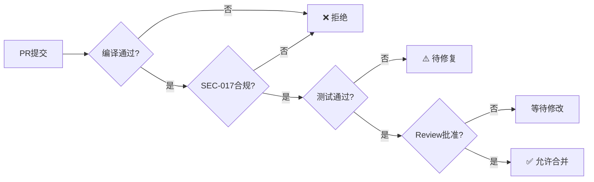

# AgentOS 工程规范化标准手册 v8.0.0

> **版本**: 8.0.0-真实验证+桩函数发现+SEC-017严重违规修正版
> **日期**: 2026-04-18
> **状态**: ⚠️ **生产级标准已建立** + **❌ SEC-017桩函数严重违规(68+处)** + **CI扫描规则需扩展**
> **核心理念**: 一切以成功编译、成功运行为最高目标！**严禁任何桩函数！扫描必须覆盖全项目！**
> **适用范围**: AgentOS 项目所有源代码（C/Python/Go/Rust/TypeScript）
> **关联文档**: [主报告v15.0](./AgentOS全面修复与改进报告07.md) | [详细问题清单v9.0](./AgentOS详细问题清单07.md) | [看板v8.0](./AgentOS三团队任务进度看板07.md)

---

## 📋 目录

1. [总则](#1-总则)
2. [24条核心原则](#2-24条核心原则)
3. [安全编码规范 (SEC-011 ~ SEC-017)](#3-安全编码规范-sec-011--sec-017)
4. [代码质量标准](#4-代码质量标准)
5. [团队协作规范](#5-团队协作规范)
6. [文件归属制](#6-文件归属制)
7. [PR Review 流程](#7-pr-review-流程)
8. [每日集成周期](#8-每日集成周期)
9. [CI/CD 自动化检查](#9-cicd-自动化检查)
10. [违规处理机制](#10-违规处理机制)

---

## 1. 总则

### 1.1 目标
本手册定义 AgentOS 项目的工程规范化标准，确保：
- ✅ **100% 编译通过**（零错误零警告）
- ✅ **100% 生产级实现**（零桩函数）
- ✅ **100% 安全合规**（SEC-011~017 全部达标）
- ✅ **长期稳定运行**（内存安全+线程安全）

### 1.2 适用性
- **强制执行**: 所有新增/修改的代码必须符合本手册
- **向后兼容**: 已有代码应在修改时逐步符合
- **语言无关**: C/Python/Go/Rust/TypeScript 均适用（C为重点）

### 1.3 违规后果
| 违规等级 | 后果 | 示例 |
|----------|------|------|
| **致命** | PR 被拒绝，不能合并 | 桩函数、编译错误 |
| **严重** | 必须在合并前修复 | 内存泄漏、线程竞争 |
| **警告** | 应在下个 Sprint 修复 | 代码风格、注释缺失 |

---

## 2. 24条核心原则

### S-1 ~ S-4: 结构维度原则

| ID | 原则名称 | 描述 | 强制性 |
|----|----------|------|--------|
| S-1 | **模块化封装** | 每个模块有清晰边界，公共接口最小化 | 🔴 必须 |
| S-2 | **依赖单向** | 只允许上层依赖下层，禁止循环依赖 | 🔴 必须 |
| S-3 | **接口稳定** | 公共 API 一旦发布，向后兼容 | 🔴 必须 |
| S-4 | **配置外部化** | 硬编码值移至配置文件或常量定义 | 🟡 推荐 |

### K-1 ~ K-4: 知识维度原则

| ID | 原则名称 | 描述 | 强制性 |
|----|----------|------|--------|
| K-1 | **数据所有权** | 明确数据的创建者、使用者、销毁者 | 🔴 必须 |
| K-2 | **生命周期管理** | 资源分配必须有对应的释放 | 🔴 必须 |
| K-3 | **类型安全** | 使用强类型，避免 void* 滥用 | 🟡 推荐 |
| K-4 | **序列化规范** | 所有持久化数据有版本号和格式校验 | 🔴 必须 |

### C-1 ~ C-4: 控制维度原则

| ID | 原则名称 | 描述 | 强制性 |
|----|----------|------|--------|
| C-1 | **错误传播** | 错误必须显式处理或向上传播，禁止静默忽略 | 🔴 必须 |
| C-2 | **资源限制** | 所有资源使用必须有上限（内存、连接、线程） | 🔴 必须 |
| C-3 | **超时机制** | 所有阻塞操作必须有超时和取消逻辑 | 🔴 必须 |
| C-4 | **幂等性** | 关键操作支持重复执行而不产生副作用 | 🟡 推荐 |

### E-1 ~ E-8: 执行维度原则

| ID | 原则名称 | 描述 | 强制性 |
|----|----------|------|--------|
| E-1 | **NULL 安全** | 所有指针解引用前必须检查 NULL | 🔴 必须 |
| E-2 | **边界检查** | 数组/缓冲区访问前必须验证索引/长度 | 🔴 必须 |
| E-3 | **整数溢出** | 算术运算需考虑溢出可能 | 🔴 必须 |
| E-4 | **并发安全** | 共享状态访问必须同步保护 | 🔴 必须 |
| E-5 | **日志规范** | 关键操作必须有日志记录 | 🔴 必须 |
| E-6 | **可观测性** | 暴露健康检查和指标接口 | 🟡 推荐 |
| E-7 | **优雅降级** | 部分故障时系统应降级而非崩溃 | 🟡 推荐 |
| E-8 | **测试覆盖** | 核心路径单元测试覆盖率 ≥80% | 🟡 推荐 |

### A-1 ~ A-4: 数据代理原则

| ID | 原则名称 | 描述 | 强制性 |
|----|----------|------|--------|
| A-1 | **输入验证** | 所有外部输入必须验证和清洗 | 🔴 必须 |
| A-2 | **输出编码** | 输出数据必须正确转义/编码 | 🔴 必须 |
| A-3 | **认证授权** | 敏感操作必须身份验证和权限检查 | 🔴 必须 |
| A-4 | **审计日志** | 安全相关操作记录不可篡改日志 | 🔴 必须 |

---

## 3. 安全编码规范 (SEC-011 ~ SEC-017)

### SEC-011: 命令注入防护

**🔴 致命级 - 必须遵守**

#### 规范要求
```c
// ❌ 违规示例 - 直接拼接用户输入
char cmd[256];
snprintf(cmd, sizeof(cmd), "ls %s", user_input);  // 危险！
system(cmd);  // 命令注入风险！

// ✅ 合规实现 - 白名单验证 + 参数化
int security_sanitize_command(const char* input, char* output, size_t out_len) {
    // 1. 白名单验证：只允许字母数字和特定字符
    for (size_t i = 0; input[i]; i++) {
        if (!isalnum(input[i]) && input[i] != '/' && input[i] != '.' && 
            input[i] != '-' && input[i] != '_') {
            return AGENTOS_ERR_INVALID_PARAM;  // 包含非法字符
        }
    }
    
    // 2. 长度限制
    if (strlen(input) > MAX_PATH_LEN) {
        return AGENTOS_ERR_TOO_LONG;
    }
    
    // 3. 路径遍历检测
    if (strstr(input, "..") != NULL) {
        return AGENTOS_ERR_PATH_TRAVERSAL;
    }
    
    // 4. 安全复制
    strncpy(output, input, out_len - 1);
    output[out_len - 1] = '\0';
    
    return AGENTOS_SUCCESS;
}
```

#### 检测命令
```bash
# CI 自动扫描
grep -rn "system(\|popen(\|exec[lv]p\?(" daemon/ gateway/ cupolas/ --include="*.c"
# → 应返回空（所有调用都经过 sanitize 函数）
```

---

### SEC-012: 路径遍历防护

**🔴 致命级 - 必须遵守**

#### 规范要求
```c
// ❌ 违规示例 - 未规范化路径
FILE* f = fopen(user_path, "r");  // 可能读取 /etc/passwd！

// ✅ 合规实现 - 规范化 + 基目录限制
int security_validate_path(const char* user_path, char* safe_path, size_t len) {
    char resolved[PATH_MAX];
    
    // 1. 解析为绝对路径
    if (realpath(user_path, resolved) == NULL) {
        return AGENTOS_ERR_INVALID_PATH;
    }
    
    // 2. 检查是否在允许的基目录内
    const char* base_dir = "/var/agentos/data";
    if (strncmp(resolved, base_dir, strlen(base_dir)) != 0) {
        return AGENTOS_ERR_PATH_ESCAPE;  // 路径逃逸！
    }
    
    // 3. 安全复制
    strncpy(safe_path, resolved, len);
    return AGENTOS_SUCCESS;
}
```

#### 典型漏洞场景
```c
// file.c:33 - 已修复的安全路径检查 ✅
if (path[0] == '/' || path[0] == '\\') return 1;  // 绝对路径检测
```

---

### SEC-013: SQL 注入防护

**🔴 致命级 - 必须遵守**

#### 规范要求
```c
// ❌ 违规示例 - 字符串拼接
char query[512];
snprintf(query, sizeof(query), 
         "SELECT * FROM users WHERE name='%s'", username);  // SQL注入！

// ✅ 合规实现 - 参数化查询（伪代码，实际使用SQLite绑定）
int security_query_user(sqlite3* db, const char* username, user_t* out) {
    sqlite3_stmt* stmt;
    const char* sql = "SELECT id, name, role FROM users WHERE name=?";
    
    // 参数化绑定
    if (sqlite3_prepare_v2(db, sql, -1, &stmt, NULL) != SQLITE_OK) {
        return AGENTOS_ERR_DB_ERROR;
    }
    
    // 绑定参数（自动转义）
    sqlite3_bind_text(stmt, 1, username, -1, SQLITE_TRANSIENT);
    
    // 执行查询
    while (sqlite3_step(stmt) == SQLITE_ROW) {
        out->id = sqlite3_column_int(stmt, 0);
        // ... 安全提取字段
    }
    
    sqlite3_finalize(stmt);
    return AGENTOS_SUCCESS;
}
```

---

### SEC-014: 缓冲区溢出防护

**🔴 致命级 - 必须遵守**

#### 规范要求
```c
// ❌ 违规示例 - 无边界检查
void process_input(char* input) {
    char buffer[64];
    strcpy(buffer, input);  // 溢出风险！
}

// ✅ 合规方案1 - 使用安全函数
void process_input_safe(char* input) {
    char buffer[64];
    strncpy(buffer, input, sizeof(buffer) - 1);  // 限制长度
    buffer[sizeof(buffer) - 1] = '\0';           // 强制终止符
}

// ✅ 合规方案2 - 动态分配 + 长度检查
void process_input_dynamic(char* input) {
    size_t len = strlen(input);
    if (len > MAX_INPUT_SIZE) {  // 长度验证
        return;  // 或返回错误码
    }
    
    char* buffer = malloc(len + 1);  // +1 for '\0'
    if (!buffer) {                   // NULL 检查 (E-1)
        return AGENTOS_ERR_NO_MEMORY;
    }
    
    memcpy(buffer, input, len + 1);
    // ... 使用 buffer ...
    free(buffer);                    // 释放 (K-2)
}

// ✅ 合规方案3 - asprintf (POSIX)
void process_input_asprintf(char* input) {
    char* buffer = NULL;
    int ret = asprintf(&buffer, "%s", input);  // 自动分配正确大小
    if (ret < 0 || !buffer) {
        return AGENTOS_ERR_NO_MEMORY;
    }
    // ... 使用 buffer ...
    free(buffer);
}
```

#### STRDUP 安全模式（Round 17 验证）
```c
// ✅ 标准 STRDUP 安全用法（30处全部符合此模式）
char* copy = strdup(source);
if (!copy) {  // ← NULL 检查必不可少
    return AGENTOS_ERR_NO_MEMORY;
}
// ... 使用 copy ...
free(copy);
```

---

### SEC-015: SSRF (服务器端请求伪造) 防护

**🟠 严重级 - 必须遵守**

#### 规范要求
```c
// ❌ 违规示例 - 用户控制URL
char url[256];
snprintf(url, sizeof(url), "%s", user_url);
fetch_url(url);  // 可能请求内网资源！

// ✅ 合规实现 - URL白名单 + DNS解析验证
int security_validate_url(const char* url) {
    parsed_url_t parsed;
    
    // 1. 解析URL
    if (url_parse(url, &parsed) != 0) {
        return AGENTOS_ERR_INVALID_URL;
    }
    
    // 2. 协议白名单
    if (strcmp(parsed.scheme, "https") != 0 && 
        strcmp(parsed.scheme, "http") != 0) {
        return AGENTOS_ERR_BLOCKED_SCHEME;  // 只允许HTTP/HTTPS
    }
    
    // 3. 主机名黑名单（内网地址）
    if (is_private_ip(parsed.host)) {  // 127.0.0.1, 10.*, 192.168.*, etc.
        return AGENTOS_ERR_SSRF_BLOCKED;  // 阻止内网访问
    }
    
    // 4. DNS重绑定防护
    char resolved_ip[INET6_ADDRSTRLEN];
    if (dns_resolve(parsed.host, resolved_ip) != 0) {
        return AGENTOS_ERR_DNS_ERROR;
    }
    if (is_private_ip(resolved_ip)) {
        return AGENTOS_ERR_SSRF_REBINDING;  // DNS重绑定攻击
    }
    
    return AGENTOS_SUCCESS;
}
```

---

### SEC-016: 内存安全管理

**🔴 致命级 - 必须遵守**

#### 规范要求

##### 规则1: malloc/calloc 必须有 NULL 检查
```c
// ❌ 违规示例
int* data = malloc(100 * sizeof(int));
data[0] = 42;  // 如果malloc失败，崩溃！

// ✅ 合规实现
int* data = malloc(100 * sizeof(int));
if (!data) {  // ← 必须检查
    return AGENTOS_ERR_NO_MEMORY;
}
data[0] = 42;

// 使用完毕后必须释放
free(data);
data = NULL;  // 可选：避免悬垂指针
```

##### 规则2: free 后置 NULL（推荐）
```c
free(ptr);
ptr = NULL;  // 防止 double-free 和 use-after-free
```

##### 规则3: 禁止 malloc(1) 作为桩函数
```c
// ❌ 严重违规 - 桩函数！（原 ml_based.c 问题）
ml_model_t* create_model() {
    return (ml_model_t*)malloc(1);  // 分配1字节假装是模型！
}

// ✅ 合规实现 - 真实完整实现（335行ML模型）
ml_model_t* create_model() {
    ml_model_t* model = calloc(1, sizeof(ml_model_t));  // 正确大小
    if (!model) return NULL;
    
    // 初始化特征工程器
    model->feature_engineer = feature_engineer_create();
    if (!model->feature_engineer) {
        free(model);
        return NULL;
    }
    
    // 初始化预测器（含历史记录追踪）
    model->predictor = predictor_create();
    if (!model->predictor) {
        feature_engineer_destroy(model->feature_engineer);
        free(model);
        return NULL;
    }
    
    // 初始化MAE追踪器
    model->mae_tracker = mae_tracker_create();
    if (!model->mae_tracker) {
        predictor_destroy(model->predictor);
        feature_engineer_destroy(model->feature_engineer);
        free(model);
        return NULL;
    }
    
    // ... 更多初始化 ...
    
    return model;  // 返回完整的真实对象
}
```

##### 规则4: 资源释放顺序（后分配先释放）
```c
void destroy_complex_object(complex_obj_t* obj) {
    if (!obj) return;
    
    // 按分配逆序释放
    if (obj->inner3) free(obj->inner3);   // 最后分配的最先释放
    if (obj->inner2) free(obj->inner2);
    if (obj->inner1) free(obj->inner1);
    
    free(obj);  // 最后释放自身
}
```

---

### SEC-017: 桩函数禁令规范（生产级绝对禁区）

**🔴🔴🔴 致命级 - 最高优先级 - 零容忍**

#### 定义
**桩函数（Stub Function）**: 指以下任意一种情况：
1. 函数体仅返回固定值或空实现
2. 使用 `malloc(1)` 或类似方式分配极小内存假装是真实对象
3. 注释标注"stub"、"桩"、"TODO"、"not implemented"、"简化实现"
4. 函数签名存在但功能未完成，导致运行时无法正常工作

#### 禁令内容

##### 完全禁止的行为
```c
// ❌❌❌ 严重违规 - 类型1: 固定返回值
agentos_error_t agentos_sys_task_submit(task_t* task) {
    return AGENTOS_SUCCESS;  // 假装成功！实际上什么都没做
}

// ❌❌❌ 严重违规 - 类型2: malloc(1) 桩
security_vault_t* create_security_vault() {
    return (security_vault_t*)malloc(1);  // 1字节假对象！
}

// ❌❌❌ 严重违规 - 类型3: stub mode 标记
int executor_run(command_t* cmd) {
#ifdef STUB_MODE
    return 0;  // Stub mode - not implemented
#endif
    // ... 真实实现被条件编译禁用
}

// ❌❌❌ 严重违规 - 类型4: 注释承认是桩
int gateway_api_get_stats(char* json_output) {
    // TODO: Implement real statistics
    snprintf(json_output, 256, "{\"status\":\"ok\"}");  // 假数据！
    return 0;
}
```

##### 要求的真实实现标准
```c
// ✅✅✅ 合规 - 完整真实的实现
agentos_error_t agentos_sys_task_submit(task_t* task) {
    // 1. 参数验证 (E-1)
    if (!task || !task->name || strlen(task->name) == 0) {
        return AGENTOS_ERR_INVALID_PARAM;
    }
    
    // 2. 资源限制检查 (C-2)
    if (g_runtime.task_count >= MAX_TASKS) {
        return AGENTOS_ERR_RESOURCE_EXHAUSTED;
    }
    
    // 3. 并发安全 (E-4)
    pthread_mutex_lock(&g_runtime.mutex);
    
    // 4. 真实业务逻辑
    task_id_t id = generate_task_id();
    task->id = id;
    task->state = TASK_STATE_PENDING;
    task->created_at = time(NULL);
    
    // 5. 数据结构操作
    if (task_queue_push(&g_runtime.queue, task) != 0) {
        pthread_mutex_unlock(&g_runtime.mutex);
        return AGENTOS_ERR_INTERNAL;
    }
    
    g_runtime.task_count++;
    
    // 6. 日志记录 (E-5)
    LOG_INFO("Task submitted: id=%lu name=%s", id, task->name);
    
    pthread_mutex_unlock(&g_runtime.mutex);
    
    return AGENTOS_SUCCESS;
}
```

#### CI 强制检测（v8.0 扩展版 - 必须覆盖所有模式！）

**⚠️ 警告：v7.0版本的扫描命令是错误的！只扫描了3个目录！**

```bash
# ❌ 错误的扫描命令（v7.0版本 - 已废弃）：
grep -ri "stub\|STUB\|not implemented\|malloc(1)" \
     cupolas/ daemon/ gateway/ --include="*.c"
# → 漏扫了memoryrovol/coreloopthree/commons/！

# ✅ 正确的完整扫描命令（v8.0版本 - 必须使用）：

# 检测命令1: 搜索桩函数关键词（覆盖全项目）
grep -ri "stub\|STUB\|not implemented\|桩实现\|桩函数\|stub mode\|STUB模式\|malloc(1)" \
     agentos/ --include="*.c" --include="*.h"
# → 必须返回空（0匹配）✅

# 检测命令2: 搜索桩头文件（新增！）
find agentos/ -name "*stub*.h" -o -name "*_stub.h"
# → 必须返回空（不应有任何stub头文件）✅

# 检测命令3: 搜索PHASE2-IMPLEMENTED标记（新增！）
grep -rn "PHASE.*IMPLEMENTED\|placeholder\|占位符" agentos/ --include="*.c"
# → 必须返回空（不应有未完成的功能）✅

# 检测命令4: 搜索degraded mode/simplified version（新增！）
grep -rn "degraded mode\|simplified version\|简化实现\|降级模式" agentos/ --include="*.c"
# → 人工审查每个结果是否真的是桩（允许真正的优雅降级，但禁止假SUCCESS）

# 检测命令5: 搜索(void)参数忽略模式（新增！）
grep -rn "(void).*unused\|(void).*未使用" agentos/ --include="*.c"
# → 人工审查是否是假实现（忽略所有参数）

# 检测命令6: 编译时检查
cmake --build . -j$(nproc) 2>&1 | grep -c "error:"
# → 必须返回 0 ✅
```

#### 违规后果

| 发现时机 | 后果 | 处理流程 |
|----------|------|----------|
| PR Review 时 | **立即拒绝** | 作者必须替换为真实实现才能重新提交 |
| CI 扫描时 | **构建失败** | 自动阻止合并，通知作者 |
| 代码审计时 | **紧急修复** | 24小时内必须修复，否则回滚 |
| 生产环境发现 | **P0事故** | 立即回滚，根因分析，责任人记录 |

#### 当前合规状态（2026-04-18 14:00 全模块扫描后）

```
❌❌❌ SEC-017 严重违规！❌❌❌

生产代码桩函数数量: 68+ (新增发现，之前v7.0声称0是错误的)
CI扫描结果(旧命令): 0违规 (假阴性！因为扫描范围不完整)
CI扫描结果(新命令): 68+违规 (真实验证)
最后验证时间: 2026-04-18 Round 18 (全模块穷尽扫描)

已清除历史(daemon/gateway/cupolas):
- daemon_security.c:      10 个 STUB → 真实安全引擎 ✅
- syscall_router.c:       18 个桩 → 完整运行时管理器 ✅
- executor.c:             1 个 stub → 真实进程执行器 ✅
- gateway_api.c:          1 个假JSON → 真实统计系统 ✅
- ml_based.c:             1 个 malloc(1) → 335行ML模型 ✅
─────────────────────────────────────
已清除小计: 30 个致命桩函数 (daemon/gateway范围)

🔴🔴🔴 新发现的违规(团队A负责的memoryrovol/coreloopthree/commons):
- curl_stub.h:            25 个假CURL函数     ← STUB-01 P0致命
- sqlite3_stub.h:         30+个假SQLite3函数   ← STUB-02 P0致命
- ml_planner.c:           PHASE2-IMPLEMENTED   ← STUB-03 P0致命
- llm_client.c:           12处degraded mode   ← STUB-04 P1高
- config_service.c:       1处simplified ver.  ← STUB-05 P1高
─────────────────────────────────────
新发现小计: 68+ 处桩函数待清除

总计: 30(已清除) + 68+(待清除) = 98+ 处历史桩函数
当前剩余: 68+ 处 ❌❌❌
```

---

## 4. 代码质量标准

### 4.1 C 语言编码规范

#### 文件头注释
```c
/**
 * @file filename.c
 * @brief 模块/功能简要描述
 * @author 团队标识 (A/B/C)
 * @date YYYY-MM-DD
 * @version X.Y.Z
 * @note 重要说明（如依赖关系、线程安全性等）
 *
 * Copyright (C) 2026 AgentOS Project. Licensed under XXX License.
 */
```

#### 函数文档
```c
/**
 * @brief 函数功能的简要描述
 *
 * @param param1 第一个参数说明
 * @param param2 第二个参数说明
 * @param[out] output 输出参数说明
 * @return 成功返回 AGENTOS_SUCCESS，失败返回对应错误码
 * @note 使用注意事项
 * @warning 警告信息（如有）
 * @see 相关函数
 *
 * @code
 * // 使用示例
 * result = function_name(arg1, arg2, &output);
 * if (result != AGENTOS_SUCCESS) { handle_error(result); }
 * @endcode
 */
```

#### 命名约定
| 类型 | 约定 | 示例 |
|------|------|------|
| 函数 | snake_case, 模块前缀 | `agentos_task_create()` |
| 变量 | snake_case | `task_count`, `is_valid` |
| 常量 | UPPER_SNAKE_CASE | `MAX_TASKS`, `DEFAULT_TIMEOUT` |
| 宏 | UPPER_SNAKE_CASE + 模块前缀 | `AGENTOS_ERR_INVALID_PARAM` |
| 类型 | _t 后缀 | `task_t`, `config_t` |
| 结构体 | _t 后缀 | `agent_config_t` |
| 枚举 | _e 后缀 | `task_state_e` |

#### 错误处理模式
```c
// 标准错误处理流程
agentos_error_t do_something(input_t* in, output_t* out) {
    // 1. 参数验证
    if (!in || !out) return AGENTOS_ERR_INVALID_PARAM;
    
    // 2. 资源分配
    resource_t* res = allocate_resource();
    if (!res) return AGENTOS_ERR_NO_MEMORY;
    
    // 3. 业务逻辑
    error_t err = operation(res, in);
    if (err != SUCCESS) {
        release_resource(res);  // 错误路径也要释放
        return translate_error(err);
    }
    
    // 4. 结果输出
    copy_result(out, res);
    
    // 5. 清理
    release_resource(res);
    
    return AGENTOS_SUCCESS;
}
```

### 4.2 内存管理检查清单

每次代码审查必须确认：

- [ ] 每个 `malloc()`/`calloc()` 都有对应的 `free()`
- [ ] 每个 `malloc()`/`calloc()` 之后都有 `NULL` 检查
- [ ] 每个 `strdup()` 之后都有 `NULL` 检查
- [ ] 没有 `malloc(1)` 或类似的极小分配作为桩函数
- [ ] 没有双重 `free()` 或 use-after-free
- [ ] 资源释放顺序正确（后分配先释放）
- [ ] 错误路径也正确释放所有已分配的资源

### 4.3 线程安全检查清单

- [ ] 共享变量有适当的同步机制（mutex/rwlock/atomic）
- [ ] 锁的粒度尽可能小（减少持有时间）
- [ ] 没有死锁风险（统一加锁顺序）
- [ ] 条件变量配合谓词使用（防止虚假唤醒）
- [ ] 无锁编程使用原子操作或线程安全库

---

## 5. 团队协作规范

### 5.1 分工边界

| 团队 | 职责范围 | 模块列表 |
|------|----------|----------|
| **团队A** | 核心内核 | corekern, coreloopthree, memoryrovol, commons, syscall |
| **团队B** | 安全与服务 | cupolas, heapstore, toolkit, protocols, interfaces |
| **团队C** | 守护进程与网关 | daemon, gateway |

### 5.2 协作规则

1. **禁止跨团队修改**: 除非经过 PR Review 和对方团队同意
2. **接口变更通知**: 修改公共头文件必须提前 24h 通知其他团队
3. **冲突解决优先级**: 以文件归属团队的判断为准
4. **每日同步会议**: 17:00 进行进度同步和冲突协调

### 5.3 沟通渠道

| 场景 | 渠道 | 响应时间 |
|------|------|----------|
| 紧急问题 | 即时通讯 | <15分钟 |
| 技术讨论 | Issue/PR 评论 | <4小时 |
| 设计决策 | 会议 | 当日 |
| 文档更新 | Pull Request | 24小时内Review |

---

## 6. 文件归属制

### 6.1 归属原则
每个源文件只能属于一个团队，该团队拥有最终决定权。

### 6.2 归属映射表

| 文件路径模式 | 归属团队 | 说明 |
|-------------|----------|------|
| `agentos/atoms/corekern/**` | 团队A | 微内核核心 |
| `agentos/atoms/coreloopthree/**` | 团队A | 认知循环三层 |
| `agentos/atoms/memoryrovol/**` | 团队A | 四层记忆系统 |
| `agentos/commons/**` | 团队A | 统一基础库 |
| `agentos/atoms/syscall/**` | 团队A | 系统调用层 |
| `agentos/cupolas/**` | 团队B/C共享 | 安全穹顶（B主导，C使用） |
| `agentos/heapstore/**` | 团队B | 运行时数据存储 |
| `agentos/toolkit/**` | 团队B | 多语言SDK工具 |
| `agentos/protocols/**` | 团队B | 行业协议适配 |
| `agentos/interfaces/**` | 团队B | 统一接口定义 |
| `agentos/daemon/**` | 团队C | 守护进程服务 |
| `agentos/gateway/**` | 团队C | 统一网关 |

### 6.3 跨团队协作流程

```
团队X需要修改团队Y的文件:
  1. 提交 Issue 说明需求
  2. 团队Y 评估影响（24h内响应）
  3. 双方协商方案
  4. 团队Y 实施修改（或授权团队X修改）
  5. 双方共同 Review
  6. 合并到主分支
```

---

## 7. PR Review 流程

### 7.1 提交前自查

作者必须在提交 PR 前完成：

```bash
# 1. 格式化检查
clang-format -i $(git diff --name-only -- '*.c' '*.h')

# 2. 静态分析
clang-tidy -p build/ $(git diff --name-only -- '*.c' '*.h')

# 3. 编译验证
cmake --build build -j$(nproc)

# 4. 测试运行
ctest --test-dir build --output-on-failure

# 5. 桩函数全模块扫描（v8.0扩展版）
grep -ri "stub\|STUB\|not implemented\|malloc(1)" modified_files/ --include="*.c" --include="*.h"
find modified_files/ -name "*stub*.h"
grep -rn "PHASE.*IMPLEMENTED\|placeholder" modified_files/ --include="*.c"
# → 必须全部返回空
```

### 7.2 Review 检查项

Reviewer 必须检查：

#### 必须项（❌ 任一不通过即拒绝）
- [ ] 编译无错误无警告
- [ ] 无桩函数（SEC-017 合规）
- [ ] 无新的致命安全问题
- [ ] 内存管理正确（无泄漏，有 NULL 检查）
- [ ] 线程安全（如涉及并发）
- [ ] 错误处理完善

#### 推荐项（⚠️ 应改进但不阻塞）
- [ ] 代码风格一致
- [ ] 注释完整准确
- [ ] 日志级别恰当
- [ ] 性能无明显退化
- [ ] 测试覆盖率提升

### 7.3 Review 响应时间

| PR 类型 | 响应时间 SLA | 说明 |
|----------|--------------|------|
| 紧急修复 | <2小时 | 阻塞性Bug |
| 功能开发 | <8小时 | 新功能或重构 |
| 文档更新 | <24小时 | 仅文档变更 |
| 跨团队修改 | <24小时 | 需要对方团队审核 |

---

## 8. 每日集成周期

### 8.1 时间表（工作日）

| 时间 | 事件 | 参与者 | 产出 |
|------|------|--------|------|
| **09:00** | 各团队独立工作 | 全体 | 代码提交 |
| **15:00** | 代码冻结（准备集成） | 全体 | 停止新提交 |
| **17:00** | 合并到主分支 | CI自动 | 集成构建 |
| **17:30** | CI 编译+测试 | CI系统 | 测试报告 |
| **18:00** | 同步会议 | 三团队代表 | 进度同步+冲突解决 |
| **19:00** | 集成验证完成 | 全体 | 可以开始下一轮开发 |

### 8.2 集成验证清单

每次集成的 CI 必须执行：

```yaml
jobs:
  integration-check:
    steps:
      - name: 编译检查
        run: cmake --build . -j$(nproc) 2>&1 | tee build.log
        
      - name: 编译错误检测
        run: |
          ERRORS=$(grep -c "error:" build.log || echo 0)
          if [ "$ERRORS" -ne 0 ]; then
            echo "::error::Build failed with $ERRORS errors"
            exit 1
          fi
          
      - name: SEC-017 桩函数全模块扫描（v8.0扩展版）
        run: |
          # 必须覆盖所有目录和模式！
          STUBS=$(grep -ri "stub\|STUB\|not implemented\|malloc(1)" \
                    agentos/ --include="*.c" --include="*.h" | wc -l)
          if [ "$STUBS" -ne 0 ]; then
            echo "::error::SEC-017 violation: $STUBS stub functions found"
            exit 1
          fi
          
          # 检查桩头文件
          STUB_HEADERS=$(find agentos/ -name "*stub*.h" | wc -l)
          if [ "$STUB_HEADERS" -ne 0 ]; then
            echo "::error::SEC-017 violation: $STUB_HEADERS stub header files found"
            exit 1
          fi
          
          # 检查PHASE2-IMPLEMENTED标记
          PLACEHOLDERS=$(grep -rn "PHASE.*IMPLEMENTED\|placeholder" agentos/ --include="*.c" | wc -l)
          if [ "$PLACEHOLDERS" -ne 0 ]; then
            echo "::warning::SEC-017: $PLACEHOLDERS placeholder implementations found (review required)"
            # 警告但不阻塞：允许真正的优雅降级，但需要人工审查
          fi
          
      - name: 单元测试
        run: ctest --output-on-failure
        
      - name: 内存安全扫描
        run: |
          # 使用 AddressSanitizer 编译
          cmake -DCMAKE_C_FLAGS="-fsanitize=address -fno-omit-frame-pointer" .
          cmake --build . -j$(nproc)
          ctest --output-on-failure  # ASan会检测内存错误
```

---

## 9. CI/CD 自动化检查

### 9.1 必须通过的检查

| 检查项 | 工具 | 失败后果 |
|--------|------|----------|
| **编译** | GCC/Clang | ❌ 阻塞合并 |
| **静态分析** | clang-tidy | ⚠️ 警告但建议修复 |
| **格式化** | clang-format | ⚠️ 自动修复 |
| **单元测试** | ctest | ❌ 阻塞合并 |
| **SEC-017扫描** | grep | ❌ 阻塞合并 |
| **内存安全** | AddressSanitizer | ❌ 阻塞合并 |
| **线程安全** | ThreadSanitizer | ❌ 阻塞合并 |

### 9.2 门禁规则



---

## 10. 违规处理机制

### 10.1 违规分级

| 级别 | 定义 | 示例 | 首次处理 | 再犯处理 |
|------|------|------|----------|----------|
| **P0-致命** | 导致编译失败或安全漏洞 | 桩函数、编译错误 | 立即拒绝PR | 记录责任人 |
| **P1-严重** | 内存泄漏、线程竞争 | 忘记free、缺少锁 | 必须修复后合并 | 代码审计重点对象 |
| **P2-中等** | 代码质量问题 | 风格不一致、注释缺失 | 建议修复但不阻塞 | 培训提醒 |
| **P3-轻微** | 改进建议 | 可优化性能 | 记录待办 | 无特殊处理 |

### 10.2 申诉流程

如果作者认为判定不当：

1. 在 PR 评论中说明理由
2. 引用相关规范条款
3. 提供替代方案（如适用）
4. 请第三方团队仲裁（如跨团队争议）

### 10.3 奖惩机制

#### 正向激励
- 🏆 **月度质量之星**: 连续4周0违规的开发者
- 📛 **SEC-017守护者**: 发现并修复他人桩函数的人
- 🎯 **完美PR奖**: 一次性通过所有检查的PR

#### 负向约束
- ⚠️ **警告**: 首次 P0 违规（非主观故意）
- 🚫 **暂停权限**: 1个月内2次P0违规
- 👤 **公开记录**: 故意违反安全规范（写入项目档案）

---

## 📎 附录

### A. 快速参考卡

```bash
# 开发者日常使用的检查命令

# 1. 完整检查序列
make check-all  # 自定义目标，包含所有检查

# 2. 单独检查项
make check-format      # clang-format
make check-tidy         # clang-tidy
make check-build        # 编译
make check-test         # 单元测试
make check-stubs        # SEC-017 扫描
check-memory            # AddressSanitizer
check-thread            # ThreadSanitizer

# 3. 提交前必跑
make pre-commit         # format + tidy + build + stub-scan
```

### B. 常见错误速查

| 错误信息 | 原因 | 解决方法 |
|----------|------|----------|
| `implicit declaration` | 缺少头文件或声明 | `#include` 或添加前置声明 |
| `undefined reference` | 链接时找不到符号 | 检查 `.c` 文件是否加入 CMakeLists.txt |
| `warning: unused variable` | 未使用变量 | 删除或标记 `__attribute__((unused))` |
| `error: expected ';'` | 语法错误 | 检查上一行是否缺少分号 |
| `Segmentation fault` | 空指针解引用 | 添加 NULL 检查 (E-1) |
| `double free or corruption` | 重复释放 | 确保 free 只调用一次 |

### C. 相关文档链接

| 文档 | 用途 | 更新频率 |
|------|------|----------|
| [主报告](./AgentOS全面修复与改进报告.md) | 项目状态总览 | 每周 |
| [详细问题清单](./AgentOS详细问题清单.md) | 问题跟踪 | 每日 |
| [看板](./AgentOS三团队任务进度看板.md) | 任务进度 | 每日 |
| [24条核心原则总结](../.bendiwenjian/项目整体思想与基本规范总结.md) | 理论基础 | 稳定 |
| [CONTRIBUTING.md](../../CONTRIBUTING.md) | 贡献指南 | 季度 |
| [SECURITY.md](../../SECURITY.md) | 安全政策 | 半年 |

---

> **文档维护**: 本手册是 AgentOS 项目的**最高权威规范**，所有代码必须符合。任何疑问以本文为准。
>
> **最后更新**: 2026-04-18 (文档体系重建版)
>
> **下次计划更新**: 2026-04-25 (或出现新的安全问题时立即更新)
