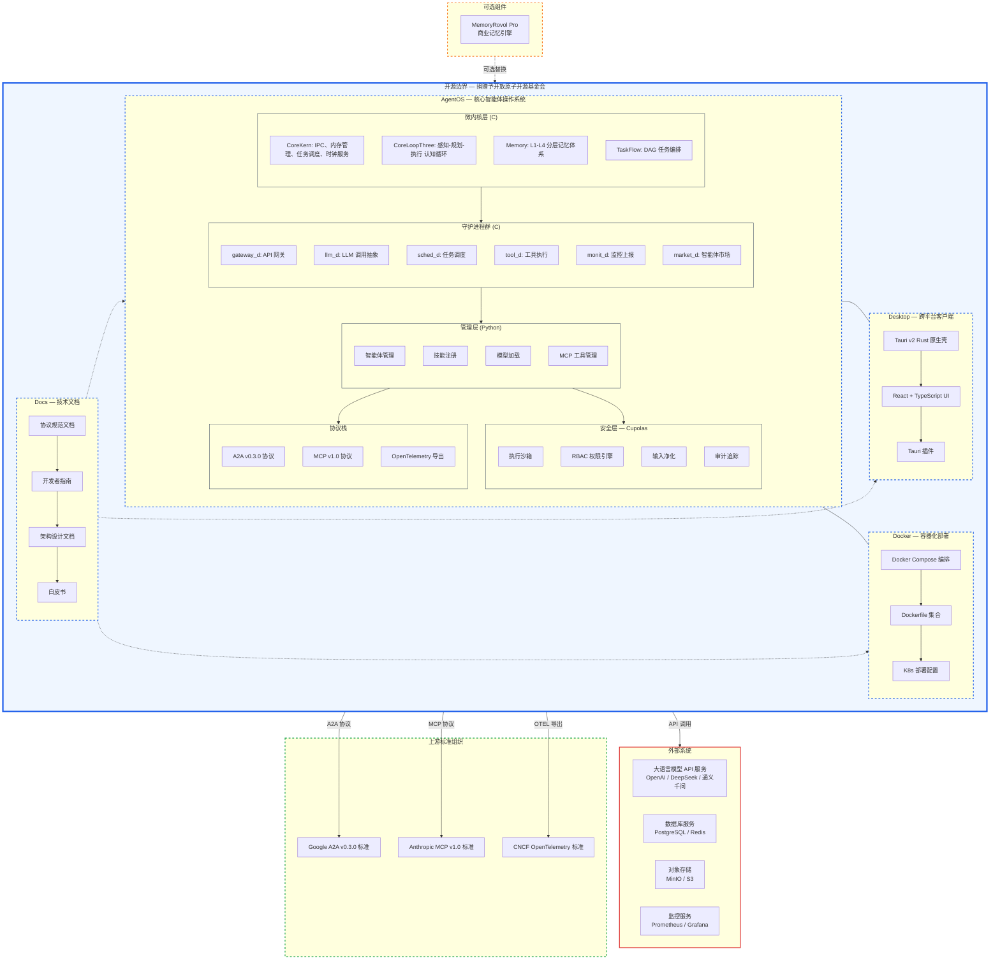
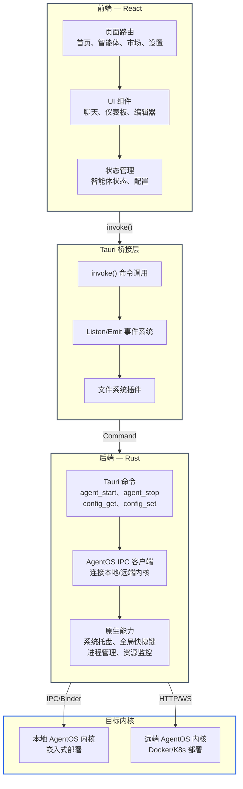
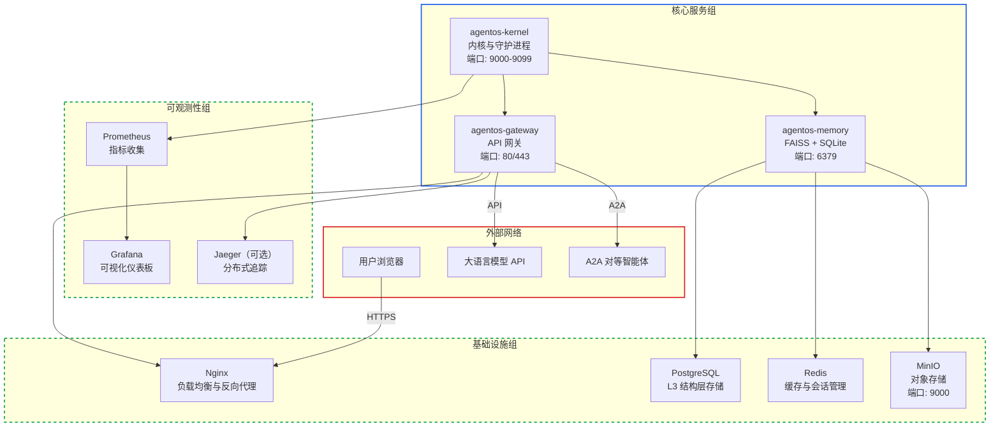
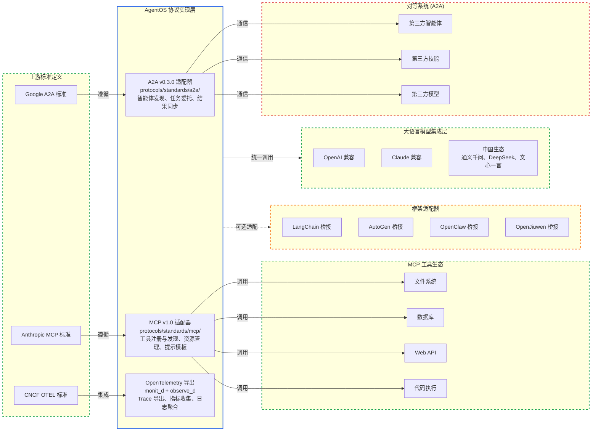
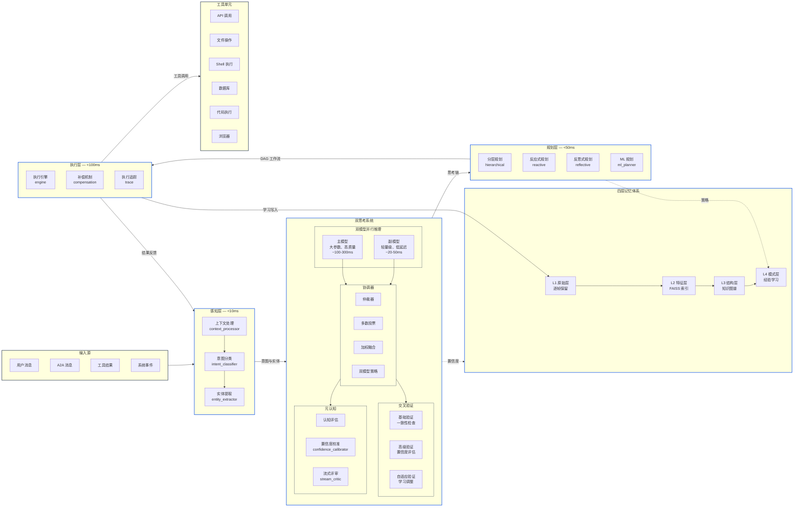
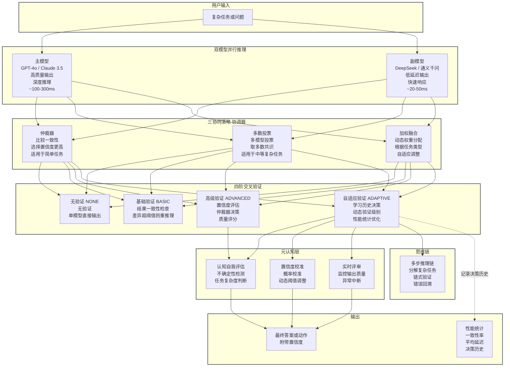
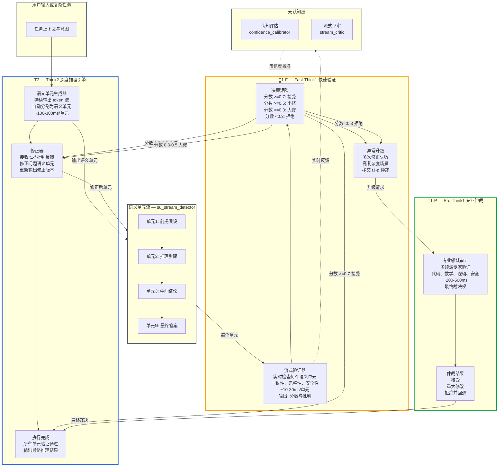

# AgentOS 宏观架构图

> **项目**: 极境智能体操作系统 | **版本**: v0.0.5 | **许可证**: Apache-2.0  
> **开源边界**: AgentOS + Desktop + Docker + Docs 四个子项目，捐赠予 **开放原子开源基金会**  
> **仓库**: [AtomGit](https://atomgit.com/openairymax/agentos) | [GitHub](https://github.com/SpharxTeam/AgentOS)

---

## 目录

1. [开源边界全景](#第一章-开源边界全景)
2. [AgentOS 核心架构分解](#第二章-agentos-核心架构分解)
3. [Desktop 客户端架构](#第三章-desktop-客户端架构)
4. [Docker 部署架构](#第四章-docker-部署架构)
5. [外部系统与协议栈](#第五章-外部系统与协议栈)
6. [开源组件与合作策略](#第六章-开源组件与合作策略)
7. [双思考系统与认知循环](#第七章-双思考系统与认知循环)
8. [Triple Coordinator 三核心组件 (t2/t1-f/t1-p)](#第八章-triple-coordinator-三核心组件-t2t1-ft1-p)
9. [闭源组件清单](#第九章-闭源组件清单)

---

## 图例说明

| 样式 | 含义 |
|------|------|
| **蓝色实线粗边框** | **开源边界** — 捐赠给开放原子开源基金会的全部代码 |
| **蓝色虚线边框** | 开源边界内的子模块 |
| **红色实线边框** | **外部闭源/商业服务** — 通过标准 API 协议调用，不纳入本系统 |
| **绿色虚线边框** | **第三方开源组件** — 遵循上游协议，可替换 |
| **橙色虚线边框** | **可选组件** — 不影响核心功能的中立性 |
| **实线箭头** | **强依赖** / 数据流 |
| **虚线箭头** | **弱依赖** / 可选集成 |
| **双线** | 标准化协议通信 |

---

## 第一章 开源边界全景



### 四项目分工

| 项目 | 定位 | 目标用户 | 技术栈 |
|------|------|---------|--------|
| **AgentOS** | 核心智能体操作系统 | 开发者 / 企业 | C (内核) + Python (管理) + C (服务) |
| **Desktop** | 跨平台桌面客户端 | 个人用户 | Tauri v2 + React/TS + Rust |
| **Docker** | 容器化部署方案 | 专业/企业用户 | Docker Compose + K8s + Nginx |
| **Docs** | 完整技术文档体系 | 所有用户 | Markdown + Sphinx + Mermaid |

---

## 第二章 AgentOS 核心架构分解


### 内核层子系统详表

| 模块 | 路径 | 功能 | 代码量 |
|------|------|------|--------|
| **corekern** | atoms/corekern/ | IPC + 内存管理 + 任务调度 + 时钟服务 | ~25,000 |
| **coreloopthree** | atoms/coreloopthree/ | 认知循环：感知-规划-执行 三阶段 | ~8,000 |
| **memory** | atoms/memory/ | L1 原始层至 L4 模式层分层记忆 | ~6,000 |
| **taskflow** | atoms/taskflow/ | DAG 任务编排 + 并行度优化 | ~5,000 |
| **syscall** | atoms/syscall/ | 用户态与内核态标准接口 + 沙箱工具 | ~4,000 |
| **frameworks** | atoms/frameworks/ | 公共类型、日志、错误码基座 | ~3,000 |

### 守护进程群

| 守护进程 | 路径 | 职责 |
|----------|------|------|
| **gateway_d** | daemon/gateway_d/ | API 网关：REST/WS/gRPC 入口，A2A + MCP 协议处理 |
| **llm_d** | daemon/llm_d/ | LLM 调用抽象层：多模型统一接口 |
| **sched_d** | daemon/sched_d/ | 任务调度：定时、周期、事件驱动 |
| **tool_d** | daemon/tool_d/ | 工具执行：MCP 工具沙箱化运行 |
| **monit_d** | daemon/monit_d/ | 监控上报：OpenTelemetry 指标导出 |
| **market_d** | daemon/market_d/ | 市场服务：智能体、技能、模型注册发现 |
| **notify_d** | daemon/notify_d/ | 通知推送：事件、告警、消息 |
| **observe_d** | daemon/observe_d/ | 可观测性：Trace + Metric + Log 收集 |
| **channel_d** | daemon/channel_d/ | 跨通道通信：智能体间、人-智能体间消息路由 |
| **info_d** | daemon/info_d/ | 元信息服务：版本、状态、配置查询 |

---

## 第三章 Desktop 客户端架构



| 层 | 技术 | 说明 |
|----|------|------|
| **前端** | React 18 + TypeScript + Vite | 类 Electron 的 Web UI，依赖：react-router-dom、zustand |
| **桥接层** | Tauri v2 + Plugins | Rust 与 JS 双向通信，比 Electron 小 10 倍（约 5MB vs 约 50MB） |
| **后端** | Rust + tauri::command + tokio | 系统级原生能力：托盘、快捷键、进程管理 |
| **通信** | HTTP/WS/本地IPC | 自动检测本地内核，降级到远端连接 |

---

## 第四章 Docker 部署架构



### 部署模式对比

| 模式 | 目标 | 容器数 | 内存需求 | 一键启动 |
|------|------|--------|----------|----------|
| **Desktop** | 个人用户 | 0（嵌入式） | 4GB | 双击桌面图标 |
| **Docker** | 专业用户 | 8 | 8GB | docker-compose up -d |
| **Kubernetes** | 企业用户 | 10+ | 16GB+ | kubectl apply -f k8s/ |

### Docker 文件组织

```
Docker/
├── docker-compose.yml          # 一键编排 8 个容器
├── Dockerfile.agentos          # AgentOS 内核镜像
├── Dockerfile.desktop-builder  # Desktop 构建镜像
├── Dockerfile.gateway          # 网关镜像
├── config/                     # 部署配置
│   ├── nginx/                  #   Nginx 反向代理
│   ├── prometheus/             #   Prometheus 抓取配置
│   └── grafana/                #   Grafana 仪表板配置
├── scripts/                    # 运维脚本
│   ├── init-db.sh             #   数据库初始化
│   ├── backup.sh              #   备份脚本
│   └── healthcheck.sh         #   健康检查
└── k8s/                        # K8s 部署 YAML
```

---

## 第五章 外部系统与协议栈



### 大语言模型多模型兼容策略

AgentOS 通过 protocols/integrations/ 实现统一的大语言模型调用抽象层：

```
用户代码
   | agentos.llm.invoke(model, prompt)
   v
大语言模型统一抽象层 (protocols/integrations/)
   ├── openai/      -> GPT-4o / GPT-4 / o1
   ├── claude/      -> Claude 3.5 / Haiku
   ├── china_eco/   -> 通义千问 / DeepSeek / 文心一言 / 百川
   └── openjiuwen/  -> 开源模型 API 兼容
```

---

## 第六章 开源组件与合作策略

### 6.1 C/C++ 核心依赖（运行时）

| 组件 | 版本 | 在 AgentOS 中的用途 | 许可证 | 获取方式 |
|------|------|--------------------|--------|----------|
| OpenSSL | >=3.2 | 传输层加密、证书管理 | Apache-2.0 | 系统包管理器 |
| libcurl | >=8.5 | 大语言模型 API HTTP 客户端 | MIT | apt/brew/vcpkg |
| libmicrohttpd | latest | 内置轻量 HTTP 服务器 | LGPL-2.1 | 动态链接 |
| libwebsockets | latest | WebSocket 实时通信 | MIT | 可选编译 |
| libevent | latest | 异步事件循环 | BSD-3 | 可选编译 |
| cJSON | >=1.7.15 | JSON 解析 | MIT | 内嵌集成 |
| libyaml | >=0.2.5 | YAML 配置解析 | MIT | 系统包管理器 |

### 6.2 Python 核心依赖

| 组件 | 版本 | 用途 | 许可证 |
|------|------|------|--------|
| FAISS | >=1.7.4 | L2 特征层向量索引 | MIT |
| Sentence-Transformers | >=2.2 | 文本向量化 | Apache-2.0 |
| SQLite3 | >=3.45 | L3 结构层关系存储 | Public Domain |
| numpy/pandas/scipy | latest | 科学计算与数据处理 | BSD-3 |
| httpx/aiohttp | latest | 异步 HTTP/Web 框架 | BSD-3 / Apache-2.0 |
| pytest/black/mypy | latest | 测试、格式化、类型检查 | MIT |

### 6.3 Desktop 前端依赖

| 组件 | 用途 | 许可证 |
|------|------|--------|
| React 18 + TypeScript | UI 框架 | MIT |
| Vite | 构建工具 | MIT |
| Tauri v2 + Plugins | 原生壳 | MIT / Apache-2.0 |
| serde/tokio | Rust 序列化与异步 | MIT |

### 6.4 Docker 基础设施依赖（外部）

| 组件 | 用途 | 许可证 | 关系 |
|------|------|--------|------|
| Docker / docker-compose | 容器化部署 | Apache-2.0 | 运行环境 |
| Nginx | 反向代理与负载均衡 | BSD-2 | Docker 容器内运行 |
| PostgreSQL | 关系数据库 | PostgreSQL License | Docker 容器内运行 |
| Redis | 缓存与消息队列 | BSD-3 | Docker 容器内运行 |
| MinIO | 对象存储 | AGPL v3 | Docker 容器内运行 |
| Prometheus | 指标收集 | Apache-2.0 | Docker 容器内运行 |
| Grafana | 可视化仪表板 | AGPL v3 | Docker 容器内运行 |

### 6.5 与上游社区合作策略

| 上游 | AgentOS 角色 | 具体合作方式 |
|------|-------------|------------|
| **Google A2A v0.3.0** | 标准协议实现者 | 完整适配器实现、兼容性测试、Issue 反馈 |
| **Anthropic MCP v1.0** | 标准协议实现者 | Server/Client 实现、工具市场集成、安全反馈 |
| **CNCF OpenTelemetry** | SDK 集成者 | OTLP 导出器、Prometheus 集成、最佳实践 |
| **FAISS (Meta)** | 嵌入式向量引擎 | 默认集成、可替换 Milvus/Qdrant |
| **SQLite** | 嵌入式数据库 | 默认集成、可替换 PostgreSQL |
| **Tauri** | 跨平台框架 | 为 AI 智能体场景贡献反馈 |
| **LangChain/AutoGen** | 框架适配 | 桥接适配器、互操作性测试 |

---

## 第七章 双思考系统与认知循环

### 7.1 CoreLoopThree 顶层架构



### 7.2 双思考系统详解



### 7.3 双思考系统核心组件

| 组件 | 路径 | 功能 | 说明 |
|------|------|------|------|
| **双模型协调器** | coreloopthree/src/cognition/coordinator/dual_model.c | 主副模型协同推理 | 加权融合、交叉验证、置信度评估 |
| **仲裁器** | coreloopthree/src/cognition/coordinator/arbiter.c | 多模型输出仲裁 | 一致性比较、选择最优输出 |
| **多数投票** | coreloopthree/src/cognition/coordinator/majority.c | 多模型投票决策 | 取多数共识，降低幻觉率 |
| **加权融合** | coreloopthree/src/cognition/coordinator/weighted.c | 动态权重分配 | 根据任务类型或历史性能调整 |
| **置信度校准** | coreloopthree/src/cognition/confidence_calibrator.c | 动态校准置信度 | 历史决策统计分析 |
| **元认知** | coreloopthree/src/cognition/metacognition.c | 认知自我评估 | 不确定性检测、任务复杂度判断 |
| **思维链** | coreloopthree/src/cognition/thinking_chain.c | 多步推理链 | 复杂任务分解、链式验证 |
| **流式评审** | coreloopthree/src/cognition/stream_critic.c | 实时输出质量监控 | 异常中断、质量评估 |
| **认知演化** | coreloopthree/src/cognition/cognitive_evolution.c | 学习策略优化 | 自适应调整策略参数 |
| **并行调度** | coreloopthree/src/cognition/parallel_dispatcher.c | 多任务并行处理 | 优先级、轮询、加权、ML 策略 |

### 7.4 交叉验证四阶模式

| 模式 | 复杂度 | 适用场景 | 验证内容 |
|------|--------|---------|----------|
| **NONE** | 最低 | 简单问答 | 无验证，直接输出 |
| **BASIC** | 低 | 中简单任务 | 主副模型一致性检查 |
| **ADVANCED** | 中 | 复杂推理 | 置信度评估与仲裁决策 |
| **ADAPTIVE** | 高 | 关键任务 | 学习历史与动态调整与性能优化 |

### 7.5 认知循环时序

```
用户输入
   | <10ms
   v
+--------------------------------------------------+
| 感知层                                             |
| 上下文处理 -> 意图分类 -> 实体提取                  |
| 输出: {意图, 实体, 上下文}                         |
+------------------------+-------------------------+
                         |
                         v
+--------------------------------------------------+
| 思考层 (Triple Coordinator)                       |
|  +------------------------------------------+    |
|  |  T2: 深度推理 (100-300ms/单元)            |    |
|  |    生成语义单元流 -> 接收批判 -> 修正       |    |
|  +------------------+-----------------------+    |
|                     | 输出语义单元               |
|                     v                             |
|  +------------------+-----------------------+    |
|  |  T1-F: 快速验证 (10-30ms/单元)            |    |
|  |    实时检查 -> 评分 -> 决策矩阵             |    |
|  +------------------+-----------------------+    |
|                     | 评分 <0.3 或多次修正失败    |
|                     v                             |
|  +------------------------------------------+    |
|  |  T1-P: 专业仲裁 (200-500ms)               |    |
|  |    多领域专家验证 -> 最终裁决               |    |
|  +------------------------------------------+    |
|  总延迟: ~200-800ms (取决于循环次数)              |
+------------------------+-------------------------+
                         |
                         v
+--------------------------------------------------+
| 规划层 (<50ms)                                    |
| 分层规划 / 反应式 / 反思式 / ML规划                |
| 输出: DAG 工作流                                   |
+------------------------+-------------------------+
                         |
                         v
+--------------------------------------------------+
| 执行层 (<100ms)                                   |
| 智能体调度 -> 工具调用 -> 状态管理 -> 结果收集      |
| 工具: API/文件/Shell/数据库/代码/浏览器            |
+------------------------+-------------------------+
                         |
                         v
              输出 -> 反馈循环
```

---

## 第八章 Triple Coordinator 三核心组件 (t2/t1-f/t1-p)

### 8.1 Triple Coordinator 组件架构



### 8.2 流式批判循环详解

```
+-------------------------------------------------------------------+
|                        流式批判循环                                  |
+-------------------------------------------------------------------+

步骤 1: T2 生成语义单元
   t2: "假设 f(x) 连续且在 [a,b] 上可导..."
   | (分割为语义单元 su_1)
   v

步骤 2: T1-F 实时验证 (10-30ms)
   t1-f: 检查一致性 通过，完整性 通过，安全性 通过
   评分: 0.85 -> 接受
   |
   v

步骤 3: T2 继续生成下一单元
   t2: "根据拉格朗日中值定理，存在 c 属于 (a,b)..."
   | (分割为语义单元 su_2)
   v

步骤 4: T1-F 验证发现问题
   t1-f: 发现推理跳跃，缺失前提条件
   评分: 0.45 -> 大修
   批判: "需要补充 f(x) 在闭区间连续的条件"
   |
   v

步骤 5: T2 修正问题单元
   t2: (接收批判) 修正为: "设 f(x) 在 [a,b] 上连续，在 (a,b) 上可导..."
   | (重新输出修正后的 su_2')
   v

步骤 6: T1-F 再次验证
   t1-f: 修正后检查通过
   评分: 0.78 -> 接受
   |
   v

步骤 7: 高复杂度场景触发 T1-P
   (若多次修正失败或涉及专业领域)
   t1-p: 专业数学验证 -> 最终裁决 接受或拒绝
```

### 8.3 Triple Coordinator 核心接口

| 组件 | 源码文件 | 职责 | 延迟 |
|------|----------|------|------|
| **T2 (Think2)** | triple_coordinator.c | 深度推理、语义单元生成、接收批判修正 | ~100-300ms/单元 |
| **T1-F (Fast-Think1)** | triple_coordinator.c | 流式验证、实时批判、决策矩阵 | ~10-30ms/单元 |
| **T1-P (Pro-Think1)** | triple_coordinator.c | 专业仲裁、多领域审计、最终裁决 | ~200-500ms |
| **元认知** | metacognition.c | 认知评估、置信度校准、流式评审 | ~5-15ms |

### 8.4 语义单元流与决策矩阵

| T1-F 评分区间 | 决策动作 | T2 响应 | 是否触发 T1-P |
|:-------------:|:--------:|:-------:|:-------------:|
| **>=0.7** | 接受 | 继续生成下一单元 | 否 |
| **0.5 ~ 0.7** | 小修 | 微调当前单元 | 否 |
| **0.3 ~ 0.5** | 大修 | 重构当前单元 | 若 3 次修正失败则触发 |
| **<0.3** | 拒绝 | 回退到上一状态 | 立即触发仲裁 |

---

## 第九章 闭源组件清单

| 组件 | 类型 | 用途 | 是否必须 | 可获得性 | 开源替代 |
|------|------|------|:------:|----------|----------|
| **MemoryRovol Pro** | 商业记忆引擎 | L1-L4 高性能记忆存储检索 | 否 | 联系 SPHARX 获取商业授权 | FAISS + SQLite（默认内置） |

> **开源中立性声明**: 本系统所有闭源或商业组件均设计为**可选、可替换**。不依赖任何闭源组件即可实现全部核心功能。MemoryRovol Pro 默认由 FAISS + SQLite 开源方案替代，功能完整可用。此设计确保本系统捐赠予 **开放原子开源基金会** 后的完全 **开源中立性** 和 **社区自治能力**。

---

## 文档版本

| 版本 | 日期 | 说明 |
|------|------|------|
| v3.0 | 2026-05-14 | 全面重新设计：去除图标符号、边界清晰、专业排版、中文版本 |

> 版权所有 2026 OpenAirymax. 遵循 Apache-2.0 许可证.  
> 捐赠予 **开放原子开源基金会**  
> 仓库: https://atomgit.com/openairymax/agentos
