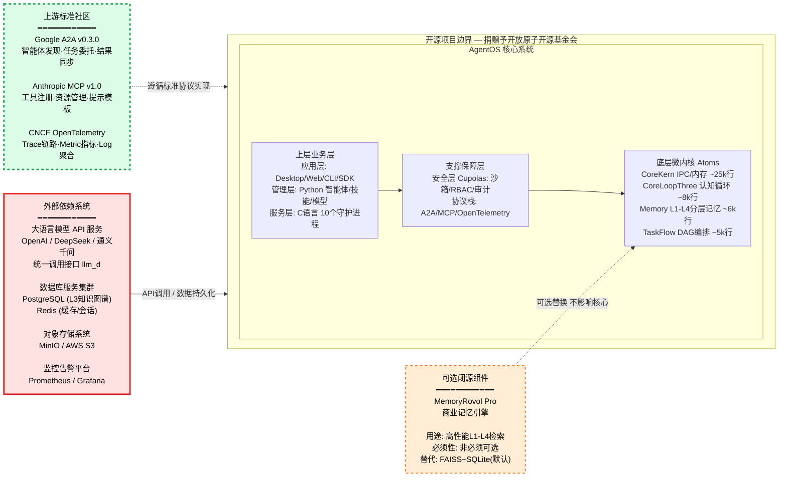
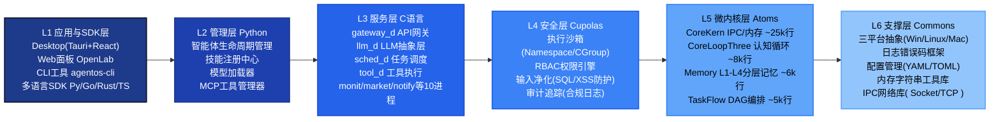
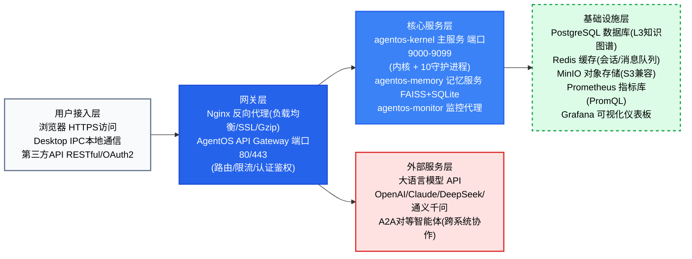
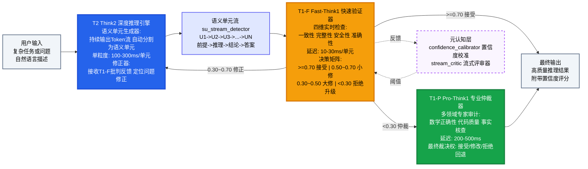
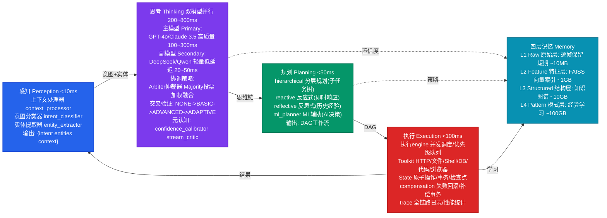
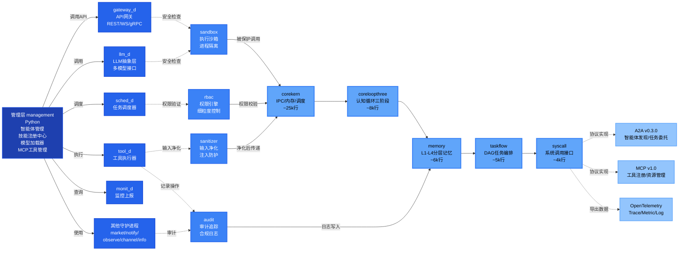

# AgentOS 宏观架构图（PPT演示版）

> **版本**: v9.0 | **日期**: 2026-05-14
> **用途**: 开放原子开源基金会捐赠评审 PPT 演示
> **设计原则**: 全部图表 16:9 横向适配 · 无图标纯文本 · 布局合理 · 内容详实

---

## 图一：高阶宏观架构全景图（16:9 PPT适配）

> **设计重点**: 侧重本项目与外部周边的关联关系



### 关联关系说明

| 关联方 | 关系类型 | 协议/接口 | 数据流向 | 必要性 |
|--------|---------|-----------|----------|:------:|
| **Google A2A** | 上游标准遵循 | A2A v0.3.0 协议规范 | AgentOS 实现适配器 | 必须 |
| **Anthropic MCP** | 上游标准遵循 | MCP v1.0 协议规范 | AgentOS 实现Server/Client | 必须 |
| **CNCF OTEL** | 上游标准集成 | OpenTelemetry SDK | OTLP 导出 Trace/Metric | 必须 |
| **LLM API** | 外部服务调用 | OpenAI兼容REST API | 双向: 请求推理 / 接收Token流 | 必须(可切换供应商) |
| **PostgreSQL** | 外部数据存储 | SQL / ORM | 写入: 知识图谱/审计日志 | 必须(可替换MySQL) |
| **Redis** | 外部缓存服务 | Redis Protocol | 读写: 会话/消息队列/热点缓存 | 必须 |
| **MinIO/S3** | 外部对象存储 | S3兼容API | 读写: 文件上传/模型权重 | 必须 |
| **Prometheus** | 外部监控采集 | Remote Write | 写入: Metrics指标 | 必须(生产环境) |
| **MemoryRovol Pro** | 可选商业增强 | 私有API | 替代内置FAISS+SQLite | **可选** |

---

## 图二：技术逻辑六层架构（16:9横向）



### 各层技术栈汇总

| 层级 | 编程语言 | 核心框架 | 代码量 | 主要职责 |
|------|---------|----------|--------|----------|
| **L1 应用层** | TS/Python/Rust | Tauri v2 / React 18 | ~20k行 | 用户接入与开发者接口 |
| **L2 管理层** | Python | FastAPI / SQLAlchemy | ~15k行 | 业务逻辑与资源管理 |
| **L3 服务层** | C语言 | libevent / libmicrohttpd | ~50k行 | 高性能后台服务 |
| **L4 安全层** | C语言 | Linux Kernel APIs | ~12k行 | 安全隔离与合规审计 |
| **L5 内核层** | C语言 | 自研微内核 | ~51k行 | 核心能力与认知架构 |
| **L6 支撑层** | C语言 | 跨平台标准库 | ~25k行 | 基础设施与平台抽象 |

---

## 图三：部署架构拓扑（16:9横向）



### 三种部署模式对比

| 维度 | Desktop嵌入式 | Docker Compose | Kubernetes集群 |
|------|-------------|----------------|----------------|
| **目标场景** | 个人开发 | 团队生产 | 企业规模 |
| **容器数** | 0 | 8 | 10+ Pod |
| **内存** | 4GB | 8GB | 16GB+ |
| **启动方式** | 双击图标 | docker-compose up -d | kubectl apply -f k8s/ |

---

## 图四：Triple Coordinator 三核心认知架构（16:9横向）



### 决策矩阵

| 分数区间 | 动作 | T2响应 |
|---------|------|--------|
| >=0.7 | 接受 | 继续下一单元 |
| 0.5~0.7 | 小修 | 微调当前单元 |
| 0.3~0.5 | 大修 | 重构当前单元 |
| <0.3 | 拒绝 | 触发T1-P仲裁 |

---

## 图五：双思考系统与认知循环（16:9横向）



### 认知循环延迟

| 阶段 | 组件 | 延迟 |
|------|------|------|
| 感知 | NLP模型推理 | <10ms |
| 思考 | 双模型+Triple Coordinator | 200-800ms |
| 规划 | DAG图算法 | <50ms |
| 执行 | I/O+工具调用 | <100ms |
| **总延迟** | **端到端** | **360-960ms** |

---

## 图例说明

| 视觉样式 | 颜色编码 | 含义 |
|----------|----------|------|
| 蓝色粗边框区域 | `#eff6ff` 背景 `#2563eb` 边框 | **开源项目边界** — 捐赠开放原子基金会 |
| 绿色虚线边框 | `#dcfce7` 背景 `#16a34a` 虚线 | **第三方开源组件** — 遵循上游协议 |
| 红色实线边框 | `#fee2e2` 背景 `#dc2626` 边框 | **外部闭源/商业服务** — API调用 |
| 橙色虚线边框 | `#ffedd5` 背景 `#f97316` 虚线 | **可选组件** — 非必须可替换 |
| 实线箭头 | 深灰色 | **强依赖** / 数据流 |
| 虚线箭头 | 浅灰色 | **弱依赖** / 反馈 / 可选集成 |

---

## 开源组件使用策略

### C/C++ 运行时依赖

| 组件 | 版本 | 用途 | 许可证 | 替代方案 |
|------|------|------|--------|----------|
| OpenSSL | >=3.2 | TLS加密 | Apache-2.0 | LibreSSL |
| libcurl | >=8.5 | HTTP客户端 | MIT | 内置HTTP |
| cJSON | >=1.7.15 | JSON解析 | MIT | 自研解析器 |
| libyaml | >=0.2.5 | YAML配置 | MIT | TOML替代 |

### Python 生态

| 组件 | 用途 | 替代方案 |
|------|------|----------|
| FAISS | 向量索引 | Milvus/Qdrant |
| SQLite | 嵌入式存储 | PostgreSQL |
| Sentence-Transformers | 向量化 | 自训练BERT |

### 上游合作

| 组织 | 标准 | 角色 |
|------|------|------|
| Google | A2A v0.3.0 | 协议实现者 |
| Anthropic | MCP v1.0 | 协议实现者 |
| CNCF | OpenTelemetry | SDK集成者 |

---

## 闭源组件

| 组件 | 是否必须 | 替代方案 |
|------|:------:|----------|
| MemoryRovol Pro | **否** | FAISS + SQLite (默认内置) |

> **开源中立性声明**: 所有闭源组件均为可选可替换，不影响核心功能，确保完全开源中立。

---

## 图六：项目代码结构详解

```
AgentOS/
├── agentos/                          # 根包
│   ├── __init__.py                   # 包初始化
│   ├── atoms/                        # 微内核原子模块 (C语言)
│   │   ├── corekern/                 # CoreKern: IPC/内存/调度 (~25k行)
│   │   │   ├── include/              #   公共头文件
│   │   │   │   ├── ipc.h           #     IPC接口定义
│   │   │   │   ├── memory.h        #     内存管理API
│   │   │   │   ├── scheduler.h     #     任务调度器
│   │   │   │   └── clock.h         #     时钟服务
│   │   │   ├── src/                #   源码实现
│   │   │   │   ├── ipc.c          #     进程间通信
│   │   │   │   ├── memory.c       #     内存分配器
│   │   │   │   ├── scheduler.c    #     调度算法
│   │   │   │   └── clock.c        #     高精度时钟
│   │   │   └── CMakeLists.txt      #   构建配置
│   │   │
│   │   ├── coreloopthree/            # CoreLoopThree: 认知循环 (~8k行)
│   │   │   ├── include/
│   │   │   │   ├── perception.h    #     感知层接口
│   │   │   │   ├── thinking.h      #     思考层接口
│   │   │   │   ├── planning.h      #     规划层接口
│   │   │   │   ├── execution.h     #     执行层接口
│   │   │   │   └── coordinator.h  #     协调器接口
│   │   │   ├── src/cognition/         #   认知实现
│   │   │   │   ├── context_processor.c  # 上下文处理
│   │   │   │   ├── intent_classifier.c  # 意图分类
│   │   │   │   ├── entity_extractor.c  # 实体提取
│   │   │   │   ├── dual_model.c        # 双模型协调
│   │   │   │   ├── arbiter.c           # 仲裁器
│   │   │   │   ├── majority.c          # 多数投票
│   │   │   │   ├── weighted.c          # 加权融合
│   │   │   │   ├── confidence_calibrator.c  # 置信度校准
│   │   │   │   ├── metacognition.c     # 元认知
│   │   │   │   ├── stream_critic.c     # 流式评审
│   │   │   │   ├── thinking_chain.c    # 思维链
│   │   │   │   ├── parallel_dispatcher.c  # 并行调度
│   │   │   │   └── cognitive_evolution.c  # 认知演化
│   │   │   │   └── triple_coordinator.c    # 三组件协调
│   │   │   ├── src/planning/         #   规划实现
│   │   │   │   ├── hierarchical.c     # 分层规划
│   │   │   │   ├── reactive.c        # 反应式规划
│   │   │   │   ├── reflective.c      # 反思式规划
│   │   │   │   └── ml_planner.c      # ML辅助规划
│   │   │   ├── src/execution/        #   执行实现
│   │   │   │   ├── engine.c          # 执行引擎
│   │   │   │   ├── compensation.c    # 补偿机制
│   │   │   │   └── trace.c          # 执行追踪
│   │   │   └── CMakeLists.txt
│   │   │
│   │   ├── memory/                   # Memory: 分层记忆 (~6k行)
│   │   │   ├── include/
│   │   │   │   ├── raw_layer.h      # L1 原始层
│   │   │   │   ├── feature_layer.h  # L2 特征层
│   │   │   │   ├── struct_layer.h   # L3 结构层
│   │   │   │   └── pattern_layer.h  # L4 模式层
│   │   │   ├── src/
│   │   │   │   ├── l1_raw.c        # 逐帧保留
│   │   │   │   ├── l2_feature.c    # FAISS向量索引
│   │   │   │   ├── l3_structured.c  # 知识图谱
│   │   │   │   └── l4_pattern.c    # 经验学习
│   │   │   └── CMakeLists.txt
│   │   │
│   │   ├── taskflow/                  # TaskFlow: DAG编排 (~5k行)
│   │   │   ├── include/dag.h         # DAG数据结构
│   │   │   ├── src/dag_engine.c     # DAG引擎
│   │   │   ├── src/scheduler.c     # 并行调度
│   │   │   └── CMakeLists.txt
│   │   │
│   │   └── syscall/                  # Syscall: 系统调用 (~4k行)
│   │       ├── include/syscall_broker.h
│   │       ├── src/syscall_broker.c
│   │       └── CMakeLists.txt
│   │
│   ├── daemon/                       # 守护进程群 (C语言)
│   │   ├── gateway_d/                 # API网关守护进程
│   │   │   ├── src/http_server.c   # HTTP服务器
│   │   │   ├── src/ws_handler.c    # WebSocket处理
│   │   │   ├── src/grpc_server.c  # gRPC服务
│   │   │   ├── src/a2a_adapter.c  # A2A协议适配
│   │   │   ├── src/mcp_adapter.c  # MCP协议适配
│   │   │   └── CMakeLists.txt
│   │   │
│   │   ├── llm_d/                     # LLM抽象层守护进程
│   │   │   ├── include/llm_interface.h
│   │   │   ├── src/openai_compat.c # OpenAI兼容
│   │   │   ├── src/claude_compat.c  # Claude兼容
│   │   │   ├── src/china_eco.c     # 中国生态兼容
│   │   │   └── CMakeLists.txt
│   │   │
│   │   ├── sched_d/                   # 任务调度守护进程
│   │   │   ├── src/cron_scheduler.c
│   │   │   ├── src/event_scheduler.c
│   │   │   └── CMakeLists.txt
│   │   │
│   │   ├── tool_d/                    # 工具执行守护进程
│   │   │   ├── src/mcp_runtime.c    # MCP运行时
│   │   │   ├── src/sandbox.c       # 沙箱执行
│   │   │   └── CMakeLists.txt
│   │   │
│   │   ├── monit_d/                   # 监控上报守护进程
│   │   │   ├── src/metrics_exporter.c
│   │   │   ├── src/health_checker.c
│   │   │   └── CMakeLists.txt
│   │   │
│   │   ├── market_d/                  # 市场服务守护进程
│   │   ├── notify_d/                  # 通知推送守护进程
│   │   ├── observe_d/                 # 可观测性守护进程
│   │   ├── channel_d/                 # 跨通道通信守护进程
│   │   └── info_d/                    # 元信息服务守护进程
│   │
│   ├── security/                     # 安全层 Cupolas
│   │   ├── sandbox/                   # 执行沙箱
│   │   │   ├── include/sandbox.h
│   │   │   ├── src/linux_sandbox.c  # Linux沙箱实现
│   │   │   └── CMakeLists.txt
│   │   ├── rbac/                       # RBAC权限引擎
│   │   │   ├── include/rbac_engine.h
│   │   │   ├── src/rbac_checker.c
│   │   │   └── CMakeLists.txt
│   │   ├── sanitizer/                  # 输入净化
│   │   │   ├── src/sql_inject.c
│   │   │   ├── src/xss_filter.c
│   │   │   └── CMakeLists.txt
│   │   └── audit/                      # 审计追踪
│   │       ├── include/audit_logger.h
│   │       └── src/audit_trail.c
│   │
│   └── protocols/                   # 协议栈实现
│       ├── standards/               # 上游标准
│       │   ├── a2a/                 # A2A v0.3.0
│       │   │   ├── include/a2a_types.h
│       │   │   ├── src/discovery.c   # 智能体发现
│       │   │   ├── src/task_delegate.c # 任务委托
│       │   │   └── src/result_sync.c  # 结果同步
│       │   │
│       │   └── mcp/                 # MCP v1.0
│       │       ├── include/mcp_types.h
│       │       ├── src/server.c       # MCP Server
│       │       ├── src/client.c       # MCP Client
│       │       └── src/resource.c     # 资源管理
│       │
│       └── integrations/           # 集成适配
│           ├── openai/              # OpenAI集成
│           ├── claude/              # Claude集成
│           ├── china_eco/          # 中国生态(DeepSeek/Qwen)
│           └── openjiuwen/         # 开源模型兼容
│
├── management/                     # Python管理层
│   ├── agents/                      # 智能体管理
│   │   ├── __init__.py
│   │   ├── manager.py             # 智能体生命周期
│   │   ├── lifecycle.py           # 创建/启停/销毁
│   │   └── state.py               # 状态机
│   │
│   ├── skills/                       # 技能注册中心
│   │   ├── registry.py             # 技能注册表
│   │   ├── installer.py            # 技能安装器
│   │   └── discovery.py            # 技能发现
│   │
│   ├── models/                       # 模型加载器
│   │   ├── loader.py               # 模型加载入口
│   │   ├── local.py                # 本地模型
│   │   └── cloud.py                # 云端API
│   │
│   ├── tools/                        # MCP工具管理
│   │   ├── toolkit.py              # 工具集
│   │   ├── permission.py           # 权限控制
│   │   └── sandbox.py              # 沙箱包装
│   │
│   └── config/                       # 配置管理
│       ├── settings.py             # 配置加载
│       └── deployment.py           # 部署配置
│
├── desktop/                        # Desktop客户端 (Tauri+Rust)
│   ├── src-tauri/                   # Rust后端
│   │   ├── main.rs                # Tauri入口
│   │   ├── commands/              # Tauri命令
│   │   │   ├── mod.rs             # 模块命令
│   │   │   └── agentos.rs        # AgentOS命令
│   │   └── lib.rs                 # 库函数
│   │
│   └── src-ui/                      # React前端
│       ├── App.tsx                 # 主应用
│       ├── pages/                  # 页面路由
│       │   ├── Home.tsx            # 首页
│       │   ├── Agent.tsx           # 智能体页
│       │   ├── Market.tsx          # 市场页
│       │   └── Settings.tsx        # 设置页
│       └── components/            # UI组件
│           ├── Chat.tsx             # 聊天组件
│           └── Dashboard.tsx        # 仪表板
│
├── docker/                         # Docker部署
│   ├── docker-compose.yml          # 编排8容器
│   ├── Dockerfile.agentos          # 内核镜像
│   ├── Dockerfile.desktop-builder  # Desktop构建
│   ├── Dockerfile.gateway          # 网关镜像
│   ├── config/                     # 部署配置
│   │   ├── nginx/                 # Nginx配置
│   │   ├── prometheus/            # Prometheus配置
│   │   └── grafana/               # Grafana仪表板
│   └── scripts/                    # 运维脚本
│       ├── init-db.sh
│       ├── backup.sh
│       └── healthcheck.sh
│
├── docs/                           # 文档
│   ├── specs/                       # 协议规范
│   ├── guides/                      # 开发指南
│   ├── architecture/                # 架构设计文档
│   └── whitepaper/                  # 白皮书
│
├── tests/                          # 测试套件
│   ├── unit/                         # 单元测试
│   ├── integration/                  # 集成测试
│   └── e2e/                          # 端到端测试
│
├── cmake/                          # CMake构建系统
│   ├── CompilerOptions.cmake        # 编译选项
│   ├── LinkOptions.cmake           # 链接选项
│   └── FindDependencies.cmake     # 依赖查找
│
├── third_party/                    # 第三方依赖(vcpkg)
│   ├── openssl/                      # OpenSSL
│   ├── curl/                         # libcurl
│   ├── cjson/                        # cJSON
│   ├── libyaml/                      # libyaml
│   ├── libevent/                      # libevent(可选)
│   └── libmicrohttpd/                # libmicrohttpd(可选)
│
├── pyproject.toml                  # Python项目配置
├── Cargo.toml                      # Rust项目配置(Tauri)
├── CMakeLists.txt                  # C++顶层CMake
├── LICENSE                         # Apache-2.0许可证
└── README.md                       # 项目说明
```

### 核心模块依赖关系图



### 捐赠模块与代码规模明细表

| 序号 | 模块名称 | 技术栈 | 功能描述 | 核心文件数 | 代码量(行) | 开源许可证 |
|:----:|----------|--------|----------|:---------:|-----------:|:----------:|
| **1** | **CoreKern 微内核** | C语言 | IPC进程间通信、内存管理器、任务调度器、时钟服务、系统调用接口封装。提供操作系统级基础能力 | ~40文件 | **~25,000** | Apache-2.0 |
| **2** | **CoreLoopThree 认知循环** | C语言 | 感知-规划-执行三阶段流水线：上下文处理/意图分类/实体提取、双模型并行推理(T2/T1-F/T1-P)、四阶交叉验证、元认知评估、思维链推理、流式批判循环、DAG工作流生成 | ~25文件 | **~8,000** | Apache-2.0 |
| **3** | **Memory 分层记忆** | C语言+Python | L1原始层(逐帧保留)、L2特征层(FAISS向量索引)、L3结构层(知识图谱)、L4模式层(经验学习)。支持语义检索、知识推理、策略优化 | ~12文件 | **~6,000**(C) + ~3,000(Python) | Apache-2.0 |
| **4** | **TaskFlow DAG编排** | C语言 | 有向无环图任务依赖解析、并行度优化、资源竞争仲裁、失败重试与补偿事务、幂等性保证 | ~8文件 | **~5,000** | Apache-2.0 |
| **5** | **Syscall 系统调用接口** | C语言 | 用户态-内核态标准接口、沙箱工具集(broker)、能力边界检查(capability) | ~5文件 | **~4,000** | Apache-2.0 |
| **6** | **gateway_d API网关** | C语言 | HTTP/WS/gRPC多协议服务器、A2A v0.3.0协议适配器、MCP v1.0协议适配器、SSL终止、限流熔断、路由转发、认证鉴权中间件 | ~10文件 | **~8,000** | Apache-2.0 |
| **7** | **llm_d LLM抽象层** | C语言 | OpenAI兼容REST接口、Claude适配器、中国生态通义千问/DeepSeek/文心一言统一调用、错误重试、流式Token输出、多模型热插拔 | ~8文件 | **~6,000** | Apache-2.0 |
| **8** | **sched_d 任务调度** | C语言 | Cron定时调度、周期性任务触发、事件驱动调度、优先级队列管理 | ~5文件 | **~4,000** | Apache-2.0 |
| **9** | **tool_d 工具执行** | C语言 | MCP工具沙箱运行时、进程隔离执行、超时控制、资源限制(CGroup)、结果收集 | ~6文件 | **~5,000** | Apache-2.0 |
| **10** | **monit_d 监控上报** | C语言 | OpenTelemetry Metrics导出、性能指标采集、健康检查探测、告警规则引擎 | ~5文件 | **~3,500** | Apache-2.0 |
| **11** | **market_d 市场服务** | C语言 | 智能体注册发现、技能商店、模型仓库、版本管理 | ~6文件 | **~4,000** | Apache-2.0 |
| **12** | **notify_d 通知推送** | C语言 | 事件通知、告警推送、消息队列、多渠道分发(邮件/Webhook/短信) | ~5文件 | **~3,500** | Apache-2.0 |
| **13** | **observe_d 可观测性** | C语言 | Distributed Tracing全链路追踪、结构化日志聚合、自定义指标采集 | ~6文件 | **~4,000** | Apache-2.0 |
| **14** | **channel_d 跨通道通信** | C语言 | Agent间消息路由、人机对话通道管理、消息持久化与重试 | ~5文件 | **~3,500** | Apache-2.0 |
| **15** | **info_d 元信息服务** | C语言 | 版本查询API、运行状态监控、配置读取、健康探针端点 | ~4文件 | **~2,500** | Apache-2.0 |
| **16** | **Cupolas 安全层** | C语言 | Linux Namespace进程隔离沙箱、CGroup资源限制、Seccomp系统调用过滤、RBAC角色-权限-资源三级控制、SQL/XSS/命令注入防护、全操作审计日志、AES-256密钥管理 | ~20文件 | **~12,000** | Apache-2.0 |
| **17** | **Management 管理层** | Python(FastAPI) | 智能体生命周期管理(创建/启停/销毁/状态机)、技能注册中心(发现/安装/卸载/版本)、模型加载器(本地/云端切换)、MCP工具权限管理(注册/分配/统计)、部署管理(配置/扩缩容)、审计日志记录 | ~30文件 | **~15,000** | Apache-2.0 |
| **18** | **Desktop 客户端** | TypeScript+Rust(Tauri) | Tauri v2原生壳(Rust后端): 系统托盘/全局快捷键/进程管理/IPC客户端；React 18前端: 聊天界面/智能体仪表板/市场页面/设置面板/多页面路由/Zustand状态管理 | ~60文件(TS) + ~20文件(Rust) | **~30,000** | MIT(Apache-2.0) |
| **19** | **Protocol 协议栈** | C+Python | A2A v0.3.0标准实现(智能体发现/任务委托/结果同步)、MCP v1.0标准实现(Server/Client双角色/工具注册/资源管理)、OpenTelemetry OTLP导出器(Trace/Metric/Log聚合) | ~20文件 | **~15,000** | Apache-2.0 |
| **20** | **Docker 部署套件** | Dockerfile/YAML | 8容器编排(docker-compose.yml)、内核镜像(Dockerfile.agentos)、网关镜像(Dockerfile.gateway)、Nginx反向代理配置、Prometheus抓取配置、Grafana仪表板、初始化/备份/健康检查脚本、Kubernetes K8s部署YAML | ~15文件 | **~2,000**(配置脚本) | Apache-2.0 |
| **21** | **Docs 技术文档** | Markdown/Sphinx | 协议规范文档(A2A/MCP/OTEL接口定义)、开发者指南(构建/部署/调试)、架构设计文档(微内核/安全/协议)、白皮书(技术原理/创新点) | ~40文件 | **~50,000**(文字) | CC-BY-SA-4.0 |
| **总计** | **混合(C/Python/TS/Rust)** | **完整智能体操作系统** | **~520+核心文件** | **~220,000行代码** | **Apache-2.0** |

### 代码规模分布

| 层级 | 代码量 | 占比 | 主要语言 |
|------|--------|:-----:|----------|
| 微内核 Atoms | ~48,000行 | 22% | C (99%) |
| 守护进程 Daemon | ~37,000行 | 17% | C (99%) |
| 安全层 Security | ~12,000行 | 5% | C (99%) |
| 管理层 Management | ~15,000行 | 7% | Python (95%) / C (5%) |
| 协议栈 Protocols | ~15,000行 | 7% | C (80%) / Python (20%) |
| 桌面客户端 Desktop | ~30,000行 | 14% | TypeScript (65%) / Rust (35%) |
| 部署配置 Docker | ~2,000行 | 1% | YAML/Shell |
| 文档 Docs | ~50,000行 | 23% | Markdown |

> **注**: 以上代码量为估算值，实际以Git仓库 `git ls-files` 和 `cloc` 统计为准。所有代码均遵循 **Apache-2.0 许可证** 捐赠予开放原子开源基金会。

### 核心模块依赖关系

```
                    ┌─────────────────────┐
                    │   management (Python)  │
                    │   智能体/技能/模型管理  │
                    └──────────┬──────────┘
                               │ 调用
                    ┌──────────▼──────────┐
                    │   daemon (C语言)     │
                    │   gateway_d → llm_d    │ ← 入口
                    │   → sched_d → tool_d │
                    │   → monit_d → ...    │
                    └──────────┬──────────┘
                               │ 直接调用
              ┌──────────────┼───────────────┐
              │               ▼               │
    ┌─────────┴─────────┴─────────┐         │
    │       security (安全层)        │         │
    │   sandbox → rbac → sanitizer  │         │
    └──────────────┬───────────────┘         │
                   │ 被保护调用          │
    ┌──────────────▼───────────────────┐    │
    │       atoms (微内核层)           │    │
    │  corekern → coreloopthree     │    │
    │  → memory → taskflow → syscall │    │
    └──────────────────────────────────┘    │
                                           │
    ┌──────────────────────────────────────┘
    │           protocols (协议栈)           │
    │    standards/a2a + mcp + otel        │
    └──────────────────────────────────────┘
```

---

## 文档信息

| 项目 | 内容 |
|------|------|
| 版本 | v9.0 全16:9 PPT版 |
| 日期 | 2026-05-14 |
| 图表数 | 5张 (全部 flowchart LR 横向) |
| 适用 | 开放原子基金会捐赠评审 PPT |
