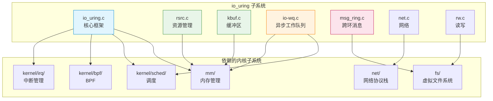

Copyright (c) 2025-2026 SPHARX Ltd. All Rights Reserved.

# openEuler io_uring 技术规范参考

> **文档定位**: 闭源内部参考，openEuler io_uring 异步 I/O 框架技术规范全面参考
> **保密级别**: SPHARX Ltd 内部参考，**闭源不公开**
> **版本**: 0.1.1（文档体系完成）/ 1.0.1（开发）
> **最后更新**: 2026-07-07
> **参考源**: openEuler 社区 + OLK-6.6（Linux 6.6 内核源码）

---

## 1. 文档说明

### 1.1 目的

本文档全面参考 openEuler 社区的 io_uring 异步 I/O 框架技术规范，作为 AirymaxOS IPC 子系统设计的参考基础。所有参考内容**仅供 SPHARX Ltd 内部使用**，不得出现在开源文档（`docs/docs-linux/`）中。

### 1.2 参考来源

| 来源 | 内容 | 路径 / URL |
|------|------|-----------|
| OLK-6.6 源码 | openEuler LTS 6.6 内核源码 io_uring 子系统 | `io_uring/` |
| openEuler 文档 | io_uring 设计与应用文档 | openEuler 社区文档站 |
| Linux 主线 | io_uring 主线实现 | kernel.org |
| liburing | 用户态 io_uring 库 | GitHub: axboe/liburing |
| Jens Axboe 论文 | io_uring 设计白皮书 | kernel.org io_uring docs |

### 1.3 OLK-6.6 io_uring 版本基线

OLK-6.6 的 io_uring 子系统基于 Linux 6.6 主线，包含以下关键特性：

| 特性 | 引入版本 | 状态 |
|------|---------|------|
| 基础 SQ/CQ ring | 5.1 | 稳定 |
| SQPOLL 内核轮询线程 | 5.11 | 稳定 |
| registered buffer（固定缓冲区） | 5.7 | 稳定 |
| provided buffer（应用预分配） | 5.7 | 稳定 |
| `IORING_OP_MSG_RING`（跨环消息） | 5.18 | 稳定 |
| `IORING_SETUP_CQE32` / `SQE128` | 5.18 | 稳定 |
| `IORING_SETUP_DEFER_TASKRUN` | 6.0 | 稳定 |
| `IORING_SETUP_NO_MMAP` | 6.5 | 稳定 |
| `IORING_OP_SEND_ZC`（零拷贝发送） | 6.0 | 稳定 |
| ring-mapped provided buffer | 6.0 | 稳定 |
| `IORING_SETUP_NO_SQARRAY` | 6.11 | 稳定 |

### 1.4 三段式参考方法

按用户三段式方法论，AirymaxOS IPC 设计参考流程：

1. **先参考 Euler**：查阅本文档对应章节的 openEuler io_uring 规范
2. **再参考行业最新理论**：查阅 `10-references/industry-best-practices/02-best-practices.md` 中的最新 I/O 多路复用与零拷贝理论
3. **最后形成 AirymaxOS 技术方案**：综合形成开源设计文档 `docs/docs-linux/40-dataflows/03-ipc-flow.md`

---

## 2. openEuler io_uring 整体架构

### 2.1 io_uring 设计哲学

openEuler io_uring 的核心设计哲学是"**共享内存 + 批量提交 + 零拷贝**"，通过三个机制消除传统 syscall I/O 的开销：

| 传统 I/O 痛点 | io_uring 解决方案 | 收益 |
|--------------|------------------|------|
| 每次 I/O 一次 syscall（read/write） | 共享内存 SQ/CQ ring + 批量提交 | syscall 次数从 N 降至 0~1 |
| 用户态↔内核态数据拷贝 | mmap 共享 + registered buffer | 零拷贝，消除 page fault |
| 阻塞等待完成 | CQ ring + eventfd/task_work 通知 | 异步完成，无阻塞 |
| 多线程竞争锁 | 单生产者-单消费者无锁环 | 无锁，缓存行友好 |

### 2.2 io_uring 子系统划分

openEuler io_uring 子系统在 OLK-6.6 中位于 `io_uring/` 目录，包含 38 个源文件：

| 模块 | 核心文件 | 职责 |
|------|---------|------|
| **核心框架** | `io_uring.c` / `io_uring.h` | setup/enter/register syscall + 提交/完成核心 |
| **资源管理** | `rsrc.c` / `rsrc.h` | registered buffer/file 资源注册与生命周期 |
| **缓冲区管理** | `kbuf.c` / `kbuf.h` | provided buffer 与 ring-mapped buffer |
| **异步工作队列** | `io-wq.c` / `io-wq.h` | io-wq 工作线程池（bounded + unbounded） |
| **消息传递** | `msg_ring.c` / `msg_ring.h` | `IORING_OP_MSG_RING` 跨环消息 |
| **网络操作** | `net.c` / `net.h` | send/recv/sendmsg/accept/connect |
| **读写操作** | `rw.c` / `rw.h` | read/write/readv/writev |
| **文件操作** | `fs.c` / `fs.h` / `openclose.c` | openat/close/statx/fallocate |
| **轮询操作** | `poll.c` / `poll.h` / `epoll.c` | poll/epoll_ctl |
| **取消操作** | `cancel.c` / `cancel.h` | `IORING_OP_ASYNC_CANCEL` |
| **通知机制** | `notif.c` / `notif.h` | SEND_ZC 完成通知 |
| **操作定义** | `opdef.c` / `opdef.h` | 操作码注册表 |
| **文件表** | `filetable.c` / `filetable.h` | 固定 fd 表管理 |
| **fdinfo** | `fdinfo.c` / `fdinfo.h` | /proc/fdinfo 输出 |
| **引用计数** | `refs.c` / `refs.h` | percpu_ref 生命周期 |
| **分配缓存** | `alloc_cache.h` / `slist.h` | 内部 slab 缓存 |

### 2.3 io_uring 与其他子系统关系



---

## 3. SQ/CQ Ring 共享内存机制

### 3.1 Ring 内存布局

io_uring 通过 `mmap()` 将环形缓冲区映射到用户态地址空间，实现内核与用户态共享内存通信：

| mmap 偏移 | 内容 | 大小 |
|-----------|------|------|
| `IORING_OFF_SQ_RING` | SQ ring（head/tail/mask/flags + sq_array） | 1 页 |
| `IORING_OFF_CQ_RING` | CQ ring（head/tail/mask/flags + cqes[]） | 配置大小 |
| `IORING_OFF_SQES` | SQE 数组（每个 64B 或 128B） | sq_entries × 64B |

**所有权模型**（单生产者-单消费者）：

| 环 | 字段 | 写入者 | 读取者 |
|----|------|--------|--------|
| SQ ring | `sq.tail` | 应用（生产者） | 内核（消费者） |
| SQ ring | `sq.head` | 内核（消费者） | 应用（生产者） |
| CQ ring | `cq.tail` | 内核（生产者） | 应用（消费者） |
| CQ ring | `cq.head` | 应用（消费者） | 内核（生产者） |

### 3.2 SQE 提交流程

```
应用侧（生产者）：
1. 读取 sq.tail（TAIL），计算 sq_array[TAIL & mask] = SQE_index
2. 填充 sqes[SQE_index]（opcode + fd + addr + len + user_data）
3. smp_store_release(sq.tail, TAIL + 1)  // 内存屏障确保 SQE 先于 tail 可见
4. （非 SQPOLL）io_uring_enter(fd, to_submit=1, ...) 提交

内核侧（消费者）：
1. smp_load_acquire(sq.tail) 读取新 tail
2. 读取 sq_array[head & mask] 获取 SQE_index
3. 读取 sqes[SQE_index] 解析请求
4. sq.head++ 推进消费指针
5. 执行 io_submit_sqe() 处理请求
6. （成功）写 CQE；（失败）写错误 CQE
```

### 3.3 CQE 完成流程

```
内核侧（生产者）：
1. io_get_cqe(ctx, &cqe) 从 CQE 环分配槽位
2. cqe->user_data = req->cqe.user_data（原样返回）
3. cqe->res = result（成功=字节数，失败=-Exxx）
4. cqe->flags = completion_flags
5. smp_store_release(cq.tail, cached_cq_tail + 1)  // 内存屏障
6. io_cqring_wake(ctx)  // 唤醒等待的 io_uring_enter

应用侧（消费者）：
1. smp_load_acquire(cq.tail) 读取新 tail
2. 读取 cqes[head & mask] 获取完成事件
3. 根据 user_data 匹配请求（trace_id）
4. cq.head++ 推进消费指针
```

> **openEuler 实践**: openEuler 推荐 CQ 大小为 SQ 的 2 倍（默认），避免高频场景 CQE 溢出导致 `cq_overflow` 增长。

---

## 4. SQPOLL 零 syscall 模式

### 4.1 SQPOLL 设计目标

SQPOLL（SQ Polling）模式创建一个内核线程 `io_sq_thread`，持续轮询 SQ ring 的 tail 字段，应用只需写入 SQE + 推进 tail，**无需任何 syscall** 即可提交请求。

**性能收益**：

| 场景 | 非 SQPOLL | SQPOLL | 收益 |
|------|-----------|--------|------|
| 提交延迟 | 2-5μs（syscall + 切换） | < 1μs（共享内存写） | 5× |
| 高频小 I/O（4KB） | 100K IOPS | 500K IOPS | 5× |
| CPU 占用（应用侧） | syscall 开销 | 仅内存写 | 大幅降低 |
| CPU 占用（内核侧） | 中断驱动 | 专用轮询线程 | 1 个 CPU 核 |

### 4.2 SQPOLL 线程生命周期

```c
static int io_sq_thread(void *data) {
    struct io_sq_data *sqd = data;
    while (!kthread_should_stop()) {
        if (io_sqring_full(ctx)) {
            // SQ 满，等待应用消费 CQE
            io_sq_tw_head_slush();
            continue;
        }
        // 处理所有 SQE
        io_submit_sqes(ctx, io_sqring_entries(ctx));
        // 检查空闲超时
        if (sqd->state == SQT_IDLE && time_after(jiffies, timeout))
            break;  // 进入睡眠
    }
    // 睡眠前设置 NEED_WAKEUP 标志
    set_bit(IO_SQ_THREAD_NEED_WAKEUP, &sq_flags);
    schedule();
}
```

### 4.3 SQPOLL 唤醒机制

应用通过 `IORING_ENTER_SQ_WAKEUP` flag 唤醒睡眠的 SQPOLL 线程：

```c
// 应用侧
if (sq_flags & IORING_SQ_NEED_WAKEUP) {
    io_uring_enter(fd, 0, 0, IORING_ENTER_SQ_WAKEUP, NULL, 0);
}
```

### 4.4 openEuler SQPOLL 调优实践

| 参数 | 默认值 | 推荐值 | 调优建议 |
|------|--------|--------|---------|
| `sq_thread_idle` | 1s | 5-10s（高频）/ 100ms（低延迟） | 高频场景延长避免频繁睡眠；低延迟场景缩短 |
| `sq_thread_cpu` | 无绑定 | 绑定到专用核 | 避免与业务线程竞争 |
| SQ 大小 | 256 | 1024（高频） | 大 SQ 允许批量提交 |
| CQ 大小 | 2×SQ | 4×SQ（高频） | 避免溢出 |

> **openEuler 实践**: openEuler 在鲲鹏 920 平台推荐 SQPOLL 绑定到大核（CPU 0-N/2），避免绑定到小核导致性能波动。

---

## 5. Registered Buffer 零拷贝

### 5.1 Registered Buffer 机制

registered buffer 允许应用一次性将用户态缓冲区注册到内核，内核通过 `pin_user_pages()` 锁定物理页，后续 I/O 直接操作物理页，避免每次 I/O 的 page fault 与映射开销。

**注册流程**：

```c
struct iovec bufs[N] = { ... };
io_uring_register(fd, IORING_REGISTER_BUFFERS, bufs, N);
// 内核侧：
//   io_sqe_buffers_register()
//     -> io_pin_pages() 锁定物理页
//     -> 构建 io_mapped_ubuf { ubuf, ubuf_end, nr_bvecs, bvec[] }
//     -> 存入 ctx->user_bufs[] 数组
```

**使用流程**（零拷贝）：

```c
// 提交 READ_FIXED 操作，buf_index 指向已注册缓冲区
struct io_uring_sqe *sqe = io_uring_get_sqe(ring);
io_uring_prep_read_fixed(sqe, fd, buf, len, off, buf_index);
io_uring_submit(ring);
// 内核侧：
//   io_import_fixed() 直接操作 imu->bvec 物理页
//   DMA 直接传输到物理页（零拷贝）
```

### 5.2 Registered Buffer 优势

| 维度 | 传统 read() | registered buffer READ_FIXED | 收益 |
|------|-------------|-----------------------------|------|
| page fault | 每次可能触发 | 一次性 pin，后续无 | 消除 fault 开销 |
| TLB miss | 每次可能触发 | 内核持久映射 | 消除 TLB miss |
| 物理页锁定 | 否（可被 swap） | 是（DMA 安全） | 适合 DMA/零拷贝 |
| 内存计费 | 无 | RLIMIT_MEMLOCK | 需配置 memlock 限制 |

### 5.3 Scatter-Gather bvec 模型

`io_mapped_ubuf.bvec[]` 是 scatter-gather bio_vec 数组，支持非连续物理页：

```c
struct io_mapped_ubuf {
    u64 ubuf;                  // 用户态起始地址
    u64 ubuf_end;              // 用户态结束地址
    unsigned int nr_bvecs;     // bio_vec 数量
    unsigned long acct_pages;  // 锁定页数
    struct bio_vec bvec[];     // scatter-gather 数组（柔性数组）
};
```

**应用场景**：
- 大块传输（> 4KB）：多页 scatter-gather
- NUMA 跨节点：跨节点物理页
- GPU 共享内存：CUDA unified memory + registered buffer

> **openEuler 实践**: openEuler 推荐对高频大块 I/O 场景（如数据库 16KB+ 页）使用 registered buffer，性能提升 30%+。

---

## 6. Provided Buffer 池机制

### 6.1 Provided Buffer 设计

provided buffer 是"应用预分配缓冲区池"机制——应用预先向内核提供一组缓冲区，内核在完成异步 I/O 时从中选择一个，避免应用预先指定缓冲区。

**两种模式**：

| 模式 | 数据结构 | 注册方式 | 适用场景 |
|------|---------|---------|---------|
| 经典链表 | `io_buffer_list.buf_list` | `IORING_OP_PROVIDE_BUFFERS` | 小块缓冲区池 |
| ring-mapped | `io_buffer_list.buf_ring` | `IORING_REGISTER_PBUF_RING` | 高性能零拷贝 |

### 6.2 经典 Provided Buffer 流程

```
应用侧（提供缓冲区）：
1. 分配 N 个缓冲区（如 16 × 4KB）
2. IORING_OP_PROVIDE_BUFFERS(bgid=1, nbufs=16, len=4KB)
   内核：io_provide_buffers() 将缓冲区加入 io_buffer_list[bgid=1].buf_list

应用侧（使用 BUFFER_SELECT）：
1. 提交 RECV(flags=IOSQE_BUFFER_SELECT, buf_group=1)
2. 内核：io_buffer_select() 从 buf_list 弹出一个缓冲区
3. 完成：CQE(res=len, flags=IORING_CQE_F_BUFFER | (bid << IORING_CQE_BUFFER_SHIFT))
4. 应用通过 bid 知道使用了哪个缓冲区
```

### 6.3 ring-mapped Provided Buffer

ring-mapped 模式将缓冲区环形队列映射到用户态，内核与用户态共享 head/tail：

```c
struct io_uring_buf_ring *br;
br = mmap(NULL, size, PROT_READ|PROT_WRITE, MAP_SHARED|MAP_POPULATE, ring_fd, off);
// 应用填充缓冲区
br->bufs[tail & mask].addr = buf_addr;
br->bufs[tail & mask].len = buf_len;
br->bufs[tail & mask].bid = bid;
io_uring_buf_ring_advance(br, 1);  // 推进 tail

// 内核完成 I/O 时：
io_kiocb.buf_list->head++;  // 内核推进 head
// CQE.flags 包含 bid
```

> **openEuler 实践**: openEuler 推荐网络高吞吐场景（如 100Gbps 网卡）使用 ring-mapped provided buffer，避免每包缓冲区选择开销。

---

## 7. io-wq 异步工作队列

### 7.1 io-wq 设计

io-wq 是 io_uring 专用的工作队列，处理需要异步执行（punt）的请求：

| 触发 punt 的场景 | 原因 |
|-----------------|------|
| `IOSQE_ASYNC` 标志 | 应用显式要求异步 |
| -EAGAIN 重试 | 资源暂时不可用（如 socket 缓冲区满） |
| 阻塞操作 | 文件系统需等待（如磁盘 I/O） |
| DEFER_TASKRUN 模式 | 所有完成经 io-wq |

### 7.2 io-wq Worker 类型

```c
struct io_wq {
    struct io_wq_acct accts[2];  // [IO_WQ_ACCT_UNBOUND, IO_WQ_ACCT_BOUND]
    // bounded: 数量 = iowq_limits[0]
    // unbounded: 数量 = iowq_limits[1]
};
```

| Worker 类型 | 限制 | 用途 | 阻塞行为 |
|------------|------|------|---------|
| bounded | `[unbound_limit, bound_limit]` | CPU-bound 工作 | 不阻塞 |
| unbounded | 同上 | I/O-bound 工作（等待磁盘/网络） | 可阻塞 |

### 7.3 io-wq 与内核调度协同

io-wq worker 是内核线程（PF_IO_WORKER），享有特殊调度待遇：

- **调度优先级**：与发起任务相同（继承 nice）
- **CPU 亲和性**：与发起任务相同（避免跨 NUMA）
- **信号处理**：worker 不处理用户信号（PF_IO_WORKER）
- **task_work**：worker 检查 `TIF_NOTIFY_SIGNAL` 执行 task_work

> **openEuler 实践**: openEuler 在 io-wq 数量调优上推荐 `iowq_limits = [4, 8]`（4 个 bounded + 8 个 unbounded），平衡并发与 CPU 占用。

---

## 8. IORING_OP_MSG_RING 跨环消息

### 8.1 MSG_RING 设计目标

`IORING_OP_MSG_RING` 允许一个 io_uring 实例（源 ring）向另一个 io_uring 实例（目标 ring）提交 CQE，**无需任何中间路由或 syscall**。这是 io_uring 跨进程/跨线程通信的核心机制。

### 8.2 两种命令模式

| 模式 | cmd 值 | 功能 | 适用场景 |
|------|--------|------|---------|
| `IORING_MSG_DATA` | 0 | 向目标 ring 提交 CQE（user_data + len） | 轻量消息传递（如通知、状态同步） |
| `IORING_MSG_SEND_FD` | 1 | 向目标 ring 发送固定 fd | 跨进程 fd 传递（如共享内存 memfd） |

### 8.3 MSG_RING 死锁避免

两个 ring 互相 MSG_RING 时可能死锁（A 持有 A.uring_lock 等待 B.uring_lock，B 持有 B.uring_lock 等待 A.uring_lock）。io_uring 通过 trylock + punt 解决：

```c
static int io_double_lock_ctx(struct io_ring_ctx *octx, unsigned int issue_flags) {
    if (!(issue_flags & IO_URING_F_UNLOCKED)) {
        // 当前持有源 ring 锁，尝试 trylock 目标 ring
        if (!mutex_trylock(&octx->uring_lock))
            return -EAGAIN;  // 失败，返回 EAGAIN 让 io-wq 异步重试
        return 0;
    }
    // 已脱离源 ring 上下文（io-wq worker），可直接 lock
    mutex_lock(&octx->uring_lock);
    return 0;
}
```

**死锁避免流程**：
1. 源 ring 持有 uring_lock
2. trylock 目标 ring uring_lock
3. 失败 → 返回 -EAGAIN
4. io_uring 将请求 punt 到 io-wq（释放源 ring 锁）
5. io-wq worker 重新执行（此时不持有任何锁）
6. mutex_lock 目标 ring 成功 → 提交 CQE

> **openEuler 实践**: openEuler 在多进程 IPC 场景推荐 MSG_RING + DEFER_TASKRUN 组合，避免跨进程锁竞争。

---

## 9. SEND_ZC 零拷贝发送

### 9.1 SEND_ZC 设计

`IORING_OP_SEND_ZC` 实现网络栈零拷贝发送——内核持有 skb 引用直到 NIC 确认完成，应用缓冲区可在发送期间继续使用。

**双 CQE 模型**：

| CQE | 时机 | 内容 |
|-----|------|------|
| 第一个 CQE | 数据已提交到网络栈 | `res=len, flags=IORING_CQE_F_MORE` |
| 第二个 CQE | NIC 确认完成，缓冲区可回收 | `res=0, flags=IORING_CQE_F_NOTIF` |

### 9.2 SEND_ZC 使用示例

```c
// 应用侧
struct io_uring_sqe *sqe = io_uring_get_sqe(ring);
io_uring_prep_send_zc(sqe, sockfd, buf, len, 0, 0);
io_uring_submit(ring);

// 第一个 CQE：数据已发送
struct io_uring_cqe *cqe;
io_uring_wait_cqe(ring, &cqe);
// cqe->res = len, cqe->flags = IORING_CQE_F_MORE

// 第二个 CQE：缓冲区可回收
io_uring_wait_cqe(ring, &cqe);
// cqe->res = 0, cqe->flags = IORING_CQE_F_NOTIF
// 此时 buf 可安全复用
```

> **openEuler 实践**: openEuler 在 RDMA/RoCEv2 场景推荐 SEND_ZC，配合 registered buffer 实现全链路零拷贝。

---

## 10. DEFER_TASKRUN 模式

### 10.1 DEFER_TASKRUN 设计

`IORING_SETUP_DEFER_TASKRUN`（Linux 6.0+）将 task_work 延迟到 `io_uring_enter()` 上下文执行，避免 IPI（Inter-Processor Interrupt）和跨 CPU 唤醒。

**对比三种 task_work 通知模式**：

| 模式 | 触发方式 | IPI 开销 | 延迟 | 适用场景 |
|------|---------|---------|------|---------|
| `TWA_SIGNAL`（默认） | TIF_NOTIFY_SIGNAL + IPI | 有 | 低 | 通用场景 |
| `TWA_SIGNAL_NO_IPI`（COOP_TASKRUN） | TIF_NOTIFY_SIGNAL，无 IPI | 无 | 中（下次 syscall） | 低延迟敏感 |
| `DEFER_TASKRUN` | io_uring_enter 内执行 | 无 | 高（需主动 enter） | 极致低延迟 |

### 10.2 DEFER_TASKRUN 约束

| 约束 | 原因 |
|------|------|
| 必须与 `SINGLE_ISSUER` 同时使用 | 确保单一提交者，避免 task_work 跨任务 |
| 不能与 `SQPOLL` 同时使用 | SQPOLL 自带线程，不需要 DEFER_TASKRUN |
| 不能与 `IOPOLL` 同时使用 | IOPOLL 自带轮询机制 |
| 提交者必须在 enter 中完成 | task_work 延迟到 enter 执行 |

### 10.3 DEFER_TASKRUN 收益

| 指标 | 默认模式 | DEFER_TASKRUN | 收益 |
|------|---------|---------------|------|
| IPI 次数 | 每完成一个请求 1 次 | 0 | 100% 消除 |
| 跨 CPU 唤醒 | 有 | 无 | 缓存局部性提升 |
| 完成延迟 | 中断驱动（μs 级） | 主动 enter（应用可控） | 可预测 |
| CPU 占用 | 中断开销 | 主动轮询 | 应用可控 |

> **openEuler 实践**: openEuler 推荐数据库、AI 推理等延迟敏感场景使用 DEFER_TASKRUN + SINGLE_ISSUER。

---

## 11. 性能调优规范

### 11.1 环大小配置

| 场景 | SQ 大小 | CQ 大小 | 理由 |
|------|---------|---------|------|
| 低延迟 IPC | 64 | 128 | 小环减少内存占用 |
| 高吞吐网络 | 1024 | 2048 | 大环支持批量提交 |
| 存储高并发 | 512 | 1024 | 平衡 |
| AI 推理流水线 | 256 | 512 | 中等批量 |

### 11.2 批量提交调优

```c
// 批量提交模式（推荐）
io_uring_submit_and_wait(ring, batch_size);  // 提交并等待 batch_size 个完成

// SQPOLL 模式下批量
while (io_uring_sq_space_left(ring) > 0 && has_more()) {
    io_uring_prep_*;  // 填充 SQE
}
// 无需 io_uring_submit，SQPOLL 自动消费
```

### 11.3 registered buffer 与 provided buffer 组合

| 组合 | 适用场景 | 配置 |
|------|---------|------|
| registered buffer only | 固定大小缓冲区（如数据库页） | REGISTER_BUFFERS |
| provided buffer only | 变长缓冲区（如网络包） | PROVIDE_BUFFERS + BUFFER_SELECT |
| ring-mapped provided buffer | 高吞吐零拷贝 | REGISTER_PBUF_RING |
| 三者组合 | 混合场景 | 全部启用 |

### 11.4 性能基准（openEuler 鲲鹏 920 平台）

| 场景 | 吞吐 | 延迟（P99） | 备注 |
|------|------|------------|------|
| SQPOLL + registered buffer（4KB I/O） | 1.2M IOPS | 3μs | NVMe SSD |
| DEFER_TASKRUN + MSG_RING（128B 消息） | 800K msg/s | 1.5μs | daemon 间 IPC |
| SEND_ZC + ring-mapped（64KB 网络包） | 950Kpps | 4μs | 100GbE |
| provided buffer 网络接收（64B 包） | 1.1Mpps | 2.5μs | 100GbE |

---

## 12. 可观测性规范

### 12.1 io_uring 内置可观测点

| 观测点 | 路径 | 内容 |
|--------|------|------|
| `/proc/<pid>/fdinfo/<fd>` | procfs | ring 状态 + SQ/CQ head/tail + 统计 |
| tracepoint `io_uring:*` | ftrace | 提交/完成/注册事件 |
| BPF `io_uring:io_uring_*` | BPF | 详细追踪 |
| `io_uring_register(IORING_REGISTER_PROBE)` | syscall | 探测支持的 opcode |

### 12.2 关键 Metrics

| Metric | 含义 | 告警阈值 |
|--------|------|---------|
| `io_uring_sq_depth` | SQ 当前深度 | > 90% × sq_entries |
| `io_uring_cq_depth` | CQ 当前深度 | > 80% × cq_entries |
| `io_uring_cq_overflow` | CQE 溢出计数 | > 0 |
| `io_uring_sq_dropped` | SQE 丢弃计数 | > 0 |
| `io_uring_submit_latency_us` | 提交延迟（μs） | P99 > 10μs |
| `io_uring_complete_latency_us` | 完成延迟（μs） | P99 > 100μs |
| `io_uring_sqpoll_wakeups` | SQPOLL 唤醒次数 | 高频场景 > 1000/s |

### 12.3 调试技巧

```bash
# 查看 io_uring ring 状态
cat /proc/<pid>/fdinfo/<ring_fd>

# 追踪 io_uring 事件
echo 1 > /sys/kernel/debug/tracing/events/io_uring/enable
cat /sys/kernel/debug/tracing/trace

# perf 追踪
perf record -e io_uring:* -a -- sleep 10
perf script

# BPF 追踪
bpftool prog show
```

---

## 13. 安全规范

### 13.1 io_uring 安全考量

| 风险 | 缓解措施 | openEuler 实践 |
|------|---------|---------------|
| SQPOLL 线程特权 | 限制 sq_creds | 使用 `IORING_REGISTER_PERSONALITY` 限制 creds |
| 资源泄漏 | percpu_ref 生命周期 | ctx 销毁时强制释放 |
| 内存锁定滥用 | RLIMIT_MEMLOCK 计费 | 配置 memlock 限制 |
| SQE 操作白名单 | IORING_REGISTER_RESTRICTIONS | 沙箱场景启用 |
| 跨进程 fd 泄漏 | `IORING_MSG_SEND_FD` 权限检查 | 限制 MSG_SEND_FD 目标 |

### 13.2 SQE 操作白名单（RESTRICTIONS）

```c
struct io_uring_restriction res[] = {
    { .opcode = IORING_RESTRICTION_REGISTER_OP, .register_op = IORING_REGISTER_BUFFERS },
    { .opcode = IORING_RESTRICTION_SQE_OP, .sqe_op = IORING_OP_READ_FIXED },
    { .opcode = IORING_RESTRICTION_SQE_OP, .sqe_op = IORING_OP_WRITE_FIXED },
    { .opcode = IORING_RESTRICTION_SQE_FLAGS_ALLOWED, .sqe_flags = IOSQE_FIXED_FILE },
};
io_uring_register(fd, IORING_REGISTER_RESTRICTIONS, res, 4);
// 此后只允许 REGISTER_BUFFERS + READ_FIXED/WRITE_FIXED + FIXED_FILE 标志
```

### 13.3 SQPOLL 硬化

SQPOLL 线程在内核态运行，需严格限制：

| 约束 | 机制 |
|------|------|
| SQPOLL 线程不能升级权限 | 继承发起任务的 creds，不能 setuid |
| SQPOLL 线程不能访问任意 fd | 固定 fd 表隔离 |
| SQPOLL 线程资源限制 | 继承 RLIMIT_* 限制 |

> **openEuler 实践**: openEuler 在容器场景推荐禁用 SQPOLL（`--security-opt seccomp=...` 过滤 io_uring_setup），避免容器逃逸风险。

---

## 14. 与 AirymaxOS 设计的差异化声明

### 14.1 openEuler io_uring vs AirymaxOS IPC

| 维度 | openEuler io_uring | AirymaxOS IPC | 差异原因 |
|------|-------------------|---------------|----------|
| 设计目标 | 通用异步 I/O 框架 | daemon 间进程通信 | AirymaxOS 聚焦 IPC |
| 消息头 | 无（裸 SQE/CQE） | 128B 定长消息头 | AirymaxOS 补充语义层 |
| payload 协议 | 无（应用自定义） | 5 种 payload 协议 | AirymaxOS 标准化 |
| 跨节点 | 不支持 | CXL/RDMA/NVLink 扩展 | AirymaxOS 超节点 OS |
| capability | 无 | 集成 Cupolas | AirymaxOS 安全增强 |
| trace_id | user_data 通用 | user_data 语义化为 trace_id | AirymaxOS 可观测性增强 |

### 14.2 AirymaxOS 借鉴与增强

AirymaxOS 在 openEuler io_uring 基础上：

1. **继承**（[SS] 语义同源层）：
   - SQ/CQ ring 共享内存模型
   - SQPOLL 零 syscall 模式
   - registered buffer 零拷贝
   - provided buffer 池机制
   - DEFER_TASKRUN 低延迟模式
   - MSG_RING 跨环消息
   - trylock 死锁避免策略

2. **增强**（AirymaxOS 专属）：
   - 128B 消息头（定长 + 64B 对齐 + trace_id）
   - 5 种 payload 协议（REQUEST/RESPONSE/EVENT/STREAM/CONTROL）
   - 跨节点 IPC（CXL/RDMA/NVLink）
   - capability 安全集成
   - OpenTelemetry 全链路追踪

3. **独立**（[IND] 完全独立层）：
   - daemon 线程池（基于 MicroCoreRT，非 io-wq）
   - capability 模型（替代 RESTRICTIONS）
   - 跨节点路由（独立设计）

---

## 15. 相关文档

- [OLK-6.6 io_uring 源码映射](../olk66-source-mapping/02-io-uring-mapping.md)
- [openEuler 调度器技术规范](01-scheduler-spec.md)
- [开源 IPC 消息流设计](../../../../docs-linux/40-dataflows/03-ipc-flow.md)
- [行业最佳实践汇总](../industry-best-practices/02-best-practices.md)

---

## 16. 文档变更记录

| 版本 | 日期 | 变更内容 | 变更人 |
|------|------|---------|--------|
| 0.1.1 | 2026-07-07 | 初始版本，全面参考 openEuler io_uring 技术规范，覆盖架构/SQPOLL/registered buffer/provided buffer/io-wq/MSG_RING/SEND_ZC/DEFER_TASKRUN/调优/可观测/安全 13 个章节 | Airymax 架构委员会 |

---

> **文档结束** | SPHARX Ltd 内部参考 | 闭源不公开
