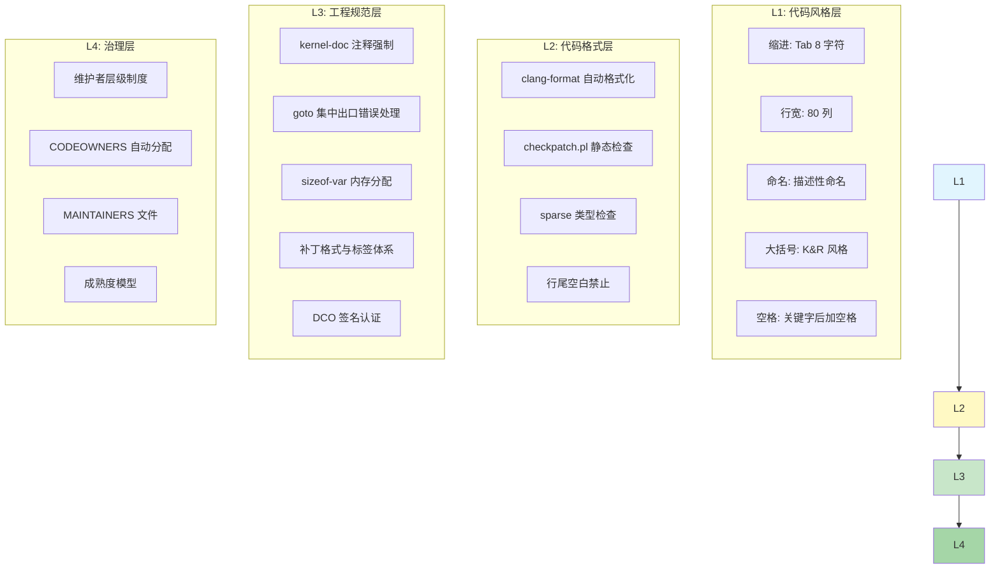

Copyright (c) 2025-2026 SPHARX Ltd. All Rights Reserved.

# 编码规范与工程标准对照

> **文档定位**: 闭源内部参考，参考发行版编码规范与工程标准全面对照分析，作为 agent-linux 工程标准规范的参考底座
> **保密级别**: SPHARX Ltd 内部参考，**闭源不公开**
> **版本**: 0.1.1
> **最后更新**: 2026-07-07
> **参考源**: 参考发行版社区 + OLK-6.6（Linux 6.6 内核源码）
> **核心约束**: IRON-9 v2 同源且部分代码共享——[SC] 共享契约层 6 个头文件落地于 `include/airymax/`
> **关联文档**: `agent-linux基本工程标准规范.md`（11 类规则编号前缀，1026 行）

---

## 目录

- [第 1 章 文档说明](#第-1-章-文档说明)
- [第 2 章 参考发行版编码规范总览](#第-2-章-参考发行版编码规范总览)
- [第 3 章 代码风格规范对比](#第-3-章-代码风格规范对比)
- [第 4 章 代码格式标准对比](#第-4-章-代码格式标准对比)
- [第 5 章 注释与文档标准对比](#第-5-章-注释与文档标准对比)
- [第 6 章 错误处理规范对比](#第-6-章-错误处理规范对比)
- [第 7 章 内存安全标准对比](#第-7-章-内存安全标准对比)
- [第 8 章 测试标准对比](#第-8-章-测试标准对比)
- [第 9 章 审查流程规范对比](#第-9-章-审查流程规范对比)
- [第 10 章 工具链与自动化](#第-10-章-工具链与自动化)
- [第 11 章 参考发行版 vs agent-linux 标准对比表](#第-11-章-参考发行版-vs-agent-linux-标准对比表)
- [第 12 章 agent-linux 采纳决策](#第-12-章-agent-linux-采纳决策)
- [第 13 章 与 agent-linux 基本工程标准规范的融合](#第-13-章-与-agent-linux-基本工程标准规范的融合)
- [第 14 章 五维正交原则映射](#第-14-章-五维正交原则映射)
- [第 15 章 IRON-9 v2 三层模型标注](#第-15-章-iron-9-v2-三层模型标注)
- [第 16 章 agent-linux 差异化声明](#第-16-章-agent-linux-差异化声明)
- [第 17 章 相关文档与版本维护](#第-17-章-相关文档与版本维护)

---

## 第 1 章 文档说明

### 1.1 目的

本文档系统梳理参考发行版（OLK-6.6 内核基线）的编码规范与工程标准，作为 agent-linux 工程标准规范的对比参考底座。agent-linux 是一个微内核 AI Agent 操作系统，其工程标准在参考发行版内核编码规范的基础上，融合了自身的 IRON-9 v2 三层共享模型、五维正交 24 原则和 11 类规则编号体系，形成了独特的工程标准框架。

所有内容仅用于 SPHARX Ltd 内部参考，**严禁出现在任何开源文档**。

### 1.2 参考来源

| 来源 | 内容 | 路径 / URL |
|------|------|-----------|
| OLK-6.6 源码 | 参考发行版 LTS 6.6 内核源码 | Linux 6.6 源码根目录 |
| Linux 内核编码规范 | `Documentation/process/coding-style.rst` | OLK-6.6 内核文档 |
| Linux 内核提交规范 | `Documentation/process/submitting-patches.rst` | OLK-6.6 内核文档 |
| Linux 内核测试文档 | `Documentation/dev-tools/` | OLK-6.6 内核文档 |
| agent-linux 工程标准 | `agent-linux基本工程标准规范.md` | `docs-closed/agent-linux-dev/` |
| 五维正交 24 原则 | `00-architectural-principles.md` | agentrt 开源文档 |

### 1.3 三段式参考方法落地

| 阶段 | 内容 | 输出 |
|------|------|------|
| **第一段** | 参考发行版编码规范（本文档） | 闭源 `docs-closed/agent-linux-dev/10-references/openeuler-tech-reference/08-coding-standard-spec.md` |
| **第二段** | 参考行业最新编码规范 | MISRA C、Rust 安全编码指南、Google C++ Style Guide、SEI CERT C Coding Standard |
| **第三段** | 形成 agent-linux 技术方案 | 开源 `docs/docs-linux/50-engineering-standards/` + agent-linux 基本工程标准规范 |

### 1.4 IRON-9 v2 三层共享模型标注

| 标注 | 含义 | 共享程度 |
|------|------|----------|
| **[SC]** | Shared Contract 共享契约层 | 完全共享代码（`include/airymax/`） |
| **[SS]** | Semantic Same-origin 语义同源层 | API 签名同源，实现独立 |
| **[IND]** | Independent 完全独立层 | 各自独立实现 |

---

## 第 2 章 参考发行版编码规范总览

### 2.1 设计支柱

参考发行版的编码规范体系基于 Linux 内核 30+ 年工程传统的积淀，建立在以下 5 大设计支柱之上：

| 支柱 | 内涵 | 对应的内核文档 |
|------|------|--------------|
| **代码风格一致性** | 统一的缩进、命名、格式规则，确保代码可读性 | `Documentation/process/coding-style.rst` |
| **错误处理严谨性** | goto 集中出口模式、错误码返回约定、内存分配惯用法 | 内核源码中的普遍实践 |
| **注释与文档化** | kernel-doc 注释格式、ABI 文档化、设计意图透明 | `Documentation/doc-guide/` |
| **审查优先文化** | 所有补丁必须经过审查，维护者层级制度 | `Documentation/process/2.Process.rst` |
| **自动化强制执行** | checkpatch.pl、sparse、clang-tidy、KUnit 等工具链 | `scripts/checkpatch.pl` |

这些支柱是 Linux 内核工程思想的结晶，也是 agent-linux 工程标准三大支柱之一（Linux 内核工程思想）的核心来源。正如五维正交 E-7 文档即代码原则所强调的——好的规范本身就是文档，好的工具链本身就是规范。

### 2.2 编码规范体系层次

参考发行版的编码规范体系分为四个层次，从基础到进阶递进：



### 2.3 编码规范文档体系

| 文档 | 路径 | 内容 | agent-linux 参考 |
|------|------|------|-------------------|
| 编码风格 | `Documentation/process/coding-style.rst` | C 语言代码风格指南 | 第 3 章 代码规范 |
| 提交补丁 | `Documentation/process/submitting-patches.rst` | 补丁格式、标签、审查 | 第 5 章 开发流程 |
| 内核文档 | `Documentation/doc-guide/kernel-doc.rst` | kernel-doc 注释格式 | 第 2.3 节 注释规范 |
| 开发工具 | `Documentation/dev-tools/` | KUnit、kselftest、sparse、KASAN | 第 6 章 工具链与自动化 |
| 维护者 | `Documentation/process/maintainers.rst` | 维护者职责与治理 | 第 7 章 维护者制度 |
| 稳定版 | `Documentation/process/stable-kernel-rules.rst` | 稳定版维护规则 | 第 5.5 节 稳定版维护 |
| 安全漏洞 | `Documentation/process/security-bugs.rst` | 安全漏洞上报流程 | 安全工程规范 |

---

## 第 3 章 代码风格规范对比

### 3.1 C 语言内核代码风格

#### 3.1.1 缩进规则

参考发行版（基于 Linux 内核）使用 **Tab 缩进，Tab 宽度为 8 字符**。这不是审美选择，而是工程约束——当缩进超过 3 层时，代码已经顶到屏幕右边缘，这是函数需要拆分的物理信号。

| 维度 | 参考发行版（Linux 内核） | agent-linux |
|------|------------------------|--------------|
| 缩进字符 | Tab（8 字符宽） | Tab（8 字符宽）——完全一致 |
| 缩进规则 | 嵌套超过 3 层应拆分函数 | 嵌套超过 3 层应拆分函数——完全一致 |
| 规则编号 | 无编号体系 | OS-FMT-001 |
| 五维原则 | 无显式标注 | A-1 极简主义原则 |

**agent-linux 额外要求**：
- 其他语言各自遵循生态规范：Rust 4 空格、Python 4 空格（PEP 8）、TypeScript 2 空格
- 这是五维正交 A-1 极简主义原则的多语言栈统一体现——每种语言使用其生态中最自然的缩进方式

#### 3.1.2 行宽规则

| 维度 | 参考发行版（Linux 内核） | agent-linux |
|------|------------------------|--------------|
| C 代码行宽 | 首选 80 列 | 首选 80 列——完全一致 |
| 超出行宽含义 | 嵌套过深或表达式过于复杂 | 嵌套过深或表达式过于复杂——完全一致 |
| 规则编号 | 无编号体系 | OS-FMT-002 |
| 其他语言 | 无明确定义 | Rust 100 列、Python 100 列、TypeScript 100 列 |

#### 3.1.3 大括号风格

参考发行版与 agent-linux 均使用 **K&R 风格**：非函数块的左括号放在行末，函数定义的左括号放在行首。

```c
/* 函数：左括号新起一行（参考发行版与 agent-linux 完全一致） */
int agentrt_task_create(void)
{
    /* 非函数块：左括号放行末 */
    if (task == NULL) {
        return -EINVAL;
    }
}
```

| 维度 | 参考发行版（Linux 内核） | agent-linux |
|------|------------------------|--------------|
| 函数左括号 | 新起一行 | 新起一行——完全一致 |
| 非函数块左括号 | 行末 | 行末——完全一致 |
| 单语句块 | 不强制大括号（但有争议） | 强制大括号（OS-FMT-004）——更严格 |
| 规则编号 | 无编号体系 | OS-FMT-003、OS-FMT-004 |

**agent-linux 增强**：即使只有一条语句，也使用大括号包围。这是防止未来修改引入 bug 的防御性实践，体现了五维正交 A-2 极致细节原则。

#### 3.1.4 空格规则

| 规则 | 参考发行版（Linux 内核） | agent-linux |
|------|------------------------|--------------|
| 关键字后空格 | `if (`、`for (`、`while (` | 完全一致 |
| 括号内无空格 | `if (condition)` | 完全一致 |
| 二元运算符空格 | `a + b`、`a = b` | 完全一致 |
| 一元运算符无空格 | `!condition`、`-value` | 完全一致 |
| 指针 `*` 贴名字 | `char *p` | 完全一致 |
| 规则编号 | 无编号体系 | OS-FMT-005 |

#### 3.1.5 命名规范

| 维度 | 参考发行版（Linux 内核） | agent-linux |
|------|------------------------|--------------|
| 全局函数 | 描述性命名 | 描述性命名（OS-STD-001）——完全一致 |
| 局部变量 | 短小切题（i、tmp、buf） | 短小切题（OS-STD-002）——完全一致 |
| 常量宏 | 全大写 | 全大写（OS-STD-003）——完全一致 |
| 敏感术语 | 禁用 master/slave、blacklist/whitelist | 禁用（OS-BAN-001）——完全一致 |
| 专属前缀 | 无统一前缀体系 | `agentrt_*` + `airymaxos_*`（OS-STD-005）——agent-linux 独有 |

**agent-linux 独有的命名增强**：

- `agentrt_*` 前缀保留给 agentrt 同源 API
- `airymaxos_*` 前缀用于 agent-linux 内核/发行版专属 API
- 两者共享 Airymax 同源语义，但代码归属与 ABI 边界不同，前缀隔离确保无适配层互操作时不冲突

#### 3.1.6 类型规范

| 维度 | 参考发行版（Linux 内核） | agent-linux |
|------|------------------------|--------------|
| 内核内部类型 | `u8/u16/u32/u64` | `u8/u16/u32/u64`（OS-STD-010）——完全一致 |
| 用户空间类型 | `__u32` 等 | `__u32` 等——完全一致 |
| typedef 限制 | 严格限制（仅 5 种例外） | 严格限制（仅 5 种例外）——完全一致 |
| bool 使用 | 仅用于返回值与栈变量 | 仅用于返回值与栈变量（OS-STD-011）——完全一致 |

### 3.2 Rust 语言内核代码风格

#### 3.2.1 参考发行版的 Rust 内核支持

参考发行版 OLK-6.6 基线包含 Rust 内核模块支持，位于 `rust/` 目录。Rust 内核模块主要用于安全敏感且非热路径的子系统（如安全策略、文件系统解析）。

| 维度 | 参考发行版（OLK-6.6） | agent-linux |
|------|----------------------|--------------|
| Rust 版本 | Rust 2021 edition | Rust 2021 edition——完全一致 |
| 内核模块约束 | `#![no_std]`，禁止 `std` 依赖 | `#![no_std]`，禁止 `std` 依赖——完全一致 |
| unsafe 安全注释 | 无强制要求 | 所有 `unsafe` 块必须有 `// SAFETY:` 注释 |
| 格式工具 | rustfmt | rustfmt——完全一致 |
| 缩进 | 4 空格 | 4 空格——完全一致 |
| 行宽 | 100 列 | 100 列——完全一致 |

**agent-linux 增强**：所有 `unsafe` 块必须有 `// SAFETY:` 注释说明安全性理由。这是五维正交 E-1 安全内生原则在 Rust 代码中的直接体现——每个 unsafe 点都必须有安全性论证。

### 3.3 函数规范

#### 3.3.1 函数长度

| 维度 | 参考发行版（Linux 内核） | agent-linux |
|------|------------------------|--------------|
| 函数长度 | 应一屏可读 | 应一屏可读（约 80x24 字符）（OS-STD-006）——完全一致 |
| 局部变量数 | 不超过 5-10 个 | 不超过 5-10 个——完全一致 |
| 超出限度的处理 | 拆分为子函数 | 拆分为子函数——完全一致 |

#### 3.3.2 函数原型

| 维度 | 参考发行版（Linux 内核） | agent-linux |
|------|------------------------|--------------|
| 元素顺序 | storage class → attributes → return type → name → params | 完全一致（OS-STD-007） |
| 示例 | `static __always_inline void *foo(...)` | `static __always_inline void *agentrt_get_private(...)` |

#### 3.3.3 返回值约定

| 维度 | 参考发行版（Linux 内核） | agent-linux |
|------|------------------------|--------------|
| 命令式函数 | 返回错误码（0 = 成功，-Exxx = 失败） | 完全一致（OS-STD-004） |
| 谓词式函数 | 返回 `bool` | 完全一致 |
| 混合约定 | 禁止混合 | 禁止混合——完全一致 |

---

## 第 4 章 代码格式标准对比

### 4.1 clang-format 配置

#### 4.1.1 参考发行版的 clang-format 使用

参考发行版（Linux 内核社区）对 clang-format 的支持经历了从争议到逐步接受的过程。Linux 内核主线提供了 `.clang-format` 配置文件，但并非强制使用——checkpatch.pl 仍然是主要的格式检查工具。

| 维度 | 参考发行版（Linux 内核） | agent-linux |
|------|------------------------|--------------|
| 强制程度 | 可选（checkpatch 优先级更高） | 强制（OS-FMT-007），CI 中 `make format-check` |
| 基础风格 | LLVM（BasedOnStyle: LLVM） | LLVM——完全一致 |
| 缩进宽度 | 8（IndentWidth: 8） | 8——完全一致 |
| Tab 使用 | Always（UseTab: Always） | Always——完全一致 |
| 大括号风格 | Linux（BreakBeforeBraces: Linux） | Linux——完全一致 |
| 指针对齐 | Right（PointerAlignment: Right） | Right——完全一致 |

#### 4.1.2 agent-linux 增强的 clang-format 配置

agent-linux 在参考发行版基础上扩展了以下配置项：

```yaml
BasedOnStyle: LLVM
IndentWidth: 8
UseTab: Always
TabWidth: 8
ColumnLimit: 80
BreakBeforeBraces: Linux
PointerAlignment: Right
SpaceAfterCStyleCast: true
ForEachMacros:
  - 'list_for_each_entry'
  - 'agentrt_for_each_task'
  - 'agentrt_for_each_channel'
  - 'agentrt_for_each_cupola'
  # ... 完整列表参见 kernel/.clang-format
```

**关键差异**：agent-linux 在 `ForEachMacros` 中添加了 `agentrt_for_each_*` 系列宏，确保自研的迭代宏也能被 clang-format 正确识别。

### 4.2 checkpatch.pl 集成

#### 4.2.1 参考发行版的 checkpatch 使用

`scripts/checkpatch.pl` 是 Linux 内核社区最核心的代码风格检查工具，在参考发行版中作为补丁提交前的强制检查项。checkpatch 的检查项涵盖：

| 检查项 | 说明 | 参考发行版要求 |
|--------|------|--------------|
| 代码风格 | 缩进、行宽、空格、大括号 | ERROR 级别阻断 |
| 命名规范 | CamelCase 警告 | WARNING 级别 |
| 注释格式 | kernel-doc 缺失 | WARNING 级别 |
| 敏感术语 | master/slave、blacklist/whitelist | WARNING 级别 |
| 内存分配 | 使用 `sizeof(*p)` 而非 `sizeof(struct xxx)` | CHECK 级别 |
| 字符串操作 | strcpy/strncpy 禁止 | ERROR 级别 |
| 行尾空白 | 行尾禁止空白 | ERROR 级别 |

#### 4.2.2 agent-linux 的 checkpatch 集成

| 维度 | 参考发行版（Linux 内核） | agent-linux |
|------|------------------------|--------------|
| 强制程度 | 所有补丁提交前必须通过 | 所有补丁提交前必须通过（OS-STD-030）——完全一致 |
| CI 集成 | 开发者自理 | CI 中强制运行，ERROR 阻断合并——更严格 |
| 规则编号 | 无编号体系 | OS-STD-030 |

agent-linux 在 CI 中强制运行 checkpatch，任何 ERROR 级别问题阻断合并。这是五维正交 E-2 可观测性原则的工程化——每个违规都是可观测的，可追溯的，可通过 CI 日志定位到具体文件与行号。

### 4.3 rustfmt 配置

| 维度 | 参考发行版（OLK-6.6） | agent-linux |
|------|----------------------|--------------|
| 强制程度 | 社区惯例 | 强制（CI 中 `cargo fmt --check`） |
| 缩进 | 4 空格 | 4 空格——完全一致 |
| 行宽 | 100 列 | 100 列——完全一致 |
| edition | 2021 | 2021——完全一致 |

### 4.4 行尾空白禁止

| 维度 | 参考发行版（Linux 内核） | agent-linux |
|------|------------------------|--------------|
| 行尾空白 | 禁止 | 禁止（OS-FMT-006）——完全一致 |
| 检查工具 | checkpatch.pl | checkpatch.pl + CI pre-commit hook |
| 五维原则 | 无显式标注 | A-2 极致细节原则 |

---

## 第 5 章 注释与文档标准对比

### 5.1 kernel-doc 注释格式

#### 5.1.1 参考发行版的 kernel-doc 规范

kernel-doc 是 Linux 内核的标准文档注释格式，从 C 源码中提取结构化注释生成文档。参考发行版要求所有 EXPORTed 函数、公共结构体、公共枚举必须包含完整的 kernel-doc 注释。

```c
/**
 * function_name - 函数简短描述
 * @param1: 参数1描述
 * @param2: 参数2描述
 *
 * 详细描述。解释函数的用途、设计决策、非显而易见的假设。
 *
 * 上下文: 调用上下文要求（进程上下文/中断上下文）
 * 返回: 返回值说明
 */
```

#### 5.1.2 对比分析

| 维度 | 参考发行版（Linux 内核） | agent-linux |
|------|------------------------|--------------|
| 格式 | kernel-doc 标准格式 | kernel-doc 标准格式——完全一致 |
| 适用范围 | EXPORTed 函数、公共结构体、公共枚举 | 完全一致（OS-STD-008） |
| 验证工具 | `scripts/kernel-doc` | `scripts/kernel-doc`——完全一致 |
| 验证要求 | 无警告 | 无警告（OS-STD-008）——完全一致 |
| 注释原则 | 解释"为什么"而非"是什么" | 解释"为什么"而非"是什么"（OS-STD-009）——完全一致 |
| 规则编号 | 无编号体系 | OS-STD-008、OS-STD-009 |

**agent-linux 增强**：注释必须通过 `scripts/kernel-doc` 验证无警告，并在 CI 中强制运行。这与五维正交 E-7 文档即代码原则一致——文档从代码中自动提取，而非手动维护。

### 5.2 Rust doc 注释

| 维度 | 参考发行版（OLK-6.6） | agent-linux |
|------|----------------------|--------------|
| 格式 | `///` 行注释 + `//!` 模块注释 | 完全一致 |
| 文档测试 | `cargo test --doc` | `cargo test --doc`——完全一致 |
| 安全性注释 | 无强制要求 | `// SAFETY:` 注释强制（五维正交 E-1 安全内生） |

### 5.3 Doxygen 与 Python/TypeScript 文档

#### 5.3.1 Python 文档

| 维度 | 参考发行版 | agent-linux |
|------|-----------|--------------|
| 格式 | PEP 257 docstring | PEP 257 docstring——完全一致 |
| 类型注解 | mypy strict 模式 | mypy strict 模式——完全一致 |

#### 5.3.2 TypeScript 文档

| 维度 | 参考发行版 | agent-linux |
|------|-----------|--------------|
| 格式 | JSDoc 风格 | JSDoc 风格——完全一致 |
| 严格模式 | `strict: true` | `strict: true`——完全一致 |

---

## 第 6 章 错误处理规范对比

### 6.1 goto 集中出口模式

#### 6.1.1 参考发行版的 goto 错误处理

参考发行版（Linux 内核）使用 goto 集中出口模式作为错误处理的标准范式。这是 Linux 内核 30+ 年沉淀的最优错误处理模式：

```c
struct foo *foo_alloc_and_init(void)
{
    struct foo *f;
    void *data;

    f = kzalloc(sizeof(*f), GFP_KERNEL);
    if (!f)
        return ERR_PTR(-ENOMEM);

    data = kzalloc(SIZE, GFP_KERNEL);
    if (!data)
        goto out_free_f;

    /* ... 初始化 ... */
    return f;

out_free_data:
    kfree(data);
out_free_f:
    kfree(f);
    return ERR_PTR(-ENOMEM);
}
```

**核心原则**：
- 分级标签按分配逆序释放
- 每个标签只释放对应资源
- 函数出口统一，避免多处 return 散布资源释放代码

#### 6.1.2 对比分析

| 维度 | 参考发行版（Linux 内核） | agent-linux |
|------|------------------------|--------------|
| 错误处理范式 | goto 集中出口模式 | goto 集中出口模式（OS-KER-001）——完全一致 |
| 强制程度 | 社区惯例 | 全内核强制——更严格 |
| 规则编号 | 无编号体系 | OS-KER-001 |
| 五维原则 | 无显式标注 | E-3 资源确定性原则 |

### 6.2 禁止 BUG()/BUG_ON()

| 维度 | 参考发行版（Linux 内核） | agent-linux |
|------|------------------------|--------------|
| 立场 | 建议避免，但内核中存在大量使用 | 强制禁止（OS-BAN-002）——更严格 |
| 替代方案 | WARN()/WARN_ON_ONCE() | WARN()/WARN_ON_ONCE() + 恢复代码 |
| 理由 | 内核崩溃不是可接受的错误处理 | 内核崩溃不是可接受的错误处理——完全一致 |

### 6.3 内存分配惯用法

| 维度 | 参考发行版（Linux 内核） | agent-linux |
|------|------------------------|--------------|
| sizeof 用法 | `sizeof(*p)` 优先 | `sizeof(*p)` 强制（OS-BAN-003）——更严格 |
| 数组分配 | `kmalloc_array`/`kcalloc` | `kmalloc_array`/`kcalloc`——完全一致 |
| 溢出检查 | 隐式（通过 kmalloc_array） | 显式要求——完全一致 |

### 6.4 字符串操作安全

| 维度 | 参考发行版（Linux 内核） | agent-linux |
|------|------------------------|--------------|
| strcpy | 禁止 | 禁止（OS-BAN-004）——完全一致 |
| strncpy | 禁止 | 禁止——完全一致 |
| strlcpy | 禁止 | 禁止——完全一致 |
| strscpy | 强制使用 | 强制使用——完全一致 |

### 6.5 Rust 错误处理

| 维度 | 参考发行版（OLK-6.6） | agent-linux |
|------|----------------------|--------------|
| 错误类型 | `Result<T, E>` | `Result<T, E>`——完全一致 |
| 内核错误映射 | `kernel::error::Error` → errno | `kernel::error::Error` → errno——完全一致 |
| panic 策略 | 内核中不允许 panic | 内核中不允许 panic——完全一致 |

---

## 第 7 章 内存安全标准对比

### 7.1 所有权模型

#### 7.1.1 参考发行版的 Rust 所有权

参考发行版通过 Rust 内核模块引入所有权模型，在编译期消除 use-after-free、double-free、数据竞争等内存安全问题。C 语言内核代码则依赖开发者纪律和静态分析工具（sparse、KASAN、KMSAN）来检测内存安全违规。

| 维度 | 参考发行版（C 代码） | 参考发行版（Rust 代码） | agent-linux |
|------|---------------------|----------------------|--------------|
| 所有权 | 无编译期所有权（依赖开发者纪律） | 编译期所有权检查 | 同参考发行版 Rust 规范 |
| 借用检查 | 无 | 编译期借用检查 | 同参考发行版 Rust 规范 |
| 生命周期 | 无 | 编译期生命周期标注 | 同参考发行版 Rust 规范 |

### 7.2 RCU（Read-Copy-Update）

| 维度 | 参考发行版（Linux 内核） | agent-linux |
|------|------------------------|--------------|
| RCU 机制 | `rcu_read_lock()`/`rcu_read_unlock()` | 完全一致 |
| 适用场景 | 读多写少的共享数据结构 | 完全一致 |
| Sparse 注解 | `__rcu` 稀疏注解 | 完全一致 |

### 7.3 lockdep（锁依赖检查器）

| 维度 | 参考发行版（Linux 内核） | agent-linux |
|------|------------------------|--------------|
| 锁分类 | lockdep 自动分类 | 完全一致 |
| 死锁检测 | 锁依赖图 + 循环检测 | 完全一致 |
| 报告格式 | 锁依赖链 + 回溯 | 完全一致 |

### 7.4 KASAN/KMSAN 内存错误检测

| 维度 | 参考发行版（Linux 内核） | agent-linux |
|------|------------------------|--------------|
| KASAN（地址消毒） | 支持 | 支持——完全一致 |
| KMSAN（内存消毒） | 支持 | 支持——完全一致 |
| KFENCE（轻量采样） | 支持 | 支持——完全一致 |
| UBSAN（未定义行为） | 支持 | 支持——完全一致 |

### 7.5 内存安全与五维正交原则

agent-linux 的内存安全标准体系直接体现了五维正交 E-1 安全内生原则——安全不是附加功能，而是从编译期（Rust 所有权）、运行时（KASAN/KMSAN）、锁检查（lockdep）三个维度同时内建于系统之中。这与五维正交 E-3 资源确定性原则形成互补——所有权确保资源不泄漏，KASAN 确保资源使用不越界。

---

## 第 8 章 测试标准对比

### 8.1 KUnit 单元测试框架

#### 8.1.1 参考发行版的 KUnit

参考发行版通过 KUnit 框架提供内核单元测试能力。KUnit 是 Linux 内核的轻量级单元测试框架，运行在内核态，可直接测试内核内部函数。

| 维度 | 参考发行版（Linux 内核） | agent-linux |
|------|------------------------|--------------|
| 测试框架 | KUnit | KUnit——完全一致 |
| 运行环境 | 内核态（kunit_tool 或手动加载） | 内核态——完全一致 |
| 断言宏 | `KUNIT_EXPECT_*`、`KUNIT_ASSERT_*` | 完全一致 |
| CI 集成 | 可选 | 强制（OS-TEST-001）——更严格 |
| 覆盖率门槛 | 无统一门槛 | 80%（OS-ACC-001）——agent-linux 独有 |
| 规则编号 | 无编号体系 | OS-TEST-001、OS-ACC-001 |

#### 8.1.2 KUnit 测试示例

```c
#include <kunit/test.h>

static void agentrt_task_test(struct kunit *test)
{
    struct agentrt_task *task;

    task = agentrt_task_create("test_task", AGENTRT_TASK_PENDING);
    KUNIT_ASSERT_NOT_ERR_OR_NULL(test, task);
    KUNIT_EXPECT_EQ(test, task->state, AGENTRT_TASK_PENDING);

    agentrt_task_destroy(task);
}

static struct kunit_case agentrt_task_cases[] = {
    KUNIT_CASE(agentrt_task_test),
    {}
};

static struct kunit_suite agentrt_task_suite = {
    .name = "agentrt_task",
    .test_cases = agentrt_task_cases,
};
kunit_test_suite(agentrt_task_suite);
```

### 8.2 kselftest 集成测试

| 维度 | 参考发行版（Linux 内核） | agent-linux |
|------|------------------------|--------------|
| 测试框架 | kselftest | kselftest——完全一致 |
| 运行环境 | 用户态 | 用户态——完全一致 |
| 测试范围 | 系统调用、子系统功能 | 系统调用、AgentsIPC、调度器行为 |
| CI 集成 | 可选 | 强制（OS-TEST-001）——更严格 |

### 8.3 Rust 测试框架

| 维度 | 参考发行版（OLK-6.6） | agent-linux |
|------|----------------------|--------------|
| 单元测试 | `#[test]` + `cargo test` | 完全一致 |
| 文档测试 | `cargo test --doc` | 完全一致 |
| 测试覆盖率 | 无统一门槛 | 80%（OS-ACC-001）——agent-linux 独有 |

### 8.4 测试覆盖层次

agent-linux 在参考发行版测试体系基础上，建立了 4 层测试覆盖体系：

```mermaid
graph TB
    subgraph "L1: 单元测试"
        U1[KUnit: 内核函数单元测试]
        U2[Rust: #[test] 单元测试]
        U3[Python: pytest 单元测试]
    end
    subgraph "L2: 集成测试"
        I1[kselftest: 系统调用测试]
        I2[契约测试: AgentsIPC 协议]
        I3[端到端测试: 数据流验证]
    end
    subgraph "L3: 安全测试"
        S1[Fuzzing: syzkaller]
        S2[Fault injection: fail_function]
        S3[安全扫描: CodeQL + Coverity]
    end
    subgraph "L4: 性能测试"
        P1[基准测试: perf + flamegraph]
        P2[回归测试: 性能时间序列]
        P3[压力测试: stress-ng]
    end
    L1 --> L2 --> L3 --> L4
    style L1 fill:#e1f5fe
    style L2 fill:#fff9c4
    style L3 fill:#fecaca
    style L4 fill:#c8e6c9
```

---

## 第 9 章 审查流程规范对比

### 9.1 补丁提交规范

#### 9.1.1 参考发行版的补丁格式

参考发行版（Linux 内核社区）使用邮件列表补丁提交流程，agent-linux 使用 GitHub Pull Request 流程，但补丁格式与标签体系保持一致。

| 维度 | 参考发行版（Linux 内核） | agent-linux |
|------|------------------------|--------------|
| 提交方式 | 邮件列表（`git send-email`） | GitHub Pull Request |
| 补丁格式 | subsystem: 简短摘要（50-72 字符） | 完全一致（OS-STD-020） |
| 详细描述 | 解释为什么而非做了什么 | 完全一致 |
| Signed-off-by | 强制（DCO） | 强制（OS-IRON-007）——完全一致 |
| 规则编号 | 无编号体系 | OS-STD-020、OS-IRON-007 |

#### 9.1.2 标签体系对照

| 标签 | 参考发行版（Linux 内核） | agent-linux | 一致性 |
|------|------------------------|--------------|--------|
| `Signed-off-by:` | DCO 认证 | DCO 认证 | 完全一致 |
| `Reviewed-by:` | 审查通过声明 | 审查通过声明 | 完全一致 |
| `Acked-by:` | 知悉且不反对 | 知悉且不反对 | 完全一致 |
| `Tested-by:` | 测试通过声明 | 测试通过声明 | 完全一致 |
| `Fixes:` | 修复的 commit SHA | 修复的 commit SHA | 完全一致 |
| `Closes:` | 无（使用 Link:） | 关闭的 Issue 编号 | agent-linux 独有（GitHub 原生） |
| `Link:` | 相关讨论链接 | 相关讨论链接 | 完全一致 |
| `Co-developed-by:` | 共同开发者 | 共同开发者 | 完全一致 |
| `Reported-by:` | 问题报告者 | 问题报告者 | 完全一致 |
| `Suggested-by:` | 建议提出者 | 建议提出者 | 完全一致 |

### 9.2 审查流程

#### 9.2.1 参考发行版的审查流程

参考发行版（Linux 内核社区）的审查流程基于邮件列表，包含以下步骤：

1. 贡献者通过 `git send-email` 发送补丁至邮件列表
2. 维护者或社区成员审查代码，通过邮件回复提供反馈
3. 贡献者根据反馈修订补丁，重新发送（v2、v3...）
4. 维护者确认后添加 Reviewed-by 标签
5. 子系统维护者将补丁纳入自己的树
6. 顶层维护者定期向 Linus 发送 Pull Request

#### 9.2.2 agent-linux 的审查流程

agent-linux 使用 GitHub Pull Request 流程，但审查理念与参考发行版完全一致：

1. 贡献者提交 PR（Pull Request），填写 PR 模板
2. CODEOWNERS 自动分配审查者
3. 审查者在 2 周内提供反馈
4. 贡献者响应反馈、修订补丁
5. 审查者最终确认并添加 Reviewed-by 标签
6. 顶层维护者合并入 develop 分支

| 维度 | 参考发行版（Linux 内核） | agent-linux |
|------|------------------------|--------------|
| 提交方式 | 邮件列表 | GitHub Pull Request |
| 审查者分配 | 邮件列表订阅 + 维护者主动 | CODEOWNERS 自动分配 |
| 审查时限 | 无硬性 SLA | 2 周内响应 |
| 审查文化 | 批评代码，不批评人 | 批评代码，不批评人——完全一致 |
| 审查原则 | 审查是知识传递，不是对抗 | 审查是知识传递，不是对抗——完全一致 |

### 9.3 维护者层级制度

| 维度 | 参考发行版（Linux 内核） | agent-linux |
|------|------------------------|--------------|
| 层级模型 | Lieutenant System（副官制） | Lieutenant System——完全一致 |
| 总维护者 | Linus Torvalds | Chief Maintainer |
| 顶层维护者 | 子系统顶层维护者 | 8 子仓各一名 Top-level Maintainer |
| 子系统维护者 | 具体子系统负责人 | 具体子系统负责人 |
| 贡献者 | 提交补丁 | 提交补丁——完全一致 |

### 9.4 稳定版维护规则

| 维度 | 参考发行版（Linux 内核） | agent-linux |
|------|------------------------|--------------|
| 接受类型 | 关键 bug 修复、安全修复、构建修复、文档修正 | 完全一致（OS-STD-021） |
| 禁止类型 | 新特性、代码重构、行为变更、ABI 变更 | 完全一致 |
| 规则编号 | 无编号体系 | OS-STD-021 |

---

## 第 10 章 工具链与自动化

### 10.1 参考发行版的工具链

参考发行版（OLK-6.6）支持以下编译器与工具链：

| 工具 | 版本要求 | 用途 |
|------|---------|------|
| GCC | >= 5.1 | 默认 C 编译器 |
| Clang/LLVM | >= 11.0 | 备选 C 编译器 + BPF 编译器 |
| Rust | >= 1.73.0 | Rust 内核模块编译器 |
| GNU Make | >= 4.0 | 构建系统 |
| sparse | >= 0.6.4 | 静态类型检查 |

### 10.2 agent-linux 的 7 层自动化验证

agent-linux 在参考发行版工具链基础上，建立了 7 层自动化验证体系，确保每条规范都被强制执行：

| 层级 | 验证内容 | 工具 | 阻断条件 | 与参考发行版的关系 |
|------|---------|------|----------|------------------|
| L1 编译期 | 编译警告、禁用函数 | `-Werror`、`banned_functions.h` | 任何警告/禁用函数使用 | 参考发行版使用 `-Wall` 但非 `-Werror` |
| L2 静态分析 | 代码质量、潜在 bug | clang-tidy、cppcheck、sparse | 新增警告 | 参考发行版仅使用 sparse |
| L3 预提交 | 格式检查、基础规则 | pre-commit hooks | 格式不符合 | agent-linux 独有 |
| L4 CI 门禁 | 构建、单元测试、BAN 规则 | quality-gate.sh | 构建失败/测试失败/规则违反 | agent-linux 独有 |
| L5 集成测试 | 端到端数据流 | KUnit + kselftest | 集成测试失败 | 参考发行版有但非强制 CI |
| L6 覆盖率 | 行覆盖率 | gcov + lcov | 覆盖率 < 80% | 参考发行版无统一覆盖率门槛 |
| L7 安全扫描 | 安全漏洞 | Coverity + CodeQL | Critical/High 漏洞 | 参考发行版有但非强制 CI |

**agent-linux 增强的核心差异**：
- 参考发行版的工具链主要依赖开发者自律，agent-linux 将工具链从"建议"升级为"强制 CI 阻断"
- 参考发行版无统一的覆盖率门槛，agent-linux 设定 80% 覆盖率门槛（OS-ACC-001）
- 参考发行版无统一的 BAN 规则 CI 检查，agent-linux 通过 quality-gate.sh 强制执行

### 10.3 CI/CD 流水线

agent-linux 的 CI/CD 流水线参考了参考发行版的检查理念，但实现了更严格的自动化：

```
PR 提交
  → L1 编译检查（GCC + Clang 双编译器）
  → L2 静态分析（clang-tidy + cppcheck + sparse）
  → L3 格式检查（clang-format + checkpatch + rustfmt）
  → L4 单元测试（KUnit + cargo test）
  → L5 集成测试（kselftest）
  → L6 覆盖率报告（gcov + lcov，门槛 80%）
  → L7 安全扫描（CodeQL）
  → 审查者分配（CODEOWNERS）
  → 审查通过
  → 合并入 develop
```

---

## 第 11 章 参考发行版 vs agent-linux 标准对比表

### 11.1 代码风格对比

| 维度 | 参考发行版 | agent-linux | 一致性 | 规则编号 |
|------|-----------|--------------|--------|----------|
| 缩进（C） | Tab 8 字符 | Tab 8 字符 | 一致 | OS-FMT-001 |
| 行宽（C） | 80 列 | 80 列 | 一致 | OS-FMT-002 |
| 大括号（C） | K&R 风格 | K&R 风格 | 一致 | OS-FMT-003 |
| 单语句块大括号 | 不强制 | 强制 | **更严格** | OS-FMT-004 |
| 空格规则 | 关键字后空格 | 关键字后空格 | 一致 | OS-FMT-005 |
| 行尾空白 | 禁止 | 禁止 | 一致 | OS-FMT-006 |
| 全局函数命名 | 描述性命名 | 描述性命名 | 一致 | OS-STD-001 |
| 局部变量命名 | 短小切题 | 短小切题 | 一致 | OS-STD-002 |
| 常量宏 | 全大写 | 全大写 | 一致 | OS-STD-003 |
| 敏感术语 | 禁用 | 禁用 | 一致 | OS-BAN-001 |
| 专属前缀 | 无 | `agentrt_*` + `airymaxos_*` | **agent-linux 独有** | OS-STD-005 |
| 类型规范 | u8/u16/u32/u64 | u8/u16/u32/u64 | 一致 | OS-STD-010 |

### 11.2 代码格式对比

| 维度 | 参考发行版 | agent-linux | 一致性 | 规则编号 |
|------|-----------|--------------|--------|----------|
| clang-format | 可选 | 强制 | **更严格** | OS-FMT-007 |
| checkpatch.pl | 提交前检查 | CI 强制检查 | **更严格** | OS-STD-030 |
| rustfmt | 社区惯例 | CI 强制 | **更严格** | — |
| 其他语言格式 | 无 | Black + isort + ESLint | **agent-linux 独有** | — |

### 11.3 注释与文档对比

| 维度 | 参考发行版 | agent-linux | 一致性 | 规则编号 |
|------|-----------|--------------|--------|----------|
| C 注释格式 | kernel-doc | kernel-doc | 一致 | OS-STD-008 |
| Rust 注释格式 | `///` | `///` | 一致 | — |
| 注释原则 | 解释"为什么" | 解释"为什么" | 一致 | OS-STD-009 |
| kernel-doc 验证 | 无警告要求 | CI 强制无警告 | **更严格** | OS-STD-008 |
| Rust SAFETY 注释 | 无强制 | 强制 | **更严格** | — |

### 11.4 错误处理对比

| 维度 | 参考发行版 | agent-linux | 一致性 | 规则编号 |
|------|-----------|--------------|--------|----------|
| goto 集中出口 | 社区惯例 | 全内核强制 | **更严格** | OS-KER-001 |
| BUG()/BUG_ON() | 建议避免 | 强制禁止 | **更严格** | OS-BAN-002 |
| sizeof(*p) | 优先 | 强制 | **更严格** | OS-BAN-003 |
| strcpy/strncpy | 禁止 | 禁止 | 一致 | OS-BAN-004 |
| 返回值约定 | 0/-Exxx | 0/-Exxx | 一致 | OS-STD-004 |

### 11.5 内存安全对比

| 维度 | 参考发行版 | agent-linux | 一致性 |
|------|-----------|--------------|--------|
| Rust 所有权 | 编译期 | 编译期 | 一致 |
| RCU | 支持 | 支持 | 一致 |
| lockdep | 支持 | 支持 | 一致 |
| KASAN | 支持 | 支持 | 一致 |
| KMSAN | 支持 | 支持 | 一致 |
| KFENCE | 支持 | 支持 | 一致 |

### 11.6 测试标准对比

| 维度 | 参考发行版 | agent-linux | 一致性 | 规则编号 |
|------|-----------|--------------|--------|----------|
| 单元测试框架 | KUnit | KUnit | 一致 | OS-TEST-001 |
| 集成测试框架 | kselftest | kselftest | 一致 | OS-TEST-001 |
| Rust 测试 | cargo test | cargo test | 一致 | — |
| 覆盖率门槛 | 无 | 80%（关键路径 90%） | **agent-linux 独有** | OS-ACC-001 |
| 测试 CI 强制 | 可选 | 强制 | **更严格** | — |

### 11.7 审查流程对比

| 维度 | 参考发行版 | agent-linux | 一致性 |
|------|-----------|--------------|--------|
| 补丁格式 | subsystem: 简短摘要 | 完全一致 | 一致 |
| 提交方式 | 邮件列表 | GitHub Pull Request | **不同** |
| 审查者分配 | 邮件列表 | CODEOWNERS 自动 | **不同** |
| DCO | 强制 | 强制 | 一致 |
| 维护者层级 | Lieutenant System | Lieutenant System | 一致 |
| 稳定版规则 | 仅接受修复 | 仅接受修复 | 一致 |

---

## 第 12 章 agent-linux 采纳决策

### 12.1 采纳项（14 项）

agent-linux 从参考发行版编码规范中采纳了以下核心实践，并在此基础上进行了增强：

| # | 采纳特性 | 来源 | agent-linux 落地 | 增强点 |
|---|---------|------|-------------------|--------|
| 1 | Tab 8 字符缩进 | coding-style.rst | OS-FMT-001 | 无 |
| 2 | 80 列行宽 | coding-style.rst | OS-FMT-002 | 无 |
| 3 | K&R 大括号风格 | coding-style.rst | OS-FMT-003 | 单语句块也强制大括号 |
| 4 | 空格规则 | coding-style.rst | OS-FMT-005 | 无 |
| 5 | 行尾空白禁止 | coding-style.rst | OS-FMT-006 | 无 |
| 6 | 描述性命名的全局符号 | coding-style.rst | OS-STD-001 | 新增 `agentrt_*`/`airymaxos_*` 前缀体系 |
| 7 | kernel-doc 注释格式 | kernel-doc.rst | OS-STD-008 | CI 强制无警告 |
| 8 | goto 集中出口错误处理 | 内核实践 | OS-KER-001 | 全内核强制 |
| 9 | sizeof(*p) 内存分配 | 内核实践 | OS-BAN-003 | 强制禁止 sizeof(struct) |
| 10 | strscpy 取代 strcpy/strncpy | 内核实践 | OS-BAN-004 | 无 |
| 11 | 补丁格式与标签体系 | submitting-patches.rst | OS-STD-020 | 新增 Closes: 标签 |
| 12 | DCO 签名认证 | 内核流程 | OS-IRON-007 | CI 自动验证 |
| 13 | 维护者层级制度 | 内核流程 | 第 7 章 | 8 子仓差异化 |
| 14 | 稳定版维护规则 | stable-kernel-rules.rst | OS-STD-021 | 无 |

### 12.2 不采纳项（3 项）

| # | 不采纳特性 | 来源 | 不采纳原因 | agent-linux 替代 |
|---|-----------|------|-----------|-------------------|
| 1 | 邮件列表补丁提交 | 内核流程 | 团队规模与协作效率；GitHub PR 提供更好的 CI 集成、代码审查 UI、自动化 | GitHub Pull Request + CODEOWNERS 自动分配 |
| 2 | 无覆盖率门槛 | 内核无统一要求 | 微内核 AI Agent OS 需要更高的质量保证；覆盖率是五维正交 E-8 可测试性原则的直接度量 | 80% 覆盖率门槛（OS-ACC-001），关键路径 90% |
| 3 | 检查工具可选 | 内核依赖开发者自律 | agent-linux 作为较新的项目，需要工具链强制执行来弥补团队规模 | 7 层自动化验证，全部 CI 强制阻断 |

### 12.3 增强项（6 项）

| # | 增强特性 | 基于的参考发行版特性 | agent-linux 增强 |
|---|---------|-------------------|-------------------|
| 1 | 11 类规则编号体系 | 无编号体系 | 每条规则可追溯、可引用、可自动化检查 |
| 2 | Rust `// SAFETY:` 注释强制 | Rust 内核模块 | 每个 unsafe 块必须有安全性论证 |
| 3 | 多语言栈统一格式规范 | 仅 C 语言有明确规范 | Rust/Python/TypeScript 统一格式规范 |
| 4 | 7 层自动化验证 | 分散的工具链 | 统一的 7 层 CI 流水线，层层阻断 |
| 5 | 五维正交原则映射 | 无显式标注 | 每条规则可追溯到五维正交 24 原则 |
| 6 | IRON-9 v2 三层共享模型 | 无 | [SC]/[SS]/[IND] 三层标注体系 |

---

## 第 13 章 与 agent-linux 基本工程标准规范的融合

### 13.1 融合架构

本文档（参考发行版编码规范对照）与 `agent-linux基本工程标准规范.md` 的关系如下：

```
agent-linux基本工程标准规范.md（1026 行，11 章）
    ├── 第 1 章 总则与工程标准框架
    ├── 第 2 章 代码规范 ←── 本文档第 3 章
    ├── 第 3 章 代码格式 ←── 本文档第 4 章
    ├── 第 4 章 工程思想
    ├── 第 5 章 开发流程 ←── 本文档第 9 章
    ├── 第 6 章 工具链与自动化 ←── 本文档第 10 章
    ├── 第 7 章 维护者制度与治理
    ├── 第 8 章 规范符合性检查
    ├── 第 9 章 IRON-9 v2 三层共享模型
    ├── 第 10 章 Euler 标准兼容性
    └── 第 11 章 禁词清单与处罚机制

本文档（08-coding-standard-spec.md）
    ├── 第 3 章 代码风格规范对比 → 输出到基本工程标准规范 §2
    ├── 第 4 章 代码格式标准对比 → 输出到基本工程标准规范 §3
    ├── 第 5 章 注释与文档标准对比 → 输出到基本工程标准规范 §2.3
    ├── 第 6 章 错误处理规范对比 → 输出到基本工程标准规范 §2.2.4
    ├── 第 7 章 内存安全标准对比 → 综合分析
    ├── 第 8 章 测试标准对比 → 输出到基本工程标准规范 §6
    ├── 第 9 章 审查流程规范对比 → 输出到基本工程标准规范 §5
    └── 第 10 章 工具链与自动化 → 输出到基本工程标准规范 §6
```

### 13.2 11 类规则编号前缀映射

agent-linux 基本工程标准规范定义了 11 类规则编号前缀，本文档涉及的规则编号映射如下：

| 编号前缀 | 含义 | 本文档涉及章节 | 对应参考发行版规范 |
|---------|------|--------------|------------------|
| **OS-IRON** | 工程铁律（不可妥协） | DCO 强制（§9.1.2） | Signed-off-by 强制 |
| **OS-BAN** | 禁止规则 | 敏感术语（§3.1.5）、BUG()禁止（§6.2）、sizeof(*p)（§6.3）、strcpy 禁止（§6.4） | coding-style.rst |
| **OS-STD** | 标准规则 | 命名规范（§3.1.5）、函数规范（§3.3）、注释（§5.1）、补丁格式（§9.1） | coding-style.rst + submitting-patches.rst |
| **OS-ACC** | 验收标准 | 覆盖率门槛（§8.1.1） | 无对应（agent-linux 独有） |
| **OS-KER** | 内核工程规则 | goto 集中出口（§6.1） | 内核实践 |
| **OS-DRV** | 驱动工程规则 | 未涉及 | — |
| **OS-BUILD** | 构建工程规则 | 未涉及 | — |
| **OS-TEST** | 测试工程规则 | KUnit/kselftest（§8.1、§8.2） | dev-tools/ |
| **OS-OBS** | 可观测性规则 | 未涉及 | — |
| **OS-SEC** | 安全工程规则 | 未涉及 | — |
| **OS-ABI** | ABI 稳定性规则 | 未涉及 | — |

### 13.3 参考发行版规范与 agent-linux 规则的对应关系

每条 agent-linux 规则都可以追溯到参考发行版编码规范的一条具体来源。这种"溯源"是五维正交 E-6 错误可追溯原则在规范层面的体现——每条规则的变化都有据可查。

---

## 第 14 章 五维正交原则映射

### 14.1 编码规范相关原则映射

agent-linux 的编码规范体系中，每一条增强或差异化决策都可以追溯到五维正交 24 原则中的一条或多条：

| 五维 | 原则 | 编号 | 在编码规范中的体现 |
|------|------|------|------------------|
| 系统观 | 层次分解 | S-2 | 4 层编码规范层次（风格→格式→规范→治理）、8 子仓差异化要求 |
| 系统观 | 总体设计部 | S-3 | 维护者层级制度、Chief Maintainer 最终决策 |
| 内核观 | 内核极简 | K-1 | 函数长度一屏可读约束、反过度抽象 |
| 内核观 | 接口契约化 | K-2 | kernel-doc 强制、ABI 文档化、补丁标签体系 |
| 内核观 | 可插拔策略 | K-4 | clang-format 配置可扩展（ForEachMacros 列表） |
| 工程观 | 安全内生 | E-1 | Rust `// SAFETY:` 注释强制、禁止 BUG()/BUG_ON()、KASAN/KMSAN 集成 |
| 工程观 | 可观测性 | E-2 | 7 层自动化验证、CI 日志可追溯、违规输出文件路径+行号 |
| 工程观 | 资源确定性 | E-3 | goto 集中出口、sizeof(*p) 强制、引用计数强制 |
| 工程观 | 命名语义化 | E-5 | 描述性全局命名、敏感术语禁用、`agentrt_*`/`airymaxos_*` 前缀 |
| 工程观 | 错误可追溯 | E-6 | Fixes:/Closes:/Link: 标签、DCO 签名链、CI 违规输出 |
| 工程观 | 文档即代码 | E-7 | kernel-doc 自动提取文档、CI 验证无警告 |
| 工程观 | 可测试性 | E-8 | KUnit + kselftest + 覆盖率 80% 门槛 |
| 设计美学 | 极简主义 | A-1 | 函数长度约束、反过度抽象、缩进 8 字符作为拆分信号 |
| 设计美学 | 细节关注 | A-2 | 行尾空白禁止、函数原型元素顺序、单语句块也加大括号 |
| 设计美学 | 人文关怀 | A-3 | 敏感术语禁用、审查礼仪（批评代码不批评人） |

### 14.2 编码规范中的五维原则提及位置

本文档中至少 3 处明确提及五维原则：

1. **第 2.1 节**：E-7 文档即代码原则——好的规范本身就是文档，好的工具链本身就是规范
2. **第 4.2.2 节**：E-2 可观测性原则——每个违规都是可观测的，可追溯的
3. **第 7.5 节**：E-1 安全内生原则 + E-3 资源确定性原则——安全与资源管理从编译期、运行时、锁检查三个维度同时内建
4. **第 13.3 节**：E-6 错误可追溯原则——每条规则的变化都有据可查

---

## 第 15 章 IRON-9 v2 三层模型标注

### 15.1 编码规范在 IRON-9 v2 中的归属

| 编码规范维度 | IRON-9 v2 层次 | 说明 |
|-------------|---------------|------|
| 代码风格（缩进、行宽、大括号、空格） | [IND] 完全独立 | 各项目独立定义，但 agent-linux 选择与参考发行版对齐 |
| 代码格式（clang-format、rustfmt） | [IND] 完全独立 | 配置文件独立维护，但核心参数与参考发行版一致 |
| kernel-doc 注释格式 | [SC] 共享契约层 | 注释格式是文档契约的一部分，kernel-doc 格式在 `include/airymax/` 头文件中共享 |
| 错误处理范式（goto 集中出口） | [SS] 语义同源 | 语义同源（参考发行版与 agent-linux 使用相同的错误处理范式），但实现独立 |
| 内存安全（所有权、RCU、lockdep） | [IND] 完全独立 | 各项目独立实现，但共享 Linux 内核的内存安全机制 |
| 测试框架（KUnit、kselftest） | [IND] 完全独立 | 测试用例独立编写，但共享 KUnit/kselftest 框架 |
| 审查流程（补丁格式、标签体系） | [SS] 语义同源 | 补丁格式与标签体系语义同源，但提交方式不同（邮件 vs PR） |
| 工具链（clang-format、checkpatch） | [IND] 完全独立 | 工具链独立配置，但核心工具共享开源生态 |

### 15.2 共享契约层编码规范

[SC] 共享契约层 6 个头文件（`include/airymax/`）中的代码必须同时满足 agent-linux 与 agentrt 的编码规范要求。这意味着：

- 6 个头文件中的代码必须通过两端 CI 的格式检查（双向校验）
- kernel-doc 注释格式必须一致，两端都能通过 `scripts/kernel-doc` 验证
- 命名必须使用 `agentrt_*` 前缀（共享契约层属于 agentrt 同源 API）
- 任何变更必须通过双向 CI 验证（agentrt + agent-linux CI 同时通过）

---

## 第 16 章 agent-linux 差异化声明

### 16.1 采纳项（14 项）

| # | 采纳特性 | 来源 | agent-linux 落地 |
|---|---------|------|-------------------|
| 1 | Tab 8 字符缩进 | coding-style.rst | OS-FMT-001 |
| 2 | 80 列行宽 | coding-style.rst | OS-FMT-002 |
| 3 | K&R 大括号风格 | coding-style.rst | OS-FMT-003 |
| 4 | 空格规则 | coding-style.rst | OS-FMT-005 |
| 5 | 行尾空白禁止 | coding-style.rst | OS-FMT-006 |
| 6 | 描述性命名的全局符号 | coding-style.rst | OS-STD-001 |
| 7 | kernel-doc 注释格式 | kernel-doc.rst | OS-STD-008 |
| 8 | goto 集中出口错误处理 | 内核实践 | OS-KER-001 |
| 9 | sizeof(*p) 内存分配 | 内核实践 | OS-BAN-003 |
| 10 | strscpy 取代 strcpy/strncpy | 内核实践 | OS-BAN-004 |
| 11 | 补丁格式与标签体系 | submitting-patches.rst | OS-STD-020 |
| 12 | DCO 签名认证 | 内核流程 | OS-IRON-007 |
| 13 | 维护者层级制度 | 内核流程 | 第 7 章 |
| 14 | 稳定版维护规则 | stable-kernel-rules.rst | OS-STD-021 |

### 16.2 不采纳项（3 项）

| # | 不采纳特性 | 来源 | 不采纳原因 | agent-linux 替代 |
|---|-----------|------|-----------|-------------------|
| 1 | 邮件列表补丁提交 | 内核流程 | 团队规模与协作效率；GitHub PR 提供更好的 CI 集成 | GitHub Pull Request + CODEOWNERS |
| 2 | 无覆盖率门槛 | 内核无统一要求 | 微内核 AI Agent OS 需要更高的质量保证 | 80% 覆盖率门槛（OS-ACC-001） |
| 3 | 检查工具可选 | 内核依赖开发者自律 | 较新项目需要工具链强制执行 | 7 层自动化验证，全部 CI 强制阻断 |

### 16.3 增强项（6 项）

| # | 增强特性 | 基于的参考发行版特性 | agent-linux 增强 |
|---|---------|-------------------|-------------------|
| 1 | 11 类规则编号体系 | 无编号体系 | 每条规则可追溯、可引用、可自动化检查 |
| 2 | Rust SAFETY 注释强制 | Rust 内核模块 | 每个 unsafe 块必须有安全性论证 |
| 3 | 多语言栈统一格式 | 仅 C 语言有明确规范 | Rust/Python/TypeScript 统一格式规范 |
| 4 | 7 层自动化验证 | 分散的工具链 | 统一 7 层 CI 流水线，层层阻断 |
| 5 | 五维正交原则映射 | 无显式标注 | 每条规则可追溯到五维正交 24 原则 |
| 6 | IRON-9 v2 三层共享 | 无 | [SC]/[SS]/[IND] 三层标注体系 |

### 16.4 关键差异总结

agent-linux 与参考发行版编码规范的核心差异可以归纳为"三个升级"：

1. **从建议到强制**：参考发行版中许多编码规范是"建议"或"社区惯例"，agent-linux 将其升级为"强制规则"并有 CI 阻断。例如：clang-format 从可选升级为强制，覆盖率从无要求升级为 80% 门槛。
2. **从分散到统一**：参考发行版的工具链分散在多个文档和脚本中，agent-linux 将其统一为 7 层自动化验证流水线。
3. **从无编号到可追溯**：参考发行版没有规则编号体系，agent-linux 引入 11 类规则编号前缀，每条规则可追溯、可引用、可自动化检查。

---

## 第 17 章 相关文档与版本维护

### 17.1 相关文档

- [闭源 agent-linux 基本工程标准规范](../../agentrt-linux基本工程标准规范.md)
- [闭源 参考发行版调度器技术规范](01-scheduler-spec.md)
- [闭源 参考发行版 io_uring 技术规范](02-io-uring-spec.md)
- [闭源 参考发行版 eBPF 技术规范](03-ebpf-spec.md)
- [闭源 参考发行版内存管理规范](04-memory-spec.md)
- [闭源 参考发行版安全规范](05-security-spec.md)
- [闭源 参考发行版 IPC 规范](06-ipc-spec.md)
- [闭源 参考发行版 Rust 支持规范](07-rust-support-spec.md)
- [开源 工程标准文档](../../../../docs-linux/50-engineering-standards)
- [开源 五维正交 24 原则](../../../../docs-workload/10-architecture/00-architectural-principles.md)

### 17.2 版本与维护

| 字段 | 值 |
|------|------|
| 文档定位 | 参考发行版编码规范与工程标准全面对照 |
| 保密级别 | SPHARX Ltd 内部参考，闭源不公开 |
| 当前版本 | 0.1.1 |
| 最后更新 | 2026-07-07 |
| 维护者 | agent-linux 工程标准组 |
| 源码基线 | OLK-6.6（Linux 6.6 内核源码） |
| 核心约束 | IRON-9 v2 同源且部分代码共享 |
| 关联规范 | `agent-linux基本工程标准规范.md`（1026 行，11 类规则编号前缀） |

**变更历史**：

- v0.1.1（2026-07-07）：初版，覆盖代码风格对比（C + Rust）、代码格式标准对比（clang-format + rustfmt + checkpatch）、注释与文档标准对比（kernel-doc + Rust doc）、错误处理规范对比（goto 集中出口 + BUG()禁止 + 内存分配）、内存安全标准对比（所有权 + RCU + lockdep + KASAN）、测试标准对比（KUnit + kselftest + Rust 测试）、审查流程规范对比（补丁提交 + 审查流程 + 维护者层级）、工具链与自动化（7 层验证）、参考发行版 vs agent-linux 标准对比表、采纳决策（采纳 14 + 不采纳 3 + 增强 6）、11 类规则编号前缀映射、五维正交 24 原则映射、IRON-9 v2 三层模型标注、差异化声明

---

> **文档结束** | SPHARX Ltd 内部参考 | 闭源不公开