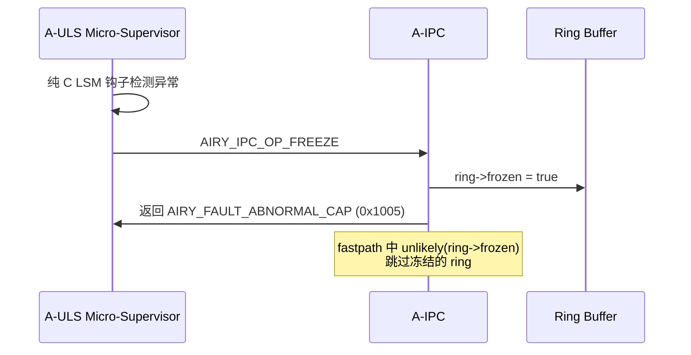

# 18 — A-IPC 系统性审查报告

## 基于 Airymax Unify Design 五模块框架的 IPC 全链路审视

> **报告日期**：2026-07-18
> **报告性质**：闭源内部 A-IPC 系统性审查 — 基于 Unify Design 总纲（10-unify-design.md）对 A-IPC 模块及全线 10+ IPC 文档的重新审视
> **审查基准**：Airymax Unify Design 五模块框架（A-UEF / A-ULP / A-UCS / A-ULS / A-IPC）+ SSoT v2 单一权威源模型
> **前置报告**：[16-ipc-comprehensive-review.md](file:///home/spharx/SpharxWorks/airymaxhub/docs-closed/agent-linux-dev/20-archive/reviews/_review_v2.2/16-ipc-comprehensive-review.md) / [17-uipf-deep-review-v2.md](file:///home/spharx/SpharxWorks/airymaxhub/docs-closed/agent-linux-dev/20-archive/reviews/_review_v2.2/17-uipf-deep-review-v2.md)
> **重要修正**：前两次审查使用了错误的模块名称 "UIPF"——正确名称为 **A-IPC（Unified Airymax IPC Fabric，统一进程间通信体系）**。

---

## 0. A-IPC 在 Unify Design 中的位置

### 0.1 权威定义（来源：[10-unify-design.md §8](file:///home/spharx/SpharxWorks/airymaxhub/docs/AirymaxOS/10-architecture/10-unify-design.md#L324-L369)）

| 维度 | 内容 |
|------|------|
| **模块全称** | A-IPC — Unified Airymax IPC Fabric（统一进程间通信体系）|
| **架构定位** | 通信骨干 — 四大技术领域中作为**通信领域核心模块** + 韧性领域辅助模块 |
| **权威源文档** | [30-interfaces/02-ipc-protocol.md](file:///home/spharx/SpharxWorks/airymaxhub/docs/AirymaxOS/30-interfaces/02-ipc-protocol.md) + [30-interfaces/07-ipc-fastpath.md](file:///home/spharx/SpharxWorks/airymaxhub/docs/AirymaxOS/30-interfaces/07-ipc-fastpath.md) |
| **物理宿主** | `kernel/include/airymax/ipc.h`（[SC] 层）+ `kernel/ipc/`（实现） |
| **技术选型** | `IORING_OP_URING_CMD` + registered buffer + mmap（禁用 page flipping） |
| **关键设计** | Capability 分层校验（fastpath ~160ns / slowpath radix tree）、数据面自治三原则、IPC 队列冻结 |

### 0.2 A-IPC 与其余 4 模块的交互（来源：Unify Design §2.1）

```
A-UEF（错误码）──提供──→ A-IPC 的错误码返回（-41~-70 IPC 码空间）
A-ULP（日志）  ──提供──→ A-IPC 异常日志的 eventfd 通知
A-UCS（配置）  ──提供──→ A-IPC 的 Ring 大小、超时参数配置热重载
A-ULS（监管）  ──触发──→ A-IPC 的队列冻结（ring->frozen = true）
```

---

## 1. 核心发现：Unify Design 总纲是 A-IPC 的"正确版本"，但下层文档未同步

### 1.1 ★★★ 发现一：总纲代码正确，下层文档 OP 码方案错误

[10-unify-design.md §8.1](file:///home/spharx/SpharxWorks/airymaxhub/docs/AirymaxOS/10-architecture/10-unify-design.md#L335-L347) 中的 `airy_uring_cmd()` 回调代码是**正确方案**：

```c
/* kernel/ipc/airy_uring_cmd.c —— io_uring_cmd 回调 */
static int airy_uring_cmd(struct io_uring_cmd *ioucmd, unsigned int issue_flags)
{
    struct airy_ipc_cmd *cmd = (struct airy_ipc_cmd *)ioucmd->cmd;
    switch (cmd->op) {  // ← cmd->op 来自 io_uring_cmd 私有数据，非 sqe.opcode
    case AIRY_IPC_OP_SEND:    return airy_ipc_send(ioucmd, cmd, issue_flags);
    case AIRY_IPC_OP_RECV:    return airy_ipc_recv(ioucmd, cmd, issue_flags);
    case AIRY_IPC_OP_FREEZE:  return airy_ipc_freeze(ioucmd, cmd, issue_flags);
    default:                  return -EOPNOTSUPP;
    }
}
```

**关键**：`cmd->op` 来自 `io_uring_cmd` 的私有数据区（`pdu[32]`），通过 `IORING_OP_URING_CMD` + `cmd_op` 机制分发——完全无需修改 io_uring 核心代码。

**但下层文档仍使用错误方案**：

| 文档 | 位置 | 错误内容 |
|------|------|---------|
| [02-ipc-protocol.md §4.2](file:///home/spharx/SpharxWorks/airymaxhub/docs/AirymaxOS/30-interfaces/02-ipc-protocol.md#L262-L263) | L262-263 | `io_uring_prep_rw(&sqe, IORING_OP_IPC_SEND, ...)` |
| [02-ipc-protocol.md §4.4](file:///home/spharx/SpharxWorks/airymaxhub/docs/AirymaxOS/30-interfaces/02-ipc-protocol.md#L288-L290) | L288-290 | `IORING_OP_IPC_SEND` / `IP_RECV` / `IPC_REGISTER_RING` / `IPC_DEREGISTER_RING` |
| [07-ipc-fastpath.md §5.1](file:///home/spharx/SpharxWorks/airymaxhub/docs/AirymaxOS/30-interfaces/07-ipc-fastpath.md#L276) | L276 | `sqe.opcode = IORING_OP_IPC_SEND(0x40)` |
| [07-ipc-fastpath.md §1.2](file:///home/spharx/SpharxWorks/airymaxhub/docs/AirymaxOS/30-interfaces/07-ipc-fastpath.md#L32) | L32 | 传输通道双栈声明中使用 `IORING_OP_IPC_SEND` |

**结论**：总纲（10-unify-design.md）的代码是正确的、可编译的。下层文档（02-ipc-protocol.md / 07-ipc-fastpath.md）如果按当前版本实现，会导致编译失败。**总纲是 SSoT，下层文档必须以总纲为权威源进行修正。**

### 1.2 ★★★ 发现二：`AIRY_IPC_OP_FREEZE` 在总纲中存在但下层文档缺失

总纲 §8.1 定义了三个 `cmd_op`：`AIRY_IPC_OP_SEND` / `AIRY_IPC_OP_RECV` / **`AIRY_IPC_OP_FREEZE`**。

但下层文档的 opcode 表：

| 文档 | 定义的 opcode |
|------|-------------|
| [07-ipc-fastpath.md §1.3](file:///home/spharx/SpharxWorks/airymaxhub/docs/AirymaxOS/30-interfaces/07-ipc-fastpath.md#L41-L46) | SEND / RECV / SEND_BATCH / CANCEL — **无 FREEZE** |
| [02-ipc-protocol.md §4.4](file:///home/spharx/SpharxWorks/airymaxhub/docs/AirymaxOS/30-interfaces/02-ipc-protocol.md#L288-L292) | IPC_SEND / IPC_RECV / REGISTER_RING / DEREGISTER_RING — **无 FREEZE** |

**FREEZE 的语义**（来自总纲 §8.4）：当 A-ULS 的 Micro-Supervisor 检测到异常时，通过 `ring->frozen = true` 冻结 IPC 队列。

**影响**：`FREEZE` 是 A-IPC 与 A-ULS 的**核心交互接口**——如果不定义此操作码，IPC 队列冻结机制将不可用，"内核冷酷执法"的第一步（冻结异常 Agent 的通信）将无法执行。

### 1.3 ★★★ 发现三：`ring->frozen` 检查在 fastpath 条件中缺失

总纲 §8.4 明确描述：

> "fastpath 通过 `unlikely(ring->frozen)` 零开销检查——正常路径不触发冻结检查的分支预测失败，仅异常路径才进入冻结处理。"

但在 [07-ipc-fastpath.md §3.1](file:///home/spharx/SpharxWorks/airymaxhub/docs/AirymaxOS/30-interfaces/07-ipc-fastpath.md#L190-L203) 的 10 项发送方条件（C-S1~C-S10）中，**没有任何一项检查 `ring->frozen`**。

这意味着如果实现按 fastpath 文档进行，当 A-ULS 设置 `ring->frozen = true` 后，fastpath 将继续处理消息——违反"冷酷执法"原则。

**修正建议**：在 C-S1~C-S10 中增加 `C-S0: ring->frozen == false`，作为第一个检查（比 magic 校验更优先——如果已冻结，无需校验任何字段）。

### 1.4 ★★★ 发现四：总纲 OP 语义与下层文档 OP 数量不匹配

| 对比维度 | 总纲 §8.1 | 下层文档 |
|---------|----------|---------|
| **opcode 总数** | 3（SEND/RECV/FREEZE） | 4（SEND/RECV/SEND_BATCH/CANCEL） |
| **FREEZE** | ✅ 有 | ❌ 无 |
| **SEND_BATCH** | ❌ 无 | ✅ 有 |
| **CANCEL** | ❌ 无 | ✅ 有 |

**分析**：
- `FREEZE` 是 A-IPC 与 A-ULS 的交互接口，必须在总纲与下层文档中一致定义
- `SEND_BATCH` 是 fastpath 状态机中的性能优化（BATCH 状态），但不一定是独立的 `cmd_op`——它可以是 SEND 的批量调用
- `CANCEL` 是资源回收操作，但也不一定是独立的 `cmd_op`——它可以是 ring 层面的操作

**建议**：统一 opcode 表为 **5 个 `cmd_op`**：`SEND / RECV / SEND_BATCH / CANCEL / FREEZE`。其中 `FREEZE` 仅由 A-ULS 触发，daemon 无权调用。

---

## 2. A-IPC × A-UEF 交互审计

### 2.1 错误码空间对齐

| Unify Design §4.2 定义 | 当前 IPC 文档中的实际使用 |
|------------------------|--------------------------|
| **IPC 码空间**：-41 ~ -70（30 个码位） | [03-ipc-performance.md §6](file:///home/spharx/SpharxWorks/airymaxhub/docs/AirymaxOS/170-performance/03-ipc-performance.md#L567-L577)：AIRY_E_IPC_* 从 -800 开始 |
| **Error 码（负数，可恢复）**：如 `AIRY_EPERM = -1` | [02-ipc-protocol.md](file:///home/spharx/SpharxWorks/airymaxhub/docs/AirymaxOS/30-interfaces/02-ipc-protocol.md)：无统一错误码表 |
| **Fault 码（正数不可恢复）**：`0x1003 = AIRY_FAULT_IPC_FAULT` | 只有 [04-ipc-data-plane-autonomy.md](file:///home/spharx/SpharxWorks/airymaxhub/docs/AirymaxOS/110-security/04-ipc-data-plane-autonomy.md) 使用了 `AIRY_ECAP_OFFLINE`（但在 A-UEF 空间中未注册） |

**★ 不一致**：[03-ipc-performance.md](file:///home/spharx/SpharxWorks/airymaxhub/docs/AirymaxOS/170-performance/03-ipc-performance.md) 定义的 `AIRY_E_IPC_MAGIC = -800` 与 Unify Design §4.2 定义的 IPC 码空间（-41 ~ -70）**完全不在同一范围**。

**修正建议**：以 Unify Design §4.2 的 IPC 码空间（-41 ~ -70）为权威源，将 [03-ipc-performance.md](file:///home/spharx/SpharxWorks/airymaxhub/docs/AirymaxOS/170-performance/03-ipc-performance.md) 的 8 个错误码重新编号至该范围，并在 [30-interfaces/08-sc-error-contract.md](file:///home/spharx/SpharxWorks/airymaxhub/docs/AirymaxOS/30-interfaces/08-sc-error-contract.md)（A-UEF 权威源）中注册。

### 2.2 Fault 码（AIRY_FAULT_IPC_FAULT）的触发路径

总纲 §4.3 定义了 `AIRY_FAULT_IPC_FAULT = 0x1003`（*Ring Buffer 元数据损坏*），但**任何 IPC 文档均未描述此 Fault 的触发条件**：
- 什么构成 "Ring Buffer 元数据损坏"？（magic 不匹配？checksum 失败？索引越界？）
- 触发后如何传递给 Micro-Supervisor？（总纲说 eventfd，但 IPC 文档未提及）
- 与 `AIRY_IPC_OP_FREEZE` 的关系？（前者是 IPC 层面的 Fault 定义，后者是 A-ULS 的冻结机制）

---

## 3. A-IPC × A-ULP 交互审计

### 3.1 eventfd 通知机制 — 已正确建立

| 文档 | eventfd 使用 | 状态 |
|------|-------------|------|
| 总纲 §8 | "A-ULP 的 eventfd 通知复用 A-IPC 的 io_uring 通道" | 交互声明 |
| [03-ipc-flow.md §2](file:///home/spharx/SpharxWorks/airymaxhub/docs/AirymaxOS/40-dataflows/03-ipc-flow.md) | `IORING_REGISTER_EVENTFD` 注册 + CQE 通知 | 正确 |
| [07-ipc-fastpath.md §4.3](file:///home/spharx/SpharxWorks/airymaxhub/docs/AirymaxOS/30-interfaces/07-ipc-fastpath.md#L254-L256) | `wake_up_interruptible` + `eventfd_signal` | 正确 |

**结论**：A-IPC × A-ULP 的 eventfd 交互链路完整且正确。

### 3.2 日志 Ring Buffer 与 IPC Ring Buffer 的独立性

总纲未明确声明两者是**独立**的 Ring Buffer。当前文档中：
- A-ULP 的日志 Ring Buffer 通过 `alloc_pages + mmap` 分配，128B 固定记录，Logger Daemon 消费
- A-IPC 的 IPC Ring Buffer 通过 `io_uring registered buffer + mmap` 分配，128B 消息头 + payload

**两者虽然都使用 128B 固定大小，但物理上是独立的**。建议总纲或 A-IPC 文档明确此独立性。

---

## 4. A-IPC × A-UCS 交互审计

### 4.1 配置项映射

| Unify Design §6 声明 | IPC 文档中的实际配置 | 状态 |
|---------------------|-------------------|------|
| "A-IPC 的 Ring 大小通过 A-UCS 的 sysctl/JSON 双向同步" | [03-ipc-flow.md §10.4](file:///home/spharx/SpharxWorks/airymaxhub/docs/AirymaxOS/40-dataflows/03-ipc-flow.md#L660-L668)：推荐配置矩阵（SQ 大小 64/256/512/1024） | 有矩阵但无 sysctl 名称 |
| "A-IPC 的超时参数配置" | [07-ipc-fastpath.md §4.4](file:///home/spharx/SpharxWorks/airymaxhub/docs/AirymaxOS/30-interfaces/07-ipc-fastpath.md#L260-L264)：`timeout_ns` 默认 5s | 有值但无 sysctl 名称 |

**★ 缺失**：A-IPC 的 Ring 大小、超时、batch 阈值（`AIRY_IPC_BATCH_THRESHOLD`）应该作为 A-UCS 的 sysctl 配置项显式列出（如 `kernel.airy_ipc.ring_size = 256`）。当前文档仅有推荐值，无 sysctl 注册表。

---

## 5. A-IPC × A-ULS 交互审计

### 5.1 IPC 队列冻结（核心交互路径）



**已对齐的部分**：
- 总纲 §7.1（Micro-Supervisor）描述了冻结流程
- 总纲 §8.4（IPC 队列冻结）描述了 fastpath 的 `unlikely(ring->frozen)` 检查
- [04-ipc-data-plane-autonomy.md §1.3](file:///home/spharx/SpharxWorks/airymaxhub/docs/AirymaxOS/110-security/04-ipc-data-plane-autonomy.md#L55) 提及 Micro-Supervisor

**断裂点**：
- [07-ipc-fastpath.md](file:///home/spharx/SpharxWorks/airymaxhub/docs/AirymaxOS/30-interfaces/07-ipc-fastpath.md) 的 fastpath 条件检查（C-S1~C-S10）**不含 `ring->frozen` 检查**（见 §1.3）
- 07-ipc-fastpath.md 的 4 个 opcode 表**不含 `AIRY_IPC_OP_FREEZE`**（见 §1.2）
- 因此，**A-IPC × A-ULS 的核心交互路径在实现层断裂**

### 5.2 Macro-Supervisor 裁决通过 io_uring_cmd

总纲 §7.2 声明：

> "裁决通过 `io_uring_cmd` 执行，避免新增 syscall。"

**验证**：02-ipc-protocol.md 和 07-ipc-fastpath.md 均**未提及** Macro-Supervisor 如何通过 io_uring_cmd 执行裁决。裁决的 `cmd_op` 对应什么值？Macro-Supervisor 通过哪个 ring 向哪个 Agent 发送裁决指令？——当前未定义。

---

## 6. Capability 模型与 A-IPC 的交互深度

### 6.1 已建立的联系

[03-capability-model.md](file:///home/spharx/SpharxWorks/airymaxhub/docs/AirymaxOS/110-security/03-capability-model.md) 与 A-IPC 的关联：

| 联系 | 文档位置 | 状态 |
|------|---------|------|
| `AIRY_IPC_F_CAP_CARRY` 标志位 | 03-capability §11.3 | ✅ 正确 |
| `airy_sys_capability_transfer` 通过 IPC 传递 | 03-capability L689 | ✅ 正确 |
| per-cpu capability 缓存（fastpath 使用） | 03-capability L1070 | ✅ 正确 |
| `AIRY_CAP_TYPE_ENDPOINT` capability 类型 | 03-capability L104 | ✅ 正确 |

### 6.2 当前的断裂点

| 断裂点 | 影响 |
|--------|------|
| `cap_slot` 未编码入 128B 消息头 | 发送方的 cap_slot 如何传递给内核？当前 API 作为独立参数传递，但消息头（Layout C SSoT）中无对应字段 |
| `cap_slot_out` 接收方槽位 | 接收方如何知道 capability 被放入了哪个槽位？ |
| 跨进程 Capability 传递的审计日志 | 谁发起了传递、传递给谁、cap_id 是什么——当前未定义 |

**建议**：利用 `reserved[84]` 的前 8 字节编码 Capability 传递信息：
- `reserved[0:3]` = `__u32 cap_id`（发送方传递的 capability ID）
- `reserved[4:7]` = `__u32 cap_slot_out`（接收方接收槽位）

---

## 7. 物理宿主与文件结构对齐

### 7.1 与 Unify Design 声明的一致性

| Unify Design §8 声明 | 实际存在 | 一致性 |
|----------------------|---------|--------|
| `kernel/include/airymax/ipc.h` | ✅ 定义位置（Layout C SSoT） | **一致** |
| `kernel/ipc/airy_uring_cmd.c` | ❌ 不存在（0 行源码） | **缺失** |
| `kernel/ipc/` 目录 | ❌ 不存在（代码真空） | **缺失** |

### 7.2 与 [01-kernel.md](file:///home/spharx/SpharxWorks/airymaxhub/docs/AirymaxOS/20-modules/01-kernel.md) 的一致性

[01-kernel.md §3.2](file:///home/spharx/SpharxWorks/airymaxhub/docs/AirymaxOS/20-modules/01-kernel.md#L245-L252) 定义的 patches 结构：

```
patches/io_uring-ipc/
├── io_uring_ipc.c      # 注册固定 OP，支持零拷贝消息传递
├── ring_register.c     # 跨进程 ring 共享注册
└── zerocopy.c          # 零拷贝路径
```

**问题**：
1. `io_uring_ipc.c` 的"注册固定 OP"在标准 Linux 6.6 中不可行（已在 16 号审查中确认）
2. 这些文件名与 Unify Design §8.1 的 `airy_uring_cmd.c` 命名风格不一致（应该使用 `airy_*` 前缀，而非直接命名为 `io_uring_ipc.c`）

---

## 8. 与 [DSL] 降级层的交互

### 8.1 IPC 在 [DSL] 模式下的行为

| [DSL] 条件（Unify Design §9.2） | A-IPC 对应行为 |
|--------------------------------|---------------|
| 错误码降级 | 仅保留 38 个 POSIX 码 + `AIRY_ECFGVERSION` |
| IPC 消息头降级 | "最简 128B 消息头（仅 magic + opcode + payload_len）" |
| 调度降级 | "EEVDF 默认调度（不依赖 SCHED_DEADLINE / SCHED_FIFO 配置）" |

**断裂点**：[02-ipc-protocol.md](file:///home/spharx/SpharxWorks/airymaxhub/docs/AirymaxOS/30-interfaces/02-ipc-protocol.md) 定义了完整的 128B 消息头（9 字段），但未定义 [DSL] 降级后的"最简 128B 消息头"长什么样。Unify Design §9.2 说"仅 magic + opcode + payload_len"，但未指定其他字段（trace_id / timestamp_ns / src_task / dst_task）在降级时是填零还是省略。

**建议**：在 [02-ipc-protocol.md](file:///home/spharx/SpharxWorks/airymaxhub/docs/AirymaxOS/30-interfaces/02-ipc-protocol.md) 新增 [DSL] 降级章节，定义 `#ifdef AIRY_SC_FALLBACK` 下的最简消息头布局。

---

## 9. 四大技术领域覆盖度审计

### 9.1 A-IPC 的领域归属（来源：Unify Design §3）

| 领域 | A-IPC 角色 | 覆盖度评估 |
|------|-----------|-----------|
| **通信** ★★（核心） | 128B 消息头 + 5 payload + io_uring 传输 | ★★★★☆（OP 码修正后完整） |
| **治理** —（不覆盖）| A-IPC 不参与治理域 | 正确 |
| **观测** —（不覆盖）| 观测由 A-ULP 负责 | 正确 |
| **韧性** ★○（辅助） | 数据面自治三原则 + 队列冻结 | ★★★★★（行业领先） |

**结论**：A-IPC 的四个技术领域覆盖与 Unify Design §3 的交叉矩阵完全一致。

### 9.2 对比前两次审查的覆盖度评估

| 审查 | 覆盖范围 | 状态 |
|------|---------|------|
| 16-ipc-comprehensive-review | io_uring 传输层 + fastpath + 数据面自治 | ✅ 有效（修正后重命名为 A-IPC 审查） |
| 17-uipf-deep-review-v2 | IPC 文档内部一致性 + 12 处不一致 | ⚠️ 名称错误（UIPF→A-IPC），内容仍有效 |
| **18-aipc-systematic-review（本文）** | A-IPC 作为 Unify Design 5 模块之一的全链路 | ✅ 本次 |

---

## 10. 问题清单

### 10.1 P0 — 阻塞正确性

| # | 问题 | 总纲正确 | 下层文档 | 建议 |
|---|------|---------|---------|------|
| **AIPC-01** | `IORING_OP_IPC_*` 自定义 OP 码不可行 | ✅（使用 cmd_op） | ❌（使用 sqe.opcode） | 下层文档全部改为 `IORING_OP_URING_CMD` + `cmd_op` |
| **AIPC-02** | `AIRY_IPC_OP_FREEZE` 缺失 | ✅（定义了 FREEZE） | ❌（无 FREEZE） | 在 07-ipc-fastpath.md opcode 表增加 FREEZE + 在 02-ipc-protocol.md 注册 |
| **AIPC-03** | `ring->frozen` 检查缺失 | ✅（§8.4 明确要求） | ❌（fastpath 条件无此检查） | 在 fastpath 条件 C-S0 增加 `ring->frozen == false` |
| **AIPC-04** | IPC 错误码不在 A-UEF 空间 | ✅（§4.2：-41~-70） | ❌（-800 开始） | 将 8 个 IPC 错误码重新编号至 -41~-70，注册到 08-sc-error-contract.md |

### 10.2 P1 — 影响体系完整性

| # | 问题 | 建议 |
|---|------|------|
| **AIPC-05** | `AIRY_FAULT_IPC_FAULT (0x1003)` 触发条件未定义 | 在三份文档中补充：什么构成 Ring Buffer 元数据损坏 → 触发路径 → eventfd 通知 → Micro-Manager 响应 |
| **AIPC-06** | Macro-Supervisor 裁决通过 io_uring_cmd 的方式未定义 | 补充裁决 `cmd_op` + 目标 ring + 裁决数据格式 |
| **AIPC-07** | `cap_slot` 未编码入 128B 消息头 | 在 `reserved[0:7]` 编码 `cap_id` + `cap_slot_out` |
| **AIPC-08** | A-IPC 的 sysctl 配置项未注册到 A-UCS | 注册 `kernel.airy_ipc.ring_size` / `timeout_ms` / `batch_threshold` 到系统 sysctl 配置表 |
| **AIPC-09** | [DSL] 降级后的最简消息头布局未定义 | 在 02-ipc-protocol.md 新增 [DSL] 降级章节 |

### 10.3 P2 — 改善

| # | 问题 |
|---|------|
| **AIPC-10** | 日志 Ring Buffer（A-ULP）与 IPC Ring Buffer（A-IPC）独立性未明确声明 |
| **AIPC-11** | A-IPC × A-ULP 的 eventfd 通知机制正确但分散在三个文档中，建议统一说明 |
| **AIPC-12** | `kernel/ipc/` 目录下的文件命名应统一为 `airy_*` 前缀（对标总纲 §8.1 的风格） |
| **AIPC-13** | 前两次审查报告的模块名称 "UIPF" 需要修正为 "A-IPC"（不影响核心发现） |

---

## 11. 最终判定

**A-IPC（Unified Airymax IPC Fabric）是一个设计方向正确但实现文档滞后的模块。**

**关键矛盾**：`10-unify-design.md`（总纲）是 A-IPC 模块的**正确版本**——它在 io_uring_cmd OP 编码、FREEZE 操作定义、ring->frozen 检查等方面是正确的。但作为其权威源的两份下层文档（`02-ipc-protocol.md` 和 `07-ipc-fastpath.md`）尚未同步更新，仍是旧的错误方案。

**修正路径**：
1. 以总纲 §8 的代码和声明为唯一标准，对 `02-ipc-protocol.md` 和 `07-ipc-fastpath.md` 进行修正
2. 补充 A-IPC 与其余 4 模块的交互实现细节（错误码注册、sysctl 注册、FREEZE 实现、裁决路径）
3. 修正 4 个 P0 问题后，A-IPC 即可作为 **"Unify Design 5 模块中第二个可正确编译的模块"**（A-UEF 是第一个，纯头文件）

---

© 2025-2026 SPHARX Ltd. All Rights Reserved.
