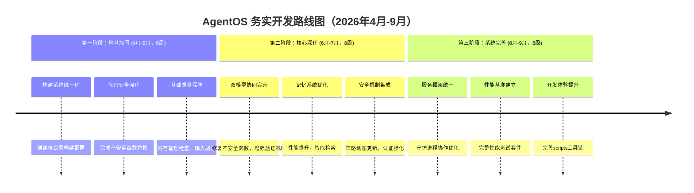

# AgentOS 务实开发计划：基于现状的调整与聚焦

**计划编号**: 20260411-10次  
**制定时间**: 2026-04-11  
**制定依据**: 
- [20260410-09次-AgentOS完整生态开发计划.md](./20260410-09次-AgentOS完整生态开发计划.md)
- [20260410-不安全函数替换计划.md](./20260410-不安全函数替换计划.md)
- [20260410-第一阶段地基修复完成报告.md](./20260410-第一阶段地基修复完成报告.md)
- [20260410-TODO-FIXME分类处理计划.md](./20260410-TODO-FIXME分类处理计划.md)
- 项目现状全面检查结果

**核心理念**: 聚焦核心，务实推进，质量优先，逐步完善  
**调整原因**: 第一阶段地基修复尚未完成，第二阶段分析显示已有良好基础但需深化，scripts模块已重组  
**计划周期**: 6个月（2026年4月 - 2026年9月）  
**计划状态**: 执行版 v1.0

---

## 📊 项目现状全面评估

### 当前完成度分析
| 维度 | 评估结果 | 详细说明 |
|------|----------|----------|
| **构建系统** | 60% | 子模块CMake配置完整，但根目录缺少统一构建配置，跨平台支持有限 |
| **代码安全** | 40% | 14个文件仍包含不安全函数调用，内存管理检查未开始，输入验证待补充 |
| **Windows兼容性** | 40% | POSIX函数移植、C11原子操作、MSVC编译警告等问题待解决 |
| **编码规范** | 90% | `.clang-format`、`.clang-tidy`配置完成，但代码格式化待应用 |
| **核心功能基础** | 75% | 双模型协同、记忆系统、安全机制等核心模块架构完整，实现深度待提升 |
| **scripts模块** | 80% | 已完成重组（dev→development，ops重组为pipeline），构建脚本待完善 |

### 关键发现
1. **scripts模块已完成重组**：用户已删除`operations/README.md`和`scripts/ci/CI_CD_DOCUMENTATION.md`，将CI/CD相关内容整合到`pipeline/`目录
2. **构建系统不完整**：根目录缺少`CMakeLists.txt`，无法进行整体构建，`scripts/setup.sh`引用不存在的构建脚本
3. **不安全函数仍存**：14个C源文件包含`strcpy`、`strcat`、`sprintf`等不安全调用，包括关键模块如`dual_model.c`
4. **第二阶段分析完成**：已全面分析双模型协同、记忆系统、安全机制、性能优化的现有实现，确认有良好基础
5. **TODO管理规范**：已完成TODO/FIXME注释分类，5个实际代码TODO已标记为`TODO-PHASE2`

### 风险识别
1. **技术债务积累**：不安全函数、内存管理问题、Windows兼容性问题持续存在
2. **构建不可靠**：缺少统一构建系统，影响开发效率和代码质量
3. **进度偏差**：原计划第一阶段6周，实际进展缓慢，需要调整时间预期
4. **资源分散**：同时进行地基修复和核心能力深化，可能两头不达

---

## 🎯 调整后的总体路线图

### 新的阶段划分（6个月周期）

### 优先级调整原则
1. **质量优先**：先解决安全问题和构建问题，再推进功能开发
2. **渐进式改进**：每个阶段完成可验证的交付物，避免半成品
3. **务实评估**：基于实际进展动态调整，不追求不切实际的目标
4. **聚焦核心**：优先处理影响项目稳定性和核心功能的问题

---

## 🔧 第一阶段：地基加固（2026年4月-5月，6周）

### 🎯 阶段目标
**确保项目具备可靠、安全、可构建的基础工程设施**，为后续开发扫清障碍。

### 📋 关键任务清单

#### 任务 1.1：构建系统统一化（2周）
| 子任务 | 描述 | 交付物 | 优先级 |
|--------|------|--------|--------|
| 1.1.1 | 创建根目录 CMakeLists.txt，支持整体构建 | `CMakeLists.txt` | P0 |
| 1.1.2 | 修复scripts/setup.sh中的构建路径引用 | 可运行的setup.sh | P0 |
| 1.1.3 | 创建统一的跨平台构建脚本 | `build-all.sh`、`build-all.ps1` | P1 |
| 1.1.4 | 验证Linux/macOS/Windows三平台基础构建 | 构建验证报告 | P1 |
| 1.1.5 | 完善pipeline目录的CI/CD配置 | CI流水线文档 | P2 |

#### 任务 1.2：代码安全强化（3周）
| 子任务 | 描述 | 交付物 | 优先级 |
|--------|------|--------|--------|
| 1.2.1 | 完成剩余14个文件的不安全函数替换 | 安全函数审计报告 | P0 |
| 1.2.2 | 内存管理一致性检查（抽样重点模块） | 内存泄漏风险报告 | P1 |
| 1.2.3 | 输入验证和边界检查补全（高风险模块） | 输入验证审计报告 | P1 |
| 1.2.4 | 应用编码规范（运行clang-format） | 格式化代码库 | P2 |
| 1.2.5 | 静态分析集成（clang-tidy基线扫描） | 静态分析报告 | P2 |

#### 任务 1.3：Windows兼容性重点修复（2周）
| 子任务 | 描述 | 交付物 | 优先级 |
|--------|------|--------|--------|
| 1.3.1 | 解决C11原子操作兼容性问题 | Windows编译通过 | P0 |
| 1.3.2 | 关键POSIX函数Windows实现（strdup等） | 平台兼容层 | P1 |
| 1.3.3 | 修复MSVC编译警告和错误 | 无警告编译 | P1 |
| 1.3.4 | 完善Windows构建文档 | Windows构建指南 | P2 |

#### 任务 1.4：开发工具链优化（1周）
| 子任务 | 描述 | 交付物 | 优先级 |
|--------|------|--------|--------|
| 1.4.1 | 完善scripts/library公共函数库 | 可重用的脚本函数 | P1 |
| 1.4.2 | 创建开发环境快速配置脚本 | `dev-quickstart.sh` | P1 |
| 1.4.3 | 统一测试脚本入口 | 统一的测试运行接口 | P2 |
| 1.4.4 | 文档生成工具链完善 | 自动API文档生成 | P2 |

### 📦 阶段交付物
1. ✅ **可构建系统**：根目录完整构建，三平台编译通过
2. ✅ **代码安全基线**：无高危不安全函数，内存管理风险可控
3. ✅ **Windows兼容性**：基础功能在Windows上可编译运行
4. ✅ **开发工具链**：完善的一键构建、测试、开发配置脚本
5. ✅ **质量报告**：代码安全、静态分析、构建稳定性报告

### ⚠️ 风险与应对
| 风险 | 概率 | 影响 | 应对措施 |
|------|------|------|----------|
| **构建系统复杂度高** | 中 | 高 | 分步实施，先基础后优化，参考成熟项目 |
| **Windows兼容性困难** | 高 | 中 | 重点解决编译问题，功能完整度可逐步提升 |
| **安全修复引入新问题** | 中 | 中 | 充分测试，分模块验证，保留回滚能力 |

---

## 🧠 第二阶段：核心深化（2026年6月-7月，8周）

### 🎯 阶段目标
**深化核心模块的实现质量**，从"基础实现"提升到"生产级实现"，重点关注代码质量和性能。

### 📋 关键任务清单

#### 任务 2.1：双模型协同完善（3周）
| 子任务 | 描述 | 交付物 | 优先级 |
|--------|------|--------|--------|
| 2.1.1 | 修复dual_model.c中的不安全函数调用 | 安全的dual_model.c | P0 |
| 2.1.2 | 增强交叉验证机制（三种验证模式完善） | 增强的验证逻辑 | P1 |
| 2.1.3 | 完善仲裁算法错误处理和边界条件 | 健壮的仲裁引擎 | P1 |
| 2.1.4 | 添加性能监控和指标收集 | 性能监控数据 | P2 |
| 2.1.5 | 编写单元测试和集成测试 | 测试覆盖率提升 | P2 |

#### 任务 2.2：记忆系统优化（3周）
| 子任务 | 描述 | 交付物 | 优先级 |
|--------|------|--------|--------|
| 2.2.1 | 记忆检索性能优化（缓存策略改进） | 性能基准报告 | P1 |
| 2.2.2 | 遗忘策略自适应机制完善 | 智能遗忘引擎 | P1 |
| 2.2.3 | 记忆融合算法边界条件处理 | 健壮的融合逻辑 | P2 |
| 2.2.4 | 记忆系统资源使用优化 | 内存使用报告 | P2 |
| 2.2.5 | 记忆操作API错误处理完善 | 完善的错误处理 | P2 |

#### 任务 2.3：安全机制集成（3周）
| 子任务 | 描述 | 交付物 | 优先级 |
|--------|------|--------|--------|
| 2.3.1 | 安全策略动态更新机制启用 | 可用的策略更新 | P1 |
| 2.3.2 | 认证和加密模块边界检查 | 安全审计报告 | P1 |
| 2.3.3 | 安全日志和审计功能完善 | 完整的审计追踪 | P2 |
| 2.3.4 | 输入净化模块性能优化 | 性能优化报告 | P2 |
| 2.3.5 | 安全测试用例补充 | 安全测试套件 | P2 |

#### 任务 2.4：代码质量专项（2周）
| 子任务 | 描述 | 交付物 | 优先级 |
|--------|------|--------|--------|
| 2.4.1 | 完成所有TODO-PHASE2标记审查 | TODO状态报告 | P1 |
| 2.4.2 | 关键模块的代码审查和重构 | 代码审查报告 | P1 |
| 2.4.3 | 错误处理一致性检查 | 错误处理规范 | P2 |
| 2.4.4 | 资源管理模式统一 | 资源管理指南 | P2 |
| 2.4.5 | 文档注释补全（Doxygen格式） | 完善的API文档 | P2 |

### 📦 阶段交付物
1. ✅ **生产级核心模块**：双模型、记忆、安全模块达到生产级质量
2. ✅ **完善的错误处理**：关键路径都有适当的错误处理和资源清理
3. ✅ **性能基准数据**：核心操作性能指标和优化建议
4. ✅ **代码质量提升**：减少技术债务，提升可维护性
5. ✅ **完整的测试覆盖**：核心功能有充分的单元测试和集成测试

### ⚠️ 风险与应对
| 风险 | 概率 | 影响 | 应对措施 |
|------|------|------|----------|
| **重构引入回归问题** | 中 | 高 | 充分测试，逐步重构，保持功能兼容性 |
| **性能优化效果有限** | 中 | 中 | 基于性能分析数据，优先优化热点路径 |
| **安全机制过于复杂** | 低 | 中 | 保持简洁设计，必要的安全性和可用性平衡 |

---

## 🏗️ 第三阶段：系统完善（2026年8月-9月，8周）

### 🎯 阶段目标
**完善系统级功能和开发体验**，建立完整的性能基准和可观测性，提升开发者体验。

### 📋 关键任务清单

#### 任务 3.1：服务框架完善（3周）
| 子任务 | 描述 | 交付物 | 优先级 |
|--------|------|--------|--------|
| 3.1.1 | 守护进程间协作机制优化 | 进程协作文档 | P1 |
| 3.1.2 | 统一的服务管理接口 | 服务管理API | P1 |
| 3.1.3 | 服务健康检查和自愈机制 | 健康检查框架 | P2 |
| 3.1.4 | 配置管理统一化 | 配置管理服务 | P2 |
| 3.1.5 | 服务部署和升级流程 | 部署流程文档 | P2 |

#### 任务 3.2：性能基准建立（3周）
| 子任务 | 描述 | 交付物 | 优先级 |
|--------|------|--------|--------|
| 3.2.1 | 建立完整的性能测试套件 | 性能测试框架 | P1 |
| 3.2.2 | 关键路径性能基准测试 | 性能基准报告 | P1 |
| 3.2.3 | 资源使用监控和告警 | 资源监控系统 | P2 |
| 3.2.4 | 性能回归检测自动化 | 性能回归工具 | P2 |
| 3.2.5 | 性能调优指南编写 | 性能优化指南 | P2 |

#### 任务 3.3：开发体验提升（3周）
| 子任务 | 描述 | 交付物 | 优先级 |
|--------|------|--------|--------|
| 3.3.1 | 完善scripts工具链的易用性 | 开发者体验报告 | P1 |
| 3.3.2 | 创建交互式开发教程 | 交互式教程 | P1 |
| 3.3.3 | 完善错误信息和调试支持 | 调试工具改进 | P2 |
| 3.3.4 | 创建常见问题解决方案库 | FAQ知识库 | P2 |
| 3.3.5 | 开发者文档更新和优化 | 完善的开发文档 | P2 |

#### 任务 3.4：生态基础准备（2周）
| 子任务 | 描述 | 交付物 | 优先级 |
|--------|------|--------|--------|
| 3.4.1 | 创建开源项目治理文档 | 项目治理规范 | P1 |
| 3.4.2 | 完善贡献者指南 | 贡献者指南 | P1 |
| 3.4.3 | 准备技术演示和案例 | 技术演示材料 | P2 |
| 3.4.4 | 社区沟通渠道建立 | 社区沟通机制 | P2 |
| 3.4.5 | 下一步发展路线图规划 | 长期路线图 | P2 |

### 📦 阶段交付物
1. ✅ **完善的系统服务**：可靠的服务框架和监控机制
2. ✅ **性能基准体系**：可度量的性能指标和优化工具
3. ✅ **优秀的开发体验**：易用的工具链、完善的文档、良好的调试支持
4. ✅ **生态基础**：开源治理、贡献者指南、社区准备
5. ✅ **可交付的产品**：稳定、安全、高性能的AgentOS基础版本

### ⚠️ 风险与应对
| 风险 | 概率 | 影响 | 应对措施 |
|------|------|------|----------|
| **系统复杂度增加** | 中 | 中 | 模块化设计，关注点分离，保持核心简洁 |
| **开发者接受度低** | 低 | 中 | 重视用户体验，收集反馈，持续改进 |
| **社区建设困难** | 中 | 中 | 先建立核心贡献者群体，逐步扩大 |

---

## 📈 成功标准与度量指标

### 技术成功标准（6个月后）
| 指标 | 目标值 | 测量方法 |
|------|--------|----------|
| **构建成功率** | 100% | 三平台编译成功，无构建错误 |
| **代码安全** | 零高危不安全函数 | 安全扫描报告 |
| **测试覆盖率** | 核心模块≥70% | 代码覆盖率报告 |
| **性能基准** | 关键操作<100ms P95 | 性能测试数据 |
| **Windows兼容性** | 基础功能可运行 | Windows验证报告 |
| **开发者满意度** | 工具链易用性评分≥4/5 | 开发者调查 |

### 项目健康度指标
| 指标 | 目标值 | 测量方法 |
|------|--------|----------|
| **技术债务比率** | <10% | 静态分析问题数/代码行数 |
| **构建时间** | <10分钟 | CI流水线构建耗时 |
| **问题解决时间** | 平均<2天 | issue跟踪数据 |
| **代码审查效率** | PR合并<3天 | 代码审查统计数据 |
| **文档完整性** | 关键API 100%有文档 | 文档覆盖率检查 |

### 阶段性验收标准
1. **第一阶段结束**：可构建、可测试、基础安全达标
2. **第二阶段结束**：核心模块生产级质量、性能可度量
3. **第三阶段结束**：系统完善、开发体验良好、生态基础就绪

---

## 🔄 计划执行与调整机制

### 执行原则
1. **迭代开发**：每2周一个迭代，每个迭代有明确的可交付成果
2. **持续集成**：每次提交自动构建和测试，确保代码质量
3. **透明沟通**：定期更新进展，公开问题和风险
4. **数据驱动**：基于度量指标做决策，而非主观判断
5. **务实调整**：根据实际进展灵活调整计划，不僵化执行

### 调整触发条件
1. **重大技术障碍**：关键任务无法按计划完成时
2. **优先级变化**：外部需求或市场变化导致优先级调整
3. **资源限制**：人力或时间资源发生重大变化
4. **质量风险**：质量指标不达标，需要专项修复
5. **机会出现**：有重要合作或技术突破机会

### 质量控制机制
1. **代码审查**：所有代码变更必须经过至少一人审查
2. **自动化测试**：核心功能必须有自动化测试覆盖
3. **性能监控**：关键性能指标持续监控，设置告警阈值
4. **安全扫描**：定期进行安全扫描，及时修复漏洞
5. **文档同步**：代码变更必须同步更新相关文档

---

## 📋 立即行动项（2026年4月11日启动）

### 本周重点任务
1. **创建根目录CMakeLists.txt**（1.1.1）
2. **修复scripts/setup.sh构建路径**（1.1.2）
3. **开始处理P0优先级不安全函数**（1.2.1）
4. **分析C11原子操作兼容性问题**（1.3.1）

### 责任分配建议
| 任务领域 | 主要责任人 | 支持人员 |
|----------|------------|----------|
| **构建系统** | 架构师 | 后端开发 |
| **代码安全** | 安全专家 | 全体开发 |
| **Windows兼容性** | 后端开发（Windows专家） | 架构师 |
| **开发工具链** | 后端开发 | 测试工程师 |
| **文档和沟通** | 文档工程师 | 社区运营 |

### 沟通计划
1. **每日站会**：15分钟同步进展和问题
2. **周度评审**：评审进展，调整下周计划
3. **月度总结**：全面评估进展，调整整体计划
4. **透明报告**：定期向社区和利益相关者汇报

---

## 📄 附录

### 附录A：第一阶段详细任务清单
参考[20260410-不安全函数替换计划.md](./20260410-不安全函数替换计划.md)中的14个文件处理优先级。

### 附录B：关键风险应对详情
1. **构建系统风险**：准备备用构建方案（如Makefile简化版）
2. **Windows兼容性风险**：考虑提供Linux Docker开发环境作为备选
3. **安全修复风险**：建立安全测试沙箱，隔离修复影响

### 附录C：相关资源链接
1. [原12个月开发计划](./20260410-09次-AgentOS完整生态开发计划.md)
2. [第一阶段完成报告](./20260410-第一阶段地基修复完成报告.md)
3. [TODO分类处理计划](./20260410-TODO-FIXME分类处理计划.md)
4. [项目架构原则](../../docs/00-architectural-principles.md)

### 附录D：技术决策记录
1. **构建系统选择**：保持CMake为主，确保跨平台兼容性
2. **代码安全标准**：采用C11安全函数，必要时实现兼容层
3. **Windows支持策略**：基础功能优先，高级功能逐步支持
4. **质量门禁**：建立代码质量门禁，不合格代码不得合并

---

**计划制定**: 2026-04-11  
**制定依据**: 项目现状全面检查  
**下一次评审**: 2026-04-18（周度评审）  
**计划版本**: v1.0（执行版）

> **注**: 本计划为务实调整版本，聚焦于6个月内可实现的实质性进展。计划将根据实际执行情况每两周评审和调整一次，确保始终与项目实际情况保持一致。
