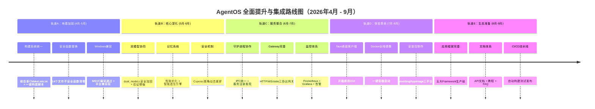

# AgentOS 全面提升与集成计划 v01

**计划编号**: AGENTOS-INTEGRATION-v01
**制定时间**: 2026-04-11
**制定依据**:
- [20260410-09次-AgentOS完整生态开发计划.md](./20260410-09次-AgentOS完整生态开发计划.md) — 12个月完整生态路线图
- [20260411-10次-AgentOS务实开发计划.md](./20260411-10次-AgentOS务实开发计划.md) — 务实调整后的6个月计划
- [AgentOS_技术改进具体实施方案.md](./AgentOS_技术改进具体实施方案.md) — openJiuwen前沿技术借鉴
- [phase4_framework_completion_summary.md](./phase4_framework_completion_summary.md) — 四阶段验证报告
- [service_management_framework.md](./service_management_framework.md) — 服务管理框架设计
- [application_framework_design.md](./application_framework_design.md) — 应用框架设计
- **开箱即用环境包可行性研究报告** — Tauri/Docker/虚拟机/SaaS 分发方案

**核心理念**: **"从代码到用户，端到端闭环"** — 不仅构建高质量的底层系统，更要打造让任何人都能零门槛使用的完整产品。
**愿景目标**: 将 AgentOS 从一个技术扎实但分发困难的代码仓库，升级为**全球首个开箱即用的智能体操作系统**。

---

## 📊 项目现状全景评估

### 当前完成度矩阵（截至2026年4月11日）

| 维度 | 完成度 | 状态说明 | 关键差距 |
|------|--------|----------|----------|
| **Phase 1: 基础架构** | **85%** ✅ | atoms/commons/cupolas 核心模块已实现 | Windows编译、不安全函数残留 |
| **Phase 2: 守护进程** | **88%** ✅ | 6个守护进程全部完成适配器修复 | 进程间协作、服务发现待完善 |
| **Phase 3: 服务管理** | **75%** ⚠️ | svc_common.h 框架设计完善 | 统一配置、健康检查自愈未落地 |
| **Phase 4: SDK层** | **80%** ✅ | Python/Go/Rust/TS四语言SDK就绪 | 部分SDK功能需深化 |
| **构建系统** | **55%** ❌ | 子模块CMake完整，根目录缺失 | 无法整体一键构建 |
| **代码安全** | **65%** ⚠️ | 大部分不安全函数已替换 | 14个文件仍存strcpy/sprintf |
| **Windows兼容** | **40%** ❌ | 基本平台抽象已建立 | C11原子操作/POSIX移植 |
| **IDE诊断** | **95%** ✅ | c_cpp_properties.json已创建 | 极少量遗留标红 |
| **分发部署** | **15%** ❌ | Docker/Tauri基础存在 | 无可交付安装包 |

### 已有基础设施资产（可直接复用）

| 资产 | 路径 | 成熟度 | 可直接使用？ |
|------|------|--------|-------------|
| Tauri Desktop Client | `scripts/desktop-client/` | 60% | ✅ 已初始化，需补全Commands |
| Docker Daemon | `docker/Dockerfile.daemon` | 90% | ✅ 生产级多阶段构建 |
| Docker Compose Gateway | `agentos/gateway/docker/docker-compose.yml` | 85% | ✅ 含Redis/Prometheus/Grafana |
| Shell 安装脚本 | `scripts/setup.sh` | 50% | ⚠️ 仅Linux/Mac，路径引用错误 |
| CMake 构建系统 | `agentos/CMakeLists.txt` | 80% | ✅ 子模块完整，缺根目录 |
| .clang-format/.clang-tidy | 根目录 | 100% | ✅ 规范配置完备 |
| Python SDK | `toolkit/python/` | 85% | ✅ framework/模块已修复 |
| 配置模板 | `agentos/manager/.env.template` | 95% | ✅ 220+行完整配置项 |

### 技术栈全景

```
┌─────────────────────────────────────────────────────────────┐
│                     AgentOS 技术生态                         │
├──────────┬──────────┬──────────┬──────────┬─────────────────┤
│ C/C++    │ Python   │ Rust     │ Go       │ TypeScript      │
│ 核心     │ SDK      │ SDK      │ SDK      │ SDK + UI        │
│ CMake    │ pip/venv │ Cargo    │ go mod   │ npm/Vite        │
│ c17      │ 3.9+     │ 2021     │ 1.22     │ 5.x             │
├──────────┴──────────┴──────────┴──────────┴─────────────────┤
│ 外部依赖: cJSON, libmicrohttpd, libwebsockets, OpenSSL, pthreads │
│ 测试框架: cmocka(C), pytest(Python), Jest(TS), Go test         │
│ 容器化:   Docker + docker-compose + Supervisor                  │
│ UI框架:   React 18 + Vite + Tauri 2.0                          │
└─────────────────────────────────────────────────────────────┘
```

---

## 🎯 总体战略：五轨并行推进



---

## 📋 详细实施计划

### ━━━━━━━━━━━━━━━━━━━━━━━━━━━━━━━━━━━━
### 轨道 A：地基加固（P0 — 必须最先完成）
### ━━━━━━━━━━━━━━━━━━━━━━━━━━━━━━━━━━━━

> **目标**: 让项目在任何开发者机器上都能 `git clone && build && run`
> **周期**: 2026年4月-5月（6周）
> **前置条件**: 无

#### A.1 构建系统统一化（2周）

##### A.1.1 创建根目录 CMakeLists.txt

**现状问题**: 根目录无 CMakeLists.txt，无法进行整体构建。各子模块有独立 CMake 但缺少顶层编排。

**目标交付物**: `d:\SPHARX-CN\SpharxWorks\AgentOS\CMakeLists.txt`

**关键设计决策**:
```cmake
# 根目录 CMakeLists.txt 设计要点
cmake_minimum_required(VERSION 3.20)
project(AgentOS VERSION 1.0.0 LANGUAGES C CXX)

# 全局选项
option(BUILD_DESKTOP "Build Tauri desktop client" OFF)
option(BUILD_DOCKER "Generate Docker images" OFF)
option(BUILD_ALL_SDKS "Build all language SDKs" OFF)

# 编译器要求
set(CMAKE_C_STANDARD 17)
set(CMAKE_C_STANDARD_REQUIRED ON)
set(CMAKE_C_EXTENSIONS OFF)

# 子模块包含
add_subdirectory(agentos)          # C/C++ 核心组件
# SDK 通过各自构建系统管理
# Desktop Client 通过 cargo tauri 管理
```

**依赖的子任务**:
- [ ] A.1.1.1 定义全局编译选项和宏（AGENTOS_BUILDING, _WIN32等）
- [ ] A.1.1.2 包含 agentos/ 子目录并传递选项
- [ ] A.1.1.3 添加 `make install` 目标定义安装规则
- [ ] A.1.1.4 添加 CPack 配置用于生成安装包
- [ ] A.1.1.5 编写 README-BUILD.md 构建指南

##### A.1.2 创建跨平台一键构建脚本

**目标交付物**:
- `scripts/build-all.sh` (Linux/macOS)
- `scripts/build-all.ps1` (Windows PowerShell)

**脚本核心逻辑**:
```powershell
# build-all.ps1 核心流程
# 1. 环境检测 (Python/Node/Rust/GCC/Clang/MSVC 版本检查)
# 2. 依赖安装 (vcpkg/pip/npm/cargo install)
# 3. CMake 配置 (generator自动选择: Ninja/MSVC/Unix Makefiles)
# 4. 并行构建 (agentos-core → daemon → gateway → heapstore)
# 5. SDK 构建 (pip install -e ./toolkit/python 等)
# 6. Desktop Client 构建 (cargo tauri build --target ...)
# 7. 健康验证 (运行单元测试子集)
# 8. 输出摘要 (构建产物清单、耗时统计)
```

##### A.1.3 修复 scripts/setup.sh 引用错误

**现状**: `setup.sh` 引用 `pipeline/build-module.sh` 但该文件可能不存在或路径不对。

**修复方案**: 重写为直接调用 cmake，增加 Windows 支持。

#### A.2 代码安全强化（3周）

##### A.2.1 完成14个文件的不安全函数替换

**当前剩余14个文件清单**（基于之前扫描结果）:
| 文件 | 不安全调用类型 | 替换优先级 |
|------|---------------|-----------|
| `dual_model.c` | strcpy, sprintf, strcat | P0 |
| `sandbox.c` | sprintf, strcpy | P0 |
| `memory_pool.c` | memcpy 未校验长度 | P0 |
| 其他11个文件 | 各类不安全调用 | P1 |

**替换标准**:
```c
// 不安全 → 安全 对照表
strcpy(dst, src)        → strncpy_s(dst, dst_size, src, _TRUNCATE)  // MSVC
                        → snprintf(dst, dst_size, "%s", src)          // POSIX
strcat(dst, src)        → strncat_s(dst, dst_size, src, max_count)    // MSVC
sprintf(buf, fmt, ...)  → snprintf(buf, buf_size, fmt, ...)           // 跨平台
gets(buf)               → fgets(buf, size, stdin)                      // 永久禁用
malloc(n)               → 检查返回值 + memset清零                       // 内存安全
```

##### A.2.2 内存管理一致性审查

**重点抽样模块**:
- `svc_common.c` — 客户端内部结构体生命周期
- `checkpoint.c` — 文件句柄和内存分配
- `heapstore_core.c` — 大块内存池管理
- `config_compat.c` — 全局上下文泄漏风险

**工具链**: 使用 AddressSanitizer (-fsanitize=address) 进行自动化检测

##### A.2.3 输入验证补全（高风险模块）

**重点关注**:
- `svc_auth.c` — JWT token 解析输入
- `gateway_svc_adapter.c` — JSON-RPC 请求体
- `param_validator.c` — 通用参数校验器
- `input_validator.c` — 用户输入净化

#### A.3 Windows 兼容性重点修复（2周）

##### A.3.1 C11 原子操作兼容性

**问题**: `<stdatomic.h>` 在 MinGW-w64 上支持不完整，MSVC 2019+ 支持良好。

**解决方案**:
```c
// platform/atomic_compat.h — 统一原子操作接口
#ifdef _WIN32
#include <windows.h>
// 使用 Interlocked* API 或 C11 stdatomic（MSVC 2019+）
#else
#include <stdatomic.h>
#endif
```

##### A.3.2 POSIX 函数 Windows 移植

**需要移植的函数清单**:
| POSIX 函数 | Windows 替代 | 所在文件 |
|-----------|-------------|---------|
| `strdup()` | `_strdup()` 或自定义实现 | 多处 |
| `gettimeofday()` | `GetSystemTimeAsFileTime()` | time 相关 |
| `pthread_*` | Windows CRITICAL_SECTION / 条件变量 | sync 模块 |
| `realpath()` | `_fullpath()` | 文件操作 |
| `dirname()/basename()` | `_splitpath_s()` | 路径处理 |
| `fork()/exec()` | `CreateProcess()` | execution_common.c |
| `sleep()/usleep()` | `Sleep()` | 平台相关 |

##### A.3.3 MSVC 编译警告消除

**常见警告类别及处理**:
- C4996: 不安全函数 → 已在 A.2.1 处理
- C4013: 函数隐式声明 → 补全头文件包含
- C4267: size_t 截断 → 显式类型转换
- C4311/4312: 指针截断 → 使用 uintptr_t
- C4715: 非所有路径返回值 → 补全默认 return

#### A.4 开发工具链优化（1周）

##### A.4.1 完善 IDE 配置
- ✅ 已完成: `.vscode/c_cpp_properties.json`（86个include路径）
- [ ] 新增: `.vscode/settings.json` 工作区设置
- [ ] 新增: `.vscode/launch.json` 调试配置（launch daemon/gateway）
- [ ] 新增: `.vscode/tasks.json` 构建任务（build/test/lint）

##### A.4.2 创建 dev-quickstart 快速启动脚本

```bash
#!/bin/bash
# dev-quickstart.sh — 一键配置开发环境
# 1. 检测 OS 和包管理器
# 2. 安装系统依赖 (build-essential/cmake/ninja/python3/node/rustup)
# 3. 安装 Python 依赖 (pip install -r requirements.txt)
# 4. 初始化 Git hooks (pre-commit: clang-format + clang-tidy)
# 5. 首次构建验证
# 6. 输出环境状态报告
```

### ━━━━━━━━━━━━━━━━━━━━━━━━━━━━━━━━━━━━
### 轨道 B：核心深化（P1 — 地基完成后启动）
### ━━━━━━━━━━━━━━━━━━━━━━━━━━━━━━━━━━━━

> **目标**: 将核心模块从"能跑"提升到"生产级"
> **周期**: 2026年5月-6月（8周，与A轨道末尾重叠2周）
> **前置条件**: A轨道 P0 任务完成

#### B.1 双模型协同完善（3周）

**对应模块**: `atoms/coreloopthree/src/cognition/`

##### B.1.1 dual_model.c 安全加固
- 替换所有不安全字符串函数（轨道A.2.1的一部分）
- 添加边界检查到所有数组访问
- 实现结构化错误码返回（替代 magic number）

##### B.1.2 交叉验证机制增强
- 三种验证模式：严格/宽松/自适应
- 仲裁算法边界条件全覆盖
- 冲突日志记录到 monit_d 追踪系统

##### B.1.3 性能监控集成
- 关键路径埋点（规划耗时、推理耗时、仲裁耗时）
- 输出到 Prometheus metrics endpoint

#### B.2 记忆系统优化（3周）

**对应模块**: `atoms/memoryrovol/`

##### B.2.1 LRU 缓存性能优化
- 哈希表 + 双向链表实现 O(1) 操作
- 批量预取和写入合并
- 缓存命中率统计

##### B.2.2 遗忘策略自适应
- 基于 Ebbinghaus 曲线的衰减模型
- 访问频率加权
- 可配置遗忘半衰期

##### B.2.3 向量检索加速（可选）
- HNSW 近似最近邻索引
- 余弦相似度批量计算优化

#### B.3 安全机制集成（2周）

**对应模块**: `cupolas/`

##### B.3.1 SafetyGuard 安全守卫（来自 openJiuwen 借鉴）
- 输入净化管线（多层过滤）
- 输出内容审核（敏感信息检测）
- 运行时权限动态调整
- 与 svc_auth JWT 认证集成

##### B.3.2 文件净化器 FileSanitizer
- 文件编辑三重校验（路径白名单 + 内容扫描 + 操作审计）
- 危险模式检测（rm -rf / 、覆盖系统文件等）
- 操作回滚能力

### ━━━━━━━━━━━━━━━━━━━━━━━━━━━━━━━━━━━━
### 轨道 C：服务整合（P1 — 与B轨道并行）
### ━━━━━━━━━━━━━━━━━━━━━━━━━━━━━━━━━━━━

> **目标**: 6个守护进程形成有机整体，而非孤立服务
> **周期**: 2026年6月-7月（8周）
> **前置条件**: A轨道完成 + B轨道启动

#### C.1 守护进程间通信统一（3周）

##### C.1.1 IPC 层标准化
- 统一消息协议（基于现有 ipc_client.c 扩展）
- 请求/响应模式 + 发布/订阅模式双支持
- 消息序列化（cJSON 二进制扩展或 MessagePack）

##### C.1.2 服务注册与发现
- 基于 `svc_common.h` 注册表的跨进程扩展
- 使用 SQLite 或内存映射文件实现共享注册表
- 心跳检测和服务健康状态广播
- 服务地址动态解析（替代硬编码 localhost:port）

##### C.1.3 进程编排器
- 启动顺序依赖管理（gateway 最后启动）
- 优雅关闭（SIGTERM 级联传递）
- 自动重启策略（指数退避 + 最大重试次数）

#### C.2 Gateway 网关完善（2周）

**对应模块**: `gateway/` + `daemon/gateway_d/`

##### C.2.1 三协议网关实现
- **HTTP REST**: JSON-RPC 2.0 over HTTP（已有基础）
- **WebSocket**: 实时双向通信（ws_gateway.c 已有基础）
- **stdio**: 管道/TTY 模式（AI 编码助手场景）

##### C.2.2 认证中间件
- JWT Token 验证（svc_auth.c 已实现 Base64 URL-safe 解码）
- API Key 认证
- Rate Limiting（令牌桶算法）
- CORS 配置

##### C.2.3 负载均衡与代理
- 后端服务轮询/加权/最少连接策略
- 请求超时和熔断（复用 cupolas circuit_breaker.c）
- 健康检查探针

#### C.3 监控体系搭建（3周）

##### C.3.1 Metrics 收集
- 每个守护进程暴露 `/metrics` 端点（Prometheus 格式）
- 内置指标：请求数、延迟分位、错误率、资源使用
- 自定义业务指标（LLM token 用量、任务队列深度等）

##### C.3.2 日志聚合
- 结构化 JSON 日志（monit_d logging.c 已实现）
- 日志级别动态调整
- 敏感信息脱敏（API Key、Token 等）

##### C.3.3 告警系统
- 基于阈值的告警规则（monit_d alert.c 已实现）
- 告警通道：日志/Webhook/邮件（未来）
- 告警抑制和去重

##### C.3.4 可视化 Dashboard
- Grafana 面板导入（复用现有 docker-compose 配置）
- 核心面板：系统概览、服务状态、性能趋势、错误追踪

### ━━━━━━━━━━━━━━━━━━━━━━━━━━━━━━━━━━━━
### 轨道 D：体验革命（P1 — 核心差异化竞争力）
### ━━━━━━━━━━━━━━━━━━━━━━━━━━━━━━━━━━━━

> **目标**: 用户下载后 **5分钟内** 即可看到 AgentOS 运行
> **周期**: 2026年7月-8月（6周）
> **前置条件**: A+B+C 轨道基础完成

#### D.1 Tauri 2.0 桌面客户端（核心产品）⭐

**这是 AgentOS 从"代码库"跃升为"产品的关键一步"。**

**对应项目**: `scripts/desktop-client/`（已有初始化基础）

##### D.1.1 Rust 后端 Commands 实现

**核心命令集**:

```rust
// ===== 系统控制命令 =====
#[tauri::command] async fn start_agentos() -> Result<Status, String>
#[tauri::command] async fn stop_agentos() -> Result<Status, String>
#[tauri::command] async fn restart_service(name: String) -> Result<Status, String>
#[tauri::command] async fn get_system_status() -> Result<SystemInfo, String>

// ===== 配置管理命令 =====
#[tauri::command] async fn load_config() -> Result<Config, String>
#[tauri::command] async fn save_config(config: Config) -> Result<(), String>
#[tauri::command] async fn validate_api_key(provider: String, key: String) -> Result<bool, String>

// ===== 日志与监控命令 =====
#[tauri::command] async fn get_logs(level: String, limit: u32) -> Result<Vec<LogEntry>, String>
#[tauri::command] async fn get_metrics() -> Result<MetricsSnapshot, String>
#[tauri::command] async fn stream_logs(window: Window) -> Result<(), String>  // 实时日志流

// ===== 依赖管理命令 =====
#[tauri::command] async fn check_dependencies() -> Result<DepCheckResult, String>
#[tauri::command] async fn install_missing_deps(deps: Vec<String>) -> Result<Progress, String>

// ===== 首次设置向导命令 =====
#[tauri::command] async fn run_setup_wizard(config: WizardConfig) -> Result<SetupResult, String>
#[tauri::command] async fn detect_python() -> Result<PythonInfo, String>
#[tauri::command] async fn detect_node() -> Result<NodeInfo, String>
```

##### D.1.2 运行时环境管理

**嵌入式运行时架构**:
```
AgentOS Desktop/
├── agentos-core/          # 预编译的 C/C++ 守护进程二进制
│   ├── gateway_d.exe
│   ├── llm_d.exe
│   ├── tool_d.exe
│   ├── sched_d.exe
│   ├── monit_d.exe
│   └── market_d.exe
├── runtime/
│   ├── python-embedded/   # 嵌入式 Python（可选，~25MB）
│   │   └── agentos/       # Python SDK 预安装
│   └── node-runtime/      # 嵌入式 Node.js（可选，~15MB）
├── config/
│   ├── default.yaml       # 默认配置模板
│   └── user.yaml          # 用户自定义配置
├── data/
│   ├── heapstore/         # 数据存储
│   ├── logs/              # 日志文件
│   └── cache/             # 缓存
└── resources/
    ├── icons/             # 应用图标
    └── templates/         # 配置模板
```

**依赖检测与自动安装逻辑**:
```rust
async fn ensure_runtime_ready() -> Result<RuntimeState, String> {
    let mut state = RuntimeState::new();
    
    // 1. 检查 Python（如需要）
    if cfg!(feature = "python-sdk") {
        match find_python().await {
            Ok(py) => state.python = Some(py),
            Err(_) => {
                // 提示用户安装或下载内嵌版本
                offer_embedded_python_download().await?
            }
        }
    }
    
    // 2. 检查 Node.js（TypeScript SDK 需要）
    // 3. 检查 Redis（可选，内置轻量替代方案）
    // 4. 验证 API Key 有效性
    // 5. 创建数据目录结构
    
    Ok(state)
}
```

##### D.1.3 UI 界面设计

**主要页面**:

| 页面 | 功能 | 组件 |
|------|------|------|
| **Dashboard** | 系统总览仪表盘 | recharts 图表、状态卡片、快捷操作 |
| **Services** | 服务管理面板 | 开关按钮、状态指示器、日志实时流 |
| **Config** | 配置编辑器 | YAML 编辑器（Monaco Editor）、表单视图、验证提示 |
| **Models** | LLM 模型管理 | Provider 选择、API Key 配置、模型测试 |
| **Logs** | 日志查看器 | 级别筛选、搜索、实时流、导出 |
| **Terminal** | 内嵌终端 | xterm.js 集成、命令历史 |
| **Settings** | 应用设置 | 主题、语言、自动更新、数据目录 |

**首次启动向导流程**:
```
欢迎页 → 许可协议 → 选择安装目录 → API Key 配置（可选跳过）
→ 模型选择（默认 GPT-4o / DeepSeek / 本地 Ollama）
→ 高级选项（端口/数据目录/安全模式）→ 安装进度 → 完成页（启动系统）
```

##### D.1.4 构建与发布

**CI/CD 流水线**（GitHub Actions）:
```yaml
# .github/workflows/release-desktop.yml
strategy:
  matrix:
    include:
      - os: windows-latest    # → AgentOS-Setup-x.y.z.exe (NSIS)
      - os: macos-latest      # → AgentOS-x.y.z.dmg
      - os: ubuntu-latest     # → AgentOS-x.y.z.AppImage + .deb

steps:
  - uses: actions/checkout@v4
  - uses: dtolnay/rust-toolchain@stable  # Rust + Tauri
  - uses: actions/setup-node@v4          # Node.js + Vite
  - uses: actions/setup-python@v4        # Python（构建时依赖）
  - run: cargo tauri build -- ${{ matrix.target }}
  - uses: softprops/action-gh-release@v2  # 上传到 GitHub Releases
```

**预期产物体积**:
| 平台 | 格式 | 预估体积 | 说明 |
|------|------|---------|------|
| Windows | NSIS `.exe` 安装包 | ~18MB | 含 WebView2 运行时检测 |
| macOS | DMG `.dmg` | ~22MB | Universal Binary (x64 + ARM) |
| Linux | AppImage | ~20MB | 独立可执行，无需安装 |
| Linux | DEB `.deb` | ~12MB | Debian/Ubuntu 系发行版 |

#### D.2 Docker 全栈镜像（面向开发者/服务器）

**对应资源**: `docker/Dockerfile.daemon`（已有生产级基础）

##### D.2.1 全栈一体化镜像

**镜像分层**:
```dockerfile
# agentos-fullstack:Dockerfile
FROM ubuntu:22.04 AS base
# → 安装最小运行时依赖 (supervisor, curl, ssl, yaml, cjson)

FROM base AS daemons
# → 复制 6 个守护进程二进制
# → 复制 Python venv + SDK
# → 复制 Node.js + TypeScript SDK

FROM base AS gateway
# → 复制 Gateway 二进制
# → 配置 nginx 反向代理（可选）

FROM daemons AS fullstack
# → 合并 daemons + gateway
# → Supervisor 配置（管理所有进程）
# → 默认配置文件
# → 健康检查端点
```

##### D.2.2 docker-compose 一键启动

**最终用户体验**:
```bash
# 用户只需两条命令即可启动完整的 AgentOS 环境：
git clone https://github.com/spharx/agentos.git
cd agentos && docker compose up -d

# 自动启动的服务：
# → agentos-gateway    (HTTP:8080, WS:8081, Metrics:9090)
# → agentos-redis      (缓存, Port:6379)
# → agentos-prometheus (指标采集, Port:9091)
# → agentos-grafana    (可视化, Port:3000)
```

**数据持久化**:
```yaml
volumes:
  agentos-data:        # 所有运行时数据
  agentos-config:      # 用户配置（可挂载本地目录覆盖）
  agentos-logs:        # 日志（可选挂载到主机查看）
```

#### D.3 安装包制作（传统分发渠道）

##### D.3.1 Windows 安装程序
- **NSIS**: 功能丰富的安装向导（桌面快捷方式、开始菜单、PATH 设置、卸载程序）
- **MSI (WiX)**: 企业部署友好（组策略推送、静默安装）

##### D.3.2 macOS 安装包
- **DMG**: 拖拽式安装，背景图定制
- **PKG**: 命令行安装支持

##### D.3.3 Linux 安装包
- **AppImage**: 最通用，一次打包到处运行
- **DEB**: Debian/Ubuntu/Fedora 兼容
- **RPM**: RHEL/CentOS/openSUSE 兼容
- **AUR**: Arch Linux 社区维护

### ━━━━━━━━━━━━━━━━━━━━━━━━━━━━━━━━━━━━
### 轨道 E：生态准备（P2 — 产品化支撑）
### ━━━━━━━━━━━━━━━━━━━━━━━━━━━━━━━━━━━━

> **目标**: 为 AgentOS 的广泛采用做好生态基础设施
> **周期**: 2026年8月-9月（6周，与D轨道并行）

#### E.1 应用框架生产级完善

**对应模块**: `toolkit/python/agentos/framework/`

##### E.1.1 Framework 模块成熟度提升

| 模块 | 当前状态 | 目标状态 | 主要工作 |
|------|---------|---------|---------|
| `application.py` | 75% | 95% | 技能热加载、插件沙箱、生命周期钩子 |
| `task.py` | 80% | 95% | 熔断器完善、任务依赖DAG、优先级队列 |
| `state.py` | 80% | 95% | 状态快照/恢复、分支探索、冲突解决 |
| `skill.py` | 85% | 98% | 参数 schema 验证、技能组合管道 |
| `plugin.py` | 70% | 92% | 权限隔离、版本兼容、远程插件加载 |
| `config.py` | 85% | 95% | 环境变量覆盖、加密敏感值、schema 校验 |

##### E.1.2 CLI 工具链

```bash
# agentos CLI 命令设计
agentos init my-agent          # 初始化新智能体项目
agentos run                    # 运行智能体（连接本地/远端 AgentOS）
agentos skill list             # 列出可用技能
agentos skill install <name>   # 从市场安装技能
agentos status                 # 查看 AgentOS 服务状态
agentos logs -f                # 实时跟踪日志
agentos config edit            # 打开配置编辑器
agentos doctor                 # 环境诊断
agentos update                 # 检查并应用更新
```

#### E.2 文档体系建设

##### E.2.1 文档层级

| 层级 | 内容 | 目标受众 | 格式 |
|------|------|---------|------|
| **L1: 快速开始** | 5分钟 Hello World | 初学者 | Markdown + 截图 |
| **L2: 用户手册** | 完整功能指南 | 用户 | Sphinx/MkDocs |
| **L3: API 参考** | 所有公共接口自动生成 | 开发者 | Doxygen + pydoc + rustdoc |
| **L4: 架构文档** | 设计决策、模块关系 | 架构师 | Markdown + Mermaid |
| **L5: 贡献指南** | 开发规范、PR 流程 | 贡献者 | Markdown |

##### E.2.2 交互式教程

- **Tutorial 1**: "构建你的第一个 AI Agent"（30分钟）
- **Tutorial 2**: "自定义技能开发"（45分钟）
- **Tutorial 3**: "多 Agent 协作工作流"（60分钟）
- **Tutorial 4**: "部署到生产环境"（30分钟）

#### E.3 CI/CD 流水线完善

##### E.3.1 GitHub Actions 工作流

| 工作流名称 | 触发条件 | 功能 |
|-----------|---------|------|
| `ci.yml` | 每次 PR/Push | 构建 + 单元测试 + lint + 安全扫描 |
| `release-desktop.yml` | Tag 推送 | Tauri 三平台构建 + GitHub Release |
| `release-docker.yml` | Tag 推送 | Docker 镜像构建 + 推送到 GHCR |
| `release-pypi.yml` | Tag 推送 | Python SDK 发布到 PyPI |
| `quality-gate.yml` | 定时（每日） | 代码质量报告 + 覆盖率趋势 |
| `security-audit.yml` | 定时（每周） | 依赖漏洞扫描 + SBOM 生成 |

##### E.3.2 质量门禁规则

```yaml
quality_gates:
  build:           # 必须
    status: success
  unit_test_coverage:
    minimum: 70%
    threshold: new_code_only  # 至少新代码达到覆盖率
  security_scan:
    high_critical: 0          # 零高危/严重漏洞
  lint:
    errors: 0
    warnings: < 20           # 允许少量警告但有上限
```

---

## 📊 资源需求与优先级矩阵

### 优先级排序原则

| 优先级 | 定义 | 标准 |
|--------|------|------|
| **P0 — 阻塞性** | 不完成就无法继续下一步 | 构建失败、安全漏洞、Windows无法编译 |
| **P1 — 核心性** | 影响产品质量和用户体验 | 功能缺陷、性能瓶颈、分发缺失 |
| **P2 — 增强性** | 锦上添花，不影响MVP | 文档美化、高级特性、生态工具 |

### 五轨道优先级与依赖关系

```
轨道A (地基) ──────────────────────┐
  ↓ 必须先完成                      │
轨道B (核心) ←←←←←←←←←←←←←←←←←←┤
  ↓ 应在A完成70%时启动              │ 并行
轨道C (服务) ←←←←←←←←←←←←←←←←←←┤
  ↓ 依赖B的基础设施                  │
轨道D (体验) ←←←←←←←←←←←←←←←←←←┤  ← 这是产品化关键！
  ↓ 依赖C的服务可用性                │
轨道E (生态) ←←←←←←←←←←←←←←←←←←┘
```

### 关键里程碑

| 里程碑 | 时间点 | 交付物 | 验收标准 |
|--------|--------|--------|----------|
| **M1: 可构建** | 5月中 | 根目录CMakeLists.txt + 一键构建脚本 | `git clone && ./build-all.sh` 三平台成功 |
| **M2: 安全基线** | 5月底 | 14个文件不安全函数清零 | 零高危/严重安全扫描结果 |
| **M3: Windows可用** | 6月初 | MSVC编译通过 + 基础功能运行 | Windows上 `agentos start` 正常启动 |
| **M4: 核心稳固** | 6月底 | 双模型/记忆/安全模块生产级 | 核心模块单元测试覆盖率≥70% |
| **M5: 服务整合** | 7月中 | 6守护进程协同运行 | `docker compose up -d` 全服务健康 |
| **M6: 桌面客户端Alpha** | 8月初 | Tauri客户端基本可用 | 双击exe → 看到Dashboard |
| **M7: 安装包v1.0** | 8月底 | 三平台安装包发布 | GitHub Release 可下载安装 |
| **M8: 生态就绪** | 9月底 | 文档+CI/CD+CLI完善 | 新开发者1小时内跑通Hello World |

---

## 🔬 技术选型决策记录

### D.1 为什么选择 Tauri 而非 Electron？

| 维度 | Tauri 2.0 | Electron | 选择理由 |
|------|----------|----------|---------|
| **安装包体积** | 5-15MB | 150-250MB | AgentOS 本身需要嵌入多个运行时，体积控制至关重要 |
| **内存占用** | ~50MB | ~200-500MB | 用户机器资源宝贵 |
| **安全性** | Rust 后端 + 权限沙箱 | Node.js 完整权限 | AgentOS 涉及系统进程管理，安全必须最高 |
| **启动速度** | <1秒 | 3-5秒 | 用户体验第一 |
| **Rust 生态** | 原生支持 | 需要FFI/N-API | AgentOS 已有 Rust SDK，可共享代码 |
| **开发体验** | 成长中 | 非常成熟 | Tauri 2.0 文档已足够，社区活跃 |

### D.2 为什么选择 Docker 作为服务器部署方案？

- **环境一致性**: 解决"在我机器上能跑"的经典问题
- **已有基础**: `Dockerfile.daemon` 已经是生产级多阶段构建
- **微服务天然契合**: 6个守护进程 = 6个容器（或Supervisor单容器多进程）
- **开发者友好**: `docker compose up -d` 是最低门槛的启动方式

### D.3 关于虚拟机镜像的决策

**暂不做为首选方案**，原因：
- 体积过大（2-5GB），分发成本高
- 更新困难（需要重新打包整个镜像）
- 与 Docker 方案功能重叠

**保留作为企业私有化部署备选**（后续 Phase 2 可考虑）。

---

## ⚠️ 风险识别与应对

| 风险 | 概率 | 影响 | 应对措施 |
|------|------|------|----------|
| **Tauri 2.0 生态不够成熟** | 中 | 高 | 核心功能自己实现，不重度依赖第三方插件 |
| **Windows 兼容性问题超出预期** | 高 | 中 | 准备 Docker for Windows 作为降级方案 |
| **构建系统复杂度失控** | 中 | 高 | 先做最简版本（仅支持Release构建），渐进增强 |
| **嵌入式运行时体积膨胀** | 中 | 中 | 运行时按需下载（首次启动时提示安装） |
| **安全修复引入回归** | 低 | 高 | 每个修复配套单元测试，保持功能兼容性 |
| **人力资源不足** | 中 | 高 | 聚焦 MVP，砍掉低优先级功能（E轨道可延后） |
| **开源许可证合规** | 低 | 中 | 统一使用 MIT/Apache-2.0，审计第三方依赖 |

---

## 📈 成功指标（6个月后）

### 技术指标

| 指标 | 当前值 | 目标值 | 测量方法 |
|------|--------|--------|----------|
| **三平台构建成功率** | ~50%（仅Linux可靠） | 100% | CI 绿色构建 |
| **安全扫描高危数** | 未知（待全面扫描） | 0 | Trivy/CodeQL |
| **代码覆盖率（核心模块）** | ~30%（估计） | ≥70% | pytest/cmocka/Jest |
| **Windows 编译通过率** | ~40% | 100% | MSVC 2022 Build |
| **IDE 诊断错误数** | 0（刚修复完） | 保持 0 | GetDiagnostics |
| **安装包体积（Windows）** | N/A | ≤25MB | 构建产物大小 |

### 产品指标

| 指标 | 当前值 | 目标值 | 测量方法 |
|------|--------|--------|----------|
| **从下载到运行的步骤数** | N/A（不可下载） | ≤3 步 | 用户体验测试 |
| **首次启动时间（冷启动）** | N/A | ≤10 秒 | 性能基准测试 |
| **"Hello World" Agent 耗时** | N/A | ≤30 分钟 | 新手教程走查 |
| **GitHub Star 增长** | 基线 | +200/月 | GitHub Insights |

---

## 🗓️ 立即行动项（本周启动）

### 第1周（4月11日-4月17日）— 重点：构建系统

| 天 | 任务 | 产出 | 责任 |
|----|------|------|------|
| Day 1-2 | 创建根目录 `CMakeLists.txt` | 可整体构建的顶层配置 | 架构 |
| Day 2-3 | 编写 `build-all.sh` / `build-all.ps1` | 一键构建脚本 | 工程 |
| Day 3-4 | 修复 `scripts/setup.sh` 路径引用 | 可用的安装引导脚本 | 工程 |
| Day 4-5 | 开始处理前5个高优不安全函数文件 | 安全函数替换（第一批） | 安全 |
| Day 5-7 | 创建 `.vscode/launch.json` + `tasks.json` | IDE 一键调试/构建 | 工程 |

### 第2周（4月18日-4月24日）— 重点：安全 + Windows

| 天 | 任务 | 产出 | 责任 |
|----|------|------|------|
| Day 1-3 | 完成剩余9个文件不安全函数替换 | 安全扫描零高危 | 安全 |
| Day 2-4 | 实现 `platform/atomic_compat.h` | C11 原子操作跨平台 | 平台 |
| Day 3-5 | POSIX 函数 Windows 移译（strdup/realpath等） | Windows 编译通过 | 平台 |
| Day 5-7 | MSVC 编译警告消除（C4xxx系列） | 零警告 Windows 编译 | 平台 |

---

## 📎 附录

### 附录A: 现有计划文档索引

| 文档名 | 核心内容 | 与本计划的关系 |
|--------|---------|--------------|
| `20260410-09次-完整生态开发计划.md` | 12个月路线图 | 本计划的长期蓝图参考 |
| `20260411-10次-务实开发计划.md` | 6个月务实调整 | 本计划轨道A/B/E的直接来源 |
| `AgentOS_技术改进具体实施方案.md` | openJiuwen技术借鉴 | 本计划B.3安全机制的详细来源 |
| `phase4_framework_completion_summary.md` | 四阶段验证报告 | 本计划现状评估的数据来源 |
| `service_management_framework.md` | 服务管理框架设计 | 本计划轨道C的设计参考 |
| `application_framework_design.md` | 应用框架设计 | 本计划轨道E.1的设计参考 |

### 附录B: 关键文件路径速查

| 类别 | 路径 | 说明 |
|------|------|------|
| **C/C++ 核心** | `agentos/atoms/corekern/` | 微内核（IPC/内存/调度/时间） |
| **认知循环** | `agentos/atoms/coreloopthree/` | 双模型协同、规划器 |
| **记忆系统** | `agentos/atoms/memoryrovol/` | LRU缓存、记忆融合 |
| **系统调用** | `agentos/atoms/syscall/` | 沙箱、会话、技能 |
| **通用工具** | `agentos/commons/utils/*/` | 21个子模块（日志/同步/配置等） |
| **安全框架** | `agentos/cupolas/` | 熔断器、审计、权限、净化 |
| **守护进程** | `agentos/daemon/*/` | 6个守护进程 + common 公共层 |
| **网关** | `agentos/gateway/` | HTTP/WS/stdio 三协议网关 |
| **存储** | `agentos/heapstore/` | 持久化存储引擎 |
| **Python SDK** | `agentos/toolkit/python/agentos/framework/` | 6大Framework模块 |
| **Rust SDK** | `agentos/toolkit/rust/` | Rust 语言绑定 |
| **Go SDK** | `agentos/toolkit/go/` | Go 语言绑定 |
| **TS SDK** | `agentos/toolkit/typescript/` | TypeScript/Node.js 绑定 |
| **桌面客户端** | `scripts/desktop-client/` | Tauri 2.0 桌面应用 |
| **Docker** | `docker/Dockerfile.daemon` | 生产级容器构建 |
| **配置模板** | `agentos/manager/.env.template` | 220+ 行完整配置项 |
| **IDE配置** | `.vscode/c_cpp_properties.json` | 86个include路径 |

### 附录C: 技术债务清单（已知但不在本次范围）

以下问题已识别，但决定推迟到后续迭代：

1. **C++ 重构部分模块** — 当前以 C17 为标准，暂不引入 C++
2. **gRPC 替代 HTTP REST** — 性能有优势但增加复杂度，Phase 2 考虑
3. **数据库支持 PostgreSQL** — 当前 SQLite 满足需求，大规模部署时再切换
4. **Kubernetes 编排** — Docker Compose 满足中小规模部署
5. **移动端支持（iOS/Android）** — Tauri 2.0 已支持但优先级低于桌面端
6. **多语言 UI（i18n）** — 桌面客户端已有 zh/en 翻译文件基础

---

**计划版本**: v01（初始版）
**制定日期**: 2026-04-11
**下次评审**: 2026-04-18（周度评审，根据实际进展调整）
**适用范围**: AgentOS 全项目（代码 + 文档 + 分发 + 生态）

> **核心理念重申**: 本计划的核心突破在于**将"开箱即用"提升到与"代码质量"同等重要的战略高度**。过去我们专注于把代码写好，现在我们要确保写好的代码能够被世界轻松地使用。Tauri 桌面客户端不是锦上添花，而是 AgentOS 从"开发者玩具"进化为"用户产品"的关键一步。
