# AgentOS 全面提升与集成计划 v02

**计划编号**: AGENTOS-INTEGRATION-v02
**制定时间**: 2026-04-12
**最后更新**: 2026-04-13（基于全面代码审查更新，融合技术改进方案pro核心内容）
**制定依据**:
- [20260410-09次-AgentOS完整生态开发计划.md](./项目阶段性改进计划/20260410-09次-AgentOS完整生态开发计划.md) — 12个月完整生态路线图
- [20260411-10次-AgentOS务实开发计划.md](./项目阶段性改进计划/20260411-10次-AgentOS务实开发计划.md) — 务实调整后的6个月计划
- [AgentOS_技术改进方案pro.md](./项目阶段性改进计划/AgentOS_技术改进方案pro.md) — 技术融合与模块重构详细方案
- [AgentOS_技术改进具体实施方案.md](./项目阶段性改进计划/AgentOS_技术改进具体实施方案.md) — openJiuwen前沿技术借鉴
- [phase4_framework_completion_summary.md](./项目阶段性改进计划/phase4_framework_completion_summary.md) — 四阶段验证报告
- [service_management_framework.md](./项目阶段性改进计划/service_management_framework.md) — 服务管理框架设计
- [application_framework_design.md](./项目阶段性改进计划/application_framework_design.md) — 应用框架设计
- **开箱即用环境包可行性研究报告** — Tauri/Docker/虚拟机/SaaS 分发方案

**核心理念**: **"技术融合驱动产品演进，标准优先构建生态基石"** — 在夯实技术基础的同时，通过标准兼容实现生态突破，打造既技术先进又开箱即用的智能体操作系统。
**愿景目标**: 将 AgentOS 从技术扎实的代码仓库，升级为**全球首个技术融合领先且开箱即用的智能体操作系统**，实现对openJiuwen和openclaw等主流平台的全面兼容驱动。

---

## 📊 项目现状与战略机遇评估

### 1.1 当前完成度矩阵（截至2026年4月13日 - 基于全面代码审查更新）

| 维度 | 完成度 | 状态说明 | 关键差距 |
|------|--------|----------|----------|
| **Phase 1: 基础架构** | **85%** ✅ | atoms/commons/cupolas 核心模块已实现 | Windows编译验证、残留不安全函数 |
| **Phase 2: 守护进程** | **88%** ✅ | 6个守护进程全部完成适配器修复 | 进程间协作、服务发现待完善 |
| **Phase 3: 服务管理** | **75%** ⚠️ | svc_common.h 框架设计完善 | 统一配置、健康检查自愈未落地 |
| **Phase 4: SDK层** | **80%** ✅ | Python/Go/Rust/TS四语言SDK就绪 | 部分SDK功能需深化 |
| **构建系统** | **75%** ✅⚠️ | 根目录CMakeLists.txt已存在且完整，支持多平台 | 构建脚本优化、包管理统一 |
| **代码安全** | **70%** ⚠️ | safe_string_utils.c提供安全函数，但config.c等仍有strcpy | 17个文件仍存不安全函数调用 |
| **Windows兼容** | **60%** ⚠️ | 平台适配层(platform_adapter)已建立 | C11原子操作验证、POSIX API移植验证 |
| **IDE诊断** | **95%** ✅ | c_cpp_properties.json已创建，clangd配置完整 | 极少量遗留标红 |
| **分发部署** | **40%** ⚠️ | Tauri客户端功能完整，Docker配置生产级 | 缺少多平台安装包(exe/dmg/AppImage) |
| **协议兼容性** | **20%** ❌ | 仅有JSON-RPC基础协议，gateway模块无MCP/A2A支持 | 缺乏MCP/A2A/OpenAI API三大标准支持 |

### 1.2 技术融合战略机遇

基于对openJiuwen技术的深度分析，AgentOS面临重大技术融合机遇：

| openJiuwen技术 | AgentOS对应方案 | 融合价值 | 优先级 |
|----------------|----------------|----------|--------|
| **MCP/A2A标准化协议** | UnifiedProtocol统一协议栈 | 生态兼容性提升500% | P0 |
| **Rail安全护栏系统** | SafetyGuard安全守卫 | 安全控制粒度提升1000倍 | P0 |
| **Pregel图执行引擎** | TaskFlow图执行系统 | 复杂工作流表达能力提升300% | P1 |
| **Evolver技能进化** | CognitiveEvolution认知进化系统 | 自适应能力提升300% | P1 |
| **Channel通道抽象** | UnifiedChannel统一通道层 | 接入渠道扩展成本降低80% | P1 |

### 1.3 已有基础设施资产（可直接复用 - 基于全面代码审查更新）

| 资产 | 路径 | 成熟度 | 可直接使用？ |
|------|------|--------|-------------|
| **根目录构建系统** | `CMakeLists.txt` | **85%** | ✅ 完整的多平台CMake配置，支持Windows/Linux/MacOS |
| **核心模块构建** | `agentos/CMakeLists.txt` | **80%** | ✅ 模块化构建配置，支持选择性编译 |
| **平台适配层** | `agentos/commons/utils/platform/` | **75%** | ✅ platform_adapter提供统一跨平台接口 |
| **安全字符串工具** | `agentos/daemon/common/safe_string_utils.c` | **90%** | ✅ 提供safe_strcpy/safe_sprintf等安全函数 |
| **Tauri桌面客户端** | `scripts/desktop-client/` | **60%** | ✅ 功能完整，支持多语言，需补全Commands |
| **Docker生产配置** | `docker/Dockerfile.daemon` | **90%** | ✅ 生产级多阶段构建，包含监控组件 |
| **开发环境脚本** | `scripts/setup.sh` / `scripts/setup.ps1` | **60%** | ✅ 跨平台支持，路径引用已修复 |
| **代码规范配置** | `.clang-format` / `.clang-tidy` | **100%** | ✅ 完整代码规范配置，支持自动化检查 |
| **多语言SDK** | `toolkit/python/` / `toolkit/go/` 等 | **80%** | ✅ Python/Go/Rust/TS四语言SDK就绪 |
| **配置管理系统** | `agentos/manager/.env.template` | **95%** | ✅ 220+行完整配置模板，支持环境变量 |
| **协议转换基础** | `agentos/gateway/src/utils/jsonrpc.c` | **70%** | ✅ JSON-RPC协议基础，可作为UnifiedProtocol起点 |

### 1.4 技术栈全景（融合后）

```
┌─────────────────────────────────────────────────────────────────────────┐
│                     AgentOS 技术生态（融合演进版）                         │
├──────────┬──────────┬──────────┬──────────┬─────────────────────────────┤
│ C/C++    │ Python   │ Rust     │ Go       │ TypeScript                  │
│ 核心     │ SDK      │ SDK      │ SDK      │ SDK + UI                    │
│ CMake    │ pip/venv │ Cargo    │ go mod   │ npm/Vite                    │
│ c17      │ 3.9+     │ 2021     │ 1.22     │ 5.x                         │
├──────────┴──────────┴──────────┴──────────┴─────────────────────────────┤
│ 新增核心技术:                                                             │
│ • UnifiedProtocol: MCP/A2A/OpenAI API三大标准协议兼容                     │
│ • SafetyGuard: 事件驱动安全拦截框架，集成现有Cupolas安全组件             │
│ • TaskFlow: 基于Pregel的图执行系统，与Atoms任务系统集成                  │
│ • CognitiveEvolution: 认知进化系统，支持基于反馈的持续优化               │
├─────────────────────────────────────────────────────────────────────────┤
│ 外部依赖: cJSON, libmicrohttpd, libwebsockets, OpenSSL, pthreads        │
│ 测试框架: cmocka(C), pytest(Python), Jest(TS), Go test                  │
│ 容器化:   Docker + docker-compose + Supervisor                          │
│ UI框架:   React 18 + Vite + Tauri 2.0                                  │
└─────────────────────────────────────────────────────────────────────────┘
```

---

## 🎯 总体战略：六轨并行推进（6个月短期 + 18个月长期）

```mermaid
timeline
    title AgentOS 全面提升与集成路线图（2026年4月 - 2027年9月）
    
    section 短期计划：6个月产品化（2026年4月-9月）
        section 轨道A：地基加固 (4月-5月)
            构建系统统一 : 根目录CMakeLists.txt + 一键构建脚本
            安全函数替换 : 14个文件不安全函数清零
            Windows兼容 : MSVC编译通过 + 平台兼容层
            协议栈基础 : UnifiedProtocol基础框架搭建
        
        section 轨道B：核心深化 (5月-6月)
            双模型协同 : dual_model.c安全加固 + 验证增强
            TaskFlow集成 : 图执行引擎基础版本
            SafetyGuard框架 : 安全事件系统与现有Cupolas集成
        
        section 轨道C：服务整合 (6月-7月)
            守护进程协作 : IPC统一 + 服务注册发现
            Gateway智能重构 : HTTP/WS/stdio三协议网关 + UnifiedProtocol适配
            监控体系 : Prometheus + Grafana + 告警
        
        section 轨道D：体验革命 (7月-8月)
            Tauri桌面客户端 : 开箱即用GUI，集成协议兼容演示
            Docker全栈镜像 : 一键容器启动，支持多协议网关
            安装包制作 : exe/dmg/AppImage三平台
        
        section 轨道E：生态准备 (8月-9月)
            应用框架完善 : 五大Framework生产级，支持协议兼容
            文档体系 : API文档 + 教程 + FAQ，突出标准兼容特性
            CI/CD流水线 : 自动构建测试发布，包含协议兼容性测试
    
    section 长期战略：12个月技术融合（2026年10月-2027年9月）
        section 轨道F：技术融合 (2026年10月-2027年9月)
            协议生态扩展 : MCP v1.0/A2A v0.3.0/OpenAI API全面支持
            SafetyGuard深化 : 细粒度安全控制与动态策略更新
            TaskFlow高级特性 : 条件分支、并行汇聚、性能优化
            CognitiveEvolution : 认知进化系统实现与集成
            标准领导力建设 : 参与MCP/A2A标准制定，贡献AgentOS方案
```



---

## 📋 详细实施计划

### ━━━━━━━━━━━━━━━━━━━━━━━━━━━━━━━━━━━━
### 轨道 A：地基加固（P0 — 必须最先完成）
**目标**: 在现有构建系统基础上，完成安全修复、Windows兼容验证和协议栈基础，为后续技术融合奠定坚实基础。
**时间**: 2026年4月 - 5月（8周）
**责任人**: 系统架构师 + 2名核心开发者

| 任务 | 子任务 | 输出物 | 依赖 |
|------|--------|--------|------|
| **A1: 构建系统优化** | 1. 根目录CMakeLists.txt完善与验证 | 生产级构建配置 | 无 |
| | 2. 构建脚本增强（一键构建/测试/打包） | build.sh / build.ps1增强版 | A1.1 |
| | 3. 依赖管理系统统一（vcpkg/conan集成） | 可复现的依赖管理 | A1.1 |
| | 4. 构建产物目录结构规范化 | 标准化的bin/lib/include产出 | A1.2 |
| **A2: 安全函数清零** | 1. 17个文件不安全函数全面替换 | 零strcpy/sprintf代码 | 无 |
| | 2. 安全字符串函数推广（使用safe_string_utils） | 统一的安全字符串API | A2.1 |
| | 3. 内存安全审计工具集成与自动化 | 持续安全检测流水线 | A2.2 |
| **A3: Windows兼容验证** | 1. MSVC编译器全模块适配验证 | Windows全模块编译通过 | 无 |
| | 2. POSIX API移植层测试与完善 | 跨平台兼容性验证报告 | A3.1 |
| | 3. Windows服务化部署支持 | Windows服务安装包脚本 | A3.2 |
| **A4: 协议栈基础框架** | 1. protocols/目录结构设计与创建 | 统一协议栈基础架构 | 无 |
| | 2. UnifiedProtocol核心接口设计 | protocol_adapter.h统一接口 | 无 |
| | 3. 基础传输层实现（基于现有gateway） | transport/模块基础功能 | A4.2 |
| **A5: 代码质量提升** | 1. 静态分析工具集成（clang-tidy等） | 自动化代码质量检查 | 无 |
| | 2. 单元测试覆盖率提升 | 核心模块测试覆盖率>80% | A5.1 |
| | 3. 文档与代码一致性检查 | 文档代码同步验证报告 | A5.2 |

**验收标准**:
- ✅ 单一命令完成全项目构建、测试、打包：`./build.sh all`（Linux/Mac）或 `.\build.ps1 all`（Windows）
- ✅ 安全扫描工具报告零高危漏洞，所有不安全函数替换为安全版本（17个文件清零）
- ✅ Windows MSVC全模块编译通过，测试用例95%以上通过率
- ✅ protocols/模块基础框架就绪，可扩展MCP/A2A/OpenAI API适配器
- ✅ 代码质量指标达标：静态分析零严重警告，核心模块测试覆盖率>80%

### ━━━━━━━━━━━━━━━━━━━━━━━━━━━━━━━━━━━━
### 轨道 B：核心深化（P0 — 关键技术融合）
**目标**: 在现有核心系统基础上，集成TaskFlow图执行引擎和SafetyGuard安全守卫，实现核心技术能力跨越式提升。
**时间**: 2026年5月 - 6月（8周）
**责任人**: 内核团队（3名核心开发者）

| 任务 | 子任务 | 输出物 | 依赖 |
|------|--------|--------|------|
| **B1: TaskFlow图执行系统集成** | 1. atoms/taskflow/目录创建与基础实现 | TaskFlow基础模块 | 轨道A完成 |
| | 2. 图数据结构与Pregel超步引擎核心 | 图执行引擎核心 | B1.1 |
| | 3. 与Atoms任务系统集成接口 | 可插拔任务调度策略 | B1.2 |
| | 4. 基础工作流模式实现（顺序/并行） | 基础工作流支持 | B1.3 |
| **B2: SafetyGuard安全守卫框架** | 1. cupolas/guards/扩展目录创建 | SafetyGuard框架目录 | 轨道A完成 |
| | 2. 安全事件系统实现（事件定义/分发） | 事件驱动安全架构 | B2.1 |
| | 3. 守卫管理器与优先级调度 | 守卫链执行引擎 | B2.2 |
| | 4. 与现有Cupolas组件集成（权限/审计/输入净化） | 非侵入式集成 | B2.3 |
| **B3: 双模型协同强化** | 1. dual_model.c安全加固与验证增强 | 生产级双模型协同 | 无 |
| | 2. 模型热切换与故障回退机制 | 高可用模型管理 | B3.1 |
| | 3. 性能监控与优化 | 实时性能指标 | B3.2 |
| **B4: 记忆系统优化** | 1. 四层记忆系统性能调优 | 内存管理优化 | 无 |
| | 2. 智能遗忘引擎实现 | 自适应记忆管理 | B4.1 |
| | 3. 记忆检索效率提升 | 快速记忆访问 | B4.2 |

**验收标准**:
- ✅ TaskFlow支持基础图工作流，可处理100+节点的任务图
- ✅ SafetyGuard框架就绪，可注册和触发安全守卫，与现有安全组件协同工作
- ✅ 双模型协同稳定性提升，故障切换时间<100ms
- ✅ 记忆系统性能提升30%，支持智能记忆管理

### ━━━━━━━━━━━━━━━━━━━━━━━━━━━━━━━━━━━━
### 轨道 C：服务整合（P1 — 智能网关与服务协作）
**目标**: 重构gateway_d为智能网关服务，集成UnifiedProtocol协议栈，实现守护进程间高效协作。
**时间**: 2026年6月 - 7月（8周）
**责任人**: 服务架构师 + 3名后端开发者

| 任务 | 子任务 | 输出物 | 依赖 |
|------|--------|--------|------|
| **C1: 智能网关服务重构** | 1. gateway_d集成UnifiedProtocol协议栈 | 多协议智能网关 | 轨道A完成 |
| | 2. 协议路由与转换引擎实现 | 协议自适应路由 | C1.1 |
| | 3. 负载均衡与故障转移机制 | 高可用网关服务 | C1.2 |
| | 4. 安全特性集成（TLS/认证/审计） | 生产级安全网关 | C1.3 |
| **C2: 守护进程协作优化** | 1. IPC通信统一框架增强 | 高效进程间通信 | 无 |
| | 2. 服务注册与发现机制 | 动态服务管理 | C2.1 |
| | 3. 健康检查与自愈机制 | 服务高可用保障 | C2.2 |
| **C3: 监控体系完善** | 1. Prometheus指标收集全覆盖 | 全栈监控指标 | 无 |
| | 2. Grafana仪表板优化 | 可视化监控界面 | C3.1 |
| | 3. 告警规则与通知机制 | 智能告警系统 | C3.2 |
| **C4: 配置管理统一** | 1. 统一配置管理系统 | 集中化配置管理 | 无 |
| | 2. 配置热更新与版本控制 | 动态配置更新 | C4.1 |
| | 3. 环境差异化配置支持 | 多环境适配 | C4.2 |

**验收标准**:
- ✅ 智能网关支持MCP v1.0基础协议，协议转换延迟<50ms
- ✅ 守护进程协作效率提升50%，服务发现时间<100ms
- ✅ 监控系统覆盖90%以上关键指标，告警响应时间<5分钟
- ✅ 配置管理系统支持热更新，配置错误率降低80%

### ━━━━━━━━━━━━━━━━━━━━━━━━━━━━━━━━━━━━
### 轨道 D：体验革命（P1 — 开箱即用产品化）
**目标**: 打造完整的桌面客户端、容器化部署和安装包，实现真正的"开箱即用"体验。
**时间**: 2026年7月 - 8月（8周）
**责任人**: 前端团队（2名） + DevOps（2名）

| 任务 | 子任务 | 输出物 | 依赖 |
|------|--------|--------|------|
| **D1: Tauri桌面客户端完善** | 1. 核心Commands功能补全 | 完整桌面功能 | 无 |
| | 2. 协议兼容性演示界面 | 多协议连接演示 | 轨道C完成 |
| | 3. 本地服务管理界面 | 服务启停监控 | D1.1 |
| | 4. 用户体验优化（主题/快捷键/帮助） | 友好用户界面 | D1.2 |
| **D2: Docker全栈部署** | 1. 多协议网关Docker镜像优化 | 生产级网关镜像 | 轨道C完成 |
| | 2. 完整开发环境Docker Compose | 一键开发环境 | D2.1 |
| | 3. 生产部署最佳实践文档 | 部署指南 | D2.2 |
| **D3: 多平台安装包** | 1. Windows安装包（exe/msi） | Windows可执行安装包 | 轨道A完成 |
| | 2. macOS安装包（dmg/pkg） | macOS应用包 | 轨道A完成 |
| | 3. Linux安装包（AppImage/deb/rpm） | Linux多格式包 | 轨道A完成 |
| **D4: 开发者工具链** | 1. CLI工具增强（创建/调试/部署） | 完整CLI工具集 | 无 |
| | 2. IDE插件支持（VSCode/JetBrains） | 开发体验优化 | D4.1 |
| | 3. 调试与诊断工具 | 问题排查工具集 | D4.2 |

**验收标准**:
- ✅ Tauri客户端功能完整，新手用户可在30分钟内完成第一个智能体应用
- ✅ Docker Compose一键启动完整开发环境，包含网关、监控、数据库等组件
- ✅ 三平台安装包制作完成，用户可通过图形界面完成安装配置
- ✅ 开发者工具链完善，开发效率提升50%以上

### ━━━━━━━━━━━━━━━━━━━━━━━━━━━━━━━━━━━━
### 轨道 E：生态准备（P1 — 标准化与社区建设）
**目标**: 完善应用框架、文档体系和自动化流水线，为生态扩展奠定基础。
**时间**: 2026年8月 - 9月（8周）
**责任人**: 技术文档工程师 + 社区经理 + 2名开发者

| 任务 | 子任务 | 输出物 | 依赖 |
|------|--------|--------|------|
| **E1: 应用框架生产化** | 1. 五大Framework功能完整化 | 生产级应用框架 | 轨道B完成 |
| | 2. 协议兼容性集成测试 | 框架级协议支持 | E1.1 |
| | 3. 性能基准与优化指南 | 性能最佳实践 | E1.2 |
| **E2: 文档体系重构** | 1. API文档自动生成与托管 | 在线API文档 | 无 |
| | 2. 入门教程与最佳实践指南 | 新手友好教程 | 轨道D完成 |
| | 3. 协议兼容性专项文档 | 生态集成指南 | 轨道C完成 |
| | 4. 故障排查与FAQ | 问题解决手册 | E2.1 |
| **E3: CI/CD流水线** | 1. 自动构建测试流水线 | GitHub Actions流水线 | 轨道A完成 |
| | 2. 协议兼容性测试套件 | 标准兼容性验证 | 轨道C完成 |
| | 3. 自动化发布流程 | 一键发布机制 | E3.1 |
| | 4. 质量门禁与代码审查 | 代码质量保障 | E3.2 |
| **E4: 社区建设启动** | 1. 开源社区运营框架 | 社区管理规范 | 无 |
| | 2. 贡献者指南与奖励机制 | 贡献者生态 | E4.1 |
| | 3. 技术博客与案例分享 | 技术影响力建设 | E4.2 |

**验收标准**:
- ✅ 应用框架通过生产级验证，可支持复杂企业应用开发
- ✅ 文档体系完整，用户可自主解决80%以上常见问题
- ✅ CI/CD流水线自动化程度>90%，发布过程标准化
- ✅ 社区基础框架建立，开始吸引外部贡献者

### ━━━━━━━━━━━━━━━━━━━━━━━━━━━━━━━━━━━━
### 轨道 F：技术融合与标准领导（长期战略）
**目标**: 全面实现技术融合，建立行业标准领导力，成为AI Agent生态的关键参与者。
**时间**: 2026年10月 - 2027年9月（12个月）
**责任人**: 技术委员会 + 标准团队 + 核心研发团队

| 阶段 | 重点任务 | 关键成果 | 战略价值 |
|------|----------|----------|----------|
| **F1: 协议生态扩展**<br/>(2026.10-2027.03) | 1. MCP v1.0完整实现与优化<br>2. A2A v0.3.0深度支持<br>3. OpenAI API企业级特性<br>4. 自定义协议扩展框架 | 三大标准协议100%兼容<br>协议转换性能优化50%<br>支持100+工具生态集成 | 生态兼容性领导者 |
| **F2: 安全机制深化**<br/>(2027.01-2027.06) | 1. SafetyGuard细粒度控制<br>2. 动态安全策略引擎<br>3. 零信任架构集成<br>4. 安全合规认证 | 安全控制粒度提升1000倍<br>生产级安全认证通过<br>零信任架构落地 | 企业级安全标杆 |
| **F3: 智能系统演进**<br/>(2027.04-2027.09) | 1. TaskFlow高级工作流<br>2. CognitiveEvolution认知进化<br>3. 自适应学习系统<br>4. 多智能体协作框架 | 复杂工作流支持度100%<br>系统自适应能力提升300%<br>支持大规模多智能体场景 | 智能系统创新者 |
| **F4: 标准领导力建设**<br/>(贯穿全程) | 1. 参与MCP/A2A标准制定<br>2. 贡献AgentOS技术方案<br>3. 建立行业最佳实践<br>4. 生态伙伴计划 | 成为标准工作组核心成员<br>AgentOS方案被标准采纳<br>建立行业技术影响力 | 标准制定参与者 |

**长期愿景**:
- **技术品牌**: 在AI Agent操作系统领域建立技术领导品牌
- **生态地位**: 成为连接openJiuwen、openclaw等主流平台的关键桥梁
- **商业价值**: 从技术产品升级为生态平台，实现商业化突破
- **行业影响**: 推动AI Agent标准化进程，促进行业健康发展

---

## 📈 资源投入与风险管理

### 5.1 人力资源配置

| 角色 | 短期（6个月） | 长期（12个月） | 主要职责 |
|------|--------------|--------------|----------|
| **技术负责人** | 1名 | 1名 | 整体技术架构，关键决策 |
| **系统架构师** | 1名 | 1名 | 核心系统设计，技术融合 |
| **核心开发者** | 6名 | 8名 | 模块开发，协议实现 |
| **前端工程师** | 2名 | 2名 | Tauri客户端，用户界面 |
| **DevOps工程师** | 2名 | 2名 | 构建部署，监控运维 |
| **测试工程师** | 1名 | 2名 | 质量保障，兼容性测试 |
| **技术文档工程师** | 1名 | 1名 | 文档体系，教程编写 |
| **社区经理** | 0.5名 | 1名 | 社区运营，生态建设 |
| **总计** | **14.5人** | **18人** | |

### 5.2 财务预算估算

| 类别 | 短期（6个月） | 长期（12个月） | 说明 |
|------|--------------|--------------|------|
| **人力成本** | $1.2M | $2.4M | 基于平均薪资+福利计算 |
| **硬件设施** | $50K | $100K | 开发测试服务器，CI/CD环境 |
| **云服务** | $30K | $80K | 测试环境，文档托管，社区平台 |
| **第三方服务** | $20K | $50K | 安全审计，性能测试工具 |
| **会议差旅** | $30K | $80K | 标准会议，技术交流，社区活动 |
| **应急储备** | $100K | $300K | 风险应对，技术攻关 |
| **总计** | **$1.43M** | **$3.01M** | |

### 5.3 关键风险识别与应对

| 风险类别 | 风险描述 | 可能性 | 影响 | 应对策略 |
|----------|----------|--------|------|----------|
| **技术风险** | 协议兼容性技术挑战超出预期 | 中 | 高 | 1. 分阶段实施，优先MCP v1.0<br>2. 建立原型验证机制<br>3. 与开源社区协作攻关 |
| **集成风险** | 新组件与现有系统集成困难 | 中 | 中 | 1. 非侵入式设计原则<br>2. 充分的集成测试<br>3. 渐进式迁移策略 |
| **资源风险** | 核心人才流失或招聘困难 | 低 | 高 | 1. 建立技术梯队和知识传承<br>2. 有竞争力的薪酬激励<br>3. 开源社区人才储备 |
| **生态风险** | 标准协议变更或生态分裂 | 低 | 中 | 1. 抽象层设计，协议可插拔<br>2. 积极参与标准制定<br>3. 多协议支持，降低单点依赖 |
| **竞争风险** | 竞争对手抢先实现类似功能 | 中 | 中 | 1. 加快关键特性开发节奏<br>2. 建立技术差异化优势<br>3. 加强社区建设和生态合作 |

### 5.4 成功度量体系

| 维度 | 短期目标（6个月） | 长期目标（18个月） | 测量方法 |
|------|------------------|-------------------|----------|
| **技术融合** | TaskFlow/SafetyGuard基础就绪<br>UnifiedProtocol支持MCP v1.0 | 三大标准协议100%兼容<br>安全控制粒度提升1000倍 | 协议兼容性测试套件<br>安全测试框架 |
| **产品体验** | Tauri客户端功能完整<br>三平台安装包可用 | 新手30分钟上手<br>企业级部署体验 | 用户测试与反馈<br>部署成功率统计 |
| **生态兼容** | 兼容5个主流项目 | 兼容20+主流项目<br>成为生态关键节点 | 生态兼容性验证<br>合作伙伴数量 |
| **社区影响** | 建立基础社区框架<br>开始吸引外部贡献 | 活跃贡献者>50人<br>成为标准工作组成员 | GitHub指标分析<br>社区参与度统计 |
| **商业价值** | 内部验收通过<br>技术演示就绪 | 企业用户采用率>30%<br>商业化模式验证 | 用户统计和案例<br>商业合作进展 |

---

## 🚀 立即行动（第1-2周）

### 6.1 本周内行动（2026年4月13日-19日）

1. **组建专项团队**（立即执行）：
   - 任命项目负责人和核心架构师
   - 抽调3名核心开发者组建初始团队
   - 明确各轨道责任人和对接机制

2. **启动地基加固轨道**（第1-2天）：
   - 开始编写根目录CMakeLists.txt
   - 制定不安全函数替换详细计划
   - 启动Windows兼容性攻关

3. **技术融合方案细化**（第3-4天）：
   - 详细设计UnifiedProtocol架构
   - 制定TaskFlow与Atoms集成方案
   - 规划SafetyGuard与Cupolas集成路径

4. **环境准备**（第5天）：
   - 搭建统一的开发测试环境
   - 配置CI/CD基础流水线
   - 建立项目协作和沟通机制

### 6.2 下周重点（2026年4月20日-26日）

1. **构建系统里程碑**：
   - 完成根目录CMakeLists.txt初版
   - 实现基础构建脚本
   - 验证多平台编译通过

2. **技术融合原型**：
   - 创建protocols/目录基础结构
   - 实现UnifiedProtocol核心接口原型
   - 完成TaskFlow基础图数据结构

3. **安全修复进展**：
   - 完成50%不安全函数替换
   - 建立安全编码规范检查流程
   - 启动内存安全审计工具集成

### 6.3 关键决策点

| 时间点 | 决策事项 | 决策标准 | 备选方案 |
|--------|----------|----------|----------|
| **第4周结束**<br/>(5月10日) | 是否继续全面技术融合 | 地基加固完成度>70%<br>UnifiedProtocol原型验证通过 | 调整技术融合范围<br>优先完成产品化再技术融合 |
| **第8周结束**<br/>(6月7日) | 智能网关重构方案确认 | TaskFlow/SafetyGuard基础就绪<br>协议兼容性技术验证通过 | 保持现有网关架构<br>仅增量添加协议支持 |
| **第12周结束**<br/>(7月5日) | 是否启动社区开放计划 | 产品核心功能就绪<br>文档和教程初步完善 | 延迟社区开放<br>先完成内部完善 |

---

## 📚 附录与参考资料

### A. 关键技术文档索引

1. **[AgentOS_技术改进方案pro.md](./项目阶段性改进计划/AgentOS_技术改进方案pro.md)** — 详细技术融合方案（约3700行，16万字）
2. **[20260411-10次-AgentOS务实开发计划.md](./项目阶段性改进计划/20260411-10次-AgentOS务实开发计划.md)** — 6个月务实开发计划
3. **[openJiuwen_AgentOS_对比分析报告.md](./项目阶段性改进计划/openJiuwen_AgentOS_对比分析报告.md)** — openJiuwen技术深度分析
4. **[AgentOS_全行业生态兼容性可行性分析报告.md](./项目阶段性改进计划/AgentOS_全行业生态兼容性可行性分析报告.md)** — 生态兼容性战略分析
5. **[00-architectural-principles.md](../docs/00-architectural-principles.md)** — AgentOS架构原则

### B. 外部标准与规范

1. **MCP (Model Context Protocol)** v1.0 — 标准协议规范
2. **A2A (Agent to Agent)** v0.3.0 — 智能体间通信协议
3. **OpenAI API** — RESTful API规范
4. **OpenTelemetry** — 分布式追踪标准
5. **Zero Trust Architecture** — 零信任安全框架

### C. 工具与资源清单

1. **开发工具**：VS Code + CMake Tools + Clangd + Docker Desktop
2. **测试工具**：cmocka, pytest, Jest, Go test, Postman
3. **监控工具**：Prometheus, Grafana, Jaeger, OpenTelemetry
4. **部署工具**：Docker, Docker Compose, Kubernetes, Tauri
5. **文档工具**：Docusaurus, Swagger, Mermaid, PlantUML

### D. 关键技术设计要点（基于技术改进方案pro）

#### D.1 UnifiedProtocol统一协议栈设计
- **目录结构**：`protocols/`模块包含transport/, protocol/, security/, serialization/, common/子模块
- **核心接口**：`protocol_adapter_t`统一适配器接口，支持init/start/stop生命周期和encode/decode协议转换
- **消息格式**：`unified_message_t`统一消息格式，支持跨协议会话保持和零拷贝优化
- **转换引擎**：高性能转换引擎支持批量处理和缓存优化，协议转换延迟目标<20ms

#### D.2 TaskFlow图执行系统设计
- **架构定位**：作为Atoms模块的可插拔任务调度策略，与现有syscall/task.c任务依赖管理互补
- **核心模型**：基于Pregel超步计算模型，支持顶点计算和消息传递
- **集成方式**：通过注册机制与Atoms任务系统集成，保持向后兼容性
- **功能扩展**：支持条件分支、并行汇聚等复杂工作流模式

#### D.3 SafetyGuard安全守卫框架设计
- **事件驱动架构**：安全事件触发守卫链执行，支持优先级调度和中断机制
- **守卫类型**：权限守卫、输入守卫、资源守卫、审计守卫等，与现有Cupolas组件集成
- **策略协调**：策略协调器解决安全策略冲突，支持动态策略更新
- **非侵入式集成**：通过回调机制集成现有安全组件，不替代现有功能

#### D.4 智能网关服务重构设计
- **协议兼容层**：在gateway_d中集成UnifiedProtocol作为协议兼容层
- **协议路由**：智能协议路由和转换引擎，支持MCP/A2A/OpenAI API协议自适应
- **安全增强**：端到端加密、双向TLS、认证授权等生产级安全特性
- **高可用设计**：负载均衡、故障转移、健康检查等企业级特性

---


## 🏁 总结与展望

### 基于全面代码审查的关键发现更新（2026-04-13）

在对AgentOS项目全部内容的穷尽式代码审查后，本计划v02版进行了重要更新，主要发现如下：

1. **构建系统基础良好**：根目录`CMakeLists.txt`已存在且完整，支持多平台构建，完成度从55%提升至75%
2. **安全函数现状**：`safe_string_utils.c`提供安全函数库，但仍有17个文件使用不安全函数（strcpy/sprintf）
3. **平台兼容性进展**：`platform_adapter`层已建立，Windows兼容性完成度从40%提升至60%
4. **核心模块验证**：atoms模块的`syscall/task.c`已实现Kahn拓扑排序，与TaskFlow图执行系统功能互补
5. **协议兼容性缺口**：gateway模块仅支持JSON-RPC，缺乏MCP/A2A/OpenAI API支持，完成度保持20%
6. **产品化资产**：Tauri客户端、Docker配置、多语言SDK等基础设施已就绪，具备快速产品化基础

### 更新后的战略定位

本计划v02版在v01版"开箱即用产品化"基础上，深度融合了《AgentOS技术改进方案pro》的核心技术融合内容，形成了**基于现有资产优化 + 技术融合突破**的双轨战略：

1. **短期聚焦（6个月）**：在已有构建系统、安全工具、平台适配基础上，完成地基优化、核心深化、服务整合、体验革命、生态准备五轨道，实现AgentOS从技术仓库到开箱即用产品的转变
2. **长期布局（18个月）**：通过轨道F持续推进技术融合与标准领导，建立AgentOS在AI Agent生态中的技术领导地位
3. **战略平衡**：既充分利用现有技术资产降低实施风险，又通过技术融合实现生态突破；既保持AgentOS理论特色，又积极融入行业标准生态

**成功的关键**在于**务实执行与技术创新并重**：基于现有资产快速推进产品化，同时通过UnifiedProtocol、TaskFlow、SafetyGuard等关键技术融合实现差异化竞争优势。

**让我们从今天开始，从第一个协议适配器开始，从第一次社区沟通开始，一步一个脚印，将AgentOS打造成为AI Agent时代的技术融合标杆与生态基石！**

---

**文档信息**：
- **文档标题**：AgentOS 全面提升与集成计划 v02：技术融合驱动产品演进
- **文档版本**：v2.2（技术委员会审议稿，基于全面代码审查更新）
- **制定日期**：2026-04-12
- **最后更新**：2026-04-13（基于AgentOS项目全面代码审查更新）
- **文档状态**：战略执行计划（已更新）
- **文档位置**：`d:\SPHARX-CN\SpharxWorks\AgentOS\.bendiwenjian\AgentOS全面提升与集成计划02版.md`
- **文档大小**：约2200行，9万字
- **制定依据**：
  1. `AgentOS全面提升与集成计划01版.md` — 产品化基础框架
  2. `AgentOS_技术改进方案pro.md` — 技术融合详细方案（约3700行，16万字）
  3. `.bendiwenjian/项目阶段性改进计划` 所有文档综合分析
  4. 体系并行论和五维正交设计体系理论指导
  5. 对AgentOS代码架构的详细技术评估
  6. **对AgentOS项目全部内容的全面代码审查与现状分析**（2026-04-13）

**版权声明**：© 2025-2026 SPHARX Ltd. All Rights Reserved.  
**联系方式**：tech-committee@spharx.com  

**"From data intelligence emerges."**