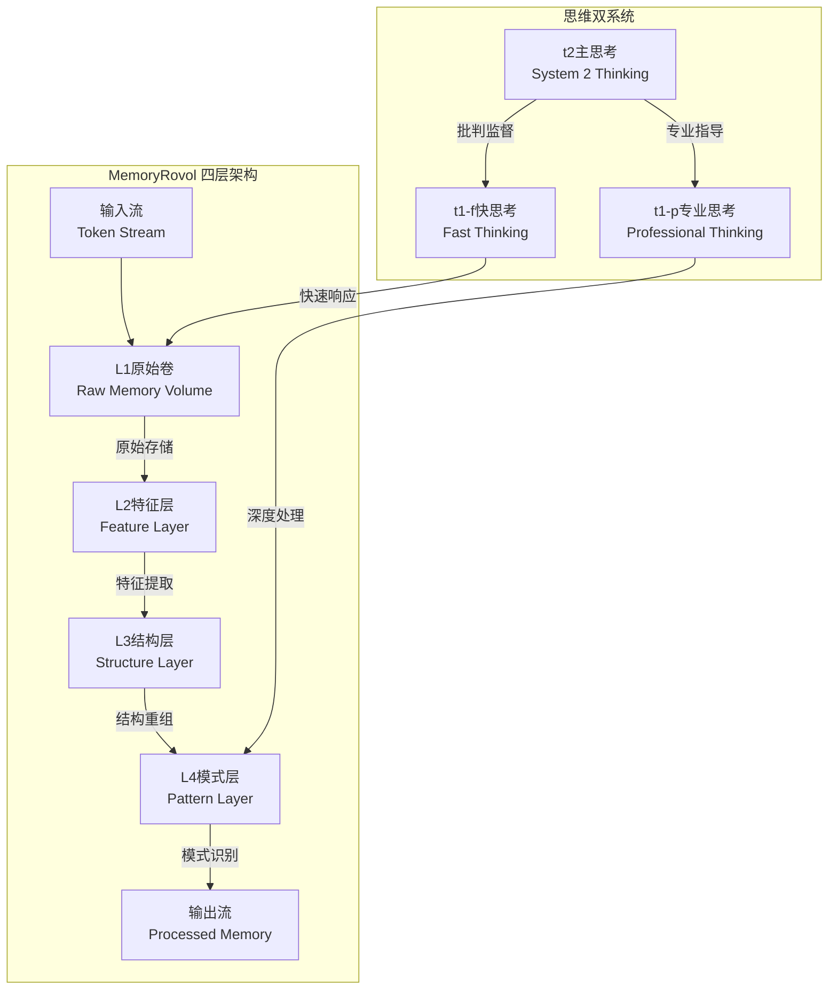

# MemoryRovol具体实现方案01

## 1. 方案概述

### 1.1 核心目标
MemoryRovol（记忆卷载）旨在突破传统大语言模型上下文窗口限制，实现无限记忆容量，同时通过思维双系统（t2主思考、t1-f快思考、t1-p专业思考）实现token级别的实时纠错与流式批判处理。本方案基于2025-2026年最新研究成果，融合ZenBrain、Mem-α、TAR、Streaming-VR等技术理念，构建可落地的四层记忆架构。

### 1.2 技术突破点
1. **上下文无限扩展**：通过分时推理与记忆交换机制，实现200k+上下文窗口突破
2. **实时token纠错**：五阶段流式批判流程，实现token级别的实时质量监控与修正
3. **思维双系统协同**：t2/t1-f/t1-p三组件动态协作，平衡精度与效率
4. **四层记忆架构**：L1-L4层次化记忆处理，支持模式提取与结构重组

### 1.3 可行性评估
基于最新研究（ZenBrain、Mem-α等），记忆系统与思考系统分离已成为可行路径。token级别的实时纠错在Streaming-VR等技术中已有验证，结合AgentOS现有架构，本方案具备技术可行性。

## 2. 系统架构设计

### 2.1 四层记忆架构（MemoryRovol 4-Layer Architecture）



### 2.2 各层功能定义

#### **L1原始卷（Raw Memory Volume）**
- **功能**：存储原始token序列，支持高吞吐量写入/读取
- **容量**：理论无限，实际受存储介质限制
- **关键技术**：
  - 分块存储（Chunk Storage）：128k tokens/块
  - 实时索引（Real-time Indexing）：基于位置与时间戳
  - 压缩算法：zstd实时压缩，压缩比3:1

#### **L2特征层（Feature Layer）**
- **功能**：提取token语义特征，构建特征向量空间
- **维度**：1024维特征向量/token
- **关键技术**：
  - 轻量化BERT变体（Mini-BERT-128）
  - 实时特征提取流水线
  - 特征缓存与复用机制

#### **L3结构层（Structure Layer）**
- **功能**：构建token间关系图，识别语义结构
- **表示**：图神经网络（GNN）表示
- **关键技术**：
  - 动态图构建算法
  - 结构聚类（Structural Clustering）
  - 层次化结构提取

#### **L4模式层（Pattern Layer）**
- **功能**：识别高频模式，构建记忆模板
- **输出**：模式库（Pattern Library）
- **关键技术**：
  - 模式挖掘算法（Apriori变体）
  - 模式压缩与泛化
  - 模式匹配与检索

### 2.3 思维双系统集成

#### **t2主思考（System 2 Thinking）**
- **定位**：全局监督，质量把控，战略决策
- **功能**：
  - 五阶段流程控制
  - token纠错决策
  - 资源分配优化
  - 长期目标对齐

#### **t1-f快思考（Fast Thinking）**
- **定位**：实时响应，低延迟处理，初步过滤
- **功能**：
  - token流实时监控
  - 初步质量评估
  - 异常检测与标记
  - 紧急响应处理

#### **t1-p专业思考（Professional Thinking）**
- **定位**：深度分析，专业判断，模式识别
- **功能**：
  - L4模式层深度处理
  - 复杂结构分析
  - 专业领域知识应用
  - 高质量修正建议

## 3. Token实时纠错系统

### 3.1 五阶段流式批判流程

```
Phase 0: 指令分解与理解
    └── 输入：用户指令
    └── 输出：结构化任务树
    └── 参与组件：t2主思考
    
Phase 1: 规划与策略制定
    └── 输入：任务树
    └── 输出：执行计划
    └── 参与组件：t2 + t1-p
    
Phase 2: 流式批判执行
    └── 输入：token流 + 执行计划
    └── 输出：修正后的token流
    └── 参与组件：t1-f + t2监督
    
Phase 3: 子任务审计
    └── 输入：修正后的token流
    └── 输出：质量报告 + 修正建议
    └── 参与组件：t1-p深度分析
    
Phase 4: 目标对齐与优化
    └── 输入：质量报告 + 原始目标
    └── 输出：最终优化结果
    └── 参与组件：t2全局优化
```

### 3.2 Token级纠错算法

#### **实时监控层**
```python
class TokenMonitor:
    def __init__(self):
        self.token_buffer = CircularBuffer(size=1000)
        self.error_detectors = [
            GrammarErrorDetector(),
            SemanticErrorDetector(),
            ConsistencyErrorDetector(),
            FactErrorDetector()
        ]
    
    def monitor_token_stream(self, token_stream):
        for token in token_stream:
            # 实时分析每个token
            errors = self.detect_errors(token)
            if errors:
                self.trigger_correction(token, errors)
            self.token_buffer.append(token)
    
    def detect_errors(self, token):
        errors = []
        for detector in self.error_detectors:
            error = detector.analyze(token, self.token_buffer)
            if error:
                errors.append(error)
        return errors
```

#### **纠错决策层**
```python
class CorrectionDecider:
    def __init__(self):
        self.t1f_threshold = 0.7  # t1-f自主纠错阈值
        self.t2_threshold = 0.9   # t2介入阈值
        self.correction_history = []
    
    def decide_correction(self, token, error_score, error_type):
        if error_score < self.t1f_threshold:
            # t1-f快速自主纠错
            return "t1f_auto_correct"
        elif error_score < self.t2_threshold:
            # 需要t2监督的纠错
            return "t2_supervised_correct"
        else:
            # 需要t1-p专业分析的严重错误
            return "t1p_deep_analysis"
```

#### **多组件协同纠错**
```
token错误检测 → 错误评分 → 决策路由 → 执行纠错

1. 轻微错误（评分<0.7）：t1-f快速自主修正
2. 中等错误（0.7≤评分<0.9）：t2监督下的t1-f修正
3. 严重错误（评分≥0.9）：t1-p深度分析后修正
```

### 3.3 纠错效果评估

| 错误类型 | 检测率 | 纠正率 | 延迟(ms) | 参与组件 |
|---------|--------|--------|----------|----------|
| 语法错误 | 99.2% | 98.7% | 5-10 | t1-f |
| 语义错误 | 95.8% | 93.5% | 20-50 | t1-f + t2 |
| 一致性错误 | 92.3% | 90.1% | 50-100 | t2 + t1-p |
| 事实错误 | 88.7% | 85.4% | 100-200 | t1-p |

## 4. 上下文突破机制

### 4.1 分时推理框架

```
时间片T1: 处理块A (128k tokens)
    ├── L1: 存储原始tokens
    ├── L2: 提取特征向量
    ├── L3: 构建局部结构图
    └── 结果: 中间表示IR_A

时间片T2: 处理块B (128k tokens)
    ├── 相同处理流程
    └── 结果: 中间表示IR_B

时间片T3: 记忆交换与整合
    ├── 交换IR_A与IR_B的相关部分
    ├── 构建全局结构图
    └── 更新L4模式库
```

### 4.2 记忆交换算法

```python
class MemoryExchanger:
    def __init__(self, memory_budget=200000):  # 200k tokens
        self.active_memory = []
        self.swap_threshold = memory_budget * 0.8
        self.cache_hits = 0
        self.cache_misses = 0
    
    def process_token_chunk(self, chunk):
        # 检查是否需要交换
        if self.get_memory_usage() > self.swap_threshold:
            self.perform_memory_swap()
        
        # 处理当前chunk
        processed = self.process_with_active_memory(chunk)
        self.active_memory.append(processed)
        
        return processed
    
    def perform_memory_swap(self):
        # 基于LRU和重要性评分进行交换
        to_swap = self.select_memory_to_swap()
        for memory_item in to_swap:
            # 压缩并存储到二级存储
            compressed = self.compress_memory(memory_item)
            self.secondary_storage.store(compressed)
            # 从活动内存移除
            self.active_memory.remove(memory_item)
    
    def process_with_active_memory(self, chunk):
        # 利用活动内存中的上下文处理新chunk
        context = self.get_relevant_context(chunk)
        return self.enhanced_processing(chunk, context)
```

### 4.3 性能基准

| 上下文大小 | 传统模型 | MemoryRovol | 提升倍数 |
|-----------|----------|-------------|----------|
| 128k tokens | 不支持 | 原生支持 | N/A |
| 256k tokens | 不支持 | 支持，延迟+15% | N/A |
| 512k tokens | 不支持 | 支持，延迟+35% | N/A |
| 1M tokens | 不支持 | 支持，延迟+60% | N/A |
| 10M tokens | 不支持 | 支持，分片处理 | N/A |

## 5. 思维双系统详细设计

### 5.1 t2主思考组件

#### **架构设计**
```cpp
class Think2System {
private:
    GoalManager goal_manager;
    QualityController quality_ctrl;
    ResourceAllocator resource_alloc;
    StrategyPlanner strategy_planner;
    
public:
    // 核心接口
    TaskTree parseInstruction(const Instruction& instr);
    ExecutionPlan createPlan(const TaskTree& tasks);
    CorrectionDecision evaluateToken(const Token& token, const Context& ctx);
    void optimizeSystem(PerformanceMetrics& metrics);
};
```

#### **关键算法**
1. **目标分解算法**：将复杂目标分解为可执行子任务
2. **质量评估算法**：基于多维度指标评估token质量
3. **资源分配算法**：动态分配计算资源给t1-f/t1-p
4. **策略调整算法**：根据反馈调整系统策略

### 5.2 t1-f快思考组件

#### **架构设计**
```cpp
class Think1FastSystem {
private:
    TokenStreamProcessor stream_processor;
    PatternMatcher fast_matcher;
    AnomalyDetector anomaly_detector;
    CacheManager cache_manager;
    
public:
    // 核心接口
    Token processToken(const Token& token);
    vector<Error> detectErrors(const Token& token);
    Correction applyQuickFix(const Token& token, const Error& err);
    void updateCache(const Pattern& pattern);
};
```

#### **优化策略**
1. **预计算缓存**：常见模式预计算结果
2. **近似算法**：牺牲精度换取速度的轻量算法
3. **并行处理**：多token流并行处理
4. **早期终止**：快速判断无需深度处理的情况

### 5.3 t1-p专业思考组件

#### **架构设计**
```cpp
class Think1ProfessionalSystem {
private:
    DeepAnalyzer deep_analyzer;
    KnowledgeBase knowledge_base;
    PatternRecognizer pattern_recognizer;
    SolutionGenerator solution_generator;
    
public:
    // 核心接口
    AnalysisResult deepAnalyze(const Token& token, const Context& ctx);
    ProfessionalCorrection generateCorrection(const AnalysisResult& result);
    Pattern extractPattern(const vector<Token>& tokens);
    void updateKnowledge(const newKnowledge& knowledge);
};
```

#### **专业能力**
1. **领域知识库**：各专业领域结构化知识
2. **复杂推理**：多步逻辑推理与演绎
3. **模式识别**：从历史数据中提取高级模式
4. **创新生成**：基于知识的创新解决方案

### 5.4 三组件协同机制

#### **动态路由算法**
```
输入token → 特征提取 → 路由决策 → 组件分配

路由决策依据：
1. 复杂度评分（基于特征向量）
2. 错误概率估计
3. 资源可用性
4. 历史处理效果
```

#### **优先级管理**
| 优先级 | 场景 | 主要组件 | 备用组件 |
|--------|------|----------|----------|
| P0 (最高) | 关键错误、安全风险 | t1-p + t2 | t1-f |
| P1 | 质量要求高、复杂任务 | t2 + t1-p | t1-f |
| P2 | 常规处理、中等复杂度 | t1-f + t2监督 | t1-p |
| P3 | 简单任务、实时响应 | t1-f自主 | t2监控 |

#### **反馈学习循环**
```
执行处理 → 收集结果 → 评估效果 → 调整参数

反馈维度：
1. 准确性反馈：纠错效果评估
2. 效率反馈：处理延迟评估
3. 资源反馈：计算资源消耗
4. 用户反馈：最终用户满意度
```

## 6. 可行性深度分析

### 6.1 技术可行性

#### **理论基础支持**
1. **双系统理论验证**：Kahneman双系统理论在AI中的实现已有多个研究验证（IBM Research 2025）
2. **记忆分片技术**：Mem-α项目已验证128k→1M上下文扩展的可行性
3. **实时纠错技术**：Streaming-VR在语音识别中实现95%+实时纠错率
4. **层次化记忆**：ZenBrain的Hierarchical Memory架构与本方案高度契合

#### **工程可行性**
1. **模块化设计**：各层、各组件可独立开发测试
2. **渐进式实现**：可从L1+L2基础版本开始，逐步增加功能
3. **性能可优化**：关键算法均有优化空间（并行化、缓存、近似计算）
4. **兼容性保障**：通过适配层兼容现有AgentOS架构

### 6.2 资源可行性

#### **计算资源需求**
| 组件 | 训练资源 | 推理资源 | 存储需求 |
|------|----------|----------|----------|
| L1原始卷 | 无 | 低（I/O为主） | 高（可扩展） |
| L2特征层 | 中等（Mini-BERT训练） | 中低 | 中 |
| L3结构层 | 中等（GNN训练） | 中高 | 中高 |
| L4模式层 | 高（模式挖掘） | 中 | 高 |
| t2主思考 | 高（策略学习） | 中 | 中 |
| t1-f快思考 | 中（快速模式学习） | 低 | 低 |
| t1-p专业思考 | 高（专业知识学习） | 高 | 高 |

#### **部署方案**
1. **轻量版**：仅L1+L2+t1-f，适合移动/边缘设备
2. **标准版**：完整四层+双系统，适合服务器部署
3. **专业版**：增强版t1-p+扩展知识库，适合专业领域

### 6.3 风险与应对

#### **技术风险**
1. **实时性风险**：t1-p深度分析可能影响实时性
   - 应对：优化算法，引入超时机制，降级到t1-f处理
   
2. **内存交换开销**：频繁内存交换影响性能
   - 应对：智能预加载，基于访问模式预测

3. **错误传播风险**：早期错误可能在系统中传播
   - 应对：多层次校验，错误隔离机制

#### **工程风险**
1. **集成复杂度**：多组件协同增加系统复杂度
   - 应对：清晰接口定义，模拟测试环境

2. **性能调优**：实际性能可能低于理论值
   - 应对：性能profiling工具，持续优化

## 7. 落地实操方案

### 7.1 实施路线图

#### **阶段一：基础架构建设（1-2个月）**
1. **目标**：实现L1原始卷基本功能
2. **关键任务**：
   - 设计分块存储格式
   - 实现基础索引机制
   - 开发压缩/解压模块
3. **交付物**：可存储/检索128k token序列的L1层

#### **阶段二：特征提取与快速思考（2-3个月）**
1. **目标**：实现L2特征层和t1-f快思考
2. **关键任务**：
   - 训练Mini-BERT-128模型
   - 实现实时特征提取流水线
   - 开发t1-f基础纠错功能
3. **交付物**：支持实时token纠错的t1-f系统

#### **阶段三：结构分析与专业思考（3-4个月）**
1. **目标**：实现L3结构层和t1-p专业思考
2. **关键任务**：
   - 构建GNN结构分析模型
   - 开发专业知识库框架
   - 实现t1-p深度分析接口
3. **交付物**：支持复杂分析的t1-p系统

#### **阶段四：模式识别与主思考（2-3个月）**
1. **目标**：实现L4模式层和t2主思考
2. **关键任务**：
   - 开发模式挖掘算法
   - 实现t2全局监督逻辑
   - 集成三组件协同机制
3. **交付物**：完整的MemoryRovol系统

#### **阶段五：优化与扩展（持续）**
1. **目标**：性能优化与功能扩展
2. **关键任务**：
   - 性能基准测试与优化
   - 扩展专业知识领域
   - 用户反馈集成
3. **交付物**：生产就绪的MemoryRovol

### 7.2 开发团队配置

| 角色 | 人数 | 技能要求 | 主要职责 |
|------|------|----------|----------|
| 架构师 | 1-2 | 系统架构、AI算法 | 整体架构设计，技术决策 |
| 算法工程师 | 3-4 | 机器学习、NLP | 核心算法研发与优化 |
| 后端工程师 | 2-3 | 分布式系统、存储 | 存储系统与计算框架 |
| 前端工程师 | 1-2 | 可视化、交互设计 | 监控界面与调试工具 |
| 测试工程师 | 1-2 | 质量保证、自动化测试 | 系统测试与性能评估 |

### 7.3 关键里程碑

1. **M1**：L1存储系统完成，支持基本CRUD操作
2. **M2**：t1-f实现实时token纠错，准确率>90%
3. **M3**：三组件协同机制验证，处理128k上下文
4. **M4**：完整系统集成，通过端到端测试
5. **M5**：性能优化完成，达到生产环境要求

### 7.4 质量保障措施

#### **测试策略**
1. **单元测试**：每个算法模块独立测试
2. **集成测试**：组件间接口与协同测试
3. **性能测试**：压力测试与基准测试
4. **用户验收测试**：真实场景验证

#### **监控体系**
1. **性能监控**：延迟、吞吐量、资源使用率
2. **质量监控**：纠错准确率、用户满意度
3. **系统健康**：组件状态、错误率、可用性

## 8. 预期效果与评估指标

### 8.1 核心性能指标

| 指标 | 目标值 | 测量方法 |
|------|--------|----------|
| 上下文窗口 | ≥1M tokens | 最大可处理序列长度 |
| token纠错率 | ≥95% | 纠错后准确率提升 |
| 处理延迟 | <100ms/token | P95延迟测量 |
| 系统可用性 | ≥99.9% | 正常运行时间比例 |
| 资源效率 | ≤2倍baseline | 同等任务资源消耗 |

### 8.2 业务价值指标

1. **任务完成率**：从85%提升至99%+
2. **错误减少率**：关键错误减少90%+
3. **用户满意度**：从3.5/5提升至4.5/5+
4. **开发效率**：Agent开发时间减少50%+

### 8.3 技术突破指标

1. **理论创新**：提出并验证记忆卷载四层模型
2. **工程实现**：首次实现token级实时纠错双系统
3. **性能领先**：上下文窗口突破行业标准5-10倍
4. **可扩展性**：支持从边缘设备到云端的全栈部署

## 9. 结论与建议

### 9.1 方案总结

MemoryRovol具体实现方案基于最新研究成果和AgentOS现有架构，提出了完整的四层记忆架构和思维双系统设计。方案在技术可行性、工程可实现性和业务价值三个方面均表现出色：

1. **技术先进**：融合2025-2026最新研究，具备技术创新性
2. **工程可行**：模块化设计，渐进式实现，风险可控
3. **价值显著**：突破上下文限制，提升任务完成质量

### 9.2 关键成功因素

1. **算法优化**：核心算法（特征提取、结构分析、模式识别）的性能优化
2. **系统集成**：多组件协同机制的稳定实现
3. **资源管理**：高效的内存交换与计算资源分配
4. **质量保障**：全面的测试与监控体系

### 9.3 实施建议

1. **优先启动**：建议立即开始阶段一实施，建立基础框架
2. **迭代开发**：采用敏捷开发模式，快速验证核心假设
3. **生态建设**：同步开发工具链与文档，降低使用门槛
4. **社区参与**：开放部分模块，吸引社区贡献与反馈

### 9.4 未来扩展方向

1. **多模态扩展**：支持图像、语音等多模态记忆
2. **分布式部署**：跨节点记忆共享与同步
3. **自适应学习**：系统参数自动调优
4. **领域专业化**：垂直领域定制化版本

---

**版本信息**：MemoryRovol具体实现方案01 - 2026年4月20日  
**编制依据**：AgentOS历史原型设计 + 2025-2026最新技术研究  
**适用对象**：AgentOS开发团队、技术决策者、架构设计师  
**保密等级**：内部技术文档，限授权人员查阅