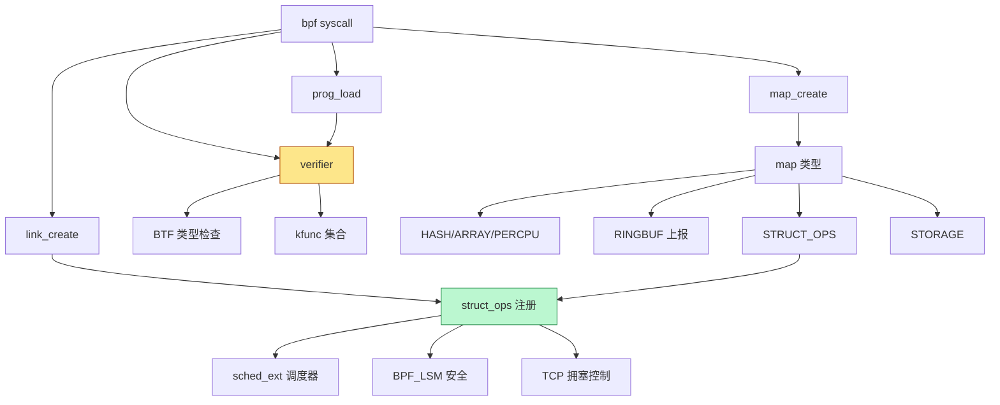
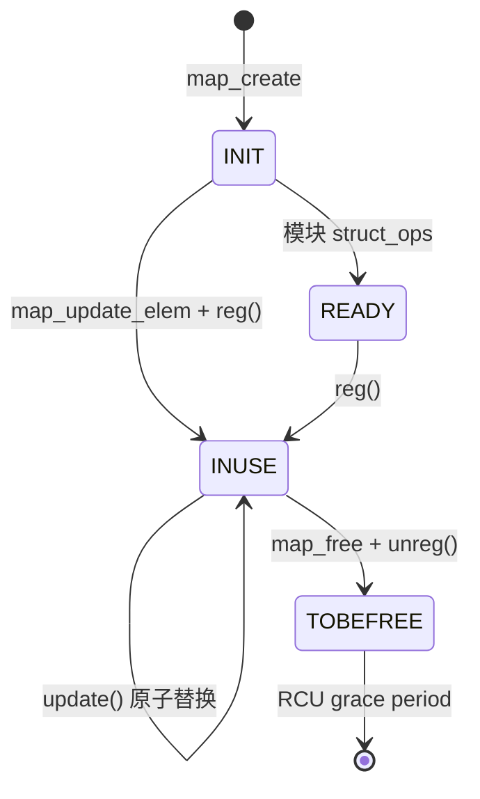
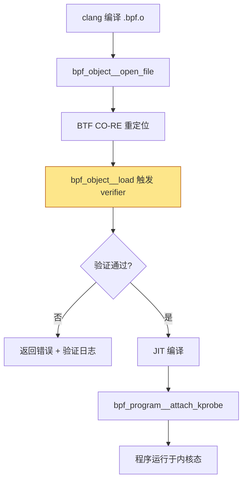

Copyright (c) 2025-2026 SPHARX Ltd. All Rights Reserved.

# openEuler eBPF 技术规范参考

> **文档定位**: 闭源内部参考，openEuler eBPF 子系统技术规范全面参考
> **保密级别**: SPHARX Ltd 内部参考，**闭源不公开**
> **版本**: 0.1.1（文档体系完成）/ 1.0.1（开发）
> **最后更新**: 2026-07-07
> **参考源**: openEuler 社区 + OLK-6.6（Linux 6.6 内核源码）

---

## 1. 文档说明

### 1.1 目的

本文档全面参考 openEuler 社区的 eBPF 子系统技术规范，作为 AirymaxOS 可编程扩展子系统（eBPF/struct_ops/kfunc）设计的参考基础。所有参考内容**仅供 SPHARX Ltd 内部使用**，不得出现在开源文档（`docs/AirymaxOS/`）中。

### 1.2 参考来源

| 来源 | 内容 | 路径 / URL |
|------|------|-----------|
| OLK-6.6 源码 | openEuler LTS 6.6 内核源码 | Linux 6.6 源码根目录 |
| openEuler 文档 | eBPF 设计文档 | openEuler 社区文档站 |
| Linux 主线 | BPF 子系统主线实现 | kernel.org |
| Meta sched_ext | BPF 可插拔调度器 | GitHub: sched_ext/sched_ext |
| libbpf | BPF 用户态库 | GitHub: libbpf/libbpf |

### 1.3 OLK-6.6 版本标记

```
OPENEULER_LTS = 0       # 非 LTS 修改版本（基线）
OPENEULER_MAJOR = 9999  # 占位
OPENEULER_MINOR = 0
OPENEULER_RELEASE = ""
```

OLK-6.6 是基于 Linux 6.6 主线的 openEuler 内核基线，包含从主线 6.12+ 前向移植的 sched_ext 特性，以及 openEuler 自研的 BPF_SCHED CFS instrumentation。

### 1.4 三段式参考方法

按用户三段式方法论，AirymaxOS eBPF 设计参考流程：

1. **先参考 Euler**：查阅本文档对应章节的 openEuler eBPF 规范
2. **再参考行业最新理论**：查阅 `04-industry-best-practices/01-latest-theory.md` 中的最新理论
3. **最后形成 AirymaxOS 技术方案**：综合形成开源设计文档 `docs/AirymaxOS/90-observability/02-ebpf-probes.md`

---

## 2. openEuler eBPF 整体架构

### 2.1 设计哲学

openEuler eBPF 子系统遵循 Linux 主线设计哲学，并增加 openEuler 特有的 BPF_SCHED 机制：

| 设计哲学 | 说明 | openEuler 增强 |
|---------|------|---------------|
| **可编程性** | 用户态编写 C 源码经 clang 编译为 BPF 字节码 | 无 |
| **安全可加载** | 验证器在加载时静态分析所有路径 | 无 |
| **JIT 加速** | BPF 字节码编译为本机指令执行 | 鲲鹏 JIT 优化 |
| **可插拔调度** | BPF 程序作为 struct_ops 注册到调度子系统 | OLK-6.6 前向移植 sched_ext |
| **CFS instrumentation** | 静态钩子 + static_key 控制 CFS 行为 | openEuler 自研 BPF_SCHED |
| **kABI 兼容** | KABI_RESERVE/KABI_FILL_HOLE 保留字段 | openEuler kABI 机制 |

### 2.2 子系统划分

| 子系统 | 路径 | 职责 | 行数 |
|--------|------|------|------|
| 系统调用 | `kernel/bpf/syscall.c` | bpf() 入口、map/prog/link 管理 | 5946 |
| 验证器 | `kernel/bpf/verifier.c` | 加载时静态分析 | 21091 |
| struct_ops | `kernel/bpf/bpf_struct_ops.c` | struct_ops 注册机制 | 1216 |
| helper | `kernel/bpf/helpers.c` | BPF 辅助函数 | 2904 |
| BTF | `kernel/bpf/btf.c` | 类型信息（含 struct_ops 注册） | 9158 |
| ringbuf | `kernel/bpf/ringbuf.c` | BPF→用户态上报 | 807 |
| hash map | `kernel/bpf/hashtab.c` | HASH/PERCPU_HASH/LRU_HASH | 2640 |
| array map | `kernel/bpf/arraymap.c` | ARRAY/PERCPU_ARRAY | 1407 |
| bloom filter | `kernel/bpf/bloom_filter.c` | 布隆过滤器 | ~400 |
| lpm trie | `kernel/bpf/lpm_trie.c` | 最长前缀匹配 | ~600 |
| task storage | `kernel/bpf/bpf_task_storage.c` | per-task 存储 | ~800 |
| inode storage | `kernel/bpf/bpf_inode_storage.c` | per-inode 存储 | ~500 |
| cgrp storage | `kernel/bpf/bpf_cgrp_storage.c` | per-cgroup 存储 | ~700 |
| BPF_LSM | `kernel/bpf/bpf_lsm.c` | LSM 钩子 | ~300 |
| core | `kernel/bpf/core.c` | BPF 解释器（JIT 失败回退） | ~2000 |
| dispatcher | `kernel/bpf/dispatcher.c` | BPF 分派器 | ~200 |
| cpumap | `kernel/bpf/cpumap.c` | CPU map（网络） | ~600 |
| devmap | `kernel/bpf/devmap.c` | 设备 map（网络） | ~500 |

### 2.3 子系统关系图



### 2.4 Kconfig 要求

```kconfig
CONFIG_BPF=y                   # BPF 基础
CONFIG_BPF_SYSCALL=y           # bpf() 系统调用
CONFIG_BPF_JIT=y               # BPF JIT 编译
CONFIG_BPF_JIT_ALWAYS_ON=y     # 强制 JIT（禁用解释器）
CONFIG_BPF_JIT_DEFAULT_ON=y    # JIT 默认开启
CONFIG_BPF_EVENTS=y             # kprobe/tracepoint/perf_event 挂载
CONFIG_BPF_LSM=y               # LSM 钩子（动态 MAC/审计）
CONFIG_BPF_SCHED=y              # openEuler CFS instrumentation
CONFIG_DEBUG_INFO_BTF=y         # BTF 调试信息
CONFIG_BPF_UNPRIV_DEFAULT_OFF=y # 非特权 BPF 默认关闭
CONFIG_SCHED_CLASS_EXT=y        # sched_ext 调度类
```

---

## 3. struct_ops 注册机制规范

### 3.1 struct_ops 设计哲学

struct_ops 是 Linux 5.x 引入的机制，允许 BPF 程序作为内核子系统的操作表（struct of function pointers）。openEuler OLK-6.6 通过此机制实现 sched_ext 可插拔调度器和 BPF_LSM 动态安全策略。

**核心设计哲学**：

1. **结构体即接口**：内核子系统定义 `struct xxx_ops`（函数指针集合），BPF 程序填充此结构体
2. **双映像模型**：用户态映像（uvalue，含 prog fd）与内核态映像（kvalue，含真实函数指针）分离
3. **trampoline 桥接**：通过 trampoline 本机码桥接内核调用与 BPF 程序入口
4. **状态机管理**：INIT → INUSE → TOBEFREE 四状态生命周期
5. **CFI 安全**：cfi_stubs 提供 kCFI 桩函数，防止控制流劫持

### 3.2 struct bpf_struct_ops 回调表

| 回调 | 签名 | 职责 |
|------|------|------|
| `verifier_ops` | `const struct bpf_verifier_ops *` | 程序验证回调 |
| `init` | `int (*)(struct btf *btf)` | 子系统初始化 |
| `check_member` | `int (*)(const struct btf_type *t, const struct btf_member *member, const struct bpf_prog *prog)` | 成员合法性检查 |
| `init_member` | `int (*)(const struct btf_type *t, const struct btf_member *member, void *kdata, const void *udata)` | 成员初始化（非函数指针字段） |
| `reg` | `int (*)(void *kdata)` | 注册到内核子系统 |
| `unreg` | `void (*)(void *kdata)` | 从内核子系统注销 |
| `update` | `int (*)(void *kdata, void *old_kdata)` | 原子更新（热替换） |
| `validate` | `int (*)(void *kdata)` | 注册前校验 |
| `cfi_stubs` | `void *` | kCFI 桩函数表 |
| `name` | `const char *` | struct_ops 类型名 |
| `owner` | `struct module *` | 拥有者模块 |
| `func_models` | `struct btf_func_model[]` | 每成员函数模型 |
| `type_id` / `value_id` | `u32` | BTF 类型 ID |

### 3.3 register_bpf_struct_ops 宏

```c
#define register_bpf_struct_ops(st_ops, type)                  \
    ({                                                         \
        struct bpf_struct_ops_##type {                         \
            struct bpf_struct_ops_common_value common;         \
            struct type data ____cacheline_aligned_in_smp;     \
        };                                                     \
        BTF_TYPE_EMIT(struct bpf_struct_ops_##type);           \
        __register_bpf_struct_ops(st_ops);                     \
    })
```

此宏做三件事：(1) 定义 value 类型（common_value 头 + 真实 ops 结构体）；(2) 通过 `BTF_TYPE_EMIT` 确保 BTF 包含此类型；(3) 调用 `__register_bpf_struct_ops()` 注册到 BTF struct_ops 表。

### 3.4 struct_ops 状态机

```c
enum bpf_struct_ops_state {
    BPF_STRUCT_OPS_STATE_INIT,     /* 已初始化，未注册 */
    BPF_STRUCT_OPS_STATE_INUSE,    /* 已注册，使用中 */
    BPF_STRUCT_OPS_STATE_TOBEFREE, /* 待释放（RCU 宽限期内） */
    BPF_STRUCT_OPS_STATE_READY,     /* 就绪（仅模块 struct_ops） */
};
```



### 3.5 sched_ext 注册实例

```c
/* kernel/sched/ext.c:5839 */
static struct bpf_struct_ops bpf_sched_ext_ops = {
    .verifier_ops = &bpf_scx_verifier_ops,
    .reg          = bpf_scx_reg,
    .unreg        = bpf_scx_unreg,
    .check_member = bpf_scx_check_member,
    .init_member  = bpf_scx_init_member,
    .init         = bpf_scx_init,
    .update       = bpf_scx_update,
    .validate     = bpf_scx_validate,
    .name         = "sched_ext_ops",
    .owner        = THIS_MODULE,
    .cfi_stubs   = &__bpf_ops_sched_ext_ops
};

/* ext.c:7335 */
ret = register_bpf_struct_ops(&bpf_sched_ext_ops, sched_ext_ops);
```

### 3.6 AirymaxOS 借鉴要点

| openEuler 规范 | AirymaxOS 落地 |
|---------------|----------------------------|
| struct_ops 注册机制 | SCHED_AGENT 通过 `register_bpf_struct_ops()` 集成 [SS] |
| 4 状态生命周期 | `airymax_struct_ops_state` 纳入 [SC] 共享契约层 |
| cfi_stubs kCFI 安全 | AirymaxOS 采用 kCFI（CONFIG_CFI_CLANG） |
| trampoline 本机码桥接 | AirymaxOS 独立实现（x86_64/arm64） |
| BTF_TYPE_EMIT 类型确保 | AirymaxOS 沿用 |

---

## 4. BPF_SCHED CFS instrumentation 规范

### 4.1 BPF_SCHED 设计哲学

BPF_SCHED 是 openEuler 自研的 CFS instrumentation 机制，允许 BPF 程序挂载到 CFS 调度器的 5 个关键决策点，实现动态调度策略。与 sched_ext 不同，BPF_SCHED 不替换调度类，而是在 CFS 内部插入 BPF 钩子。

**核心设计哲学**：

1. **静态钩子**：通过 `BPF_SCHED_HOOK` 宏在 CFS 代码中插入调用点
2. **static_key 控制**：未挂载 BPF 程序时 `static_branch_unlikely` 跳过，零开销
3. **CFS 内部访问**：BPF 程序可直接访问 `struct sched_entity`、`struct sched_migrate_ctx` 等 CFS 内部结构
4. **返回值影响**：BPF 程序返回值影响 CFS 决策（如 `cfs_can_migrate_task` 返回 0 阻止迁移）

### 4.2 BPF_SCHED 配置

```kconfig
config BPF_SCHED
    bool "Sched Instrumentation with BPF"
    depends on BPF_EVENTS
    depends on BPF_SYSCALL
    depends on BPF_JIT
    help
      Enables instrumentation of the sched hooks with eBPF programs for
      implementing dynamic scheduling policies. When CONFIG_BPF_SCHED
      is enabled, privileged BPF could be used to expand scheduling
      capabilities.
```

### 4.3 5 个 CFS 钩子

```c
/* include/linux/sched_hook_defs.h */
BPF_SCHED_HOOK(int, -1, cfs_select_rq, struct sched_migrate_ctx *ctx)
BPF_SCHED_HOOK(int, -1, cfs_can_migrate_task, struct task_struct *p,
                struct sched_migrate_node *migrate_node)
BPF_SCHED_HOOK(int, -1, cfs_tag_entity_eligible, struct sched_entity *se)
BPF_SCHED_HOOK(int, -1, cfs_tag_pick_next_entity,
                const struct sched_entity *curr,
                const struct sched_entity *next)
BPF_SCHED_HOOK(void, (void) 0, cfs_exec_init, struct task_struct *tsk)
```

宏展开后生成 `bpf_sched_cfs_select_rq()` 等函数，通过 `static_key` (`bpf_sched_enabled_key`) 控制：

```c
/* 宏展开示意（简化） */
static DEFINE_STATIC_KEY_FALSE(bpf_sched_enabled_key);

int bpf_sched_cfs_select_rq(struct sched_migrate_ctx *ctx)
{
    if (static_branch_unlikely(&bpf_sched_enabled_key))
        return bpf_prog_run_array(...);  /* 调用 BPF 程序 */
    return -1;  /* 默认值 */
}
```

### 4.4 钩子语义详解

| 钩子 | 调用点 | 参数 | 返回值语义 |
|------|--------|------|-----------|
| `cfs_select_rq` | 任务迁移选 CPU 时 | `struct sched_migrate_ctx *ctx`（含 task、prev_cpu、new_cpu、flags） | 返回选定的 CPU 编号，-1 表示使用默认 |
| `cfs_can_migrate_task` | 任务可否迁移时 | `struct task_struct *p`、`struct sched_migrate_node *migrate_node` | 0=阻止迁移，1=允许 |
| `cfs_tag_entity_eligible` | 实体资格判定时 | `struct sched_entity *se` | 0=ineligible，1=eligible |
| `cfs_tag_pick_next_entity` | 选下一个实体时 | `curr`、`next` 两个 sched_entity | 0=拒绝 next，1=接受 |
| `cfs_exec_init` | 任务 exec 初始化时 | `struct task_struct *tsk` | void（仅观测） |

### 4.5 BPF_SCHED vs sched_ext 对比

| 维度 | BPF_SCHED | sched_ext |
|------|-----------|-----------|
| 集成方式 | 静态钩子 + static_key | struct_ops 注册 |
| 调度类 | 不替换 CFS | 新增 ext_sched_class |
| 回调数量 | 5 个 CFS 钩子 | 25+ 调度回调 |
| 访问深度 | CFS 内部结构（sched_entity 等） | 完整调度接口 |
| 失败回退 | BPF 返回默认值 | 自动回退 CFS |
| openEuler 状态 | 自研 | 前向移植主线 6.12+ |
| AirymaxOS 决策 | **不移植** [IND] | **采用** [SS] |

### 4.6 AirymaxOS 不移植 BPF_SCHED 的理由

1. **sched_ext 更完整**：sched_ext 提供 25+ 回调，覆盖调度全生命周期，远超 BPF_SCHED 的 5 钩子
2. **微内核解耦原则**：BPF_SCHED 与 CFS 内部实现强耦合（`struct sched_entity`、`struct sched_migrate_ctx`），不符合微内核解耦原则
3. **sched_ext 已在主线**：sched_ext 已进入 Linux 主线（6.12+），openEuler OLK-6.6 前向移植，AirymaxOS 直接采用主线版本
4. **struct_ops 语义更优**：struct_ops 提供完整操作表注册，比静态钩子更符合"可插拔"理念
5. **避免双重机制**：同时支持 BPF_SCHED 和 sched_ext 会造成调度策略分散，违反工程一致性原则

**[IND] 独立设计**：AirymaxOS 在 SCHED_AGENT 框架下通过 struct_ops 回调实现等价的"调度策略钩子"，不使用 BPF_SCHED 的静态钩子模式。

---

## 5. eBPF 验证器规范

### 5.1 两阶段验证

| 阶段 | 检查内容 | openEuler 实现 |
|------|---------|---------------|
| 第一阶段：DAG 检查 | 禁止循环、不可达指令；构建控制流图 | `kernel/bpf/verifier.c` check_cfg() |
| 第二阶段：路径模拟 | 从首指令模拟执行所有路径，跟踪寄存器/栈状态 | `kernel/bpf/verifier.c` do_check() |

### 5.2 寄存器类型系统

验证器维护每指令处每寄存器的类型状态：

| 类型 | 语义 | openEuler 使用 |
|------|------|---------------|
| `PTR_TO_CTX` | 上下文指针（kprobe ctx / struct_ops arg） | 是 |
| `PTR_TO_MAP` | map 指针 | 是 |
| `PTR_TO_MAP_KEY` / `PTR_TO_MAP_VALUE` | map 键值指针 | 是 |
| `PTR_TO_STACK` | 栈指针 | 是 |
| `PTR_TO_PACKET` / `PTR_TO_PACKET_META` / `PTR_TO_PACKET_END` | 网络包指针 | 是（网络观测） |
| `PTR_TO_TCP_SOCK` / `PTR_TO_SOCK_COMMON` | socket 指针 | 是（网络观测） |
| `PTR_TO_MEM` / `PTR_TO_MEM_OR_NULL` | dynptr 包装的内存 | 是 |
| `PTR_TO_ARENA` | BPF arena 指针（新） | 是（实验） |
| `SCALAR_VALUE` | 标量值 | 是 |

### 5.3 复杂度上限

```c
#define BPF_COMPLEXITY_LIMIT_INSNS    1000000  /* 100 万指令 */
#define BPF_COMPLEXITY_LIMIT_STACK    512       /* 栈深度 512 字节 */
#define BPF_COMPLEXITY_LIMIT_STATES   1000000  /* 状态数上限 */
```

### 5.4 验证器日志

加载失败时验证器返回详细日志，可通过 `bpf_attr.log_buf` 获取。验证器日志含程序名、失败指令、错误原因三要素。

### 5.5 AirymaxOS 借鉴要点

| openEuler 规范 | AirymaxOS 落地 |
|---------------|----------------------------|
| 两阶段验证 | [SS] 语义同源，实现独立 |
| 寄存器类型系统 | [SS] 语义同源 |
| 复杂度上限 | [SS] 遵循相同上限（OS-STD-010） |
| 验证器日志落审计 | AirymaxOS 强制落 `/var/log/airymaxos/bpf-load.log`（OS-STD-012） |

---

## 6. BPF map 类型规范

### 6.1 核心 map 类型

openEuler OLK-6.6 提供 28+ 种 BPF map 类型：

| map 类型 | 实现 | 用途 | AirymaxOS 使用 |
|---------|------|------|----------------|
| `BPF_MAP_TYPE_HASH` | `hashtab.c` | 通用键值存储 | [SS] |
| `BPF_MAP_TYPE_ARRAY` | `arraymap.c` | 索引数组 | [SS] |
| `BPF_MAP_TYPE_PERCPU_HASH` | `hashtab.c` | per-CPU 哈希（无锁） | [SS] |
| `BPF_MAP_TYPE_PERCPU_ARRAY` | `arraymap.c` | per-CPU 数组 | [SS] |
| `BPF_MAP_TYPE_LRU_HASH` / `LRU_PERCPU_HASH` | `hashtab.c` | LRU 淘汰哈希 | [SS] |
| `BPF_MAP_TYPE_RINGBUF` | `ringbuf.c` | BPF→用户态上报（推荐） | [SS] |
| `BPF_MAP_TYPE_PERF_EVENT_ARRAY` | `arraymap.c` | 旧版上报（被 ringbuf 替代） | [IND] |
| `BPF_MAP_TYPE_STACK_TRACE` | `stackmap.c` | 栈回溯 | [SS] |
| `BPF_MAP_TYPE_STACK` / `QUEUE` | `queue_stack_maps.c` | 栈/队列 | [IND] |
| `BPF_MAP_TYPE_STRUCT_OPS` | `bpf_struct_ops.c` | struct_ops 注册载体 | [SS] |
| `BPF_MAP_TYPE_BLOOM_FILTER` | `bloom_filter.c` | 布隆过滤器 | [IND] |
| `BPF_MAP_TYPE_LPM_TRIE` | `lpm_trie.c` | 最长前缀匹配 | [SS] |
| `BPF_MAP_TYPE_TASK_STORAGE` | `bpf_task_storage.c` | per-task 存储 | [SS] |
| `BPF_MAP_TYPE_INODE_STORAGE` | `bpf_inode_storage.c` | per-inode 存储 | [IND] |
| `BPF_MAP_TYPE_CGRP_STORAGE` | `bpf_cgrp_storage.c` | per-cgroup 存储 | [SS] |
| `BPF_MAP_TYPE_ARENA` | 新增 | BPF arena（共享地址空间） | [IND] |

### 6.2 ringbuf map 上报规范

ringbuf 是 Linux 6.6 内核基线推荐的 BPF→用户态数据上报通路，替代 `BPF_MAP_TYPE_PERF_EVENT_ARRAY`。

**优势**：

1. **跨 CPU 顺序**：保证事件按时间顺序到达
2. **保留通知**：`BPF_RB_NO_DISCARD` 保留满时通知
3. **无锁预留**：`bpf_ringbuf_reserve` 无锁预留缓冲区
4. **大容量**：支持 GB 级 ringbuf

```c
/* ringbuf 上报示例 */
struct event *e = bpf_ringbuf_reserve(&agent_events, sizeof(*e), 0);
if (!e) return 0;
e->agent_id = ...; e->ts = bpf_ktime_get_ns();
bpf_ringbuf_submit(e, 0);   /* 或 bpf_ringbuf_discard(e, 0) 丢弃 */
```

### 6.3 per-CPU map 无锁并发

per-CPU map 为每 CPU 维护独立副本，BPF 程序访问本 CPU 副本无锁。用户态通过 `bpf_map_lookup_percpu_elem(map, key, cpu)` 聚合。适合 Token 累加等高频计数器。

### 6.4 AirymaxOS 借鉴要点

| openEuler 规范 | AirymaxOS 落地 |
|---------------|----------------------------|
| ringbuf 推荐为上报通路 | Agent 行为追踪强制使用 ringbuf（OS-OBS-020） |
| per-CPU map 无锁并发 | Token 累加强制 PERCPU_ARRAY（OS-OBS-017） |
| LRU_HASH 淘汰策略 | Agent 状态追踪使用 LRU_HASH |
| map 显式 max_entries | OS-STD-013 规则 |

---

## 7. kfunc 内核函数调用规范

### 7.1 kfunc 注册模式

kfunc 通过 `__bpf_kfunc` 宏标注函数，`BTF_KFUNCS_START`/`BTF_KFUNCS_END` 注册到 BTF kfunc 集合。验证器仅允许调用已注册 kfunc。

```c
__bpf_kfunc_start_defs();
__bpf_kfunc struct task_struct *bpf_find_get_task_by_vpid(pid_t nr)
{ return find_get_task_by_vpid(nr); }
__bpf_kfunc_end_defs();

BTF_KFUNCS_START(bpf_general_kfuncs)
BTF_ID_FLAGS(func, bpf_find_get_task_by_vpid)
BTF_KFUNCS_END(bpf_general_kfuncs);
```

### 7.2 kfunc 参数注解

| 注解 | 语义 | 验证器用途 |
|------|------|-----------|
| `__sz` | 缓冲区大小参数 | 边界检查 |
| `__k` | 常量标量参数 | 编译期求值 |
| `__uninit` | 未初始化输出参数 | 生命周期检查 |
| `__opt` | 可选参数 | 参数存在性检查 |
| `__nullable` | 可空参数（struct_ops 专用） | 空指针检查 |

### 7.3 kfunc vs helper 对比

| 维度 | BPF helper | kfunc |
|------|-----------|-------|
| 接口稳定性 | 稳定 ABI | 无稳定接口（随内核版本变化） |
| 类型安全 | 弱（签名固定） | 强（BTF 描述） |
| 可扩展性 | 有限集 | 可扩展 |
| 注册方式 | `BPF_CALL_*` 宏 | `__bpf_kfunc` + BTF_KFUNCS |
| 推荐度 | 旧代码 | Linux 6.6 推荐新代码 |

### 7.4 AirymaxOS 借鉴要点

| openEuler 规范 | AirymaxOS 落地 |
|---------------|----------------------------|
| kfunc 注册模式 | [SS] 语义同源，`__bpf_kfunc` + BTF_KFUNCS |
| 参数注解 | [SS] 沿用 __sz/__k/__uninit/__opt/__nullable |
| 新代码优先 kfunc | AirymaxOS 新观测 kfunc 优先（OS-OBS-013） |
| 自定义 kfunc | AirymaxOS 注册 `bpf_agent_decision_get`、`bpf_agent_token_usage_get`、`bpf_agent_state_get` [IND] |

---

## 8. BPF 程序加载流程规范

### 8.1 加载步骤

eBPF 程序从源码到运行经历五步：

1. **编译**：clang `-target bpf -O2 -g` 编译为 BPF ELF 字节码
2. **加载**：`bpf(BPF_PROG_LOAD)` 系统调用提交内核
3. **验证**：验证器两阶段静态分析
4. **JIT**：JIT 编译器将字节码编译为本机指令
5. **挂载**：通过 `bpf(BPF_LINK_CREATE)` 挂载到 kprobe/tracepoint/perf_event/struct_ops

### 8.2 libbpf 框架

openEuler 推荐使用 libbpf 框架管理 BPF 程序生命周期：

```c
struct bpf_object *obj = bpf_object__open_file("agent_tracer.bpf.o", NULL);
if (libbpf_get_error(obj)) return libbpf_get_error(obj);
int err = bpf_object__load(obj);   /* 触发 verifier 验证 + JIT */
if (err) { bpf_object__close(obj); return err; }
struct bpf_link *link = bpf_program__attach_kprobe(
    bpf_object__find_program_by_name(obj, "trace_cognition"),
    false, "agentrt_cognition_process");
```

### 8.3 加载流程图



### 8.4 AirymaxOS 借鉴要点

| openEuler 规范 | AirymaxOS 落地 |
|---------------|----------------------------|
| libbpf 框架 | AirymaxOS 沿用 libbpf |
| BTF CO-RE 重定位 | OS-OBS-012 强制 CO-RE |
| 显式 link 生命周期 | OS-OBS-018 强制 `bpf_link__destroy` |
| .o 文件随内核发布 | OS-STD-014 存放 `/usr/lib/airymaxos/bpf/` |

---

## 9. 性能调优规范

### 9.1 ringbuf 大小配置

| 场景 | ringbuf 大小 | 说明 |
|------|-------------|------|
| 低频事件（配置变更） | 1 MB | `BPF_MAP_TYPE_RINGBUF` max_entries=1<<20 |
| 中频事件（Agent 决策） | 4 MB | OS-OBS-020 强制 ≥4 MB |
| 高频事件（Token 累加） | 16 MB | 大容量避免丢失 |

### 9.2 批量提交优化

```c
/* 批量提交优化——减少 ringbuf 锁竞争 */
#pragma unroll
for (int i = 0; i < 8; i++) {
    struct event *e = bpf_ringbuf_reserve(&agent_events, sizeof(*e), 0);
    if (!e) break;
    /* 填充 e */
    bpf_ringbuf_submit(e, 0);
}
```

### 9.3 鲲鹏 920 性能基准

openEuler 在鲲鹏 920（ARM64）上的 BPF 性能基准：

| 指标 | 数值 | 说明 |
|------|------|------|
| BPF 程序加载延迟 | < 5 ms | verifier + JIT |
| kprobe 挂载开销 | < 1 μs | 单次探针 |
| ringbuf 上报吞吐 | 250K events/s | 4 MB ringbuf |
| per-CPU map 查询 | < 100 ns | 本 CPU 副本 |
| struct_ops 注册延迟 | < 10 ms | sched_ext 启用 |

### 9.4 AirymaxOS 借鉴要点

| openEuler 规范 | AirymaxOS 落地 |
|---------------|----------------------------|
| ringbuf 大小配置 | OS-OBS-020 强制 ≥4 MB |
| 批量提交优化 | AirymaxOS 推荐批量 reserve/submit |
| 鲲鹏 920 基准 | AirymaxOS ARM64 性能目标对齐 |
| per-CPU map 无锁 | OS-OBS-017 强制 PERCPU_ARRAY |

---

## 10. 安全规范

### 10.1 capabilities 检查

| 能力 | 用途 | openEuler 默认 |
|------|------|---------------|
| `CAP_BPF` | BPF 基础操作（map/prog 创建） | 需要 |
| `CAP_SYS_ADMIN` | 高危操作（pin/obj） | 需要 |
| `CAP_NET_ADMIN` | 网络 BPF（XDP/TC） | 需要 |
| `CAP_PERFMON` | 性能监控（kprobe/perf_event） | 需要 |

### 10.2 BPF_UNPRIV_DEFAULT_OFF

```kconfig
config BPF_UNPRIV_DEFAULT_OFF
    bool "Unprivileged BPF disabled by default"
    depends on BPF_SYSCALL
    default y
    help
      Disables unprivileged BPF by default.
```

openEuler 默认关闭非特权 BPF，仅 root 或具有 `CAP_BPF` 的进程可加载 BPF 程序。

### 10.3 RESTRICTIONS 白名单

openEuler 提供 `kernel.unprivileged_bpf_disabled` sysctl 控制非特权 BPF：

```bash
# 0: 允许非特权 BPF（不推荐）
# 1: 禁止非特权 BPF 加载（默认）
# 2: 禁止且不可更改
echo 2 > /proc/sys/kernel/unprivileged_bpf_disabled
```

### 10.4 SQPOLL 硬化（关联 io_uring）

BPF 程序与 io_uring SQPOLL 协同时的安全约束：

1. SQPOLL 线程在内核态运行，不能加载 BPF 程序
2. BPF 程序不能直接操作 io_uring ring
3. io_uring registered buffer 与 BPF map 不共享内存

### 10.5 AirymaxOS 借鉴要点

| openEuler 规范 | AirymaxOS 落地 |
|---------------|----------------------------|
| capabilities 检查 | AirymaxOS 强制 CAP_BPF + CAP_SYS_ADMIN |
| BPF_UNPRIV_DEFAULT_OFF | OS-KER-011 强制开启 |
| unprivileged_bpf_disabled=2 | AirymaxOS 默认设为 2（不可更改） |
| SQPOLL 硬化 | AirymaxOS 沿用安全约束 |

---

## 11. 可观测性规范

### 11.1 BPF Metrics

openEuler 通过 `bpf_iter` 提供可观测性：

| iter 类型 | 输出 | 用途 |
|----------|------|------|
| `bpf_iter_bpf_map` | map 内容 | 检查 map 状态 |
| `bpf_iter_bpf_prog` | prog 信息 | 检查加载的程序 |
| `bpf_iter_bpf_link` | link 信息 | 检查挂载状态 |
| `bpf_iter_task` | 任务信息 | 结合 BPF task storage |
| `bpf_iter_tcp` | TCP 连接 | 网络观测 |

### 11.2 调试技巧

```bash
# 查看 BPF 程序
bpftool prog show

# 查看 BPF map
bpftool map show

# 查看 BPF link
bpftool link show

# 查看 struct_ops
bpftool struct_ops show

# 查看 BTF
bpftool btf show

# 查看验证器日志
bpftool prog load agent_tracer.bpf.o /sys/fs/bpf/agent_tracer \
    type kprobe pinmaps /sys/fs/bpf/agent_tracer_maps \
    log_level 1 log_size 65536
```

### 11.3 AirymaxOS 借鉴要点

| openEuler 规范 | AirymaxOS 落地 |
|---------------|----------------------------|
| bpf_iter 可观测性 | AirymaxOS 沿用 bpf_iter |
| bpftool 工具 | AirymaxOS 随内核发布 bpftool |
| 验证器日志 | OS-STD-012 强制落审计 |

---

## 12. 与 AirymaxOS 设计的差异化声明

### 12.1 采纳的 openEuler 规范

| 规范 | 采纳方式 | 同源标注 |
|------|---------|----------|
| struct_ops 注册机制 | [SS] 语义同源，SCHED_AGENT 集成 |
| 4 状态生命周期 | [SC] 共享契约层 |
| ringbuf 上报通路 | [SS] 语义同源 |
| per-CPU map 无锁 | [SS] 语义同源 |
| kfunc 注册模式 | [SS] 语义同源 |
| 验证器两阶段 | [SS] 语义同源 |
| libbpf 框架 | [SS] 沿用 |
| bpf_iter 可观测性 | [SS] 沿用 |
| capabilities 检查 | [SS] 沿用 |
| BPF_UNPRIV_DEFAULT_OFF | [SS] 沿用 |

### 12.2 不采纳的 openEuler 规范

| 规范 | 不采纳原因 | AirymaxOS 替代方案 |
|------|------------|-------------------|
| BPF_SCHED CFS 钩子 | 与 CFS 强耦合，sched_ext 更完整 | struct_ops 调度回调 [IND] |
| KABI_RESERVE/KABI_FILL_HOLE | openEuler kABI 兼容机制 | AirymaxOS 不采用 kABI |
| PERCPU_ARRAY 的旧版 perf_event_array | 被 ringbuf 替代 | ringbuf [IND] |
| BPF_MAP_TYPE_BLOOM_FILTER | AirymaxOS 暂不使用 | [IND] |
| BPF_MAP_TYPE_ARENA | 实验特性 | [IND] |

### 12.3 AirymaxOS 增强的规范

| 增强项 | 说明 |
|--------|------|
| [SC] 共享契约层 | openEuler 无此概念，AirymaxOS 独创 |
| `airymax_struct_ops_state` | openEuler 无此别名，AirymaxOS [SC] 共享 |
| `bpf_agent_decision_get` kfunc | openEuler 无，AirymaxOS [IND] 自定义 |
| `bpf_agent_token_usage_get` kfunc | openEuler 无，AirymaxOS [IND] 自定义 |
| `bpf_agent_state_get` kfunc | openEuler 无，AirymaxOS [IND] 自定义 |
| BPF 程序体积上限 | AirymaxOS OS-KER-020 强制 <64 KB / <1 万指令 |

---

## 13. 相关文档与版本维护

### 13.1 相关文档

**同模块闭源文档**：[`01-scheduler-spec.md`](01-scheduler-spec.md)（调度器规范）、[`02-io-uring-spec.md`](02-io-uring-spec.md)（io_uring 规范）。
**同模块开源文档**：`docs/AirymaxOS/90-observability/02-ebpf-probes.md`（eBPF 可编程探针）。
**源码映射**：[`../02-olk66-source-mapping/03-bpf-mapping.md`](../02-olk66-source-mapping/03-bpf-mapping.md)（eBPF 源码映射）。

### 13.2 版本与维护

| 版本 | 日期 | 变更说明 |
|------|------|----------|
| 0.1.1 | 2026-07-07 | 初稿，覆盖 openEuler eBPF 整体架构 + struct_ops + BPF_SCHED + 验证器 + map + kfunc + 加载流程 + 性能调优 + 安全 + 可观测性 + 差异化声明 |

**维护责任**：文档负责人为 AirymaxOS 可观测性工程组；代码负责人为 kernel BPF 维护者；每个 LTS 小版本发布前重新核对 openEuler 规范变更与 AirymaxOS 差异化声明有效性。

---

> **文档结束** | openEuler eBPF 技术规范参考 v0.1.1
