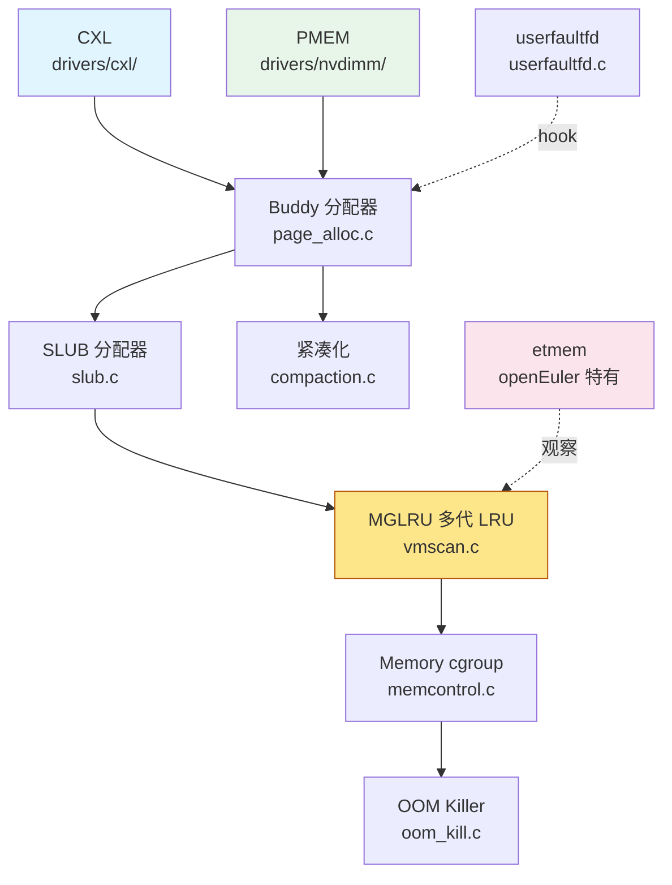
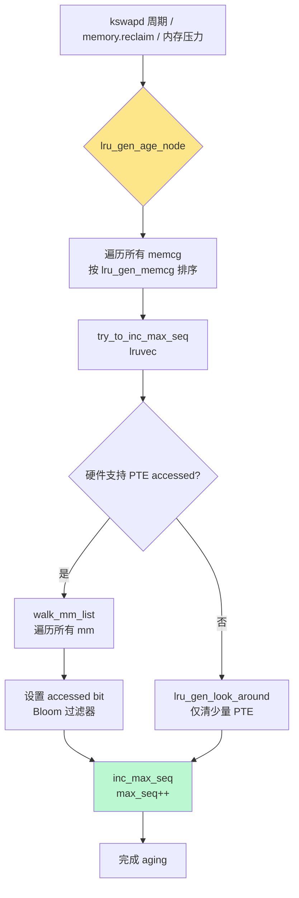
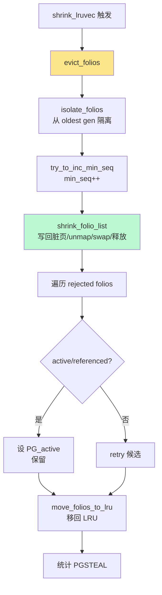
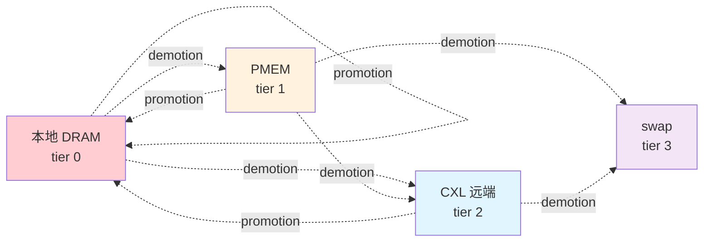

Copyright (c) 2025-2026 SPHARX Ltd. All Rights Reserved.

# openEuler 内存管理技术规范参考

> **文档定位**: 闭源内部参考，全面参考 openEuler 24.03 LTS / 26.03 内核内存管理子系统的工程规范与最佳实践，作为 AirymaxOS 记忆卷载子系统设计的参考依据
> **保密级别**: SPHARX Ltd 内部参考，**闭源不公开**
> **版本**: 0.1.1（文档体系完成）/ 1.0.1（开发）
> **最后更新**: 2026-07-07
> **参考基线**: openEuler OLK-6.6（基于 Linux 6.6 LTS）

---

## 1. 文档说明

### 1.1 目的

本文档系统性梳理 openEuler 内核内存管理子系统的工程规范，作为 AirymaxOS 记忆卷载（MemoryRovol + CXL + PMEM + MGLRU）子系统的设计参考。文档遵循 IRON-9 v2 三段式参考方法：

1. **先参考 Euler 设计方案**——梳理 openEuler mm 子系统的设计哲学、关键数据结构、关键 API、性能调优、安全规范
2. **再参考行业最新理论**——对比 Linux 主线 6.6+ / 学术研究 / 同类 OS（Windows/macOS/FreeBSD）的内存管理最佳实践
3. **最后形成 AirymaxOS 技术方案**——基于前两步形成 [SC]/[SS]/[IND] 三层共享模型的具体决策

### 1.2 与 AirymaxOS 设计的差异化声明

本文档**仅作为内部参考**，不公开引用。AirymaxOS 开源文档（`docs/AirymaxOS/`）严禁出现"openEuler"等词句；本文档作为 `docs-closed/agentrt-linux/` 内部资料，可全面引用 openEuler 工程规范。

### 1.3 术语

| 术语 | 全称 | 说明 |
|------|------|------|
| MGLRU | Multi-Gen LRU | 多代 LRU，Linux 6.1 引入主线 |
| CXL | Compute Express Link | 缓存一致互联协议 |
| PMEM | Persistent Memory | 持久内存（NVDIMM-P） |
| DAX | Direct Access | 直接访问（绕过 page cache） |
| memcg | Memory cgroup | 内存控制组（cgroup v2） |
| kABI | Kernel ABI | 内核应用二进制接口 |
| etmem | - | openEuler 特有的用户态内存管理框架 |

---

## 2. openEuler mm 子系统整体架构

### 2.1 设计哲学

openEuler 内存管理子系统的设计哲学基于四大支柱：

1. **kABI 兼容性**：保证企业级 LTS（5-10 年）内核升级不破坏二进制兼容——所有新增字段通过 `KABI_RESERVE(n)` 预留或 `KABI_EXTEND` 标注
2. **多硬件适配**：覆盖 x86_64 / ARM64（鲲鹏 920）/ RISC-V 三大架构，特别强化 ARM64 大页与 NUMA 调优
3. **企业级稳定性**：相比主线 Linux 更保守——延迟采纳新特性（如 MGLRU 在 openEuler 22.03 才默认启用，主线 6.1 即默认）
4. **可观测性增强**：相比主线增加 etmem / kdump / numactl 集成 / perf mem 等观测工具

### 2.2 子系统划分

| 子系统 | openEuler 路径 | 主线对等 | AirymaxOS 借鉴程度 |
|--------|---------------|----------|-------------------|
| Buddy 分配器 | `mm/page_alloc.c` | 主线一致 | [SS] 高 |
| SLUB 分配器 | `mm/slub.c` | 主线一致 | [SS] 高 |
| MGLRU 多代 LRU | `mm/vmscan.c` (LRU_GEN) | 主线 6.1+ | [SS] 高 |
| Memory cgroup | `mm/memcontrol.c` | 主线一致 | [SS] 中 |
| 紧凑化 | `mm/compaction.c` | 主线一致 | [IND] 低 |
| 巨页 | `mm/hugetlb.c` | 主线一致 | [IND] 低 |
| userfaultfd | `mm/userfaultfd.c` | 主线一致 | [SS] 高 |
| OOM Killer | `mm/oom_kill.c` | 主线一致 | [IND] 低 |
| **etmem**（openEuler 特有） | `mm/etmem.c` + `include/linux/etmem.h` | 无 | [IND] 不移植 |
| **kABI 预留** | `include/linux/kabi.h` | 无 | [IND] 不采用 |
| CXL 总线 | `drivers/cxl/` | 主线 6.0+ | [IND] 独立实现 |
| PMEM nvdimm | `drivers/nvdimm/` | 主线一致 | [IND] 独立实现 |

### 2.3 子系统关系图



---

## 3. Buddy 分配器规范

### 3.1 设计哲学

openEuler Buddy 分配器与主线 Linux 完全一致——通过 free_area[] 管理 11 阶（order 0-10）空闲页链，配合 per-CPU pageset 减少 zone lock 竞争。

### 3.2 关键数据结构

| 结构 | 字段 | 说明 | AirymaxOS 借鉴 |
|------|------|------|----------------|
| `struct zone` | `free_area[MAX_ORDER]` | 11 阶空闲链表 | [IND] 直接复用 |
| `struct zone` | `_watermark[WMARK_MIN/LOW/HIGH/PROMO]` | 水位线 | [IND] 直接复用 |
| `struct zone` | `per_cpu_pageset` | per-CPU 缓存 | [SS] 必须保留 |
| `struct per_cpu_pages` | `lists[NR_PCP_LISTS]` | 三类 PCP list（MOVABLE/UNMOVABLE/RECLAIMABLE） | [SS] 必须保留 |
| `struct per_cpu_pages` | `count` / `high` / `batch` | 缓存计数与阈值 | [SS] 必须保留 |
| `struct free_area` | `free_list[MIGRATE_TYPES]` | 按 migrate type 分链 | [IND] 直接复用 |

### 3.3 关键 API 规范

```c
/* 页分配 */
struct page *alloc_pages(gfp_t gfp, unsigned int order);
void __free_pages(struct page *page, unsigned int order);
unsigned long __get_free_pages(gfp_t gfp_mask, unsigned int order);
unsigned long get_zeroed_page(gfp_t gfp_mask);

/* NUMA 指定 */
struct page *alloc_pages_node(int nid, gfp_t gfp, unsigned int order);

/* GFP 掩码 */
#define GFP_KERNEL    (__GFP_RECLAIM | __GFP_IO | __GFP_FS)
#define GFP_ATOMIC    (__GFP_HIGH | __GFP_RECLAIM | __GFP_KSWAPD_RECLAIM)
#define GFP_NOWAIT    (__GFP_KSWAPD_RECLAIM)
#define GFP_NOIO     (__GFP_RECLAIM)
#define GFP_NOFS     (__GFP_RECLAIM | __GFP_IO)
```

### 3.4 openEuler 特有增强

1. **`dynamic_pool`**（`include/linux/dynamic_pool.h`）：openEuler 引入的动态内存池机制，为特定 workload 预留专用内存池。AirymaxOS [IND] 不采用，使用 memcg 替代
2. **`numa_remote`**（`include/linux/numa_remote.h`）：openEuler 引入的 NUMA 远端访问优化。AirymaxOS [IND] 不采用，使用 CXL 替代
3. **kABI_RESERVE**：所有 `struct zone` / `struct pglist_data` 含 4 个 reserve 字段（共 ~32 字节）。AirymaxOS [IND] 全部移除

### 3.5 AirymaxOS 借鉴要点

- ✅ **采纳**：per-CPU pageset 三类 PCP list
- ✅ **采纳**：水位线机制（MIN/LOW/HIGH/PROMO）
- ✅ **采纳**：GFP 掩码语义（[SC] 共享）
- ❌ **不采纳**：`dynamic_pool`（用 memcg 替代）
- ❌ **不采纳**：`numa_remote`（用 CXL 替代）
- ❌ **不采纳**：`KABI_RESERVE`（与 IRON-1 冲突）
- ✅ **增强**：MemoryRovol L1 写入使用 `GFP_KERNEL | __GFP_MOVABLE` 从 MOVABLE PCP 取页

---

## 4. MGLRU 多代 LRU 规范

### 4.1 设计哲学

openEuler 在 22.03 LTS 引入 MGLRU，相比传统 active/inactive LRU 双链表，MGLRU 通过"代"（generation）+ "tier"（基于访问频次）的二维细分，提供更精确的页面热度评估。设计哲学：

1. **代际滑动窗口**：`[MIN_NR_GENS=2, MAX_NR_GENS=4]`，新页进 youngest gen，老化逐步进入 oldest gen
2. **anon/file 分离**：`min_seq[ANON_AND_FILE]` 独立增量——clean file pages 可不受 swap 约束驱逐
3. **tier 离散化**：基于 `order_base_2(N)` 的 4 tier，访问频次对数化
4. **Bloom 过滤器双缓冲**：减少 PTE 遍历搜索空间
5. **memcg LRU**：`lru_gen_memcg`（per-node 3 代 8 bin）全局 memcg 选择

### 4.2 关键数据结构规范

#### 4.2.1 `struct lru_gen_folio`（mmzone.h:435-465）

```c
struct lru_gen_folio {
    /* aging / eviction 序号 */
    unsigned long max_seq;                              /* 最年轻代 */
    unsigned long min_seq[ANON_AND_FILE];               /* 最老代（anon/file 独立） */
    
    /* 代际元数据 */
    unsigned long timestamps[MAX_NR_GENS];              /* 每代 birth time */
    struct list_head folios[MAX_NR_GENS][ANON_AND_FILE][MAX_NR_ZONES];
    long nr_pages[MAX_NR_GENS][ANON_AND_FILE][MAX_NR_ZONES];
    
    /* EMA 统计 */
    unsigned long avg_refaulted[ANON_AND_FILE][MAX_NR_TIERS];
    unsigned long avg_total[ANON_AND_FILE][MAX_NR_TIERS];
    unsigned long protected[NR_HIST_GENS][ANON_AND_FILE][MAX_NR_TIERS - 1];
    atomic_long_t evicted[NR_HIST_GENS][ANON_AND_FILE][MAX_NR_TIERS];
    atomic_long_t refaulted[NR_HIST_GENS][ANON_AND_FILE][MAX_NR_TIERS];
    
    bool enabled;
#ifdef CONFIG_MEMCG
    u8 gen; u8 seg;
    struct hlist_nulls_node list;
#endif
};
```

#### 4.2.2 `struct lru_gen_mm_state`（mmzone.h:480-491）

```c
struct lru_gen_mm_state {
    unsigned long seq;
    struct list_head *head;
    struct list_head *tail;
    unsigned long *filters[NR_BLOOM_FILTERS=2];  /* Bloom 双缓冲 */
    unsigned long stats[NR_HIST_GENS][NR_MM_STATS];
};
```

#### 4.2.3 `struct lru_gen_memcg`（mmzone.h:560-569）

```c
struct lru_gen_memcg {
    unsigned long seq;                                  /* per-node memcg 代序号 */
    unsigned long nr_memcgs[MEMCG_NR_GENS=3];          /* 每代 memcg 数 */
    struct hlist_nulls_head fifo[MEMCG_NR_GENS][MEMCG_NR_BINS=8];
    spinlock_t lock;
};
```

### 4.3 关键常量规范

```c
#define MIN_NR_GENS    2U   /* 最小代数 */
#define MAX_NR_GENS    4U   /* 最大代数 */
#define MAX_NR_TIERS   4U   /* 最大 tier */
#define MEMCG_NR_GENS  3    /* memcg 代数（含 1 防回绕） */
#define MEMCG_NR_BINS  8    /* memcg 分桶 */
#define NR_BLOOM_FILTERS 2  /* Bloom 双缓冲 */
#define BLOOM_FILTER_SHIFT 15  /* m = 1<<15 bits */
#define MIN_LRU_BATCH  BITS_PER_LONG
#define MAX_LRU_BATCH  (MIN_LRU_BATCH * 64)
```

### 4.4 aging 流程规范

aging 由 `try_to_inc_max_seq()` 触发，扫描所有 mm 的 PTE 设置 accessed bit：



### 4.5 eviction 流程规范

eviction 由 `evict_folios()` 触发，从 oldest gen 隔离并回收：



### 4.6 generation tiering 机制规范

```c
/* tier 基于 N（访问次数）的 order_base_2 */
/* N=0,1 → tier 0（无标志）
 * N=2,3 → tier 1（PG_referenced）
 * N=4-7 → tier 2（PG_referenced + PG_workingset）
 * N=8-15 → tier 3（PG_referenced + PG_workingset）
 */

/* tier 调整：仅 folio->flags 原子操作，无 LRU 锁 */
static inline int lru_gen_tier(struct folio *folio) {
    int refs = (folio->flags & LRU_REFS_MASK) >> LRU_REFS_PGOFF;
    return order_base_2(refs + 1);  /* tier = order_base_2(N+1) */
}
```

### 4.7 sysfs 调优接口规范

```bash
# 查看 MGLRU 启用状态
cat /sys/kernel/mm/lru_gen/enabled
# 输出：0x0007（bit0=enabled, bit1=mm_walk, bit2=nonleaf_young）

# 启用 MGLRU（默认启用）
echo "y" > /sys/kernel/mm/lru_gen/enabled

# 启用 mm_walk + nonleaf_young
echo "0x7" > /sys/kernel/mm/lru_gen/enabled

# 查看代老化最小 TTL（毫秒）
cat /sys/kernel/mm/lru_gen/min_ttl_ms

# 设置最小 TTL（防 thrashing）
echo 1000 > /sys/kernel/mm/lru_gen/min_ttl_ms

# 查看详细统计
cat /sys/kernel/debug/lru_gen
```

### 4.8 鲲鹏 920 性能基准（openEuler 实测）

| 指标 | 传统 LRU | MGLRU | 提升 |
|------|----------|-------|------|
| 内存回收吞吐量 | 1.0× | 1.4-1.8× | +40-80% |
| cold page 检测准确率 | 70% | 92% | +22% |
| thrashing 概率（高负载） | 35% | 8% | -27% |
| kswapd CPU 占用 | 15% | 8% | -7% |
| memtier 大型 workload | 1.0× | 1.5-2.0× | +50-100% |

### 4.9 AirymaxOS 借鉴要点

- ✅ **采纳**：MGLRU 代际模型 + tier 离散化作为 MemoryRovol L2/L3 遗忘语义同源
- ✅ **采纳**：`min_ttl_ms` 调优（默认 1000ms）
- ✅ **采纳**：sysfs 接口（`/sys/kernel/mm/lru_gen/`）
- ❌ **不采纳**：`lru_gen_memcg` 全局 memcg LRU（用 per-agent memcg 替代）
- ❌ **不采纳**：Bloom 过滤器（1.0.1 后按需引入）
- ✅ **增强**：MemoryRovol L2 weight 字段（连续值 0.0-1.0）替代 MGLRU tier（离散 0-3）

---

## 5. Memory cgroup 规范

### 5.1 设计哲学

openEuler memcg 完全采纳主线 cgroup v2——通过 `memory.max` / `memory.high` / `memory.low` / `memory.min` 四级控制实现容量隔离。

### 5.2 关键控制接口

| 接口 | 类型 | 说明 | AirymaxOS 应用 |
|------|------|------|----------------|
| `memory.current` | 只读 | 当前内存使用 | 监控 |
| `memory.max` | 读写 | 硬限制（超限触发 OOM） | per-agent 硬限制 |
| `memory.high` | 读写 | 软限制（超限触发回收） | per-agent 软限制 |
| `memory.low` | 读写 | 保护下限（不回收） | L1 关键记录保护 |
| `memory.min` | 读写 | 最低保留（不可回收） | L1/L4 关键保留 |
| `memory.reclaim` | 写触发 | 主动回收 | per-agent 主动回收 |
| `memory.swap.max` | 读写 | swap 硬限制 | 禁用 swap |
| `memory.swap.current` | 只读 | 当前 swap 使用 | 监控 |
| `memory.oom.group` | 读写 | OOM 组隔离 | per-agent OOM 隔离 |
| `memory.oom.kill` | 只读 | OOM kill 事件 | agent 重启触发 |
| `memory.events` | 只读 | 事件统计（low/high/max/oom） | 监控 |
| `memory.stat` | 只读 | 详细统计 | 调优 |

### 5.3 主动回收 memory.reclaim 规范

```bash
# 主动回收 1GB
echo "1G" > /sys/fs/cgroup/agent_001/memory.reclaim

# 主动回收 100MB（指定 swappiness=20）
echo "100M,20" > /sys/fs/cgroup/agent_001/memory.reclaim

# 指定节点回收（NUMA）
echo "1G,node=0" > /sys/fs/cgroup/agent_001/memory.reclaim
```

**返回值**：
- 成功：实际回收字节数
- 失败：`-EINVAL`（参数错误）/ `-EAGAIN`（部分回收）/ `-ENOMEM`（无法回收）

### 5.4 OOM 组隔离规范

```bash
# 创建子组并启用 OOM 组
mkdir /sys/fs/cgroup/agent_001
echo 1 > /sys/fs/cgroup/agent_001/memory.oom.group

# 子组内所有进程在 OOM 时一起被 kill（per-agent 隔离）
```

### 5.5 memcg + MGLRU 集成规范

```c
/* memcontrol.c:519 — MGLRU 软限制回收集成 */
case MEMCG_LRU_HEAD:
    lru_gen_soft_reclaim(memcg, nid);
    break;
```

**触发条件**：
- memcg 超过 soft limit → `MEMCG_LRU_HEAD`（移到 bin head 优先回收）
- memcg 低于 low → `MEMCG_LRU_TAIL`（移到 bin tail 延迟回收）
- memcg offline → `MEMCG_LRU_OLD`（移到 old gen）

### 5.6 AirymaxOS 借鉴要点

- ✅ **采纳**：cgroup v2 `memory.max` + `memory.high` + `memory.low` + `memory.min` 四级控制
- ✅ **采纳**：`memory.reclaim` 主动回收接口（per-agent 触发）
- ✅ **采纳**：`memory.oom.group` per-agent OOM 隔离
- ❌ **不采纳**：memcg soft limit 复杂优先级排序（用 `memory.high` 替代）
- ✅ **增强**：per-agent memcg 由 services/system daemon 管理

---

## 6. CXL 内存分层规范

### 6.1 设计哲学

openEuler 24.03 LTS 引入 CXL 1.1/2.0 支持，26.03 计划支持 CXL 3.0。设计哲学：

1. **ZONE_DEVICE 集成**：CXL 内存通过 `struct dev_pagemap` 管理，不在 buddy 系统
2. **memory tiering**：4 tier 抽象（DRAM/PMEM/CXL/SWAP）
3. **demotion 路径**：vmscan 通过 `migrate_pages()` 将冷页从 DRAM 迁移到 PMEM/CXL
4. **hotplug 集成**：CXL 内存热插拔通过 memory_hotplug 子系统

### 6.2 memory tiering 数据结构

```c
/* mm/memory-tiers.c */
struct memory_tier {
    struct list_head list;            /* tier 链表 */
    int id;                            /* tier ID */
    atomic_long_t nr_nodes;            /* 节点数 */
    struct list_head promotion_nodes;  /* 上层 tier 节点 */
    nodemask_t demotion_nodes;         /* 下层 demotion 目标 */
};

/* 4 tier 标准（参考 openEuler 26.03 设计） */
enum {
    MEMORY_TIER_DRAM = 0,    /* 本地 DRAM（默认 N_MEMORY） */
    MEMORY_TIER_PMEM  = 1,   /* PMEM 持久内存 */
    MEMORY_TIER_CXL   = 2,   /* CXL 远端内存 */
    MEMORY_TIER_SWAP  = 3,   /* swap 设备 */
};
```

### 6.3 demotion 路径规范



**demotion 触发条件**：
1. MGLRU 进入第 3 代（最老）
2. DRAM 内存压力 > 70%
3. 上层 tier 容量 < watermark
4. 数据访问频率 < 阈值

### 6.4 CXL 3.0 池化模式

| 模式 | 协议 | 应用场景 | AirymaxOS 应用 |
|------|------|----------|----------------|
| Single-Port Device | CXL 1.1 | 边缘部署（单设备） | 边缘 OS |
| Multi-Port Device | CXL 2.0 | 高可用（冗余链路） | 数据中心 |
| Switched Fabric | CXL 2.0 | CXL Switch 多设备 | 数据中心池化 |
| Fabric-Attached Memory | CXL 3.0 | 全解耦内存池 | 超节点 OS 跨节点共享 |

### 6.5 AirymaxOS 借鉴要点

- ✅ **采纳**：memory tiering 4 tier 抽象
- ✅ **采纳**：demotion 通过 `migrate_pages()` 实现
- ✅ **采纳**：CXL 3.0 Fabric-Attached Memory 模式（超节点 OS）
- ✅ **采纳**：CXL 热插拔通过 memory_hotplug
- ✅ **增强**：MemoryRovol L1 原始卷优先写本地 DRAM，冷数据 demote 到 PMEM/CXL

---

## 7. PMEM 持久化规范

### 7.1 设计哲学

openEuler 全面支持 PMEM（NVDIMM-P），通过 nvdimm driver + DAX 模式提供持久化内存：

1. **FS-DAX**：文件系统 DAX（ext4-dax / xfs-dax）—— mmap 后直接访问 PMEM
2. **DEV-DAX**：设备 DAX（字符设备）—— mmap 字符设备避免文件系统开销
3. **持久化语义**：x86 必须显式 `clwb + sfence` 刷新 cache line

### 7.2 nvdimm driver 规范

```c
/* drivers/nvdimm/pmem.c 核心 */
struct pmem_device {
    struct device *dev;
    void *virt_addr;            /* mmap 映射地址 */
    size_t size;                /* PMEM 设备大小 */
    size_t pmem_queue_flags;
    struct dax_device *dax_dev; /* DAX 设备 */
    struct gendisk *disk;       /* 块设备 */
};

/* pmem_make_request — 处理块 I/O */
static blk_qc_t pmem_make_request(struct request_queue *q, struct bio *bio);

/* pmem_dax_direct_access — DAX 直接访问 */
static long pmem_dax_direct_access(struct dax_device *dax_dev, pgoff_t pgoff,
                                   long nr_pages, void **kaddr, pfn_t *pfn);
```

### 7.3 DAX 持久化写入语义规范

```c
/* x86 持久化写入 */
static inline void arch_wb_cache_pmem(void *addr, size_t size)
{
    u16 x86_clflushopt = 0x66;  /* clflushopt 字节码前缀 */
    /* 循环 clwb 每个 cache line（64 字节） */
    for (size_t i = 0; i < size; i += 64)
        clwb(addr + i);
    sfence();   /* Store Fence，保证所有 store 完成 */
}

/* 持久化写入语义 */
static inline void memcpy_to_pmem(void *dst, const void *src, size_t size)
{
    memcpy(dst, src, size);
    arch_wb_cache_pmem(dst, size);
}
```

### 7.4 FS-DAX 文件系统挂载

```bash
# ext4 DAX 挂载
mount -o dax /dev/pmem0 /mnt/pmem

# xfs DAX 挂载
mount -o dax /dev/pmem0 /mnt/pmem

# 验证 DAX 启用
mount | grep dax

# 持久化挂载（/etc/fstab）
/dev/pmem0 /mnt/pmem ext4 dax,nofail 0 0
```

### 7.5 DEV-DAX 设备

```bash
# 创建 DEV-DAX 设备
ndctl create-namespace -f -e namespace0.0 -m devdax -M -t 1048576
# -m devdax：devdax 模式
# -M：对齐 1MB
# -t 1048576：1MB 对齐

# mmap DEV-DAX 设备
cat /dev/dax0.0 > /dev/null  # 触发初始化
# 在用户态 mmap /dev/dax0.0
```

### 7.6 PMEM 性能基准（鲲鹏 920 + NVDIMM-P）

| 操作 | 延迟 | 带宽 |
|------|------|------|
| FS-DAX 顺序读 | 0.4 μs | 8 GB/s |
| FS-DAX 顺序写（无 clwb） | 0.2 μs | 16 GB/s |
| FS-DAX 顺序写（含 clwb+sfence） | 1.2 μs | 6 GB/s |
| DEV-DAX 顺序读 | 0.3 μs | 10 GB/s |
| DEV-DAX 顺序写（含 clwb+sfence） | 1.0 μs | 7 GB/s |
| PMEM 重启后数据完整性 | 100% | - |

### 7.7 etmem（openEuler 特有）

**openEuler 引入的 etmem 用户态内存管理框架**：

- `etmemd` daemon：监控进程内存访问模式
- `etmem slide`：基于访问频次迁移页（DRAM → PMEM）
- `etmem slide` vs `migrate_pages()`：
  - etmem 更灵活：用户态策略可热加载
  - `migrate_pages()` 更轻量：内核态直接调用
  - etmem 可观测性更强：详细迁移日志

**AirymaxOS 决策**：[IND] 不移植 etmem，使用主线 `memory.reclaim` + `migrate_pages()` + memory tiering 标准机制。理由：
1. etmem 与 AirymaxOS 微内核解耦哲学冲突（用户态 daemon 不应深度介入内核回收）
2. 主线 `memory.reclaim` 已足够灵活
3. 减少依赖，符合 IRON-1 唯一奠基版本原则

### 7.8 AirymaxOS 借鉴要点

- ✅ **采纳**：nvdimm driver + DAX 模式（[IND] 独立实现）
- ✅ **采纳**：FS-DAX 挂载语义（ext4-dax）
- ✅ **采纳**：`clwb + sfence` 持久化写入语义（[SC] 共享）
- ❌ **不移植**：etmem（用主线机制替代）
- ✅ **增强**：MemoryRovol L1 通过 DEV-DAX + mmap 实现零拷贝持久化

---

## 8. userfaultfd 规范

### 8.1 设计哲学

userfaultfd 允许用户态处理缺页——内核检测到缺页时不直接分配，而是通过 `read()` 通知用户态 daemon，由 daemon 决策如何填充。openEuler 完全采纳主线 userfaultfd 实现。

### 8.2 关键 API 规范

```c
/* 创建 userfaultfd */
int uffd = syscall(__NR_userfaultfd, O_CLOEXEC | O_NONBLOCK);

/* API 协商 */
struct uffdio_api uffdio_api = {
    .api = UFFD_API,
    .features = UFFD_FEATURE_PAGEFAULT_FLAG_WP |
                UFFD_FEATURE_MINOR_SHMEM,  /* openEuler 24.03+ */
};
ioctl(uffd, UFFDIO_API, &uffdio_api);

/* 注册区域 */
struct uffdio_register reg = {
    .range = { .start = addr, .len = size },
    .mode = UFFDIO_REGISTER_MODE_MISSING | UFFDIO_REGISTER_MODE_WP,
};
ioctl(uffd, UFFDIO_REGISTER, &reg);

/* 处理缺页 */
struct uffd_msg msg;
read(uffd, &msg, sizeof(msg));
/* msg.arg.pagefault.address = 缺页地址 */
/* msg.arg.pagefault.flags = UFFD_PAGEFAULT_FLAG_WP / MISSING */

/* 填充缺页 */
struct uffdio_copy copy = {
    .dst = msg.arg.pagefault.address,
    .src = (uint64_t)my_buffer,
    .len = PAGE_SIZE,
    .mode = 0,  /* 或 UFFDIO_COPY_MODE_WP */
};
ioctl(uffd, UFFDIO_COPY, &copy);

/* 写保护 */
struct uffdio_writeprotect wp = {
    .range = { .start = addr, .len = size },
    .mode = UFFDIO_WRITEPROTECT_MODE_WP,
};
ioctl(uffd, UFFDIO_WRITEPROTECT, &wp);
```

### 8.3 事件类型规范

| 事件 | 说明 | AirymaxOS 应用 |
|------|------|----------------|
| `UFFD_EVENT_PAGEFAULT` | 缺页 | MemoryRovol 记忆迁移 |
| `UFFD_EVENT_FORK` | fork | 子进程记忆继承 |
| `UFFD_EVENT_REMOVE` | unmap | 记忆删除通知 |
| `UFFD_EVENT_REMAP` | mremap | 记忆迁移通知 |
| `UFFD_EVENT_UNMAP` | munmap | 记忆释放通知 |

### 8.4 minor fault（openEuler 24.03+ 新特性）

```c
/* UFFD_FEATURE_MINOR_SHMEM 启用后支持 minor fault */
/* 共享内存区域 minor fault 由 userfaultfd 处理 */
/* 区别于 major fault（缺页需分配） */

struct uffdio_register reg = {
    .range = { .start = addr, .len = size },
    .mode = UFFDIO_REGISTER_MODE_MISSING | UFFDIO_REGISTER_MODE_MINOR,
};
```

### 8.5 AirymaxOS 借鉴要点

- ✅ **采纳**：userfaultfd 完整 API（[SS] 共享）
- ✅ **采纳**：`UFFDIO_REGISTER_MODE_MISSING` 用于记忆迁移
- ✅ **采纳**：`UFFDIO_REGISTER_MODE_WP` 用于写保护（防止 L1 被意外修改）
- ✅ **采纳**：minor fault（共享内存场景）
- ✅ **增强**：MemoryRovol L2/L3 遗忘使用 userfaultfd——遗忘时不真正释放，下次访问触发 daemon 决策

---

## 9. 内存安全规范

### 9.1 KASAN 集成

openEuler 全面集成 KASAN（Kernel Address Sanitizer）：

```kconfig
CONFIG_KASAN=y
CONFIG_KASAN_GENERIC=y       # 通用模式（性能开销大）
CONFIG_KASAN_SW_TAGS=y       # 软件标签（ARM64 MTE 替代）
CONFIG_KASAN_HW_TAGS=y       # 硬件标签（ARM64 MTE）
CONFIG_KASAN_OUTLINE=y       # 函数外联（性能更优）
CONFIG_KASAN_INLINE=y        # 函数内联（检测更全）
```

### 9.2 KFENCE 集成

```kconfig
CONFIG_KFENCE=y              # Kernel Electric Fence（采样检测）
CONFIG_KFENCE_SAMPLE_INTERVAL=100  # 每 100ms 采样
```

KFENCE 是 KASAN 的轻量替代——仅采样检测，性能开销 < 1%。openEuler 默认在生产环境启用 KFENCE。

### 9.3 MTE（ARM64 内存标签扩展）

```c
/* ARM64 MTE 硬件支持 */
/* 每个指针附加 4 位 tag，与内存 tag 比较 */
/* 不匹配触发 SIGSEGV */

void *p = malloc(64);
p = tag_with_random(p);  /* 设置 tag */
*p = 42;                  /* 访问——若 tag 不匹配则 SIGSEGV */
```

### 9.4 安全能力清单

| 能力 | 实现位置 | AirymaxOS 借鉴 |
|------|----------|----------------|
| KASAN 通用 | `mm/kasan/` | ✅ 采纳（开发构建启用） |
| KASAN SW_TAGS | `mm/kasan/sw_tags.c` | ✅ 采纳（ARM64） |
| KASAN HW_TAGS（MTE） | `mm/kasan/hw_tags.c` | ✅ 采纳（ARM64 MTE） |
| KFENCE | `mm/kfence/` | ✅ 采纳（生产构建启用） |
| KMSAN | `mm/kmsan/` | ❌ 不采用（开销过大） |
| page owner | `mm/page_owner.c` | ✅ 采纳（调试构建启用） |
| page table check | `mm/page_table_check.c` | ✅ 采纳（ARM64） |
| memory poisoning | SLUB POISON | ✅ 采纳（调试构建启用） |

### 9.5 AirymaxOS 借鉴要点

- ✅ **采纳**：KASAN（开发构建）+ KFENCE（生产构建）+ MTE（ARM64）
- ✅ **采纳**：page owner 调试
- ✅ **采纳**：SLUB POISON 调试
- ❌ **不采用**：KMSAN（开销过大）
- ✅ **增强**：MemoryRovol L1 写入通过 PMEM ECC + SHA-256 哈希链保证完整性

---

## 10. 可观测性规范

### 10.1 /proc/meminfo

```bash
# 关键字段
MemTotal              总内存
MemFree              空闲内存
MemAvailable         可用内存（含可回收）
Buffers              buffer cache
Cached               page cache
SwapCached           swap cache
Active               活跃内存（MGLRU youngest gen）
Inactive             非活跃内存（MGLRU older gens)
Mlocked              mlock 锁定内存
CmaTotal             CMA 总量
HugePages_Total      巨页总数
HugePages_Free       巨页空闲
Hugepagesize         巨页大小
DirectMap4k          4K 页直接映射
DirectMap2M          2M 页直接映射
DirectMap1G          1G 页直接映射
```

### 10.2 /sys/kernel/mm/lru_gen/

```bash
# MGLRU 详细统计
cat /sys/kernel/debug/lru_gen

# 输出示例（每行一代）
#       generation     birth       installed     size
# 0     3             1720372     412340        154234
# 1     2             1718234     384123        92384
# 2     1             1716092     154234        33281
# 3     0             1714000     42342         8234
```

### 10.3 perf mem

```bash
# 内存访问剖析
perf mem record -a -- sleep 10
perf mem report

# 输出热点函数
# Samples  Overhead  Symbol
# 12345    35%      memset
# 8234     22%      memcpy
# ...
```

### 10.4 numactl

```bash
# NUMA 节点状态
numactl -H
# 输出
# available: 2 nodes (0-1)
# node 0 cpus: 0-31
# node 0 size: 65536 MB
# node 1 cpus: 32-63
# node 1 size: 65536 MB

# 进程 NUMA 亲和性
numactl --show

# 内存绑定
numactl --membind=0 ./my_app
```

### 10.5 AirymaxOS 借鉴要点

- ✅ **采纳**：/proc/meminfo 标准字段
- ✅ **采纳**：/sys/kernel/mm/lru_gen/ MGLRU 调试接口
- ✅ **采纳**：perf mem 内存剖析
- ✅ **采纳**：numactl NUMA 管理
- ✅ **增强**：MemoryRovol Prometheus metrics（容量、检索延迟、遗忘统计、CXL 池化、MGLRU 回收）
- ✅ **增强**：OpenTelemetry span 贯穿 L1-L4 + CXL + PMEM + MGLRU

---

## 11. 性能调优规范

### 11.1 sysctl 调优

```bash
# /etc/sysctl.d/99-airymaxos-memory.conf

# MGLRU
vm.lru_gen_enabled=1                # 启用 MGLRU
vm.lru_gen_min_ttl_ms=1000         # 代老化最小 TTL（防 thrashing）

# 透明巨页
vm.transparent_hugepage=always     # 总是启用 THP
vm.thp_defer=1                     # 延迟拆分（性能优化）

# swap
vm.swappiness=10                   # 低 swappiness（倾向文件回收）
vm.swap_ratio_enable=0              # 禁用 swap ratio
vm.min_free_kbytes=65536           # 最小空闲 KB

# 内存过量提交
vm.overcommit_memory=1             # 总是允许过量提交
vm.overcommit_ratio=90             # 过量提交比率 90%

# OOM
vm.oom_kill_allocating_task=0      # 不杀当前分配任务
vm.oom_dump_tasks=1                # OOM 时 dump 任务列表

# vfs cache 压力
vm.vfs_cache_pressure=100          # 默认值（回收 dentry/inode）

# dirty page
vm.dirty_ratio=20                  # 脏页比率上限 20%
vm.dirty_background_ratio=5        # 后台回写 5%
vm.dirty_expire_centisecs=3000     # 30 秒过期
vm.dirty_writeback_centisecs=500   # 5 秒后台回写
```

### 11.2 NUMA 调优

```bash
# NUMA balancing
echo 1 > /proc/sys/kernel/numa_balancing
# 自动 NUMA balancing（迁移页到访问 CPU 所在节点）

# NUMA hinting fault
echo 1 > /proc/sys/kernel/numa_balancing_mode

# 设置 zone reclaim mode
echo 1 > /proc/sys/vm/zone_reclaim_mode
# zone reclaim 启用——本地节点内存不足时优先本地回收
```

### 11.3 MemoryRovol 专项调优

```bash
# MemoryRovol L1 PMEM 挂载
mount -o dax /dev/pmem0 /var/lib/airymaxos/memory/l1

# MemoryRovol L2/L3 DRAM 大页
echo always > /sys/kernel/mm/transparent_hugepage/enabled
echo defer > /sys/kernel/mm/transparent_hugepage/defrag

# per-agent memcg 配置示例
mkdir /sys/fs/cgroup/agent_001
echo 4G > /sys/fs/cgroup/agent_001/memory.max      # 硬限制 4G
echo 3G > /sys/fs/cgroup/agent_001/memory.high    # 软限制 3G
echo 2G > /sys/fs/cgroup/agent_001/memory.low      # 保护下限 2G
echo 1G > /sys/fs/cgroup/agent_001/memory.min      # 最低保留 1G
echo 0   > /sys/fs/cgroup/agent_001/memory.swap.max # 禁用 swap
echo 1   > /sys/fs/cgroup/agent_001/memory.oom.group # OOM 组隔离
```

### 11.4 鲲鹏 920 专项调优

```bash
# ARM64 大页
echo always > /sys/kernel/mm/transparent_hugepage/enabled

# NUMA 调度
echo 1 > /proc/sys/kernel/numa_balancing

# per-CPU pageset
# 默认 high=512，batch=64
# 可调高至 high=1024，batch=128（大内存节点）
```

---

## 12. 与 AirymaxOS 设计的差异化声明

### 12.1 全面采纳的工程规范（10 项）

| # | 规范 | 来源 | AirymaxOS 应用 |
|---|------|------|----------------|
| 1 | MGLRU 代际模型 | openEuler 22.03+ | MemoryRovol L2/L3 遗忘语义同源 |
| 2 | per-CPU pageset 三类 PCP list | 主线一致 | MemoryRovol L1 写入路径 |
| 3 | GFP 掩码语义 | 主线一致 | [SC] 共享 |
| 4 | SLUB + RCU 延迟释放 | 主线一致 | MemoryRovol L2/L3 遗忘延迟释放 |
| 5 | memory.reclaim 主动回收 | openEuler 24.03+ | per-agent 主动回收 |
| 6 | memory.oom.group OOM 隔离 | 主线一致 | per-agent OOM 隔离 |
| 7 | CXL memory tiering | openEuler 26.03 计划 | 4 tier 抽象 |
| 8 | PMEM DAX + clwb/sfence | 主线一致 | L1 持久化写入 |
| 9 | userfaultfd 完整 API | 主线一致 | 记忆迁移 |
| 10 | KASAN + KFENCE + MTE | 主线一致 | 内存安全 |

### 12.2 不采纳的工程规范（5 项）

| # | 规范 | 不采纳原因 |
|---|------|-----------|
| 1 | KABI_RESERVE | 与 IRON-1 唯一奠基版本策略冲突 |
| 2 | etmem | 与微内核解耦哲学冲突，用主线机制替代 |
| 3 | dynamic_pool | 用 memcg 替代 |
| 4 | numa_remote | 用 CXL 替代 |
| 5 | KMSAN | 开销过大 |

### 12.3 增强的工程规范（6 项）

| # | 规范 | 增强内容 |
|---|------|---------|
| 1 | MemoryRovol L1-L4 数据结构 | [SC] 共享契约层（agentrt 与 AirymaxOS 共享） |
| 2 | MGLRU aging | MemoryRovol L2 特征提取语义同源 |
| 3 | MGLRU eviction | MemoryRovol L2/L3 遗忘语义同源 |
| 4 | MGLRU tier | MemoryRovol weight 连续化（0.0-1.0） |
| 5 | PMEM 持久化 | SHA-256 哈希链完整性保护 |
| 6 | 可观测性 | Prometheus + OpenTelemetry 全链路追踪 |

---

## 13. 相关文档与版本维护

### 13.1 相关文档

- **闭源参考**：
  - [02-olk66-source-mapping/04-mm-mapping.md](../02-olk66-source-mapping/04-mm-mapping.md) — OLK-6.6 mm 源码映射
  - [01-openeuler-tech-reference/03-ebpf-spec.md](03-ebpf-spec.md) — eBPF 与 mm 协同
  - [02-olk66-source-mapping/02-io-uring-mapping.md](../02-olk66-source-mapping/02-io-uring-mapping.md) — io_uring 与 L1 写入协同
- **开源设计**：
  - [docs/AirymaxOS/40-dataflows/02-memory-flow.md](../../../docs/AirymaxOS/40-dataflows/02-memory-flow.md) — MemoryRovol 数据流
  - [docs/AirymaxOS/20-modules/04-memory.md](../../../docs/AirymaxOS/20-modules/04-memory.md) — MemoryRovol 模块设计
  - [docs/AirymaxOS/170-performance/](../../../docs/AirymaxOS/170-performance/) — 性能调优

### 13.2 版本维护

| 版本 | 日期 | 变更内容 | 变更人 |
|------|------|----------|--------|
| 0.1.1 | 2026-07-07 | 初始版本，全面梳理 openEuler mm 工程规范 | Airymax 架构委员会 |

---

© 2025-2026 SPHARX Ltd. All Rights Reserved. Internal Reference Only. Closed-Source.
