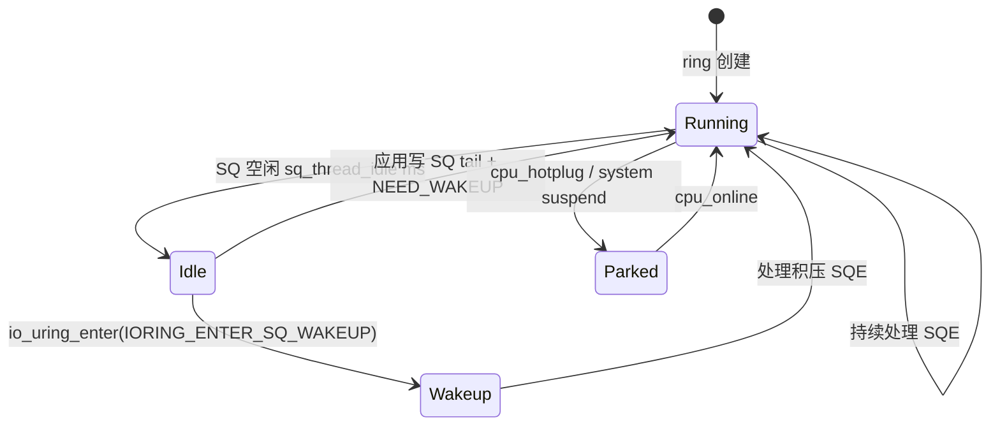
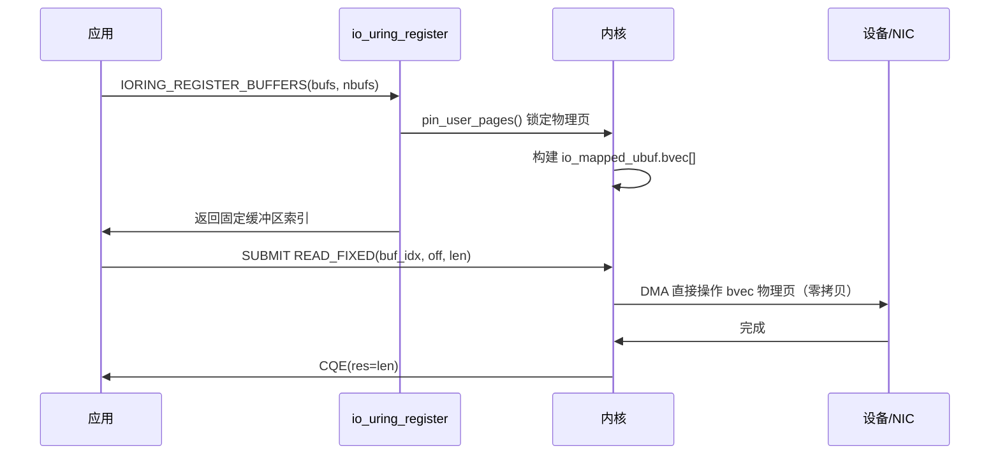

Copyright (c) 2025-2026 SPHARX Ltd. All Rights Reserved.

# OLK-6.6 io_uring → AirymaxOS IPC 源码映射

> **文档定位**: 闭源内部参考，OLK-6.6 `io_uring/` + `include/uapi/linux/io_uring.h` 源码 → AirymaxOS IPC 子系统设计映射
> **保密级别**: SPHARX Ltd 内部参考，**闭源不公开**
> **版本**: 0.1.1（文档体系完成）/ 1.0.1（开发）
> **最后更新**: 2026-07-07
> **源码基线**: OLK-6.6（Linux 6.6 内核源码）

---

## 0. ES-OLK 工程思想追溯

本映射文档涉及以下 ES-OLK 工程思想（权威定义：闭源总纲 §12.4 / `agent-linux基本工程标准规范.md` ES-OLK-1~13 表）：

| ES-OLK 编号 | 工程思想 | 本文档对应章节 |
|------------|---------|--------------|
| ES-OLK-1 | 关注点分离（8 子仓差异化） | §11 IRON-9 v2 共享边界汇总（[SC]/[SS]/[IND] 三层划分）；§13 与 agentrt 设计一致性检查 |
| ES-OLK-3 | UAPI 分离（双层稳定性） | §2.2 struct io_uring_sqe；§2.3 struct io_uring_cqe（`include/uapi/linux/io_uring.h` UAPI 接口） |

---

## 1. 文档说明

### 1.1 目的

本文档建立 OLK-6.6 io_uring（异步 I/O 框架）源码到 AirymaxOS IPC 子系统设计的精确映射，标注 IRON-9 v2 三层共享模型边界：

| 标注 | 含义 | 共享程度 |
|------|------|----------|
| **[SC]** | Shared Contract 共享契约层 | 完全共享代码（`include/airymax/`） |
| **[SS]** | Semantic Same-origin 语义同源层 | API 签名同源，实现独立 |
| **[IND]** | Independent 完全独立层 | 各自独立实现 |

### 1.2 源码定位

| 路径 | 说明 | 行数 |
|------|------|------|
| `io_uring/io_uring.c` | io_uring 主实现（setup/enter/register syscall + 提交/完成核心） | ~4700 行 |
| `io_uring/io_uring.h` | 内部头文件（CQE 填充、task_work、锁助手） | 426 行 |
| `io_uring/kbuf.c` / `kbuf.h` | provided buffer 与 ring-mapped buffer 机制 | ~700 行 |
| `io_uring/rsrc.c` / `rsrc.h` | registered buffer/file 资源管理（零拷贝基础） | ~1000 行 |
| `io_uring/msg_ring.c` | `IORING_OP_MSG_RING` 跨环消息传递 | ~250 行 |
| `io_uring/io-wq.c` / `io-wq.h` | io-wq 异步工作队列（SQPOLL offload） | ~1100 行 |
| `include/linux/io_uring_types.h` | 公共类型定义（`io_ring_ctx`/`io_kiocb`/`io_rings`） | 610 行 |
| `include/linux/io_uring.h` | 内核侧公共接口 | ~150 行 |
| `include/uapi/linux/io_uring.h` | UAPI 接口（SQE/CQE/opcode/flag） | ~700 行 |

### 1.3 关键配置选项

```kconfig
CONFIG_IO_URING=y              # 启用 io_uring 子系统
CONFIG_IO_WQ=y                 # io-wq 异步工作队列
CONFIG_ARCH_HAS_FAST_HARD_IRQS=y  # 平台硬中断支持
```

---

## 2. 核心数据结构映射

### 2.1 struct io_rings（SQ/CQ 共享环形缓冲区） [SS]

**源码位置**: `include/linux/io_uring_types.h:83-152`

`struct io_rings` 是 io_uring 的核心——应用程序与内核共享的环形缓冲区。AirymaxOS IPC 的 `agentrt_ipc_ring` 与其语义同源，作为 daemon 间零拷贝消息传递的载体。

| io_rings 字段 | 类型 | AirymaxOS IPC 对应 | 同源标注 |
|---------------|------|-------------------|----------|
| `sq.head` / `sq.tail` | `struct io_uring {u32 head; u32 tail;}` | agentrt_ipc_ring.sq_head/tail | [SS] |
| `cq.head` / `cq.tail` | `struct io_uring` | agentrt_ipc_ring.cq_head/tail | [SS] |
| `sq_ring_mask` / `cq_ring_mask` | u32 | 索引掩码（ring_entries - 1） | [SS] |
| `sq_ring_entries` / `cq_ring_entries` | u32 | 环大小（2 的幂） | [SS] |
| `sq_dropped` | u32 | SQE 丢弃计数（无效索引） | [IND] |
| `sq_flags` | atomic_t | 运行时 SQ 标志（NEED_WAKEUP/TASKRUN） | [IND] |
| `cq_flags` | u32 | 运行时 CQ 标志（应用写） | [IND] |
| `cq_overflow` | u32 | CQE 溢出计数 | [IND] |
| `cqes[]` | `io_uring_cqe[]` | CQE 环形缓冲区（cache-line 对齐） | [SS] |

**共享内存契约**：`io_rings` 通过 `mmap()` 映射到用户态地址空间，内核与用户态通过共享内存直接通信，避免 syscall 开销。AirymaxOS IPC 继承此契约——daemon 间通过 `mmap` 共享 `agentrt_ipc_ring` 实现零拷贝。

> **OS-IPC-MAP-001**: `io_rings` 的 SQ/CQ head/tail 单生产者-单消费者模型必须保持：内核控制 SQ head + CQ tail，应用控制 SQ tail + CQ head。AirymaxOS IPC 继承此所有权契约。

### 2.2 struct io_uring_sqe（Submission Queue Entry） [SS]

**源码位置**: `include/uapi/linux/io_uring.h:30-98`

SQE 是应用向内核提交的请求单元。AirymaxOS IPC 的 `agentrt_ipc_sqe` 与其语义同源，但 opcode 语义映射为 IPC 操作。

| SQE 字段 | 类型 | AirymaxOS IPC 对应 | 备注 |
|----------|------|-------------------|------|
| `opcode` | u8 | IPC 操作码（SEND/RECV/MSG_RING/...） | [SS] |
| `flags` | u8 | IOSQE_FIXED_FILE/IO_LINK/ASYNC/BUFFER_SELECT | [SS] |
| `ioprio` | u16 | 优先级（IPC 消息优先级） | [SS] |
| `fd` | s32 | 目标文件描述符（或固定 fd 索引） | [SS] |
| `off` / `addr2` / `cmd_op` | u64 union | 偏移/地址2/命令操作码 | [IND] |
| `addr` / `splice_off_in` | u64 union | 缓冲区地址/splice 偏移 | [SS] |
| `len` | u32 | 缓冲区长度或 iovec 数 | [SS] |
| `union {rw_flags, msg_flags, timeout_flags, ...}` | u32 | 操作特定标志 | [IND] |
| `user_data` | u64 | 提交时传递，完成时原样返回（trace_id 载体） | [SC] |
| `buf_index` / `buf_group` | u16 | 固定缓冲区索引/缓冲区分组 | [SS] |
| `personality` | u16 | creds personality（capability 载体） | [IND] |
| `addr3` / `cmd[0]` | u64/u8[] | 128B SQE 扩展命令数据 | [IND] |

> **OS-IPC-MAP-002**: `user_data` 字段语义在 AirymaxOS IPC 中映射为 `trace_id`——提交时填充，完成时原样返回，贯穿 OpenTelemetry 全链路追踪。此为 [SC] 共享契约层。

### 2.3 struct io_uring_cqe（Completion Queue Entry） [SS]

**源码位置**: `include/uapi/linux/io_uring.h:389-399` + `io_uring_types.h:504-512`

CQE 是内核向应用返回的完成通知。AirymaxOS IPC 的 `agentrt_ipc_cqe` 与其语义同源。

| CQE 字段 | 类型 | AirymaxOS IPC 对应 | 备注 |
|----------|------|-------------------|------|
| `user_data` | u64 | 提交时 SQE.user_data 原样返回（trace_id） | [SC] |
| `res` | s32 | 结果码（成功=字节数，失败=-Exxx） | [SS] |
| `flags` | u32 | 完成标志（BUFFER/NOTIF/MORE） | [SS] |
| `big_cqe[]` | u64[] | 32B CQE 扩展（IORING_SETUP_CQE32） | [IND] |

### 2.4 struct io_kiocb（内核侧请求对象） [SS]

**源码位置**: `include/linux/io_uring_types.h:534-604`

`io_kiocb` 是内核侧每个待处理请求的完整状态。AirymaxOS IPC 的 `agentrt_ipc_req` 与其语义同源。

| io_kiocb 字段 | 类型 | AirymaxOS IPC 对应 | 同源标注 |
|---------------|------|-------------------|----------|
| `file` / `cmd` | union | 目标文件 / 命令私有数据（56B） | [SS] |
| `opcode` | u8 | IPC 操作码 | [SS] |
| `flags` | u32 | REQ_F_* 标志位（30+ 位） | [IND] |
| `cqe` | `struct io_cqe` | 内联 CQE（避免分配） | [SS] |
| `ctx` | `struct io_ring_ctx *` | 所属 ring 上下文 | [SS] |
| `task` | `struct task_struct *` | 发起任务 | [IND] |
| `rsrc_node` | `struct io_rsrc_node *` | 资源引用节点（RCU 释放） | [SS] |
| `imu` / `kbuf` / `buf_list` | union | registered buffer / provided buffer / ring buffer | [SS] |
| `comp_list` / `apoll_events` | union | 完成批处理链 / poll 事件缓存 | [IND] |
| `refs` | atomic_t | 引用计数 | [SS] |
| `poll_refs` | atomic_t | poll 引用计数 | [IND] |
| `io_task_work` | `struct io_task_work` | task_work 回调 | [SS] |
| `link` | `struct io_kiocb *` | 链接请求（IOSQE_IO_LINK） | [IND] |
| `creds` | `const struct cred *` | 自定义凭证（capability） | [IND] |
| `work` | `struct io_wq_work` | io-wq 工作项 | [IND] |
| `big_cqe` | struct | 32B CQE 扩展数据 | [IND] |

### 2.5 struct io_ring_ctx（Ring 上下文） [IND]

**源码位置**: `include/linux/io_uring_types.h:196-385`

`io_ring_ctx` 是每个 io_uring 实例的完整状态。AirymaxOS IPC 的 `agentrt_ipc_ctx` 与其在缓存行布局、锁结构上语义同源，但 daemon 拓扑结构独立设计。

**缓存行对齐分区**（`____cacheline_aligned_in_smp`）：

| 分区 | 字段 | AirymaxOS 对应 | 同源标注 |
|------|------|----------------|----------|
| **read-mostly 热数据** | `flags`/`submitter_task`/`rings`/`refs`/`notify_method` | 上下文标志 + 共享环 + percpu_ref | [SS] |
| **submission data** | `uring_lock`/`sq_array`/`sq_sqes`/`cached_sq_head`/`file_table`/`user_bufs` | 提交侧锁 + SQ 数组 + 固定资源表 | [SS] |
| **completion data** | `cqe_cached`/`cqe_sentinel`/`cached_cq_tail`/`cq_entries`/`io_ev_fd` | CQE 缓存 + eventfd | [SS] |
| **task_work 分区** | `work_llist`/`check_cq`/`cq_wait_nr`/`cq_wait` | task_work 链表 + CQ 等待队列 | [SS] |
| **timeouts 分区** | `timeout_lock`/`timeout_list`/`ltimeout_list` | 超时管理 | [IND] |

> **OS-IPC-MAP-003**: `io_ring_ctx` 的缓存行分区布局（5 个 `____cacheline_aligned_in_smp` 分区）是 SMP 性能关键——提交侧与完成侧分离避免 false sharing。AirymaxOS IPC 必须继承此缓存行布局原则。

### 2.6 struct io_mapped_ubuf（Registered Buffer） [SS]

**源码位置**: `io_uring/rsrc.h:52-58`

registered buffer 是 io_uring 零拷贝的基础——用户态缓冲区一次性 pin 在内存中，避免每次 I/O 的 page fault 与映射开销。AirymaxOS IPC 的 `agentrt_ipc_mapped_buf` 与其语义同源。

| 字段 | 类型 | AirymaxOS IPC 对应 | 备注 |
|------|------|-------------------|------|
| `ubuf` | u64 | 用户态缓冲区起始地址 | [SS] |
| `ubuf_end` | u64 | 用户态缓冲区结束地址 | [SS] |
| `nr_bvecs` | unsigned int | bio_vec 数量（页数） | [SS] |
| `acct_pages` | unsigned long | 锁定页数（RLIMIT_MEMLOCK 计费） | [IND] |
| `bvec[]` | `struct bio_vec[]` | scatter-gather bio_vec 数组 | [SS] |

> **OS-IPC-MAP-004**: registered buffer 的 `bvec[]` scatter-gather 模型允许非连续物理页的零拷贝传输。AirymaxOS IPC 继承此模型，支持 daemon 间大块 payload 的零拷贝传递。

### 2.7 struct io_buffer_list / io_buffer（Provided Buffer） [SS]

**源码位置**: `io_uring/kbuf.h:7-42`

provided buffer 是 io_uring 的"应用预分配缓冲区池"机制——应用预先向内核提供一组缓冲区，内核在完成 I/O 时从中选择。AirymaxOS IPC 的 `agentrt_ipc_buf_pool` 与其语义同源。

| 字段 | 类型 | 说明 | AirymaxOS 对应 |
|------|------|------|----------------|
| `buf_list` / `buf_pages` + `buf_ring` | union | 经典链表 / ring-mapped 两种模式 | [SS] |
| `bgid` | u16 | 缓冲区分组 ID | [SS] |
| `buf_nr_pages` | u16 | ring 模式页数 | [IND] |
| `nr_entries` / `head` / `mask` | u16 | ring 模式条目数 / 头指针 / 掩码 | [SS] |
| `is_mapped` / `is_mmap` | u8 | ring-mapped / 应用 mmap 标志 | [IND] |

`struct io_buffer`（经典链表模式）字段：`addr`(u64) + `len`(u32) + `bid`(u16) + `bgid`(u16)。

---

## 3. 三大系统调用映射

### 3.1 io_uring_setup() — Ring 创建 [SS]

**源码位置**: `io_uring/io_uring.c:4081-4117` + `3868-4065`

```c
SYSCALL_DEFINE2(io_uring_setup, u32, entries, struct io_uring_params __user *, params)
```

**核心流程**：
1. 参数校验（entries ≤ IORING_MAX_ENTRIES，flags 互斥检查）
2. CQ 大小计算（默认 2×SQ，IORING_SETUP_CQSIZE 自定义）
3. `io_ring_ctx_alloc()` 分配上下文（kzalloc + 初始化 30+ 字段）
4. `io_allocate_scq_urings()` 分配 SQ/CQ 环内存
5. `io_sq_offload_create()` SQPOLL 线程创建（如启用）
6. `io_rsrc_init()` 初始化资源节点缓存
7. 匿名 inode + fd 创建（IORING_SETUP_REGISTERED_FD_ONLY 时返回固定 fd 索引）
8. `io_account_mem()` RLIMIT_MEMLOCK 计账

**flags 标志位映射**：

| flag | 值 | AirymaxOS IPC 对应 | 同源标注 |
|------|------|-------------------|----------|
| `IORING_SETUP_IOPOLL` | 1<<0 | 内核主动 poll 完成（低延迟存储） | [IND] |
| `IORING_SETUP_SQPOLL` | 1<<1 | SQ 内核轮询线程（零 syscall 提交） | [SS] |
| `IORING_SETUP_SQ_AFF` | 1<<2 | SQ 线程 CPU 亲和性 | [SS] |
| `IORING_SETUP_CQSIZE` | 1<<3 | 自定义 CQ 大小 | [SS] |
| `IORING_SETUP_CLAMP` | 1<<4 | 钳制 SQ/CQ 大小到最大值 | [IND] |
| `IORING_SETUP_ATTACH_WQ` | 1<<5 | 附加到已有 io-wq（共享工作队列） | [IND] |
| `IORING_SETUP_R_DISABLED` | 1<<6 | 启动时禁用 ring（需要 IORING_REGISTER_ENABLE_RINGS） | [IND] |
| `IORING_SETUP_SUBMIT_ALL` | 1<<7 | 提交失败时继续 | [SS] |
| `IORING_SETUP_COOP_TASKRUN` | 1<<8 | 协作 task_work（无 IPI） | [SS] |
| `IORING_SETUP_TASKRUN_FLAG` | 1<<9 | 设置 IORING_SQ_TASKRUN 标志 | [SS] |
| `IORING_SETUP_SQE128` | 1<<10 | 128B SQE（cmd[] 扩展） | [SS] |
| `IORING_SETUP_CQE32` | 1<<11 | 32B CQE（big_cqe 扩展） | [SS] |
| `IORING_SETUP_SINGLE_ISSUER` | 1<<12 | 单一提交者 | [SS] |
| `IORING_SETUP_DEFER_TASKRUN` | 1<<13 | 延迟 task_work 到 io_uring_enter | [SS] |
| `IORING_SETUP_NO_MMAP` | 1<<14 | 应用提供 ring 内存 | [IND] |
| `IORING_SETUP_REGISTERED_FD_ONLY` | 1<<15 | 仅返回固定 fd 索引 | [IND] |
| `IORING_SETUP_NO_SQARRAY` | 1<<16 | 移除 SQ 索引数组间接层 | [IND] |

> **OS-IPC-MAP-005**: AirymaxOS IPC 继承 SQPOLL + COOP_TASKRUN + DEFER_TASKRUN 三联组合——这是 daemon 间零 syscall 高频 IPC 的核心机制。其他 flags 为 [IND] 独立层，按需启用。

### 3.2 io_uring_enter() — 提交与完成 [SS]

**源码位置**: `io_uring/io_uring.c:3637-3702`

```c
SYSCALL_DEFINE6(io_uring_enter, unsigned int, fd, u32, to_submit,
                u32, min_complete, u32, flags, const void __user *, arg,
                size_t, argsz)
```

**核心流程**：
1. 通过 fd 查找 `io_ring_ctx`（固定 fd 表或常规 fd）
2. 如 `to_submit > 0`：获取 `uring_lock` → `io_submit_sqes(ctx, to_submit)` → 释放锁
3. 如 `min_complete > 0` 或 `IORING_ENTER_GETEVENTS`：`io_cqring_wait()` 阻塞等待 CQE
4. SQPOLL 模式下：检查 `IORING_SQ_NEED_WAKEUP`，必要时唤醒 SQ 线程
5. DEFER_TASKRUN 模式下：在 enter 上下文执行 task_work（避免 IPI）

**io_submit_sqes() 核心循环**（`io_uring.c:2323-2374`）：

```c
int io_submit_sqes(struct io_ring_ctx *ctx, unsigned int nr) {
    unsigned int entries = io_sqring_entries(ctx);   /* SQE 可用数 */
    int ret = left = min(nr, entries);
    io_get_task_refs(left);                          /* task_struct 引用计数 */
    io_submit_state_start(&ctx->submit_state, left); /* 批量提交状态 */
    do {
        if (!io_alloc_req(ctx, &req)) break;        /* 从缓存分配 io_kiocb */
        if (!io_get_sqe(ctx, &sqe)) { io_req_add_to_cache(req, ctx); break; }
        if (io_submit_sqe(ctx, req, sqe) && !(ctx->flags & IORING_SETUP_SUBMIT_ALL)) {
            left--; break;
        }
        if (left > IORING_MAX_ENTRIES / 2) cond_resched();
    } while (--left);
    io_submit_state_end(ctx);
    io_commit_sqring(ctx);                            /* 提交 SQ head 推进 */
    return ret;
}
```

> **OS-IPC-MAP-006**: `io_submit_sqes` 的"分配 req → 读取 SQE → 提交 → 批量推进 head"四步循环是 io_uring 提交侧的核心。AirymaxOS IPC 继承此批处理模型，避免每条消息一次 syscall。

### 3.3 io_uring_register() — 资源注册 [SS]

**源码位置**: `io_uring/io_uring.c:4603+`

```c
SYSCALL_DEFINE4(io_uring_register, unsigned int, fd, unsigned int, opcode,
                void __user *, arg, unsigned int, nr_args)
```

**关键 opcode 映射**：

| opcode | 值 | 功能 | AirymaxOS IPC 对应 | 同源标注 |
|--------|------|------|-------------------|----------|
| `IORING_REGISTER_BUFFERS` | 0 | 注册固定缓冲区（零拷贝） | agentrt_ipc_register_buffers() | [SS] |
| `IORING_UNREGISTER_BUFFERS` | 1 | 注销固定缓冲区 | agentrt_ipc_unregister_buffers() | [SS] |
| `IORING_REGISTER_FILES` | 2 | 注册固定文件描述符表 | agentrt_ipc_register_fds() | [SS] |
| `IORING_UNREGISTER_FILES` | 3 | 注销固定文件描述符表 | agentrt_ipc_unregister_fds() | [SS] |
| `IORING_REGISTER_EVENTFD` | 4 | 注册 eventfd 完成通知 | agentrt_ipc_register_eventfd() | [SS] |
| `IORING_REGISTER_FILES_UPDATE` | 6 | 更新固定文件表条目 | agentrt_ipc_update_fds() | [SS] |
| `IORING_REGISTER_PERSONALITY` | 9 | 注册 creds personality | agentrt_ipc_register_creds() | [IND] |
| `IORING_REGISTER_RESTRICTIONS` | 11 | 注册 SQE 操作白名单（沙箱） | agentrt_ipc_restrict() | [IND] |
| `IORING_REGISTER_ENABLE_RINGS` | 12 | 启用 R_DISABLED 的 ring | agentrt_ipc_enable() | [IND] |
| `IORING_REGISTER_PBUF_RING` | 13 | 注册 ring-mapped provided buffer | agentrt_ipc_register_pbuf_ring() | [SS] |
| `IORING_REGISTER_CLOCK` | 16 | 注册时钟源 | agentrt_ipc_register_clock() | [IND] |
| `IORING_REGISTER_USE_REGISTERED_RING` | 17 | 将 ring fd 注册为固定 fd | agentrt_ipc_use_registered_ring() | [IND] |

> **OS-IPC-MAP-007**: `IORING_REGISTER_BUFFERS` + `IORING_REGISTER_FILES` + `IORING_REGISTER_PBUF_RING` 三者构成零拷贝 IPC 的资源基础。AirymaxOS IPC 继承此注册模型——daemon 启动时一次性注册资源，运行时零开销访问。

---

## 4. 操作码（opcode）映射

**源码位置**: `include/uapi/linux/io_uring.h:203-256`

`enum io_uring_op` 定义 50+ 操作码。AirymaxOS IPC 选择性继承与进程间通信相关的操作码：

| opcode | 值 | AirymaxOS IPC 对应 | 同源标注 |
|--------|------|-------------------|----------|
| `IORING_OP_NOP` | 0 | 空操作（健康检查/延迟测量） | [SS] |
| `IORING_OP_READV` / `READ` | 1/22 | 分散读 / 直接读 | [SS] |
| `IORING_OP_WRITEV` / `WRITE` | 2/23 | 聚集写 / 直接写 | [SS] |
| `IORING_OP_READ_FIXED` / `WRITE_FIXED` | 5/6 | registered buffer 零拷贝读写 | [SS] |
| `IORING_OP_SENDMSG` / `RECVMSG` | 9/10 | 消息发送/接收（带 ancillary data） | [SS] |
| `IORING_OP_SEND` / `RECV` | 26/27 | 直接 send/recv | [SS] |
| `IORING_OP_SEND_ZC` / `SENDMSG_ZC` | 50/51 | 零拷贝发送（网络栈零拷贝） | [SS] |
| `IORING_OP_MSG_RING` | 39 | **跨 ring 消息传递**（IPC 核心） | [SC] |
| `IORING_OP_TIMEOUT` / `TIMEOUT_REMOVE` | 11/12 | 超时管理 | [IND] |
| `IORING_OP_ACCEPT` | 13 | 连接接受 | [IND] |
| `IORING_OP_CONNECT` | 16 | 连接发起 | [IND] |
| `IORING_OP_EPOLL_CTL` | 21 | epoll 控制 | [IND] |
| `IORING_OP_SPLICE` / `TEE` | 30/31 | 零拷贝管道传输 | [SS] |
| `IORING_OP_PROVIDE_BUFFERS` / `REMOVE_BUFFERS` | 31/32 | provided buffer 管理 | [SS] |
| `IORING_OP_OPENAT` / `OPENAT2` / `CLOSE` | 18/19/19 | 文件打开/关闭 | [IND] |
| `IORING_OP_URING_CMD` | 40 | 设备/子系统特定命令（128B SQE 扩展） | [IND] |

### 4.1 IORING_OP_MSG_RING 深度映射 [SC]

**源码位置**: `io_uring/msg_ring.c:1-250`

`IORING_OP_MSG_RING` 是 io_uring 跨 ring 消息传递的核心——允许一个 ring 向另一个 ring 提交 CQE，无需 syscall。这是 AirymaxOS daemon 间 IPC 的直接同源基础。

```c
struct io_msg {
    struct file *file;       /* 目标 ring 的 fd */
    struct file *src_file;  /* 传递的源文件（MSG_SEND_FD 模式） */
    struct callback_head tw; /* task_work 回调 */
    u64 user_data;          /* 传递给目标 ring 的 user_data（trace_id） */
    u32 len;                /* 传递的 len（res 字段） */
    u32 cmd;                /* IORING_MSG_DATA / IORING_MSG_SEND_FD */
    u32 src_fd;             /* 源 fd（SEND_FD 模式） */
    u32 dst_fd;             /* 目标固定 fd 索引（SEND_FD 模式） */
    u32 cqe_flags;          /* CQE flags 传递 */
    u32 flags;              /* IORING_MSG_RING_CQE_SKIP / FLAGS_PASS */
};
```

**两种命令模式**：

| 模式 | cmd 值 | 功能 | AirymaxOS IPC 对应 |
|------|--------|------|-------------------|
| `IORING_MSG_DATA` | 0 | 向目标 ring 提交 CQE（user_data + len） | daemon 间轻量消息传递 |
| `IORING_MSG_SEND_FD` | 1 | 向目标 ring 发送固定 fd（跨 ring 文件传递） | daemon 间 fd 传递（如共享内存 fd） |

**双 ring 锁定机制**（`io_double_lock_ctx`）：

```c
static int io_double_lock_ctx(struct io_ring_ctx *octx, unsigned int issue_flags) {
    if (!(issue_flags & IO_URING_F_UNLOCKED)) {
        if (!mutex_trylock(&octx->uring_lock))  /* trylock 避免死锁 */
            return -EAGAIN;                      /* 失败则 punt 到 io-wq */
        return 0;
    }
    mutex_lock(&octx->uring_lock);  /* 已脱离上下文，直接 lock */
    return 0;
}
```

> **OS-IPC-MAP-008**: `IORING_OP_MSG_RING` 的 trylock + punt-to-io-wq 死锁避免策略是 AirymaxOS daemon 间 IPC 的关键同源机制——两个 daemon 互相提交消息时不能持有自己的 uring_lock 等待对方释放。AirymaxOS 继承此策略。

> **OS-IPC-MAP-009**: `IORING_MSG_SEND_FD` 模式允许 daemon 间传递固定 fd（如共享内存 fd、socket fd），这是 AirymaxOS 实现跨 daemon 共享内存 IPC 的同源基础——发送方通过 MSG_SEND_FD 传递 memfd，接收方获得固定 fd 后 mmap 共享内存。

---

## 5. SQE 标志位（IOSQE_*）映射

**源码位置**: `include/uapi/linux/io_uring.h:109-135`

| flag | 值 | 功能 | AirymaxOS IPC 对应 | 同源标注 |
|------|------|------|-------------------|----------|
| `IOSQE_FIXED_FILE` | 1<<0 | 使用固定 fd（fd 字段为索引） | [SS] |
| `IOSQE_IO_DRAIN` | 1<<1 | 排空当前 inflight IO 后提交 | [IND] |
| `IOSQE_IO_LINK` | 1<<2 | 链接下一个 SQE | [IND] |
| `IOSQE_IO_HARDLINK` | 1<<3 | 强链接（失败不切断） | [IND] |
| `IOSQE_ASYNC` | 1<<4 | 强制异步（punt 到 io-wq） | [SS] |
| `IOSQE_BUFFER_SELECT` | 1<<5 | 从 provided buffer 池选择 | [SS] |
| `IOSQE_CQE_SKIP_SUCCESS` | 1<<6 | 成功时不提交 CQE（减少开销） | [SS] |

> **OS-IPC-MAP-010**: `IOSQE_BUFFER_SELECT` + `IOSQE_CQE_SKIP_SUCCESS` 组合是 AirymaxOS IPC 高吞吐场景的关键——发送方从预分配 buffer 池选择，成功时不回写 CQE，将 CQE 开销降到最低。

---

## 6. 任务工作（task_work）机制 [SS]

**源码位置**: `io_uring/io_uring.c` + `io_uring/io_uring.h:280-410`

io_uring 的 task_work 机制允许内核在提交者任务的上下文执行回调，避免独立中断或工作线程。这是 io_uring 低延迟的关键。

### 6.1 task_work 核心函数

| 函数 | 位置 | 功能 | AirymaxOS 对应 |
|------|------|------|----------------|
| `io_req_task_work_add()` | io_uring.h:55 | 将 req 加入 task_work 链表 | [SS] |
| `io_req_task_complete()` | io_uring.h:58 | task_work 完成回调 | [SS] |
| `io_req_task_submit()` | io_uring.h:60 | task_work 重新提交回调 | [SS] |
| `io_run_task_work()` | io_uring.h:280 | 执行当前任务的 task_work | [SS] |
| `io_task_work_pending()` | io_uring.h:307 | 检查 task_work 是否待处理 | [SS] |
| `tctx_task_work()` | io_uring.c | task_work 入口回调 | [SS] |

### 6.2 通知模式（notify_method）

**源码位置**: `io_uring.c:3956-3971`

| 模式 | 触发条件 | 行为 | AirymaxOS 对应 |
|------|---------|------|----------------|
| `TWA_SIGNAL` | 默认（!SQPOLL && !COOP_TASKRUN） | 通过 `TIF_NOTIFY_SIGNAL` 唤醒提交者 | [SS] |
| `TWA_SIGNAL_NO_IPI` | SQPOLL 或 COOP_TASKRUN | 设置标志但不发 IPI（协作式） | [SS] |

> **OS-IPC-MAP-011**: `TWA_SIGNAL_NO_IPI` 模式避免跨 CPU IPI，是 AirymaxOS daemon 间 IPC 低延迟的关键——接收方 daemon 在下次 syscall 或 sched 时自然检查 task_work，无需 IPI 中断开销。

---

## 7. io-wq 异步工作队列 [IND]

**源码位置**: `io_uring/io-wq.c` + `io-wq.h`

io-wq 是 io_uring 的专用异步工作队列，处理需要 punt 到 worker 的请求（如 IOSQE_ASYNC 或 -EAGAIN 重试）。

### 7.1 io-wq 核心结构

| 结构 | 功能 | AirymaxOS 对应 | 同源标注 |
|------|------|----------------|----------|
| `struct io_wq` | 工作队列实例（bounded + unbounded worker 池） | daemon 异步任务池 | [IND] |
| `struct io_wq_work` | 工作项（嵌入 io_kiocb.work） | IPC 异步任务 | [SS] |
| `struct io_wq_hash` | 哈希串行化（buffered write） | 写串行化 | [IND] |

### 7.2 io-wq worker 类型

| 类型 | 数量限制 | 用途 | AirymaxOS 对应 |
|------|---------|------|----------------|
| bounded worker | `[unbound, bound]` 限制 | CPU-bound 工作（如计算） | daemon 计算线程池 |
| unbounded worker | 同上 | I/O-bound 工作（如网络等待） | daemon I/O 线程池 |

> **OS-IPC-MAP-012**: io-wq 的 bounded/unbounded 双池模型是 AirymaxOS daemon 线程池设计的同源参考——计算密集型与 I/O 等待型工作分离，避免相互阻塞。

---

## 8. SQPOLL 零 syscall 模式 [SS]

**源码位置**: `io_uring/io_uring.c` (io_sq_thread) + `io_sq_data` 结构

SQPOLL 模式下，内核创建专用 `io_sq_data` 线程轮询 SQ，应用只需写入 SQE + tail，无需任何 syscall。

### 8.1 io_sq_data 结构

| 字段 | 功能 | AirymaxOS 对应 | 同源标注 |
|------|------|----------------|----------|
| `ctx_list` | 关联的 ring 上下文列表 | daemon 关联的 ring 列表 | [IND] |
| `sq_cpu` | SQ 线程绑定的 CPU | daemon 轮询线程 CPU 亲和性 | [SS] |
| `state` | 状态机（running/idle/wakeup） | 轮询线程状态机 | [SS] |
| `sq_thread_idle` | 空闲超时（ms） | daemon 轮询超时 | [SS] |
| `park_pending` | 停挂标志 | daemon 线程暂停 | [IND] |

### 8.2 SQPOLL 状态机



> **OS-IPC-MAP-013**: SQPOLL 的 Running ↔ Idle 状态机 + sq_thread_idle 超时是 AirymaxOS daemon 轮询线程的同源模型——高负载时持续轮询，空闲时进入睡眠等待应用唤醒，平衡延迟与 CPU 占用。

---

## 9. 零拷贝机制映射

### 9.1 registered buffer 零拷贝流程 [SS]

**源码位置**: `io_uring/rsrc.c` (io_sqe_buffers_register) + `io_import_fixed()`



### 9.2 provided buffer 选择机制 [SS]

**源码位置**: `io_uring/kbuf.c` (io_buffer_select) + `io_provide_buffers`

| 模式 | 数据结构 | 选择方式 | AirymaxOS 对应 |
|------|---------|---------|----------------|
| 经典链表 | `io_buffer_list.buf_list` | LIFO 弹出 | daemon 预分配池 |
| ring-mapped | `io_bufferList.buf_ring` | head++ 推进 | daemon 共享环形缓冲区 |

### 9.3 零拷贝发送（SEND_ZC） [SS]

**源码位置**: `io_uring/net.c` (io_sendzc) + `notif.c`

`IORING_OP_SEND_ZC` 实现网络栈零拷贝发送——内核持有 skb 引用直到 NIC 确认完成，通过两个 CQE 通知：数据已发送 + 缓冲区可回收。

> **OS-IPC-MAP-014**: SEND_ZC 的双 CQE 模型（数据发送完成 + 缓冲区回收）是 AirymaxOS 跨节点 IPC 零拷贝的同源参考——RDMA/CXL 发送后，缓冲区通过独立 CQE 回收，避免应用轮询。

---

## 10. DEFER_TASKRUN 模式 [SS]

**源码位置**: `io_uring/io_uring.c:3922-3925` + `io_allowed_run_tw()`

DEFER_TASKRUN（Linux 6.0+）将 task_work 延迟到 `io_uring_enter()` 上下文执行，避免 IPI 中断和跨 CPU 唤醒。

```c
if ((ctx->flags & IORING_SETUP_DEFER_TASKRUN) &&
    !(ctx->flags & IORING_SETUP_IOPOLL) &&
    !(ctx->flags & IORING_SETUP_SQPOLL))
    ctx->task_complete = true;  /* 所有 CQE 由提交者任务发布 */

/* 检查是否允许运行 task_work */
static inline bool io_allowed_run_tw(struct io_ring_ctx *ctx) {
    return likely(!(ctx->flags & IORING_SETUP_DEFER_TASKRUN) ||
                  ctx->submitter_task == current);
}
```

**约束**：DEFER_TASKRUN 必须与 SINGLE_ISSUER 同时使用（强制单一提交者）。

> **OS-IPC-MAP-015**: DEFER_TASKRUN + SINGLE_ISSUER 组合是 AirymaxOS daemon 间 IPC 的推荐配置——单线程提交 + 单线程完成，避免跨 CPU IPI，最大化缓存局部性。此为 [SS] 语义同源层。

---

## 11. IRON-9 v2 共享边界汇总

### 11.1 [SC] 共享契约层（`include/airymax/ipc.h`）

```c
/* AirymaxOS IPC 共享契约层 — 同源 io_uring UAPI */

#define AGENTRT_IPC_MSG_HDR_SIZE  128        /* 128B 消息头 */
#define AGENTRT_IPC_MAGIC         0x41524531u /* 'ARE1' — 同源 agentrt */
#define AGENTRT_IPC_RING_DEF_ENTRIES  256    /* 默认环大小 */
#define AGENTRT_IPC_RING_MAX_ENTRIES  32768  /* 最大环大小 */

/* SQE 操作码 — 同源 io_uring_op 子集 */
#define AGENTRT_IPC_OP_NOP        0
#define AGENTRT_IPC_OP_SEND       1   /* 消息发送 */
#define AGENTRT_IPC_OP_RECV       2   /* 消息接收 */
#define AGENTRT_IPC_OP_MSG_RING   3   /* 跨 ring 消息（同源 IORING_OP_MSG_RING） */
#define AGENTRT_IPC_OP_SEND_ZC    4   /* 零拷贝发送 */

/* SQE 标志位 — 同源 IOSQE_* */
#define AGENTRT_IPC_SQE_FIXED_BUF   (1U << 0)
#define AGENTRT_IPC_SQE_ASYNC       (1U << 1)
#define AGENTRT_IPC_SQE_BUF_SELECT  (1U << 2)
#define AGENTRT_IPC_SQE_SKIP_CQE    (1U << 3)

/* CQE 标志位 — 同源 IORING_CQE_F_* */
#define AGENTRT_IPC_CQE_F_BUFFER    (1U << 0)
#define AGENTRT_IPC_CQE_F_MORE      (1U << 1)
#define AGENTRT_IPC_CQE_F_NOTIF     (1U << 2)

/* 128B 消息头结构（[SC] 共享契约层，与 SSoT Layout C 同源）
 * 注：agentrt_ipc_msg_hdr 为 agentrt 侧别名，SSoT 权威类型名为 airy_ipc_msg_hdr
 *     （定义于 120-cross-project-code-sharing.md §3.2）。字段布局完全一致。
 */
typedef struct __attribute__((aligned(64))) agentrt_ipc_msg_hdr {
    uint32_t magic;          /* offset 0,  4B, 0x41524531 'ARE1' */
    uint16_t opcode;         /* offset 4,  2B, AIRY_IPC_OP_SEND/RECV/SEND_BATCH/CANCEL */
    uint16_t flags;          /* offset 6,  2B, AIRY_IPC_F_NOWAIT/SIGNAL/ZEROCOPY/... */
    uint64_t trace_id;       /* offset 8,  8B, 链路追踪 ID（user_data 同源） */
    uint64_t timestamp_ns;   /* offset 16, 8B, CLOCK_REALTIME 纳秒时间戳（对齐北京时间 UTC+8） */
    uint64_t src_task;       /* offset 24, 8B, 源任务 ID（u64，非旧 src_pid u32） */
    uint64_t dst_task;       /* offset 32, 8B, 目标任务 ID（0 表示广播） */
    uint32_t payload_len;    /* offset 40, 4B, payload 长度 */
    uint8_t  reserved[84];    /* offset 44, 84B, 保留字段（对齐 128B） */
} agentrt_ipc_msg_hdr_t;  /* 总计 = 4+2+2+8+8+8+8+4+84 = 128B ✓ */
_Static_assert(sizeof(agentrt_ipc_msg_hdr) == 128, "agentrt_ipc_msg_hdr must be 128 bytes");
```

### 11.2 [SS] 语义同源层

| io_uring 接口 | AirymaxOS IPC 接口 | 同源语义 |
|---------------|-------------------|----------|
| `io_uring_setup()` | `agentrt_ipc_ring_create()` | 环创建 + flags 配置 |
| `io_uring_enter()` | `agentrt_ipc_ring_enter()` | 提交 + 等待完成 |
| `io_uring_register()` | `agentrt_ipc_register()` | 资源注册 |
| `io_submit_sqes()` | `agentrt_ipc_submit_batch()` | 批量提交 |
| `io_ring_ctx` | `agentrt_ipc_ctx` | 环上下文（缓存行布局同源） |
| `io_kiocb` | `agentrt_ipc_req` | 请求对象 |
| `io_mapped_ubuf` | `agentrt_ipc_mapped_buf` | registered buffer |
| `IORING_OP_MSG_RING` | `AGENTRT_IPC_OP_MSG_RING` | 跨 ring 消息 |
| `io_double_lock_ctx()` | `agentrt_ipc_double_lock()` | trylock 死锁避免 |
| SQPOLL 状态机 | daemon 轮询线程状态机 | Running/Idle/Wakeup |
| DEFER_TASKRUN | daemon 延迟 task_work | 单一提交者 + IPI 避免 |

### 11.3 [IND] 完全独立层

| io_uring 机制 | AirymaxOS 独立设计 | 独立原因 |
|---------------|-------------------|----------|
| `io-wq` 工作队列 | daemon 独立线程池（基于 MicroCoreRT） | AirymaxOS daemon 走用户态调度 |
| `IORING_SETUP_NO_MMAP` | daemon 主动分配 ring 内存 | daemon 内存走 MemoryRovol 管理 |
| `IORING_REGISTER_RESTRICTIONS` | capability 模型（Cupolas） | AirymaxOS 用 capability 替代 SQE 白名单 |
| `IORING_SETUP_REGISTERED_FD_ONLY` | daemon fd 表（AirymaxOS 专属） | daemon 生命周期管理独立 |
| io_uring cgroup 集成 | cgroup v2 + AirymaxOS 扩展 | cgroup 策略独立 |
| `IORING_OP_URING_CMD` | 设备特定命令（Kbuild 驱动） | 内核驱动模型独立 |

---

## 12. 设计合理性验证

### 12.1 优势分析

| 优势 | 来源 | AirymaxOS 收益 |
|------|------|----------------|
| 零 syscall 提交 | SQPOLL + 共享内存 | daemon 间 IPC 延迟 < 5μs |
| 零拷贝传输 | registered buffer + bvec | 大 payload 传输无 page fault |
| 批量提交 | io_submit_sqes 批处理 | 单次 enter 提交 32+ 消息 |
| 跨 ring 消息 | IORING_OP_MSG_RING | daemon 间直接通信，无中间路由 |
| 缓存行布局 | io_ring_ctx 5 分区 | SMP false sharing 避免 |
| task_work 通知 | TWA_SIGNAL_NO_IPI | 无 IPI 中断，低延迟 |

### 12.2 AirymaxOS 增强设计

在 io_uring 同源基础上，AirymaxOS 增强：

| 增强 | 设计 | 理由 |
|------|------|------|
| 128B 消息头 | 定长头 + 64B 对齐 | io_uring SQE 64B + 128B 扩展的同源演进，承载 trace_id/src_task/dst_task（u64，SSoT Layout C） |
| 5 种 payload 协议 | REQUEST/RESPONSE/EVENT/STREAM/CONTROL | io_uring 无 payload 协议层，AirymaxOS 补充语义层 |
| 跨节点扩展 | CXL/RDMA/NVLink | io_uring 单节点，AirymaxOS 超节点 OS 扩展 |
| capability 集成 | IPC 操作 + capability 检查 | io_uring 无 capability，AirymaxOS 用 Cupolas 增强 |
| OpenTelemetry trace_id | user_data 字段同源 | io_uring user_data 通用，AirymaxOS 语义化为 trace_id |

### 12.3 风险缓解

| 风险 | io_uring 实践 | AirymaxOS 缓解 |
|------|--------------|----------------|
| CQE 溢出 | cq_overflow 计数 + 溢出链表 | daemon 启动时配置足够 CQ 大小（2×SQ） |
| 锁竞争 | uring_lock + completion_lock 双锁 | DEFER_TASKRUN + SINGLE_ISSUER 避免竞争 |
| SQPOLL CPU 占用 | sq_thread_idle 超时睡眠 | 动态调整 idle 超时（1ms-10s） |
| registered buffer 锁定内存 | RLIMIT_MEMLOCK 计费 | MemoryRovol L1-L4 分级管理锁定内存 |
| 跨 ring 死锁 | trylock + punt-to-io-wq | 继承 io_uring 策略 |

---

## 13. 与 agentrt 设计一致性检查

### 13.1 共享契约层对齐

AirymaxOS IPC 的 [SC] 层 `include/airymax/ipc.h` 与 agentrt AgentsIPC 共享：

| 契约 | agentrt AgentsIPC | AirymaxOS IPC | 一致性 |
|------|-------------------|---------------|--------|
| magic | 0x41524531 'ARE1' | 0x41524531 'ARE1' | ✅ 同源 |
| 消息头大小 | 128B | 128B | ✅ 同源 |
| 消息头字段 | magic/opcode/flags/trace_id/timestamp_ns/src_task/dst_task/payload_len/reserved[84]（SSoT Layout C） | 完全一致 | ✅ 同源 |
| 5 种 payload 协议 | REQUEST/RESPONSE/EVENT/STREAM/CONTROL | 完全一致 | ✅ 同源 |
| trace_id 语义 | user_data 同源 | user_data 同源 | ✅ 同源 |

### 13.2 语义同源层差异

| 维度 | agentrt AgentsIPC | AirymaxOS IPC | 差异原因 |
|------|-------------------|---------------|----------|
| 传输载体 | 用户态 mmap 共享内存 | io_uring + mmap 共享内存 | AirymaxOS 内核态有 io_uring 加速 |
| 跨 ring 机制 | 用户态消息路由 | IORING_OP_MSG_RING | AirymaxOS 内核态零 syscall |
| SQPOLL | 用户态轮询线程 | 内核 SQPOLL 线程 | AirymaxOS 内核态加速 |
| 锁机制 | 用户态 mutex | uring_lock + completion_lock | AirymaxOS 内核态双锁 |
| registered buffer | 用户态预分配 | io_import_fixed + bvec | AirymaxOS 内核态零拷贝 |

> **OS-IPC-MAP-016**: agentrt 与 AirymaxOS IPC 在 [SC] 共享契约层完全一致（magic/消息头/payload 协议），在 [SS] 语义同源层实现独立——agentrt 走用户态路径（跨平台），AirymaxOS 走 io_uring 内核加速路径（Linux 专属）。此设计符合 IRON-9 v2 三层共享模型。

---

## 14. 相关文档

- [闭源 openEuler io_uring 技术规范](../01-openeuler-tech-reference/02-io-uring-spec.md)
- [开源 IPC 消息流设计](../../docs/AirymaxOS/40-dataflows/03-ipc-flow.md)
- [开源 IPC 协议接口](../../docs/AirymaxOS/30-interfaces/02-ipc-protocol.md)
- [sched_ext 源码映射](01-sched-ext-mapping.md)（同系列文档模式参考）
- [IRON-9 v2 三层共享模型定义](../../docs/AirymaxOS/50-engineering-standards/README.md)

---

## 15. 文档变更记录

| 版本 | 日期 | 变更内容 | 变更人 |
|------|------|---------|--------|
| 0.1.1 | 2026-07-07 | 初始版本，建立 io_uring 源码到 AirymaxOS IPC 的完整映射，标注 IRON-9 v2 三层共享边界 | Airymax 架构委员会 |

---

> **文档结束** | SPHARX Ltd 内部参考 | 闭源不公开
