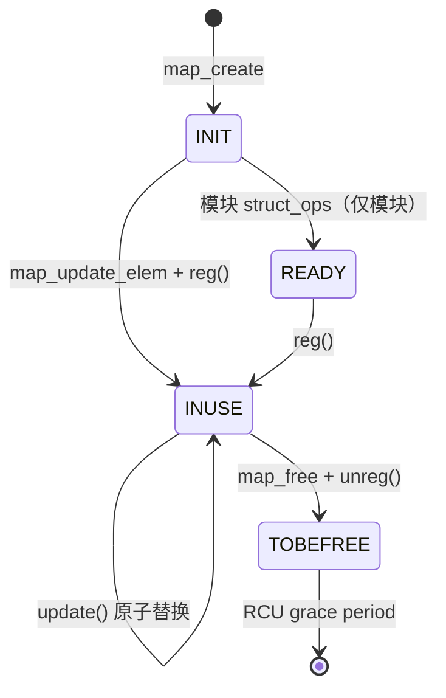
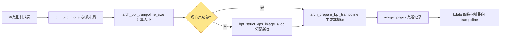

Copyright (c) 2025-2026 SPHARX Ltd. All Rights Reserved.

# OLK-6.6 eBPF → AirymaxOS 可编程扩展源码映射

> **文档定位**: 闭源内部参考，OLK-6.6 `kernel/bpf/` + `include/linux/bpf.h` + `include/uapi/linux/bpf.h` 源码 → AirymaxOS 可编程扩展（eBPF/struct_ops/kfunc）子系统设计映射
> **保密级别**: SPHARX Ltd 内部参考，**闭源不公开**
> **版本**: 0.1.1（文档体系完成）/ 1.0.1（开发）
> **最后更新**: 2026-07-07
> **源码基线**: OLK-6.6（Linux 6.6 内核源码）

---

## 0. ES-OLK 工程思想追溯

本映射文档涉及以下 ES-OLK 工程思想（权威定义：闭源总纲 §12.4 / `agentrt-linux基本工程标准规范.md` ES-OLK-1~13 表）：

| ES-OLK 编号 | 工程思想 | 本文档对应章节 |
|------------|---------|--------------|
| ES-OLK-4 | 策略机制分离（sched_ext BPF 可插拔） | §3 struct_ops 注册机制映射；§3.2 sched_ext 注册实例；§1.4 三大集成路径 |
| ES-OLK-12 | 运行时可加载（EXPORT_SYMBOL） | §8 kfunc 机制映射（`__bpf_kfunc` 导出 + BTF_KFUNCS 注册）；§2.1 struct bpf_struct_ops（运行时注册） |

---

## 1. 文档说明

### 1.1 目的

本文档建立 OLK-6.6 eBPF 子系统源码到 AirymaxOS 可编程扩展子系统设计的精确映射，标注 IRON-9 v2 三层共享模型边界：

| 标注 | 含义 | 共享程度 |
|------|------|----------|
| **[SC]** | Shared Contract 共享契约层 | 完全共享代码（`include/airymax/`） |
| **[SS]** | Semantic Same-origin 语义同源层 | API 签名同源，实现独立 |
| **[IND]** | Independent 完全独立层 | 各自独立实现 |

### 1.2 源码定位

| 路径 | 说明 | 行数 |
|------|------|------|
| `kernel/bpf/syscall.c` | bpf() 系统调用入口（map/prog/link 创建） | 5946 行 |
| `kernel/bpf/verifier.c` | 加载时验证器（两阶段静态分析） | 21091 行 |
| `kernel/bpf/bpf_struct_ops.c` | struct_ops 注册机制（sched_ext 集成核心） | 1216 行 |
| `kernel/bpf/helpers.c` | BPF 辅助函数实现 | 2904 行 |
| `kernel/bpf/btf.c` | BTF 类型信息（含 `__register_bpf_struct_ops`） | 9158 行 |
| `kernel/bpf/ringbuf.c` | BPF_MAP_TYPE_RINGBUF 实现（BPF→用户态上报） | 807 行 |
| `kernel/bpf/hashtab.c` | BPF_MAP_TYPE_HASH/PERCPU_HASH/LRU_HASH | 2640 行 |
| `kernel/bpf/arraymap.c` | BPF_MAP_TYPE_ARRAY/PERCPU_ARRAY | 1407 行 |
| `include/linux/bpf.h` | 内核侧公共类型（bpf_struct_ops/bpf_prog/bpf_map/bpf_map_ops） | ~1900 行 |
| `include/linux/bpf_sched.h` | BPF_SCHED 钩子接口（openEuler CFS instrumentation） | 50 行 |
| `include/linux/sched_hook_defs.h` | 5 个 CFS 钩子定义 | 9 行 |
| `include/uapi/linux/bpf.h` | UAPI 接口（bpf_attr/enum bpf_map_type/enum bpf_prog_type） | 7409 行 |
| `kernel/sched/ext.c` | sched_ext 框架（`bpf_sched_ext_ops` 注册点 L5839） | 7335+ 行 |

### 1.3 关键配置选项

```kconfig
CONFIG_BPF=y                   # BPF 基础
CONFIG_BPF_SYSCALL=y           # bpf() 系统调用
CONFIG_BPF_JIT=y               # BPF JIT 编译
CONFIG_BPF_JIT_ALWAYS_ON=y     # 强制 JIT（禁用解释器）
CONFIG_BPF_JIT_DEFAULT_ON=y    # JIT 默认开启
CONFIG_BPF_EVENTS=y            # kprobe/tracepoint/perf_event 挂载
CONFIG_BPF_LSM=y               # LSM 钩子（动态 MAC/审计）
CONFIG_BPF_SCHED=y             # 调度钩子（openEuler CFS instrumentation）
CONFIG_DEBUG_INFO_BTF=y        # BTF 调试信息
CONFIG_BPF_UNPRIV_DEFAULT_OFF=y  # 非特权 BPF 默认关闭
CONFIG_SCHED_CLASS_EXT=y       # sched_ext 调度类（struct_ops 集成）
```

### 1.4 三大集成路径

OLK-6.6 eBPF 子系统通过三种机制集成到内核各子系统：

| 路径 | 机制 | 注册点 | AirymaxOS 对应 |
|------|------|--------|----------------|
| **sched_ext** | struct_ops | `kernel/sched/ext.c:7335` `register_bpf_struct_ops(&bpf_sched_ext_ops, sched_ext_ops)` | SCHED_AGENT BPF 调度 [SS] |
| **BPF_SCHED** | 静态钩子 + static_key | `include/linux/bpf_sched.h` + `sched_hook_defs.h`（5 个 CFS 钩子） | openEuler 特有，AirymaxOS 独立实现 [IND] |
| **BPF_LSM** | struct_ops + 安全钩子 | `security/bpf/hooks.c` | Cupolas 安全策略 [SS] |

---

## 2. 核心数据结构映射

### 2.1 struct bpf_struct_ops（struct_ops 注册描述符） [SC]

**源码位置**: `include/linux/bpf.h:1783-1807`

`struct bpf_struct_ops` 是 struct_ops 注册机制的核心——子系统集成方通过它声明"BPF 程序可作为本子系统的操作表"。sched_ext、BPF_LSM、TCP 拥塞控制均通过此机制集成。AirymaxOS 将 `bpf_struct_ops_common_value` + `enum bpf_struct_ops_state` 纳入 [SC] 共享契约层，使 agentrt 用户态可解析 struct_ops map 的 state 字段。

| bpf_struct_ops 字段 | 类型 | AirymaxOS 对应 | 同源标注 |
|---------------------|------|----------------|----------|
| `verifier_ops` | `const struct bpf_verifier_ops *` | airymaxos 内核独立 verifier_ops | [IND] |
| `init` | `int (*)(struct btf *btf)` | 子系统初始化回调 | [SS] |
| `check_member` | `int (*)(const struct btf_type *, const struct btf_member *, const struct bpf_prog *)` | 成员合法性检查回调 | [SS] |
| `init_member` | `int (*)(const struct btf_type *, const struct btf_member *, void *kdata, const void *udata)` | 成员初始化回调 | [SS] |
| `reg` | `int (*)(void *kdata)` | 注册到内核子系统回调 | [SS] |
| `unreg` | `void (*)(void *kdata)` | 注销回调 | [SS] |
| `update` | `int (*)(void *kdata, void *old_kdata)` | 原子更新回调 | [SS] |
| `validate` | `int (*)(void *kdata)` | 注册前校验回调 | [SS] |
| `cfi_stubs` | `void *` | CFI 桩函数表（kCFI 安全） | [IND] |
| `name` | `const char *` | struct_ops 类型名（如 "sched_ext_ops"） | [SS] |
| `owner` | `struct module *` | 拥有者模块 | [IND] |
| `func_models` | `struct btf_func_model[BPF_STRUCT_OPS_MAX_NR_MEMBERS]` | 每成员函数模型 | [SS] |
| `type_id` / `value_id` | `u32` | BTF 类型 ID | [SS] |

**[SC] 共享契约层定义**（`include/airymax/bpf_struct_ops.h`）：

```c
/* include/airymax/bpf_struct_ops.h —— IRON-9 v2 [SC] 共享契约层 */
#ifndef AIRYMAX_BPF_STRUCT_OPS_H
#define AIRYMAX_BPF_STRUCT_OPS_H

#include <stdint.h>

/* struct_ops 状态机——agentrt 用户态与 AirymaxOS 内核态共享 */
enum airymax_struct_ops_state {
    AIRYMAX_STRUCT_OPS_STATE_INIT     = 0,  /* 已初始化，未注册 */
    AIRYMAX_STRUCT_OPS_STATE_INUSE     = 1,  /* 已注册，使用中 */
    AIRYMAX_STRUCT_OPS_STATE_TOBEFREE  = 2,  /* 待释放（RCU 宽限期内） */
    AIRYMAX_STRUCT_OPS_STATE_READY     = 3,  /* 就绪（仅模块 struct_ops） */
};

/* struct_ops map value 公共头——与 bpf_struct_ops_common_value 同源 */
struct airymax_struct_ops_common_value {
    uint32_t refcnt;   /* 引用计数（与内核 refcount_t 语义同源） */
    uint32_t state;    /* enum airymax_struct_ops_state */
    uint32_t reserved[2];
};

/* struct_ops map value 布局——agentrt 解析 struct_ops map 时使用 */
#define AIRYMAX_STRUCT_OPS_VALUE_HEADER_SIZE  16  /* common_value */

#endif /* AIRYMAX_BPF_STRUCT_OPS_H */
```

### 2.2 struct bpf_struct_ops_map（struct_ops map 双映像） [IND]

**源码位置**: `kernel/bpf/bpf_struct_ops.c:23-54`

`struct bpf_struct_ops_map` 是 struct_ops 专属 map，维护用户态映像（uvalue）与内核态映像（kvalue）的双份拷贝，并通过 `image_pages[]` 存储最多 8 页 trampoline 本机码。AirymaxOS 内核态实现独立，但 uvalue/kvalue 双映像模型在 agentrt 用户态策略引擎中语义同源。

| bpf_struct_ops_map 字段 | 类型 | AirymaxOS 对应 | 同源标注 |
|------------------------|------|----------------|----------|
| `map` | `struct bpf_map` | 继承 bpf_map 基类 | [SS] |
| `st_ops_desc` | `const struct bpf_struct_ops_desc *` | struct_ops 描述符 | [SS] |
| `lock` | `struct mutex` | 保护 map_update 并发 | [IND] |
| `links` | `struct bpf_link **` | 每函数指针成员对应的 bpf_link | [IND] |
| `links_cnt` | `u32` | link 数量 | [IND] |
| `image_pages_cnt` | `u32` | trampoline 页数（≤ 8） | [IND] |
| `image_pages[MAX_TRAMP_IMAGE_PAGES]` | `void *` | trampoline 本机码页 | [IND] |
| `btf` | `struct btf *` | 拥有者模块 BTF | [IND] |
| `uvalue` | `struct bpf_struct_ops_value *` | 用户态映像（含 prog fd） | [SS] |
| `kvalue` | `struct bpf_struct_ops_value` | 内核态映像（含真实函数指针） | [IND] |

### 2.3 struct bpf_prog（BPF 程序对象） [SS]

**源码位置**: `include/linux/bpf.h:1609-1647`

`struct bpf_prog` 是 BPF 程序的内核对象，承载字节码、JIT 后本机码、验证器辅助状态。AirymaxOS eBPF 程序对象语义同源（相同生命周期：load → attach → run → detach → unload），但 JIT 后端与 verifier 实现独立。

| bpf_prog 字段 | 类型 | AirymaxOS 对应 | 同源标注 |
|--------------|------|----------------|----------|
| `type` | `enum bpf_prog_type` | 程序类型（kprobe/tracepoint/struct_ops...） | [SS] |
| `expected_attach_type` | `enum bpf_attach_type` | 期望挂载类型 | [SS] |
| `len` | `u32` | BPF 字节码长度（指令数） | [SS] |
| `jited_len` | `u32` | JIT 后本机码长度 | [IND] |
| `bpf_func` | `bpf_func_t` | JIT 后入口函数指针 | [IND] |
| `aux` | `struct bpf_prog_aux *` | 辅助状态（含 BTF、kfunc 表） | [SS] |

### 2.4 struct bpf_link（BPF 链接对象） [SS]

**源码位置**: `include/linux/bpf.h:1662-1680`

`struct bpf_link` 解耦 BPF 程序与挂载点，使程序生命周期独立于加载进程。AirymaxOS 通过 `bpf(BPF_LINK_CREATE)` 显式管理链接，与 agentrt 用户态"策略加载即链接"语义同源。

### 2.5 struct bpf_map_ops（map 操作回调表） [SS]

**源码位置**: `include/linux/bpf.h:77-182`

`struct bpf_map_ops` 定义 map 类型的全部操作回调（lookup/update/delete + batch + mmap + direct_value + local_storage）。AirymaxOS 自定义 map 类型必须实现此回调表的子集，语义同源但实现独立。

| bpf_map_ops 回调 | 语义 | AirymaxOS 使用 |
|------------------|------|----------------|
| `map_alloc` / `map_free` | map 分配/释放 | [SS] 所有 map 类型 |
| `map_lookup_elem` / `map_update_elem` / `map_delete_elem` | 基本增删改查 | [SS] 所有 map 类型 |
| `map_lookup_percpu_elem` | per-CPU 查询 | [SS] PERCPU 类型 |
| `map_push_elem` / `map_pop_elem` / `map_peek_elem` | 栈/队列操作 | [SS] STACK/QUEUE 类型 |
| `map_mmap` | 用户态 mmap | [SS] ringbuf/lpm_trie |
| `map_direct_value_addr` / `map_direct_value_meta` | 直接值访问 | [SS] ARRAY 内联值 |
| `map_local_storage_charge` / `map_local_storage_uncharge` | 本地存储计费 | [SS] task/inode/cgrp storage |
| `map_poke_track` / `map_poke_untrack` / `map_poke_run` | prog_array 热更新 | [IND] AirymaxOS 暂不使用 |
| `map_meta_equal` | inner map 元数据相等检查 | [SS] map_in_map |

### 2.6 struct bpf_map（map 基类） [SS]

**源码位置**: `include/linux/bpf.h:282-340`

`struct bpf_map` 是所有 map 类型的基类。前两个 cacheline 为 read-mostly 热数据（ops/max_entries/key_size/value_size），第 3-4 cacheline 为 refcount/writecnt 避免伪共享。AirymaxOS map 基类布局同源，但 `KABI_RESERVE`/`KABI_FILL_HOLE`/`KABI_BROKEN_REPLACE` 为 openEuler kABI 兼容机制，AirymaxOS 不采用。

| bpf_map 字段 | 类型 | AirymaxOS 对应 | 同源标注 |
|-------------|------|----------------|----------|
| `ops` | `const struct bpf_map_ops *` | map 操作回调表 | [SS] |
| `map_type` | `enum bpf_map_type` | map 类型枚举 | [SS] |
| `key_size` / `value_size` / `max_entries` | `u32` | 维度 | [SS] |
| `map_extra` | `u64` | per-type 扩展字段 | [SS] |
| `map_flags` | `u32` | 创建标志 | [SS] |
| `id` | `u32` | 全局唯一 ID | [SS] |
| `record` | `struct btf_record *` | BTF 字段记录（spinlock/timer/kptr） | [SS] |
| `refcnt` / `usercnt` | `atomic64_t` | 引用计数 | [SS] |
| `frozen` | `bool` | 只读冻结（BPF_MAP_FREEZE） | [SS] |

### 2.7 enum bpf_struct_ops_state（状态机） [SC]

**源码位置**: `include/linux/bpf.h:1834-1839`

```c
enum bpf_struct_ops_state {
    BPF_STRUCT_OPS_STATE_INIT,     /* 已初始化，未注册 */
    BPF_STRUCT_OPS_STATE_INUSE,    /* 已注册，使用中 */
    BPF_STRUCT_OPS_STATE_TOBEFREE, /* 待释放（RCU 宽限期内） */
    BPF_STRUCT_OPS_STATE_READY,    /* 就绪（仅模块 struct_ops） */
};
```

状态机迁移（与 §4.2 struct_ops 生命周期对应）：

```
INIT --map_update+reg()--> INUSE --map_free+unreg()--> TOBEFREE --RCU gp--> freed
                              ↑                            |
                              +----update() 原子替换--------+
```

**[SC] 共享契约层**：状态枚举值（0/1/2/3）与字段语义在 `airymax_struct_ops_state` 中完整保留，agentrt 用户态策略引擎可读取 `state` 字段判断 BPF 调度器是否在线。

---

## 3. struct_ops 注册机制映射

### 3.1 register_bpf_struct_ops 宏 [SS]

**源码位置**: `include/linux/bpf.h:1851-1859`

```c
#define register_bpf_struct_ops(st_ops, type)                  \
    ({                                                         \
        struct bpf_struct_ops_##type {                         \
            struct bpf_struct_ops_common_value common;         \
            struct type data ____cacheline_aligned_in_smp;     \
        };                                                     \
        BTF_TYPE_EMIT(struct bpf_struct_ops_##type);           \
        __register_bpf_struct_ops(st_ops);                     \
    })
```

此宏做三件事：(1) 定义 value 类型（common_value 头 + 真实 ops 结构体）；(2) 通过 `BTF_TYPE_EMIT` 确保 BTF 包含此类型；(3) 调用 `__register_bpf_struct_ops()` 注册到 BTF struct_ops 表。AirymaxOS SCHED_AGENT 集成语义同源——使用相同宏注册 `airymax_sched_agent_ops`。

### 3.2 sched_ext 注册实例 [SS]

**源码位置**: `kernel/sched/ext.c:5839-5851 + 7335`

```c
/* ext.c:5839 —— sched_ext 的 struct_ops 声明 */
static struct bpf_struct_ops bpf_sched_ext_ops = {
    .verifier_ops = &bpf_scx_verifier_ops,
    .reg          = bpf_scx_reg,
    .unreg        = bpf_scx_unreg,
    .check_member = bpf_scx_check_member,
    .init_member  = bpf_scx_init_member,
    .init         = bpf_scx_init,
    .update       = bpf_scx_update,
    .validate     = bpf_scx_validate,
    .name         = "sched_ext_ops",
    .owner        = THIS_MODULE,
    .cfi_stubs   = &__bpf_ops_sched_ext_ops
};

/* ext.c:7335 —— sched_ext 初始化时注册 */
ret = register_bpf_struct_ops(&bpf_sched_ext_ops, sched_ext_ops);
```

AirymaxOS SCHED_AGENT 沿用此模式：`airymax_sched_agent_ops` 声明同名回调集，注册名为 `"sched_agent_ops"`。

### 3.3 struct sched_ext_ops 回调表 [SS]

**源码位置**: `kernel/sched/ext.c:245-580`（详见 [`01-sched-ext-mapping.md`](01-sched-ext-mapping.md) §3）

sched_ext 通过 `struct sched_ext_ops` 暴露完整调度接口（init/exit/enqueue/dispatch/select_cpu/runnable/running/stopping/quiescent/cgroup_*等 25+ 回调）。AirymaxOS SCHED_AGENT 语义同源，回调签名一致，详见调度子系统映射文档。

---

## 4. struct_ops 生命周期映射

### 4.1 map_update_elem 流程（INIT → INUSE） [IND]

**源码位置**: `kernel/bpf/bpf_struct_ops.c:603-770`

```c
static long bpf_struct_ops_map_update_elem(struct bpf_map *map, void *key,
                                           void *value, u64 flags)
{
    /* 1. 校验 key=0、flags=0、state==INIT */
    if (flags) return -EINVAL;
    if (*(u32 *)key != 0) return -E2BIG;
    err = check_zero_holes(st_map->btf, st_ops_desc->value_type, value);
    /* 2. 拷贝 uvalue，遍历成员 */
    memcpy(uvalue, value, map->value_size);
    for_each_member(i, t, member) {
        /* 2a. module 字段特殊处理（BPF_MODULE_OWNER） */
        /* 2b. 调用 init_member() 处理非函数指针成员 */
        err = st_ops->init_member(t, member, kdata, udata);
        /* 2c. 函数指针成员：查找 prog_fd → bpf_prog_get → 准备 trampoline */
        prog = bpf_prog_get(prog_fd);
        link = bpf_struct_ops_link_alloc(prog, st_map);
        bpf_struct_ops_prepare_trampoline(tlinks, link, &model,
                                          stub_func, &image, &image_off, true);
    }
    /* 3. 调用 reg() 注册到内核子系统，state INIT→INUSE */
    err = st_ops->reg(kdata);
    smp_store_release(&kvalue->common.state, BPF_STRUCT_OPS_STATE_INUSE);
}
```

### 4.2 状态迁移图 [SC]



### 4.3 trampoline 准备机制 [IND]

**源码位置**: `kernel/bpf/bpf_struct_ops.c:557-601`

`bpf_struct_ops_prepare_trampoline()` 通过 `arch_prepare_bpf_trampoline()` 生成本机码，该本机码在调用 BPF 程序前保存函数参数（按 `btf_func_model` 描述的参数布局）。trampoline 页数上限 `MAX_TRAMP_IMAGE_PAGES=8`（每页 4 KB，共 32 KB 本机码预算）。



AirymaxOS trampoline 机制完全独立实现——JIT 后端、参数布局编码、本机码生成都依赖 kernel 架构后端（x86_64/arm64），不与 agentrt 用户态共享。

---

## 5. eBPF 验证器映射

### 5.1 两阶段验证 [SS]

**源码位置**: `kernel/bpf/verifier.c`（21091 行）

| 阶段 | 检查内容 | AirymaxOS 落地 |
|------|---------|----------------|
| 第一阶段：DAG 检查 | 禁止循环、不可达指令；构建控制流图 | [SS] 语义同源 |
| 第二阶段：路径模拟 | 从首指令模拟执行所有路径，跟踪寄存器/栈状态 | [SS] 语义同源 |

### 5.2 寄存器类型系统 [SS]

验证器维护每指令处每寄存器的类型状态：

| 类型 | 语义 | AirymaxOS 使用 |
|------|------|----------------|
| `PTR_TO_CTX` | 上下文指针（kprobe ctx / struct_ops arg） | [SS] |
| `PTR_TO_MAP` | map 指针 | [SS] |
| `PTR_TO_MAP_KEY` / `PTR_TO_MAP_VALUE` | map 键值指针 | [SS] |
| `PTR_TO_STACK` | 栈指针 | [SS] |
| `PTR_TO_PACKET` / `PTR_TO_PACKET_META` / `PTR_TO_PACKET_END` | 网络包指针 | [IND] AirymaxOS 网络观测 |
| `PTR_TO_TCP_SOCK` / `PTR_TO_SOCK_COMMON` | socket 指针 | [IND] |
| `PTR_TO_MEM` / `PTR_TO_MEM_OR_NULL` | dynptr 包装的内存 | [SS] |
| `PTR_TO_ARENA` | BPF arena 指针（新） | [IND] |
| `SCALAR_VALUE` | 标量值 | [SS] |

### 5.3 复杂度上限 [SS]

```c
#define BPF_COMPLEXITY_LIMIT_INSNS    1000000  /* 100 万指令 */
#define BPF_COMPLEXITY_LIMIT_STACK    512       /* 栈深度 512 字节 */
#define BPF_COMPLEXITY_LIMIT_STATES   1000000  /* 状态数上限 */
```

AirymaxOS 遵循相同上限，超限程序必须拆分（OS-STD-010 规则）。

---

## 6. BPF 程序类型映射

### 6.1 可观测性相关程序类型 [SS]

**源码位置**: `include/uapi/linux/bpf.h:974-1008`（30+ 类型）

| 程序类型 | 挂载点 | AirymaxOS 用途 | 同源标注 |
|---------|--------|----------------|----------|
| `BPF_PROG_TYPE_KPROBE` | kprobe/kretprobe | Agent 决策追踪 | [SS] |
| `BPF_PROG_TYPE_TRACEPOINT` | tracepoint | 静态埋点 | [SS] |
| `BPF_PROG_TYPE_RAW_TRACEPOINT` | 裸 tracepoint | 高性能追踪 | [SS] |
| `BPF_PROG_TYPE_PERF_EVENT` | perf 事件 | CPU 剖析、周期采样 | [SS] |
| `BPF_PROG_TYPE_STRUCT_OPS` | struct_ops 成员 | SCHED_AGENT 调度回调 | [SS] |
| `BPF_PROG_TYPE_TRACING` | fentry/fexit/fmod_ret | 函数追踪（BTF 重定位） | [SS] |
| `BPF_PROG_TYPE_LSM` | LSM 钩子 | Cupolas 动态安全策略 | [SS] |
| `BPF_PROG_TYPE_EXT` | freplace | 程序替换（热更新） | [IND] |
| `BPF_PROG_TYPE_SCHED` | CFS 钩子 | openEuler BPF_SCHED（AirymaxOS 独立实现） | [IND] |

### 6.2 struct_ops 程序加载特殊性 [IND]

struct_ops 程序加载时需指定 `expected_attach_type` 为 struct_ops 类型 ID，验证器通过 `bpf_struct_ops_verifier_ops` 检查程序签名是否匹配 `btf_func_model`。AirymaxOS SCHED_AGENT 程序加载流程独立实现，但签名校验语义同源。

---

## 7. BPF map 类型映射

### 7.1 核心 map 类型 [SS]

**源码位置**: `include/uapi/linux/bpf.h:923-963`（28+ 类型）

| map 类型 | 实现 | AirymaxOS 用途 | 同源标注 |
|---------|------|----------------|----------|
| `BPF_MAP_TYPE_HASH` | `hashtab.c` | 通用键值存储 | [SS] |
| `BPF_MAP_TYPE_ARRAY` | `arraymap.c` | 索引数组 | [SS] |
| `BPF_MAP_TYPE_PERCPU_HASH` | `hashtab.c` | per-CPU 哈希（无锁） | [SS] |
| `BPF_MAP_TYPE_PERCPU_ARRAY` | `arraymap.c` | per-CPU 数组 | [SS] |
| `BPF_MAP_TYPE_LRU_HASH` / `LRU_PERCPU_HASH` | `hashtab.c` | LRU 淘汰哈希 | [SS] |
| `BPF_MAP_TYPE_RINGBUF` | `ringbuf.c` | BPF→用户态上报（推荐） | [SS] |
| `BPF_MAP_TYPE_PERF_EVENT_ARRAY` | `arraymap.c` | 旧版上报（被 ringbuf 替代） | [IND] |
| `BPF_MAP_TYPE_STACK_TRACE` | `stackmap.c` | 栈回溯 | [SS] |
| `BPF_MAP_TYPE_STACK` / `QUEUE` | `queue_stack_maps.c` | 栈/队列 | [IND] |
| `BPF_MAP_TYPE_STRUCT_OPS` | `bpf_struct_ops.c` | struct_ops 注册载体 | [SS] |
| `BPF_MAP_TYPE_BLOOM_FILTER` | `bloom_filter.c` | 布隆过滤器 | [IND] |
| `BPF_MAP_TYPE_LPM_TRIE` | `lpm_trie.c` | 最长前缀匹配 | [SS] |
| `BPF_MAP_TYPE_TASK_STORAGE` | `bpf_task_storage.c` | per-task 存储 | [SS] |
| `BPF_MAP_TYPE_INODE_STORAGE` | `bpf_inode_storage.c` | per-inode 存储 | [IND] |
| `BPF_MAP_TYPE_CGRP_STORAGE` | `bpf_cgrp_storage.c` | per-cgroup 存储 | [SS] |
| `BPF_MAP_TYPE_ARENA` | 新增 | BPF arena（共享地址空间） | [IND] |

### 7.2 ringbuf map 零拷贝上报 [SS]

**源码位置**: `kernel/bpf/ringbuf.c`（807 行）

ringbuf 是多生产者单消费者环形缓冲，支持无锁预留（`bpf_ringbuf_reserve`）、跨 CPU 顺序、保留通知。AirymaxOS Agent 行为追踪事件通过 ringbuf 上报至用户态审计守护进程。

```c
/* ringbuf reserve/submit 模式 */
struct event *e = bpf_ringbuf_reserve(&agent_events, sizeof(*e), 0);
if (!e) return 0;
e->agent_id = ...; e->ts = bpf_ktime_get_ns();
bpf_ringbuf_submit(e, 0);   /* 或 bpf_ringbuf_discard(e, 0) 丢弃 */
```

### 7.3 per-CPU map 无锁并发 [SS]

per-CPU map 为每 CPU 维护独立副本，BPF 程序访问本 CPU 副本无锁。用户态通过 `bpf_map_lookup_percpu_elem(map, key, cpu)` 聚合。AirymaxOS Token 累加计数器强制使用 `BPF_MAP_TYPE_PERCPU_ARRAY`（OS-OBS-017）。

---

## 8. kfunc 机制映射

### 8.1 kfunc 注册模式 [SS]

**源码位置**: `kernel/bpf/helpers.c` + 各子系统 kfunc 集

kfunc 通过 `__bpf_kfunc` 宏标注函数，`BTF_KFUNCS_START`/`BTF_KFUNCS_END` 注册到 BTF kfunc 集合。验证器仅允许调用已注册 kfunc。

```c
__bpf_kfunc_start_defs();
__bpf_kfunc struct task_struct *bpf_find_get_task_by_vpid(pid_t nr)
{ return find_get_task_by_vpid(nr); }
__bpf_kfunc_end_defs();

BTF_KFUNCS_START(bpf_general_kfuncs)
BTF_ID_FLAGS(func, bpf_find_get_task_by_vpid)
BTF_KFUNCS_END(bpf_general_kfuncs);
```

### 8.2 kfunc 参数注解 [SS]

| 注解 | 语义 | 验证器用途 |
|------|------|-----------|
| `__sz` | 缓冲区大小参数 | 边界检查 |
| `__k` | 常量标量参数 | 编译期求值 |
| `__uninit` | 未初始化输出参数 | 生命周期检查 |
| `__opt` | 可选参数 | 参数存在性检查 |
| `__nullable` | 可空参数（struct_ops 专用） | 空指针检查 |

### 8.3 AirymaxOS 自定义 kfunc [IND]

AirymaxOS 注册以下自定义 kfunc，供 BPF 程序查询 Agent 状态：

| kfunc | 返回 | 用途 | 同源标注 |
|-------|------|------|----------|
| `bpf_agent_decision_get(agent_id)` | `struct agent_decision *` | Agent 决策查询 | [IND] |
| `bpf_agent_token_usage_get(agent_id)` | `u64` | Token 累计消耗 | [IND] |
| `bpf_agent_state_get(agent_id)` | `enum agent_state` | Agent 状态查询 | [IND] |

---

## 9. BPF_SCHED 钩子机制（openEuler 特有） [IND]

### 9.1 BPF_SCHED 配置

**源码位置**: `kernel/bpf/Kconfig:103-114`

```kconfig
config BPF_SCHED
    bool "Sched Instrumentation with BPF"
    depends on BPF_EVENTS
    depends on BPF_SYSCALL
    depends on BPF_JIT
    help
      Enables instrumentation of the sched hooks with eBPF programs for
      implementing dynamic scheduling policies.
```

### 9.2 5 个 CFS 钩子

**源码位置**: `include/linux/sched_hook_defs.h`

```c
BPF_SCHED_HOOK(int, -1, cfs_select_rq, struct sched_migrate_ctx *ctx)
BPF_SCHED_HOOK(int, -1, cfs_can_migrate_task, struct task_struct *p,
                struct sched_migrate_node *migrate_node)
BPF_SCHED_HOOK(int, -1, cfs_tag_entity_eligible, struct sched_entity *se)
BPF_SCHED_HOOK(int, -1, cfs_tag_pick_next_entity,
                const struct sched_entity *curr,
                const struct sched_entity *next)
BPF_SCHED_HOOK(void, (void) 0, cfs_exec_init, struct task_struct *tsk)
```

宏展开后生成 `bpf_sched_cfs_select_rq()` 等函数，通过 `static_key` (`bpf_sched_enabled_key`) 控制是否调用 BPF 程序。未挂载 BPF 程序时 `static_branch_unlikely` 跳过，零开销。

### 9.3 AirymaxOS 独立实现 [IND]

AirymaxOS **不直接移植 BPF_SCHED 钩子**，原因：

1. sched_ext（struct_ops）已提供更完整的可插拔调度接口（25+ 回调 vs BPF_SCHED 的 5 钩子）
2. BPF_SCHED 与 CFS 内部实现强耦合（`struct sched_entity`、`struct sched_migrate_ctx`），不符合微内核解耦原则
3. AirymaxOS SCHED_AGENT 通过 struct_ops 集成，语义更完整

**[IND] 独立设计**：AirymaxOS 在 SCHED_AGENT 框架下提供等价的"调度策略钩子"，但通过 struct_ops 回调实现（`ops.enqueue`/`ops.dispatch`/`ops.select_cpu`），不使用 BPF_SCHED 的静态钩子模式。

---

## 10. bpf() 系统调用映射

### 10.1 bpf() 入口 [SS]

**源码位置**: `kernel/bpf/syscall.c`

```c
SYSCALL_DEFINE3(bpf, int, cmd, union bpf_attr __user *, uattr, unsigned int, size)
{
    union bpf_attr attr;
    /* 1. capabilities 检查（CAP_BPF / CAP_SYS_ADMIN / CAP_NET_ADMIN） */
    /* 2. copy_from_user(attr) */
    /* 3. 根据 cmd 分发 */
    switch (cmd) {
    case BPF_MAP_CREATE:          err = map_create(&attr); break;
    case BPF_MAP_LOOKUP_ELEM:     err = map_lookup_elem(&attr); break;
    case BPF_MAP_UPDATE_ELEM:     err = map_update_elem(&attr); break;
    case BPF_MAP_DELETE_ELEM:     err = map_delete_elem(&attr); break;
    case BPF_MAP_FREEZE:          err = map_freeze(&attr); break;
    case BPF_PROG_LOAD:           err = bpf_prog_load(&attr); break;
    case BPF_OBJ_PIN:             err = bpf_obj_pin(&attr); break;
    case BPF_OBJ_GET:             err = bpf_obj_get(&attr); break;
    case BPF_PROG_ATTACH:         err = bpf_prog_attach(&attr); break;
    case BPF_PROG_DETACH:         err = bpf_prog_detach(&attr); break;
    case BPF_PROG_TEST_RUN:       err = bpf_prog_test_run(&attr); break;
    case BPF_PROG_QUERY:          err = bpf_prog_query(&attr); break;
    case BPF_PROG_BIND_MAP:       err = bpf_prog_bind_map(&attr); break;
    case BPF_LINK_CREATE:         err = link_create(&attr, uattr); break;
    case BPF_LINK_UPDATE:         err = link_update(&attr); break;
    case BPF_LINK_DETACH:         err = link_detach(&attr); break;
    case BPF_LINK_GET_FD_BY_ID:   err = bpf_link_get_fd_by_id(&attr); break;
    case BPF_MAP_GET_FD_BY_ID:    err = bpf_map_get_fd_by_id(&attr); break;
    case BPF_PROG_GET_FD_BY_ID:   err = bpf_prog_get_fd_by_id(&attr); break;
    case BPF_OBJ_GET_INFO_BY_FD:  err = bpf_obj_get_info_by_fd(&attr); break;
    case BPF_TASK_FD_QUERY:       err = bpf_task_fd_query(&attr); break;
    /* ... 共 30+ cmd */
    }
}
```

### 10.2 关键 cmd 分类 [SS]

| cmd 类别 | 命令 | AirymaxOS 使用 |
|---------|------|----------------|
| map 管理 | CREATE/LOOKUP_ELEM/UPDATE_ELEM/DELETE_ELEM/FREEZE/LOOKUP_BATCH/UPDATE_BATCH/DELETE_BATCH | [SS] |
| prog 管理 | PROG_LOAD/PROG_ATTACH/PROG_DETACH/PROG_TEST_RUN/PROG_QUERY/PROG_BIND_MAP | [SS] |
| link 管理 | LINK_CREATE/LINK_UPDATE/LINK_DETACH/LINK_GET_FD_BY_ID | [SS] |
| 对象管理 | OBJ_PIN/OBJ_GET/OBJ_GET_INFO_BY_FD/GET_FD_BY_ID | [SS] |
| BTF 管理 | BTF_LOAD/BTF_GET_FD_BY_ID | [SS] |
| 任务查询 | TASK_FD_QUERY | [SS] |

---

## 11. IRON-9 v2 三层共享边界汇总

### 11.1 [SC] 共享契约层

**位置**: `include/airymax/bpf_struct_ops.h`

```c
/* 完整共享代码——agentrt 用户态与 AirymaxOS 内核态都包含此头 */
enum airymax_struct_ops_state { INIT=0, INUSE=1, TOBEFREE=2, READY=3 };
struct airymax_struct_ops_common_value { uint32_t refcnt; uint32_t state; uint32_t reserved[2]; };
#define AIRYMAX_STRUCT_OPS_VALUE_HEADER_SIZE 16
```

agentrt 用户态策略引擎通过此头解析 struct_ops map 的 `state` 字段，判断 BPF 调度器是否在线，无需访问内核私有数据结构。

### 11.2 [SS] 语义同源层（11 项）

| 维度 | agentrt 用户态 | AirymaxOS 内核态 | 同源点 |
|------|----------------|------------------|--------|
| struct_ops 注册宏 | 策略引擎注册回调 | `register_bpf_struct_ops()` | 宏模式同源 |
| struct_ops 状态机 | 4 状态（INIT/INUSE/TOBEFREE/READY） | 4 状态 | 枚举值同源 |
| bpf_prog 生命周期 | load→attach→run→detach→unload | 同 | 5 阶段同源 |
| bpf_link 生命周期 | create→update→detach | 同 | 3 阶段同源 |
| bpf_map_ops 回调表 | 策略引擎实现回调子集 | 内核实现完整回调表 | 接口签名同源 |
| 程序类型枚举 | 30+ 类型 | 30+ 类型 | 枚举值同源 |
| map 类型枚举 | 28+ 类型 | 28+ 类型 | 枚举值同源 |
| ringbuf reserve/submit | 策略引擎 ringbuf 客户端 | 内核 ringbuf 实现 | API 签名同源 |
| kfunc 注册模式 | 策略引擎导出函数 | `__bpf_kfunc` + BTF_KFUNCS | 宏模式同源 |
| 验证器两阶段 | 策略引擎静态检查 | 内核 verifier | 概念同源 |
| bpf() cmd | 策略引擎调用 bpf() | 内核实现 bpf() | ABI 同源 |

### 11.3 [IND] 完全独立层（7 项）

| 维度 | agentrt 用户态 | AirymaxOS 内核态 |
|------|----------------|------------------|
| JIT 后端 | 不适用（用户态解释器/LLVM） | kernel x86_64/arm64 JIT |
| trampoline 机制 | 不适用 | `arch_prepare_bpf_trampoline()` 本机码生成 |
| verifier 实现 | 不适用 | 内核 verifier.c（21091 行） |
| BPF_SCHED CFS 钩子 | 不适用 | AirymaxOS 独立实现（不移植 openEuler BPF_SCHED） |
| 自定义 kfunc | 不适用 | `bpf_agent_decision_get` 等 |
| cfi_stubs | 不适用 | kCFI 桩函数表 |
| kABI 兼容 | 不适用 | AirymaxOS 不采用 KABI_RESERVE |

---

## 12. 设计合理性验证

### 12.1 优势分析

| 优势 | 说明 |
|------|------|
| **struct_ops 提供完整调度接口** | sched_ext 25+ 回调远超 BPF_SCHED 的 5 钩子，SCHED_AGENT 无需 BPF_SCHED |
| **[SC] 共享契约层薄** | 仅 16 字节 common_value + 4 状态枚举，agentrt 用户态解析零成本 |
| **状态机同源** | agentrt 策略引擎可读取 struct_ops state 判断调度器在线状态 |
| **ringbuf 零拷贝上报** | BPF→用户态上报性能优于 perf_event_array，跨态聚合成本低 |
| **kfunc 可扩展** | 新观测 kfunc 优先于 helper，BTF 类型安全 |

### 12.2 与 io_uring 子系统协同增强

eBPF 与 io_uring 在 AirymaxOS 中协同：

- eBPF kprobe 追踪 io_uring 提交/完成路径（`io_submit_sqes`/`io_commit_cqring`）
- eBPF ringbuf 上报与 io_uring CQE 共享 trace_id（[SC] `agentrt_ipc_msg_hdr.trace_id` 同源 `io_uring_sqe.user_data`）
- eBPF struct_ops 调度策略可感知 io_uring 提交模式（SQPOLL/DEFER_TASKRUN）

### 12.3 风险与缓解

| 风险 | 缓解措施 |
|------|----------|
| struct_ops map_update 并发 | `mutex_lock(&st_map->lock)` + `smp_store_release` 状态迁移 |
| trampoline 本机码注入风险 | kCFI 桩函数表 + 验证器静态分析 + JIT 强制开启 |
| BPF 程序内存泄漏 | refcount 引用计数 + RCU 宽限期释放 + bpf_mem_alloc 内存记账 |
| verifier 复杂度爆炸 | 100 万指令上限 + 状态数上限 + 路径剪枝 |
| 非特权 BPF 滥用 | `CONFIG_BPF_UNPRIV_DEFAULT_OFF=y` + capabilities 检查 |

### 12.4 与 agentrt 设计一致性检查

| 检查项 | agentrt | AirymaxOS | 一致性 |
|--------|---------|-----------|--------|
| struct_ops 状态枚举 | `airymax_struct_ops_state` | `enum bpf_struct_ops_state` | [SC] 值同源 |
| 策略加载生命周期 | load→attach→run→detach→unload | 同 | [SS] 语义同源 |
| ringbuf 事件格式 | AgentsIPC 128B 消息头 | ringbuf event 同 header | [SC] trace_id 同源 |
| Token 累加模式 | metrics_record(name, value) | PERCPU_ARRAY 累加 | [SS] 语义同源 |
| kfunc 导出 | 策略引擎导出 RPC | `__bpf_kfunc` 导出 | [SS] 模式同源 |

**结论**：eBPF 子系统设计在 IRON-9 v2 三层共享模型下与 agentrt 保持 [SC] 共享契约 + [SS] 语义同源，无需修改 agentrt 设计。BPF_SCHED 作为 openEuler 特有机制不移植，AirymaxOS 通过 struct_ops 提供等价能力，设计合理。

---

## 13. 相关文档与版本维护

### 13.1 相关文档

**同模块闭源文档**：[`01-sched-ext-mapping.md`](01-sched-ext-mapping.md)（调度器源码映射）、[`02-io-uring-mapping.md`](02-io-uring-mapping.md)（IPC 源码映射）。
**同模块开源文档**：`docs/AirymaxOS/90-observability/02-ebpf-probes.md`（eBPF 可编程探针）、`docs/AirymaxOS/40-dataflows/03-ipc-flow.md`（IPC 数据流）、`docs/AirymaxOS/40-dataflows/04-scheduling-flow.md`（调度数据流）。
**openEuler 技术规范**：[`../01-openeuler-tech-reference/03-ebpf-spec.md`](../01-openeuler-tech-reference/03-ebpf-spec.md)。
**内核源码**：OLK-6.6 `kernel/bpf/{syscall.c,verifier.c,bpf_struct_ops.c,helpers.c,btf.c,ringbuf.c,hashtab.c,arraymap.c}`、`include/linux/bpf.h`、`include/uapi/linux/bpf.h`、`kernel/sched/ext.c`。

### 13.2 版本与维护

| 版本 | 日期 | 变更说明 |
|------|------|----------|
| 0.1.1 | 2026-07-07 | 初稿，覆盖 eBPF 核心数据结构 + struct_ops 注册机制 + 生命周期 + 验证器 + map/prog 类型 + kfunc + BPF_SCHED + bpf() syscall + IRON-9 v2 三层共享边界 |

**维护责任**：文档负责人为 AirymaxOS 可观测性工程组；代码负责人为 kernel BPF 维护者；每个 LTS 小版本发布前重新核对 BPF 接口与 [SC]/[SS]/[IND] 边界有效性。

---

> **文档结束** | OLK-6.6 eBPF → AirymaxOS 可编程扩展源码映射 v0.1.1
