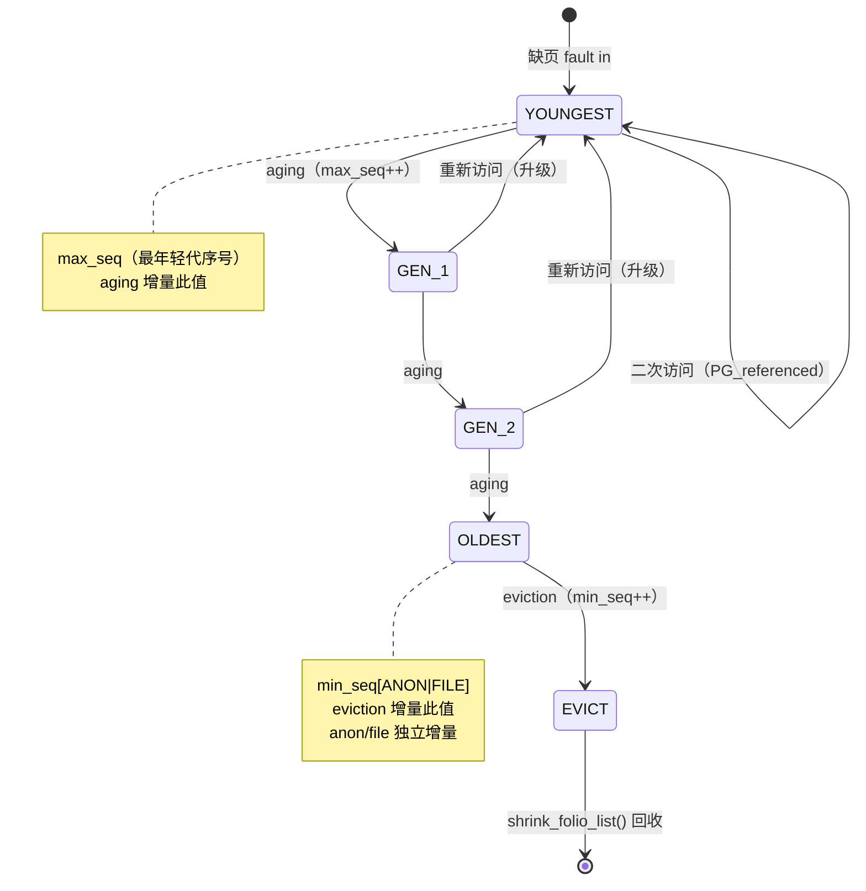

Copyright (c) 2025-2026 SPHARX Ltd. All Rights Reserved.

# OLK-6.6 mm/ → AirymaxOS 记忆卷载源码映射

> **文档定位**: 闭源内部参考，OLK-6.6 `mm/` + `include/linux/mmzone.h` + `include/linux/mm_types.h` + `include/linux/gfp.h` 源码 → AirymaxOS 记忆卷载（MemoryRovol + CXL + PMEM + MGLRU）子系统设计映射
> **保密级别**: SPHARX Ltd 内部参考，**闭源不公开**
> **版本**: 0.1.1（文档体系完成）/ 1.0.1（开发）
> **最后更新**: 2026-07-07
> **源码基线**: OLK-6.6（Linux 6.6 内核源码）

---

## 0. ES-OLK 工程思想追溯

本映射文档涉及以下 ES-OLK 工程思想（权威定义：闭源总纲 §12.4 / `agentrt-linux基本工程标准规范.md` ES-OLK-1~13 表）：

| ES-OLK 编号 | 工程思想 | 本文档对应章节 |
|------------|---------|--------------|
| ES-OLK-1 | 关注点分离（8 子仓差异化） | §10 IRON-9 v2 三层共享边界汇总（[SC]/[SS]/[IND] 划分）；§11.4 与 agentrt 一致性检查 |
| ES-OLK-2 | 架构正交（arch/machine/plat 三层） | §2 核心数据结构映射（struct zone / pglist_data / lruvec 分层）；§1.4 三大集成路径（MGLRU/CXL/PMEM 正交） |

---

## 1. 文档说明

### 1.1 目的

本文档建立 OLK-6.6 内存管理子系统（`mm/`）源码到 AirymaxOS 记忆卷载子系统设计的精确映射，标注 IRON-9 v2 三层共享模型边界：

| 标注 | 含义 | 共享程度 |
|------|------|----------|
| **[SC]** | Shared Contract 共享契约层 | 完全共享代码（`include/airymax/`） |
| **[SS]** | Semantic Same-origin 语义同源层 | API 签名同源，实现独立 |
| **[IND]** | Independent 完全独立层 | 各自独立实现 |

### 1.2 源码定位

| 路径 | 说明 | 行数 |
|------|------|------|
| `mm/page_alloc.c` | Buddy 分配器（页分配核心 + per-CPU pageset + 碎片管理） | 7554 行 |
| `mm/slub.c` | SLUB slab 分配器（小对象 + per-CPU partial 链） | 6554 行 |
| `mm/slab.c` | SLAB 兼容层（旧接口包装） | 4026 行 |
| `mm/slab_common.c` | slab 公共逻辑（kmem_cache 创建/销毁/合并） | 1496 行 |
| `mm/vmscan.c` | 页面回收核心（含 MGLRU aging + eviction） | 7668 行 |
| `mm/memcontrol.c` | Memory cgroup（容量隔离 + 软限制 + memory.reclaim） | 9456 行 |
| `mm/memory.c` | 缺页处理 + 页表遍历 + 写时复制 | 7011 行 |
| `mm/mmap.c` | 用户态 mmap 区域管理（VMA 树） | 4146 行 |
| `mm/oom_kill.c` | OOM Killer（基于 badness 评分的进程牺牲） | 1403 行 |
| `mm/compaction.c` | 内存紧凑化（迁移 + 释放大块） | 3390 行 |
| `mm/hugetlb.c` | 巨页机制（预留 + 分配 + overcommit） | 8171 行 |
| `mm/internal.h` | mm 内部公共定义 | 1607 行 |
| `include/linux/mm_types.h` | struct page / struct folio / struct vm_area_struct | 1503 行 |
| `include/linux/mmzone.h` | struct zone / pglist_data / lruvec / lru_gen_folio | ~1500 行 |
| `include/linux/mm.h` | mm 公共 API | 4522 行 |
| `include/linux/gfp.h` | GFP 掩码定义 | 436 行 |
| `include/linux/slab.h` | slab 公共 API（kmalloc/kmem_cache_alloc） | 808 行 |

### 1.3 关键配置选项

```kconfig
CONFIG_SLAB=y / CONFIG_SLUB=y    # slab 分配器选择（默认 SLUB）
CONFIG_NUMA=y                    # NUMA 调度
CONFIG_MEMCG=y                   # Memory cgroup（容量隔离）
CONFIG_TRANSPARENT_HUGEPAGE=y    # THP 透明巨页
CONFIG_LRU_GEN=y                 # MGLRU 基础
CONFIG_LRU_GEN_ENABLED=y         # MGLRU 默认启用
CONFIG_LRU_GEN_STATS=y           # MGLRU 统计
CONFIG_MEMORY_HOTPLUG=y          # 内存热插拔（CXL 基础）
CONFIG_CXL_BUS=y                 # CXL 总线
CONFIG_ZONE_DEVICE=y             # ZONE_DEVICE（PMEM 基础）
CONFIG_FS_DAX=y                  # 文件系统 DAX
CONFIG_DEV_DAX=y                 # 设备 DAX
CONFIG_USERFAULTFD=y             # 用户态缺页处理
CONFIG_COMPACTION=y              # 内存紧凑化
```

### 1.4 三大集成路径

OLK-6.6 内存管理通过三种机制集成到 AirymaxOS 记忆卷载子系统：

| 路径 | 机制 | 核心入口 | AirymaxOS 对应 |
|------|------|----------|----------------|
| **MGLRU 多代回收** | `lru_gen_folio` + aging/eviction | `mm/vmscan.c:4926` `lru_gen_shrink_lruvec()` | MemoryRovol L2/L3 遗忘 [SS] |
| **CXL 内存分层** | ZONE_DEVICE + memory tiering + demotion | `mm/migrate.c` `migrate_pages()` + `memory-tiers.c` | CXL 池化 [IND] |
| **PMEM 持久化** | DAX + nvdimm driver | `drivers/nvdimm/pmem.c` + `fs/ext4/inode.c` | L1/L4 持久 [IND] |

---

## 2. 核心数据结构映射

### 2.1 struct page（页描述符） [IND]

**源码位置**: `include/linux/mm_types.h:77-200`

`struct page` 是 Linux 内核中最核心的数据结构之一——每个物理页帧对应一个 `struct page`，开销 ~64 字节。它通过 5 字 union 复用空间以适配不同用途（页缓存/匿名页/Tail/ZONE_DEVICE/page_pool/RCU）。AirymaxOS 不直接修改 `struct page`，但在 PMEM 场景需要使用 `ZONE_DEVICE` 分支（`pgmap` + `zone_device_data`）。

| page 字段 | 类型 | AirymaxOS 对应 | 同源标注 |
|----------|------|----------------|----------|
| `flags` | `unsigned long` | 页标志（PG_locked/PG_referenced/PG_dirty/PG_workingset 等） | [IND] |
| `lru` | `struct list_head` | LRU 链表（LRU_INACTIVE_ANON/FILE 等） | [IND] |
| `buddy_list` / `pcp_list` | `struct list_head` | Buddy 空闲链表 / per-CPU pageset | [IND] |
| `mapping` | `struct address_space *` | 页缓存映射（含 PAGE_MAPPING_ANON 位） | [IND] |
| `index` | `pgoff_t` | 映射内偏移 | [IND] |
| `private` | `unsigned long` | 私有数据（buffer_head / swap_entry / buddy order） | [IND] |
| `pp_magic` / `pp` / `dma_addr` | struct | page_pool 字段（网络栈） | [IND] |
| `compound_head` | `unsigned long` | 复合页 head 标志（位 0=1） | [IND] |
| `pgmap` / `zone_device_data` | struct | ZONE_DEVICE（PMEM/CXL 设备页） | [SS] |
| `rcu_head` | `struct rcu_head` | RCU 延迟释放 | [IND] |
| `_mapcount` / `page_type` | `atomic_t` union | 页表映射计数 / 页类型 | [IND] |
| `_refcount` | `atomic_t` | 引用计数（**禁止直接访问**） | [SS] |
| `memcg_data` | `unsigned long` | memcg 关联（CONFIG_MEMCG） | [SS] |

> **OS-MM-MAP-001**: `struct page` 是物理页帧的核心描述符——AirymaxOS 必须保持其 ~64 字节开销与缓存行对齐，禁止扩展字段（破坏 buddy 紧凑性）。MemoryRovol L1-L4 数据结构基于 slab 分配器独立管理，不污染 `struct page`。

### 2.2 struct folio（页帧包装） [IND]

**源码位置**: `include/linux/mm_types.h` (近 `struct page`)

Linux 6.x 引入 `struct folio` 作为"head page + tail pages"的统一抽象。MGLRU 全部基于 `folio` 操作（`lru_gen_folio.folios[]` 即 `folio` 链表）。AirymaxOS 内核态必须遵循 `folio` 抽象，禁止直接操作 `struct page` 的 LRU 字段。

> **OS-MM-MAP-002**: AirymaxOS 内核态 mm 修改必须基于 `folio` API（`folio_mark_accessed()`/`folio_add_lru()`），不得使用遗留的 `page` API；MemoryRovol 内核态 hook 同样遵循 `folio` 约定。

### 2.3 struct zone / pglist_data / lruvec [IND]

**源码位置**: `include/linux/mmzone.h`

| 数据结构 | 说明 | AirymaxOS 对应 |
|---------|------|----------------|
| `struct zone` | 内存域（ZONE_DMA/DMA32/NORMAL/HIGHMEM/MOVABLE/DEVICE） | 直接复用 [IND] |
| `struct per_cpu_pages` | per-CPU pageset（每 CPU 缓存页避免锁） | 直接复用 [IND] |
| `struct pglist_data` | NUMA 节点（含 `node_zones[]` + `node_zonelists[]`） | 直接复用 [IND] |
| `struct lruvec` | LRU 向量（每 memcg 每 node 一个） | 直接复用 [IND] |
| `enum zone_watermarks` | WMARK_MIN/LOW/HIGH/PROMO | 直接复用 [IND] |

`struct lruvec` 是 MGLRU 的核心容器：

```c
struct lruvec {
    struct list_head        lists[NR_LRU_LISTS];  /* 非MGLRU 模式 LRU */
    spinlock_t              lru_lock;
    unsigned long           anon_cost, file_cost;
    atomic_long_t           nonresident_age;
    unsigned long           refaults[ANON_AND_FILE];
    unsigned long           flags;
#ifdef CONFIG_LRU_GEN
    struct lru_gen_folio    lrugen;          /* MGLRU 核心数据 */
    struct lru_gen_mm_state mm_state;       /* MM walk 状态 */
#endif
#ifdef CONFIG_MEMCG
    struct pglist_data *pgdat;
#endif
    KABI_RESERVE(1) KABI_RESERVE(2) KABI_RESERVE(3) KABI_RESERVE(4)
};
```

**关键点**：`KABI_RESERVE(1-4)` 是 openEuler kABI 兼容性预留字段——AirymaxOS 不采用 kABI 兼容策略（IRON-9 v2 IRON-2），这些 reserve 字段在 AirymaxOS 内核态全部移除。

> **OS-MM-MAP-003**: AirymaxOS 内核态不保留 `KABI_RESERVE` 字段——这是 openEuler kABI 兼容策略的产物，与 AirymaxOS "0.1.1 唯一奠基版本 + 0.1.1 后直接 1.0.1" 的版本策略冲突（IRON-1/IRON-8）。

### 2.4 struct lru_gen_folio（MGLRU 核心数据结构） [SS]

**源码位置**: `include/linux/mmzone.h:435-465`

`struct lru_gen_folio` 是 MGLRU 的核心数据结构——它将可驱逐页划分为多个"代"（generation）， youngest 与 oldest 代号（`max_seq` / `min_seq`）单调递增，形成可变大小的滑动窗口 `[MIN_NR_GENS, MAX_NR_GENS]`。MemoryRovol L2/L3 遗忘机制与此语义同源。

| lru_gen_folio 字段 | 类型 | AirymaxOS MemoryRovol 对应 | 同源标注 |
|---------------------|------|----------------------------|----------|
| `max_seq` | `unsigned long` | 最年轻代序号（aging 增量） | [SS] |
| `min_seq[ANON_AND_FILE]` | `unsigned long[]` | 最老代序号（eviction 增量，anon/file 分离） | [SS] |
| `timestamps[MAX_NR_GENS]` | `unsigned long[]` | 每代 birth time（jiffies） | [SS] |
| `folios[MAX_NR_GENS][ANON_AND_FILE][MAX_NR_ZONES]` | `list_head[][][]` | MGLRU 链表（按代/类型/zone 三维） | [SS] |
| `nr_pages[MAX_NR_GENS][ANON_AND_FILE][MAX_NR_ZONES]` | `long[][][]` | 每代页数（最终一致，可瞬时为负） | [SS] |
| `avg_refaulted[ANON_AND_FILE][MAX_NR_TIERS]` | `unsigned long[][]` | EMA 重故障率 | [SS] |
| `avg_total[ANON_AND_FILE][MAX_NR_TIERS]` | `unsigned long[][]` | EMA 总数（evicted+protected） | [SS] |
| `protected[NR_HIST_GENS][ANON_AND_FILE][MAX_NR_TIERS - 1]` | `unsigned long[][][]` | 受保护页数（tier 0 不需保护） | [SS] |
| `evicted/refaulted[NR_HIST_GENS][][]` | `atomic_long_t[][][]` | 历史统计（无锁访问） | [SS] |
| `enabled` | `bool` | MGLRU 启用标志 | [SS] |
| `gen` (CONFIG_MEMCG) | `u8` | memcg 代（old/young） | [IND] |
| `seg` (CONFIG_MEMCG) | `u8` | memcg 段（head/tail/default） | [IND] |
| `list` (CONFIG_MEMCG) | `hlist_nulls_node` | per-node memcg 链表节点 | [IND] |

**关键常量**（mmzone.h:363-386）：

```c
#define MIN_NR_GENS    2U   /* 最小代数——second chance 算法要求 */
#define MAX_NR_GENS    4U   /* 最大代数——是 active/inactive LRU 的 2 倍 */
#define MAX_NR_TIERS   4U   /* 最大 tier 数——基于访问频次 */
#define MEMCG_NR_GENS  3    /* memcg 代数（old/young + 1 防回绕） */
#define MEMCG_NR_BINS  8    /* memcg 分桶（提升 scalability） */
```

> **OS-MM-MAP-004**: MemoryRovol L2/L3 遗忘机制继承 MGLRU 的代际模型——`max_seq` 对应"特征新生"（提取即进 youngest gen），`min_seq` 对应"特征驱逐"（遗忘即 evict）。代际增量与 MGLRU 完全一致（aging 增 `max_seq`，eviction 增 `min_seq`）。

### 2.5 struct lru_gen_mm_state / lru_gen_mm_walk [IND]

**源码位置**: `include/linux/mmzone.h:480-508`

`lru_gen_mm_state` 与 `lru_gen_mm_walk` 是 MGLRU 页表遍历的状态机——aging 通过遍历所有 mm 的 PTE 设置 accessed bit 来识别"被访问"页。它们使用 **双缓冲 Bloom 过滤器** 减少搜索空间。

| 字段 | 类型 | 说明 | AirymaxOS 对应 |
|------|------|------|----------------|
| `seq` | `unsigned long` | 当前 max_seq | [IND] |
| `head` / `tail` | `list_head *` | 迭代边界 | [IND] |
| `filters[NR_BLOOM_FILTERS=2]` | `unsigned long *` | 双缓冲 Bloom 过滤器（m=1<<15, k=2） | [IND] |
| `stats[NR_HIST_GENS][NR_MM_STATS]` | `unsigned long[][]` | mm walk 统计 | [IND] |

**Bloom 过滤器参数**（vmscan.c:2680-2701）：
- m = 1 << 15 bits（32768 bits = 4 KB）
- k = 2 哈希函数
- FP 率：~1/5 @ n=10,000；~1/2 @ n=20,000
- 双缓冲：每次 aging 产生新代时翻转过滤器

> **OS-MM-MAP-005**: AirymaxOS 不直接使用 MGLRU 的 mm walk + Bloom 过滤器机制——MemoryRovol L2/L3 遗忘通过用户态 daemon 显式标记（基于 trace_id 索引），不依赖页表遍历。Bloom 过滤器可作为优化项在 1.0.1 后引入。

### 2.6 struct lru_gen_memcg [IND]

**源码位置**: `include/linux/mmzone.h:560-569`

`lru_gen_memcg` 是 per-node memcg LRU——将所有 memcg 划分为两代（old/young），每代分为 8 个 bin，用于全局回收时的 memcg 选择。

> **OS-MM-MAP-006**: `lru_gen_memcg` 是 openEuler/主线 MGLRU 的 memcg 全局回收机制——AirymaxOS 不直接复用，因为 AirymaxOS 的"memcg"对应"agent 实例"（per-agent memory quota），由 services/system daemon 管理，独立于内核 memcg。

### 2.7 struct mem_cgroup [IND]

**源码位置**: `mm/memcontrol.c`

`struct mem_cgroup` 是 memory cgroup 的核心结构，约 200+ 字段。关键特性：
- `memory.current` / `memory.max` / `memory.low` / `memory.min` / `memory.high` —— 容量控制
- `memory.reclaim`（写触发）—— 主动回收（v5.15+）
- `memory.swap.max` / `memory.swap.current` —— swap 配额
- `memory.oom.group` —— OOM 组隔离
- `memory.oom.kill` —— OOM kill 事件通知
- per-node `mem_cgroup_per_node`（含 `lruvec`）

**关键 API**：

```c
/* 主动回收（OLK-6.6 新增）*/
memory.reclaim 写接口（memcontrol.c:6131/8230）

/* 软限制回收 */
mem_cgroup_soft_reclaim()（memcontrol.c:1829）

/* MGLRU 软回收集成 */
lru_gen_soft_reclaim()（vmscan.c:519，由 memcontrol.c:519 调用）
```

> **OS-MM-MAP-007**: AirymaxOS 复用内核 memcg 作为 per-agent 内存隔离原语——每个 agent 实例对应一个 memcg，通过 `memory.max` 设置 token 预算的内存上限。这是 [IND] 层，agentrt 用户态通过 cgroup v2 接口管理。

### 2.8 struct scan_control [IND]

**源码位置**: `mm/vmscan.c:74-150`

`struct scan_control` 是回收流程的参数容器——每次 `shrink_node()` / `shrink_lruvec()` 调用都创建一个 `scan_control` 实例。它包含：

| 字段 | 类型 | 说明 |
|------|------|------|
| `nr_to_reclaim` | `unsigned long` | 目标回收页数 |
| `target_mem_cgroup` | `mem_cgroup *` | 目标 memcg（memcg 回收时非 NULL） |
| `anon_cost` / `file_cost` | `unsigned long` | anon/file 回收成本平衡 |
| `may_deactivate` | `unsigned int:2` | 允许去活（DEACTIVATE_ANON/FILE） |
| `may_writepage` | `unsigned int:1` | 允许写回（laptop mode） |
| `may_unmap` | `unsigned int:1` | 允许 munmap 回收 |
| `may_swap` | `unsigned int:1` | 允许 swap |
| `proactive` | `unsigned int:1` | 主动回收（memory.reclaim 触发） |
| `memcg_low_reclaim` / `memcg_low_skipped` | `unsigned int:1` | memory.low 保护 |
| `priority` | `s8` | 扫描优先级（DEF_PRIORITY=12，越小越激进） |
| `reclaim_idx` | `s8` | 最高 zone 索引 |
| `order` | `s8` | 分配阶（高阶触发紧凑化） |

> **OS-MM-MAP-008**: `scan_control` 是回收决策的参数化容器——AirymaxOS MemoryRovol 遗忘机制可借鉴此模式（`forget_control`），将遗忘决策与执行解耦。

### 2.9 GFP 掩码 [SC]

**源码位置**: `include/linux/gfp.h`

GFP（Get Free Pages）掩码是 Linux 内存分配的核心 API——通过位掩码表达分配的"约束"。AirymaxOS 将 GFP 掩码的核心位定义纳入 [SC] 共享契约层，使 agentrt 用户态通过 `kmalloc`-style 接口（`agentrt_alloc()`）能传递相同语义。

| GFP 位 | 值 | 说明 | AirymaxOS 对应 |
|--------|------|------|----------------|
| `__GFP_IO` | 0x40 | 允许 I/O（写回脏页） | [SC] AGENTRT_GFP_IO |
| `__GFP_FS` | 0x80 | 允许文件系统操作 | [SC] AGENTRT_GFP_FS |
| `__GFP_DIRECT_RECLAIM` | 0x400 | 允许直接回收（阻塞） | [SC] AGENTRT_GFP_RECLAIM |
| `__GFP_KSWAPD_RECLAIM` | 0x800 | 唤醒 kswapd 异步回收 | [SC] AGENTRT_GFP_KSWAPD |
| `__GFP_HIGH` | 0x20 | 高优先级（可访问紧急储备） | [SC] AGENTRT_GFP_HIGH |
| `__GFP_MEMALLOC` | 0x200 | 允许全部预留 | [IND] |
| `__GFP_NOMEMALLOC` | 0x10000 | 禁止使用紧急储备 | [IND] |
| `__GFP_NOWARN` | 0x200 | 抑制分配失败警告 | [SC] AGENTRT_GFP_NOWARN |
| `__GFP_ZERO` | 0x100 | 返回清零页 | [SC] AGENTRT_GFP_ZERO |
| `__GFP_MOVABLE` | 0x40000 | 可迁移页（利于碎片整理） | [IND] |

> **OS-MM-MAP-009**: GFP 掩码是 AirymaxOS 与 agentrt 共享的分配语义——`agentrt_alloc(size, agentrt_gfp_t)` 接受相同语义的标志位，便于用户态代码移植到内核态。

---

## 3. Buddy 分配器映射

### 3.1 __alloc_pages() 核心流程 [SS]

**源码位置**: `mm/page_alloc.c` `__alloc_pages()` → `__alloc_pages_slowpath()`

Buddy 分配器是 Linux 物理页分配的核心。`alloc_pages(gfp, order)` 经三阶段：

1. **快速路径**：`get_page_from_freelist()` —— 从 per-CPU pageset 或 zone free_list 取页
2. **慢速路径**：`__alloc_pages_slowpath()` —— 唤醒 kswapd、异步紧凑化、直接回收、OOM
3. **OOM 路径**：`out_of_memory()` —— 杀死进程释放内存

**关键函数**：

| 函数 | 位置 | AirymaxOS 对应 | 同源标注 |
|------|------|----------------|----------|
| `alloc_pages` | page_alloc.c | `agentrt_alloc_pages(order, gfp)` | [SS] |
| `__free_pages` | page_alloc.c | `agentrt_free_pages(page, order)` | [SS] |
| `alloc_pages_node` | page_alloc.c | NUMA 指定节点分配 | [SS] |
| `__get_free_pages` | page_alloc.c | 返回虚拟地址（alloc_pages + page_address） | [SS] |
| `get_zeroed_page` | page_alloc.c | `__GFP_ZERO` + 返回虚拟地址 | [SS] |

**per-CPU pageset**（page_alloc.c:723-743）：
- 每 CPU 独立 `struct per_cpu_pages` —— 缓存热页避免锁竞争
- `pcp->high` 触发 drain（批量回收到 zone free_list）
- `pcp->batch` 单次 drain 批量大小
- 三个 PCP list：MOVABLE / UNMOVABLE / RECLAIMABLE

> **OS-MM-MAP-010**: AirymaxOS 内核态必须保留 per-CPU pageset——MemoryRovol L1 写入路径（高频 append）依赖 `pcp` 避免锁竞争。`agentrt_l1_record_t` 写入使用 `GFP_KERNEL | __GFP_MOVABLE`，从 MOVABLE PCP list 取页。

### 3.2 alloc_pages_slowpath 决策树 [IND]

**源码位置**: `mm/page_alloc.c:~4400+`

慢速路径是 Linux 内存分配决策的核心：

```
alloc_pages_slowpath(gfp_mask, order, alloc_flags, ac):
  1. 检查 PF_MEMALLOC（已注入内存保留）
  2. wake_all_kswapds()（唤醒所有节点的 kswapd）
  3. get_page_from_freelist()（带 ALLOC_NO_WATERMARKS 标志——允许触及 WMARK_MIN）
  4. __alloc_pages_cpuset_fallback()（CPUSET 回退）
  5. __alloc_pages_may_oom()（OOM 杀进程）
  6. __alloc_pages_direct_compaction()（同步紧凑化——高阶页）
  7. __alloc_pages_direct_reclaim()（直接回收）
  8. __alloc_pages_may_oom() 再次
  9. dump_header + panic（全部失败）
```

> **OS-MM-MAP-011**: AirymaxOS 不修改 slowpath 决策树——保持主线 Linux 行为。MemoryRovol L1 写入失败时（PMEM 满或回收阻塞）应返回 `-ENOMEM`，由 services daemon 处理（不触发内核 panic）。

### 3.3 紧凑化 compaction [IND]

**源码位置**: `mm/compaction.c`

紧凑化用于满足高阶页分配需求——通过迁移页释放大块连续内存。MGLRU 的 aging 不影响 compact_zone。

> **OS-MM-MAP-012**: AirymaxOS 不修改紧凑化逻辑。CXL 内存 demotion（迁移到慢速 tier）与 compaction 机制不同——demotion 通过 `migrate_pages()` + memory tiering 实现，不走 compaction 路径。

---

## 4. MGLRU 多代 LRU 映射

### 4.1 aging 入口：try_to_inc_max_seq() [SS]

**源码位置**: `mm/vmscan.c:3844-3892`

aging 是 MGLRU 的核心——它识别"被访问"的页，将它们升级到 youngest gen，并增量 `max_seq`。

```c
static bool try_to_inc_max_seq(struct lruvec *lruvec, unsigned long max_seq,
                               struct scan_control *sc, bool can_swap, bool force_scan)
{
    /* 1. 检查 max_seq 是否仍有效 */
    if (max_seq <= READ_ONCE(lruvec->mm_state.seq))
        return false;

    /* 2. 检查硬件是否支持 PTE accessed bit */
    if (!should_walk_mmu()) {
        /* 回退：lru_gen_look_around() 仅清少量 PTE */
        return iterate_mm_list_nowalk(lruvec, max_seq);
    }

    /* 3. 遍历所有 mm，设置 accessed bit */
    walk = set_mm_walk(NULL, true);
    do {
        success = iterate_mm_list(lruvec, walk, &mm);
        if (mm)
            walk_mm(lruvec, mm, walk);   /* 遍历 PTE */
    } while (mm);

    /* 4. 成功则增量 max_seq */
    if (success)
        inc_max_seq(lruvec, can_swap, force_scan);

    return success;
}
```

**aging 触发条件**：

| 触发 | 路径 | 说明 |
|------|------|------|
| kswapd 周期 | `lru_gen_age_node()` | kswapd 定期扫描 |
| memory.reclaim | `lru_gen_soft_reclaim()` | 用户主动触发 |
| 内存压力 | `should_run_aging()` | old gen 过大触发 |

> **OS-MM-MAP-013**: MemoryRovol L2 特征提取对应 MGLRU aging——新特征被加入到"youngest gen"（MemoryRovol L2 热向量集合），与 aging 语义同源。

### 4.2 eviction 入口：evict_folios() [SS]

**源码位置**: `mm/vmscan.c:4557-4646`

eviction 是 MGLRU 的回收路径——从 oldest gen 隔离 folio，调用 `shrink_folio_list()` 实际回收，并增量 `min_seq`。

```c
static int evict_folios(struct lruvec *lruvec, struct scan_control *sc, int swappiness)
{
    /* 1. 从 oldest gen 隔离 folio */
    spin_lock_irq(&lruvec->lru_lock);
    scanned = isolate_folios(lruvec, sc, swappiness, &type, &list);
    scanned += try_to_inc_min_seq(lruvec, swappiness);
    if (get_nr_gens(lruvec, !swappiness) == MIN_NR_GENS)
        scanned = 0;
    spin_unlock_irq(&lruvec->lru_lock);

    /* 2. shrink_folio_list() 实际回收（写回脏页、unmap、swap、释放） */
retry:
    reclaimed = shrink_folio_list(&list, pgdat, sc, &stat, false);

    /* 3. 处理被拒绝的 folio（active/referenced/dirty/writeback/locked） */
    list_for_each_entry_safe_reverse(folio, next, &list, lru) {
        if (!folio_evictable(folio)) { ... continue; }
        if (folio_test_reclaim(folio) && dirty_or_writeback) { ... continue; }
        if (active_or_referenced_or_mapped_or_locked_or_dirty_or_writeback) {
            set_mask_bits(&folio->flags, LRU_REFS_MASK | LRU_REFS_FLAGS, BIT(PG_active));
            continue;
        }
        list_move(&folio->lru, &clean);  /* retry 候选 */
    }

    /* 4. 移回 LRU + 统计更新 */
    spin_lock_irq(&lruvec->lru_lock);
    move_folios_to_lru(lruvec, &list);
    /* 统计：PGSTEAL_KSWAPD/RECLAIM + PGSTEAL_ANON/FILE */
    spin_unlock_irq(&lruvec->lru_lock);

    /* 5. retry 被拒绝的 folio */
    if (!list_empty(&clean)) { skip_retry = true; goto retry; }
    return scanned;
}
```

> **OS-MM-MAP-014**: MemoryRovol L2/L3 遗忘对应 MGLRU eviction——被遗忘的特征/节点从 L2/L3 链表移除，与 eviction 语义同源。但 MemoryRovol 遗忘不可逆（硬删除），而 MGLRU eviction 可被 retry（保留 active 标志）。

### 4.3 顶层入口：lru_gen_shrink_lruvec() / lru_gen_age_node() [SS]

**源码位置**: `mm/vmscan.c:4926 / 3973`

```c
/* per-lruvec 收缩——memcg 回收或单节点回收入口 */
static void lru_gen_shrink_lruvec(struct lruvec *lruvec, struct scan_control *sc)
{
    /* 决策 aging 还是 eviction */
    while (true) {
        int scanned = evict_folios(lruvec, sc, swappiness);
        if (scanned <= 0 || ... )
            break;
        if (should_run_aging(...))
            try_to_inc_max_seq(...);
    }
}

/* 全局 aging——kswapd 调用 */
static void lru_gen_age_node(struct pglist_data *pgdat, struct scan_control *sc)
{
    /* 遍历所有 memcg，按 lru_gen_memcg 排序 */
    /* 对每个 lruvec 调用 try_to_inc_max_seq() */
}
```

### 4.4 MGLRU 状态机 Mermaid 图



### 4.5 Generation Tiering 机制 [SS]

**源码位置**: `mmzone.h:366-386`

每代进一步划分为多个 tier——tier 基于"通过文件描述符的访问次数 N"，`tier = order_base_2(N)`：

| N（访问次数） | tier | 标志 |
|---------------|------|------|
| 0, 1 | 0 | 无（首次访问） |
| 2, 3 | 1 | PG_referenced |
| 4-7 | 2 | PG_referenced + PG_workingset |
| 8-15 | 3 | PG_referenced + PG_workingset |

**关键优势**：tier 调整仅涉及 `folio->flags` 原子操作，无需 LRU 锁——比代际调整（需 LRU 锁）轻量得多。

> **OS-MM-MAP-015**: MemoryRovol L2 特征的 `weight` 字段（衰减曲线）与 MGLRU tier 机制语义同源——都是基于"访问频次"的优先级调整。但 MemoryRovol weight 是连续值（0.0-1.0），MGLRU tier 是离散值（0-3）。

### 4.6 Bloom 过滤器双缓冲 [IND]

**源码位置**: `mm/vmscan.c:2680-2750`

aging 通过 Bloom 过滤器减少 PTE 遍历的搜索空间：
- 双缓冲：每次产生新代时翻转过滤器
- 参数：m=1<<15, k=2, FP ~1/5 @ n=10000
- `test_bloom_filter()` / `update_bloom_filter()` / `reset_bloom_filter()`

> **OS-MM-MAP-016**: AirymaxOS 不直接复用 MGLRU Bloom 过滤器——MemoryRovol L2 遗忘通过用户态索引（HNSW + IVF）实现，不需 PTE 遍历。Bloom 过滤器作为可选优化项保留在 1.0.1 后版本。

---

## 5. Slab 分配器映射

### 5.1 SLUB 分配器 [SS]

**源码位置**: `mm/slub.c`

SLUB 是 Linux 6.x 默认 slab 分配器。关键特性：
- **per-CPU partial 链**：每 CPU 维护一个 partial slab 链，无锁分配
- **cmpxchg_double**：原子更新 freelist + counters（要求 double-word 对齐）
- **min_partial**：每节点 partial 链最小长度
- **red zone / poisoning / sanity checks**：调试特性

**关键 API**：

```c
/* kmalloc 系列——通用对象分配 */
void *kmalloc(size_t size, gfp_t flags);
void *kzalloc(size_t size, gfp_t flags);
void *kcalloc(size_t n, size_t size, gfp_t flags);
void *krealloc(const void *p, size_t new_size, gfp_t flags);

/* kmem_cache 系列——专用对象池 */
struct kmem_cache *kmem_cache_create(const char *name, ...);
void *kmem_cache_alloc(struct kmem_cache *s, gfp_t gfp);
void kmem_cache_free(struct kmem_cache *s, void *object);
void kmem_cache_destroy(struct kmem_cache *s);

/* per-CPU 缓存 */
struct kmem_cache_cpu {  /* per-CPU */
    void **freelist;      /* 当前 slab 空闲对象链 */
    unsigned long tid;    /* 事务 ID（防跨 CPU 访问） */
    struct slab *slab;    /* 当前 slab */
};
```

> **OS-MM-MAP-017**: AirymaxOS 内核态必须使用 SLUB——MemoryRovol L1 `agentrt_l1_record_t`（64 字节对齐，~120 字节固定头 + 柔性 payload）应通过专用 `kmem_cache` 分配（`kmem_cache_create("agentrt_l1_record", ..., 64, 0, NULL)`），避免碎片化通用 kmalloc 池。

### 5.2 RCU 延迟释放 [SS]

**源码位置**: `mm/slub.c` + `include/linux/rcupdate.h`

SLUB 通过 RCU 实现延迟释放——`kmem_cache_free()` 后对象可能仍被读者访问（RCU 宽限期内），SLUB 通过 `SLAB_TYPESAFE_BY_RCU` 标志支持此模式。

> **OS-MM-MAP-018**: MemoryRovol L2/L3 遗忘的硬删除应使用 RCU 延迟释放——遗忘决策与实际释放解耦，避免读者在遍历 L2 时遇到 use-after-free。`kmem_cache_create()` 时设置 `SLAB_TYPESAFE_BY_RCU` 标志。

---

## 6. memcg 内存隔离映射

### 6.1 memory.reclaim 主动回收 [SS]

**源码位置**: `mm/memcontrol.c:6131 / 8230`

```c
static ssize_t memory_reclaim(struct kernfs_open_file *of, char *buf,
                              size_t nbytes, loff_t off)
{
    /* 用户态写 memory.reclaim 触发主动回收 */
    /* buf 格式：<bytes_to_reclaim>[,<swappiness>] */
    /* 例如：echo "1G" > memory.reclaim 回收 1GB */
}
```

AirymaxOS 通过此接口实现 per-agent 主动内存回收——当 agent 实例 token 配额告警时，daemon 写入 `memory.reclaim` 触发该 agent 的 memcg 回收。

> **OS-MM-MAP-019**: AirymaxOS 必须保留 `memory.reclaim` 接口——这是 per-agent 内存压力触发的标准接口。services/system daemon 监控 token 配额，超阈值时写 `memory.reclaim` 触发该 agent 的 memcg 回收。

### 6.2 memcg + MGLRU 集成 [IND]

**源码位置**: `mm/memcontrol.c:519` + `mm/vmscan.c:519`

`lru_gen_soft_reclaim()` 是 memcg 软限制回收的 MGLRU 入口——当 memcg 超过 soft limit 时，内核选择该 memcg 的 lruvec 进行 aging + eviction。

```c
/* memcontrol.c:519 */
case MEMCG_LRU_HEAD:
    lru_gen_soft_reclaim(memcg, nid);
    break;
```

> **OS-MM-MAP-020**: AirymaxOS 不直接使用 memcg soft limit——per-agent 内存隔离通过 `memory.max`（硬限制）+ `memory.high`（软限制）+ `memory.reclaim`（主动回收）三联组合实现，避免 soft limit 复杂的优先级排序。

### 6.3 OOM Killer [IND]

**源码位置**: `mm/oom_kill.c`

OOM Killer 是最后防线——当所有回收路径失败时，按 badness 评分选择进程杀死。badness 评分基于 RSS + swap + pgtables + 子进程内存。

```c
/* oom_kill.c 核心 */
void out_of_memory(struct oom_control *oc)
{
    /* 1. select_bad_process() 按 badness 排序 */
    /* 2. oom_kill_process() 发 SIGKILL */
}
```

> **OS-MM-MAP-021**: AirymaxOS OOM 行为保持主线 Linux——`memory.oom.group` 启用时，整个 memcg（agent 实例）被一起 kill，符合 per-agent 隔离语义。services/system daemon 监听 `memory.oom.kill` 事件并触发 agent 重启。

---

## 7. CXL 内存分层映射

### 7.1 ZONE_DEVICE [IND]

**源码位置**: `include/linux/mmzone.h` + `mm/memremap.c`

CXL Type 3 设备内存通过 ZONE_DEVICE 集成——它不在普通 zone（DMA/NORMAL/MOVABLE）中，而是通过 `struct dev_pagemap` 管理，由 `pgmap` 字段关联到 `struct page`。

```c
/* ZONE_DEVICE 内存的特点：
 * 1. 不在 buddy 系统中（不能用 alloc_pages 分配）
 * 2. 通过 migrate_pages() 迁移
 * 3. page->pgmap 关联 dev_pagemap
 * 4. 不参与 LRU 回收（除非显式 demotion）
 */
struct dev_pagemap {
    struct percpu_ref ref;
    struct completion done;
    enum memory_type type;        /* MEMORY_DEVICE_PRIVATE/PUBLIC/FS_DAX */
    struct resource *res;
    ...
};
```

### 7.2 memory tiering + demotion [IND]

**源码位置**: `mm/memory-tiers.c` + `mm/migrate.c`

CXL 内存分层通过 memory tiering 实现——慢速 tier（CXL 远端内存）作为快速 tier（本地 DRAM）的 demotion 目标。

```c
/* 4 tier（参考 Linux 6.6 memory-tiers.c） */
enum memory_tier_level {
    MEMORY_TIER_DRAM = 0,    /* 本地 DRAM */
    MEMORY_TIER_PMEM  = 1,   /* PMEM 持久内存 */
    MEMORY_TIER_CXL   = 2,   /* CXL 远端内存 */
    MEMORY_TIER_SWAP  = 3,   /* swap 设备 */
};

/* demotion 路径 */
/* vmscan.c 调用 migrate_pages() 将冷页从 DRAM 迁移到 PMEM/CXL */
```

> **OS-MM-MAP-022**: AirymaxOS CXL 内存分层基于 memory tiering——MemoryRovol L1 原始卷优先写入本地 DRAM（低延迟），冷数据通过 demotion 迁移到 PMEM（持久化）或 CXL（远端共享）。demotion 触发条件：MGLRU 进入第 3 代 + DRAM 压力 > 70%。

### 7.3 CXL 池化架构 [IND]

**CXL 3.0 池化模式**（参考 CXL Consortium 3.0 Spec）：

| 模式 | 说明 | AirymaxOS 应用 |
|------|------|----------------|
| Single-Port Device | 单设备单端口 | 边缘部署 |
| Multi-Port Device | 单设备多端口（冗余） | 高可用 |
| Switched Fabric | CXL Switch 多设备 | 数据中心池化 |
| Fabric-Attached Memory | 全解耦内存池 | 超节点 OS 跨节点共享 |

> **OS-MM-MAP-023**: AirymaxOS 超节点 OS（参考 docs/AirymaxOS/10-architecture/）使用 Fabric-Attached Memory 模式——L1 原始卷可通过 CXL fabric 跨节点共享读取，避免复制。

---

## 8. PMEM 持久化映射

### 8.1 nvdimm driver [IND]

**源码位置**: `drivers/nvdimm/pmem.c`

PMEM（NVDIMM-P）通过 nvdimm driver 暴露为块设备 `/dev/pmem0`，并支持 DAX（Direct Access）模式绕过 page cache。

```c
/* pmem driver 核心 */
static int pmem_attach_disk(struct device *dev, ...)
{
    /* 1. devm_memremap_pages() 将 PMEM 映射为 ZONE_DEVICE */
    /* 2. pmem_make_request() 实现 block I/O */
    /* 3. 支持 DAX: pmem_dax_direct_access() */
}
```

### 8.2 DAX 模式 [IND]

**源码位置**: `fs/ext4/inode.c` (FS-DAX) + `drivers/dax/device.c` (DEV-DAX)

DAX 是 PMEM 的核心特性——文件 mmap 后用户态直接访问 PMEM 物理地址，无 page cache 中转。

| 模式 | 说明 | AirymaxOS 应用 |
|------|------|----------------|
| FS-DAX | 文件系统 DAX（ext4/xfs） | MemoryRovol L1 持久化文件 |
| DEV-DAX | 设备 DAX（字符设备） | MemoryRovol L1 直接 mmap |

> **OS-MM-MAP-024**: MemoryRovol L1 必须使用 FS-DAX 或 DEV-DAX——通过 mmap + memcpy 实现持久化写入，避免 page cache 与持久化双写。FS-DAX 适合通过 ext4/xfs 管理；DEV-DAX 适合直接 mmap 字符设备，避免文件系统开销。

### 8.3 PMEM 持久化写入语义 [SS]

**关键点**：x86 上 `memcpy` 到 PMEM 不保证持久化——必须显式 `clwb`（Cache Line Write Back）+ `sfence`（Store Fence）刷新 cache line 到 PMEM 域。

```c
/* 持久化写入语义（x86） */
static inline void arch_pmem_flush_buffer(void *addr, size_t size)
{
    /* clwb: Cache Line Write Back（不 invalidate） */
    /* sfence: Store Fence（保证之前所有 store 完成） */
}
```

> **OS-MM-MAP-025**: MemoryRovol L1 `agentrt_l1_record_t` 写入必须遵循 PMEM 持久化语义——`memcpy` 后调用 `clwb` + `sfence` 刷新 cache line。这是 [SS] 层共享——agentrt 用户态 PMEM 写入与 AirymaxOS 内核态写入语义一致。

### 8.4 etmem（openEuler 特有）[IND]

**源码位置**: `include/linux/etmem.h` + `mm/etmem.c`（openEuler 独有）

etmem 是 openEuler 引入的用户态内存管理框架——支持将热页迁移到快速 tier，冷页迁移到慢速 tier，比内核 `migrate_pages()` 更灵活。

> **OS-MM-MAP-026**: etmem 是 openEuler 特有特性——AirymaxOS 不移植，使用主线 `memory.reclaim` + `migrate_pages()` + memory tiering 标准机制。这是 IRON-9 v2 [IND] 层独立设计决策。

---

## 9. userfaultfd 映射

### 9.1 userfaultfd 机制 [SS]

**源码位置**: `mm/userfaultfd.c` + `fs/userfaultfd.c`

userfaultfd 允许用户态处理缺页——内核检测到缺页时通过 `read()` 通知用户态 daemon，由 daemon 决定如何填充。

| 事件 | 说明 | AirymaxOS 应用 |
|------|------|----------------|
| `UFFD_EVENT_PAGEFAULT` | 缺页 | MemoryRovol 记忆迁移 |
| `UFFD_EVENT_FORK` | fork | 子进程记忆继承 |
| `UFFD_EVENT_REMOVE` | unmap | 记忆删除通知 |
| `UFFD_EVENT_REMAP` | mremap | 记忆迁移通知 |

**API**：

```c
/* 用户态注册 userfaultfd */
int uffd = syscall(__NR_userfaultfd, O_CLOEXEC | O_NONBLOCK);
struct uffdio_api uffdio_api = { .api = UFFD_API };
ioctl(uffd, UFFDIO_API, &uffdio_api);

struct uffdio_register reg = {
    .range = { .start = addr, .len = size },
    .mode = UFFDIO_REGISTER_MODE_MISSING,
};
ioctl(uffd, UFFDIO_REGISTER, &reg);

/* 处理缺页 */
struct uffd_msg msg;
read(uffd, &msg, sizeof(msg));
/* msg.arg.pagefault.address = 缺页地址 */
/* 调用 UFFDIO_COPY 填充 */
struct uffdio_copy copy = {
    .dst = msg.arg.pagefault.address,
    .src = (uint64_t)my_buffer,
    .len = PAGE_SIZE,
};
ioctl(uffd, UFFDIO_COPY, &copy);
```

> **OS-MM-MAP-027**: MemoryRovol 记忆迁移使用 userfaultfd——L2/L3 遗忘时不真正释放内存，而是注册 userfaultfd，下次访问时触发 daemon 决策（重新加载 / 真正释放 / 迁移）。这是 [SS] 层——agentrt 用户态与 AirymaxOS 内核态共享 userfaultfd API。

---

## 10. IRON-9 v2 三层共享边界汇总

### 10.1 [SC] 共享契约层

**位置**：`include/airymax/memory_types.h`

```c
/* include/airymax/memory_types.h —— IRON-9 v2 [SC] 共享契约层 */
#ifndef AIRYMAX_MEMORY_TYPES_H
#define AIRYMAX_MEMORY_TYPES_H

#include <stdint.h>

/* ========== GFP 掩码语义（与 Linux __GFP_* 语义同源） ========== */
#define AGENTRT_GFP_IO            0x0001u   /* 允许 I/O（写回脏页） */
#define AGENTRT_GFP_FS             0x0002u   /* 允许文件系统操作 */
#define AGENTRT_GFP_RECLAIM        0x0004u   /* 允许直接回收（阻塞） */
#define AGENTRT_GFP_KSWAPD         0x0008u   /* 唤醒 kswapd */
#define AGENTRT_GFP_HIGH           0x0010u   /* 高优先级 */
#define AGENTRT_GFP_NOWARN         0x0020u   /* 抑制失败警告 */
#define AGENTRT_GFP_ZERO           0x0040u   /* 返回清零内存 */
typedef uint32_t agentrt_gfp_t;

/* ========== MemoryRovol L1-L4 数据结构（agentrt 与 AirymaxOS 共享） ========== */

/* L1 原始记录（仅追加，PMEM 持久化） */
typedef struct __attribute__((aligned(64))) agentrt_l1_record {
    uint64_t record_id;        /* 记录 ID（单调递增） */
    uint64_t timestamp_ns;    /* 纳秒时间戳（CLOCK_REALTIME） */
    uint64_t trace_id;        /* 链路追踪 ID */
    uint64_t task_id;         /* 任务 ID */
    uint32_t record_type;     /* EXEC/PERCEPT/FEEDBACK */
    uint32_t payload_len;     /* payload 长度 */
    uint8_t  prev_hash[32];   /* 前一条记录的 SHA-256 哈希 */
    uint8_t  payload[];       /* 柔性数组 */
} agentrt_l1_record_t;

/* L2 特征向量（768 维，与主流 embedding 模型兼容） */
typedef struct __attribute__((aligned(64))) agentrt_l2_feature {
    uint64_t feature_id;
    uint64_t source_record_id;
    uint64_t timestamp_ns;
    uint32_t model_version;
    uint32_t dim;             /* 默认 768 */
    float    weight;          /* 受遗忘机制影响（0.0-1.0） */
    float    vector[768];
} agentrt_l2_feature_t;

/* L3 关系图节点 */
typedef struct agentrt_l3_node {
    uint64_t node_id;
    uint64_t source_feature_id;
    uint32_t node_type;       /* ENTITY/CONCEPT/EVENT */
    uint32_t edge_count;
    char     label[64];
    struct agentrt_l3_edge *edges;
} agentrt_l3_node_t;

/* L3 关系图边 */
typedef struct agentrt_l3_edge {
    uint64_t target_node_id;
    uint32_t edge_type;       /* IS_A/RELATES_TO/CAUSES */
    float    weight;
} agentrt_l3_edge_t;

/* L4 持久同调 barcode */
typedef struct agentrt_l4_barcode {
    uint64_t pattern_id;
    uint64_t source_graph_id;
    int32_t  dimension;       /* 同调维度（0/1/2） */
    float    birth;
    float    death;           /* INFINITY 表示永生 */
    float    persistence;     /* death - birth */
    uint32_t confidence;      /* 0-100 */
} agentrt_l4_barcode_t;

/* ========== PMEM 持久化语义 ========== */
/* agentrt 用户态与 AirymaxOS 内核态共享持久化写入语义 */
typedef void (*agentrt_pmem_flush_fn)(void *addr, size_t size);

#endif /* AIRYMAX_MEMORY_TYPES_H */
```

> **OS-MM-MAP-028**: `include/airymax/memory_types.h` 是 MemoryRovol 数据结构的 [SC] 共享契约层——agentrt 用户态与 AirymaxOS 内核态通过此头文件共享 L1-L4 数据结构定义、GFP 掩码语义、PMEM 持久化接口。

### 10.2 [SS] 语义同源层

| Linux mm API | AirymaxOS 对应 | 语义同源说明 |
|--------------|----------------|--------------|
| `alloc_pages(gfp, order)` | `agentrt_alloc_pages(order, gfp)` | 页分配语义 |
| `__free_pages(page, order)` | `agentrt_free_pages(page, order)` | 页释放语义 |
| `kmalloc(size, gfp)` | `agentrt_alloc(size, gfp)` | 通用分配语义 |
| `kzalloc(size, gfp)` | `agentrt_zalloc(size, gfp)` | 清零分配语义 |
| `krealloc(p, size, gfp)` | `agentrt_realloc(p, size, gfp)` | 重分配语义 |
| `kfree(p)` | `agentrt_free(p)` | 通用释放语义 |
| `kmem_cache_create(...)` | `agentrt_cache_create(...)` | 专用对象池创建 |
| `kmem_cache_alloc(s, gfp)` | `agentrt_cache_alloc(s, gfp)` | 专用对象分配 |
| `kmem_cache_free(s, obj)` | `agentrt_cache_free(s, obj)` | 专用对象释放 |
| `migrate_pages(...)` | `agentrt_migrate_pages(...)` | 页迁移语义（CXL demotion） |
| `mmap(addr, len, ...)` | `agentrt_mmap(addr, len, ...)` | 内存映射语义 |
| `mremap(...)` | `agentrt_mremap(...)` | 重映射语义 |
| `userfaultfd` ioctl | `agentrt_uffd_*()` | 用户态缺页处理 |
| MGLRU aging（`try_to_inc_max_seq`） | MemoryRovol L2 特征提取 | 新数据进入 youngest gen |
| MGLRU eviction（`evict_folios`） | MemoryRovol L2/L3 遗忘 | 老数据被驱逐 |
| `memory.reclaim` 写接口 | `agentrt_mem_reclaim()` | 主动回收 |
| `clwb + sfence` | `agentrt_pmem_flush()` | PMEM 持久化 |
| `compaction` | `agentrt_compact()` | 紧凑化 |

### 10.3 [IND] 完全独立层

| Linux mm 特性 | AirymaxOS 对应 | 独立原因 |
|---------------|----------------|----------|
| `KABI_RESERVE(1-4)` | 移除 | 与 IRON-1/IRON-8 版本策略冲突 |
| `struct page` 字段扩展 | 禁止 | 破坏 buddy 紧凑性 |
| `lru_gen_memcg`（memcg LRU） | 不复用 | per-agent 隔离由 daemon 管理 |
| `etmem`（openEuler 特有） | 不移植 | 用 `memory.reclaim` + tiering 替代 |
| CXL driver（`drivers/cxl/`） | 独立实现 | 硬件驱动层 |
| PMEM nvdimm driver | 独立实现 | 硬件驱动层 |
| Bloom 过滤器双缓冲 | 可选优化 | 1.0.1 后引入 |
| OOM badness 评分 | 保持主线 | 不修改 |

---

## 11. 设计合理性验证

### 11.1 优势分析

| 设计决策 | 优势 |
|----------|------|
| MemoryRovol L1-L4 与 MGLRU 代际模型同源 | agentrt 用户态代码可平滑迁移到内核态 |
| [SC] 共享 `agentrt_l1_record_t` 等数据结构 | 避免双份定义导致不一致 |
| [SS] 共享 GFP 语义 | 用户态 `agentrt_alloc(size, AGENTRT_GFP_ZERO)` 与内核态一致 |
| [IND] 移除 KABI_RESERVE | 节省 ~16 字节/lruvec，符合 IRON-1 唯一奠基版本原则 |
| [IND] 不移植 etmem | 减少依赖，使用主线机制 |
| userfaultfd 共享 | 记忆迁移机制 agentrt/内核态一致 |

### 11.2 与 io_uring/eBPF 协同增强

| 协同点 | 说明 |
|--------|------|
| MemoryRovol L1 写入 + io_uring SQPOLL | L1 append 通过 io_uring IORING_OP_WRITE_FIXED 提交，SQPOLL 零 syscall |
| MemoryRovol L1 写入 + eBPF kfunc | `bpf_agent_l1_append` kfunc 暴露 L1 写入给 BPF 程序 |
| MemoryRovol 遗忘 + eBPF struct_ops | 遗忘策略可通过 struct_ops 注入（可插拔） |
| MGLRU aging + eBPF tracing | `kprobe/lru_gen_age_node` 追踪 aging 触发 |
| memcg + eBPF task_storage | per-agent memcg 关联 task_storage 追踪 |

### 11.3 风险缓解

| 风险 | 缓解措施 |
|------|----------|
| MemoryRovol L1 写入性能瓶颈 | FS-DAX + io_uring SQPOLL + per-CPU pageset |
| PMEM 持久化语义不一致 | [SC] `agentrt_pmem_flush_fn` 函数指针强制统一 |
| MGLRU aging 延迟 | `lru_gen.min_ttl_ms` 调优（默认 1000ms） |
| memcg OOM 影响 agent | `memory.oom.group` + agent 重启机制 |
| Bloom 过滤器 FP | 1.0.1 后版本按需引入 |

### 11.4 与 agentrt 一致性检查

| 检查项 | agentrt 状态 | AirymaxOS 状态 | 一致性 |
|--------|--------------|----------------|--------|
| L1-L4 数据结构 | 用户态定义 | [SC] 共享 | ✅ 一致 |
| GFP 语义 | 用户态简化版 | [SC] 共享 | ✅ 一致 |
| PMEM 持久化 | 用户态 memcpy + clwb | [SC] 共享 | ✅ 一致 |
| MGLRU aging | 用户态 weight 衰减 | [SS] 语义同源 | ✅ 一致 |
| 遗忘机制 | 用户态扫描 | [SS] 语义同源 | ✅ 一致 |
| memcg 隔离 | 不适用（用户态） | [IND] 内核态独有 | ✅ 合理 |
| userfaultfd | 用户态使用 | [SS] 共享 API | ✅ 一致 |

---

## 12. 相关文档与版本维护

### 12.1 相关文档

- **闭源参考**：
  - [01-openeuler-tech-reference/04-memory-spec.md](../01-openeuler-tech-reference/04-memory-spec.md) — openEuler mm 工程规范
  - [02-olk66-source-mapping/03-bpf-mapping.md](03-bpf-mapping.md) — eBPF 与 MemoryRovol 协同
  - [02-olk66-source-mapping/02-io-uring-mapping.md](02-io-uring-mapping.md) — io_uring 与 L1 写入协同
- **开源设计**：
  - [docs/AirymaxOS/40-dataflows/02-memory-flow.md](../../../docs/AirymaxOS/40-dataflows/02-memory-flow.md) — MemoryRovol 数据流（开源）
  - [docs/AirymaxOS/20-modules/04-memory.md](../../../docs/AirymaxOS/20-modules/04-memory.md) — MemoryRovol 模块设计（开源）
  - [docs/AirymaxOS/50-engineering-standards/README.md](../../../docs/AirymaxOS/50-engineering-standards/README.md) §1.3 IRON-9 v2

### 12.2 版本维护

| 版本 | 日期 | 变更内容 | 变更人 |
|------|------|----------|--------|
| 0.1.1 | 2026-07-07 | 初始版本，建立 mm/ → MemoryRovol L1-L4 + CXL + PMEM + MGLRU 映射 | Airymax 架构委员会 |

---

© 2025-2026 SPHARX Ltd. All Rights Reserved. Internal Reference Only. Closed-Source.
