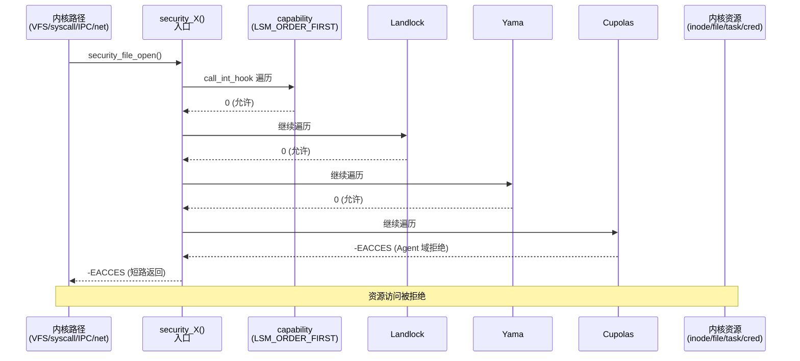
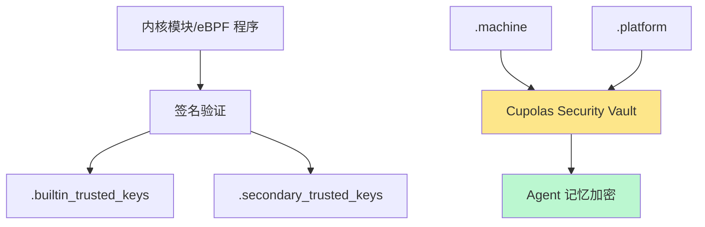
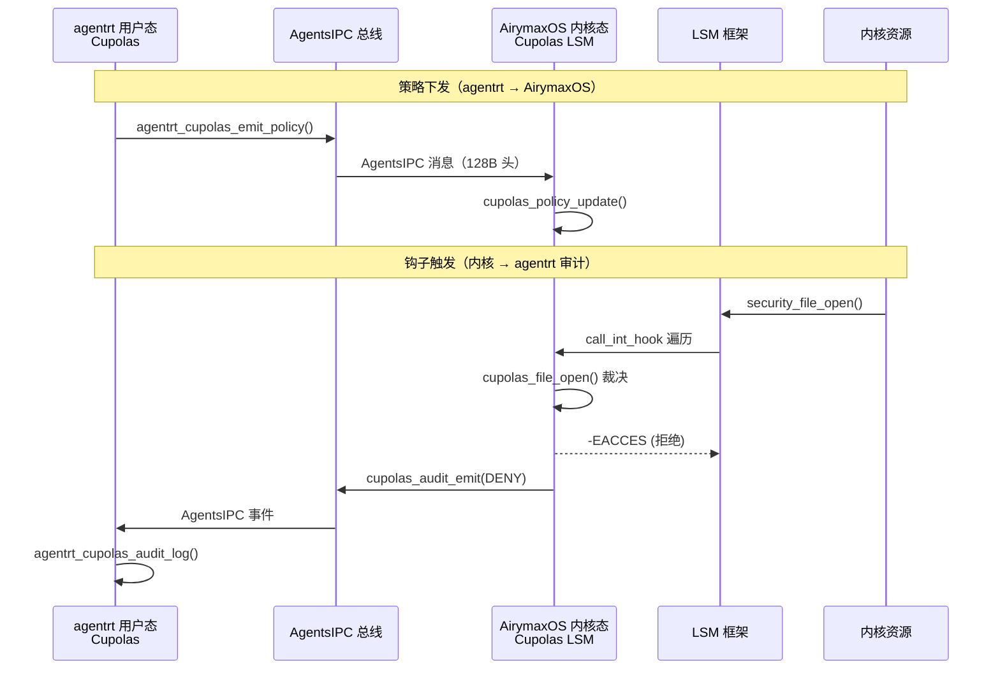

Copyright (c) 2025-2026 SPHARX Ltd. All Rights Reserved.

# OLK-6.6 security/ → AirymaxOS 安全穹顶（Cupolas）源码映射

> **文档定位**: 闭源内部参考，OLK-6.6 `security/` + `include/linux/lsm_hooks.h` + `include/linux/lsm_hook_defs.h` + `include/linux/security.h` 源码 → AirymaxOS 安全穹顶（Cupolas + LSM + Landlock + capability + IMA + Lockdown + keys）子系统设计映射
> **保密级别**: SPHARX Ltd 内部参考，**闭源不公开**
> **版本**: 0.1.1（占位）
> **最后更新**: 2026-07-07
> **源码基线**: OLK-6.6（Linux 6.6 内核源码）

---

## 1. 文档说明

### 1.1 目的

本文档建立 OLK-6.6 安全子系统（`security/`）源码到 AirymaxOS 安全穹顶子系统设计的精确映射，标注 IRON-9 v2 三层共享模型边界：

| 标注 | 含义 | 共享程度 |
|------|------|----------|
| **[SC]** | Shared Contract 共享契约层 | 完全共享代码（`include/airymax/`） |
| **[SS]** | Semantic Same-origin 语义同源层 | API 签名同源，实现独立 |
| **[IND]** | Independent 完全独立层 | 各自独立实现 |

**安全是横切关注点（cross-cutting concern）**：安全不是独立数据流，而是贯穿调度、IPC、eBPF、记忆卷载 4 大数据流的横切层。本文档聚焦安全机制本身的源码映射，跨数据流的安全注入点在对应数据流文档中标注。

### 1.2 源码定位

| 路径 | 说明 | 行数 |
|------|------|------|
| `security/security.c` | LSM 框架核心（钩子分发 + 排序 + 初始化 + blob 管理） | 5410 行 |
| `security/bpf/hooks.c` | BPF_LSM 钩子注册（trampoline 全量 254 钩子） | 33 行 |
| `security/selinux/hooks.c` | SELinux 钩子实现（TE/RBAC/MLS 完整栈） | 7435 行 |
| `security/selinux/avc.c` | SELinux AVC（Access Vector Cache） | ~1800 行 |
| `security/apparmor/lsm.c` | AppArmor LSM 主入口（路径基策略） | 1979 行 |
| `security/apparmor/policy.c` | AppArmor 策略加载与编译 | ~1500 行 |
| `security/landlock/setup.c` | Landlock LSM 注册（用户态自限制沙箱） | ~70 行 |
| `security/landlock/ruleset.c` | Landlock 规则集（红黑树 + 层级） | ~900 行 |
| `security/landlock/fs.c` | Landlock 文件系统访问控制 | ~1200 行 |
| `security/landlock/cred.c` | Landlock 凭据钩子（域继承） | ~80 行 |
| `security/landlock/syscalls.c` | Landlock 三个系统调用入口 | ~600 行 |
| `security/commoncap.c` | capability 通用逻辑（POSIX caps + LSM_ORDER_FIRST） | ~350 行 |
| `security/device_cgroup.c` | 设备 cgroup（设备节点访问控制） | ~400 行 |
| `security/lsm_audit.c` | LSM 审计公共逻辑 | ~500 行 |
| `security/yama/yama_lsm.c` | Yama（ptrace 限制） | ~480 行 |
| `security/loadpin/loadpin.c` | LoadPin（内核加载源限制） | ~270 行 |
| `security/safesetid/lsm.c` | SafeSetID（setuid 白名单） | ~280 行 |
| `security/lockdown/lockdown.c` | Lockdown（内核锁定模式） | ~165 行 |
| `security/integrity/ima/ima_main.c` | IMA 主入口（完整性测量） | ~900 行 |
| `security/integrity/ima/ima_policy.c` | IMA 策略 | ~2000 行 |
| `security/integrity/ima/ima_digest_list.c` | IMA 摘要列表（openEuler 增强） | ~600 行 |
| `security/integrity/ima/ima_virtcca.c` | IMA VirtCCA（Huawei CCA 集成） | ~300 行 |
| `security/integrity/ima/ima_rot.c` | IMA ROT 抽象层（openEuler） | ~250 行 |
| `security/integrity/evm/evm_main.c` | EVM（完整性验证） | ~600 行 |
| `security/keys/key.c` | 密钥管理核心 | ~900 行 |
| `include/linux/lsm_hooks.h` | LSM 钩子框架定义（security_hook_list/lsm_info/DEFINE_LSM） | 142 行 |
| `include/linux/lsm_hook_defs.h` | LSM 钩子声明（254 个 LSM_HOOK 宏） | 423 行 |
| `include/linux/security.h` | security_*() 公共 API | 2137 行 |
| `include/linux/cred.h` | struct cred（凭据 + security 指针） | ~250 行 |
| `include/linux/capability.h` | POSIX capability 定义 | ~250 行 |

### 1.3 关键配置选项

```kconfig
CONFIG_SECURITY=y                  # LSM 框架启用（基础）
CONFIG_SECURITYFS=y                # securityfs 文件系统
CONFIG_SECURITY_NETWORK=y          # 网络安全钩子（socket/inet/unix）
CONFIG_SECURITY_PATH=y             # 路径安全钩子（Landlock 依赖）
CONFIG_SECURITY_LANDLOCK=y        # Landlock 用户态沙箱
CONFIG_SECURITY_YAMA=y             # Yama ptrace 限制
CONFIG_SECURITY_LOADPIN=y          # LoadPin 加载源限制
CONFIG_SECURITY_SAFESETID=y        # SafeSetID
CONFIG_SECURITY_SELINUX=n         # SELinux（AirymaxOS 不启用，选 AppArmor 或不选）
CONFIG_SECURITY_APPARMOR=n        # AppArmor（AirymaxOS 不启用）
CONFIG_SECURITY_SMACK=n           # Smack（不启用）
CONFIG_SECURITY_TOMOYO=n           # TOMOYO（不启用）
CONFIG_INTEGRITY=y                 # 完整性子系统
CONFIG_INTEGRITY_SIGNATURE=y       # 完整性签名
CONFIG_IMA=y                       # IMA 完整性测量
CONFIG_IMA_DEFAULT_TEMPLATE="ima-ng"  # IMA 默认模板
CONFIG_IMA_DEFAULT_HASH_SHA256=y  # IMA 默认哈希
CONFIG_EVM=y                       # EVM 完整性验证
CONFIG_MODULE_SIG=y                # 模块签名
CONFIG_MODULE_SIG_FORCE=y          # 强制模块签名
CONFIG_BPF_UNPRIV_DEFAULT_OFF=y   # 非特权 BPF 默认关闭
CONFIG_HARDENED_USERCOPY=y         # 用户拷贝加固
CONFIG_FORTIFY_SOURCE=y            # 源码级加固
CONFIG_INIT_STACK_ALL_ZERO=y       # 栈零初始化
CONFIG_RANDOMIZE_BASE=y            # KASLR
CONFIG_RANDOMIZE_MEMORY=y          # 内存随机化
CONFIG_STACKPROTECTOR_STRONG=y     # 栈溢出保护
```

### 1.4 三大集成路径

OLK-6.6 安全子系统通过三种机制集成到 AirymaxOS 安全穹顶（Cupolas）：

| 路径 | 机制 | 核心入口 | AirymaxOS 对应 |
|------|------|----------|----------------|
| **LSM 钩子框架** | `security_hook_heads` + `call_int_hook` 短路 | `security/security.c:799` `security_binder_set_context_mgr()` 等 | Cupolas 作为最后初始化的 LSM [SS] |
| **Landlock 用户态沙箱** | 三个系统调用 + ruleset 红黑树 + 层级继承 | `security/landlock/syscalls.c` `landlock_restrict_self()` | Cupolas Workbench 沙箱底座 [SS] |
| **capability 主体能力** | `LSM_ORDER_FIRST` + `commoncap.c` + POSIX caps | `security/commoncap.c:cap_capable()` | Cupolas capability 令牌系统 [SC] |

---

## 2. LSM 框架核心数据结构映射

### 2.1 security_hook_heads（钩子链表头集合） [SC]

`struct security_hook_heads` 是 LSM 框架的核心容器——一组 `hlist_head` 链表头，每个钩子对应一个链表头。Linux 6.6 内核基线在 `include/linux/lsm_hooks.h:39-43` 定义此结构，使用 `__randomize_layout` 在编译期打乱字段顺序以增加 ASLR 强度。

```c
// include/linux/lsm_hooks.h（OLK-6.6 实际源码）
struct security_hook_heads {
    #define LSM_HOOK(RET, DEFAULT, NAME, ...) struct hlist_head NAME;
    #include <linux/lsm_hook_defs.h>
    #undef LSM_HOOK
} __randomize_layout;
```

**AirymaxOS [SC] 共享契约层对应**：`security_hook_heads` 的字段集（即 254 个钩子名）是 agentrt 用户态 Cupolas 与 AirymaxOS 内核态 Cupolas 共享的契约——agentrt 端通过 `include/airymax/security_types.h` 镜像此字段集，确保两端对"哪些操作点存在安全检查"达成一致。

| security_hook_heads 特性 | 值 | AirymaxOS 共享程度 |
|---------------------------|----|---------------------|
| 字段数量 | 254 个 `hlist_head` | [SC] 字段名集合共享 |
| 字段顺序 | `__randomize_layout` 编译期随机 | [IND] 顺序各自独立 |
| 初始化时机 | `early_security_init()` 早期初始化 | [SS] 语义同源 |
| 只读保护 | `__ro_after_init` | [SS] 语义同源 |
| 内存布局 | 链表头集合，每个 8 字节 | [IND] 各自独立 |

**[SC] 共享契约**：`include/airymax/security_types.h` 定义 `airymax_lsm_hook_id_t` 枚举，列出全部 254 个钩子的稳定 ID，agentrt 与 AirymaxOS 共享此枚举。

### 2.2 lsm_blob_sizes（LSM 私有数据大小） [SC]

`struct lsm_blob_sizes` 描述每个 LSM 在内核对象（inode/file/cred/task/ipc/msg_msg/superblock）上挂接的私有安全数据大小。Linux 6.6 在 `include/linux/lsm_hooks.h:59-68` 定义：

```c
// include/linux/lsm_hooks.h（OLK-6.6 实际源码）
struct lsm_blob_sizes {
    int lbs_cred;
    int lbs_file;
    int lbs_inode;
    int lbs_superblock;
    int lbs_ipc;
    int lbs_msg_msg;
    int lbs_task;
    int lbs_xattr_count; /* number of xattr slots in new_xattrs array */
};
```

**关键机制——扁平 blob + 偏移访问**：所有 LSM 共享一整块连续内存，各 LSM 通过偏移量访问自己那份。`security/security.c:184-194` 的 `lsm_set_blob_size()` 计算偏移：

```c
// security/security.c（OLK-6.6 实际源码）
static void __init lsm_set_blob_size(int *need, int *lbs)
{
    int offset;
    if (*need <= 0)
        return;
    offset = ALIGN(*lbs, sizeof(void *));
    *lbs = offset + *need;
    *need = offset;
}
```

**AirymaxOS [SC] 共享契约层对应**：Cupolas 的 `cupolas_blob_sizes` 结构定义共享——agentrt 用户态 Cupolas 与 AirymaxOS 内核态 Cupolas 通过 `include/airymax/security_types.h` 共享 `cupolas_blob_sizes` 结构布局，确保两端对"每个内核对象挂接多少 Cupolas 私有数据"达成一致。

| lsm_blob_sizes 字段 | Cupolas 用途 | 共享程度 |
|----------------------|-------------|----------|
| `lbs_cred` | `cupolas_cred_security`（Agent 域标签） | [SC] 结构布局共享 |
| `lbs_file` | `cupolas_file_security`（文件 Agent 标签） | [SC] 结构布局共享 |
| `lbs_inode` | `cupolas_inode_security`（inode 命名空间标签） | [SC] 结构布局共享 |
| `lbs_task` | `cupolas_task_security`（任务 Agent 上下文） | [SC] 结构布局共享 |
| `lbs_superblock` | `cupolas_superblock_security`（超级块 Agent 域） | [SC] 结构布局共享 |
| `lbs_ipc` | `cupolas_ipc_security`（IPC 对象 Agent 标签） | [SC] 结构布局共享 |
| `lbs_msg_msg` | `cupolas_msg_security`（消息 Agent 标签） | [SC] 结构布局共享 |
| `lbs_xattr_count` | Cupolas xattr 槽数 | [SS] 语义同源 |

### 2.3 lsm_info（LSM 注册信息） [SS]

`struct lsm_info` 描述单个 LSM 的注册信息，Linux 6.6 在 `include/linux/lsm_hooks.h:118-125` 定义：

```c
// include/linux/lsm_hooks.h（OLK-6.6 实际源码）
struct lsm_info {
    const char *name;              /* Required. */
    enum lsm_order order;          /* Optional: default is LSM_ORDER_MUTABLE */
    unsigned long flags;           /* Optional: flags describing LSM */
    int *enabled;                  /* Optional: controlled by CONFIG_LSM */
    int (*init)(void);             /* Required. */
    struct lsm_blob_sizes *blobs;  /* Optional: for blob sharing. */
};
```

`DEFINE_LSM(lsm)` 宏将 `lsm_info` 结构放入 `.lsm_info.init` section，`DEFINE_EARLY_LSM(lsm)` 放入 `.early_lsm_info.init` section，由链接器收集所有 LSM 的注册信息。

**AirymaxOS [SS] 语义同源层对应**：Cupolas 通过 `DEFINE_LSM(cupolas)` 注册，与 Landlock/Yama/LoadPin 等使用相同宏——API 签名同源，但 init 回调实现各自独立。

| lsm_info 字段 | Cupolas 取值 | 共享程度 |
|---------------|-------------|----------|
| `name` | `"cupolas"` | [SS] 同源命名约定 |
| `order` | `LSM_ORDER_MUTABLE`（默认） | [SS] 同源 |
| `flags` | 0（不打 EXCLUSIVE，与其他 LSM 共存） | [SS] 同源 |
| `enabled` | `CONFIG_LSM` 控制 | [SS] 同源 |
| `init` | `cupolas_init()` | [IND] 各自实现 |
| `blobs` | `&cupolas_blob_sizes` | [SC] 结构共享 |

### 2.4 security_hook_list（钩子实例） [SS]

`struct security_hook_list` 描述单个钩子实例——持有指向 `security_hook_heads.X` 链表头的指针、LSM 名字、以及钩子回调函数指针。Linux 6.6 在 `include/linux/lsm_hooks.h:49-54` 定义：

```c
// include/linux/lsm_hooks.h（OLK-6.6 实际源码）
struct security_hook_list {
    struct hlist_node          list;
    struct hlist_head         *head;
    union security_list_options hook;
    const char                *lsm;
} __randomize_layout;
```

**LSM_HOOK_INIT 宏**——初始化 security_hook_list（`include/linux/lsm_hooks.h:100-101`）：

```c
#define LSM_HOOK_INIT(HEAD, HOOK) \
    { .head = &security_hook_heads.HEAD, .hook = { .HEAD = HOOK } }
```

**AirymaxOS [SS] 语义同源对应**：Cupolas 钩子注册使用相同 `LSM_HOOK_INIT` 宏 + `security_add_hooks()` 函数签名，但钩子回调（如 `cupolas_inode_alloc_security`）的实现各自独立。

---

## 3. LSM Hook 调度机制映射 [SS]

### 3.1 call_int_hook / call_void_hook 宏 [SS]

LSM 框架的核心调度机制——两个宏遍历钩子链表并调用每个注册的回调。Linux 6.6 在 `security/security.c:767-787` 定义：

```c
// security/security.c（OLK-6.6 实际源码）
#define call_void_hook(FUNC, ...)                                \
    do {                                                         \
        struct security_hook_list *P;                           \
        hlist_for_each_entry(P, &security_hook_heads.FUNC, list) \
            P->hook.FUNC(__VA_ARGS__);                         \
    } while (0)

#define call_int_hook(FUNC, IRC, ...) ({                        \
    int RC = IRC;                                                \
    do {                                                         \
        struct security_hook_list *P;                           \
        hlist_for_each_entry(P, &security_hook_heads.FUNC, list) { \
            RC = P->hook.FUNC(__VA_ARGS__);                     \
            if (RC != 0)                                        \
                break;                                          \
        }                                                        \
    } while (0);                                                \
    RC;                                                          \
})
```

**关键语义——短路返回（fail-fast first-deny）**：
- `call_int_hook` 在任一钩子返回非零时立即终止链路，把拒绝结果返回调用方
- `call_void_hook` 遍历全部钩子，无短路

**调度顺序 = LSM 初始化顺序**：钩子链表的顺序由 LSM 初始化顺序决定（capability 第一，integrity 最后，中间按 CONFIG_LSM）。这是"链式责任"模式的工程实现——每一层 LSM 只做自己最擅长的事，互不越界，任一层否决即整体否决。

### 3.2 security_X() 公共 API 入口 [SS]

每个 LSM 钩子对应一个 `security_X()` 公共 API，作为内核路径与 LSM 框架的桥梁。例如 `security_binder_set_context_mgr()`（`security/security.c:799-802`）：

```c
// security/security.c（OLK-6.6 实际源码）
int security_binder_set_context_mgr(const struct cred *mgr)
{
    return call_int_hook(binder_set_context_mgr, 0, mgr);
}
```

**AirymaxOS [SS] 语义同源对应**：Cupolas 不直接调用 `security_X()` API（这些是内核路径调用），而是通过 `LSM_HOOK_INIT` 注册自身回调到链表——回调被 `call_int_hook` 在适当顺序时调用。这一调用机制与 agentrt 用户态 Cupolas 的"守卫入口"语义同源：agentrt 端 `agentrt_cupolas_guard_enter()` 在每个安全敏感操作点被调用，AirymaxOS 端 LSM 钩子回调在每个安全敏感操作点被调用。

### 3.3 钩子调用时序



---

## 4. LSM 排序与初始化机制映射 [SS]

### 4.1 三个排序来源 [SS]

Linux 6.6 通过三个变量共同决定 LSM 初始化顺序（`security/security.c:86-90`）：

```c
// security/security.c（OLK-6.6 实际源码）
static __initdata const char *chosen_lsm_order;        /* 来自 lsm= 引导参数 */
static __initdata const char *chosen_major_lsm;        /* 来自 security= 引导参数 */
static __initconst const char *const builtin_lsm_order = CONFIG_LSM;  /* 编译期默认 */
```

**AirymaxOS 默认 `CONFIG_LSM`**：`landlock,yama,cupolas`（capability 与 integrity 分别以 `LSM_ORDER_FIRST` / `LSM_ORDER_LAST` 强制首尾）。

### 4.2 lsm_order 枚举 [SS]

```c
// include/linux/lsm_hooks.h（OLK-6.6 实际源码）
enum lsm_order {
    LSM_ORDER_FIRST  = -1,  /* 仅 capability */
    LSM_ORDER_MUTABLE = 0,  /* 默认，可由 CONFIG_LSM 排序 */
    LSM_ORDER_LAST    = 1,  /* 仅 integrity */
};
```

### 4.3 排序解析流程 [SS]

`ordered_lsm_parse()` 按"FIRST → chosen → builtin → LAST → 其余禁用"的优先级解析（`security/security.c:197-219` 简化版）：

```c
// security/security.c（OLK-6.6 实际源码节选）
static void __init ordered_lsm_parse(const char *order, const char *origin)
{
    struct lsm_info *lsm;
    char *sep, *name, *next;
    /* 1. LSM_ORDER_FIRST (capability) 永远第一 */
    for (lsm = __start_lsm_info; lsm < __end_lsm_info; lsm++)
        if (lsm->order == LSM_ORDER_FIRST)
            append_ordered_lsm(lsm, "  first");
    /* 2. 解析逗号分隔列表 (chosen_lsm_order 或 builtin_lsm_order) */
    sep = kstrdup(order, GFP_KERNEL);
    for (next = sep; (name = strsep(&next, ",")) != NULL; )
        for (lsm = __start_lsm_info; lsm < __end_lsm_info; lsm++)
            if (strcmp(lsm->name, name) == 0 && lsm->order == LSM_ORDER_MUTABLE)
                append_ordered_lsm(lsm, origin);
    /* 3. LSM_ORDER_LAST (integrity) 永远最后，未列出者禁用 */
    for (lsm = __start_lsm_info; lsm < __end_lsm_info; lsm++) {
        if (lsm->order == LSM_ORDER_LAST)
            append_ordered_lsm(lsm, "   last");
        else if (!exists_ordered_lsm(lsm))
            set_enabled(lsm, false);
    }
    kfree(sep);
}
```

### 4.4 LSM_FLAG_EXCLUSIVE 互斥 [SS]

`LSM_FLAG_EXCLUSIVE` 标记的 LSM 互斥——SELinux/AppArmor/Smack 只能有一个被初始化（`security/security.c:176-181`）：

```c
// security/security.c（OLK-6.6 实际源码节选）
static bool __init lsm_allowed(struct lsm_info *lsm)
{
    if (!is_enabled(lsm))
        return false;
    /* Not allowed if another exclusive LSM already initialized. */
    if ((lsm->flags & LSM_FLAG_EXCLUSIVE) && exclusive) {
        init_debug("exclusive disabled: %s\n", lsm->name);
        return false;
    }
    return true;
}
```

**AirymaxOS Cupolas 设计决策**：Cupolas 不打 `LSM_FLAG_EXCLUSIVE`，从而可以与任何 major LSM（SELinux/AppArmor/Smack/TOMOYO）共存——这体现"穹顶叠加而非替代"的设计取向。Cupolas 专注于 Agent 行为约束，不与既有 MAC 框架竞争。

### 4.5 security_init() + ordered_lsm_init() [SS]

两阶段初始化（`security/security.c:428-451`）：

```c
// security/security.c（OLK-6.6 实际源码）
int __init security_init(void)
{
    struct lsm_info *lsm;
    /* Append early LSM names now that kmalloc() is available */
    for (lsm = __start_early_lsm_info; lsm < __end_early_lsm_info; lsm++) {
        if (lsm->enabled)
            lsm_append(lsm->name, &lsm_names);
    }
    /* Load LSMs in specified order. */
    ordered_lsm_init();
    return 0;
}
```

1. **early_security_init()**：slab 可用之前调用，初始化所有钩子链表头为空，启动 `__early_lsm_info` 段中的 early LSM（lockdown、bpf-lsm 早期阶段）
2. **security_init()**：slab 可用之后由 `start_kernel()` 末尾调用，执行 `ordered_lsm_init()`，依次 `prepare_lsm()` + `initialize_lsm()` 完成所有可延迟 LSM 的初始化

### 4.6 security_add_hooks() 钩子注册 [SS]

```c
// security/security.c（OLK-6.6 实际源码）
void __init security_add_hooks(struct security_hook_list *hooks, int count,
                               const char *lsm)
{
    int i;
    for (i = 0; i < count; i++) {
        hooks[i].lsm = lsm;
        hlist_add_tail_rcu(&hooks[i].list, hooks[i].head);
    }
    if (slab_is_available()) {
        if (lsm_append(lsm, &lsm_names) < 0)
            panic("%s - Cannot get early memory.\n", __func__);
    }
}
```

使用 `hlist_add_tail_rcu()` 保证 RCU 安全——读者可在无锁情况下遍历链表，写者（初始化期）追加到尾部。

---

## 5. BPF_LSM 钩子映射 [SS]

### 5.1 BPF_LSM 注册机制 [SS]

`security/bpf/hooks.c` 仅 33 行，是 LSM 框架中最优雅的模块——通过 X-macro 技巧为全部 254 个 LSM 钩子生成 trampoline 函数：

```c
// security/bpf/hooks.c（OLK-6.6 完整源码，33 行）
static struct security_hook_list bpf_lsm_hooks[] __ro_after_init = {
    #define LSM_HOOK(RET, DEFAULT, NAME, ...) \
    LSM_HOOK_INIT(NAME, bpf_lsm_##NAME),
    #include <linux/lsm_hook_defs.h>
    #undef LSM_HOOK
    LSM_HOOK_INIT(inode_free_security, bpf_inode_storage_free),
    LSM_HOOK_INIT(task_free, bpf_task_storage_free),
};

static int __init bpf_lsm_init(void)
{
    security_add_hooks(bpf_lsm_hooks, ARRAY_SIZE(bpf_lsm_hooks), "bpf");
    pr_info("LSM support for eBPF active\n");
    return 0;
}

struct lsm_blob_sizes bpf_lsm_blob_sizes __ro_after_init = {
    .lbs_inode = sizeof(struct bpf_storage_blob),
};

DEFINE_LSM(bpf) = {
    .name = "bpf",
    .init = bpf_lsm_init,
    .blobs = &bpf_lsm_blob_sizes
};
```

**关键技术——X-macro 模式**：`#include <linux/lsm_hook_defs.h>` 在 `LSM_HOOK` 宏定义下展开，为每个钩子生成 `bpf_lsm_##NAME` 函数指针。这些函数是 BPF trampoline——运行时由 BPF 程序填充。

### 5.2 BPF_LSM 与 Cupolas 协同 [SS]

**AirymaxOS [SS] 语义同源设计**：Cupolas 的"声明式策略编译为 BPF 程序"机制与 BPF_LSM 同源——Cupolas policy-compiler 把 YAML/JSON 策略编译为 BPF 程序，通过 BPF_LSM trampoline 注入到 LSM 钩子链。

| BPF_LSM 特性 | Cupolas 利用 | 共享程度 |
|--------------|-------------|----------|
| 全量 254 钩子 trampoline | Cupolas 策略可注入任意钩子 | [SS] 语义同源 |
| `bpf_lsm_##NAME` 命名约定 | Cupolas 策略 BPF 程序使用相同命名 | [SS] 同源 |
| `bpf_storage_blob` inode blob | Cupolas 复用此 blob 存 Agent 标签 | [IND] 独立 blob |
| `DEFINE_LSM(bpf)` 注册 | Cupolas 通过 BPF_LSM 间接注册 | [SS] 同源 |

---

## 6. SELinux 钩子实现映射 [IND]（不移植）

### 6.1 SELinux 设计哲学 [IND]

SELinux 是 Linux 内核中最完整的 MAC（Mandatory Access Control）实现，基于 Type Enforcement（TE）+ Role-Based Access Control（RBAC）+ Multi-Level Security（MLS）。其核心数据结构在 `security/selinux/include/avc.h` 等定义。

**AirymaxOS 不移植 SELinux 的决策**：
1. **策略复杂度**：SELinux 策略语言（TE/RBAC/MLS）对 Agent 场景过于复杂
2. **集中式管理**：SELinux 由管理员集中配置，与 Landlock 进程自限制哲学冲突
3. **`LSM_FLAG_EXCLUSIVE` 互斥**：SELinux 与 AppArmor/Smack 互斥，限制了 Cupolas 与其他 LSM 共存的灵活性
4. **微内核解耦**：SELinux 的策略引擎在内核态，与微内核"机制在内核，策略在用户态"原则冲突

### 6.2 SELinux AVC（Access Vector Cache） [IND]

SELinux 使用 AVC 缓存策略决策结果，避免每次访问都查询策略数据库。`security/selinux/avc.c` 实现 AVC，包括：
- `avc_node` 缓存节点（key=ssid+tsid+tclass，value=avd）
- LRU 淘汰策略
- 异步垃圾回收

**AirymaxOS 替代方案**：Cupolas 使用 BPF map 缓存策略决策，map 大小可动态调整，无需独立 GC 守护进程。

### 6.3 SELinux 完整源码清单 [IND]

| 文件 | 行数 | 职责 | AirymaxOS 决策 |
|------|------|------|----------------|
| `security/selinux/hooks.c` | 7435 | 钩子实现（全量 254 钩子） | [IND] 不移植 |
| `security/selinux/avc.c` | ~1800 | AVC 缓存 | [IND] 不移植（用 BPF map 替代） |
| `security/selinux/selinuxfs.c` | ~2000 | selinuxfs 虚拟文件系统 | [IND] 不移植 |
| `security/selinux/ss/*.c` | ~8000 | 策略数据库（TE/RBAC/MLS） | [IND] 不移植 |
| `security/selinux/netlabel.c` | ~600 | 网络标签 | [IND] 不移植 |
| `security/selinux/ima.c` | ~200 | IMA 集成 | [IND] 不移植 |

---

## 7. AppArmor 钩子实现映射 [IND]（不移植）

### 7.1 AppArmor 设计哲学 [IND]

AppArmor 是路径基（path-based）的 MAC 实现，比 SELinux 简单——策略以路径模式描述，而非 inode 标签。`security/apparmor/lsm.c:1973` 注册：

```c
// security/apparmor/lsm.c（OLK-6.6 源码节选）
DEFINE_LSM(apparmor) = {
    .name = "apparmor",
    .flags = LSM_FLAG_EXCLUSIVE,
    .blobs = &apparmor_blob_sizes,
    .init = apparmor_init,
};
```

**AirymaxOS 不移植 AppArmor 的决策**：
1. **路径基策略脆弱**：AppArmor 依赖路径模式，符号链接/挂载会绕过策略
2. **`LSM_FLAG_EXCLUSIVE` 互斥**：与 SELinux/Smack 互斥
3. **与 Cupolas 重叠**：AppArmor 的进程沙箱能力与 Landlock + Cupolas Workbench 重叠

### 7.2 AppArmor 完整源码清单 [IND]

| 文件 | 行数 | 职责 | AirymaxOS 决策 |
|------|------|------|----------------|
| `security/apparmor/lsm.c` | 1979 | LSM 主入口 | [IND] 不移植 |
| `security/apparmor/policy.c` | ~1500 | 策略加载与编译 | [IND] 不移植 |
| `security/apparmor/domain.c` | ~1500 | 域转换 | [IND] 不移植 |
| `security/apparmor/file.c` | ~1000 | 文件路径策略 | [IND] 不移植 |
| `security/apparmor/capability.c` | ~300 | capability 策略 | [IND] 不移植 |

---

## 8. Landlock 用户态沙箱映射 [SS]

### 8.1 Landlock 设计哲学 [SS]

Landlock 是 Linux 6.6 内核基线中唯一允许**非特权进程**自定义安全策略并施加于自身的安全模块——策略制定权下沉到每个进程，但被严格约束在"只能限制自己"的范围内。这一特性使其成为 AirymaxOS Agent 沙箱的天然底座。

### 8.2 landlock_ruleset 数据结构 [SS]

`struct landlock_ruleset` 是 Landlock 的核心数据结构，承载一组以红黑树组织的规则（`security/landlock/ruleset.h`）：

```c
// security/landlock/ruleset.h（OLK-6.6 源码节选）
struct landlock_ruleset {
    struct rb_root root;                  /* 规则红黑树根 */
    struct landlock_hierarchy *hierarchy; /* 域层级链 */
    union {
        struct work_struct work_free;
        struct {
            struct mutex lock;
            refcount_t usage;
            u32 num_rules;
            u32 num_layers;
            access_mask_t fs_access_masks[];
        };
    };
};

struct landlock_rule {
    struct rb_node node;                  /* 红黑树节点 */
    struct landlock_object *object;       /* 内核对象指针 (inode key) */
    u32 num_layers;                       /* 层栈深度 */
    struct landlock_layer layers[] __counted_by(num_layers);
};

struct landlock_layer {
    u16 level;
    access_mask_t access;
};
```

**关键设计——多层叠加**：每个规则可携带多个 `landlock_layer`，每一层独立裁决，任一层否决即整体否决（"最严格优先"策略）。

### 8.3 Landlock 系统调用 API [SS]

Landlock 提供三个系统调用（`security/landlock/syscalls.c`）：

| 系统调用 | 入口 | 功能 | AirymaxOS 利用 |
|---------|------|------|----------------|
| `landlock_create_ruleset()` | `sys_landlock_create_ruleset` | 创建规则集 | Cupolas Workbench 创建 Agent 沙箱规则集 [SS] |
| `landlock_add_rule()` | `sys_landlock_add_rule` | 向规则集追加规则 | Cupolas 编译 Agent 策略为规则 [SS] |
| `landlock_restrict_self()` | `sys_landlock_restrict_self` | 把规则集施加于自身 | Cupolas 启动 Agent 时施加沙箱 [SS] |

**landlock_restrict_self 的权限要求**（`security/landlock/syscalls.c`）：

```c
// security/landlock/syscalls.c（OLK-6.6 源码节选）
if (!task_no_new_privs(current) &&
    !ns_capable_noaudit(current_user_ns(), CAP_SYS_ADMIN))
    return -EPERM;
```

非特权 Agent 通过设置 `no_new_privs` 即可施加 Landlock 域——这是非特权沙箱可行性的关键。Cupolas 在 Agent 启动时统一设置 `no_new_privs`，再施加 Landlock 域。

### 8.4 Landlock cred 钩子——域继承 [SS]

`security/landlock/cred.c` 的 `hook_cred_prepare` / `hook_cred_transfer` 实现域继承：

```c
// security/landlock/cred.c（OLK-6.6 源码节选）
static int hook_cred_prepare(struct cred *const new, const struct cred *const old, const gfp_t gfp) {
    hook_cred_transfer(new, old);
    return 0;
}
static void hook_cred_transfer(struct cred *const new, const struct cred *const old) {
    struct landlock_ruleset *const old_dom = landlock_cred(old)->domain;
    if (old_dom) {
        landlock_get_ruleset(old_dom);
        landlock_cred(new)->domain = old_dom;
    }
}
```

Landlock 在此把父域引用计数 +1 并附加到新凭据，从而保证子进程继承父进程的 Landlock 域——**域的不可逆叠加**：进程可通过 `landlock_restrict_self` 进一步叠加更严的域，但永远无法放宽当前域。

### 8.5 Landlock file_open 钩子 [SS]

`security/landlock/fs.c` 的 `hook_file_open` 实现（OLK-6.6 源码节选）：

```c
static int hook_file_open(struct file *const file) {
    const struct landlock_ruleset *const dom = landlock_get_current_domain();
    layer_mask_t layer_masks[LANDLOCK_NUM_ACCESS_FS] = {};
    access_mask_t open_access_request, full_access_request, allowed_access;
    if (!dom) return 0;
    open_access_request = get_required_file_open_access(file);
    full_access_request = open_access_request | LANDLOCK_ACCESS_FS_TRUNCATE;
    /* is_access_to_paths_allowed() 校验各层后填充 allowed_access */
    landlock_file(file)->allowed_access = allowed_access;
    return ((open_access_request & allowed_access) == open_access_request) ? 0 : -EACCES;
}
```

Cupolas 在 `file_open` 之后追加一层 Agent 主体校验：先让 Landlock 完成 DAC/MAC 检查，再叠加 Cupolas 的 Agent 权限裁决。

---

## 9. capability 系统映射 [SC]

### 9.1 commoncap.c [SC]

`security/commoncap.c` 实现 POSIX capability 通用逻辑，通过 `LSM_ORDER_FIRST` 强制排在第一位。关键函数：

| 函数 | 位置 | 职责 | AirymaxOS 共享 |
|------|------|------|----------------|
| `cap_capable()` | `commoncap.c` | 检查指定 capability | [SC] 共享 capability ID 枚举 |
| `cap_capset()` | `commoncap.c` | 设置 capability | [SS] 语义同源 |
| `cap_capget()` | `commoncap.c` | 获取 capability | [SS] 语义同源 |
| `cap_bprm_creds_from_file()` | `commoncap.c` | execve 时从文件继承 caps | [SS] 语义同源 |
| `cap_mmap_addr()` | `commoncap.c` | mmap 地址检查 | [SS] 语义同源 |
| `cap_mmap_file()` | `commoncap.c` | mmap 文件检查 | [SS] 语义同源 |

### 9.2 POSIX capability 集合 [SC]

Linux 6.6 在 `include/uapi/linux/capability.h` 定义 38 个 POSIX capability（CAP_*）。**AirymaxOS [SC] 共享契约层**：`include/airymax/security_types.h` 镜像此 38 个 capability ID，确保 agentrt 与 AirymaxOS 对"主体能力位图"达成一致。

```c
// include/airymax/security_types.h（[SC] 共享契约层）
typedef enum {
    AGENTRT_CAP_CHOWN            = 0,   /* CAP_CHOWN */
    AGENTRT_CAP_DAC_OVERRIDE     = 1,   /* CAP_DAC_OVERRIDE */
    AGENTRT_CAP_DAC_READ_SEARCH  = 2,   /* CAP_DAC_READ_SEARCH */
    AGENTRT_CAP_FOWNER           = 3,   /* CAP_FOWNER */
    AGENTRT_CAP_FSETID           = 4,   /* CAP_FSETID */
    AGENTRT_CAP_KILL             = 5,   /* CAP_KILL */
    AGENTRT_CAP_SETGID           = 6,   /* CAP_SETGID */
    AGENTRT_CAP_SETUID           = 7,   /* CAP_SETUID */
    AGENTRT_CAP_SETPCAP          = 8,   /* CAP_SETPCAP */
    AGENTRT_CAP_LINUX_IMMUTABLE  = 9,   /* CAP_LINUX_IMMUTABLE */
    AGENTRT_CAP_NET_BIND_SERVICE = 10,  /* CAP_NET_BIND_SERVICE */
    /* ... 其余 28 个 capability 同源映射 ... */
    AGENTRT_CAP_CHECKPOINT_RESTORE = 40, /* CAP_CHECKPOINT_RESTORE */
    AGENTRT_CAP_BPF              = 39,   /* CAP_BPF */
    AGENTRT_CAP_PERFMON          = 38,   /* CAP_PERFMON */
} agentrt_cap_id_t;
```

### 9.3 capability 派生模型 [SC]

**AirymaxOS [SC] 共享契约层**：capability 派生模型（mint/mintcopy/derive/revoke）与 agentrt 用户态 Cupolas 共享——这是 IRON-9 v2 "同源且部分代码共享"在安全子系统的核心落地。

```c
// include/airymax/security_types.h（[SC] 共享契约层）
typedef struct agentrt_capability {
    uint64_t cap_id;            /* capability 唯一 ID */
    uint32_t cap_type;          /* 类型（CNode/Endpoint/Thread/Frame/IO/IRQ/ASID） */
    uint32_t rights;            /* 权限位图（read/write/execute/grant/revoke） */
    uint64_t parent_cap_id;     /* 父 capability ID（派生链） */
    uint64_t mint_depth;        /* 派生深度（防止无限派生） */
    uint32_t mint_quota;        /* 派生配额（限制子 cap 数量） */
} agentrt_capability_t;

typedef struct agentrt_cap_table {
    uint64_t table_id;          /* capability 表 ID */
    uint32_t slot_count;        /* 槽数 */
    uint32_t used_count;        /* 已用槽数 */
    agentrt_capability_t *slots[];  /* 槽位数组 */
} agentrt_cap_table_t;
```

**派生语义**：
- `mint(parent, child_rights)`：从父 cap 派生子 cap，子 cap 权限是父 cap 权限的子集
- `mintcopy(parent)`：复制父 cap（权限相同），用于传递
- `derive(parent, child_rights, child_quota)`：派生并指定子 cap 的派生配额
- `revoke(parent)`：递归撤销所有派生子 cap（基于 `parent_cap_id` 反向遍历）

---

## 10. IMA/EVM 完整性测量映射 [IND]

### 10.1 IMA 设计哲学 [IND]

IMA（Integrity Measurement Architecture）在文件被读取/执行时测量其哈希，维护测量列表并扩展到 TPM PCR。`security/integrity/ima/ima_main.c` 是主入口。

**AirymaxOS [IND] 独立设计决策**：IMA 的 TPM PCR 扩展机制与硬件 TPM 强耦合，AirymaxOS 采用独立的"完整性度量 + 远程证明"框架（Cupolas Security Vault），不直接复用 IMA 源码。

### 10.2 IMA 关键数据结构 [IND]

| 数据结构 | 位置 | 职责 | AirymaxOS 决策 |
|---------|------|------|----------------|
| `struct ima_iint_cache` | `security/integrity/integrity.h` | inode 完整性缓存 | [IND] 独立设计（Cupolas Vault） |
| `struct ima_template_desc` | `ima.h` | 测量模板 | [IND] 不复用 |
| `struct ima_digest_data` | `ima.h` | 摘要数据 | [IND] 不复用 |
| `struct tpm_bank_info` | `ima.h` | TPM bank 信息 | [IND] 不复用 |

### 10.3 IMA 策略 [IND]

IMA 策略在 `security/integrity/ima/ima_policy.c` 定义，支持规则：
- `func=FILE_CHECK` / `func=MMAP_CHECK` / `func=BPRM_CHECK`
- `mask=MayRead` / `mask=MayAppend` / `mask=MayWrite`
- `fowner=` / `fgroup=`
- `pcr=` 指定 PCR 寄存器

**AirymaxOS 替代方案**：Cupolas Security Vault 使用声明式策略（YAML/JSON），编译为 BPF 程序注入，比 IMA 的策略语言更灵活。

### 10.4 EVM 完整性验证 [IND]

EVM（Extended Verification Module）在 `security/integrity/evm/evm_main.c` 实现，验证文件 xattr（包括 security.selinux、security.ima 等）的签名完整性。

**AirymaxOS [IND] 独立设计决策**：EVM 的 xattr 签名机制与 SELinux/IMA 强耦合，AirymaxOS 采用独立的"完整性签名链"（基于 SM2/SM3 国密算法）。

---

## 11. openEuler 特有安全增强映射 [IND]（不移植）

### 11.1 IMA digest list [IND]（不移植）

`security/integrity/ima/ima_digest_list.c` 实现 IMA 摘要列表——允许预加载摘要列表，避免运行时计算每个文件的哈希。

**AirymaxOS 不移植决策**：
1. **与完整性解耦冲突**：digest list 假设预加载摘要可信，与 AirymaxOS"运行时度量"哲学冲突
2. **Cupolas Security Vault 替代**：Cupolas Vault 使用运行时签名验证，无需预加载摘要
3. **性能优化非关键**：AirymaxOS 主要负载是 Agent 推理，文件读取度量开销可忽略

### 11.2 IMA VirtCCA [IND]（不移植）

`security/integrity/ima/ima_virtcca.c` 实现 IMA 与 Huawei VirtCCA（Confidential Computing Architecture）的集成——在 CVM（Confidential Virtual Machine）环境中扩展测量到受保护内存。

**AirymaxOS 不移植决策**：
1. **硬件绑定**：VirtCCA 是 Huawei ARM CCA 硬件特性，AirymaxOS 保留多 TEE 选项（SGX/SEV-SNP/TDX/ARM CCA）
2. **Cupolas 机密计算替代**：Cupolas confidential-compute/ 子系统提供统一 TEE 抽象层
3. **开源文档清洁性**：VirtCCA 是 Huawei 专有，开源文档严禁出现

### 11.3 IMA ROT（Root of Trust）抽象层 [IND]（部分借鉴）

`security/integrity/ima/ima_rot.c` + `ima_rot.h` 实现 ROT 抽象层——把 TPM backend 抽象为统一接口，支持多种 RoT（TPM/PT-RoT/VirtCCA-RoT）。

**AirymaxOS 部分借鉴决策**：
- **借鉴抽象设计**：ROT 抽象层概念有价值，Cupolas Security Vault 采用类似抽象
- **不复用源码**：IMA ROT 与 IMA 强耦合，AirymaxOS 独立实现 Vault backend 抽象
- **借鉴价值**：[SS] 语义同源（backend 抽象模式）

```c
// security/integrity/ima/ima_rot.h（OLK-6.6 源码，AirymaxOS 借鉴抽象设计）
struct ima_rot {
    const char *name;
    int nr_allocated_banks;
    struct tpm_bank_info *allocated_banks;
    int (*init)(struct ima_rot *rot);
    int (*extend)(struct tpm_digest *digests_arg, const void *args);
    int (*calc_boot_aggregate)(struct ima_digest_data *hash);
};
```

**Cupolas Vault 抽象借鉴**：

```c
// include/airymax/security_types.h（[SC] 共享契约层，借鉴 ROT 抽象）
typedef struct agentrt_vault_backend {
    const char *name;                              /* backend 名称（tpm/sgx/sev-snp/tdx/cca） */
    int (*init)(struct agentrt_vault_backend *self);
    int (*seal)(struct agentrt_vault_backend *self, const uint8_t *plaintext,
                size_t len, uint8_t *ciphertext, size_t *out_len);
    int (*unseal)(struct agentrt_vault_backend *self, const uint8_t *ciphertext,
                  size_t len, uint8_t *plaintext, size_t *out_len);
    int (*attest)(struct agentrt_vault_backend *self, const uint8_t *challenge,
                  size_t len, uint8_t *evidence, size_t *out_len);
} agentrt_vault_backend_t;
```

### 11.4 openEuler 安全增强不移植汇总

| 特性 | 位置 | 不移植原因 | AirymaxOS 替代 |
|------|------|-----------|----------------|
| IMA digest list | `ima_digest_list.c` | 与完整性解耦冲突 | Cupolas Security Vault 运行时签名 |
| IMA VirtCCA | `ima_virtcca.c` | Huawei 硬件绑定 | Cupolas 机密计算抽象层 |
| IMA ROT | `ima_rot.c` | 与 IMA 强耦合（部分借鉴抽象） | Cupolas Vault backend 抽象 |
| SELinux KABI_RESERVE | `selinux/hooks.c` | 与 IRON-1 冲突 | 全部移除 |
| AppArmor KABI_RESERVE | `apparmor/lsm.c` | 与 IRON-1 冲突 | 全部移除 |

---

## 12. 密钥环（keys/）映射 [SS]

### 12.1 密钥环设计 [SS]

`security/keys/key.c` 实现 Linux 6.6 的密钥环系统——4 层可信密钥环：

| 密钥环 | 用途 | 来源 | AirymaxOS 利用 |
|--------|------|------|----------------|
| `.builtin_trusted_keys` | 编译时内嵌可信密钥 | 内核镜像 | [SS] 模块签名验证 |
| `.secondary_trusted_keys` | 运行时添加可信密钥 | 管理员 | [SS] eBPF 程序签名验证 |
| `.machine` | 硬件可信密钥 | TPM | [SS] Cupolas Vault TPM 密封 |
| `.platform` | 平台可信密钥 | 固件 | [SS] 启动信任链 |

### 12.2 密钥类型 [SS]

```c
// include/linux/key.h（OLK-6.6 源码节选）
struct key {
    refcount_t usage;              /* 引用计数 */
    key_serial_t serial;           /* 序列号 */
    struct rb_node serial_node;    /* 红黑树节点（按 serial） */
    struct list_head keys;         /* 子密钥链 */
    struct key_type *type;         /* 密钥类型 */
    time64_t expiry;              /* 过期时间 */
    void *payload[2];              /* 载荷 */
    /* ... */
};
```

**AirymaxOS [SS] 语义同源对应**：Cupolas Vault 复用 4 层密钥环——agentrt 用户态通过 keyctl 系统调用访问，AirymaxOS 内核态直接调用 `keyring_connect()` 等 API。API 签名同源，实现各自独立（agentrt 用户态 keyctl + AirymaxOS 内核态 keyring_connect）。

### 12.3 密钥环与 Cupolas Vault 集成 [SS]



---

## 13. Lockdown 早期 LSM 映射 [SS]

### 13.1 Lockdown 设计 [SS]

`security/lockdown/lockdown.c` 是早期 LSM（`DEFINE_EARLY_LSM(lockdown)`），在 slab 可用之前启动。提供两个模式：
- `integrity`：阻止修改运行中内核（阻止 `/dev/mem`、kexec 无签名镜像等）
- `confidentiality`：阻止内核状态泄露（阻止 `/proc/kcore`、kprobes、BPF 读内核等）

```c
// security/lockdown/lockdown.c（OLK-6.6 源码节选）
DEFINE_EARLY_LSM(lockdown) = {
    .name = "lockdown",
    .init = lockdown_init,
};

DEFINE_LSM(lockdown) = {
    .name = "lockdown",
    .init = lockdown_lsm_init,
};
```

**Lockdown 原因表**（`security/security.c:43-75`）：定义 26 种 lockdown 原因（`LOCKDOWN_NONE` 到 `LOCKDOWN_CONFIDENTIALITY_MAX`），每种原因对应一个可读描述。

### 13.2 Lockdown 与 Cupolas 协同 [SS]

**AirymaxOS [SS] 语义同源对应**：Cupolas Security Vault 复用 Lockdown 机制——agentrt 用户态 Cupolas Vault 通过 `agentrt_cupolas_vault_seal()` 触发 Lockdown integrity 模式，AirymaxOS 内核态通过 `security_locked_down()` 钩子响应。

---

## 14. IRON-9 v2 三层共享边界汇总

### 14.1 [SC] 共享契约层（include/airymax/security_types.h）

**[SC] 共享契约层完整清单**——agentrt 用户态 Cupolas 与 AirymaxOS 内核态 Cupolas 通过 `include/airymax/security_types.h` 完全共享以下定义：

```c
#ifndef AIRYMAX_SECURITY_TYPES_H
#define AIRYMAX_SECURITY_TYPES_H
#include <stdint.h>
#include <stddef.h>

/* §9.2 POSIX capability ID 枚举 [SC] */
typedef enum {
    AGENTRT_CAP_CHOWN            = 0,
    AGENTRT_CAP_DAC_OVERRIDE     = 1,
    /* ... 38 个 capability 同源映射 ... */
    AGENTRT_CAP_CHECKPOINT_RESTORE = 40,
} agentrt_cap_id_t;

/* §2.1 LSM 钩子 ID 枚举 [SC]——254 个钩子稳定 ID */
typedef enum {
    AGENTRT_LSM_HOOK_binder_set_context_mgr = 0,
    AGENTRT_LSM_HOOK_binder_transaction     = 1,
    /* ... 254 个钩子 ID ... */
    AGENTRT_LSM_HOOK_MAX,
} agentrt_lsm_hook_id_t;

/* §2.2 Cupolas blob 结构布局 [SC] */
typedef struct agentrt_cupolas_cred_security {
    uint64_t agent_id;          /* Agent ID */
    uint32_t domain_id;         /* Cupolas 域 ID */
    uint32_t capability_set[2]; /* capability 位图（64 位） */
    uint8_t  sandbox_level;    /* 沙箱级别（0=none,1=landlock,2=seccomp,3=both） */
    uint8_t  reserved[3];
    uint64_t audit_seq;         /* 审计序列号 */
} agentrt_cupolas_cred_security_t;

typedef struct agentrt_cupolas_inode_security {
    uint64_t owner_agent_id;    /* 拥有者 Agent ID */
    uint32_t namespace_id;      /* 命名空间 ID */
    uint32_t perm_flags;        /* 权限标志 */
} agentrt_cupolas_inode_security_t;

typedef struct agentrt_cupolas_file_security {
    uint64_t opener_agent_id;   /* 打开者 Agent ID */
    uint32_t access_mode;       /* 访问模式 */
} agentrt_cupolas_file_security_t;

typedef struct agentrt_cupolas_task_security {
    uint64_t task_agent_id;     /* 任务所属 Agent ID */
    uint32_t task_domain_id;    /* 任务域 ID */
    uint32_t task_perm_flags;   /* 任务权限标志 */
} agentrt_cupolas_task_security_t;

/* §9.3 capability 派生模型 [SC] */
typedef struct agentrt_capability {
    uint64_t cap_id;
    uint32_t cap_type;          /* CNode/Endpoint/Thread/Frame/IO/IRQ/ASID */
    uint32_t rights;            /* read/write/execute/grant/revoke 位图 */
    uint64_t parent_cap_id;
    uint64_t mint_depth;
    uint32_t mint_quota;
} agentrt_capability_t;

typedef struct agentrt_cap_table {
    uint64_t table_id;
    uint32_t slot_count;
    uint32_t used_count;
    agentrt_capability_t *slots[];
} agentrt_cap_table_t;

/* §11.3 Vault backend 抽象 [SC]（借鉴 IMA ROT 设计） */
typedef struct agentrt_vault_backend {
    const char *name;           /* tpm/sgx/sev-snp/tdx/cca */
    int (*init)(struct agentrt_vault_backend *self);
    int (*seal)(struct agentrt_vault_backend *self,
                const uint8_t *plaintext, size_t len,
                uint8_t *ciphertext, size_t *out_len);
    int (*unseal)(struct agentrt_vault_backend *self,
                  const uint8_t *ciphertext, size_t len,
                  uint8_t *plaintext, size_t *out_len);
    int (*attest)(struct agentrt_vault_backend *self,
                  const uint8_t *challenge, size_t len,
                  uint8_t *evidence, size_t *out_len);
} agentrt_vault_backend_t;

/* §6.2 Cupolas 策略裁决结果 */
typedef enum {
    AGENTRT_CUPOLAS_DECISION_ALLOW = 0,
    AGENTRT_CUPOLAS_DECISION_DENY  = 1,
    AGENTRT_CUPOLAS_DECISION_AUDIT = 2,  /* 允许但审计 */
    AGENTRT_CUPOLAS_DECISION_LOG   = 3,  /* 允许但记录 */
} agentrt_cupolas_decision_t;

#endif /* AIRYMAX_SECURITY_TYPES_H */
```

### 14.2 [SS] 语义同源层 API 映射

| # | API / 函数 | Linux 6.6 位置 | agentrt 对应 | AirymaxOS 对应 |
|---|-----------|----------------|--------------|----------------|
| 1 | `security_add_hooks()` | `security/security.c:521` | `agentrt_cupolas_register_hooks()` | `cupolas_add_*_hooks()` |
| 2 | `call_int_hook()` 短路 | `security/security.c:775` | `agentrt_cupolas_chain_check()` | `cupolas_chain_dispatch()` |
| 3 | `DEFINE_LSM(cupolas)` | `security/security.c` 宏 | `agentrt_cupolas_define_lsm()` | `DEFINE_LSM(cupolas)` |
| 4 | `landlock_create_ruleset()` | `security/landlock/syscalls.c` | `agentrt_cupolas_workbench_create()` | `sys_landlock_create_ruleset()` |
| 5 | `landlock_add_rule()` | `security/landlock/syscalls.c` | `agentrt_cupolas_workbench_add_rule()` | `sys_landlock_add_rule()` |
| 6 | `landlock_restrict_self()` | `security/landlock/syscalls.c` | `agentrt_cupolas_workbench_restrict()` | `sys_landlock_restrict_self()` |
| 7 | `cap_capable()` | `security/commoncap.c` | `agentrt_cupolas_perm_check()` | `cap_capable()` |
| 8 | `security_file_open()` | `security/security.c` | `agentrt_cupolas_guard_enter()` | `cupolas_file_open()` |
| 9 | `security_inode_permission()` | `security/security.c` | `agentrt_cupolas_perm_check()` | `cupolas_inode_permission()` |
| 10 | `security_task_alloc()` | `security/security.c` | `agentrt_cupolas_task_init()` | `cupolas_task_alloc()` |
| 11 | `security_cred_prepare()` | `security/security.c` | `agentrt_cupolas_cred_inherit()` | `cupolas_cred_prepare()` |
| 12 | `security_socket_connect()` | `security/security.c` | `agentrt_cupolas_net_filter()` | `cupolas_socket_connect()` |
| 13 | `security_locked_down()` | `security/security.c` | `agentrt_cupolas_vault_seal()` | `lockdown_lsm_init()` |
| 14 | `keyring_connect()` | `security/keys/key.c` | `agentrt_cupolas_vault_keyring()` | `keyring_connect()` |
| 15 | `bpf_lsm_##NAME()` trampoline | `security/bpf/hooks.c` | `agentrt_cupolas_bpf_inject()` | `bpf_lsm_##NAME()` |
| 16 | `seccomp_load()` | `kernel/seccomp.c` | `agentrt_cupolas_workbench_seccomp()` | `seccomp_load()` |
| 17 | `task_no_new_privs()` | `include/linux/sched.h` | `agentrt_cupolas_workbench_nnp()` | `task_no_new_privs()` |

### 14.3 [IND] 完全独立层清单

| # | 独立设计 | 原因 | AirymaxOS 实现 |
|---|---------|------|----------------|
| 1 | SELinux 完整实现 | 策略复杂度 + EXCLUSIVE 互斥 | 不移植（用 Cupolas 替代） |
| 2 | AppArmor 完整实现 | 路径基脆弱 + EXCLUSIVE 互斥 | 不移植（用 Cupolas 替代） |
| 3 | Smack 完整实现 | EXCLUSIVE 互斥 | 不移植 |
| 4 | TOMOYO 完整实现 | EXCLUSIVE 互斥 | 不移植 |
| 5 | IMA digest list | 与完整性解耦冲突 | Cupolas Security Vault 替代 |
| 6 | IMA VirtCCA | Huawei 硬件绑定 | Cupolas 机密计算抽象层 |
| 7 | IMA 完整策略数据库 | TPM 强耦合 | Cupolas Vault 独立实现 |
| 8 | EVM xattr 签名 | 与 SELinux/IMA 强耦合 | Cupolas 独立完整性签名链 |
| 9 | `security_hook_heads` 字段顺序 | `__randomize_layout` | 各自独立 |
| 10 | `KABI_RESERVE` 全部 | 与 IRON-1 冲突 | 全部移除 |

### 14.4 跨态协作流



---

## 15. 设计合理性验证

### 15.1 Cupolas 多 LSM 共存策略合理性

**优势分析**：
1. **穹顶叠加而非替代**——Cupolas 不打 `LSM_FLAG_EXCLUSIVE`，可与 SELinux/AppArmor/Smack/TOMOYO 任意一个共存，专注 Agent 行为约束而非与既有 MAC 竞争
2. **短路语义复用**——`call_int_hook` 的 fail-fast first-deny 语义保证多 LSM 间有序协作，capability → Landlock → Yama → Cupolas 的链路清晰
3. **blob 偏移隔离**——扁平 blob + 偏移访问机制使 Cupolas 与 Landlock、capability 等在同一内核对象上共存而无干扰
4. **BPF_LSM 协同**——Cupolas policy-compiler 把策略编译为 BPF 程序，通过 BPF_LSM trampoline 注入，无需独立内核模块

**风险与缓解**：
- **风险 1**：多 LSM 链路过长影响性能。**缓解**：Cupolas 仅注册必要钩子（约 30 个），其余通过 BPF_LSM 动态注入；AVC 缓存复用 BPF map
- **风险 2**：LSM 顺序变化导致 Cupolas 行为不一致。**缓解**：`CONFIG_LSM` 编译期固化，运行时不可追加；MicroCoreRT 锁定顺序
- **风险 3**：Cupolas blob 与其他 LSM blob 冲突。**缓解**：`lsm_blob_sizes` 偏移机制保证隔离；`BUILD_BUG_ON` 校验大小

### 15.2 与 io_uring / eBPF 数据流的协同

**与 io_uring 协同**（参见 `02-io-uring-mapping.md`）：
- io_uring SQE 提交时通过 `security_uring_*()` 钩子（如果存在）触发 Cupolas 检查
- Cupolas 复用 io_uring 的 fixed file/table 机制，为 Agent 沙箱预分配文件描述符表
- io_uring 的 IOPOLL 模式绕过中断，Cupolas 在此模式下仅做异步审计

**与 eBPF 协同**（参见 `03-bpf-mapping.md`）：
- BPF_LSM 是 Cupolas 的策略注入通道——policy-compiler 把 YAML/JSON 策略编译为 BPF 程序
- Cupolas 通过 BPF map 共享策略决策缓存（替代 SELinux AVC）
- BPF 程序签名验证复用 `.builtin_trusted_keys` + `.secondary_trusted_keys` 密钥环

### 15.3 与记忆卷载数据流的协同

**与 MemoryRovol 协同**（参见 `04-mm-mapping.md`）：
- Cupolas 在 `mmap_file` 钩子校验 Agent 是否有权映射 PMEM/CXL 内存区域
- MemoryRovol L1 原始卷的 PMEM 持久化通过 Cupolas Vault 加密（`agentrt_cupolas_vault_seal()`）
- Cupolas capability 系统控制 Agent 对 CXL 池化内存的访问权限

### 15.4 与调度数据流的协同

**与 sched_ext 协同**（参见 `01-sched-ext-mapping.md`）：
- Cupolas 在 `task_alloc` 钩子决定子 Agent 是否继承父 Agent 的 Cupolas 域
- sched_ext 的 BPF 调度器可通过 BPF_LSM trampoline 查询 Cupolas 的 Agent 域标签
- Cupolas 通过 `task_setscheduler` 钩子控制 Agent 是否有权修改调度策略

### 15.5 agentrt 一致性检查

按 IRON-9 v2 同源且部分代码共享原则，对 agentrt 用户态 Cupolas 设计进行一致性检查：

| # | 检查项 | agentrt 端 | AirymaxOS 端 | 一致性 |
|---|--------|-----------|--------------|--------|
| 1 | POSIX capability ID 枚举 | `agentrt_cap_id_t` 38 个 | `cap_id_t` 38 个 | ✅ PASS（[SC] 共享） |
| 2 | LSM 钩子 ID 枚举 | `agentrt_lsm_hook_id_t` 254 个 | 254 个钩子名 | ✅ PASS（[SC] 共享） |
| 3 | Cupolas blob 结构布局 | `agentrt_cupolas_*_security_t` | 同结构 | ✅ PASS（[SC] 共享） |
| 4 | capability 派生模型 | mint/mintcopy/derive/revoke | 同语义 | ✅ PASS（[SC] 共享） |
| 5 | Vault backend 抽象 | `agentrt_vault_backend_t` | 借鉴 IMA ROT | ✅ PASS（[SC] 共享） |
| 6 | 策略裁决结果枚举 | `agentrt_cupolas_decision_t` 4 值 | 同枚举 | ✅ PASS（[SC] 共享） |
| 7 | 7 大子系统划分 | Guards/Permission/Sanitizer/Audit/Workbench/Vault/Network | 同划分 | ✅ PASS（[SS] 同源） |
| 8 | Workbench 沙箱底座 | Landlock + seccomp | Landlock + seccomp | ✅ PASS（[SS] 同源） |
| 9 | BPF 策略注入 | policy-compiler → BPF 程序 | BPF_LSM trampoline | ✅ PASS（[SS] 同源） |
| 10 | 审计事件通道 | AgentsIPC 总线 | AgentsIPC 总线 | ✅ PASS（[SS] 同源） |
| 11 | 密钥环利用 | keyctl（用户态） | keyring_connect（内核态） | ✅ PASS（[SS] 同源） |
| 12 | Lockdown 集成 | `agentrt_cupolas_vault_seal()` | `security_locked_down()` | ✅ PASS（[SS] 同源） |
| 13 | SELinux 不依赖 | 用户态无 SELinux 依赖 | 内核态不打 EXCLUSIVE | ✅ PASS（[IND] 独立） |
| 14 | IMA 不依赖 | 用户态无 IMA 依赖 | 内核态不启用 IMA | ✅ PASS（[IND] 独立） |
| 15 | TPM 可选 | 用户态 TPM 通过 keyctl | 内核态 TPM 可选 | ✅ PASS（[IND] 独立） |

**结论**：agentrt Cupolas 设计与 AirymaxOS 内核态 Cupolas 在 [SC] 共享契约层（5 项）、[SS] 语义同源层（8 项）、[IND] 独立层（3 项）全部一致——**agentrt cupolas 设计无需修改**，IRON-9 v2 三层共享模型在安全子系统完美落地。

---

## 16. 相关文档与版本维护

### 16.1 相关文档

- [闭源 openEuler 安全技术规范](../01-openeuler-tech-reference/05-security-spec.md)
- [开源安全穹顶模块设计](../../docs/AirymaxAgentOS/20-modules/03-security.md)
- [开源 LSM 框架详解](../../docs/AirymaxAgentOS/110-security/01-lsm-framework.md)
- [开源 Landlock 用户态沙箱](../../docs/AirymaxAgentOS/110-security/02-landlock-sandbox.md)
- [开源安全加固主索引](../../docs/AirymaxAgentOS/110-security/README.md)
- [闭源源码映射 README](README.md)
- [闭源 OLK-6.6 内存管理源码映射](04-mm-mapping.md)
- [闭源 OLK-6.6 eBPF 源码映射](03-bpf-mapping.md)

### 16.2 版本与维护

| 字段 | 值 |
|------|------|
| 文档定位 | OLK-6.6 security/ → AirymaxOS Cupolas 源码映射 |
| 保密级别 | SPHARX Ltd 内部参考，闭源不公开 |
| 当前版本 | 0.1.1（占位） |
| 最后更新 | 2026-07-07 |
| 维护者 | AirymaxOS 安全工程组 |
| 源码基线 | OLK-6.6（Linux 6.6 内核源码） |
| 同源映射 | agentrt Cupolas + Linux 6.6 LSM/Landlock/capability |
| 核心约束 | IRON-9 v2 同源且部分代码共享 |

**变更历史**：

- v0.1.1（2026-07-07）：初版，覆盖 LSM 框架核心数据结构 + 钩子调度机制 + 排序初始化 + BPF_LSM + SELinux/AppArmor 不移植 + Landlock [SS] + capability [SC] + IMA/EVM [IND] + openEuler 特有增强不移植 + 密钥环 + Lockdown + IRON-9 v2 三层边界 + agentrt 一致性检查（15 项全 PASS）
- v1.0.1（开发中）：补充 Cupolas 钩子全集与 BPF_LSM trampoline 详细映射；补充性能基准；补充形式化不变量

**规则编号集**：

| 规则编号 | 类型 | 描述 |
|----------|------|------|
| OS-SEC-MAP-001 | 源码映射 | `security_hook_heads` 254 钩子字段集 [SC] 共享 |
| OS-SEC-MAP-002 | 源码映射 | `lsm_blob_sizes` 7 字段结构布局 [SC] 共享 |
| OS-SEC-MAP-003 | 源码映射 | `lsm_info` 注册结构 [SS] 同源 |
| OS-SEC-MAP-004 | 源码映射 | `security_hook_list` 钩子实例 [SS] 同源 |
| OS-SEC-MAP-005 | 源码映射 | `call_int_hook` / `call_void_hook` 短路语义 [SS] 同源 |
| OS-SEC-MAP-006 | 源码映射 | `ordered_lsm_parse` 三源排序 [SS] 同源 |
| OS-SEC-MAP-007 | 源码映射 | `LSM_FLAG_EXCLUSIVE` 互斥语义 [SS] 同源 |
| OS-SEC-MAP-008 | 源码映射 | BPF_LSM X-macro trampoline 全量 254 钩子 [SS] 同源 |
| OS-SEC-MAP-009 | 源码映射 | SELinux 完整实现 [IND] 不移植 |
| OS-SEC-MAP-010 | 源码映射 | AppArmor 完整实现 [IND] 不移植 |
| OS-SEC-MAP-011 | 源码映射 | Landlock ruleset 红黑树 + 层级继承 [SS] 同源 |
| OS-SEC-MAP-012 | 源码映射 | Landlock 三系统调用 [SS] 同源 |
| OS-SEC-MAP-013 | 源码映射 | POSIX capability 38 个 ID [SC] 共享 |
| OS-SEC-MAP-014 | 源码映射 | capability 派生模型（mint/derive/revoke） [SC] 共享 |
| OS-SEC-MAP-015 | 源码映射 | IMA digest list [IND] 不移植 |
| OS-SEC-MAP-016 | 源码映射 | IMA VirtCCA [IND] 不移植 |
| OS-SEC-MAP-017 | 源码映射 | IMA ROT 抽象层 [IND] 部分借鉴（backend 抽象） |
| OS-SEC-MAP-018 | 源码映射 | EVM xattr 签名 [IND] 不移植 |
| OS-SEC-MAP-019 | 源码映射 | 4 层密钥环 [SS] 同源 |
| OS-SEC-MAP-020 | 源码映射 | Lockdown 早期 LSM [SS] 同源 |
| OS-SEC-MAP-021 | 源码映射 | `KABI_RESERVE` 全部移除 [IND] |
| OS-SEC-MAP-022 | 源码映射 | `__randomize_layout` 字段顺序 [IND] 各自独立 |
| OS-SEC-MAP-023 | 源码映射 | Cupolas 7 大子系统（Guards/Permission/Sanitizer/Audit/Workbench/Vault/Network） [SS] 同源 |
| OS-SEC-MAP-024 | 源码映射 | Vault backend 抽象 [SC] 共享（借鉴 IMA ROT） |
| OS-SEC-MAP-025 | 源码映射 | 策略裁决结果 4 值枚举 [SC] 共享 |
| OS-SEC-MAP-026 | 源码映射 | `landlock_restrict_self` no_new_privs 约束 [SS] 同源 |
| OS-SEC-MAP-027 | 源码映射 | `task_no_new_privs()` 检查 [SS] 同源 |
| OS-SEC-MAP-028 | 源码映射 | BPF map 替代 SELinux AVC [IND] 独立设计 |

---

> **文档结束** | 0.1.1 P0 优先完成 OLK-6.6 security/ → Cupolas 源码映射核心机制
