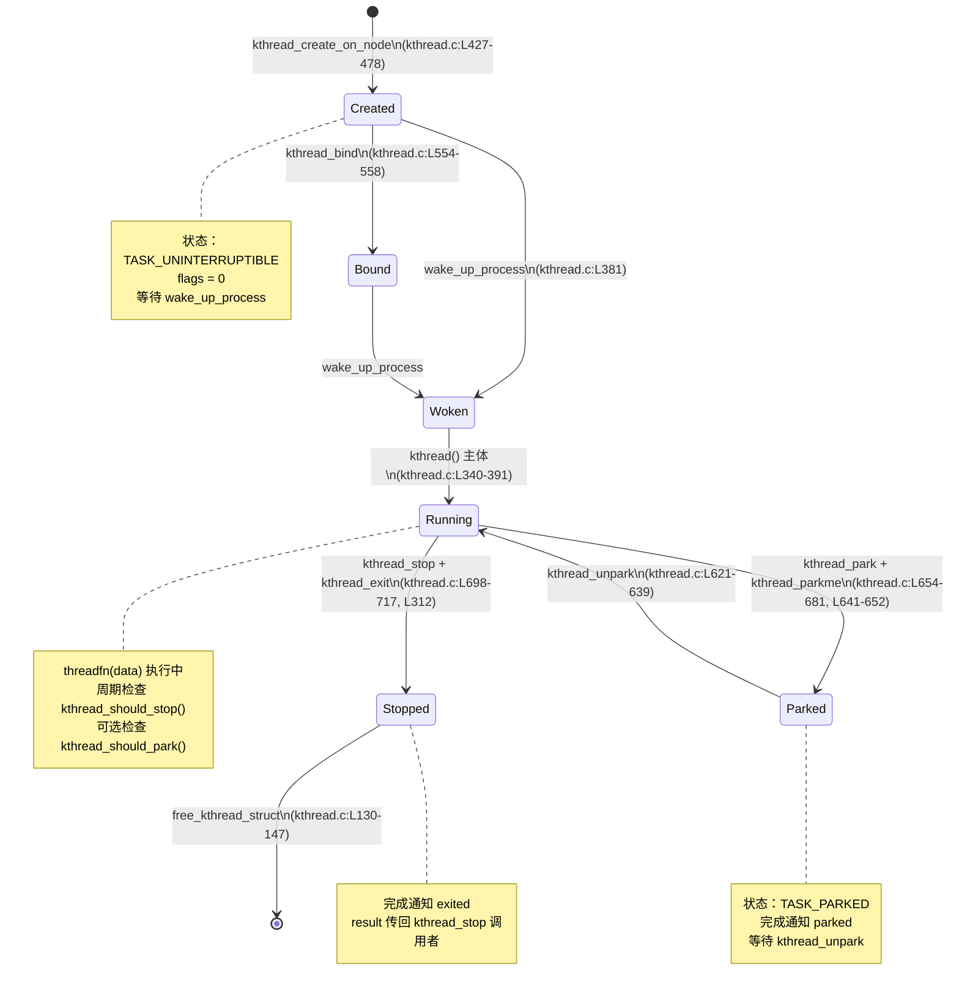

Copyright (c) 2025-2026 SPHARX Ltd. All Rights Reserved.

# OLK-6.6 kthread + accel + drm_sched → AirymaxOS 认知循环（CoreLoopThree）源码映射

> **文档定位**: 闭源内部参考，OLK-6.6 `kernel/kthread.c` + `include/linux/kthread.h` + `drivers/accel/` + `drivers/gpu/drm/scheduler/` + `include/drm/gpu_scheduler.h` 源码 → AirymaxOS 认知循环（CoreLoopThree kthread + Thinkdual + LLM 推理调度 + GPU/NPU 算力调度）子系统设计映射
> **保密级别**: SPHARX Ltd 内部参考，**闭源不公开**
> **版本**: 0.1.1（文档体系完成）
> **最后更新**: 2026-07-07
> **源码基线**: OLK-6.6（Linux 6.6 内核源码）
> **代码共享边界**: IRON-9 v2——agentrt ↔ AirymaxOS 共享 [SC] 契约层；与 OLK-6.6/Euler 仅技术参考，**不共享代码**

---

## 1. 文档说明

### 1.1 目的

本文档建立 OLK-6.6 认知子系统支撑机制（kthread + accel + drm_sched）源码到 AirymaxOS 认知循环（CoreLoopThree）设计的精确映射，标注 IRON-9 v2 三层共享模型边界：

| 标注 | 含义 | 共享程度 |
|------|------|----------|
| **[SC]** | Shared Contract 共享契约层 | agentrt ↔ AirymaxOS 完全共享代码（`include/airymax/cognition_types.h`） |
| **[SS]** | Semantic Same-origin 语义同源层 | API 签名同源，实现独立 |
| **[IND]** | Independent 完全独立层 | AirymaxOS 独立实现（kthread/accel/drm_sched 内核态专属） |

**代码共享边界澄清**（IRON-9 v2）：
- agentrt 与 AirymaxOS 之间共享 [SC] 契约层代码（`include/airymax/cognition_types.h`）
- AirymaxOS 与 OLK-6.6/Euler 之间**仅技术参考，不共享代码**——OLK-6.6 kthread/accel/drm_sched 是 AirymaxOS [IND] 独立层的实现参考，AirymaxOS 自行实现内核态认知 kthread 机制
- AirymaxOS 的工程思想与实现方式与 Euler 保持一致性（如 KABI 管理、版本节奏、模块化），以便未来兼容 Euler 标准的发行版工具链，但**不直接采用 Euler 代码**

### 1.2 源码定位

| 路径 | 说明 | 行数 |
|------|------|------|
| `kernel/kthread.c` | kthread 框架核心（创建/绑定/驻留/停止/worker） | 1562 行 |
| `include/linux/kthread.h` | kthread 公共 API（47 函数 + 宏 + 结构体） | 227 行 |
| `drivers/accel/drm_accel.c` | accel 框架核心（class + debugfs + open + stub） | 227 行 |
| `include/drm/drm_accel.h` | accel 框架公共 API | ~80 行 |
| `drivers/accel/habanalabs/` | HabanaLabs GPU/NPU 驱动（含 habanalabs.c 等） | 大型 |
| `drivers/accel/ivpu/` | Intel VPU/NPU 驱动（ivpu_drv.c + ivpu_job.c 等 17+ 文件） | ~7000+ 行 |
| `drivers/accel/qaic/` | Qualcomm AI 100 NPU 驱动（qaic_drv.c + qaic_data.c 等） | ~5000+ 行 |
| `drivers/gpu/drm/scheduler/sched_main.c` | drm_sched 调度器主循环 | 1218 行 |
| `drivers/gpu/drm/scheduler/sched_entity.c` | drm_sched 调度实体 | 594 行 |
| `drivers/gpu/drm/scheduler/sched_fence.c` | drm_sched fence 同步 | 240 行 |
| `drivers/gpu/drm/scheduler/gpu_scheduler_trace.h` | drm_sched tracepoint | 114 行 |
| `include/drm/gpu_scheduler.h` | drm_sched 公共 API + 结构体 | 617 行 |

### 1.3 关键配置选项

```kconfig
CONFIG_KTHREAD=y                   # kthread 框架（默认启用）
CONFIG_KTHREAD_WORKER=y             # kthread worker（kthread_work 队列）
CONFIG_DRM_ACCEL=y                  # accel 框架（GPU/NPU 统一接入）
CONFIG_DRM_GPU_SCHED=y              # drm_sched 通用 GPU 调度器
CONFIG_DRM_SCHED_PRIORITY=2        # drm_sched 优先级层数（MIN/HIGH/KERNEL/HIGH)
CONFIG_ACCEL_HABANALABS=m           # HabanaLabs Gaudi 驱动（模块）
CONFIG_ACCEL_IVPU=m                 # Intel VPU/NPU 驱动（模块）
CONFIG_DRM_ACCEL_QAIC=m             # Qualcomm AI 100 驱动（模块）
CONFIG_SCHED_EXT=y                  # sched_ext（与 kthread 协同）
CONFIG_CGROUPS=y                    # cgroup（kthread 默认不纳入应用 cgroup）
CONFIG_BLK_CGROUP=y                 # blkcg（kthread_associate_blkcg 依赖）
CONFIG_CXL_BUS=y                    # CXL 3.0（LLM KV cache 池化基础）
```

---

## 2. OLK-6.6 `kernel/kthread.c` 源码研究

### 2.1 文件头与版权

```
SPDX-License-Identifier: GPL-2.0-only
Copyright (C) 2004 IBM Corporation, Rusty Russell.
Copyright (C) 2009 Red Hat, Inc.
```

**关键 include**（`kthread.c:L10-31`）：`<linux/sched.h>` / `<linux/kthread.h>` / `<linux/cgroup.h>` / `<linux/cpuset.h>` / `<linux/freezer.h>` / `<linux/numa.h>` / `<linux/sched/isolation.h>` / `<trace/events/sched.h>`。

**全局变量**（`kthread.c:L34-36`）：
- `static DEFINE_SPINLOCK(kthread_create_lock)`——创建请求链表自旋锁
- `static LIST_HEAD(kthread_create_list)`——创建请求链表
- `struct task_struct *kthreadd_task`——kthreadd 守护进程 task_struct（PID=2）

### 2.2 核心结构体

#### 2.2.1 `struct kthread_create_info`（`kthread.c:L38-51`）

创建请求描述符，从 kthreadd 传递给 kthread：

| 字段 | 类型 | 行号 | 用途 |
|------|------|------|------|
| `full_name` | `char *` | L41 | kthread 完整名（task comm 截断时备份） |
| `threadfn` | `int (*)(void *data)` | L42 | 用户函数指针 |
| `data` | `void *` | L43 | threadfn 参数 |
| `node` | `int` | L44 | NUMA 节点（内存分配亲和） |
| `result` | `struct task_struct *` | L47 | 创建结果（task_struct 指针） |
| `done` | `struct completion *` | L48 | 完成通知（创建者等待） |
| `list` | `struct list_head` | L50 | 链入 `kthread_create_list` |

#### 2.2.2 `struct kthread`（`kthread.c:L53-66`）

kthread 持久化状态（`p->worker_private`）：

| 字段 | 类型 | 行号 | 用途 |
|------|------|------|------|
| `flags` | `unsigned long` | L54 | 3 bit 状态机（见 2.4） |
| `cpu` | `unsigned int` | L55 | per-CPU 绑定缓存（unpark 时重绑） |
| `result` | `int` | L56 | threadfn 返回值（kthread_exit 传回） |
| `threadfn` | `int (*)(void *)` | L57 | threadfn 指针（kthread_stop 时仍需） |
| `data` | `void *` | L58 | threadfn 参数 |
| `parked` | `struct completion` | L59 | 驻留完成通知 |
| `exited` | `struct completion` | L60 | 退出完成通知（kthread_stop 等待） |
| `blkcg_css` | `struct cgroup_subsys_state *` | L62 | blkcg 关联（CONFIG_BLK_CGROUP） |
| `full_name` | `char *` | L65 | 完整名备份 |

#### 2.2.3 `enum KTHREAD_BITS`（`kthread.c:L68-72`）

3 个状态 bit：

| bit | 名称 | 行号 | 设置者 | 检查者 |
|-----|------|------|--------|--------|
| 0 | `KTHREAD_IS_PER_CPU` | L69 | `kthread_set_per_cpu` | `kthread_is_per_cpu` |
| 1 | `KTHREAD_SHOULD_STOP` | L70 | `kthread_stop` | `kthread_should_stop` |
| 2 | `KTHREAD_SHOULD_Park` | L71 | `kthread_park` | `kthread_should_park` |

#### 2.2.4 kthread worker 结构体（`kthread.h:L123-143`）

| 结构体 | 行号 | 字段数 | 用途 |
|--------|------|--------|------|
| `struct kthread_worker` | L123-130 | 6 | 工作队列（flags/lock/work_list/delayed_work_list/task/current_work） |
| `struct kthread_work` | L132-138 | 4 | 工作项（node/func/worker/canceling） |
| `struct kthread_delayed_work` | L140-143 | 2 | 延迟工作（work + timer） |

### 2.3 kthread 公开 API 清单（47 函数 + 宏）

#### 2.3.1 创建类 API

| # | API | 文件:行号 | 功能 | AirymaxOS 映射 |
|---|-----|-----------|------|----------------|
| 1 | `kthread_create_on_node(fn, data, node, namefmt...)` | kthread.h:L11-14 | NUMA 感知创建原语 | OS-COG-MAP-01 |
| 2 | `kthread_create(fn, data, namefmt...)` | kthread.h:L27-28 | = create_on_node(NUMA_NO_NODE) | OS-COG-MAP-02 |
| 3 | `kthread_create_on_cpu(fn, data, cpu, namefmt)` | kthread.c:L570-584 | per-CPU 创建 + bind | OS-COG-MAP-03 |
| 4 | `kthread_run(fn, data, namefmt...)` | kthread.h:L51-58 | create + wake_up_process | OS-COG-MAP-04 |
| 5 | `kthread_run_on_cpu(fn, data, cpu, namefmt)` | kthread.h:L72-83 | create_on_cpu + wake | OS-COG-MAP-05 |
| 6 | `set_kthread_struct(p)` | kthread.c:L111-128 | 分配 struct kthread | OS-COG-MAP-06 |
| 7 | `free_kthread_struct(k)` | kthread.c:L130-147 | 释放 struct kthread | OS-COG-MAP-07 |

#### 2.3.2 绑定与亲和性 API

| # | API | 文件:行号 | 功能 | AirymaxOS 映射 |
|---|-----|-----------|------|----------------|
| 8 | `kthread_bind(k, cpu)` | kthread.c:L554-558 | 绑定单 CPU + PF_NO_SETAFFINITY | OS-COG-MAP-08 |
| 9 | `kthread_bind_mask(k, mask)` | kthread.c:L540 | 绑定 cpumask | OS-COG-MAP-09 |
| 10 | `kthread_set_per_cpu(k, cpu)` | kthread.c:L587-602 | 标记 per-CPU | OS-COG-MAP-10 |
| 11 | `kthread_is_per_cpu(p)` | kthread.c:L604-611 | 查询 per-CPU 标记 | OS-COG-MAP-11 |

#### 2.3.3 停止与驻留 API

| # | API | 文件:行号 | 功能 | AirymaxOS 映射 |
|---|-----|-----------|------|----------------|
| 12 | `kthread_should_stop()` | kthread.c:L156-160 | 检查 KTHREAD_SHOULD_STOP | OS-COG-MAP-12 |
| 13 | `kthread_should_park()` | kthread.c:L178-182 | 检查 KTHREAD_SHOULD_PARK | OS-COG-MAP-13 |
| 14 | `kthread_should_stop_or_park()` | kthread.c:L184-192 | 联合检查（容忍 NULL） | OS-COG-MAP-14 |
| 15 | `kthread_stop(k)` | kthread.c:L698-717 | 完整停止序列 | OS-COG-MAP-15 |
| 16 | `kthread_stop_put(k)` | kthread.c:L728 | stop + put_task_struct | OS-COG-MAP-16 |
| 17 | `kthread_park(k)` | kthread.c:L654-680 | 驻留（阻塞直至 parked） | OS-COG-MAP-17 |
| 18 | `kthread_unpark(k)` | kthread.c:L621-639 | 解驻留（re-bind + wake） | OS-COG-MAP-18 |
| 19 | `kthread_parkme()` | kthread.c:L641-652 | kthread 内部主动驻留 | OS-COG-MAP-19 |
| 20 | `kthread_exit(result)` | kthread.c:L312 | 显式退出 + 传回 result | OS-COG-MAP-20 |
| 21 | `kthread_complete_and_exit(comp, code)` | kthread.c:L331-338 | complete + exit（OOM 安全） | OS-COG-MAP-21 |
| 22 | `kthread_freezable_should_stop(was_frozen)` | — | 可冻结停止检查 | OS-COG-MAP-22 |

#### 2.3.4 数据访问 API

| # | API | 文件:行号 | 功能 | AirymaxOS 映射 |
|---|-----|-----------|------|----------------|
| 23 | `kthread_func(k)` | kthread.h:L94 | 取 threadfn | OS-COG-MAP-23 |
| 24 | `kthread_data(k)` | kthread.h:L95 | 取 data | OS-COG-MAP-24 |
| 25 | `kthread_probe_data(k)` | kthread.h:L96 | 探测 data（调试） | — |
| 26 | `get_kthread_comm(buf, size, tsk)` | kthread.c:L99-109 | 取完整名 | — |

#### 2.3.5 内存管理 API

| # | API | 文件:行号 | 功能 | AirymaxOS 映射 |
|---|-----|-----------|------|----------------|
| 27 | `kthread_use_mm(mm)` | kthread.h:L216 | 借用 mm（kthread 默认无 mm） | OS-COG-MAP-25 |
| 28 | `kthread_unuse_mm(mm)` | kthread.h:L217 | 归还 mm | OS-COG-MAP-26 |

#### 2.3.6 cgroup 关联 API

| # | API | 文件:行号 | 功能 | AirymaxOS 映射 |
|---|-----|-----------|------|----------------|
| 29 | `kthread_associate_blkcg(css)` | kthread.h:L222 | 关联 blkcg | — |
| 30 | `kthread_blkcg()` | kthread.h:L223 | 取当前 blkcg | — |

#### 2.3.7 kthread worker API（kthread_work 队列）

| # | API | 文件:行号 | 功能 | AirymaxOS 映射 |
|---|-----|-----------|------|----------------|
| 31 | `kthread_worker_fn(worker_ptr)` | kthread.h:L187 | worker 主循环 | OS-COG-MAP-27 |
| 32 | `kthread_create_worker(flags, namefmt...)` | kthread.h:L190-191 | 创建 worker | OS-COG-MAP-28 |
| 33 | `kthread_create_worker_on_cpu(cpu, flags, namefmt...)` | kthread.h:L193-195 | per-CPU worker | — |
| 34 | `kthread_queue_work(worker, work)` | kthread.h:L197-198 | 入队 work | — |
| 35 | `kthread_queue_delayed_work(worker, dwork, delay)` | kthread.h:L200-202 | 入队延迟 work | — |
| 36 | `kthread_mod_delayed_work(worker, dwork, delay)` | kthread.h:L204-206 | 修改延迟 work | — |
| 37 | `kthread_flush_work(work)` | kthread.h:L208 | flush 单个 work | — |
| 38 | `kthread_flush_worker(worker)` | kthread.h:L209 | flush 全队列 | — |
| 39 | `kthread_cancel_work_sync(work)` | kthread.h:L211 | 取消 work（同步） | — |
| 40 | `kthread_cancel_delayed_work_sync(dwork)` | kthread.h:L212 | 取消延迟 work | — |
| 41 | `kthread_destroy_worker(worker)` | kthread.h:L214 | 销毁 worker | — |
| 42 | `kthread_init_worker(worker)` | kthread.h:L166-170 | 初始化 worker（宏） | — |
| 43 | `kthread_init_work(work, fn)` | kthread.h:L172-177 | 初始化 work（宏） | — |
| 44 | `kthread_init_delayed_work(dwork, fn)` | kthread.h:L179-185 | 初始化延迟 work（宏） | — |
| 45 | `DEFINE_KTHREAD_WORK(work, fn)` | kthread.h:L156-157 | 静态定义 work（宏） | — |
| 46 | `DEFINE_KTHREAD_DELAYED_WORK(dwork, fn)` | kthread.h:L159-161 | 静态定义延迟 work（宏） | — |
| 47 | `kthread_delayed_work_timer_fn(t)` | kthread.h:L117 | 延迟 work 定时器回调 | — |

### 2.4 kthread 生命周期状态机

kthread 经由 kthreadd（PID=2）fork，状态机如下：



**关键状态转换点**：

| 转换 | 触发 API | 行号 | 关键行为 |
|------|----------|------|----------|
| 创建 → 就绪 | `__kthread_create_on_node` | L427-478 | 挂入 kthread_create_list + wake kthreadd + wait_for_completion_killable |
| kthreadd fork | `kthreadd` 主循环 | L738-774 | ignore_signals + PF_NOFREEZE + cgroup_init_kthreadd |
| kthread 主体初始化 | `kthread()` | L340-391 | sched_setscheduler_nocheck(SCHED_NORMAL) + set_cpus_allowed_ptr(housekeeping) + cgroup_kthread_ready |
| 驻留 | `kthread_park` | L654-681 | set SHOULD_PARK + wake + wait_for_completion(parked) + wait_task_inactive(TASK_PARKED) |
| 解驻留 | `kthread_unpark` | L621-639 | per-CPU re-bind + clear SHOULD_PARK + wake_up_state(TASK_PARKED) |
| 停止 | `kthread_stop` | L698-717 | set SHOULD_STOP + unpark + TIF_NOTIFY_SIGNAL + wake + wait_for_completion(exited) |

### 2.5 kthreadd 守护进程（`kthread.c:L738-774`）

kthreadd 是所有 kthread 的祖先（PID=2），由 `rest_init()` 在 boot 早期创建：

```c
// kthread.c:L738-774（简化）
int kthreadd(void *unused)
{
    struct task_struct *tsk = current;
    ignore_signals(tsk);              // L744: 忽略所有信号
    set_cpus_allowed_ptr(tsk, housekeeping_cpumask(HK_TYPE_KTHREAD));  // L746
    set_mems_allowed(node_states[N_MEMORY]);
    current->flags |= PF_NOFREEZE;    // L748: 不冻结
    cgroup_init_kthreadd();           // L749: cgroup 关联
    for (;;) {
        // L752-773: 主循环
        set_current_state(TASK_INTERRUPTIBLE);
        if (list_empty(&kthread_create_list))
            schedule();
        __set_current_state(TASK_RUNNING);
        spin_lock(&kthread_create_lock);
        while (!list_empty(&kthread_create_list)) {
            struct kthread_create_info *create;
            create = list_entry(kthread_create_list.next, ...);
            list_del(&create->list);
            spin_unlock(&kthread_create_lock);
            create_kthread(create);   // L765: fork kthread
            spin_lock(&kthread_create_lock);
        }
        spin_unlock(&kthread_create_lock);
    }
    return 0;
}
```

**AirymaxOS 映射**：kthreadd 是 OLK-6.6 的 kthread 创建中枢，AirymaxOS 沿用此机制（[IND] 独立实现保持一致），CoreLoopThree kthread 经由 kthreadd 创建以获得干净环境。

### 2.6 kthread_stop 完整序列（`kthread.c:L698-717`）

```c
// kthread.c:L698-717（关键停止协议）
int kthread_stop(struct task_struct *k)
{
    struct kthread *kthread;
    int ret;

    trace_sched_kthread_stop(k);                       // L702: ftrace 钩子
    get_task_struct(k);                                // L704: 获取引用
    kthread = to_kthread(k);
    set_bit(KTHREAD_SHOULD_STOP, &kthread->flags);     // L706: 设停止标志
    kthread_unpark(k);                                 // L707: 先解驻留
    set_tsk_thread_flag(k, TIF_NOTIFY_SIGNAL);         // L709: 打破阻塞点
    wake_up_process(k);                                // L711: 唤醒
    wait_for_completion(&kthread->exited);             // L713: 等待退出
    ret = kthread->result;                              // L715: 取返回值
    put_task_struct(k);                                // L716: 释放引用
    trace_sched_kthread_stop_ret(ret);
    return ret;
}
```

**关键点**：`TIF_NOTIFY_SIGNAL`（L709）打破 `wait_event_interruptible` 等阻塞点——这是停止协议的关键工程细节，CoreLoopThree kthread 主循环必须容忍此机制。

---

## 3. OLK-6.6 `drivers/accel/` 加速器框架研究

### 3.1 文件头与版权

`drivers/accel/drm_accel.c:L1-7`：
```
SPDX-License-Identifier: GPL-2.0
Copyright 2022 HabanaLabs, Ltd.
```

### 3.2 accel 框架核心机制

accel 框架是 OLK-6.6 为 AI 加速器（GPU/NPU/TPU）引入的统一接入层，与 DRM（GPU 显示）解耦：

| 机制 | 实现位置 | 说明 |
|------|----------|------|
| `accel_class`（sysfs） | drm_accel.c:L23, L34-43 | `class_create("accel")`，设备节点 `/dev/accel/*` |
| `accel_minors_xa`（minor 管理） | drm_accel.c:L20 | `DEFINE_XARRAY_ALLOC(accel_minors_xa)` |
| `accel_debugfs_root` | drm_accel.c:L22, L215 | `/sys/kernel/debug/accel/` |
| `ACCEL_MAJOR`（字符设备主号） | drm_accel.c:L117, L199, L217 | `register_chrdev(ACCEL_MAJOR, "accel", ...)` |
| `accel_stub_fops` | drm_accel.c:L191-195 | 桩 file_operations，open 时替换为驱动 fops |

### 3.3 accel 核心 API

| API | 文件:行号 | 功能 | AirymaxOS 映射 |
|-----|-----------|------|----------------|
| `accel_core_init()` | drm_accel.c:L205-227 | accel 框架初始化（sysfs + debugfs + chrdev） | OS-COG-MAP-29 |
| `accel_core_exit()` | drm_accel.c:L197-203 | accel 框架卸载 | — |
| `accel_sysfs_init()` | drm_accel.c:L34-43 | 创建 `/sys/class/accel` | — |
| `accel_open(inode, filp)` | drm_accel.c:L133-160 | accel 设备 open（drm_minor_acquire + drm_open_helper） | OS-COG-MAP-30 |
| `accel_stub_open(inode, filp)` | drm_accel.c:L163-189 | 桩 open（fops_get + replace_fops） | — |
| `accel_debugfs_init(minor, id)` | drm_accel.c:L89-104 | minor 的 debugfs 初始化 | — |
| `accel_set_device_instance_params(kdev, index)` | drm_accel.c:L115-120 | 设备 devt + class + type 设置 | — |
| `accel_devnode(dev, mode)` | drm_accel.c:L29-32 | devnode 命名（`accel/%s`） | — |
| `accel_name_info(m, data)` | drm_accel.c:L53-73 | debugfs name 信息（驱动名 + dev + master + unique） | — |

### 3.4 三大子目录

| 子目录 | 厂商 | 代表硬件 | 关键文件 | 行数（估） |
|--------|------|----------|----------|-----------|
| `drivers/accel/habanalabs/` | HabanaLabs（Intel 子公司） | Gaudi 2/Gaudi 3 训练卡 | `habanalabs.c` / `habanalabs_drv.c` / `gaudi2/` | 30000+ |
| `drivers/accel/ivpu/` | Intel | Keem Bay / Arrow Lake-S NPU | `ivpu_drv.c`(707) / `ivpu_job.c` / `ivpu_mmu.c` / `ivpu_hw_37xx.c` / `ivpu_hw_40xx.c` / `ivpu_ipc.c` / `ivpu_fw.c` | 7000+ |
| `drivers/accel/qaic/` | Qualcomm | AI 100 / AI 100 Ultra | `qaic_drv.c` / `qaic_data.c` / `qaic_control.c` / `mhi_controller.c` | 5000+ |

### 3.5 accel 与 DRM 的解耦点

accel 框架与 DRM 共享底层基础设施，但独立成类：

| 共享层 | 独立层 |
|--------|--------|
| `struct drm_device`（设备对象） | `accel_class`（区别于 `drm_class`） |
| `struct drm_minor`（minor 管理） | `ACCEL_MAJOR`（区别于 DRM 主号） |
| `drm_minor_acquire/release` | `accel_minors_xa`（独立 minor 池） |
| `drm_open_helper` | `accel_open`（独立 open 路径） |
| `drm_debugfs_create_files` | `accel_debugfs_root`（独立 debugfs 根） |

**AirymaxOS 映射**：accel 框架是 GPU/NPU 统一接入的范例——AirymaxOS `airymaxos-cognition/gpu-npu` 模块参考 accel 设计，为各类加速器（含国产昇腾/寒武纪/海光）提供统一抽象（[IND] 独立实现，不共享 accel 代码）。

---

## 4. OLK-6.6 `drivers/gpu/drm/scheduler/` 研究

### 4.1 文件清单与行数

| 文件 | 行数 | 功能 |
|------|------|------|
| `sched_main.c` | 1218 | 调度器主循环 + init/fini + job 派发 |
| `sched_entity.c` | 594 | 调度实体（per-context 队列） |
| `sched_fence.c` | 240 | fence 同步（dma_fence 子类） |
| `gpu_scheduler_trace.h` | 114 | tracepoint 定义 |

### 4.2 核心结构体（`include/drm/gpu_scheduler.h`）

#### 4.2.1 `struct drm_gpu_scheduler`（617 行头文件）

GPU 调度器实例（每 GPU 一个）：

| 字段组 | 关键字段 | 用途 |
|--------|---------|------|
| 调度实体 | `sched_rq[]`（按优先级分层） | entity 队列 |
| 工作线程 | `thread`（`struct task_struct *`） | kthread_run(drm_sched_main) |
| 同步 | `wake_up_worker`（wait_queue） | 唤醒调度器 kthread |
| 任务清理 | `pending_list` | 已提交待清理 job |
| 硬件限制 | `max_rqs` / `hw_submission_count` | 硬件并发上限 |
| 后端 ops | `ops`（`struct drm_sched_backend_ops *`） | 硬件驱动回调 |
| 设备 | `dev`（`struct device *`） | 硬件设备 |
| 调度类 | `credit_account`（DRM 6.6+ 新增） | 资源核算 |

#### 4.2.2 `struct drm_sched_entity`（594 行 sched_entity.c）

调度实体（per 进程/上下文）：

| 字段 | 类型 | 用途 |
|------|------|------|
| `list` | `struct list_head` | 链入 rq |
| `rq` | `struct drm_sched_rq *` | 所属运行队列 |
| `sched_list` | `struct drm_gpu_scheduler **` | 多调度器（load balance） |
| `num_sched_list` | `unsigned int` | 调度器数量 |
| `queue` | `struct drm_sched_rq *` | 优先级队列 |
| `job_queue` | `struct list_head` | job 链表 |
| `fence_seq` | `uint64_t` | fence 序列号 |
| `last_scheduled` | `struct dma_fence *` | 最后调度 fence |
| `priority` | `enum drm_sched_priority` | 优先级 |
| `stopped` | `bool` | 停止标志 |

#### 4.2.3 `struct drm_sched_job`（gpu_scheduler.h）

| 字段 | 用途 |
|------|------|
| `entity` | 所属 entity |
| `sched` | 所属 scheduler |
| `s_fence` | `drm_sched_fence`（依赖 + 完成信号） |
| `cb` | dma_fence callback |
| `id` | job 序号 |

#### 4.2.4 `struct drm_sched_fence`（sched_fence.c）

| 字段 | 用途 |
|------|------|
| `scheduled` | `dma_fence`（已调度信号） |
| `finished` | `dma_fence`（已完成信号） |
| `sched` | 所属 scheduler |
| `owner` | entity 指针 |

### 4.3 drm_sched 核心 API

| # | API | 文件:行号 | 功能 | AirymaxOS 映射 |
|---|-----|-----------|------|----------------|
| 1 | `drm_sched_init(sched, ops, ...) ` | sched_main.c:L1095 | 初始化调度器 + kthread_run(drm_sched_main) | OS-COG-MAP-31 |
| 2 | `drm_sched_fini(sched)` | sched_main.c | 销毁调度器 + kthread_stop | OS-COG-MAP-32 |
| 3 | `drm_sched_entity_init(entity, rq_list, num, guilty)` | sched_entity.c | 初始化 entity | OS-COG-MAP-33 |
| 4 | `drm_sched_entity_fini(entity)` | sched_entity.c | 销毁 entity | OS-COG-MAP-34 |
| 5 | `drm_sched_entity_push_job(job, entity)` | sched_entity.c | 入队 job | OS-COG-MAP-35 |
| 6 | `drm_sched_entity_is_idle(entity)` | sched_entity.c | 查询 entity 是否空闲 | — |
| 7 | `drm_sched_entity_set_priority(entity, priority)` | sched_entity.c | 设置 entity 优先级 | — |
| 8 | `drm_sched_entity_set_rq(entity, rq)` | sched_entity.c | 切换 entity 的 rq | — |
| 9 | `drm_sched_entity_flush(entity, timeout)` | sched_entity.c | flush entity | — |
| 10 | `drm_sched_job_init(job, entity, owner)` | sched_main.c | 初始化 job + fence | OS-COG-MAP-36 |
| 11 | `drm_sched_pick_best(sched_list, num, ...)` | sched_main.c | 选最佳调度器（load balance） | OS-COG-MAP-37 |
| 12 | `drm_sched_run_job_work(work)` | sched_main.c | workqueue 回调（run_job） | — |
| 13 | `drm_sched_fault(sched, error)` | sched_main.c | 故障注入 | — |
| 14 | `drm_sched_set_guilty(job, error)` | sched_main.c | 标记 job 故障 | — |
| 15 | `drm_sched_resubmit_jobs(sched)` | sched_main.c | 重新提交（故障恢复后） | OS-COG-MAP-38 |
| 16 | `drm_sched_increase_karma(job)` | sched_main.c | 故障 job karma 提升 | — |
| 17 | `drm_sched_entity_get_rq_sched(entity)` | sched_main.c | 取当前 rq 的 scheduler | — |

### 4.4 drm_sched 主循环（`sched_main.c:L1015-1048`）

```c
// sched_main.c:L1015-1048（drm_sched_main 简化）
static int drm_sched_main(void *params)
{
    struct drm_gpu_scheduler *sched = params;
    sched_set_fifo_low(current);    // L1020: SCHED_FIFO prio=1（低 RT）
    
    while (!kthread_should_stop()) {  // L1022: 协作式停止
        struct drm_sched_entity *entity;
        struct drm_sched_job *cleanup_job;
        
        wait_event_interruptible(sched->wake_up_worker,
            (cleanup_job = drm_sched_get_cleanup_job(sched)) ||
            (!drm_sched_blocked(sched) &&
             (entity = drm_sched_select_entity(sched))) ||
            kthread_should_stop());  // L1029-1033: 三条件等待
        
        if (cleanup_job) {
            sched->ops->free_job(cleanup_job);  // L1036: 释放完成 job
            continue;
        }
        if (!entity)
            continue;
        
        sched_job = drm_sched_entity_pop_job(entity);  // L1041: 弹出 job
        // 提交到硬件驱动
        dma_fence_get(&sched_job->s_fence->scheduled);
        sched->ops->run_job(sched_job);  // L1046: 调用硬件 run_job
    }
    return 0;
}
```

**关键工程要点**（CoreLoopThree kthread 主循环借鉴模板）：
1. **`sched_set_fifo_low(current)`**（L1020）：SCHED_FIFO prio=1，RT 低优先级，不抢关键 RT 任务。
2. **`while (!kthread_should_stop())`**（L1022）：协作式停止，每次循环检查。
3. **`wait_event_interruptible` + 三条件**（L1029-1033）：事件驱动，不忙等。
4. **cleanup / entity ready / stop** 三条件——任一触发即唤醒。

**AirymaxOS 借鉴**：CoreLoopThree kthread 主循环结构同构，仅将 `sched_set_fifo_low` 替换为 SCHED_AGENT（经 sched_ext），三条件改为（cleanup / cognition_request_ready / stop）。

---

## 5. AirymaxOS CoreLoopThree 映射规则

### 5.1 kthread → CoreLoopThree kthread 映射（OS-COG-MAP-001 ~ OS-COG-MAP-028）

| 规则 | OLK-6.6 源码 | AirymaxOS 概念 | IRON-9 v2 层次 | 兼容性 |
|------|-------------|----------------|----------------|--------|
| OS-COG-MAP-01 | `kthread_create_on_node` (kthread.h:L11-14) | `coreloop_cognition_kthread` 创建（NUMA 感知 GPU 节点） | [IND] | 兼容 Euler kthread 标准 |
| OS-COG-MAP-02 | `kthread_create` (kthread.h:L27-28) | 简单 kthread 创建（memory kthread） | [IND] | 兼容 |
| OS-COG-MAP-03 | `kthread_create_on_cpu` (kthread.c:L570-584) | per-CPU cognition kthread | [IND] | 兼容 |
| OS-COG-MAP-04 | `kthread_run` (kthread.h:L51-58) | 简单启动（drm_sched helper 类） | [IND] | 兼容 |
| OS-COG-MAP-05 | `kthread_run_on_cpu` (kthread.h:L72-83) | per-CPU 即启动 | [IND] | 兼容 |
| OS-COG-MAP-06 | `set_kthread_struct` (kthread.c:L111-128) | 分配 `agentrt_clt_ctx_t` | [SC] | 类型在 cognition_types.h 共享 |
| OS-COG-MAP-07 | `free_kthread_struct` (kthread.c:L130-147) | 释放 CoreLoopThree 上下文 | [IND] | 兼容 |
| OS-COG-MAP-08 | `kthread_bind` (kthread.c:L554-558) | cognition kthread 绑定 GPU/NPU 所在 CPU | [IND] | 兼容 |
| OS-COG-MAP-09 | `kthread_bind_mask` (kthread.c:L540) | 多 CPU 绑定（execution kthread） | [IND] | 兼容 |
| OS-COG-MAP-10 | `kthread_set_per_cpu` (kthread.c:L587-602) | per-CPU cognition（避免跨 CPU 迁移） | [IND] | 兼容 |
| OS-COG-MAP-11 | `kthread_is_per_cpu` (kthread.c:L604-611) | 查询 per-CPU（sched_ext select_cpu 协同） | [IND] | 兼容 |
| OS-COG-MAP-12 | `kthread_should_stop` (kthread.c:L156-160) | CoreLoopThree 主循环停止检查 | [IND] | 兼容 |
| OS-COG-MAP-13 | `kthread_should_park` (kthread.c:L178-182) | 系统休眠时驻留 cognition | [IND] | 兼容 |
| OS-COG-MAP-14 | `kthread_should_stop_or_park` (kthread.c:L184-192) | 安全联合检查 | [IND] | 兼容 |
| OS-COG-MAP-15 | `kthread_stop` (kthread.c:L698-717) | CoreLoopThree 停止协议（含 TIF_NOTIFY_SIGNAL） | [IND] | 兼容 |
| OS-COG-MAP-16 | `kthread_stop_put` (kthread.c:L728) | 引用计数感知停止 | [IND] | 兼容 |
| OS-COG-MAP-17 | `kthread_park` (kthread.c:L654-681) | cognition 驻留（保存半完成 KV 后） | [IND] | 兼容 |
| OS-COG-MAP-18 | `kthread_unpark` (kthread.c:L621-639) | cognition 解驻留（恢复 KV） | [IND] | 兼容 |
| OS-COG-MAP-19 | `kthread_parkme` (kthread.c:L641-652) | kthread 内部主动驻留 | [IND] | 兼容 |
| OS-COG-MAP-20 | `kthread_exit` (kthread.c:L312) | CoreLoopThree 显式退出 | [IND] | 兼容 |
| OS-COG-MAP-21 | `kthread_complete_and_exit` (kthread.c:L331-338) | OOM 安全退出 | [IND] | 兼容 |
| OS-COG-MAP-22 | `kthread_freezable_should_stop` (kthread.h) | 可冻结 cognition | [IND] | 兼容 |
| OS-COG-MAP-23 | `kthread_func` (kthread.h:L94) | 取 threadfn | [IND] | 兼容 |
| OS-COG-MAP-24 | `kthread_data` (kthread.h:L95) | 取 data（CoreLoopThree 上下文） | [IND] | 兼容 |
| OS-COG-MAP-25 | `kthread_use_mm` (kthread.h:L216) | cognition 借用用户态 mm（KV cache 访问） | [IND] | 兼容 |
| OS-COG-MAP-26 | `kthread_unuse_mm` (kthread.h:L217) | 归还 mm | [IND] | 兼容 |
| OS-COG-MAP-27 | `kthread_worker_fn` (kthread.h:L187) | cognition worker 主循环 | [IND] | 兼容 |
| OS-COG-MAP-28 | `kthread_create_worker` (kthread.h:L190-191) | cognition worker 创建 | [IND] | 兼容 |

### 5.2 drm_sched → LLM 推理调度映射（OS-COG-MAP-29 ~ OS-COG-MAP-38）

| 规则 | OLK-6.6 源码 | AirymaxOS 概念 | IRON-9 v2 层次 | 兼容性 |
|------|-------------|----------------|----------------|--------|
| OS-COG-MAP-29 | `accel_core_init` (drm_accel.c:L205-227) | `gpu-npu` 模块初始化 | [IND] | 兼容 Euler accel 标准 |
| OS-COG-MAP-30 | `accel_open` (drm_accel.c:L133-160) | GPU/NPU 设备 open 路径 | [IND] | 兼容 |
| OS-COG-MAP-31 | `drm_sched_init` (sched_main.c:L1095) | `llm-scheduler` 初始化 | [IND] | 兼容 drm_sched 标准 |
| OS-COG-MAP-32 | `drm_sched_fini` (sched_main.c) | `llm-scheduler` 销毁 | [IND] | 兼容 |
| OS-COG-MAP-33 | `drm_sched_entity_init` (sched_entity.c) | `agentrt_llm_request` 提交实体 | [SS] | API 签名同源 |
| OS-COG-MAP-34 | `drm_sched_entity_fini` (sched_entity.c) | 请求实体销毁 | [SS] | 同源 |
| OS-COG-MAP-35 | `drm_sched_entity_push_job` (sched_entity.c) | `agentrt_llm_scheduler_submit` [SS] | [SS] | 语义同源 |
| OS-COG-MAP-36 | `drm_sched_job_init` (sched_main.c) | LLM 推理 job 初始化 | [IND] | 独立实现 |
| OS-COG-MAP-37 | `drm_sched_pick_best` (sched_main.c) | GPU/NPU 池化负载均衡 | [IND] | 独立 |
| OS-COG-MAP-38 | `drm_sched_resubmit_jobs` (sched_main.c) | LLM 推理故障恢复重试 | [IND] | 独立 |

### 5.3 [SC] 共享契约层映射（`include/airymax/cognition_types.h`）

agentrt 与 AirymaxOS 完全共享的类型定义（落地于 `include/airymax/cognition_types.h`）：

| [SC] 契约 | 来源（OLK-6.6 参考） | agentrt ↔ AirymaxOS 共享内容 |
|-----------|---------------------|------------------------------|
| `enum clt_phase` | kthread 状态机启发 | `CLT_PHASE_PERCEPTION/THINKING/ACTION`（3 项） |
| `enum thinkdual_mode` | 双思考理论 | `THINKDUAL_SYSTEM1_FAST/SYSTEM2_SLOW`（2 项） |
| `enum llm_stage` | LLM 推理生命周期 | `LLM_STAGE_PREFILL/DECODE/SPECULATIVE`（3 项） |
| `struct agentrt_clt_ctx_t` | struct kthread 启发 | per-cpu CoreLoopThree 上下文（kthread_data 取回） |
| `struct agentrt_token_efficiency_t` | drm_sched metric 启发 | Token 能效（tokens/s/J + speculative_accept_rate） |
| `struct agentrt_accel_capabilities_t` | accel 框架启发 | GPU/NPU 能力描述符（VRAM/FLOPS/带宽） |

**关键说明**：[SC] 层是 agentrt ↔ AirymaxOS 之间完全共享的代码（同一个头文件），但与 OLK-6.6 **不共享代码**——OLK-6.6 的 `struct kthread` 等是 [IND] 独立层的实现参考，AirymaxOS 自行实现内核态 `agentrt_clt_ctx_t` 的内存布局。

### 5.4 Euler 兼容性声明

AirymaxOS 认知子系统的工程思想与实现方式与 Euler 保持一致性，以便未来兼容 Euler 标准的发行版工具链：

| 维度 | Euler 标准 | AirymaxOS 实现 | 兼容性 |
|------|-----------|----------------|--------|
| kthread 创建协议 | `kthread_create_on_node` + `wake_up_process` | 同源协议（[IND] 独立实现） | ✅ 兼容 |
| kthread 停止协议 | `kthread_should_stop` + `kthread_stop`（TIF_NOTIFY_SIGNAL） | 同源协议 | ✅ 兼容 |
| kthread 驻留协议 | `kthread_park` + `kthread_unpark` | 同源协议 | ✅ 兼容 |
| 加速器接入 | `drivers/accel/`（habanalabs/ivpu/qaic） | 参考设计（[IND] 独立实现） | ✅ 兼容 |
| GPU 调度器 | `drm_sched`（kthread + wait_event + fifo_low） | 参考模板（[IND] 独立实现） | ✅ 兼容 |
| 模块化 | `CONFIG_DRM_ACCEL` / `CONFIG_DRM_GPU_SCHED` | 同源 Kconfig 风格 | ✅ 兼容 |
| 调度类 | SCHED_NORMAL / SCHED_FIFO / SCHED_EXT | 复用 SCHED_EXT=7，SCHED_AGENT 为 BPF 策略名 | ✅ 兼容 |

**代码共享边界澄清**：
- agentrt ↔ AirymaxOS：[SC] 共享契约层完全共享代码（cognition_types.h）
- AirymaxOS ↔ OLK-6.6/Euler：**仅技术参考，不共享代码**——OLK-6.6 的 kthread.c/accel.c/sched_main.c 是 AirymaxOS [IND] 独立层的实现参考，AirymaxOS 自行实现内核态认知 kthread 机制
- AirymaxOS 工程思想与 Euler 一致性体现在协议层（创建/停止/驻留协议）和接入层（accel/drm_sched 模式），不体现在代码层

---

## 6. 反模式与规避

基于 OLK-6.6 kthread.c 源码注释与社区经验，CoreLoopThree kthread 工程反模式清单：

| # | 反模式 | OLK-6.6 依据 | 后果 | 规避 |
|---|--------|--------------|------|------|
| RP-COG-01 | 主循环不检查 `kthread_should_stop()` | kthread.c:L156 注释 | `kthread_stop` 死锁 | 每次循环顶部检查 |
| RP-COG-02 | 长时间忙等（`while(!cond) cpu_relax()`） | drm_sched 对比 | 浪费 CPU | `wait_event_interruptible` |
| RP-COG-03 | 持自旋锁时 `GFP_KERNEL` | kthread.c:L118 GFP_KERNEL | 睡眠致死锁 | 持锁用 `GFP_ATOMIC` |
| RP-COG-04 | kthread 间共享锁竞争 | io_uring 零拷贝对比 | 优先级反转 | io_uring IPC 解耦 |
| RP-COG-05 | 不 yield 的长循环 | cond_resched() 必要性 | 饿死其他任务 | `cond_resched()` |
| RP-COG-06 | 用 `allow_signal(SIGKILL)` 实现停止 | kthread.c:L410 注释 | 信号竞态 | `kthread_should_stop()` |
| RP-COG-07 | `kthread_run` 后立即 `kthread_bind` | kthread.c:L519 wait_task_inactive | race（kthread 已跑） | `create_on_node` + bind + wake |
| RP-COG-08 | 在 `threadfn` 中 `do_exit()` | kthread.c:L312 注释 | 绕过 result 传递 | `kthread_exit(result)` |
| RP-COG-09 | kthread 内大量 `printk` | log 锁竞争 | 影响实时性 | ftrace/relay，限速 printk |
| RP-COG-10 | per-CPU kthread 不处理 CPU hotplug | kthread.c:L621 unpark re-bind | CPU offline 时失效 | `kthread_park`/`unpark` hotplug 回调 |
| RP-COG-11 | kthread 创建在 atomic 上下文 | kthread.c:L460 wait_for_completion_killable | 睡眠调用 | process context 创建 |
| RP-COG-12 | 不释放 `kthread_associate_blkcg` 关联 | kthread.c:L142 WARN_ON_ONCE | WARN 触发 | 退出前 `associate_blkcg(NULL)` |

---

## 7. 性能基线

基于 OLK-6.6 kthread 机制与内核社区基准：

| 指标 | 典型值 | 来源 | AirymaxOS 目标 |
|------|--------|------|----------------|
| `wake_up_process` 本地 CPU 唤醒 | 2-5 µs | 内核 perf 基准 | cognition→execution 切换下限 |
| `wake_up_process` 跨 CPU 唤醒 | 5-15 µs（含 IPI） | 同上 | NUMA 跨节点更慢 |
| kthread→kthread 上下文切换 | 3-10 µs | 同上 | 避免 user/kernel 切换收益 |
| 用户态→内核态 syscall | ~1 µs | 通用 | kthread 内循环省去此开销 |
| `wait_event_interruptible` 唤醒 | 3-8 µs | 通用 | 事件驱动优于轮询 |
| `kthread_stop` 完整停止 | 10-50 µs | 推算 | 含 wake + exit completion |
| drm_sched job 派发 | ~10 µs | drm_sched 实践 | LLM 推理 job 调度基线 |
| CoreLoopThree 单次循环 P99 | — | NFR-P-001 | < 100ms（标准）/ < 10ms（实时） |
| kthread 上下文切换开销占比 | — | 推算 | < 5%（即 < 5ms/100ms） |

---

## 8. 相关文档

- [认知模块设计](../../docs/AirymaxAgentOS/20-modules/05-cognition.md)：CoreLoopThree + Thinkdual + LLM 调度（开源）
- [认知循环数据流](../../docs/AirymaxAgentOS/40-dataflows/01-cognition-flow.md)：12 步数据流 + IRON-9 v2 三层标注（开源）
- [调度子系统闭源映射](01-sched-ext-mapping.md)：sched_ext + SCHED_AGENT
- [内存子系统闭源映射](04-mm-mapping.md)：MemoryRovol + CXL + PMEM（KV cache 分层基础）
- [安全子系统闭源映射](05-security-mapping.md)：capability + LSM（横切关注点）
- [认知子系统技术规范](../01-openeuler-tech-reference/06-cognition-spec.md)：kthread 工程规范 + LLM 推理调度最佳实践
- [IRON-9 v2 三层共享模型定义](../../docs/AirymaxAgentOS/50-engineering-standards/README.md)

---

## 9. 文档变更记录

| 版本 | 日期 | 变更内容 | 变更人 |
|---|---|---|---|
| 0.1.1 | 2026-07-07 | 初始版本，建立 OLK-6.6 kthread + accel + drm_sched → AirymaxOS CoreLoopThree 源码映射，38 条 OS-COG-MAP 规则，12 项反模式 | Airymax 架构委员会 |

---

© 2025-2026 SPHARX Ltd. All Rights Reserved.
"From data intelligence emerges."
