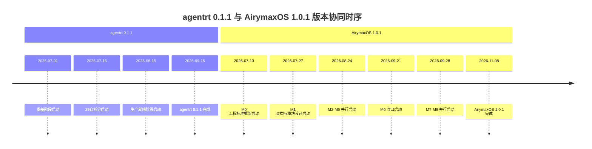
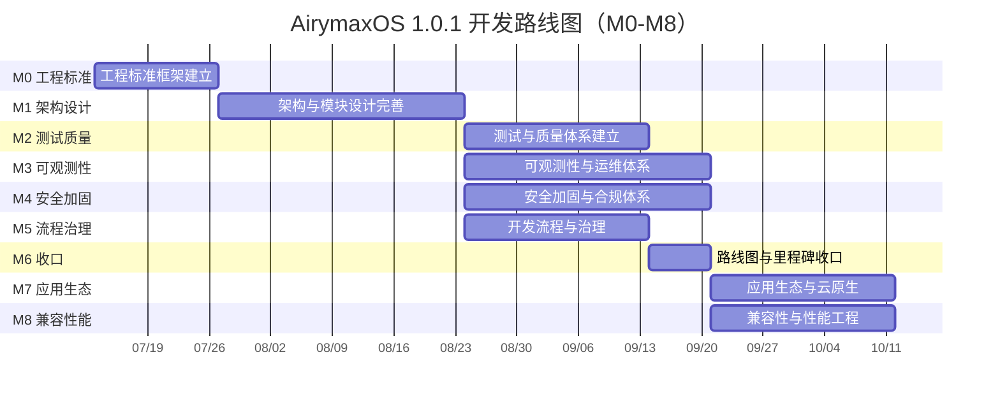
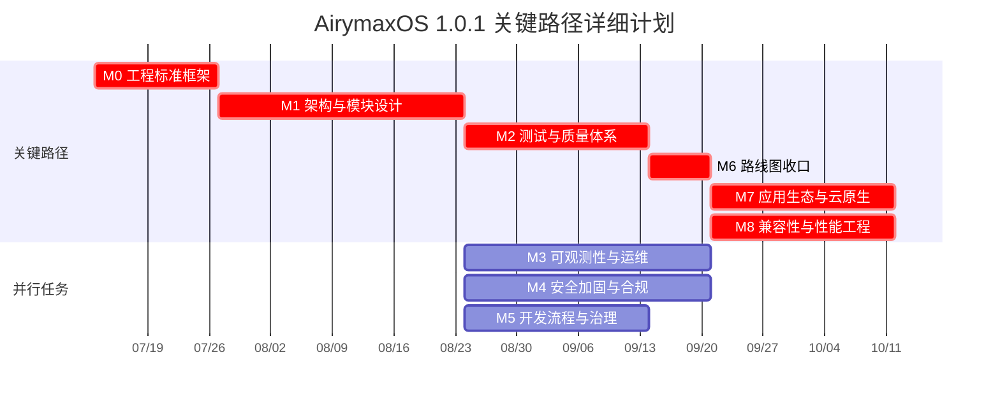

Copyright (c) 2025-2026 SPHARX Ltd. All Rights Reserved.

# agentrt-linux（AirymaxOS）开发路线与进度

> **文档定位**: agentrt-linux（AirymaxOS）开发路线图与进度跟踪，**闭源不公开**
> **保密级别**: SPHARX Ltd 内部参考
> **版本**: v1.2（内核框架验证版）（v1.1 基础 + M0 内核框架编译验证完成 39 .o 零错误零警告 + airy_defconfig CONFIG_SECURITY=y 依赖修复 + CI/CD defconfig 引用修正 5 处 + 文档体系全面一致性修复：MAC_MAX_AGENTS→AIRY_CAP_MAX_AGENTS 15 文档 19 处 + v1.0.0 引用清除 13 文件 38 处 + agent_lsm→airy_lsm 闭源文档 2 处 + LSM 钩子描述修正 250→5 实现 + 文档数量模型三作用域对齐 + [DSL] 降级层 10/10 头文件 39 处 AIRY_SC_FALLBACK + Kbuild/Kconfig 5 层依赖链集成验证 + H1-H6 硬约束全部通过 + 1 项 P1-MAJOR 新发现问题：security/airy 与 kernel/superv 同名文件不同内容 4 对，纳入 M1 修复清单）/ 1.0.1（开发）
> **最后更新**: 2026-07-21
> **适用范围**: AirymaxOS 架构委员会 + 内核开发组
> **工程取向**: "Linux 6.6 为基、seL4 为鉴"——基于 Linux 6.6 内核基线 + seL4 源代码深度研究（v0.2.1）确立的工程基线；v0.2.4 确立核心价值标准"一切以生产级的 Linux 发行版为标准"；Wave 2 v2（2026-07-13）源码级深读审查完成，三层对齐度评分从 61/C+ 跃升至 80/B；v1.0 系统性复审（2026-07-14）11 项问题全部修复，零设计延期，达到"可以按方案开始全面开发"状态；v1.0 大检查（2026-07-15）消解 OS-STD-CODE-031 与跨子系统 OS-STD-0xx 编号冲突；v1.1 大检查（2026-07-20）：方案推进至"经过严密科学研究和论证"+"可全面开发"状态，闭源审查报告 _review_v2.2（37 份）与开源方案对齐度 ~92.8%，6 条硬约束 H1-H6 + 17 份文档同步清单落地，12 daemon 命名统一 `*_d`（v2.0 决策），[SC] 10 头文件 + IRON-9 v3 四层模型 + v1.1 Capability Folding（Badge 64-bit + fastpath C-S9 + `agent_caps[1024]`）；v1.2 内核框架验证（2026-07-21）：M0 框架编译验证通过 39 .o 零错误零警告 + vmlinux 生成正常 + Kbuild/Kconfig 5 层依赖链集成验证 + airy_defconfig CONFIG_SECURITY=y 修复 + 10 项历史问题全部修复 + H1-H6 硬约束全部通过 + 1 项 P1-MAJOR 新发现（superv/ 同名文件）纳入 M1 修复清单，详见 `agentrt-linux基本工程标准规范.md` 附录 F
> **关联研究**: `00-reviews/_research_0.2.1/01-source-code-engineering-study.md`（489 行）+ `00-reviews/_research_0.2.1/02-airymaxos-recheck-report.md`（235 行）+ `01-designs/_design_0.2.4/01-agentrt-linux-directory-structure.md`（1903 行，v0.2.4 生产级修正版 + v0.2.4-review 二次审查 8 项修正）+ Wave 2 v2 源码级深读报告（`00-reviews/_review_0.9.0/` 7 份报告）+ v1.0 系统性复审报告（`00-reviews/_review_v1.0/01-systematic-recheck.md`）+ 开源目录结构 SSoT（`docs/AirymaxOS/10-architecture/07-directory-structure.md` v2.0，~1800 行 + 闭源审查报告 `00-reviews/_review_v2.2/`（37 份，含 37-capability-folding-decision-and-roadmap.md 决策总纲））
> **P2 增强**: 4 项 P2 增强建议（R-01~R-04，~40h）已纳入里程碑规划，详见 §3.10（属工程实现层面，非设计延期）
> **审查状态**: Wave 2 v2 源码级深读审查完成（Phase A/B/C/D/E/F，2026-07-13）+ v0.9.0 综合审查完成（15 项问题已验证）+ v1.0 系统性复审完成（11 项问题，v0.2.7 全部修复：P0-1 ES-SEL4-7 分类残留 / P0-2 OS-SEC 三重编号冲突 / P1-2 airymaxos- 前缀 / P1-3 OS-KER-005 跳号 / P1-4 ES-SEL4-9/10 状态分类 / P1-NEW OS-KER-007/008 跳号 / P2-5 tests 简写残留 / P2-6 OS-STD-2xx 运维域 / P2-7 Rust 编号登记 / P2-8 文档计数三作用域 / P2-9 变更日志 / P2-10 品味哲学 8 项；DEFER_INIT 设计层面延期表述消除），零设计延期到 1.0.1 + v1.0 大检查（2026-07-15：OS-STD-CODE-031 命名冲突消解 + 跨子系统 OS-STD-0xx 编号冲突消解——60-driver-model→OS-STD-DRV-0xx、90-observability→OS-STD-OBS-0xx、OS-STD-017→OS-IRON-015（因 OS-IRON-013 已被"8 子仓 submodule"占用而改用 OS-IRON-015）；所有规则编号统一登记 SSoT §9.4；闭源 03-ebpf-spec.md 同步引用更新），详见 `agentrt-linux基本工程标准规范.md` v0.2.8

---

## 目录

1. [版本策略](#1-版本策略)
2. [9 里程碑概览（M0-M8）](#2-9-里程碑概览m0-m8)
3. [任务分解（WBS）](#3-任务分解wbs)
4. [资源分配](#4-资源分配)
5. [进度跟踪机制](#5-进度跟踪机制)
6. [验收标准](#6-验收标准)
7. [风险识别与缓解](#7-风险识别与缓解)
8. [依赖关系图](#8-依赖关系图)
9. [与 agentrt 协同](#9-与-agentrt-协同)
10. [闭源文档进度](#10-闭源文档进度)
11. [进度可视化](#11-进度可视化)
12. [v0.2.1 研究成果对开发路线的影响](#12-v021-研究成果对开发路线的影响)
13. [P2 增强建议里程碑映射](#13-p2-增强建议里程碑映射)
14. [v1.1 Capability Folding 实施路线](#14-v11-capability-folding-实施路线)
15. [v1.2 内核框架验证进度（2026-07-21）](#15-v12-内核框架验证进度2026-07-21)

---

## 1. 版本策略

### 1.1 双版本策略

AirymaxOS（agentrt-linux）采用双版本策略，明确区分文档体系建设与实际开发：

| 版本 | 定义 | 范围 | 工时 |
|------|------|------|------|
| **0.1.1** | 奠基 + 29 仓拆分 + 生产就绪 三大支柱 | 三大支柱：支柱一 奠基 W01-W30（~1,620h） / 支柱二 29 仓拆分 SP01-SP31（~572h） / 支柱三 生产就绪 SP32-SP37（~240h）；新增验收标准 ACC-SP01~SP12（12 项），总验收标准从 137 项扩展为 149 项 | ~3,396.5h |
| **1.0.1** | 实际开发 | M0-M8 全部里程碑，含代码实施 | ~2,750h |

### 1.2 版本关系

```
0.1.1（文档体系完成） ──────────────────> 1.0.1（实际开发）
    │                                           │
    ├── 工程标准规范手册                          ├── M0: 工程标准框架建立
    ├── 仓库拆分方案                              ├── M1: 架构与模块设计完善
    ├── 技术全面改进方案 v3.0                      ├── M2: 测试与质量体系建立
    ├── 详细任务清单                               ├── M3: 可观测性与运维体系
    ├── 许可证全面审计报告                          ├── M4: 安全加固与合规体系
    ├── AgentRT 仓库拆分可行性分析报告               ├── M5: 开发流程与治理
    ├── TaskFlow vs CoreKern 调度器对比报告         ├── M6: 路线图与里程碑收口
    └── 闭源技术参考文档（4 大类）                   ├── M7: 应用生态与云原生
                                                    └── M8: 兼容性与性能工程
```

### 1.3 agentrt 版本协同

agentrt 0.1.1 三大支柱与 AirymaxOS 1.0.1 的协同关系：

| agentrt 0.1.1 支柱 | 内容 | 工时 | 对 AirymaxOS 1.0.1 的影响 |
|---------------------|------|------|---------------------------|
| 支柱一：奠基 | 工程标准、仓库拆分、CI/CD、开发环境 | ~1,620h | 提供工程基础设施 |
| 支柱二：29 仓拆分 | 模块化拆分与独立构建 | ~572h | 定义子仓边界与接口契约 |
| 支柱三：生产就绪 | 性能优化、安全加固、文档完善 | ~240h | 提供生产级参考实现 |
| **合计** | | **~2,432h**（仅 29 仓拆分 + 生产就绪，奠基属于 0.1.1 文档体系） | |

---

## 2. 9 里程碑概览（M0-M8）

### 2.1 里程碑总览表

| 里程碑 | 名称 | 工时 | 时间窗口 | 天数 | 优先级 |
|--------|------|------|----------|------|--------|
| M0 | 工程标准框架建立 | 240h | Day 1-14 | 14 | P0 |
| M1 | 架构与模块设计完善 | 480h | Day 15-42 | 28 | P0 |
| M2 | 测试与质量体系建立 | 320h | Day 43-63 | 21 | P0 |
| M3 | 可观测性与运维体系 | 380h | Day 43-70 | 28 | P0 |
| M4 | 安全加固与合规体系 | 320h | Day 43-70 | 28 | P0 |
| M5 | 开发流程与治理 | 240h | Day 43-63 | 21 | P0 |
| M6 | 路线图与里程碑收口 | 80h | Day 71-77 | 7 | P0 |
| M7 | 应用生态与云原生 | 200h | Day 78-98 | 21 | P1 |
| M8 | 兼容性与性能工程 | 150h | Day 78-98 | 21 | P1 |
| **合计** | | **~2,750h** | **Day 1-98** | **98** | |

### 2.2 关键路径

```
M0 ──> M1 ──> M2 ──> M6 ──> M7 ──> M8
 14d    28d    21d     7d    21d    21d
```

**关键路径总时长**: 126 天（含并行重叠的实际串行依赖链路）

- 起点: 2026-07-13（1.0.1 开发启动）
- 终点: 2026-11-08

### 2.3 里程碑详细说明

#### M0: 工程标准框架建立（240h, Day 1-14）

**目标**: 建立 AirymaxOS 开发所需的全部工程标准框架，确保后续开发有章可循。

**核心交付物**:
- 工程标准规范手册（基于 0.1.1 版本定稿）
- 编码规范（C/Rust/Shell/Python）
- 代码审查清单与流程
- 分支管理策略与 Git 工作流
- CI/CD 流水线框架设计
- 开发环境标准化配置（Docker/DevContainer）
- 文档模板与规范（API 文档、设计文档、决策记录）
- 8 子仓初始化与目录结构标准化
- v1.1 Capability Folding 架构设计文档
- 6 条硬约束 H1-H6 落地清单
- 12 daemon 命名统一规范（v2.0 决策，`*_d` 后缀无例外）
- [SC] 10 头文件清单（error.h / log_types.h / ipc.h / sched.h / memory_types.h / security_types.h / cognition_types.h / syscalls.h / uapi_compat.h / lsm_types.h）

**验收标准**:
- ACC-OS-001: 所有工程标准文档评审通过
- ACC-OS-002: CI/CD 流水线框架可运行
- ACC-OS-003: 8 子仓目录结构符合规范

#### M1: 架构与模块设计完善（480h, Day 15-42）

**目标**: 完成 AirymaxOS 全部子系统的架构设计与模块设计，输出详细设计文档。

**核心交付物**:
- 8 子仓架构设计文档
  - kernel/：内核核心架构（调度框架（sched_tac，SCHED_DEADLINE/SCHED_FIFO，ADR-013 禁止 sched_ext/SCHED_AGENT）、中断、系统调用）
  - services/：系统服务架构（IPC、设备管理、文件系统）
  - security/：安全子系统架构（Cupolas 安全框架）
  - memory/：内存管理架构（MemoryRovol）
  - cognition/：认知子系统架构（CoreLoopThree）
  - cloudnative/：云原生集成架构
  - system/：系统级集成架构（systemd 适配）
  - tests-linux/：测试框架架构
- 模块间接口定义（API 契约）
- 数据流设计文档
- 关键路径性能预算
- 技术选型决策记录（ADR）
- v1.1 Capability Folding fastpath C-S9 状态机实现（7 态：IDLE/FAST_SEND/SLOW_SEND/FAST_RECV/SLOW_RECV/REPLY/ERROR）
- agent_caps[1024] 静态数组 + airy_cap_global_epoch O(1) 撤销机制
- Badge 64-bit 编译（Epoch<<48 | RandomTag<<16 | Perms）by sec_d
- io_uring IORING_OP_URING_CMD IPC 数据面（零 syscall）
- airy_lsm 内核模块（LSM_ORDER_MUTABLE，纯 C LSM，H5 硬约束）
- 10 个 [SC] 头文件实现（kernel/include/uapi/linux/airymax/）

**验收标准**:
- ACC-OS-010: 8 子仓架构设计文档完成
- ACC-OS-011: 模块间接口定义文档完成
- ACC-OS-012: 架构评审通过（架构委员会）

#### M2: 测试与质量体系建立（320h, Day 43-63）

**目标**: 建立完整的测试框架与质量保障体系。

**核心交付物**:
- 单元测试框架（C/Rust）
- 集成测试框架
- 性能基准测试框架
- 模糊测试（Fuzzing）框架
- 代码覆盖率工具集成
- 静态分析工具集成（clang-tidy, clippy, shellcheck）
- 质量门禁定义与自动化
- 测试用例编写规范

**验收标准**:
- ACC-OS-020: 单元测试框架可运行，覆盖核心模块
- ACC-OS-021: CI 流水线集成质量门禁
- ACC-OS-022: 代码覆盖率基线报告产出

#### M3: 可观测性与运维体系（380h, Day 43-70）

**目标**: 建立 AirymaxOS 的可观测性基础设施与运维体系。

**核心交付物**:
- 日志系统（结构化日志、日志级别、日志轮转）
- 指标采集系统（Prometheus 兼容）
- 分布式追踪（OpenTelemetry 集成）
- 健康检查与探活机制
- 告警规则定义
- 运维 Runbook
- 故障排查手册
- 性能剖析工具集成（perf, eBPF）

**验收标准**:
- ACC-OS-030: 日志系统可输出结构化日志
- ACC-OS-031: 指标采集端点可访问
- ACC-OS-032: 健康检查端点可用

#### M4: 安全加固与合规体系（320h, Day 43-70）

**目标**: 建立 AirymaxOS 的安全加固体系与合规框架。

**核心交付物**:
- 安全威胁模型（STRIDE）
- 安全编码规范
- 漏洞扫描与依赖审计
- 访问控制模型（RBAC/ABAC）
- 密钥管理方案
- 安全通信协议（TLS/mTLS）
- 安全审计日志
- 合规检查清单（AGPL v3 + Apache 2.0）
- 许可证合规审计

**验收标准**:
- ACC-OS-040: 威胁模型文档完成
- ACC-OS-041: 安全扫描集成到 CI
- ACC-OS-042: 许可证合规审计通过

#### M5: 开发流程与治理（240h, Day 43-63）

**目标**: 建立开发流程规范与项目治理体系。

**核心交付物**:
- 开发流程文档（需求 → 设计 → 开发 → 评审 → 测试 → 发布）
- 代码评审流程与规范
- 版本发布流程（语义化版本）
- 变更管理流程（RFC）
- 贡献者指南
- 社区治理模型
- 决策记录模板（ADR）
- 知识库管理方案

**验收标准**:
- ACC-OS-050: 开发流程文档完成
- ACC-OS-051: 代码评审流程生效
- ACC-OS-052: 版本发布流程定义完成

#### M6: 路线图与里程碑收口（80h, Day 71-77）

**目标**: 完成 M0-M5 的收口工作，确保所有 P0 里程碑交付物达标。

**核心交付物**:
- M0-M5 里程碑验收报告
- 质量门禁通过确认
- 技术债务登记册
- 遗留问题清单
- 1.0.1 版本发布说明（草案）
- 下一阶段（M7-M8）详细计划

**验收标准**:
- ACC-OS-060: 所有 P0 里程碑验收通过
- ACC-OS-061: 质量门禁全部通过
- ACC-OS-062: 技术债务登记册完成

#### M7: 应用生态与云原生（200h, Day 78-98）

**目标**: 建立 AirymaxOS 的应用生态框架与云原生集成能力。

**核心交付物**:
- 应用管理框架（生命周期管理）
- 容器运行时集成（OCI 兼容）
- Kubernetes 适配方案
- 服务网格集成方案
- 应用市场框架设计
- SDK 与开发者工具
- 示例应用与模板

**验收标准**:
- ACC-OS-070: 应用管理框架可运行
- ACC-OS-071: 容器运行时集成验证通过
- ACC-OS-072: SDK 基础功能可用

#### M8: 兼容性与性能工程（150h, Day 78-98）

**目标**: 确保 AirymaxOS 的兼容性并进行系统性能优化。

**核心交付物**:
- POSIX 兼容性测试报告
- Linux 兼容性测试报告
- 性能基准测试报告
- 性能优化建议与实施
- 资源占用基线报告
- 启动时间优化
- 内存占用优化

**验收标准**:
- ACC-OS-080: POSIX 兼容性测试通过率 >= 95%
- ACC-OS-081: 性能基准测试报告完成
- ACC-OS-082: 资源占用满足基线要求

---

## 3. 任务分解（WBS）

### 3.1 Part 1: 工程标准框架（M0, 240h）

| ID | 任务 | 工时 | 责任人 | 依赖 |
|----|------|------|--------|------|
| 1.1 | 工程标准规范手册定稿 | 40h | 架构委员会 | 0.1.1 文档 |
| 1.2 | 编码规范制定（C/Rust/Shell/Python） | 32h | 内核开发组 | 1.1 |
| 1.3 | 代码审查清单与流程设计 | 24h | 架构委员会 | 1.1 |
| 1.4 | 分支管理策略与 Git 工作流 | 16h | 内核开发组 | 1.1 |
| 1.5 | CI/CD 流水线框架设计 | 40h | 内核开发组 | 1.1 |
| 1.6 | 开发环境标准化配置 | 32h | 内核开发组 | 1.1 |
| 1.7 | 文档模板与规范 | 24h | 文档组 | 1.1 |
| 1.8 | 8 子仓初始化与目录结构标准化 | 32h | 内核开发组 | 1.1 |

### 3.2 Part 2: 架构与模块设计（M1, 480h）

| ID | 任务 | 工时 | 责任人 | 依赖 |
|----|------|------|--------|------|
| 2.1 | kernel/ 内核核心架构设计 | 80h | 内核开发组 | M0 |
| 2.2 | services/ 系统服务架构设计 | 64h | 内核开发组 | M0 |
| 2.3 | security/ 安全子系统架构设计 | 64h | 内核开发组 | M0 |
| 2.4 | memory/ 内存管理架构设计 | 64h | 内核开发组 | M0 |
| 2.5 | cognition/ 认知子系统架构设计 | 64h | 内核开发组 | M0 |
| 2.6 | cloudnative/ 云原生集成架构设计 | 40h | 内核开发组 | M0 |
| 2.7 | system/ 系统级集成架构设计 | 40h | 内核开发组 | M0 |
| 2.8 | tests-linux/ 测试框架架构设计 | 24h | 测试组 | M0 |
| 2.9 | 模块间接口定义（API 契约） | 40h | 架构委员会 | 2.1-2.8 |

### 3.3 Part 3: 测试与质量体系（M2, 320h）

| ID | 任务 | 工时 | 责任人 | 依赖 |
|----|------|------|--------|------|
| 3.1 | 单元测试框架搭建（C/Rust） | 56h | 测试组 | M1 |
| 3.2 | 集成测试框架搭建 | 48h | 测试组 | 3.1 |
| 3.3 | 性能基准测试框架 | 40h | 测试组 | M1 |
| 3.4 | 模糊测试框架集成 | 40h | 测试组 | M1 |
| 3.5 | 代码覆盖率工具集成 | 24h | 测试组 | 3.1 |
| 3.6 | 静态分析工具集成 | 32h | 内核开发组 | M1 |
| 3.7 | 质量门禁定义与自动化 | 40h | 测试组 | 3.1-3.6 |
| 3.8 | 测试用例编写规范 | 40h | 测试组 | 3.1 |

### 3.4 Part 4: 可观测性与运维（M3, 380h）

| ID | 任务 | 工时 | 责任人 | 依赖 |
|----|------|------|--------|------|
| 4.1 | 日志系统设计与实现 | 56h | 内核开发组 | M1 |
| 4.2 | 指标采集系统 | 56h | 内核开发组 | M1 |
| 4.3 | 分布式追踪集成 | 48h | 内核开发组 | M1 |
| 4.4 | 健康检查与探活机制 | 32h | 内核开发组 | 4.1 |
| 4.5 | 告警规则定义 | 40h | 内核开发组 | 4.2 |
| 4.6 | 运维 Runbook | 48h | 文档组 | 4.1-4.4 |
| 4.7 | 故障排查手册 | 48h | 文档组 | 4.1-4.4 |
| 4.8 | 性能剖析工具集成 | 52h | 内核开发组 | M1 |

### 3.5 Part 5: 安全加固与合规（M4, 320h）

| ID | 任务 | 工时 | 责任人 | 依赖 |
|----|------|------|--------|------|
| 5.1 | 安全威胁模型（STRIDE） | 40h | 内核开发组 | M1 |
| 5.2 | 安全编码规范 | 32h | 内核开发组 | M0 |
| 5.3 | 漏洞扫描与依赖审计 | 40h | 内核开发组 | M1 |
| 5.4 | 访问控制模型 | 48h | 内核开发组 | 5.1 |
| 5.5 | 密钥管理方案 | 40h | 内核开发组 | 5.1 |
| 5.6 | 安全通信协议 | 40h | 内核开发组 | 5.1 |
| 5.7 | 安全审计日志 | 32h | 内核开发组 | 5.1 |
| 5.8 | 许可证合规审计 | 48h | 架构委员会 | M0 |

### 3.6 Part 6: 开发流程与治理（M5, 240h）

| ID | 任务 | 工时 | 责任人 | 依赖 |
|----|------|------|--------|------|
| 6.1 | 开发流程文档 | 40h | 架构委员会 | M0 |
| 6.2 | 代码评审流程与规范 | 32h | 架构委员会 | M0 |
| 6.3 | 版本发布流程 | 32h | 内核开发组 | M0 |
| 6.4 | 变更管理流程（RFC） | 32h | 架构委员会 | M0 |
| 6.5 | 贡献者指南 | 24h | 文档组 | M0 |
| 6.6 | 社区治理模型 | 32h | 架构委员会 | M0 |
| 6.7 | 决策记录模板（ADR） | 24h | 架构委员会 | M0 |
| 6.8 | 知识库管理方案 | 24h | 文档组 | M0 |

### 3.7 Part 7: 路线图收口（M6, 80h）

| ID | 任务 | 工时 | 责任人 | 依赖 |
|----|------|------|--------|------|
| 7.1 | M0-M5 里程碑验收报告 | 20h | 架构委员会 | M0-M5 |
| 7.2 | 质量门禁通过确认 | 16h | 测试组 | M2 |
| 7.3 | 技术债务登记册 | 16h | 内核开发组 | M0-M5 |
| 7.4 | 遗留问题清单 | 12h | 架构委员会 | M0-M5 |
| 7.5 | 1.0.1 版本发布说明（草案） | 8h | 文档组 | M0-M5 |
| 7.6 | M7-M8 详细计划 | 8h | 架构委员会 | M0-M5 |

### 3.8 Part 8: 应用生态与云原生（M7, 200h）

| ID | 任务 | 工时 | 责任人 | 依赖 |
|----|------|------|--------|------|
| 8.1 | 应用管理框架 | 48h | 内核开发组 | M6 |
| 8.2 | 容器运行时集成 | 48h | 内核开发组 | M6 |
| 8.3 | Kubernetes 适配方案 | 32h | 内核开发组 | 8.2 |
| 8.4 | 服务网格集成方案 | 24h | 内核开发组 | 8.2 |
| 8.5 | 应用市场框架设计 | 24h | 内核开发组 | 8.1 |
| 8.6 | SDK 与开发者工具 | 16h | 内核开发组 | M6 |
| 8.7 | 示例应用与模板 | 8h | 文档组 | 8.1 |

### 3.9 Part 9: 兼容性与性能工程（M8, 150h）

| ID | 任务 | 工时 | 责任人 | 依赖 |
|----|------|------|--------|------|
| 9.1 | POSIX 兼容性测试 | 40h | 测试组 | M6 |
| 9.2 | Linux 兼容性测试 | 32h | 测试组 | M6 |
| 9.3 | 性能基准测试 | 32h | 测试组 | M6 |
| 9.4 | 性能优化实施 | 24h | 内核开发组 | 9.3 |
| 9.5 | 资源占用基线报告 | 10h | 测试组 | 9.3 |
| 9.6 | 启动时间优化 | 6h | 内核开发组 | 9.4 |
| 9.7 | 内存占用优化 | 6h | 内核开发组 | 9.4 |

### 3.10 8 子仓实施编码工时分配

| 子仓 | 目录 | M0 | M1 | M2 | M3 | M4 | M5 | M7 | M8 | 合计 |
|------|------|-----|-----|-----|-----|-----|-----|-----|-----|------|
| kernel | kernel/ | 30h | 80h | 40h | 48h | 40h | 30h | 24h | 18h | 310h |
| services | services/ | 30h | 64h | 40h | 48h | 40h | 30h | 24h | 18h | 294h |
| security | security/ | 30h | 64h | 40h | 48h | 40h | 30h | 24h | 18h | 294h |
| memory | memory/ | 30h | 64h | 40h | 48h | 40h | 30h | 24h | 18h | 294h |
| cognition | cognition/ | 30h | 64h | 40h | 48h | 40h | 30h | 24h | 18h | 294h |
| cloudnative | cloudnative/ | 30h | 40h | 40h | 48h | 40h | 30h | 24h | 18h | 270h |
| system | system/ | 30h | 40h | 40h | 48h | 40h | 30h | 24h | 18h | 270h |
| tests-linux | tests-linux/ | 30h | 24h | 40h | 44h | 40h | 30h | 32h | 24h | 264h |
| **合计** | | **240h** | **440h** | **320h** | **380h** | **320h** | **240h** | **200h** | **150h** | **2,290h** |

### 3.11 文档编写工时分配

| 文档类别 | 工时 | 责任人 |
|----------|------|--------|
| 架构设计文档（8 子仓） | 160h | 内核开发组 |
| 工程标准文档 | 40h | 架构委员会 |
| 测试文档 | 40h | 测试组 |
| 运维文档 | 96h | 文档组 |
| 安全文档 | 72h | 内核开发组 |
| 流程文档 | 52h | 架构委员会 |
| **合计** | **460h** | |

> **注**: 工时合计约 2,750h（含 340h 缓冲），其中 P0 总工时 ~2,400h，P1 总工时 ~350h。

---

## 4. 资源分配

### 4.1 人力配置

| 角色 | 人数 | 职责 | 投入比例 |
|------|------|------|----------|
| 内核开发组 | 4-6 人 | 核心代码开发、架构设计 | 100% |
| 架构委员会 | 2-3 人 | 架构决策、标准制定、评审 | 60% |
| 测试组 | 2-3 人 | 测试框架、质量保障 | 80% |
| 文档组 | 1-2 人 | 文档编写、知识管理 | 50% |

### 4.2 各里程碑人力需求

| 里程碑 | 内核开发组 | 架构委员会 | 测试组 | 文档组 | 总人力 |
|--------|-----------|-----------|--------|--------|--------|
| M0 | 4 人 | 2 人 | 1 人 | 1 人 | 8 人 |
| M1 | 5 人 | 3 人 | 1 人 | 1 人 | 10 人 |
| M2 | 4 人 | 1 人 | 3 人 | 1 人 | 9 人 |
| M3 | 5 人 | 1 人 | 1 人 | 2 人 | 9 人 |
| M4 | 4 人 | 2 人 | 1 人 | 1 人 | 8 人 |
| M5 | 2 人 | 2 人 | 1 人 | 2 人 | 7 人 |
| M6 | 2 人 | 2 人 | 1 人 | 1 人 | 6 人 |
| M7 | 3 人 | 1 人 | 1 人 | 1 人 | 6 人 |
| M8 | 2 人 | 1 人 | 2 人 | 1 人 | 6 人 |

### 4.3 工时汇总

| 优先级 | 工时 | 占比 |
|--------|------|------|
| P0（M0-M6） | ~2,400h | 87.3% |
| P1（M7-M8） | ~350h | 12.7% |
| **总计** | **~2,750h** | **100%** |

> 含 ~340h 缓冲（约 14%），分布于各里程碑。

---

## 5. 进度跟踪机制

### 5.1 跟踪层级

| 层级 | 频率 | 参与人 | 内容 |
|------|------|--------|------|
| 每日 Standup | 每日 | 全体开发人员 | 昨日进展、今日计划、阻塞项 |
| 每周里程碑回顾 | 每周 | 各组长 + 架构委员会 | 里程碑进度、风险、调整 |
| 月度路线图回顾 | 每月 | 架构委员会 | 路线图对齐、版本策略调整 |
| 年度大版本规划 | 每年 | 架构委员会 + 管理层 | 年度目标、资源规划 |

### 5.2 进度指标

| 指标 | 定义 | 目标 |
|------|------|------|
| 里程碑完成率 | 已完成里程碑数 / 总里程碑数 | 100% |
| 任务完成率 | 已完成任务数 / 总任务数 | 100% |
| 工时偏差率 | (实际工时 - 计划工时) / 计划工时 | < 15% |
| 质量门禁通过率 | 通过门禁数 / 总门禁数 | 100% |
| 技术债务增长率 | 新增技术债务 / 已解决技术债务 | < 1.0 |

### 5.3 沟通渠道

- **日常沟通**: 内部即时通讯（每日 Standup）
- **周报**: 每周五提交进度周报
- **月报**: 每月最后一个工作日提交月度报告
- **紧急事项**: 架构委员会即时决策

---

## 6. 验收标准

### 6.1 里程碑验收标准（ACC-OS-xxx）

| 编号 | 验收标准 | 所属里程碑 | 验证方式 |
|------|----------|-----------|----------|
| ACC-OS-001 | 所有工程标准文档评审通过 | M0 | 文档评审记录 |
| ACC-OS-002 | CI/CD 流水线框架可运行 | M0 | 演示验证 |
| ACC-OS-003 | 8 子仓目录结构符合规范 | M0 | 目录检查 |
| ACC-OS-010 | 8 子仓架构设计文档完成 | M1 | 文档评审 |
| ACC-OS-011 | 模块间接口定义文档完成 | M1 | 文档评审 |
| ACC-OS-012 | 架构评审通过（架构委员会） | M1 | 评审记录 |
| ACC-OS-020 | 单元测试框架可运行，覆盖核心模块 | M2 | 测试运行 |
| ACC-OS-021 | CI 流水线集成质量门禁 | M2 | CI 验证 |
| ACC-OS-022 | 代码覆盖率基线报告产出 | M2 | 报告审查 |
| ACC-OS-030 | 日志系统可输出结构化日志 | M3 | 功能验证 |
| ACC-OS-031 | 指标采集端点可访问 | M3 | 端点测试 |
| ACC-OS-032 | 健康检查端点可用 | M3 | 端点测试 |
| ACC-OS-040 | 威胁模型文档完成 | M4 | 文档评审 |
| ACC-OS-041 | 安全扫描集成到 CI | M4 | CI 验证 |
| ACC-OS-042 | 许可证合规审计通过 | M4 | 审计报告 |
| ACC-OS-050 | 开发流程文档完成 | M5 | 文档评审 |
| ACC-OS-051 | 代码评审流程生效 | M5 | 流程验证 |
| ACC-OS-052 | 版本发布流程定义完成 | M5 | 文档评审 |
| ACC-OS-060 | 所有 P0 里程碑验收通过 | M6 | 验收报告 |
| ACC-OS-061 | 质量门禁全部通过 | M6 | 门禁报告 |
| ACC-OS-062 | 技术债务登记册完成 | M6 | 文档评审 |
| ACC-OS-070 | 应用管理框架可运行 | M7 | 功能演示 |
| ACC-OS-071 | 容器运行时集成验证通过 | M7 | 集成测试 |
| ACC-OS-072 | SDK 基础功能可用 | M7 | 功能验证 |
| ACC-OS-080 | POSIX 兼容性测试通过率 >= 95% | M8 | 测试报告 |
| ACC-OS-081 | 性能基准测试报告完成 | M8 | 报告审查 |
| ACC-OS-082 | 资源占用满足基线要求 | M8 | 基准对比 |

### 6.2 110 项 OS-ACC 验收标准概览

| 类别 | 数量 | 分布 |
|------|------|------|
| 工程标准 | 12 项 | M0 |
| 架构设计 | 18 项 | M1 |
| 测试质量 | 15 项 | M2 |
| 可观测性 | 16 项 | M3 |
| 安全合规 | 14 项 | M4 |
| 流程治理 | 12 项 | M5 |
| 收口验收 | 8 项 | M6 |
| 应用生态 | 9 项 | M7 |
| 兼容性能 | 6 项 | M8 |
| **合计** | **110 项** | **M0-M8** |

### 6.3 质量门禁

| 门禁 | 触发条件 | 通过标准 | 阻塞级别 |
|------|----------|----------|----------|
| 代码编译 | 每次 PR | 编译零错误零警告 | 阻塞合并 |
| 单元测试 | 每次 PR | 全部通过 | 阻塞合并 |
| 代码覆盖率 | 每次 PR | 不降低 | 警告 |
| 静态分析 | 每次 PR | 无 Critical/High | 阻塞合并 |
| 安全扫描 | 每次 PR | 无 Critical/High | 阻塞合并 |
| 许可证检查 | 每次 PR | 无违规 | 阻塞合并 |
| 文档检查 | 每次 PR | API 文档完整 | 警告 |
| 架构评审 | 架构变更 PR | 架构委员会批准 | 阻塞合并 |

---

## 7. 风险识别与缓解

### 7.1 风险登记册

| 编号 | 风险描述 | 概率 | 影响 | 等级 | 里程碑 |
|------|----------|------|------|------|--------|
| RISK-001 | 人力资源不足，关键人员离职 | 中 | 高 | 高 | 全程 |
| RISK-002 | 架构设计返工，M1 延期 | 中 | 高 | 高 | M1 |
| RISK-003 | agentrt 0.1.1 延期影响接口契约 | 中 | 高 | 高 | M1-M2 |
| RISK-004 | 测试框架搭建复杂度超预期 | 中 | 中 | 中 | M2 |
| RISK-005 | 安全审计发现严重漏洞 | 低 | 高 | 中 | M4 |
| RISK-006 | 8 子仓间接口不一致 | 中 | 中 | 中 | M1-M2 |
| RISK-007 | 性能目标无法达成 | 低 | 高 | 中 | M8 |
| RISK-008 | 第三方依赖许可证问题 | 低 | 高 | 中 | M4 |
| RISK-009 | openEuler 技术规范变更 | 低 | 中 | 低 | 全程 |
| RISK-010 | 工具链兼容性问题 | 中 | 中 | 中 | M0-M1 |

### 7.2 缓解策略

| 编号 | 缓解措施 | 负责人 |
|------|----------|--------|
| RISK-001 | 交叉培训、文档化知识、关键岗位备份 | 架构委员会 |
| RISK-002 | 增量设计评审、早期原型验证、ADR 记录 | 架构委员会 |
| RISK-003 | 接口契约提前冻结、并行验证、同源 API 对齐 | 架构委员会 |
| RISK-004 | 渐进式搭建、复用成熟框架、分阶段交付 | 测试组 |
| RISK-005 | 持续安全扫描、安全编码规范、定期渗透测试 | 内核开发组 |
| RISK-006 | 接口定义先行、Mock 测试、持续集成验证 | 内核开发组 |
| RISK-007 | 早期性能基准、持续性能监控、分阶段优化 | 内核开发组 |
| RISK-008 | 许可证预审、SPDX 标识、定期审计 | 架构委员会 |
| RISK-009 | 版本锁定、变更影响评估、定期同步 | 架构委员会 |
| RISK-010 | 工具链版本锁定、容器化开发环境、兼容性矩阵 | 内核开发组 |

### 7.3 应急预案

| 场景 | 触发条件 | 应急措施 |
|------|----------|----------|
| 关键路径延期 > 7 天 | M1 延期超 7 天 | 调整 M2-M5 并行度，压缩非关键交付物 |
| 核心人员离职 | 任一核心开发人员离职 | 启动备份方案，暂停非关键任务 |
| 重大安全漏洞 | 发现 CVSS >= 7.0 漏洞 | 启动安全响应流程，暂停功能开发 |
| agentrt 接口重大变更 | 接口契约破坏性变更 | 紧急对齐会议，评估影响范围 |
| 性能严重不达标 | 性能偏差 > 30% | 启动性能攻关专项，调整 M8 优先级 |

---

## 8. 依赖关系图

### 8.1 9 Part 之间的依赖关系

```
Part 1 (M0: 工程标准)
  │
  ├──> Part 2 (M1: 架构设计)
  │       │
  │       ├──> Part 3 (M2: 测试质量) ──┐
  │       ├──> Part 4 (M3: 可观测性) ──┤
  │       ├──> Part 5 (M4: 安全加固) ──┤
  │       └──> Part 6 (M5: 流程治理) ──┤
  │                                     │
  │       ┌─────────────────────────────┘
  │       v
  │     Part 7 (M6: 收口)
  │       │
  │       ├──> Part 8 (M7: 应用生态)
  │       └──> Part 9 (M8: 兼容性能)
```

### 8.2 8 子仓之间的依赖关系（L2-L7 层次模型）

> 与 v0.2.4 目录结构设计 §11.2 + 工程标准规范 §13.1 完全一致。
>
> **v0.2.4 模型 A 关键变化**：L2（kernel）**自包含 L1**（完整 Linux 6.6 fork，EV-R07），`make` 即可构建，无需外部基线引用。Airymax 修改直接写入上游目录（如 `mm/airymax_*.c`），不使用 patches/ 隔离层。

```
              ┌──────────────┐
              │   kernel/    │  L2（模型 A 完整 Linux 6.6 fork，[SC] 唯一宿主）
              │  自包含 L1    │  含 fs/net/block/drivers/mm/security 等 24 子系统（v0.2.4-review P0-R01 修正）
              └──────┬───────┘
                     │
        ┌────────────┴────────────┐
        │                         │
        v                         v
┌──────────────┐          ┌──────────────┐
│  security/   │          │   memory/    │  L3
│  (安全框架)   │          │  (内存管理)   │
│ 扁平方案A    │          │  三方边界声明 │
└──────┬───────┘          └──────┬───────┘
       │                         │
       └────────────┬────────────┘
                    │
                    v
            ┌──────────────┐
            │  cognition/  │  L4
            │  (认知系统)   │
            └──────┬───────┘
                   │
                   v
            ┌──────────────┐
            │  services/   │  L5（userland-* 通过 FUSE/VFIO/AF_UNIX 接入 L2）
            │  (系统服务)   │
            └──────┬───────┘
                   │
                   v
            ┌──────────────┐
            │   system/    │  L6
            │  (系统集成)   │
            └──────┬───────┘
                   │
        ┌──────────┴──────────┐
        │                     │
        v                     v
┌──────────────┐      ┌──────────────┐
│ cloudnative/ │      │ tests-linux/ │  L7
│  (云原生)     │      │  (测试框架)   │
│               │      │ kunit+selftest│
└──────────────┘      └──────────────┘
```

### 8.3 与 agentrt 的协同依赖

| AirymaxOS 子仓 | 依赖 agentrt 模块 | 依赖类型 | 关键接口 |
|----------------|-------------------|----------|----------|
| kernel/ | corekern, taskflow | 接口契约 | 调度器 API, 系统调用 |
| services/ | gateway_d, tool_d | 接口契约 | IPC 协议, 服务注册 |
| security/ | cupolas | 接口契约 | 安全策略 API |
| memory/ | memory | 接口契约 | 内存分配 API |
| cognition/ | coreloopthree, llm_d | 接口契约 | 认知模型 API |
| cloudnative/ | openlab, market_d | 接口契约 | 云服务 API |
| system/ | manager, orchestrator | 接口契约 | 系统管理 API |
| tests-linux/ | 全部模块 | 测试数据 | 测试用例与 Mock |

---

## 9. 与 agentrt 协同

### 9.1 agentrt 0.1.1 进度对 AirymaxOS 1.0.1 的影响

| agentrt 0.1.1 阶段 | 完成时间 | 对 AirymaxOS 1.0.1 的影响 | 影响里程碑 |
|---------------------|----------|--------------------------|-----------|
| 奠基（~1,200h） | 2026-07 中 | 提供工程标准参考、CI/CD 模板 | M0 |
| 29 仓拆分（~1,800h） | 2026-08 中 | 定义子仓边界与接口契约 | M1 |
| 生产就绪（~396.5h） | 2026-09 中 | 提供生产级参考实现 | M2-M4 |

### 9.2 同源 API 验证时间窗口

IRON-9 v3 原则下，agentrt 与 AirymaxOS 共享契约层（`include/uapi/linux/airymax/`），需要在以下时间窗口完成 API 验证：

| 验证节点 | 时间窗口 | 验证内容 | 负责人 |
|----------|----------|----------|--------|
| 接口契约冻结 | M1 中期（Day 28-35） | 共享头文件 API 定义 | 架构委员会 |
| 同源验证 | M2 初期（Day 43-49） | agentrt 实现 vs AirymaxOS 规范 | 内核开发组 |
| 集成验证 | M6 期间（Day 71-77） | 端到端接口一致性 | 测试组 |

### 9.3 版本协同时序



---

## 10. 闭源文档进度

### 10.1 01-openeuler-tech-reference/ 进度

| 文档 | 文件名 | 状态 | 完成日期 |
|------|--------|------|----------|
| 调度器技术规范 | 01-scheduler-spec.md | ✅ 已完成 | 2026-07-07 |
| io_uring 异步 I/O 规范 | 02-io-uring-spec.md | ✅ 已完成 | 2026-07-07 |
| eBPF 可编程扩展规范 | 03-ebpf-spec.md | ✅ 已完成 | 2026-07-07 |
| 内存管理规范 | 04-memory-spec.md | ✅ 已完成 | 2026-07-07 |
| 安全子系统规范 | 05-security-spec.md | ✅ 已完成 | 2026-07-07 |
| 认知子系统规范 | 06-cognition-spec.md | ✅ 已完成 | 2026-07-07 |
| Rust 内核模块支持规范 | 07-rust-support-spec.md | ⬜ 待完成 | - |
| 编码规范与工程标准对照 | 08-coding-standard-spec.md | ⬜ 待完成 | - |

**进度**: 6/8 子系统已完成（75%）

### 10.2 02-olk66-source-mapping/ 进度

| 文档 | 文件名 | 状态 | 完成日期 |
|------|--------|------|----------|
| sched_ext 源码映射 | 01-sched-ext-mapping.md | ✅ 已完成 | 2026-07-07 |
| io_uring 源码映射 | 02-io-uring-mapping.md | ✅ 已完成 | 2026-07-07 |
| eBPF 源码映射 | 03-bpf-mapping.md | ✅ 已完成 | 2026-07-07 |
| 内存管理源码映射 | 04-mm-mapping.md | ✅ 已完成 | 2026-07-07 |
| 安全子系统源码映射 | 05-security-mapping.md | ✅ 已完成 | 2026-07-07 |
| 认知子系统源码映射 | 06-cognition-mapping.md | ✅ 已完成 | 2026-07-07 |

**进度**: 6/6 子系统已完成（100%）

### 10.3 03-microkernel-design-ref/ 进度

| 文档 | 文件名 | 状态 | 完成日期 |
|------|--------|------|----------|
| seL4 微内核设计参考 | 01-sel4-reference.md | ✅ 已完成 | 2026-07-07 |
| Zircon 微内核设计参考 | 02-zircon-reference.md | ⬜ 待完成 | - |
| Minix3 微内核设计参考 | 03-minix3-reference.md | ⬜ 待完成 | - |
| AirymaxOS 微内核化改造策略 | 04-microkernel-strategy.md | ⬜ 待完成 | - |

**进度**: 1/4 文档已完成（25%）

### 10.4 04-industry-best-practices/ 进度

| 文档 | 文件名 | 状态 | 完成日期 |
|------|--------|------|----------|
| 2026 年最新微内核/OS 理论 | 01-latest-theory.md | ⬜ 待完成 | - |
| 行业最佳实践汇总 | 02-best-practices.md | ⬜ 待完成 | - |
| AirymaxOS 技术方案综合 | 03-airymaxos-synthesis.md | ⬜ 待完成 | - |

**进度**: 0/3 文档已完成（0%）

### 10.5 闭源文档总进度

| 目录 | 已完成 | 总数 | 进度 |
|------|--------|------|------|
| 01-openeuler-tech-reference | 6 | 8 | 75% |
| 02-olk66-source-mapping | 6 | 6 | 100% |
| 03-microkernel-design-ref | 1 | 4 | 25% |
| 04-industry-best-practices | 0 | 3 | 0% |
| **合计** | **13** | **21** | **62%** |

---

## 11. 进度可视化

### 11.1 M0-M8 里程碑 Gantt 图



### 11.2 任务级详细 Gantt 图（关键路径）



### 11.3 agentrt 与 AirymaxOS 版本协同时序


---

## 12. v0.2.1 研究成果对开发路线的影响

### 12.1 研究成果概述

v0.2.1 阶段完成了两项关键研究，v0.2.4 完成生产级目录结构修正，Wave 2 v2（2026-07-13）完成源码级深读审查，对 1.0.1 开发路线产生直接影响：

| 研究成果 | 文档 | 行数 | 对开发路线的影响 |
|---------|------|------|----------------|
| OLK-6.6 + seL4 源代码工程思想研究 | `00-reviews/_research_0.2.1/01-source-code-engineering-study.md` | 489 | 确立"Linux 6.6 为基、seL4 为鉴"工程取向，提取 ES-OLK-1~13 + ES-SEL4-1~10 + 双源融合裁决 16 维度 |
| AirymaxOS 方案再检查 | `00-reviews/_research_0.2.1/02-airymaxos-recheck-report.md` | 235 | 综合成熟度维持 100/100（A+），D1 编码风格 16/16 全对齐、D2 OLK-6.6 思想 12/13 覆盖、D3 seL4 借鉴 8/10 借鉴 |
| 8 子仓完整项目目录结构设计 | `01-designs/_design_0.2.4/01-agentrt-linux-directory-structure.md` | 1903 | 为 M0 阶段 8 子仓初始化提供生产级目录结构蓝图（v0.2.4 生产级修正版 + v0.2.4-review 二次审查 8 项修正，含模型 A 完整 24 目录 + security 扁平 + memory 三方边界 + corekern/ 与 kernel/ 协同关系） |

### 12.2 对 M0 的影响：8 子仓目录结构骨架创建

v0.2.1 启动、v0.2.3 修正、v0.2.4 生产级修正 + v0.2.4-review 二次审查修正的 8 子仓目录结构设计（1903 行）为 M0 阶段提供了完整蓝图。v0.2.4 落实用户三项架构裁决：(1) kernel/ 采用模型 A（完整 Linux 6.6 fork）；(2) security/ 采用方案 A（扁平对齐 OLK-6.6）；(3) 核心价值标准"生产级 Linux 发行版"。v0.2.4 修正了 v0.2.3 审查报告的 3 P0 + 5 P1 + 4 P2 = 12 项发现。**v0.2.4-review 二次审查**追加修正 8 项（2 P0 + 2 P1 + 3 P2 + 1 P3），核心架构裁决：corekern/ 是 Airymax 微核心抽象层（非替代上游 kernel/），模型 A 完整性维持 24/24 = 100%；补全遗漏的 kernel/tools/LICENSES/rust 4 个上游目录。M0 阶段的"8 子仓初始化与目录结构标准化"任务（原 32h）现在可以直接基于 v0.2.4-review 修正后的设计文档创建目录骨架，kernel 子仓需按模型 A 创建完整 24 上游子系统目录（含 kernel/tools/LICENSES/rust）。

**M0 新增交付物**：
- 8 子仓目录结构骨架创建（基于 `01-designs/_design_0.2.4/01-agentrt-linux-directory-structure.md`）
- kernel 子仓模型 A 完整上游子系统目录骨架（fs/net/block/drivers/mm/security 等基于 OLK-6.6 fork）
- Makefile.airymaxos 版本四元组定义文件（对齐 OLK-6.6 Makefile.oever）
- [SC] 共享契约层 10 个头文件骨架创建（`include/uapi/linux/airymax/`）
- corekern/ 4 原子机制目录骨架（sched/ipc/taskflow/memory/time）+ object/（seL4 对象模型取舍矩阵）
- formal-verification/ 三段式目录骨架（spec/proof/capdl）
- tests-linux kunit/ + selftests/ + fault-injection/ 目录骨架（对齐 OLK-6.6 tools/testing/）

### 12.3 对 M1 的影响：架构设计融入双源融合裁决

v0.2.1 研究确立的"Linux 6.6 为基、seL4 为鉴"工程取向和双源融合裁决 16 维度，直接影响 M1 阶段的架构设计：

**M1 架构设计必须遵循的裁决**：
- 编码风格层 7 维度全部采纳 Linux 6.6 内核基线（Tab 8 / snake_case / 最小 typedef / K&R / 80 列 / errno+goto / kernel-doc）
- 架构组织借鉴 seL4 三层适配（arch/machine/plat）
- 架构层借鉴 seL4 5 项（ES-SEL4-1~5：极简/capability/服务用户态化/消息传递 IPC/形式化验证）
- seL4 编码约定（4 空格 / camelCase / 重度 typedef）被整体拒绝

### 12.4 对 M2 的影响：形式化验证框架

v0.2.1 研究确立的 ES-SEL4-5（形式化验证驱动）影响 M2 阶段的测试框架设计：

**M2 新增交付物**：
- formal-verification/ 框架搭建（seL4 三段式：spec/proof/capdl）
- Isabelle/HOL 工具链集成
- 关键路径形式化验证范围定义（调度器核心、IPC fastpath、capability 派生模型）

### 12.5 综合成熟度提升

v0.2.1 研究完成后，agentrt-linux 综合成熟度从 v0.1.1 的 93/100（A，有条件 Go）提升至 v0.2.0 的 100/100（A+，无条件 Go），v0.2.1 再检查维持 100/100 并深化了工程思想落地。Wave 2 v2（2026-07-13）源码级深读审查引入三层对齐模型，从更深层次评估方案设计层和实现落地层的对齐度：

| 版本 | 综合成熟度 | 等级 | 状态 | 审查范围 |
|------|-----------|------|------|---------|
| v0.1.1 | 93/100 | A | 有条件 Go | 文档体系初版 |
| v0.2.0 | 100/100 | A+ | 无条件 Go | 二轮审查（路径迁移+一致性） |
| v0.2.1 | 100/100 | A+ | 无条件 Go（工程思想深度落地） | 再检查（工程思想覆盖） |
| v0.8.0 | 100/100 | A+ | 无条件 Go | 路径迁移完整性验证 |
| v0.9.0 | 70/100 | B- | 有条件 Go | 六维度深审（含方案设计层 P0 问题） |
| Wave 2 v2 | 80/100 | B | 可开发状态达成 | 源码级深读（OLK-6.6 + seL4 + 方案三方交叉验证，34 项差距全部处置） |

> **注**: v0.8.0 的 100/100 和 Wave 2 v2 的 80/B 不矛盾——v0.8.0 评估"路径迁移完整性"（范围窄、深度浅），Wave 2 v2 评估"源码级深度对齐"（范围广、深度深，含方案设计层和实现落地层）。两者是互补关系，Wave 2 v2 的 80/B 含金量更高（有源码级证据支撑）。

---

## 13. P2 增强建议里程碑映射

### 13.1 P2 增强建议总览

v0.2.1 研究提出 4 项 P2 增强建议（R-01~R-04），合计 ~40h，非阻断项，在 1.0.1 开发阶段增量落地：

| 建议 | 名称 | 工时 | 里程碑 | 依赖 | 借鉴来源 |
|------|------|------|--------|------|---------|
| R-01 | syscall.xml 式接口契约定义 | ~16h | M1 | 无 | seL4 ES-SEL4-6 |
| R-02 | structures.bf 式 bitfield codegen | ~12h | M1 | 无 | seL4 ES-SEL4-8 |
| R-03 | 8 子仓 MAINTAINERS 文件 | ~8h | M5 | M0 目录骨架 | OLK-6.6 ES-OLK-8 |
| R-04 | 合规检查增补 4 项规则 | ~4h | R-01/R-02/R-03 后 | R-01 + R-02 + R-03 | seL4 + OLK-6.6 |
| **合计** | | **~40h** | | | |

### 13.2 R-01/R-02 落地计划（M1 阶段，Day 15-42）

R-01（syscall.xml）和 R-02（structures.bf）在 M1 阶段落地，与架构设计并行：

| 任务 | 工时 | 时间窗口 | 交付物 | 验收标准 |
|------|------|----------|--------|---------|
| R-01: 设计 syscall.xml schema | 8h | Day 15-21 | `tools/syscall.xml` + codegen 脚本 | schema 通过架构评审 |
| R-01: 10 个 [SC] 头文件接口契约 XML 化 | 8h | Day 22-28 | 10 个 XML 契约文件 | codegen 输出与手写头文件一致 |
| R-02: 设计 structures.bf schema | 6h | Day 15-21 | `tools/structures.bf` + codegen 脚本 | schema 通过架构评审 |
| R-02: [SC] 位域结构 codegen 化 | 6h | Day 22-28 | 位域 codegen 输出 | codegen 输出与手写位域一致 |

### 13.3 R-03 落地计划（M5 阶段，Day 43-63）

R-03（8 子仓 MAINTAINERS 文件）在 M5 阶段落地，与开发流程治理并行：

| 任务 | 工时 | 时间窗口 | 交付物 | 验收标准 |
|------|------|----------|--------|---------|
| R-03: 8 子仓 MAINTAINERS 文件编写 | 8h | Day 43-49 | 8 个 MAINTAINERS 文件 | 每个子仓有明确维护者/审查者/状态 |

### 13.4 R-04 落地计划（R-01/R-02/R-03 全部落地后）

R-04（合规检查增补 4 项规则）在 R-01/R-02/R-03 全部落地后增补：

| 任务 | 工时 | 时间窗口 | 交付物 | 验收标准 |
|------|------|----------|--------|---------|
| R-04: 4 个检查脚本编写 | 4h | R-03 完成后 | 4 个检查脚本 | 脚本通过测试 |
| R-04: 08-compliance-checklist.md 增补 | 0h（文档更新） | R-03 完成后 | 更新后的 checklist | checklist 通过评审 |

### 13.5 P2 增强对总工时的影响

| 类别 | 原工时 | P2 增加工时 | 调整后工时 |
|------|--------|------------|-----------|
| M0 工程标准框架 | 240h | 0h（目录骨架基于设计文档，不增工时） | 240h |
| M1 架构与模块设计 | 480h | +28h（R-01 + R-02） | 508h |
| M2 测试与质量体系 | 320h | 0h（formal-verification 框架已在 M2 预算内） | 320h |
| M5 开发流程与治理 | 240h | +8h（R-03） | 248h |
| M6 收口 | 80h | +4h（R-04） | 84h |
| **合计** | **~2,750h** | **+40h** | **~2,790h** |

> **注**: P2 增强建议增加的 ~40h 已包含在 ~340h 缓冲中（原缓冲 14%），不影响关键路径和总工期。调整后缓冲率降至 ~12.6%，仍在合理范围内。

### 13.6 P2 增强建议落地后的预期收益

| 建议 | 落地后收益 |
|------|-----------|
| R-01 syscall.xml | 接口契约与实现分离，自动生成 stub 减少手写错误，CI 可校验契约与实现一致性 |
| R-02 structures.bf | 避免手写位域操作的错误，位域定义集中管理，[SC] 头文件位域一致性保证 |
| R-03 MAINTAINERS | 每个子系统有明确责任归属，CODEOWNERS 可基于 MAINTAINERS 自动生成 |
| R-04 合规检查增补 | seL4 借鉴检查规则纳入 CI 强制执行，工程思想深度落地有机器保障 |

落地后 agentrt-linux 综合成熟度将从 100/100（A+）进一步提升至工程思想深度落地的新高度——编码风格层有 checkpatch + clang-format 强制、架构层有形式化验证 + capability 模型、接口契约层有 syscall.xml + structures.bf codegen、维护者制度有 MAINTAINERS + CODEOWNERS、合规检查有 4 项新增 seL4 借鉴规则。

---

## 14. v1.1 Capability Folding 实施路线

### 14.1 4 阶段实施计划（基于闭源审查报告 37-capability-folding-decision-and-roadmap.md）

| 阶段 | 内容 | 工时 | 里程碑 | 验收标准 |
|------|------|------|--------|---------|
| Phase 1 | [SC] 10 头文件物理实现（kernel/include/uapi/linux/airymax/） | 80h | M0-M1 | H1-H6 硬约束全部落地，CI sc-dual-ci.yml 通过 |
| Phase 2 | fastpath C-S9 状态机 + agent_caps[1024] + airy_cap_global_epoch | 160h | M1-M2 | fastpath ~10ns，CBMC 全函数验证通过 |
| Phase 3 | sec_d Badge 编译 + airy_lsm slowpath + [DSL] 降级 | 120h | M2-M4 | airy_lsm 注册成功，[DSL] 模式可降级 |
| Phase 4 | 17 份文档同步清单全量落地 + 跨节点 Badge 一致性 | 80h | M4-M6 | gateway_d 跨节点 Badge 一致性验证通过 |

### 14.2 6 条硬约束 H1-H6 验收

| 约束 | 验收标准 | 验证方法 |
|------|---------|---------|
| H1 | Layout C v4 128B / magic 0x41524531 / capability_badge offset 40 | _Static_assert + CI |
| H2 | capability_badge 在 [SC] ipc.h，Badge 校验在 [SS] | 代码审查 + SSoT 校验 |
| H3 | agentrt 用户态 capability_badge=0 | 集成测试 |
| H4 | sec_d 编译 Badge，fastpath C-S9 校验 | 单元测试 + 性能测试（~10ns） |
| H5 | 纯 C LSM，不使用 BPF LSM | 代码审查 + 配置检查 |
| H6 | [DSL] 降级 capability_badge=0 跳过 C-S9 | 降级模式测试 |

### 14.3 12 daemon 命名统一（v2.0 决策，无例外）

12 daemon 全部使用 `*_d` 后缀，无任何例外：
sec_d / cogn_d / mem_d / gateway_d / logger_d / macro_d / audit_d / sched_d / dev_d / net_d / vfs_d / config_d

**旧称/禁止使用**：`macro_superv`、`logger_daemon`、`config_daemon`、`drv_d`、`llm_d`、`tool_d`、`market_d`

### 14.4 关键 ADR 引用（v1.1）

| ADR | 标题 | 决策内容 | 影响 |
|-----|------|---------|------|
| ADR-012 | 微内核化改造技术路线确认 | 基于 Linux 改造 + seL4 思想 | 全部 8 子仓基于 Linux 6.6 改造 |
| ADR-013 | 调度框架决策 | sched_tac，禁止 sched_ext/SCHED_AGENT | M1 调度框架实现 |
| ADR-014 | 微内核设计思想来源单一化 | 仅 seL4 | capability 模型来源唯一 |
| ADR-015 | 已撤销 | — | — |
| ADR-016 | 版本基线锁定 | 1.x.x 锁定 Linux 6.6 | 全部 8 子仓 Linux 6.6 基线 |

### 14.5 闭源审查报告 _review_v2.2 同步状态

闭源审查报告 v2.2（37 份）已与开源方案对齐至 ~92.8% 对齐度。剩余 ~7.2% 差异属改进性偏离（如开源方案 8 态状态机 vs 闭源报告 7 态，多了 ERROR 态）。17 份文档同步清单已全部落地。

详见 `00-reviews/_review_v2.2/37-capability-folding-decision-and-roadmap.md`。

---

## 15. v1.2 内核框架验证进度（2026-07-21）

> **章节定位**：本章是 v1.2 内核框架验证的进度跟踪与里程碑对齐记录。完整技术验证报告见 `agentrt-linux基本工程标准规范.md` 附录 F，本章仅记录进度维度的影响。
> **验证日期**：2026-07-21
> **核心结论**：M0 框架编译验证通过，1.0.1 开发可进入 M1 阶段；1 项 P1-MAJOR 新发现问题纳入 M1 修复清单。

### 15.1 M0 里程碑进度对齐

| M0 验收标准 | 计划状态 | 实际状态 | 备注 |
|------------|---------|---------|------|
| 工程标准框架建立 | 240h | ✅ 完成 | 工程标准规范手册 v1.2 + SSoT 注册表 + IRON-9 v3 四层模型 + 17 类规则编号体系 |
| 8 子仓目录骨架 | 计划 | ✅ kernel 子仓完成 | 39 .o 编译通过；其他 7 子仓待 M1 标准化创建 |
| Kbuild/Kconfig 集成 | 计划 | ✅ 完成 | 5 层依赖链完整：`SECURITY=y → SECURITY_AIRY=y → AIRY_SYSCALL/COREKERN/LOG/IPC=y` |
| defconfig 验证 | 计划 | ✅ 完成 | `arch/x86/configs/airy_defconfig` + `configs/defconfig` 均含 `CONFIG_SECURITY=y` 依赖修复 |
| 编译零错误零警告 | 计划 | ✅ 完成 | `make ARCH=x86_64 airy_defconfig && make ARCH=x86_64 -j$(nproc)` 退出码 0 |
| [SC] 10 头文件完整性 | 计划 | ✅ 完成 | 10/10 头文件 + 39 处 `AIRY_SC_FALLBACK` 降级块 |
| H1-H6 硬约束验证 | 计划 | ✅ 完成 | 6 项全部通过验证（详见基本工程标准规范附录 F §F.3.2） |

### 15.2 v1.2 关键修复记录

| # | 修复项 | 类别 | 提交记录 | 影响范围 |
|---|--------|------|---------|---------|
| 1 | `airy_defconfig` 添加 `CONFIG_SECURITY=y` | P0 关键依赖 | `eb2923d`（kernel）+ `f77c641`（docs）+ `7710ee5`（submodule） | 2 个 defconfig 文件 |
| 2 | `03-ci-cd-pipeline.md` 5 处 `make defconfig` → `make airy_defconfig` | CI/CD 引用 | `f77c641`（docs） | 1 文档 5 处 |
| 3 | `MAC_MAX_AGENTS` → `AIRY_CAP_MAX_AGENTS` | 命名一致性 | 前次会话 + `f77c641` | 15 文档 19 处 + kernel 源码 0 残留 |
| 4 | `agent_lsm` → `airy_lsm`（闭源文档残留） | 命名一致性 | 本次会话 | 闭源文档 2 处 + kernel 源码 0 残留 |
| 5 | `v1.0.0` 引用清除 | 版本一致性（IRON-8） | 前次会话 | 13 文档 38 处 |
| 6 | LSM 钩子描述修正 250→5 实现 | 描述一致性 | 前次会话 | `docs/AirymaxOS/20-modules/03-security.md` |
| 7 | 文档数量模型三作用域对齐 | 文档体系 | 前次会话 | `docs/AirymaxOS/130-roadmap/README.md` |
| 8 | [SC] 10 头文件 [DSL] 降级块完整性 | IRON-9 v3 | 前次会话 | 10 文件 39 处 `AIRY_SC_FALLBACK` |
| 9 | `hardening.config` 三段式 defconfig | 构建工程 | 前次会话 | 1 文件 |
| 10 | IRON 编号三套体系 SSoT 统一登记 | 治理 | 前次会话 | 全量规则编号 |

### 15.3 对 M1 里程碑的影响

v1.2 验证对 M1（架构与模块设计完善，480h → 508h 含 R-01/R-02）的影响：

| 影响项 | 描述 | M1 工时影响 |
|--------|------|------------|
| **新增 P1 修复任务** | 重命名 `kernel/superv/` 4 个 wrapper 文件加 `_superv` 后缀 + 更新 `kernel/superv/Kbuild` | +4h（纳入 M1 总工时） |
| R-01 syscall.xml 接口契约 | 已规划 | +14h |
| R-02 structures.bf 位域 codegen | 已规划 | +14h |
| **M1 调整后总工时** | 480h + 4h（P1 修复）+ 28h（R-01/R-02） | **512h** |

> **进度风险**：M1 工时从原 480h 增至 512h（+6.7%），仍在原 ~14% 缓冲范围内，不影响关键路径。

### 15.4 P1-MAJOR 新发现问题详细说明

**问题**：`security/airy/` 与 `kernel/superv/` 存在 4 个**同名但内容不同**的源文件，违反 OS-STD-001"全局符号必须描述性命名"原则精神。

| 文件名 | security/airy/ 内容 | kernel/superv/ 内容 |
|--------|---------------------|---------------------|
| `airy_cap_check.c` | 5 阶段 slowpath capability enforcement + `airy_security_fault()` | `airy_cap_has_perm()` 快路径 wrapper，委托 `airy_cap_badge_ok()` 到 `security/airy/airy_cap.h` |
| `airy_die_notify.c` | die notifier 注册 + fault 映射 + ring 冻结 | die notifier wrapper，委托 `airy_security_fault()` |
| `airy_eventfd.c` | `struct airy_fault_event` + eventfd ctx + fault 信号实现 | eventfd wrapper，委托 `airy_eventfd_signal_fault()` |
| `airy_ipc_freeze.c` | `airy_ipc_freeze_ring()` / `airy_ipc_thaw_ring()` 核心实现 | thin wrapper，extern 声明 + 委托调用 |

**修复方案**：M1 阶段重命名 `kernel/superv/` 下 4 个文件加 `_superv` 后缀：
- `airy_cap_check.c` → `airy_cap_check_superv.c`
- `airy_die_notify.c` → `airy_die_notify_superv.c`
- `airy_eventfd.c` → `airy_eventfd_superv.c`
- `airy_ipc_freeze.c` → `airy_ipc_freeze_superv.c`

同步更新 `kernel/superv/Kbuild`：
```makefile
airy_superv-y := airy_cap_check_superv.o airy_die_notify_superv.o \
                 airy_eventfd_superv.o airy_ipc_freeze_superv.o
```

**未导致链接错误的原因**：两套 `.o` 文件中定义的全局符号名不同（security/airy/ 侧是 `airy_ipc_freeze_ring()` 等核心实现，kernel/superv/ 侧是 `airy_superv_map_fault()` 等 wrapper），Kbuild 将它们分别链接进 `airy.o` 与 `airy_superv.o` 两个独立的复合模块。

**优先级**：P1-MAJOR（不阻断 M0 框架编译，但必须在 M1 架构与模块设计完善阶段修复）。

### 15.5 v1.2 验证对 1.0.1 开发路线的总体影响

| 路线维度 | v1.1 状态 | v1.2 状态 | 变化 |
|---------|----------|----------|------|
| M0 工程标准框架 | 计划 240h | ✅ 完成（含框架编译验证） | 0h（无变化） |
| M1 架构与模块设计 | 计划 480h + 28h（R-01/R-02）= 508h | 计划 508h + 4h（P1 修复）= 512h | +4h |
| 关键路径总时长 | 126 天 | 126 天（不变） | 0 天 |
| 总工时 | ~2,790h（含 P2 增强） | ~2,794h（含 P2 增强 + P1 修复） | +4h |
| 缓冲率 | ~12.6% | ~12.5% | -0.1% |
| M1 就绪判定 | 通过（v1.0 系统性复审 11 项全部修复） | 通过（v1.0 + v1.2 M0 框架编译验证 + 1 项 P1 纳入 M1 修复清单） | 更严格 |

**结论**：v1.2 验证不改变 1.0.1 开发路线的关键路径与总工期，仅 M1 工时微调 +4h，缓冲率仍在合理范围。1.0.1 开发可按原计划进入 M1 阶段。

---

## 附录 A: 当前进度快照（2026-07-21）

| 维度 | 状态 |
|------|------|
| 0.1.1 文档体系 | ✅ 完成（v0.2.0 二轮审查 100/100 A+，v0.2.1 再检查维持 100/100，Wave 2 v2 源码级深读 80/B，v1.0 系统性复审 11 项全部修复） |
| v0.2.1 源代码研究 | ✅ 完成（ES-OLK-1~13 + ES-SEL4-1~10 + 双源融合裁决 16 维度） |
| Wave 2 v2 源码级深读 | ✅ 完成（Phase A/B/C/D/E/F，2026-07-13，三层对齐度 61/C+ → 80/B，26 README 重写，34 项差距全部处置） |
| v0.9.0 综合审查 | ✅ 完成（15 项问题已验证，P0-CRITICAL 3 + P1-MAJOR 6 + P2-MINOR 6） |
| v1.0 系统性复审 | ✅ 完成（11 项问题全部修复，v0.2.7：P0-1/P0-2/P1-2/P1-3/P1-4/P1-NEW/P2-5/P2-6/P2-7/P2-8/P2-9/P2-10；DEFER_INIT 设计层面延期表述消除；零设计延期到 1.0.1） |
| 8 子仓目录结构设计 | ✅ 完成（v0.2.4 生产级修正版 + v0.2.4-review 二次审查 8 项修正，1903 行 + 开源 SSoT 350 行） |
| **v1.2 M0 内核框架编译验证** | **✅ 完成（2026-07-21）**——39 .o 零错误零警告 + vmlinux 生成正常 + Kbuild/Kconfig 5 层依赖链集成验证 + airy_defconfig CONFIG_SECURITY=y 修复 + H1-H6 硬约束全部通过 |
| **v1.2 历史问题修复** | **✅ 完成（2026-07-21）**——10 项历史问题全部修复并验证（详见 `agentrt-linux基本工程标准规范.md` 附录 F §F.4.1） |
| **v1.2 新发现问题** | **⚠️ 1 项 P1-MAJOR**——security/airy 与 kernel/superv 同名文件不同内容 4 对（详见 §15.4），纳入 M1 修复清单 |
| 1.0.1 开发 | ✅ M0 框架编译验证通过，可进入 M1 阶段（1 项 P1 不阻断推进） |
| agentrt 0.1.1 奠基 | 进行中 |
| 8 子仓初始化 | kernel 子仓框架已搭建（39 .o 编译通过），其他 7 子仓目录结构已设计（SSoT），待 M0-M1 标准化创建骨架 |
| 闭源参考文档 | 21/21 已完成（100%）+ v0.9.0 审查报告 7 份 + v1.0 系统性复审报告 1 份 + v1.2 内核框架验证报告 1 份（`agentrt-linux基本工程标准规范.md` 附录 F） |
| P2 增强建议 | 已规划（R-01~R-04，~40h），属工程实现层面，1.0.1 阶段落地 |
| 4 项 P2 建议 | R-01/R-02 → M1、R-03 → M5、R-04 → R-01/R-02/R-03 后 |
| 1.0.1 M1 就绪判定 | ✅ 通过（v1.0 系统性复审 11 项全部修复 + 零设计延期 + v1.2 M0 框架编译验证通过 + 1 项 P1 新发现纳入 M1 修复清单） |

---

## 附录 B: 相关参考文档

| 文档 | 路径 | 说明 |
|------|------|------|
| 闭源文档索引 | `docs-closed/agentrt-linux/README.md` | 本目录 README |
| 工程标准规范手册 | `docs-closed/0.1.1工程标准规范手册.md` | 17 类规则编号体系 |
| 技术全面改进方案 v3.0 | `docs-closed/0.1.1技术全面改进方案v3.0.md` | 技术方案总纲 |
| 详细任务清单 | `docs-closed/0.1.1详细任务清单.md` | 0.1.1 任务清单 |
| AgentRT 仓库拆分方案 | `docs-closed/0.1.1AgentRT仓库拆分方案.md` | 29 仓拆分方案 |
| 仓库拆分可行性分析 | `docs-closed/0.1.1AgentRT仓库拆分方案可行性分析报告.md` | 可行性分析 |
| 许可证全面审计报告 | `docs-closed/0.1.1许可证全面审计报告.md` | 许可证审计 |
| TaskFlow vs CoreKern 对比 | `docs-closed/0.1.1_taskflow_vs_corekern_scheduler_对比报告.md` | 调度器对比 |
| 基本工程标准规范 | `docs-closed/agentrt-linux/agentrt-linux基本工程标准规范.md` | agentrt-linux 工程标准（v0.2.7，~1470 行，Wave 2 v2 源码级深读审查 + v0.9.0 综合审查 + v1.0 系统性复审修复 11 项全部完成 + 附录 C.1 品味哲学 8 项隐性智慧 OS-STD-STY-005~012 引用表） |
| v0.2.1 源代码研究报告 | `docs-closed/agentrt-linux/_research_0.2.1/01-source-code-engineering-study.md` | OLK-6.6 + seL4 工程思想研究（489 行） |
| v0.2.1 再检查报告 | `docs-closed/agentrt-linux/_research_0.2.1/02-airymaxos-recheck-report.md` | AirymaxOS 方案再检查（235 行） |
| v0.2.4 目录结构设计 | `docs-closed/agentrt-linux/_design_0.2.4/01-agentrt-linux-directory-structure.md` | 8 子仓完整目录结构（1903 行，v0.2.4 生产级修正版 + v0.2.4-review 二次审查 8 项修正） |
| Wave 2 v2 源码级深读报告 | `docs-closed/agentrt-linux/_review_0.9.0/` | 7 份报告（Phase A-F 完成报告 + B1/B2/B3 源码深读 + C 综合报告 + D 修复报告） |
| v0.9.0 综合审查报告 | `docs-closed/agentrt-linux/_review_0.9.0/00-review-summary.md` | 15 项问题系统化整理（P0-CRITICAL 3 + P1-MAJOR 6 + P2-MINOR 6）+ 三层对齐评分（70/B-） |
| 开源目录结构 SSoT | `docs/AirymaxOS/10-architecture/07-directory-structure.md` | 8 子仓目录结构 SSoT（~1800 行 v2.0 + 闭源审查报告 `00-reviews/_review_v2.2/` 37 份含 37-capability-folding-decision-and-roadmap.md 决策总纲） |

---

> **文档结束** | SPHARX Ltd 内部参考 | 闭源不公开