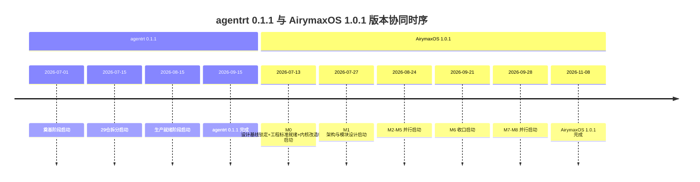

Copyright (c) 2025-2026 SPHARX Ltd. All Rights Reserved.

# agentrt-linux（AirymaxOS）开发路线与进度

> **文档定位**: agentrt-linux（AirymaxOS）开发路线图与进度跟踪，**闭源不公开**。本文档是 **v3.6 审查后的全面开发执行视图**——`docs/AirymaxOS/130-roadmap/`（docs 仓，权威）定义"做什么/为什么/验收什么"，本文档给出"按什么顺序做、每步测什么、何时可推进"的可执行节奏，首次补齐**内核代码模块级实施顺序**（Phase 0-6 总表）。
> **保密级别**: SPHARX Ltd 内部参考
> **版本**: v2.1（v3.6 三份审查结论基线 + Phase 0-6 模块化开发总表 + **Phase 0 已完成**）
> **最后更新**: 2026-08-01（v3.6 三轮深度对比审查闭环：kernel 框架 60% / docs 93% / 叶子仓结构完整；**Phase 0 已完成并验证，Phase 1 系统调用面已规划**）
> **适用范围**: AirymaxOS 架构委员会 + 内核开发组
> **工程取向**: "Linux 6.6 为基、seL4 为鉴"——基于 Linux 6.6 内核基线（v1.2 M0 框架编译验证 39 .o 零错误零警告 + arm64+airy 完整构建 EXIT_CODE=0）+ seL4 形式化微内核思想；ALK"只新增文件不改主线"策略规避 KABI 债务；IRON-9 v3 同源且部分代码共享
> **权威依据**: docs 仓 `docs/AirymaxOS/130-roadmap/`（02-milestones-and-timeline.md / 04-dependency-graph.md / 06-acceptance-criteria.md）为路线图权威口径，本文件为其执行视图
> **审查基线**: v3.6 三轮深度对比研究（`00-reviews/_review_v3.6/`，23 份报告）——第一轮 6 子域核心机制 29 项改进（89.5/A-）+ 第二轮 8 维度基础设施 22 项（N1-N22，86.0/B+）+ 第三轮工程标准 17 项（E1-E17，82.0/B），去重累计 68 项（1 P0 + 29 P1 + 37 P2 + 1 P3），三轮加权整体成熟度 86.3（B+）
> **关联研究**: 闭源 `00-reviews/_research_0.2.1/`（489+235 行）+ `_design_0.2.4/`（1903 行）+ `_review_0.9.0/`（7 份）+ `_review_v2.2/`（37 份）+ `_review_v3.5/` + `_review_v3.6/`（23 份）；开源 SSoT `docs/AirymaxOS/`（10-architecture / 20-modules / 30-interfaces / 40-dataflows / 50-engineering-standards / 80-testing / 110-security / 130-roadmap）

---

## 目录

1. [文档定位与权威依据](#1-文档定位与权威依据)
2. [状态基线（v3.6 三份审查结论）](#2-状态基线v36-三份审查结论)
3. [开发总原则：模块化开发流水线](#3-开发总原则模块化开发流水线)
4. [模块开发顺序总表（Phase 0-6）](#4-模块开发顺序总表phase-0-6)
5. [测试门禁矩阵](#5-测试门禁矩阵)
6. [里程碑重映射（Phase 0-6 ↔ M0-M8）](#6-里程碑重映射phase-0-6--m0-m8)
7. [版本策略](#7-版本策略)
8. [资源分配](#8-资源分配)
9. [进度跟踪机制](#9-进度跟踪机制)
10. [风险登记册](#10-风险登记册)
11. [与 agentrt 协同](#11-与-agentrt-协同)
12. [进度记录](#12-进度记录)
13. [闭源文档进度](#13-闭源文档进度)
14. [附录 A: 当前进度快照](#附录-a-当前进度快照)
15. [附录 B: 相关参考文档](#附录-b-相关参考文档)

---

## 1. 文档定位与权威依据

### 1.1 文档定位（v3.6 审查后更新）

本文档 v1.x 时代定位为"里程碑 + WBS + 验收"的总体规划，粒度停留在里程碑（M0-M8）与任务（Part 1-9）两级。v3.6 三份审查结论暴露了一个关键缺口（审查 B 明确建议）：**缺少"内核代码模块级实施顺序图"**——知道"什么时候做完"（里程碑），知道"验收什么"（OS-ACC），但不知道"以什么顺序把模块逐个落地、每步测什么、卡在哪里"。

本文档 v2.0 全面重写解决该缺口：

| 维度 | 旧文档（v1.x） | 本文档（v2.0） |
|------|---------------|---------------|
| 粒度 | 里程碑（M0-M8）+ 任务（Part 1-9） | **代码模块级**（Phase 0-6，28 个模块） |
| 顺序依据 | 文档体系依赖（Part 依赖矩阵） | **内核实现依赖**（syscall 面 → 安全/IPC → 调度/内存 → 治理 → 用户态 → 验证） |
| 推进规则 | 里程碑验收解锁 | **每模块五步流水线**（设计冻结→实现→测试→OS-ACC 验收→推进），任一模块未过验收不推进 |
| 测试要求 | 框架级（"KUnit 就位"） | **模块级具体用例**（每个模块列 KUnit/kselftest 用例） |
| 状态口径 | 里程碑完成度 | **审查就绪度 + 缺口清单 + 行动项** |

### 1.2 权威依据（docs 仓）

| 权威文档 | 路径 | 本文件引用方式 |
|---------|------|---------------|
| 里程碑与时间线 | `docs/AirymaxOS/130-roadmap/02-milestones-and-timeline.md` | M0-M8 定义与时间线，§6 重映射 |
| 依赖关系图 | `docs/AirymaxOS/130-roadmap/04-dependency-graph.md` | Part/模块依赖 + OS-ACC 里程碑门禁（§7.2），§4 前置依赖列引用 |
| 验收标准与质量门禁 | `docs/AirymaxOS/130-roadmap/06-acceptance-criteria.md` | **110 项 OS-ACC**（OS-ACC-001~110）+ 三层质量门禁（PR/里程碑/版本），§4 各模块"验收"列引用 |
| 开发策略 | `docs/AirymaxOS/130-roadmap/01-development-strategy.md` | 三大支柱与开发原则 |
| 资源估算 | `docs/AirymaxOS/130-roadmap/03-resource-estimation.md` | 人力/工时口径 |
| 风险缓解 | `docs/AirymaxOS/130-roadmap/05-risk-mitigation.md` | 风险编号引用 |

> **权威关系**：docs 仓定义"做什么/为什么/验收什么"，本文档定义"按什么顺序做、每步测什么、何时可推进"。两仓冲突时以 docs 仓为准，本文档同步更新。

---

## 2. 状态基线（v3.6 三份审查结论）

> 以下三份审查结论已完成事实核验（源码/仓库/CI 配置逐一确认），本文件直接采用作为开发基线。

### 2.1 审查 A：kernel 框架（就绪度 ≈60%）

| 子系统 | 就绪度 | 关键事实 |
|--------|--------|---------|
| 工程框架 | **90%** | Kconfig/Makefile 全接线；三架构 `airy_defconfig`（x86/arm64/sw_64）；arm64+airy 完整构建通过（EXIT_CODE=0）；x86 prepare 通过 |
| 安全子系统 | **75%** | `security/airy` 9 个生产 .c + `kernel/superv` 4 + `kernel/log` 3 真实实现；7 个 LSM hooks；1024 能力表（`agent_caps[1024]`）；三阶段检查（frozen → CAP_REQUEST → DSL → recheck → enforce） |
| 系统调用面 | **15%** | `kernel/syscalls/airy_syscalls.c` 4 个 syscall（548-551）全部 `-ENOSYS`（M1 脚手架，合规 OS-IRON-004）；x86/asm-generic 已注册 548-571；**sw_64 `syscall.tbl` 止于 518，未注册 airy 号段** |
| 调度/内存 | **30%** | `sched_tac` 的 `stc_dispatch_enqueue` 无调用者，未接入主路径；`airy_mem_tier` 仅分类器；zero-copy SEND/RECV 未实现 |
| openEuler 硬件驱动 | **20%** | 仅 sw_64 367 文件 + `euler_hw_*.config` 三架构配置；`drivers/hw-vendor/` 不存在；无 KABI/xsched/ummu |
| airy 自有代码 | — | 44 个 .c（38 生产 + 5 KUnit 测试 + 1 bench），约 5616 行 |
| 版本库卫生 | ⚠️ | `build-arm64.log` 被 git 跟踪（commit 278ebfb19ca6 带入）；树内残留 arm64 编译产物导致 `O=` 分离构建被 kbuild 拦截；`.gitmodules` 声明 `develop/hubs-01` 但 kernel 实际分支为 `ALK-6.6-dev` |

### 2.2 审查 B：docs/AirymaxOS（就绪度 ≈93%，有条件 GO）

| 维度 | 状态 |
|------|------|
| 核心设计要素 SSoT | ✅ 10 项核心设计要素全有权威文档（架构/capability/LSM/SC 调度/MemoryRovol/IPC/工程标准/测试/路线图/known-caveats） |
| 验收体系 | ✅ 110 项 OS-ACC + 三层质量门禁（PR/里程碑/版本）+ 里程碑门禁（M0 过 OS-ACC-001~020 解锁 M1）；"开发一模块→KUnit/kselftest→OS-ACC 验收→解锁下一模块"执行链已存在 |
| 缺口 1 | ⚠️ **缺"内核代码模块级实施顺序图"**（建议补）——本文档 §4 即补此缺口 |
| 缺口 2 | 2 处低优先文档漂移：`sched.h` 的 `__attribute__((aligned(64)))` vs `AIRY_ALIGNED(64)`（对应 v3.6 P1-5，已落地）、`reserved` vs `_reserved` |

### 2.3 审查 C：叶子仓（结构完整，kernel 领先）

| 维度 | 状态 |
|------|------|
| 8 子模块结构 | ✅ kernel 真实实现；其余 7 仓为"真实可编译最小骨架"（每仓 1 个 .c，186-377 行）；`build/`/`tools/`/`scripts/` 是管理仓目录 |
| build/ 定义 | ✅ 构建定义非编译产物：`airy-kernel.spec` 5 包拆分 + `ks-airymax.cfg` + `meta-airymax` 3 recipe；**spec 的 Patch0 为 placeholder**（待真实补丁） |
| 一致性问题 1 | ⚠️ `tools/` 9 个 .py + `codegen/` 未入版本控制（`.gitignore` 白名单缺 `!tools/**` `!scripts/**`） |
| 一致性问题 2 | ⚠️ CI 引用 7 个不存在的脚本（`formal-verify.py` 等） |
| 一致性问题 3 | ⚠️ `ci-airy.yml` 监听不存在的 `kernel/config/Kconfig.alk` |
| tests-linux | 1 个测试（`test_ipc_magic`，8 函数 42 断言） |

### 2.4 阻断全面开发的缺口清单（8 项）

> **更新（2026-08-01，Phase 0 完成）**：G-02/G-05/G-06/G-07 已清零（Phase 0 修复落地并验证），G-08 已由本文档 §4 清除。剩余待处置：G-01（Phase 1）、G-03（Phase 3）、G-04（全程）。

| # | 缺口 | 来源 | 影响 | 处置归属 | 状态 |
|---|------|------|------|---------|------|
| G-01 | **系统调用面 15%**：4 syscall 全 -ENOSYS | 审查 A | 用户态无法调用任何 Airymax 内核能力，Phase 1 之前用户态开发不可行 | Phase 1 | ⏳ 待启动 |
| G-02 | **sw_64 号段未接线**：syscall.tbl 止于 518 | 审查 A | sw_64 后续一切 syscall 功能的基础缺失 | Phase 0（前置） | ✅ **已清零**（kernel `dd990c6`：548-571 注册，`__NR_syscalls=572` 生成验证通过） |
| G-03 | **sched_tac 未接入主路径**：stc_dispatch_enqueue 无调用者 | 审查 A | 调度/内存模块无法在真实调度循环中生效 | Phase 3 | ⏳ 待启动 |
| G-04 | **openEuler 驱动导入**：drivers/hw-vendor/ 不存在，无 KABI/xsched/ummu | 审查 A | 硬件复用层仅 20%，sw_64 真机生态不可用 | 全程（依赖 sw_64 硬件） | ⏳ 待启动 |
| G-05 | **版本库卫生**：build-arm64.log 被跟踪 + 树内产物 | 审查 A | O= 分离构建被 kbuild 拦截，CI 无法干净复现 | Phase 0 | ✅ **已清零**（kernel `0207ff0`：日志移出跟踪 + `/build-*.log` 规则；O= x86_64 airy_defconfig + bzImage 全量构建通过） |
| G-06 | **CI 工具未跟踪**：tools/ 9 .py + codegen/ 未入版本控制，CI 引用 7 个不存在脚本 | 审查 C | CI 流水线实际不可运行 | Phase 0 | ✅ **已清零**（管理仓 `8fe4e7d` 14 工具入库 + `7813134` CI 路径修复/守卫） |
| G-07 | **分支声明失效**：.gitmodules 声明 develop/hubs-01 vs kernel 实际 ALK-6.6-dev | 审查 A/C | 子模块检出行为与预期不符 | Phase 0 | ✅ **已清零**（管理仓 `ef6103e`：kernel 分支声明对齐 ALK-6.6-dev） |
| G-08 | **docs 模块级顺序图缺失** | 审查 B | 开发缺乏代码级实施顺序（本文档 §4 即补此缺口） | 本文档 | ✅ 已清除（v2.0 重写） |

---

## 3. 开发总原则：模块化开发流水线

### 3.1 五步流水线（每模块强制）

v3.6 审查（尤其审查 B 的"执行链已存在"）确认了模块化验收的执行框架。本原则将其固化为**每模块五步、未过验收不推进**的硬性流程：

```
① 设计冻结 ──> ② 实现 ──> ③ KUnit/kselftest ──> ④ OS-ACC 验收 ──> ⑤ 进入下一模块
    │             │              │                    │
  对齐 SSoT      按 ALK 策略     具体用例              执行对应 OS-ACC
  文档 + ADR     只新增文件      （见 §5 门禁矩阵）    工程规范委员会
    │             │              │                    │
    └─────────────┴──────────────┴────────────────────┘
              任一模块未过验收：不启动依赖它的下一模块
```

| 步骤 | 内容 | 产物 | 责任人 |
|------|------|------|--------|
| ① 设计冻结 | 对齐 docs/AirymaxOS SSoT 文档（无 SSoT 则先补文档 + ADR 裁决）；引用 v3.6 改进编号（P1-x/Nx/Ex）作为实现要求 | 设计说明 + SSoT 对齐检查 | 架构委员会 |
| ② 实现 | 按 ALK"只新增文件不改主线"策略实现；Kconfig/Makefile 接线；编译零错误零警告 | 代码 + 构建验证 | 内核开发组 |
| ③ 测试 | 按模块类型执行 §5 矩阵对应手段（KUnit/kselftest/动态/静态/模糊/形式化） | 测试用例 + 运行记录 | 测试组 |
| ④ OS-ACC 验收 | 执行模块对应 OS-ACC（§4 各表"验收"列），通过即记录；不通过回退 ②/③ | OS-ACC 验收记录 | 工程规范委员会 |
| ⑤ 推进 | 标记模块 DONE，解锁其下游模块；更新本文档 §12 进度记录 | 进度更新 + 里程碑门禁复查 | 架构委员会 |

### 3.2 为什么必须模块化串行推进

v3.6 审查确认了三个系统性教训：

1. **依赖未就绪就开发上层模块必然返工**（审查 A：sched_tac 未接入主路径时，任何基于 stc_dispatch_enqueue 的测试都是空转；syscall 全 -ENOSYS 时，用户态 daemon 开发只能 mock）。
2. **占位与真实实现的边界必须文档化**（审查 B 的 2 处文档漂移、审查 C 的 CI 引用不存在脚本，都是"文档承诺超前于实现"的工程诚信问题——诚实标注"预留"与"已落地"）。
3. **一个模块一个逻辑变更**（git bisect 友好；模块级验收 = 最小可验证单元；符合 OS-IRON 提交规范）。

### 3.3 与 docs 仓执行链的关系

docs 仓 `06-acceptance-criteria.md` §12.2 已定义"里程碑门禁：M0 过 OS-ACC-001~020 解锁 M1"的链路。本原则将门禁从**里程碑粒度**下沉到**模块粒度**：

- 里程碑门禁（已有）：M 完成 → 过整组 OS-ACC → 解锁下一 M
- **模块门禁（新增）**：Phase 内模块完成 → 过该模块 OS-ACC → 解锁 Phase 内下一模块
- 两层门禁关系：模块门禁是里程碑门禁的**子集前置**——所有模块过验收是里程碑验收通过的必要条件（非充分条件，里程碑还需文档/工程类 OS-ACC）

---

## 4. 模块开发顺序总表（Phase 0-6）

### 4.1 Phase 总览

| Phase | 名称 | 时间窗口 | 模块数 | 里程碑归属 | 完成标准（退出条件） | 状态 |
|-------|------|---------|--------|-----------|---------------------|------|
| Phase 0 | 工程基线修复（无新功能） | 1-2 周 | 5 | M0 收尾 + M1 前置 | 干净 O= 构建通过、CI 工具全跟踪、sw_64 syscall 号段接线，阻断缺口 G-02/G-05/G-06/G-07 清零 | ✅ **已完成（2026-08-01）** |
| Phase 1 | 系统调用面落地 | 2-4 周 | 4 | M2 核心 | 4 syscall 真实实现 + kselftest 用户态 + KUnit 内核态全绿，缺口 G-01 清零 | ⏳ 待启动 |
| Phase 2 | 安全与 IPC 深化 | 3-4 周 | 3 | M2 | LSM 入口全对称、fastpath 前置条件文档化、并发改造完成 | ⏳ |
| Phase 3 | 调度与内存落地 | 4-6 周 | 4 | M2-M3 | sched_tac 挂接主路径、CBS 准入、tier 路由、zero-copy 可用，缺口 G-03 清零 | ⏳ |
| Phase 4 | 运行时治理 | 4-6 周 | 5 | M3-M5 | hrtimer/SC 捐赠/lockdown/MemoryRovol/suspend-resume 全落地 | ⏳ |
| Phase 5 | 用户态与服务层 | 6-8 周 | 3 | M5-M7 | 12 daemons 骨架→实现、7 仓从骨架到实现、tests-linux 扩展 | ⏳ |
| Phase 6 | 验证与收口 | 4-6 周 | 4 | M6-M8 | 形式化 Phase 1-4、性能基准真机采集、sw_64 OBS 构建、CAVEATS 更新 | ⏳ |

**总计：7 个 Phase，28 个代码模块**（Phase 0 的 5 项为无新功能的工程修复，Phase 1-6 的 23 项为功能模块）。**截至 2026-08-01：Phase 0 完成（5/5 模块），Phase 1-6 共 23 个功能模块待开发。**

### 4.2 Phase 0：工程基线修复（1-2 周，无新功能）—— ✅ 已完成（2026-08-01）

> **目标**：在 M0 之后立即清理版本库卫生与工程接线问题，为 sw_64 后续一切开发建立干净基线。本 Phase 无新功能，全部为工程修复（阻断缺口 G-02/G-05/G-06/G-07）。

| 序号 | 模块 | 前置依赖 | 实现内容 | 测试要求 | 验收（OS-ACC） | 状态 |
|------|------|---------|---------|---------|---------------|------|
| P0-1 | 版本库卫生修复 | 无 | 移除 `build-arm64.log` 跟踪（git rm --cached）+ 补 `/build-*.log` gitignore 规则；`make mrproper` 清理树内残留产物后 `O=` 分离构建验证 | `O=` x86_64 airy_defconfig + bzImage 全量构建 EXIT_CODE=0，`git status` 无编译产物 | OS-ACC-002/049（CI 复现） | ✅ kernel `0207ff0` |
| P0-2 | .gitmodules 分支声明修正 | 无 | `.gitmodules` 声明 `develop/hubs-01` → `ALK-6.6-dev`（与实际分支对齐），8 子仓逐一核验 | `git submodule status` 8 仓全部一致无漂移 | OS-ACC-002/050 | ✅ 管理仓 `ef6103e` |
| P0-3 | tools/scripts 纳入版本控制 | 无 | `.gitignore` 白名单补 `!tools/**` `!scripts/**` + `__pycache__` 排除；tools/ 9 个 .py + abi-check/ + codegen/ + maintainers_to_codeowners.pl 共 14 文件入库 | 工具脚本可执行；`git ls-files tools/` 全跟踪、pycache 0 命中 | OS-ACC-018（7 层验证）/049 | ✅ 管理仓 `8fe4e7d` |
| P0-4 | CI 工作流修复 | P0-3 | `ci-airy.yml` 移除不存在的 `kernel/config/Kconfig.alk` 监听路径；`nightly.yml` 6 个缺失脚本（formal-verify/soak-runner/chaos-runner/auto-bisect/create-revert-pr/ci-budget-check）加存在性守卫（显式 SKIP）；`release.yml` merge-sbom.py 守卫 + `make binrpm-pkg` 补 `working-directory: kernel` | 3 个 workflow YAML 语法校验通过 | OS-ACC-017/049 | ✅ 管理仓 `7813134` |
| P0-5 | **sw_64 syscall 号段接线** | 无 | 548-571 注册到 `arch/sw_64/kernel/syscalls/syscall.tbl`：548-551 映射 `sys_airy_*` + 552-571 预留槽 `sys_ni_syscall`（对齐 x86/asm-generic 已注册号段） | `syscallhdr.sh`/`syscalltbl.sh` 生成验证：`__NR_syscalls=572`，24 个宏全部正确产出 | OS-ACC-037（ABI 检查） | ✅ kernel `dd990c6` |

> **为什么 P0-5 放 Phase 0**：sw_64 syscall.tbl 止于 518 是 sw_64 架构一切 syscall 功能的基础——不先接线，Phase 1 的 4 个 syscall 在 sw_64 上无从谈起。P0-5 是 sw_64 后续所有 Phase 的前置。

**Phase 0 退出条件**：✅ **已达成（2026-08-01）**——G-02/G-05/G-06/G-07 全部清零；O= 分离构建（x86_64 airy_defconfig + bzImage）干净通过（EXIT_CODE=0，`CONFIG_SECURITY_AIRY/AIRY_IPC/AIRY_COREKERN/AIRY_SYSCALL` 全部 `=y`）；CI 工具链全部可运行（YAML 校验通过）。

**Phase 0 关键产出**：
1. **sw_64 syscall 号段接通**：548-571 全部注册，`__NR_syscalls=572` 与 asm-generic 对称——sw_64 与 x86/arm64 现处于同一 syscall 基线。
2. **构建可复现**：mrproper + O= 分离构建打破此前 kbuild 拦截，CI 可干净复现（`0207ff0`）。
3. **版本库卫生达标**：build-arm64.log 移出跟踪，根目录 `/build-*.log` 规则生效（不误伤上游 kunit test_data 夹具）。
4. **CI 工具全入库**：14 个工具脚本/工具链入版本控制，新 clone 不再缺依赖（`8fe4e7d`）。
5. **CI 工作流语义修正**：路径监听与实际文件一致、缺失脚本显式 SKIP 而非隐晦 WARN、构建 working-directory 正确（`7813134`）。
6. **分支声明对齐**：kernel 子模块分支 = ALK-6.6-dev，与 .gitmodules 一致（`ef6103e`）。

### 4.3 Phase 1：系统调用面落地（M2 核心，最高优先）

> **目标**：将 `kernel/syscalls/airy_syscalls.c` 从 -ENOSYS 脚手架推进到真实实现，打通用户态 → 内核态的第一条调用链（阻断缺口 G-01）。每 syscall 独立子模块，完成一个测一个。
>
> **实现基线（2026-08-01 现状）**：`airy_syscalls.c`（198 行）4 个 `SYSCALL_DEFINE` 已含参数校验（null 检查/magic 检查/opcode 范围/phase 范围），全部 op 分支返回 `-ENOSYS`；[SC] `syscalls.h` 定义 `AIRY_SYS_CALL=548..AIRY_SYS_CLT_NOTIFY=551`；x86/asm-generic/sw_64 三架构号段已注册（Phase 0-5 完成）。

#### P1-1 airy_sys_call（548）—— IPC 命令分发主入口

**前置依赖**：Phase 0（已完成）；`kernel/corekern/ipc/` 的 ring/fastpath/zero-copy 基础设施（已存在）；`security/airy/airy_cap_check.c` 5-phase 校验（已存在）。

**实现步骤**：
1. **Badge 校验接入**：在 `copy_from_user` 与 magic 校验之后、opcode 分发之前，调用 `airy_cap_badge_ok(cap, current_agent_id, AIRY_CAP_IPC)`——复用 `security/airy/airy_cap.h` 的 fastpath inline（~10ns，已实测 2-10ns）；校验失败返回 `-AIRY_ECAP_MISSING`。
2. **SEND/SEND_BATCH**：调用 `airy_ipc_ring_post()` 将 `hdr` 投递到 `current` 的 `ipc_ring`（经 `airy_ipc_ring_for_task(current)` 取 ring，N3 接线项），成功返回 `0` + 通过 CQE 语义反馈；ring frozen 返回 `-AIRY_EIPC_FROZEN`。
3. **RECV**：调用 `airy_ipc_ring_consume()` 取出一条消息拷贝到用户态 `msg`（`copy_to_user`），返回消费字节数。
4. **CANCEL**：调用 `airy_ipc_cancel_badged_sends()`（P1-8 已实现），按 badge 取消在途发送，返回取消条数。
5. **FREEZE**：校验 `AIRY_CAP_IPC_FREEZE` 权限（Badge perms 位）后调用 `airy_ipc_freeze_ring()`；无权限返回 `-EACCES`（supervisor-only）。
6. **CAP_REQUEST/CAP_RESPONSE**：引导期走 io_uring_cmd 路径（本 syscall 明确拒绝返回 `-EINVAL`，保持与注释声明的"bootstrap 走 uring_cmd"一致）。
7. **并发与内存序**：SEND/RECV 遵循 SPSC acquire/release 配对（`smp_store_release`/`smp_load_acquire`），不做额外加锁；CANCEL/FREEZE 在 ring 级锁内执行。

**测试用例**：
- KUnit（`kernel/syscalls/airy_syscalls_test.c`，新建）：① SEND 成功入环（断言 ring head 推进 + slot 内容正确）；② 未知 opcode → `-EINVAL`；③ Badge 缺失/epoch 不匹配 → `-AIRY_ECAP_MISSING`；④ frozen ring → `-AIRY_EIPC_FROZEN`；⑤ FREEZE 无权限 → `-EACCES`；⑥ cap==AIRY_CAP_NULL → `-EINVAL`；⑦ msg==NULL → `-EFAULT`；⑧ magic 错误 → `-EINVAL`。
- kselftest（`tools/testing/selftests/airymax/`，新建）：① 用户态构造 `struct airy_ipc_msg_hdr` 调 `syscall(548, badge, &hdr)` 验证 SEND 返回 0；② RECV 取回消息比对；③ 错误 badge 返回负值 errno 映射。

**验收（OS-ACC）**：OS-ACC-026（AgentsIPC）/033（io_uring）/041~044；**退出信号**：上述 KUnit 8 用例 + kselftest 3 用例全绿。

#### P1-2 airy_sys_rovol_ctl（549）—— 记忆卷控制

**前置依赖**：P1-1；`memory_types.h` **需新增 rovol op 枚举**（当前无 `AIRY_ROVOL_OP_*`，先补 [SC] 定义，走 codegen 流程）。

**实现步骤**：
1. **[SC] 枚举补齐**：`memory_types.h` 定义 10 个 op（SNAPSHOT/RESTORE/MIGRATE/TIER_SET/TIER_GET/MGLRU_CONFIG/LIST/DELETE/DEMOTE/PROMOTE）+ 参数结构体；同步 `syscall.xml` + `syscall_gen.py` 生成（三方一致性）。
2. **op 分发骨架**：`switch(op)` 分派 10 分支，未知 op → `-EINVAL`；pid 校验（`pid <= 0` → `-EINVAL`）。
3. **SNAPSHOT 真实实现**：对目标 agent 内存映射建立版本快照（`airy_mem_tier` 读侧 + 页表 freeze 语义），登记到快照表，返回快照 id。
4. **LIST**：枚举当前 agent 的快照列表到用户态缓冲区。
5. **DELETE**：释放指定快照并回收映射（`vmunmap`/`zap_vma_pages` 语义，06 报告 §3.2）。
6. **其余 7 op**：返回 `-EOPNOTSUPP`（Phase 4 P4-4 深化），保持进度自包含（IRON-4）。
7. **能力检查**：rovol 操作要求 `AIRY_CAP_MEM_ROVOL`（Badge perms 位），缺失返回 `-AIRY_ECAP_MISSING`。

**测试用例**：
- KUnit：① op==0 → `-EINVAL`；② 未知 op → `-EINVAL`；③ SNAPSHOT 成功（快照表 +1）；④ SNAPSHOT→DELETE 生命周期；⑤ LIST 空表/非空表；⑥ 能力缺失拒绝。
- kselftest：① 用户态调 `syscall(549, SNAPSHOT, pid, arg)` 验证返回快照 id；② LIST 取回。

**验收（OS-ACC）**：OS-ACC-025/041~044；**退出信号**：KUnit 6 用例 + kselftest 2 用例全绿；三架构编译通过。

#### P1-3 airy_sys_sched_ctl（550）—— 调度控制

**前置依赖**：P1-1；`kernel/corekern/sched/` 的 stc_policy/stc_mcs_map/stc_dispatch（已存在）；`sched.h` 4 策略枚举（已存在，L102-105）。

**实现步骤**：
1. **op 校验**：`sched.h` 需新增 `AIRY_SCHED_OP_*` 枚举（当前无 op 定义，补 [SC] 头 + codegen）；`op==0` → `-EINVAL`（现有校验保留）。
2. **策略设置**：`AIRY_SCHED_OP_SET_POLICY`——`copy_from_user` 读 `policy` 字符串 → 映射 `AIRY_SCHED_POLICY_*`（1-4）→ 调用 `stc_policy_to_linux()`（L26-40，映射 SCHED_DEADLINE/FIFO/EEVDF/BATCH）→ `sched_setscheduler()` 应用到目标 task。
3. **策略查询**：`AIRY_SCHED_OP_GET_POLICY`——读回当前 task 的 `airy_task_desc.policy`，`copy_to_user` 返回。
4. **8 态迁移触发**：`AIRY_SCHED_OP_SET_STATE`——校验目标状态在 `airy_task_lifecycle` 12 条合法转移表内（L97-110），非法迁移 → `-EPERM`；合法则更新 `airy_task_sec.agent_state`。
5. **cgroup_path 参数**：当前校验 `cgroup_path==NULL` → `-EINVAL`（保留）；M2 先按字符串路径解析 `cgroup_get_from_path()`，失败 `-ENOENT`。
6. **[DSL] 降级**：4 策略在 DSL 编译期折叠为 EEVDF（uapi_compat.h L116-119 已有宏），运行时无降级分支（编译期已定）。

**测试用例**：
- KUnit（`stc_sched_ctl_test.c` 或并入 `airy_syscalls_test.c`）：① op==0 → `-EINVAL`；② 非法策略字符串 → `-EINVAL`；③ 合法策略映射到正确 sched_class；④ 非法状态迁移（8 态表外）→ `-EPERM`；⑤ 合法迁移成功；⑥ policy==NULL/cgroup_path==NULL → `-EINVAL`。
- kselftest：① 用户态 `syscall(550, SET_POLICY, path, "DEADLINE")` 后 GET_POLICY 回读一致；② sched_setattr 兼容路径。

**验收（OS-ACC）**：OS-ACC-025（sched_tac）/041~044；**退出信号**：KUnit 6 用例 + kselftest 2 用例全绿。

#### P1-4 airy_sys_clt_notify（551）—— 认知生命周期通知

**前置依赖**：P1-1；`cognition_types.h` 3 phase 枚举（已存在，L27-31）；`kernel/corekern/` 的事件/通知基础设施。

**实现步骤**：
1. **phase/task_id 校验**：保留现有（`phase >= AIRY_COG_PHASE_MAX` → `-EINVAL`；`task_id < 0` → `-EINVAL`）。
2. **通知注册**：`AIRY_COG_NOTIFY_REGISTER`（可选 op，若引入）——将 `task_id` 挂到事件通知链表。
3. **事件分发**：将 `(task_id, phase)` 封装为通知事件，经 `airy_eventfd_signal_fault()` 通道（P2 中 eventfd 已实现）推送给注册的 Macro-Supervisor / 目标 agent。
4. **die/fault 通知路由**：映射到 `airy_die_map_fault()`（security/airy/airy_die_notify.c，已存在）的 fault code，复用 die_notifier 链（N13 部分收敛）。
5. **并发**：通知链表用 `airy_lock` 保护（沿用 kernel/corekern/locking），批量通知走读锁路径。

**测试用例**：
- KUnit：① phase 越界 → `-EINVAL`；② task_id<0 → `-EINVAL`；③ 正常 PERCEPT/THINK/ACT 通知成功（断言事件计数）；④ 并发通知无 data race（KCSAN）；⑤ 注册-通知-注销生命周期。
- kselftest：① 用户态 `syscall(551, tid, PERCEPT)` 返回 0；② eventfd 端到端：注册 eventfd → 通知 → 用户态读到事件。

**验收（OS-ACC）**：OS-ACC-031/041~044；**退出信号**：KUnit 5 用例 + kselftest 2 用例全绿。

#### Phase 1 模块依赖与顺序

```
P1-1 (airy_sys_call) ──► P1-2 (rovol_ctl) ──► P1-3 (sched_ctl) ──► P1-4 (clt_notify)
  （Badge 校验+ring 接线）   （依赖 P1-1 的 Badge 接入）   （独立，依赖 [SC] op 枚举）   （独立，复用 eventfd/die_notify）
```

**顺序理由**：P1-1 打通"用户态→syscall→Badge 校验→ring"主链，是其余 3 个的公共前置（Badge 校验模式复用）；P1-2 依赖 P1-1 的 Badge 接入 + 需补 [SC] 枚举（走 codegen）；P1-3/P1-4 无强依赖可并行，但建议按序号串行以保持"一次一个可测交付"。

**Phase 1 退出条件**：4 syscall 全部真实实现（无 -ENOSYS，`AIRY_IPC_OP_*` 全 opcode 分发）；每 syscall 至少 1 个 kselftest 用例 + 1 个 KUnit 用例全绿；x86/arm64/sw_64 三架构编译通过；`syscall_gen.py --check --check-tbl` 零漂移。

### 4.4 Phase 2：安全与 IPC 深化

> **目标**：收敛 v3.6 安全/IPC 领域剩余改进项（N2/P1-6、E12/P2-7、N10/P1-11/N4），使安全入口完全对称、IPC fastpath 可论证。

| 序号 | 模块 | 前置依赖 | 实现内容 | 测试要求 | 验收（OS-ACC） |
|------|------|---------|---------|---------|---------------|
| P2-1 | airy_lsm 完整性 | Phase 1 | `superv_lsm` 5 补充钩子 Badge 校验（N2，P1-4 残余半收敛项）；`airy_inode_sec` inode blob 接线 VFS（P1-6） | KUnit：superv 钩子 Badge 校验矩阵、inode blob 生命周期；kselftest：task_kill/file_open 拒绝路径 | OS-ACC-062（capability）/063（LSM）/066（纯 C LSM） |
| P2-2 | IPC fastpath 完善 | P1-1 | fastpath 唯一合法入口声明文档化（E12，fastpath 不得绕过 LSM 5-phase）；magic check 评估（P2-7） | KUnit：fastpath 前置条件断言（AIRY_COMPILE_ASSERT，E1 前置）；性能：fastpath 回归 ≤ 基线（§12.1 实测） | OS-ACC-026/066 |
| P2-3 | 并发改造 | P2-1 | cap_array 高频读 RCU wrapper（N10）；per-bucket 锁替代全局 spinlock（P1-11）；object 锁改造（N4） | KUnit：并发 cap 读写/KCSAN 无 data race；动态分析：KCSAN/KASAN 全开 | OS-ACC-042（覆盖率）/049 |

**Phase 2 退出条件**：LSM 入口全对称（io_uring_cmd/task_kill/file_open 一致）；fastpath 前置条件有编译期断言 + 文档；并发改造通过 KCSAN/KASAN；IPC benchmark 性能无回归。

### 4.5 Phase 3：调度与内存落地

> **目标**：将调度/内存从"分类器/占位"推进到"接入主路径可运行"（阻断缺口 G-03）。

| 序号 | 模块 | 前置依赖 | 实现内容 | 测试要求 | 验收（OS-ACC） |
|------|------|---------|---------|---------|---------------|
| P3-1 | sched_tac 接入调度主路径 | Phase 1 | `stc_dispatch_enqueue` 挂接 CFS/调度核心（tick 入口 + enqueue 路径）；budget 入口检查（P2-2，`airy_budget_guard` 于 `airy_sched_tick`/IPC 入口双重检查） | KUnit：enqueue/dispatch 主路径回归（复用 P1-1/4/5/8/10 回归）；性能：调度延迟基线 | OS-ACC-025/042 |
| P3-2 | CBS 准入（P2-1） | P3-1 | `airy_cbs.c`：利用率上界 Σ(runtime/period) ≤ 0.85、sporadic server 补充周期、[DSL] 降级单点校验 | KUnit：超载拒绝（-AIRY_EBUSY）/补充时序抖动 ≤1%/撤销后带宽释放 | OS-ACC-025/042~044 |
| P3-3 | 内存 tier 路由（N8）+ per-agent 账户（N7） | Phase 1 | tier → NUMA node 真实路由（`airy_mem_tier` 从分类器到路由）；per-agent 内存账户（对齐 memcg 思路，ALK 新增文件） | KUnit：tier 选择/账户记账/超限拒绝；kselftest：内存压力场景 | OS-ACC-029（MGLRU）/030（CXL）/042 |
| P3-4 | zero-copy SEND/RECV 实现（E8） | P3-3 | zero-copy 发送/接收真实实现 + 与 MemoryRovol 版本治理交互文档化（快照 or 共享，E8） | KUnit：零拷贝路径/页所有权转移/快照交互；性能：吞吐对比非零拷贝 | OS-ACC-026/042 |

**Phase 3 退出条件**：sched_tac 主路径挂接生效（stc_dispatch_enqueue 有调用者）；CBS 准入通过 KUnit 全用例；tier 路由生效；zero-copy 可用且有性能数据。

### 4.6 Phase 4：运行时治理（M3-M5）

> **目标**：落地 v3.6 指出的"运行时治理层"四类缺失（CBS 已前置到 P3-2，其余在此）+ MemoryRovol 真实实现 + suspend/resume API。

| 序号 | 模块 | 前置依赖 | 实现内容 | 测试要求 | 验收（OS-ACC） |
|------|------|---------|---------|---------|---------------|
| P4-1 | hrtimer 超时唤醒（N5） | Phase 1 | `airy_timer_arm`：agent 超时唤醒 hrtimer 封装（airy_time.c 从 ktime wrapper 到 hrtimer 真实机制） | KUnit：超时触发/取消/重载；kselftest：超时唤醒端到端 | OS-ACC-031/042~044 |
| P4-2 | SC 捐赠（P2-3） | P3-1 | `airy_sc_donate.c`：donor→receiver 预算捐赠握手（AIRY_IPC_FLAG_SC_DONATE）+ 4 种撤销条件 + [DSL] 降级为优先级继承 | KUnit：握手/撤销/强制撤销/并发捐赠；ftrace：sc_donate_* 事件 | OS-ACC-025/066 |
| P4-3 | lockdown 机制（P2-4） | P2-1 | `airy_lockdown.c`：early/late/full 三阶段收敛（Linux lockdown 扩展 + `airy_sys_admin` 新增 op）；`airy_lockdown_gate()` 接入全部可写 Airymax 接口 | KUnit：阶段切换单调性/接口收敛/lockdown 拒绝不触发 fault；kselftest：/dev/mem 拒绝 | OS-ACC-061~070 |
| P4-4 | MemoryRovol 真实实现（P2-14） | P1-2 + P3-3 | `mm/rovol/airy_rovol*.c`：10 op 全实现（revoke 两阶段删除/evolve 层级迁移/restore userfaultfd）；**先写形式化时序图**（spec/proof 先行，对齐 ES-SEL4-5） | KUnit：revoke/evolve/restore/cap 级联撤销/IPC ring 取消协同；形式化：时序图过审 | OS-ACC-025/046（形式化）/061~070 |
| P4-5 | suspend/resume 显式 API（N11） | P4-1 | `airy_sys_admin` 显式 suspend/resume 接口（对齐 seL4 TCB suspend 语义），替代隐式状态漂移 | KUnit：suspend→resume 状态合法转移/进行中 IPC 处置 | OS-ACC-031/042 |

**Phase 4 退出条件**：运行时治理四类缺失（budget/CBS/SC 捐赠/lockdown）全部有实现 + 用例；MemoryRovol 10 op 全实现且形式化时序图过审；suspend/resume API 落地。

### 4.7 Phase 5：用户态与服务层

> **目标**：内核侧（Phase 0-4）就绪后启动用户态——此时 4 syscall 真实可用，daemon 开发不再依赖 mock。

| 序号 | 模块 | 前置依赖 | 实现内容 | 测试要求 | 验收（OS-ACC） |
|------|------|---------|---------|---------|---------------|
| P5-1 | services 12 daemons | Phase 1 + 4 | 12 daemons（sec_d/cogn_d/mem_d/gateway_d/logger_d/macro_d/audit_d/sched_d/dev_d/net_d/vfs_d/config_d）从"仅 macro_d"到全实现；`*_d` 命名无例外（v2.0 决策） | kselftest：每 daemon 端到端冒烟；集成：daemon 间 IPC | OS-ACC-038（12 daemons）/091~100 |
| P5-2 | 7 仓从骨架到实现 | Phase 1 + 4 | cloudnative/cognition/memory/security/system/services/tests-linux 各仓从"1 个 .c 最小骨架"到对应子系统实现（对齐各仓架构文档） | KUnit 聚合 + kselftest（各仓） | OS-ACC-021~040（架构落地）/091~100 |
| P5-3 | tests-linux 扩展 | Phase 0-4 持续 | KUnit 聚合框架 + kselftest 套件 + LTP 兼容测试 + perf harness；`test_ipc_magic`（8 函数 42 断言）为起点扩展 | 全量回归门禁；覆盖率 ≥80%（单元）/≥70%（集成） | OS-ACC-042~050 |

**Phase 5 退出条件**：12 daemons 全部可运行；7 仓实现对齐架构文档；tests-linux 覆盖 Phase 1-4 全部模块且有覆盖率报告。

### 4.8 Phase 6：验证与收口

> **目标**：形式化验证、性能基准、sw_64 OBS 远程构建验证、CAVEATS 更新，收口 1.0.1。

| 序号 | 模块 | 前置依赖 | 实现内容 | 测试要求 | 验收（OS-ACC） |
|------|------|---------|---------|---------|---------------|
| P6-1 | 形式化验证落地 | Phase 4 | `10-formal-verification.md` Phase 1-4 落地（spec/proof/capdl 三段式；调度器核心、IPC fastpath、capability 派生模型）；E2 验证注解（MODIFIES/FNSPEC）+ E3 配置锁存 | CBMC 全函数验证（H5）；Isabelle/HOL 关键路径 | OS-ACC-046/066 |
| P6-2 | 性能基准真机采集 | Phase 3 + 4 | `airy_fastpath_bench` 从 UML/WSL2 迁移真机采集；调度/内存/IPC/认知循环四类基准（对齐 170-performance/） | 性能基线报告；regression ≤5% | OS-ACC-101~110（OS-ACC-103/109/110） |
| P6-3 | sw_64 OBS 构建验证 | Phase 0 + 5 | `13-obs-remote-build.md` 落地：OBS 远程构建 sw_64 内核包（airy-kernel.spec 5 包拆分 + Patch0 真实化）；QEMU sw_64 冒烟 | OBS 构建通过 + 产物安装冒烟 | OS-ACC-049/104（硬件兼容矩阵） |
| P6-4 | CAVEATS 更新 | Phase 6 全部 | `09-known-caveats.md` 更新：SMP 验证覆盖标注（E4）、[DSL] 触发时域（E9）、实现 vs 预留诚实声明（对齐 seL4 CAVEATS 传统） | 文档审查 | OS-ACC-081~090（收口） |

**Phase 6 退出条件**：形式化 Phase 1-4 全落地；性能基准真机数据入档；sw_64 OBS 构建验证通过；CAVEATS 无"文档承诺、实现空白"残留；全部 110 项 OS-ACC 通过 → 1.0.1 发布。

---

## 5. 测试门禁矩阵

> 对应 docs 仓 `80-testing/` 体系（7 层验证：checkpatch → 编译 → 单元 → 集成 → 性能 → Soak → 形式化）。每类模块按行匹配测试手段，列内为强制项。

| 模块类别 | KUnit | kselftest | 动态分析（KCSAN/KASAN） | 静态分析（sparse/smatch） | 模糊测试（syzkaller） | 形式化 | 对应 80-testing/ 文档 |
|---------|:-----:|:---------:|:-----------------------:|:------------------------:|:---------------------:|:------:|---------------------|
| 系统调用面（Phase 1） | ✅ 每 syscall 参数/错误路径 | ✅ 用户态端到端 | KASAN | ✅ | ✅ syscall 号段 fuzz | — | 01/02/06 |
| 安全/LSM（Phase 2） | ✅ 校验矩阵 | ✅ 拒绝路径 | ✅ KCSAN（并发） | ✅ | ✅ | CBMC（H5） | 01/02/04/06 |
| 调度/内存（Phase 3） | ✅ 准入/时序 | ✅ 压力场景 | ✅ KCSAN（tick/enqueue） | ✅ | — | 时序图（P4-4 前置） | 01/02/05 |
| 运行时治理（Phase 4） | ✅ 状态迁移/撤销 | ✅ 端到端 | ✅ KCSAN | ✅ | — | ✅（MemoryRovol 时序图） | 01/02/04/06 |
| 用户态 daemon（Phase 5） | —（内核侧 KUnit 已有） | ✅ 每 daemon 冒烟 + 集成 | — | shellcheck/clang-tidy | — | — | 02/03 |
| 验证收口（Phase 6） | 回归全量 | 回归全量 | ✅ 全开 | ✅ 全量 | ✅ 全量 | ✅ Phase 1-4 | 01-10 全 |

**门禁量化门槛**（对齐 docs 仓 06-acceptance-criteria.md）：
- 单元覆盖率 ≥80%、集成覆盖率 ≥70%（OS-ACC-042）
- 编译零错误零警告（OS-ACC-017）
- regression 零容忍（E-6 错误可追溯）
- 性能 regression ≤5%（OS-ACC-103/110）
- 静态分析无 Critical/High；KCSAN/KASAN 零报告

---

## 6. 里程碑重映射（Phase 0-6 ↔ M0-M8）

### 6.1 映射关系

docs 仓权威里程碑（02-milestones-and-timeline.md）保持 M0-M8 定义不变；Phase 0-6 是**更细粒度的代码模块实施视图**，两者是"实施视图 ↔ 验收视图"的投影关系：

| 里程碑（docs 仓） | 对应 OS-ACC 门禁 | Phase（本文档） | 关系 |
|------------------|-----------------|----------------|------|
| M0 工程标准+内核改造框架 | OS-ACC-001~020 | Phase 0（收尾） | Phase 0 在 M0 完成后立即执行，是 M0 工程质量的收尾与 M1 前置 |
| M1 架构与模块设计 | OS-ACC-021~040 | Phase 1-2 启动 | Phase 1（syscall 面）是 M2 核心；架构文档为各模块设计冻结提供 SSoT |
| M2 测试与质量体系 | OS-ACC-041~050 | Phase 1-3 | Phase 1/2/3 的每个模块测试同时建设测试体系（KUnit/kselftest 用例即体系资产） |
| M3 可观测性与运维 | OS-ACC-051~060 | Phase 3-4 | P3-1 budget/ftrace 事件、P4-2 ftrace 事件、P4-4 回收时序即可观测性产出 |
| M4 安全加固与合规 | OS-ACC-061~070 | Phase 2 + 4 | P2-1 LSM 完整性、P4-3 lockdown、P4-4 cap 级联撤销为 M4 核心交付 |
| M5 开发流程与治理 | OS-ACC-071~080 | Phase 4-5 | 运行时治理交付物经 RFC → 评审 → ACC 验收流程落地 |
| M6 路线图与里程碑收口 | OS-ACC-081~090 | Phase 6 | P6-4 CAVEATS 更新 + 全部 OS-ACC 复查即 M6 收口 |
| M7 应用生态与云原生 | OS-ACC-091~100 | Phase 5 | P5-1 12 daemons、P5-2 各仓实现为 M7 输入 |
| M8 兼容性与性能工程 | OS-ACC-101~110 | Phase 6 | P6-2 性能基准、P6-3 OBS 构建为 M8 核心交付 |

### 6.2 粒度说明

- **Phase 粒度更细**：里程碑以"文档体系/能力体系"为交付单元（M0-M8），Phase 以"代码模块"为交付单元（28 模块），Phase 是里程碑的模块级分解。
- **模块是推进的最小单元**：里程碑验收以"本 M 内全部模块 + 文档类 OS-ACC"为条件；模块验收以"单模块 OS-ACC + 测试门禁"为条件。模块未过验收不启动依赖模块（§3 流水线），里程碑未过验收不解锁下一 M（docs 仓 §12.2）。
- **Phase 与 M 非一一对应**：一个 Phase 可能跨多个 M（如 Phase 4 覆盖 M3-M5），一个 M 可能含多个 Phase 的模块（如 M2 覆盖 Phase 1-3 的测试体系资产）。以模块为最小跟踪单元，避免粒度错位。

---

## 7. 版本策略

### 7.1 双版本策略（保留原口径）

AirymaxOS（agentrt-linux）采用双版本策略，明确区分文档体系建设与实际开发：

| 版本 | 定义 | 范围 | 工时 |
|------|------|------|------|
| **0.1.1** | 奠基 + 29 仓拆分 + 生产就绪 三大支柱 | 支柱一 奠基 W01-W30（~1,620h）/ 支柱二 29 仓拆分 SP01-SP31（~572h）/ 支柱三 生产就绪 SP32-SP37（~240h）；新增验收标准 ACC-SP01~SP12（12 项），总验收标准从 137 项扩展为 149 项 | ~3,396.5h |
| **1.0.1** | 实际开发 | M0-M8 全部里程碑 + Phase 0-6 全部 28 个代码模块，含代码实施 | ~2,750h |

### 7.2 版本关系

```
0.1.1（文档体系完成） ──────────────────────────────> 1.0.1（实际开发）
    │                                                      │
    ├── 工程标准规范手册                                    ├── M0: 工程标准框架建立（已完成）
    ├── 仓库拆分方案                                        ├── Phase 0: 工程基线修复（待启动）
    ├── 技术全面改进方案 v3.0                               ├── Phase 1: 系统调用面（M2 核心）
    ├── 详细任务清单                                        ├── Phase 2: 安全与 IPC 深化（M2）
    ├── 许可证全面审计报告                                   ├── Phase 3: 调度与内存（M2-M3）
    ├── AgentRT 仓库拆分可行性分析报告                       ├── Phase 4: 运行时治理（M3-M5）
    ├── TaskFlow vs CoreKern 调度器对比报告                  ├── Phase 5: 用户态与服务层（M5-M7）
    └── 闭源技术参考文档（4 大类）                           └── Phase 6: 验证与收口（M6-M8）
```

### 7.3 agentrt 版本协同（保留原口径）

agentrt 0.1.1 三大支柱与 AirymaxOS 1.0.1 的协同关系：

| agentrt 0.1.1 支柱 | 内容 | 工时 | 对 AirymaxOS 1.0.1 的影响 |
|---------------------|------|------|---------------------------|
| 支柱一：奠基 | 工程标准、仓库拆分、CI/CD、开发环境 | ~1,620h | 提供工程基础设施 |
| 支柱二：29 仓拆分 | 模块化拆分与独立构建 | ~572h | 定义子仓边界与接口契约 |
| 支柱三：生产就绪 | 性能优化、安全加固、文档完善 | ~240h | 提供生产级参考实现 |
| **合计** | | **~2,432h**（仅 29 仓拆分 + 生产就绪，奠基属于 0.1.1 文档体系） | |

---

## 8. 资源分配

### 8.1 人力配置（保留原口径）

| 角色 | 人数 | 职责 | 投入比例 |
|------|------|------|----------|
| 内核开发组 | 4-6 人 | 核心代码开发、架构设计 | 100% |
| 架构委员会 | 2-3 人 | 架构决策、标准制定、评审 | 60% |
| 测试组 | 2-3 人 | 测试框架、质量保障 | 80% |
| 文档组 | 1-2 人 | 文档编写、知识管理 | 50% |

### 8.2 各里程碑人力需求（保留原口径）

| 里程碑 | 内核开发组 | 架构委员会 | 测试组 | 文档组 | 总人力 |
|--------|-----------|-----------|--------|--------|--------|
| M0 | 4 人 | 2 人 | 1 人 | 1 人 | 8 人 |
| M1 | 5 人 | 3 人 | 1 人 | 1 人 | 10 人 |
| M2 | 4 人 | 1 人 | 3 人 | 1 人 | 9 人 |
| M3 | 5 人 | 1 人 | 1 人 | 2 人 | 9 人 |
| M4 | 4 人 | 2 人 | 1 人 | 1 人 | 8 人 |
| M5 | 2 人 | 2 人 | 1 人 | 2 人 | 7 人 |
| M6 | 2 人 | 2 人 | 1 人 | 1 人 | 6 人 |
| M7 | 3 人 | 1 人 | 1 人 | 1 人 | 6 人 |
| M8 | 2 人 | 1 人 | 2 人 | 1 人 | 6 人 |

### 8.3 工时汇总（保留原口径）

| 优先级 | 工时 | 占比 |
|--------|------|------|
| P0（M0-M6） | ~2,400h | 87.3% |
| P1（M7-M8） | ~350h | 12.7% |
| **总计** | **~2,750h** | **100%** |

> 含 ~340h 缓冲（约 14%），分布于各里程碑。v3.6 改进项（68 项）工作量已纳入各 Phase 模块工时估算，不另计缓冲外工时。

---

## 9. 进度跟踪机制

### 9.1 跟踪层级（保留原口径）

| 层级 | 频率 | 参与人 | 内容 |
|------|------|--------|------|
| 每日 Standup | 每日 | 全体开发人员 | 昨日进展、今日计划、阻塞项（模块级） |
| 每周里程碑回顾 | 每周 | 各组长 + 架构委员会 | 里程碑进度、风险、调整（模块门禁复查） |
| 月度路线图回顾 | 每月 | 架构委员会 | 路线图对齐、版本策略调整 |
| 年度大版本规划 | 每年 | 架构委员会 + 管理层 | 年度目标、资源规划 |

### 9.2 进度指标（模块化扩展）

| 指标 | 定义 | 目标 |
|------|------|------|
| 里程碑完成率 | 已完成里程碑数 / 总里程碑数 | 100% |
| **模块完成率** | 已完成模块数（DONE）/ 28 模块 | 100%（Phase 内推进的硬指标） |
| 任务完成率 | 已完成任务数 / 总任务数 | 100% |
| 工时偏差率 | (实际工时 - 计划工时) / 计划工时 | < 15% |
| 质量门禁通过率 | 通过门禁数 / 总门禁数 | 100% |
| **缺口清零率** | 已清零阻断缺口 / 8 项（G-01~G-08） | 100% |
| 技术债务增长率 | 新增技术债务 / 已解决技术债务 | < 1.0 |

### 9.3 沟通渠道（保留原口径）

- **日常沟通**: 内部即时通讯（每日 Standup）
- **周报**: 每周五提交进度周报（含模块 DONE 列表与缺口清零情况）
- **月报**: 每月最后一个工作日提交月度报告
- **紧急事项**: 架构委员会即时决策

---

## 10. 风险登记册

### 10.1 风险登记册（原 10 项保留 + v3.6 审查后新增 4 项）

| 编号 | 风险描述 | 概率 | 影响 | 等级 | 里程碑 |
|------|----------|------|------|------|--------|
| RISK-001 | 人力资源不足，关键人员离职 | 中 | 高 | 高 | 全程 |
| RISK-002 | 架构设计返工，M1 延期 | 中 | 高 | 高 | M1 |
| RISK-003 | agentrt 0.1.1 延期影响接口契约 | 中 | 高 | 高 | M1-M2 |
| RISK-004 | 测试框架搭建复杂度超预期 | 中 | 中 | 中 | M2 |
| RISK-005 | 安全审计发现严重漏洞 | 低 | 高 | 中 | M4 |
| RISK-006 | 8 子仓间接口不一致 | 中 | 中 | 中 | M1-M2 |
| RISK-007 | 性能目标无法达成 | 低 | 高 | 中 | M8 |
| RISK-008 | 第三方依赖许可证问题 | 低 | 高 | 中 | M4 |
| RISK-009 | openEuler 技术规范变更 | 低 | 中 | 低 | 全程 |
| RISK-010 | 工具链兼容性问题 | 中 | 中 | 中 | M0-M1 |
| **RISK-011** | **openEuler 驱动导入依赖**：硬件驱动复用仅 20%（drivers/hw-vendor/ 不存在，无 KABI/xsched/ummu），sw_64 硬件生态依赖外部源码导入 | 中 | 高 | **高** | 全程（Phase 0-6） |
| **RISK-012** | **sw_64 硬件不可得**：无真机/仿真平台，内核功能只能 OBS 远程构建 + QEMU 冒烟验证，真机行为无法覆盖 | 高 | 中 | **中** | Phase 6（OBS）+ 全程 |
| **RISK-013** | **CI 断裂**：CI 引用 7 个不存在脚本 + 监听不存在 Kconfig 路径 + tools/ 未入版本控制，当前 CI 流水线实际不可运行 | 中 | 中 | **中** | Phase 0 |
| **RISK-014** | **syscall 预留槽位被误占用**：548-571 号段若未显式登记（P0-5），上游/第三方新增 syscall 可能冲突 | 低 | 高 | 中 | Phase 0 |

### 10.2 缓解策略（原 10 项保留 + 新增 4 项）

| 编号 | 缓解措施 | 负责人 |
|------|----------|--------|
| RISK-001 | 交叉培训、文档化知识、关键岗位备份 | 架构委员会 |
| RISK-002 | 增量设计评审、早期原型验证、ADR 记录 | 架构委员会 |
| RISK-003 | 接口契约提前冻结、并行验证、同源 API 对齐 | 架构委员会 |
| RISK-004 | 渐进式搭建、复用成熟框架、分阶段交付 | 测试组 |
| RISK-005 | 持续安全扫描、安全编码规范、定期渗透测试 | 内核开发组 |
| RISK-006 | 接口定义先行、Mock 测试、持续集成验证 | 内核开发组 |
| RISK-007 | 早期性能基准、持续性能监控、分阶段优化 | 内核开发组 |
| RISK-008 | 许可证预审、SPDX 标识、定期审计 | 架构委员会 |
| RISK-009 | 版本锁定、变更影响评估、定期同步 | 架构委员会 |
| RISK-010 | 工具链版本锁定、容器化开发环境、兼容性矩阵 | 内核开发组 |
| RISK-011 | 尽早启动驱动导入评估（Phase 0 并行）；以 x86 驱动子集先验证 hw-vendor 目录结构；维护驱动清单与 license 预审 | 内核开发组 |
| RISK-012 | Phase 6 前置 OBS 远程构建验证（13-obs-remote-build.md）；QEMU sw_64 冒烟；真机行为列入 1.1.x 验证计划 | 内核开发组 |
| RISK-013 | Phase 0 P0-3/P0-4 优先处置（工具入库 + 脚本补齐或摘除 + 路径修正）；CI 恢复为合并门禁硬依赖 | 内核开发组 |
| RISK-014 | Phase 0 P0-5 显式登记 548-571 为 sys_ni_syscall（对齐 P0-1）；CI 增加 syscall.tbl 三方一致性检查 | 内核开发组 |

### 10.3 应急预案（保留原口径）

| 场景 | 触发条件 | 应急措施 |
|------|----------|----------|
| 关键路径延期 > 7 天 | Phase 1/3 延期超 7 天 | 调整并行度，压缩非关键交付物（Phase 2/4 内部可交换顺序的模块） |
| 核心人员离职 | 任一核心开发人员离职 | 启动备份方案，暂停非关键任务 |
| 重大安全漏洞 | 发现 CVSS >= 7.0 漏洞 | 启动安全响应流程，暂停功能开发 |
| agentrt 接口重大变更 | 接口契约破坏性变更 | 紧急对齐会议，评估影响范围 |
| 性能严重不达标 | 性能偏差 > 30% | 启动性能攻关专项，调整 M8 优先级 |
| sw_64 构建环境不可用 | OBS 远程构建失败 > 3 次 | 降级为本地交叉编译 + QEMU 冒烟，OBS 验证顺延至 1.1.x |

---

## 11. 与 agentrt 协同

### 11.1 agentrt 0.1.1 进度对 AirymaxOS 1.0.1 的影响（保留原口径）

| agentrt 0.1.1 阶段 | 完成时间 | 对 AirymaxOS 1.0.1 的影响 | 影响里程碑 |
|---------------------|----------|--------------------------|-----------|
| 奠基（~1,200h） | 2026-07 中 | 提供工程标准参考、CI/CD 模板 | M0 |
| 29 仓拆分（~1,800h） | 2026-08 中 | 定义子仓边界与接口契约 | M1 |
| 生产就绪（~396.5h） | 2026-09 中 | 提供生产级参考实现 | M2-M4 |

### 11.2 同源 API 验证时间窗口（保留原口径）

IRON-9 v3 原则下，agentrt 与 AirymaxOS 共享契约层（`include/uapi/linux/airymax/`），需要在以下时间窗口完成 API 验证：

| 验证节点 | 时间窗口 | 验证内容 | 负责人 |
|----------|----------|----------|--------|
| 接口契约冻结 | M1 中期（Day 28-35） | 共享头文件 API 定义 | 架构委员会 |
| 同源验证 | M2 初期（Day 43-49） | agentrt 实现 vs AirymaxOS 规范 | 内核开发组 |
| 集成验证 | M6 期间（Day 71-77） | 端到端接口一致性 | 测试组 |

### 11.3 版本协同时序（保留原口径）



### 11.4 8 子仓与 agentrt 模块依赖（保留原口径）

| AirymaxOS 子仓 | 依赖 agentrt 模块 | 依赖类型 | 关键接口 |
|----------------|-------------------|----------|----------|
| kernel/ | corekern, taskflow | 接口契约 | 调度器 API, 系统调用 |
| services/ | gateway_d, tool_d | 接口契约 | IPC 协议, 服务注册 |
| security/ | cupolas | 接口契约 | 安全策略 API |
| memory/ | memory | 接口契约 | 内存分配 API |
| cognition/ | coreloopthree, llm_d | 接口契约 | 认知模型 API |
| cloudnative/ | openlab, market_d | 接口契约 | 云服务 API |
| system/ | manager, orchestrator | 接口契约 | 系统管理 API |
| tests-linux/ | 全部模块 | 测试数据 | 测试用例与 Mock |

---

## 12. 进度记录

### 12.1 已完成工作（截至 2026-08-01）

| 工作项 | 内容 | 状态 | 证据 |
|--------|------|------|------|
| v3.6 审查闭环 | 三轮深度对比（6 子域核心机制 + 8 维度基础设施 + 工程标准），68 项改进点（去重），Go/No-Go 判断：M0 ✅ / M1 ✅ / M2 ⚠️ 条件 GO | ✅ 完成 | `00-reviews/_review_v3.6/`（23 份） |
| v3.6 12 项发现修复闭环 | P0-1（552-571 预留槽显式登记）+ P1-1/3/4/5/7/8/10 等 12 项高优先修复落地（pr_info→tracepoint、Badge 校验、AIRY_ALIGNED、cancelBadgedSends、COPY 权限降级等） | ✅ 完成 | 08-closure-summary-v3.6.md + commit 历史 |
| P1-1/4/5/8/10 KUnit 回归落地 | 第一轮高优先改进项落地并配 KUnit 回归用例，作为 Phase 1-4 模块测试基线 | ✅ 完成 | kernel 测试树 + v3.6c 报告 §4（P1-4 已确认落地） |
| sw_64 架构导入 | `arch/sw_64/`（366-367 文件）+ openeuler_defconfig 底座（x86/arm64）+ euler_hw 硬件碎片 + defconfig-agent IRON-7 覆盖；三架构配置生成验证通过，x86 完整编译通过 | ✅ 完成 | `01-openeuler-tech-reference/12-build-and-flash-strategy.md` §11 |
| LAYER 双轨制 | sw_64 与驱动 LAYER 双轨描述统一（架构导入层 + 驱动复用层） | ✅ 完成 | commit 81941ae |
| OBS 方案文档 | sw_64 OBS 远程构建方案落地（airy-kernel.spec 5 包拆分 + Patch0 placeholder） | ✅ 完成 | `01-openeuler-tech-reference/13-obs-remote-build.md`（commit 2b26025） |
| IPC benchmark 实测 | `airy_fastpath_bench`（UML x86_64/WSL2、gcc 13.3.0）：**badge_ok 2-10ns**、fastpath_send 37-61ns、ring_post 51-83ns、ring_consume 13-33ns，**fastpath 均值 ~46ns**——设计估算（~10ns/~158ns）替换为实测数据 | ✅ 完成 | commit 65d16bb（design estimates → measured fastpath data） |
| M0 内核框架编译验证 | 39 .o 零错误零警告 + vmlinux 生成 + Kbuild/Kconfig 5 层依赖链 + H1-H6 硬约束全部通过；arm64+airy 完整构建 EXIT_CODE=0 | ✅ 完成（v1.2） | `agentrt-linux基本工程标准规范.md` 附录 F |
| docs SSoT 权威加强 | OS-IRON-018~021 + 110 项 OS-ACC + 三层质量门禁 + 里程碑门禁（M0 过 OS-ACC-001~020 解锁 M1） | ✅ 完成（v2.9/v3.0） | docs 仓 `130-roadmap/` |
| **Phase 0 工程基线修复（2026-08-01）** | 5 模块全部完成：① 版本库卫生（`build-arm64.log` 移出跟踪 + `/build-*.log` 规则 + mrproper + O= 分离构建验证通过）；② `.gitmodules` kernel 分支对齐 `ALK-6.6-dev`；③ tools/scripts 14 文件入库（`__pycache__` 排除）；④ CI 工作流修复（路径监听修正 + 7 个缺失脚本存在性守卫 + working-directory 修正）；⑤ **sw_64 syscall 号段 548-571 接线**（`__NR_syscalls=572` 生成验证通过） | ✅ **完成（2026-08-01）** | kernel `0207ff0`/`dd990c6` + 管理仓 `ef6103e`/`8fe4e7d`/`7813134` |
| **Phase 1 系统调用面规划（2026-08-01）** | 4 syscall 实现步骤 + 测试用例细化：P1-1（Badge 校验 + ring 分发，8 KUnit + 3 kselftest）、P1-2（rovol 10 op，含 [SC] 枚举补齐，6 KUnit + 2 kselftest）、P1-3（sched_ctl 策略/状态迁移，6 KUnit + 2 kselftest）、P1-4（clt_notify 事件通知，5 KUnit + 2 kselftest） | ✅ 规划完成（待实施） | 本文档 §4.3 |

### 12.2 当前状态

| 维度 | 状态 |
|------|------|
| kernel 框架就绪度 | **≈60%**（工程框架 90% / 安全 75% / syscall 面 15% / 调度内存 30% / openEuler 驱动 20%）——Phase 1 完成后 syscall 面 → 100% |
| docs 就绪度 | **≈93%**（有条件 GO，唯一缺口 = 模块级实施顺序图，本文档 §4 已补） |
| 叶子仓结构 | 完整（kernel 真实实现，7 仓最小骨架） |
| 阻断缺口 | **G-02/G-05/G-06/G-07 已清零（Phase 0），G-08 已清除**；剩余 G-01（Phase 1）/G-03（Phase 3）/G-04（全程） |
| **Phase 0** | ✅ **已完成（2026-08-01）**——5/5 模块，O= 构建验证通过，CI 工具全跟踪，sw_64 号段接线 |
| **Phase 1** | ⏳ **待启动**——4 syscall 实现步骤与测试用例已规划（§4.3），等待实施 |

### 12.3 下一步行动项（按优先级）

| # | 行动项 | 归属 | 说明 |
|---|--------|------|------|
| 1 | ~~启动 Phase 0：P0-1 版本库卫生修复~~ | Phase 0 | ✅ 已完成（kernel `0207ff0`，O= 构建验证通过） |
| 2 | ~~启动 Phase 0：P0-5 sw_64 syscall 号段接线~~ | Phase 0 | ✅ 已完成（kernel `dd990c6`，`__NR_syscalls=572`） |
| 3 | ~~启动 Phase 0：P0-2/P0-3/P0-4~~ | Phase 0 | ✅ 已完成（管理仓 `ef6103e`/`8fe4e7d`/`7813134`） |
| 4 | ~~Phase 0 退出评审~~ | Phase 0 | ✅ 已达成：G-02/05/06/07 清零 + O= 构建通过 |
| 5 | **启动 Phase 1：P1-1 airy_sys_call（548）** | Phase 1 | Badge 校验接入 + SEND/RECV/CANCEL/FREEZE 分发 + `airy_syscalls_test.c`（8 KUnit）+ kselftest（3 用例） |
| 6 | 并行推进 P1-2/3/4（每 syscall 独立子模块） | Phase 1 | 完成一个测一个（kselftest + KUnit），顺序 P1-1→P1-2→P1-3→P1-4 |

---

## 13. 闭源文档进度

### 13.1 01-openeuler-tech-reference/ 进度

| 文档 | 文件名 | 状态 | 完成日期 |
|------|--------|------|----------|
| 调度器技术规范 | 01-scheduler-spec.md | ✅ 已完成 | 2026-07-07 |
| io_uring 异步 I/O 规范 | 02-io-uring-spec.md | ✅ 已完成 | 2026-07-07 |
| eBPF 可编程扩展规范 | 03-ebpf-spec.md | ✅ 已完成 | 2026-07-07 |
| 内存管理规范 | 04-memory-spec.md | ✅ 已完成 | 2026-07-07 |
| 安全子系统规范 | 05-security-spec.md | ✅ 已完成 | 2026-07-07 |
| 认知子系统规范 | 06-cognition-spec.md | ✅ 已完成 | 2026-07-07 |
| Rust 内核模块支持规范 | 07-rust-support-spec.md | ⬜ 待完成 | - |
| 编码规范与工程标准对照 | 08-coding-standard-spec.md | ⬜ 待完成 | - |
| 构建与烧录策略 | 12-build-and-flash-strategy.md | ✅ 已完成 | 2026-07-31 |
| OBS 远程构建 | 13-obs-remote-build.md | ✅ 已完成 | 2026-08-01 |

**进度**: 8/10 子系统已完成（80%）

### 13.2 02-olk66-source-mapping/ 进度

| 文档 | 文件名 | 状态 | 完成日期 |
|------|--------|------|----------|
| sched_ext 源码映射 | 01-sched-ext-mapping.md | ✅ 已完成 | 2026-07-07 |
| io_uring 源码映射 | 02-io-uring-mapping.md | ✅ 已完成 | 2026-07-07 |
| eBPF 源码映射 | 03-bpf-mapping.md | ✅ 已完成 | 2026-07-07 |
| 内存管理源码映射 | 04-mm-mapping.md | ✅ 已完成 | 2026-07-07 |
| 安全子系统源码映射 | 05-security-mapping.md | ✅ 已完成 | 2026-07-07 |
| 认知子系统源码映射 | 06-cognition-mapping.md | ✅ 已完成 | 2026-07-07 |

**进度**: 6/6 子系统已完成（100%）

### 13.3 03-microkernel-design-ref/ 进度

| 文档 | 文件名 | 状态 | 完成日期 |
|------|--------|------|----------|
| seL4 微内核设计参考 | 01-sel4-reference.md | ✅ 已完成 | 2026-07-07 |
| Zircon 微内核设计参考 | 02-zircon-reference.md | ⬜ 待完成 | - |
| Minix3 微内核设计参考 | 03-minix3-reference.md | ⬜ 待完成 | - |
| AirymaxOS 微内核化改造策略 | 04-microkernel-strategy.md | ⬜ 待完成 | - |

**进度**: 1/4 文档已完成（25%）

### 13.4 04-industry-best-practices/ 进度

| 文档 | 文件名 | 状态 | 完成日期 |
|------|--------|------|----------|
| 2026 年最新微内核/OS 理论 | 01-latest-theory.md | ⬜ 待完成 | - |
| 行业最佳实践汇总 | 02-best-practices.md | ⬜ 待完成 | - |
| AirymaxOS 技术方案综合 | 03-airymaxos-synthesis.md | ⬜ 待完成 | - |

**进度**: 0/3 文档已完成（0%）

### 13.5 闭源文档总进度

| 目录 | 已完成 | 总数 | 进度 |
|------|--------|------|------|
| 01-openeuler-tech-reference | 8 | 10 | 80% |
| 02-olk66-source-mapping | 6 | 6 | 100% |
| 03-microkernel-design-ref | 1 | 4 | 25% |
| 04-industry-best-practices | 0 | 3 | 0% |
| **合计** | **15** | **23** | **65%** |

---

## 附录 A: 当前进度快照

| 维度 | 状态 |
|------|------|
| 0.1.1 文档体系 | ✅ 完成（v0.2.0 二轮审查 100/100 A+，Wave 2 v2 源码级深读 80/B，v1.0 系统性复审 11 项全部修复） |
| v0.2.1 源代码研究 | ✅ 完成（ES-OLK-1~13 + ES-SEL4-1~10 + 双源融合裁决 16 维度） |
| v1.2 M0 内核框架编译验证 | ✅ 完成（2026-07-21）——39 .o 零错误零警告 + Kbuild/Kconfig 5 层依赖链 + H1-H6 硬约束全部通过 |
| v2.9/v3.0 P0 系统性修复 | ✅ 完成（SSoT 重写 914 行 + 18 文档修改 + 6 工具新增 + ABI 三方一致性 6/6 PASS + OS-IRON-018~021） |
| **v3.6 三轮深度对比审查** | **✅ 完成（2026-08-01）**——29 + 22 + 17 = 68 项改进点（去重），三轮加权整体成熟度 86.3（B+） |
| **v3.6 12 项发现修复闭环** | **✅ 完成**——P0-1 + P1-1/3/4/5/7/8/10 等高优先项落地（12 项） |
| **P1-1/4/5/8/10 KUnit 回归** | **✅ 完成**——tracepoint/Badge 校验/AIRY_ALIGNED/cancelBadgedSends/COPY 降级全部配回归用例 |
| **sw_64 架构导入** | **✅ 完成（2026-07-31）**——arch/sw_64 366-367 文件 + euler_hw_*.config 三架构 + 12-build-and-flash-strategy.md §11 |
| **LAYER 双轨制** | **✅ 完成**——sw_64 架构导入层 + 驱动复用层统一描述（81941ae） |
| **OBS 方案文档** | **✅ 完成（2026-08-01）**——13-obs-remote-build.md（2b26025） |
| **IPC benchmark 实测** | **✅ 完成**——badge_ok 2-10ns、fastpath ~46ns、ring_post 51-83ns、ring_consume 13-33ns（65d16bb，UML x86_64/WSL2） |
| kernel 框架就绪度 | **≈60%**（工程框架 90% / 安全 75% / syscall 面 15% / 调度内存 30% / openEuler 驱动 20%） |
| docs 就绪度 | **≈93%**（有条件 GO，模块级顺序图缺口已由本文档 §4 补） |
| 叶子仓结构 | 完整（kernel 真实实现，7 仓最小骨架） |
| 阻断缺口 | **8 项（G-01~G-08）**，G-02/05/06/07 已清零（Phase 0），G-08 已清除，剩余 G-01/G-03/G-04 |
| 1.0.1 开发 | **Phase 0 已完成（2026-08-01）**，Phase 1 系统调用面已规划待实施（M0 ✅ / M1 进行中 / M2 ⚠️ 条件 GO：收敛 P1-1/4/5 已完成，N3/N5/N10/E1 待 Phase 2） |
| agentrt 0.1.1 奠基 | 进行中 |
| 闭源参考文档 | 23 文档中 15 已完成（65%）+ v3.6 审查报告 23 份 |

---

## 附录 B: 相关参考文档

| 文档 | 路径 | 说明 |
|------|------|------|
| 闭源文档索引 | `docs-closed/agentrt-linux/README.md` | 本目录 README |
| 工程标准规范手册 | `docs-closed/0.1.1工程标准规范手册.md` | 17 类规则编号体系 |
| 技术全面改进方案 v3.0 | `docs-closed/0.1.1技术全面改进方案v3.0.md` | 技术方案总纲 |
| 详细任务清单 | `docs-closed/0.1.1详细任务清单.md` | 0.1.1 任务清单 |
| 基本工程标准规范 | `docs-closed/agentrt-linux/agentrt-linux基本工程标准规范.md` | agentrt-linux 工程标准（附录 F：v1.2 内核框架验证） |
| v3.6 深度对比研究 | `docs-closed/agentrt-linux/00-reviews/_review_v3.6/` | 23 份报告（00-overview + 6+8 子域 + 17-23 汇总闭环） |
| v3.5 系统审计 | `docs-closed/agentrt-linux/00-reviews/_review_v3.5/` | SSoT/IRON 合规性审计（27-systematic-audit-v9.0.md） |
| 构建与烧录策略 | `docs-closed/agentrt-linux/01-openeuler-tech-reference/12-build-and-flash-strategy.md` | sw_64 导入 + LAYER 双轨制 + 三架构配置（§11） |
| OBS 远程构建 | `docs-closed/agentrt-linux/01-openeuler-tech-reference/13-obs-remote-build.md` | sw_64 OBS 构建方案（P6-3 落地依据） |
| 里程碑与时间线（权威） | `docs/AirymaxOS/130-roadmap/02-milestones-and-timeline.md` | M0-M8 + Gantt + 关键路径 |
| 依赖关系图（权威） | `docs/AirymaxOS/130-roadmap/04-dependency-graph.md` | Part/模块依赖 + OS-ACC 里程碑门禁（§7.2） |
| 验收标准与质量门禁（权威） | `docs/AirymaxOS/130-roadmap/06-acceptance-criteria.md` | 110 项 OS-ACC + 三层质量门禁 |
| 开发策略（权威） | `docs/AirymaxOS/130-roadmap/01-development-strategy.md` | 三大支柱与开发原则 |
| 风险缓解（权威） | `docs/AirymaxOS/130-roadmap/05-risk-mitigation.md` | 风险编号引用 |
| 开源目录结构 SSoT | `docs/AirymaxOS/10-architecture/07-directory-structure.md` | 8 子仓目录结构 SSoT（~1800 行 v2.0） |
| 内核代码位置 | `airymaxhub/agentrt-linux/kernel/` | kernel 子仓（分支 ALK-6.6-dev） |
| 构建定义 | `airymaxhub/agentrt-linux/build/` | airy-kernel.spec（5 包）+ ks-airymax.cfg + meta-airymax |

---

> **文档结束** | SPHARX Ltd 内部参考 | 闭源不公开 | v3.6 审查基线：kernel 60% / docs 93% / 叶子仓结构完整 | **Phase 0 已完成（2026-08-01），Phase 1 系统调用面已规划**
