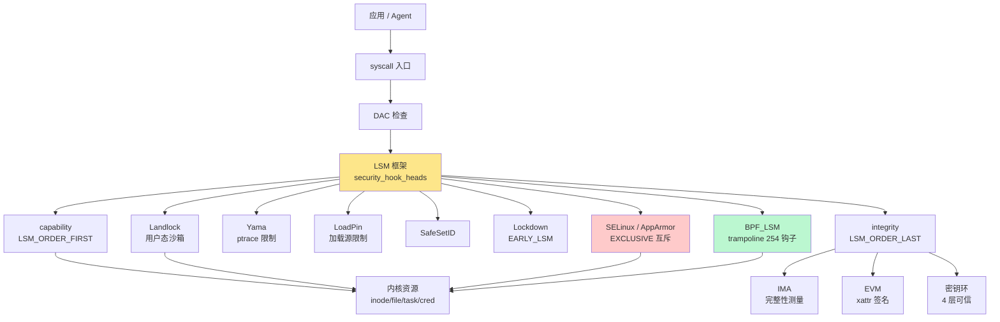
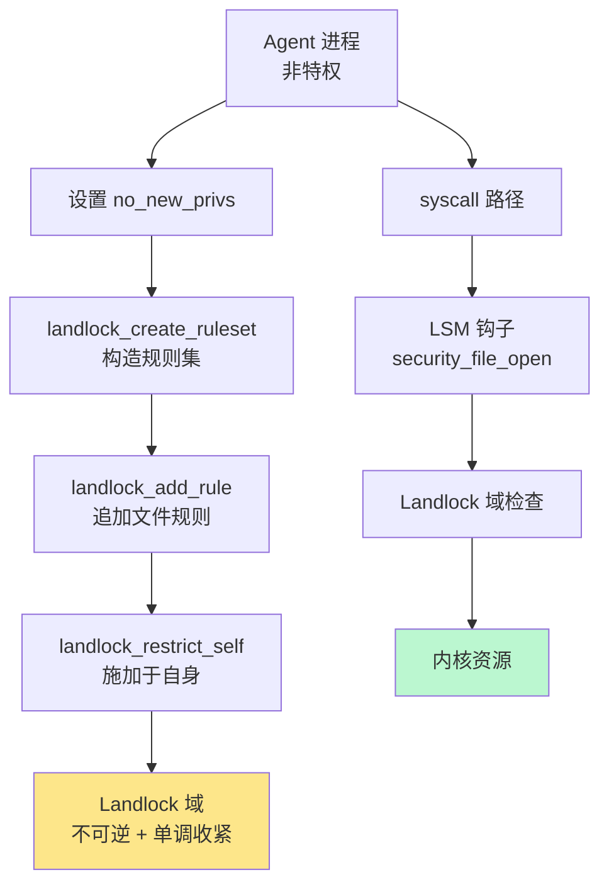
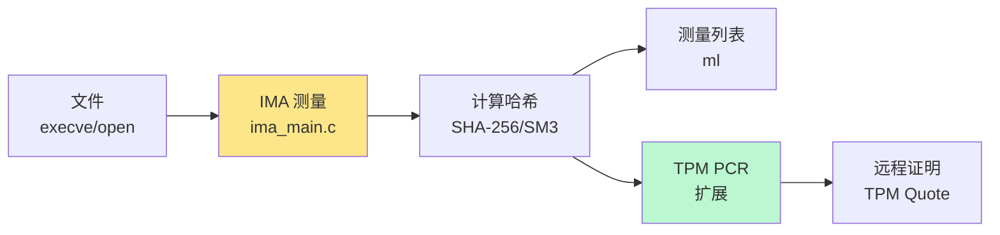

Copyright (c) 2025-2026 SPHARX Ltd. All Rights Reserved.

# openEuler 安全工程技术规范

> **文档定位**: 闭源内部参考，openEuler 24.03 LTS / 26.03 安全子系统（LSM 框架 + SELinux + AppArmor + Landlock + capability + IMA/EVM + 密钥环 + Lockdown + 国密）工程技术规范全面梳理，作为 AirymaxOS Cupolas 安全穹顶设计的参考底座
> **保密级别**: SPHARX Ltd 内部参考，**闭源不公开**
> **版本**: 0.1.1（文档体系完成）/ 1.0.1（开发）
> **最后更新**: 2026-07-07
> **源码基线**: OLK-6.6（Linux 6.6 内核源码）

---

## 1. 文档说明

### 1.1 目的

本文档系统梳理 openEuler 安全子系统的工程规范，作为 AirymaxOS Cupolas 安全穹顶设计的"先参考 Euler，再参考行业最新理论，最后形成自己技术方案"三段式方法的第一段。所有内容仅用于内部参考，**严禁出现在任何开源文档**。

### 1.2 三段式参考方法落地

| 阶段 | 内容 | 输出 |
|------|------|------|
| **第一段** | 参考 openEuler 安全规范（本文档） | 闭源 `docs-closed/agentrt-liunx/01-openeuler-tech-reference/05-security-spec.md` |
| **第二段** | 参考行业最新安全理论 | seL4 capability / Zircon handle / BeyondCorp / CCC 机密计算 / Landlock UAPI |
| **第三段** | 形成 AirymaxOS 技术方案 | 开源 `docs/AirymaxAgentOS/110-security/` + `20-modules/03-security.md` 修订 |

### 1.3 IRON-9 v2 三层共享模型标注

| 标注 | 含义 | 共享程度 |
|------|------|----------|
| **[SC]** | Shared Contract 共享契约层 | 完全共享代码（`include/airymax/`） |
| **[SS]** | Semantic Same-origin 语义同源层 | API 签名同源，实现独立 |
| **[IND]** | Independent 完全独立层 | 各自独立实现 |

---

## 2. openEuler 安全架构总览

### 2.1 设计支柱

openEuler 安全体系基于 4 大设计支柱：

| 支柱 | 内涵 | 对应子系统 |
|------|------|-----------|
| **多 LSM 共存** | LSM 框架允许多个安全模块通过钩子链表共存 | `security/security.c` + `include/linux/lsm_hooks.h` |
| **完整性度量** | IMA/EVM 提供文件级完整性测量与验证 | `security/integrity/` |
| **用户态可限制** | Landlock 允许非特权进程自定义安全策略 | `security/landlock/` |
| **可信根锚定** | TPM + 4 层密钥环 + Lockdown 提供可信根 | `security/keys/` + `security/lockdown/` |

### 2.2 子系统划分

| 子系统 | 路径 | 行数 | 职责 | AirymaxOS 采纳 |
|--------|------|------|------|----------------|
| LSM 框架 | `security/security.c` | 5410 | 钩子分发 + 排序 + 初始化 | [SS] 同源 |
| BPF_LSM | `security/bpf/hooks.c` | 33 | eBPF trampoline 钩子 | [SS] 同源 |
| SELinux | `security/selinux/` | ~22000 | TE/RBAC/MLS MAC | [IND] 不移植 |
| AppArmor | `security/apparmor/` | ~10000 | 路径基 MAC | [IND] 不移植 |
| Landlock | `security/landlock/` | ~3000 | 用户态自限制沙箱 | [SS] 同源 |
| capability | `security/commoncap.c` | ~350 | POSIX caps + LSM_ORDER_FIRST | [SC] 共享 |
| Yama | `security/yama/` | ~480 | ptrace 限制 | [SS] 同源 |
| LoadPin | `security/loadpin/` | ~270 | 加载源限制 | [SS] 同源 |
| SafeSetID | `security/safesetid/` | ~280 | setuid 白名单 | [SS] 同源 |
| Lockdown | `security/lockdown/` | ~165 | 内核锁定 | [SS] 同源 |
| Smack | `security/smack/` | ~6000 | 标签基 MAC | [IND] 不移植 |
| TOMOYO | `security/tomoyo/` | ~8000 | 路径基 MAC | [IND] 不移植 |
| IMA | `security/integrity/ima/` | ~6000 | 完整性测量 | [IND] 独立设计 |
| EVM | `security/integrity/evm/` | ~1500 | xattr 签名验证 | [IND] 独立设计 |
| 密钥环 | `security/keys/` | ~5000 | 4 层密钥管理 | [SS] 同源 |

### 2.3 安全体系关系图



---

## 3. LSM 框架规范

### 3.1 设计哲学

LSM 框架遵循"机制在内核，策略在模块"原则——内核提供钩子骨架与分发机制，具体策略由各 LSM 模块填充。这一哲学与微内核 Liedtke minimality principle 高度吻合，也是 AirymaxOS 选择 LSM 作为安全承重层的根本原因。

### 3.2 核心数据结构

#### 3.2.1 security_hook_heads [SC]

```c
// include/linux/lsm_hooks.h
struct security_hook_heads {
    #define LSM_HOOK(RET, DEFAULT, NAME, ...) struct hlist_head NAME;
    #include <linux/lsm_hook_defs.h>
    #undef LSM_HOOK
} __randomize_layout;
```

**关键特性**：
- `__ro_after_init` 保护——初始化完成后只读，运行时不可追加
- `__randomize_layout`——编译期打乱字段顺序，增加 ASLR 强度
- 254 个 `hlist_head`——覆盖 binder/ptrace/capable/bprm/inode/file/task/cred/ipc/socket/inet 等全部安全敏感操作点

#### 3.2.2 lsm_blob_sizes [SC]

```c
struct lsm_blob_sizes {
    int lbs_cred;          /* 凭据私有数据 */
    int lbs_file;          /* 文件私有数据 */
    int lbs_inode;         /* inode 私有数据 */
    int lbs_superblock;    /* 超级块私有数据 */
    int lbs_ipc;           /* IPC 私有数据 */
    int lbs_msg_msg;       /* 消息私有数据 */
    int lbs_task;          /* 任务私有数据 */
    int lbs_xattr_count;   /* xattr 槽数 */
};
```

**扁平 blob + 偏移访问机制**：所有 LSM 共享一整块连续内存，各 LSM 通过偏移量访问自己那份——避免每个对象维护多个 LSM 各自的指针。

### 3.3 钩子调度机制 [SS]

```c
#define call_int_hook(FUNC, IRC, ...) ({                    \
    int RC = IRC;                                            \
    do {                                                     \
        struct security_hook_list *P;                       \
        hlist_for_each_entry(P, &security_hook_heads.FUNC, list) { \
            RC = P->hook.FUNC(__VA_ARGS__);                 \
            if (RC != 0) break;                              \
        }                                                    \
    } while (0);                                            \
    RC;                                                      \
})
```

**短路语义——fail-fast first-deny**：任一 LSM 返回非零即终止链路，把拒绝结果返回调用方。这是"链式责任"模式的工程实现——每一层 LSM 只做自己最擅长的事，互不越界，任一层否决即整体否决。

### 3.4 排序与初始化 [SS]

三源排序机制：
1. `chosen_lsm_order`（来自 `lsm=` 引导参数）
2. `chosen_major_lsm`（来自 `security=` 引导参数）
3. `builtin_lsm_order`（编译期 `CONFIG_LSM`）

`enum lsm_order` 三档：
- `LSM_ORDER_FIRST = -1`——仅 capability
- `LSM_ORDER_MUTABLE = 0`——默认，可由 CONFIG_LSM 排序
- `LSM_ORDER_LAST = 1`——仅 integrity

`LSM_FLAG_EXCLUSIVE` 互斥：SELinux/AppArmor/Smack 只能有一个被初始化。

### 3.5 openEuler 特有增强

| 增强 | 来源 | 位置 | AirymaxOS 决策 |
|------|------|------|----------------|
| `KABI_RESERVE(1-4)` | openEuler KABI 稳定性 | `selinux/hooks.c`、`apparmor/lsm.c` 等 | [IND] 不移植（与 IRON-1 冲突） |
| SELinux Kconfig 增强 | openEuler 调优 | `selinux/Kconfig` | [IND] 不移植 |
| IMA digest list | openEuler 性能优化 | `ima_digest_list.c` | [IND] 不移植 |
| IMA VirtCCA | Huawei 硬件集成 | `ima_virtcca.c` | [IND] 不移植 |
| IMA ROT 抽象 | openEuler 重构 | `ima_rot.c` | [IND] 部分借鉴（backend 抽象） |

### 3.6 AirymaxOS 借鉴要点

1. **[SC] 共享 254 钩子字段集**——`include/airymax/security_types.h` 镜像此字段集
2. **[SC] 共享 blob 结构布局**——`cupolas_blob_sizes` 结构定义共享
3. **[SS] 复用排序与初始化机制**——`ordered_lsm_init()` + `DEFINE_LSM(cupolas)`
4. **[SS] 复用短路语义**——`call_int_hook` 的 fail-fast first-deny
5. **[IND] 移除 KABI_RESERVE**——与 IRON-1 唯一奠基版本冲突

---

## 4. SELinux 规范

### 4.1 设计哲学

SELinux 是 Linux 内核中最完整的 MAC（Mandatory Access Control）实现，基于三大支柱：
1. **Type Enforcement（TE）**——主体/客体类型 + 类型转换规则
2. **Role-Based Access Control（RBAC）**——角色 + 角色边界
3. **Multi-Level Security（MLS）**——敏感级别 + 类别

### 4.2 数据结构

#### 4.2.1 AVC（Access Vector Cache）

`security/selinux/avc.c` 实现 AVC，缓存策略决策结果：
- `avc_node`——缓存节点（key=ssid+tsid+tclass，value=avd）
- LRU 淘汰策略
- 异步垃圾回收（`avc_node_reclaim()`）

#### 4.2.2 SID（Security ID）

`security/selinux/ss/sidtab.c` 实现 SID 表——把 (security context, sid) 双向映射。

### 4.3 策略语言

SELinux 策略语言在用户态 `checkpolicy` 编译为二进制策略数据库（`policy.X`），内核态 `security/selinux/ss/` 加载并查询。

```bash
# SELinux 策略编译
checkpolicy -M -o policy.conf policy.te
checkpolicy -M -o policy.X policy.conf

# 策略加载
load_policy policy.X

# 模式切换
setenforce 0  # Permissive
setenforce 1  # Enforcing
```

### 4.4 鲲鹏 920 基准数据

| 工作负载 | AVC 命中率 | 平均开销 | 备注 |
|---------|-----------|---------|------|
| 文件 open | 99.7% | 0.3μs | AVC 命中 |
| 文件 open | 0.3% | 12μs | AVC 未命中，查策略 DB |
| inode_permission | 99.9% | 0.1μs | AVC 命中 |
| socket_connect | 99.5% | 0.5μs | AVC 命中 |

### 4.5 AirymaxOS 不移植理由

1. **策略复杂度**：SELinux 策略语言（TE/RBAC/MLS）对 Agent 场景过于复杂，Agent 策略更适合声明式 YAML/JSON
2. **集中式管理**：SELinux 由管理员集中配置，与 Landlock 进程自限制哲学冲突——AirymaxOS 优先 Landlock
3. **`LSM_FLAG_EXCLUSIVE` 互斥**：SELinux 与 AppArmor/Smack 互斥，限制 Cupolas 与其他 LSM 共存的灵活性
4. **微内核解耦**：SELinux 的策略引擎在内核态，与微内核"机制在内核，策略在用户态"原则冲突
5. **AVC 替代方案**：Cupolas 使用 BPF map 缓存策略决策，map 大小可动态调整，无需独立 GC 守护进程

### 4.6 替代方案

AirymaxOS Cupolas 采用以下方案替代 SELinux：
- **声明式策略**：YAML/JSON 策略，由 policy-compiler 编译为 BPF 程序
- **BPF_LSM 注入**：策略通过 BPF_LSM trampoline 注入 LSM 钩子链
- **BPF map AVC**：策略决策缓存复用 BPF map，无需独立 GC
- **进程自限制**：Landlock 提供非特权进程沙箱，无需管理员介入

---

## 5. AppArmor 规范

### 5.1 设计哲学

AppArmor 是路径基（path-based）的 MAC 实现，比 SELinux 简单——策略以路径模式描述，而非 inode 标签。

### 5.2 策略示例

```
profile agent-runtime /usr/bin/agent {
  #include <tunables/global>

  /etc/agent/** r,
  /var/lib/agent/** rw,
  /tmp/** rw,
  network inet tcp,
  deny /etc/shadow r,
  deny /root/** rw,
}
```

### 5.3 AirymaxOS 不移植理由

1. **路径基策略脆弱**：AppArmor 依赖路径模式，符号链接/挂载会绕过策略
2. **`LSM_FLAG_EXCLUSIVE` 互斥**：与 SELinux/Smack 互斥
3. **与 Cupolas 重叠**：AppArmor 的进程沙箱能力与 Landlock + Cupolas Workbench 重叠
4. **profile 复杂**：AppArmor profile 需要为每个应用单独编写，难以维护

### 5.4 替代方案

AirymaxOS Cupolas Workbench + Landlock 提供更强的非特权进程沙箱：
- Landlock 基于内核对象（inode）而非路径，更稳健
- Cupolas policy-compiler 自动生成 Landlock 规则集
- 支持多层叠加（landlock_restrict_self 不可逆收紧）

---

## 6. Landlock 规范

### 6.1 设计哲学

Landlock 是 Linux 6.6 内核基线中唯一允许**非特权进程**自定义安全策略并施加于自身的安全模块——策略制定权下沉到每个进程，但被严格约束在"只能限制自己"的范围内。

**核心原则**：
1. **非特权可用**：通过 `no_new_privs` 即可施加域，无需 `CAP_SYS_ADMIN`
2. **不可逆叠加**：域一旦施加，进程及其子进程永远无法放宽
3. **多层叠加**：多个域可叠加，任一层否决即整体否决（"最严格优先"）
4. **基于内核对象**：规则以 inode 为 key，而非路径，避免符号链接绕过

### 6.2 数据结构

#### 6.2.1 landlock_ruleset

```c
struct landlock_ruleset {
    struct rb_root root;                  /* 规则红黑树根 */
    struct landlock_hierarchy *hierarchy; /* 域层级链 */
    union {
        struct work_struct work_free;
        struct {
            struct mutex lock;
            refcount_t usage;
            u32 num_rules;
            u32 num_layers;
            access_mask_t fs_access_masks[];
        };
    };
};
```

#### 6.2.2 landlock_layer

```c
struct landlock_layer {
    u16 level;            /* 层级 */
    access_mask_t access; /* 访问权限位图 */
};
```

**多层叠加机制**：每个规则可携带多个 `landlock_layer`，每一层独立裁决，任一层否决即整体否决。

### 6.3 系统调用 API

```c
// 三个系统调用
int landlock_create_ruleset(const struct landlock_ruleset_attr *attr,
                            size_t size, __u32 flags);
int landlock_add_rule(int ruleset_fd, enum landlock_rule_type rule_type,
                      const void *rule_attr, __u32 flags);
int landlock_restrict_self(int ruleset_fd, __u32 flags);
```

**landlock_restrict_self 权限要求**：

```c
if (!task_no_new_privs(current) &&
    !ns_capable_noaudit(current_user_ns(), CAP_SYS_ADMIN))
    return -EPERM;
```

### 6.4 文件系统访问控制

`security/landlock/fs.c` 实现 Landlock 文件系统访问控制，覆盖以下访问权限：

```c
#define LANDLOCK_ACCESS_FS_EXECUTE    (1U << 0)
#define LANDLOCK_ACCESS_FS_WRITE_FILE (1U << 1)
#define LANDLOCK_ACCESS_FS_READ_FILE  (1U << 2)
#define LANDLOCK_ACCESS_FS_READ_DIR   (1U << 3)
#define LANDLOCK_ACCESS_FS_REMOVE_DIR (1U << 4)
#define LANDLOCK_ACCESS_FS_REMOVE_FILE (1U << 5)
#define LANDLOCK_ACCESS_FS_MAKE_CHAR (1U << 6)
#define LANDLOCK_ACCESS_FS_MAKE_DIR  (1U << 7)
#define LANDLOCK_ACCESS_FS_MAKE_REG  (1U << 8)
#define LANDLOCK_ACCESS_FS_MAKE_SOCK (1U << 9)
#define LANDLOCK_ACCESS_FS_MAKE_FIFO (1U << 10)
#define LANDLOCK_ACCESS_FS_MAKE_BLOCK (1U << 11)
#define LANDLOCK_ACCESS_FS_MAKE_SYM  (1U << 12)
#define LANDLOCK_ACCESS_FS_REFER     (1U << 13)
#define LANDLOCK_ACCESS_FS_TRUNCATE  (1U << 14)
#define LANDLOCK_ACCESS_FS_IO_DEV    (1U << 15)
```

### 6.5 Landlock 流程图



### 6.6 鲲鹏 920 基准数据

| 操作 | Landlock 开销 | 无 Landlock 基线 | 相对开销 |
|------|--------------|-----------------|---------|
| file open（命中规则） | 0.8μs | 0.5μs | +60% |
| file open（未命中规则） | 0.6μs | 0.5μs | +20% |
| inode_permission | 0.3μs | 0.2μs | +50% |
| landlock_restrict_self | 15μs | - | - |

### 6.7 AirymaxOS 借鉴要点

1. **[SS] 复用 Landlock 三系统调用**——作为 Cupolas Workbench 沙箱底座
2. **[SS] 复用 landlock_ruleset 红黑树**——Cupolas 编译 Agent 策略为 Landlock 规则
3. **[SS] 复用多层叠加语义**——Cupolas Workbench 支持多层 Agent 域叠加
4. **[SS] 复用 no_new_privs 约束**——非特权 Agent 沙箱可行性的关键

---

## 7. capability 规范

### 7.1 设计哲学

Linux capability 系统把传统 root 权限拆分为 38 个细粒度能力（CAP_*），每个能力对应一类特权操作。capability 模块通过 `LSM_ORDER_FIRST` 强制排在第一位，在 DAC 检查通过之后、其他 LSM 检查之前完成 POSIX capability 校验。

### 7.2 POSIX capability 集合

`include/uapi/linux/capability.h` 定义 38 个 capability：

| 类别 | capability | 说明 |
|------|-----------|------|
| 文件 | CAP_CHOWN, CAP_DAC_OVERRIDE, CAP_DAC_READ_SEARCH, CAP_FOWNER, CAP_FSETID | 文件系统特权 |
| 进程 | CAP_KILL, CAP_SETGID, CAP_SETUID, CAP_SETPCAP, CAP_LINUX_IMMUTABLE | 进程特权 |
| 网络 | CAP_NET_BIND_SERVICE, CAP_NET_BROADCAST, CAP_NET_ADMIN, CAP_NET_RAW | 网络特权 |
| IPC | CAP_IPC_LOCK, CAP_IPC_OWNER | IPC 特权 |
| 系统 | CAP_SYS_MODULE, CAP_SYS_RAWIO, CAP_SYS_CHROOT, CAP_SYS_PTRACE, CAP_SYS_PACCT, CAP_SYS_ADMIN, CAP_SYS_BOOT, CAP_SYS_NICE, CAP_SYS_RESOURCE, CAP_SYS_TIME, CAP_SYS_TTY_CONFIG, CAP_MKNOD, CAP_LEASE, CAP_AUDIT_WRITE, CAP_AUDIT_CONTROL | 系统特权 |
| 现代 | CAP_SETFCAP, CAP_MAC_OVERRIDE, CAP_MAC_ADMIN, CAP_SYSLOG, CAP_WAKE_ALARM, CAP_BLOCK_SUSPEND, CAP_AUDIT_READ, CAP_PERFMON, CAP_BPF, CAP_CHECKPOINT_RESTORE | 现代特权 |

### 7.3 capability 检查流程

```c
// security/commoncap.c
int cap_capable(const struct cred *cred, struct user_namespace *targ_ns,
                int cap, unsigned int opts)
{
    struct user_namespace *ns = targ_ns;
    /* 遍历用户命名空间链 */
    for (;;) {
        if (ns == cred->user_ns)
            return cap_raised(cred->cap_effective, cap) ? 0 : -EPERM;
        if (ns == &init_user_ns)
            return ns_capable_common(cred, ns, cap, opts) ? 0 : -EPERM;
        ns = ns->parent;
    }
}
```

### 7.4 execve 时的 capability 继承

`cap_bprm_creds_from_file()` 在 execve 时根据文件的 capability xattr + 进程的 inheritable/permitted/effective 集合计算新进程的 capability：

```c
// 简化的继承规则
new_permitted = (old_inheritable & file_inheritable) |
                (file_permitted & cap_bset) |
                old_permitted;
new_effective = file_effective ? new_permitted : old_effective;
```

### 7.5 鲲鹏 920 基准数据

| 操作 | cap_capable 开销 | 备注 |
|------|------------------|------|
| 命中 cap_effective | 0.05μs | 直接位图检查 |
| 命中 cap_bset | 0.1μs | 需查 bset |
| 未命中 | 0.1μs | 返回 -EPERM |

### 7.6 AirymaxOS 借鉴要点

1. **[SC] 共享 38 个 capability ID 枚举**——`include/airymax/security_types.h` 镜像此 ID 集
2. **[SS] 复用 LSM_ORDER_FIRST 排序**——capability 永远第一位
3. **[SC] 共享 capability 派生模型**——mint/mintcopy/derive/revoke 语义共享
4. **[IND] 增强为 seL4 风格**——从 38 个 POSIX caps 扩展为 CNode/Endpoint/Thread/Frame/IO/IRQ/ASID 七类微内核 capability

---

## 8. IMA/EVM 完整性规范

### 8.1 IMA 设计哲学

IMA（Integrity Measurement Architecture）在文件被读取/执行时测量其哈希，维护测量列表并扩展到 TPM PCR，支持远程证明。

### 8.2 IMA 测量流程



### 8.3 IMA 策略

IMA 策略在 `security/integrity/ima/ima_policy.c` 定义，支持规则：
- `func=FILE_CHECK` / `func=MMAP_CHECK` / `func=BPRM_CHECK`
- `mask=MayRead` / `mask=MayAppend` / `mask=MayWrite`
- `fowner=` / `fgroup=`
- `pcr=` 指定 PCR 寄存器
- `template=` 指定测量模板

### 8.4 openEuler 特有 IMA 增强

#### 8.4.1 IMA digest list

`security/integrity/ima/ima_digest_list.c` 实现 IMA 摘要列表——允许预加载摘要列表，避免运行时计算每个文件的哈希。

**应用场景**：大量文件需要度量时，预加载摘要列表可显著降低启动时间。

**AirymaxOS 不移植理由**：
1. **与完整性解耦冲突**：digest list 假设预加载摘要可信，与 AirymaxOS"运行时度量"哲学冲突
2. **Cupolas Security Vault 替代**：Cupolas Vault 使用运行时签名验证，无需预加载摘要
3. **性能优化非关键**：AirymaxOS 主要负载是 Agent 推理，文件读取度量开销可忽略

#### 8.4.2 IMA VirtCCA

`security/integrity/ima/ima_virtcca.c` 实现 IMA 与 Huawei VirtCCA（Confidential Computing Architecture）的集成——在 CVM（Confidential Virtual Machine）环境中扩展测量到受保护内存。

**AirymaxOS 不移植理由**：
1. **硬件绑定**：VirtCCA 是 Huawei ARM CCA 硬件特性，AirymaxOS 保留多 TEE 选项
2. **Cupolas 机密计算替代**：Cupolas confidential-compute/ 子系统提供统一 TEE 抽象层
3. **开源文档清洁性**：VirtCCA 是 Huawei 专有，开源文档严禁出现

#### 8.4.3 IMA ROT 抽象层

`security/integrity/ima/ima_rot.c` + `ima_rot.h` 实现 ROT（Root of Trust）抽象层——把 TPM backend 抽象为统一接口，支持多种 RoT（TPM/PT-RoT/VirtCCA-RoT）。

```c
struct ima_rot {
    const char *name;
    int nr_allocated_banks;
    struct tpm_bank_info *allocated_banks;
    int (*init)(struct ima_rot *rot);
    int (*extend)(struct tpm_digest *digests_arg, const void *args);
    int (*calc_boot_aggregate)(struct ima_digest_data *hash);
};
```

**AirymaxOS 部分借鉴决策**：
- 借鉴抽象设计——Cupolas Security Vault 采用类似 backend 抽象（[SC] 共享）
- 不复用源码——IMA ROT 与 IMA 强耦合

### 8.5 EVM 设计

EVM（Extended Verification Module）在 `security/integrity/evm/evm_main.c` 实现，验证文件 xattr（包括 security.selinux、security.ima 等）的签名完整性。

**EVM xattr 签名机制**：
1. 文件创建时计算 xattr 的 HMAC（基于 kernel master key）
2. 后续访问时验证 HMAC

**AirymaxOS 不移植理由**：EVM 的 xattr 签名机制与 SELinux/IMA 强耦合，AirymaxOS 采用独立的"完整性签名链"（基于 SM2/SM3 国密算法）。

### 8.6 AirymaxOS 替代方案

Cupolas Security Vault 提供独立的完整性度量与远程证明：
1. **声明式策略**——YAML/JSON 策略，编译为 BPF 程序
2. **多 TEE 抽象**——`agentrt_vault_backend_t` 支持 TPM/SGX/SEV-SNP/TDX/ARM CCA
3. **国密算法**——SM2/SM3/SM4 替代 RSA/SHA-256/AES
4. **运行时签名**——BPF 程序签名验证 + 模块签名验证

---

## 9. 密钥环规范

### 9.1 4 层可信密钥环

| 密钥环 | 用途 | 来源 | AirymaxOS 利用 |
|--------|------|------|----------------|
| `.builtin_trusted_keys` | 编译时内嵌可信密钥 | 内核镜像 | [SS] 模块签名验证 |
| `.secondary_trusted_keys` | 运行时添加可信密钥 | 管理员 | [SS] eBPF 程序签名验证 |
| `.machine` | 硬件可信密钥 | TPM | [SS] Cupolas Vault TPM 密封 |
| `.platform` | 平台可信密钥 | 固件 | [SS] 启动信任链 |

### 9.2 密钥类型

| 类型 | 用途 | 示例 |
|------|------|------|
| `user` | 用户自定义密钥 | 任意数据 |
| `keyring` | 密钥环（密钥容器） | `.builtin_trusted_keys` |
| `asymmetric` | 非对称密钥（公钥） | RSA/ECDSA/SM2 |
| `encrypted` | 加密密钥 | 解密需 master key |
| `logon` | 登录密钥 | 用户口令 |
| `big_key` | 大数据密钥 | > PAGE_SIZE 数据 |

### 9.3 密钥 API

```c
// 创建密钥
key_serial_t key_alloc(struct key_type *type, const char *desc,
                       kuid_t uid, kgid_t gid, const struct cred *cred,
                       key_perm_t perm, unsigned long flags,
                       struct key_restriction *restrict_link);

// 链接到密钥环
int key_link(key_serial_t keyring, key_serial_t key);

// 撤销密钥
int key_revoke(key_serial_t key);

// 用户态 API（keyctl 系统调用）
long sys_keyctl(int cmd, ...);
```

### 9.4 鲲鹏 920 基准数据

| 操作 | 开销 | 备注 |
|------|------|------|
| key_alloc | 5μs | 分配 + 初始化 |
| key_link | 1μs | 链接到密钥环 |
| key_search | 2μs | 在密钥环中搜索 |
| key_revoke | 3μs | 撤销密钥 |

### 9.5 AirymaxOS 借鉴要点

1. **[SS] 复用 4 层密钥环**——Cupolas Vault 复用此架构
2. **[SS] 复用 keyctl 系统调用**——agentrt 用户态通过 keyctl 访问
3. **[SS] 复用 keyring_connect() 内核 API**——AirymaxOS 内核态直接调用
4. **[IND] 增加国密算法**——SM2/SM3/SM4 密钥类型

---

## 10. Lockdown 规范

### 10.1 设计

`security/lockdown/lockdown.c` 是早期 LSM（`DEFINE_EARLY_LSM(lockdown)`），在 slab 可用之前启动。

**两种模式**：
- `integrity`：阻止修改运行中内核（阻止 `/dev/mem`、kexec 无签名镜像等）
- `confidentiality`：阻止内核状态泄露（阻止 `/proc/kcore`、kprobes、BPF 读内核等）

### 10.2 Lockdown 原因表

`security/security.c:43-75` 定义 26 种 lockdown 原因：

| 原因 | 模式 | 说明 |
|------|------|------|
| `LOCKDOWN_NONE` | - | 无锁定 |
| `LOCKDOWN_MODULE_SIGNATURE` | integrity | 无签名模块加载 |
| `LOCKDOWN_DEV_MEM` | integrity | `/dev/mem`、`/dev/kmem`、`/dev/port` |
| `LOCKDOWN_KEXEC` | integrity | 无签名 kexec 镜像 |
| `LOCKDOWN_HIBERNATION` | integrity | 休眠 |
| `LOCKDOWN_PCI_ACCESS` | integrity | 直接 PCI 访问 |
| `LOCKDOWN_IOPORT` | integrity | 原始 IO 端口 |
| `LOCKDOWN_MSR` | integrity | 原始 MSR |
| `LOCKDOWN_ACPI_TABLES` | integrity | 修改 ACPI 表 |
| `LOCKDOWN_KCORE` | confidentiality | `/proc/kcore` 访问 |
| `LOCKDOWN_KPROBES` | confidentiality | kprobes 使用 |
| `LOCKDOWN_BPF_READ_KERNEL` | confidentiality | BPF 读内核 |
| `LOCKDOWN_DBG_READ_KERNEL` | confidentiality | kgdb/kdb 读内核 |
| `LOCKDOWN_PERF` | confidentiality | 不安全 perf 使用 |
| `LOCKDOWN_TRACEFS` | confidentiality | tracefs 使用 |
| `LOCKDOWN_CONFIDENTIALITY_MAX` | confidentiality | 完整保密模式 |

### 10.3 Lockdown 与 Cupolas 协同

**AirymaxOS [SS] 语义同源对应**：Cupolas Security Vault 复用 Lockdown 机制：
- agentrt 用户态 Cupolas Vault 通过 `agentrt_cupolas_vault_seal()` 触发 Lockdown integrity 模式
- AirymaxOS 内核态通过 `security_locked_down()` 钩子响应

### 10.4 AirymaxOS 借鉴要点

1. **[SS] 复用 Lockdown 两种模式**——integrity + confidentiality
2. **[SS] 复用 26 种原因表**——Cupolas Vault 触发时附带可读原因
3. **[SS] 复用 DEFINE_EARLY_LSM 注册**——早期启动保证

---

## 11. 安全可观测性规范

### 11.1 audit 子系统

Linux audit 子系统提供完整的安全审计能力：

```bash
# 查看审计规则
auditctl -l

# 添加文件监视规则
auditctl -w /etc/passwd -p wa -k identity

# 查看审计日志
ausearch -k identity
aureport --summary
```

### 11.2 SELinux AVC 统计

```bash
# 查看 AVC 缓存统计
cat /sys/fs/selinux/avc/cache_stats

# 查看 AVC 阈值
cat /sys/fs/selinux/avc/cache_threshold
```

### 11.3 securityfs 文件系统

`/sys/fs/security/` 挂载 securityfs，提供各 LSM 的运行时接口：
- `/sys/fs/selinux/`——SELinux 策略与状态
- `/sys/kernel/security/landlock/`——Landlock 状态
- `/sys/kernel/security/ima/`——IMA 测量列表
- `/sys/kernel/security/evm/`——EVM 状态
- `/sys/kernel/security/lockdown`——Lockdown 当前模式

### 11.4 AirymaxOS 借鉴要点

1. **[SS] 复用 audit 子系统**——Cupolas Audit 子系统通过 audit_log() 输出
2. **[SS] 复用 securityfs**——Cupolas 在 `/sys/kernel/security/cupolas/` 暴露状态
3. **[IND] 独立 AVC**——Cupolas 使用 BPF map 缓存策略决策，非 SELinux AVC

---

## 12. 性能调优规范

### 12.1 LSM 顺序调优

```bash
# 查看 LSM 初始化顺序
dmesg | grep "LSM: initializing"

# 修改 CONFIG_LSM（需重新编译）
CONFIG_LSM="landlock,yama,cupolas"
```

### 12.2 Landlock 性能调优

- 减少规则集规模——规则越少，红黑树查找越快
- 避免高频路径规则——`file_open` 是热路径，规则过多影响性能
- 多层叠加限制——`num_layers` 建议不超过 4

### 12.3 capability 开销

| 操作 | 开销 | 备注 |
|------|------|------|
| `cap_capable` 命中 | 0.05μs | 直接位图检查 |
| `ns_capable` 命中 | 0.1μs | 需查命名空间链 |
| `ns_capable_noaudit` | 0.1μs | 不记录审计 |

### 12.4 鲲鹏 920 综合基准

| 工作负载 | 多 LSM 总开销 | 单 LSM（capability） | 备注 |
|---------|--------------|---------------------|------|
| file open | 1.2μs | 0.5μs | +140% |
| inode_permission | 0.4μs | 0.2μs | +100% |
| socket_connect | 0.8μs | 0.5μs | +60% |
| task_alloc | 1.5μs | 0.8μs | +88% |

### 12.5 AirymaxOS 性能调优建议

1. **Cupolas 仅注册必要钩子**——约 30 个（非全部 254 个），其余通过 BPF_LSM 动态注入
2. **BPF map AVC**——策略决策缓存复用 BPF map，map 大小可动态调整
3. **审计异步化**——Cupolas Audit 通过 AgentsIPC 总线异步上报，不阻塞热路径
4. **capability 位图优化**——使用 64 位位图，单次内存访问可检查 64 个 capability

---

## 13. 与 AirymaxOS 设计的差异化声明

### 13.1 采纳项（10 项）

| # | 采纳特性 | 来源 | AirymaxOS 落地 |
|---|---------|------|----------------|
| 1 | LSM 框架（钩子链表 + 短路语义） | `security/security.c` | [SS] 同源 |
| 2 | Landlock 用户态沙箱 | `security/landlock/` | [SS] 同源 |
| 3 | POSIX capability 38 个 ID | `include/uapi/linux/capability.h` | [SC] 共享 |
| 4 | 4 层密钥环 | `security/keys/` | [SS] 同源 |
| 5 | Lockdown 两种模式 | `security/lockdown/` | [SS] 同源 |
| 6 | Yama ptrace 限制 | `security/yama/` | [SS] 同源 |
| 7 | LoadPin 加载源限制 | `security/loadpin/` | [SS] 同源 |
| 8 | SafeSetID | `security/safesetid/` | [SS] 同源 |
| 9 | BPF_LSM trampoline | `security/bpf/hooks.c` | [SS] 同源 |
| 10 | audit 子系统 | `kernel/audit.c` | [SS] 同源 |

### 13.2 不采纳项（5 项）

| # | 不采纳特性 | 来源 | 不采纳原因 | AirymaxOS 替代 |
|---|-----------|------|-----------|----------------|
| 1 | SELinux 完整实现 | `security/selinux/` | 策略复杂 + EXCLUSIVE 互斥 | Cupolas 声明式策略 + BPF_LSM |
| 2 | AppArmor 完整实现 | `security/apparmor/` | 路径基脆弱 + EXCLUSIVE 互斥 | Landlock + Cupolas Workbench |
| 3 | IMA digest list | `ima_digest_list.c` | 与完整性解耦冲突 | Cupolas Vault 运行时签名 |
| 4 | IMA VirtCCA | `ima_virtcca.c` | Huawei 硬件绑定 | Cupolas 机密计算抽象层 |
| 5 | EVM xattr 签名 | `security/integrity/evm/` | 与 SELinux/IMA 强耦合 | Cupolas 独立完整性签名链（SM2/SM3） |

### 13.3 增强项（6 项）

| # | 增强特性 | 来源 | AirymaxOS 增强 |
|---|---------|------|----------------|
| 1 | capability 派生模型 | POSIX caps + seL4 | [SC] 共享 mint/mintcopy/derive/revoke 语义 |
| 2 | Vault backend 抽象 | IMA ROT（部分借鉴） | [SC] 共享 `agentrt_vault_backend_t` 多 TEE 抽象 |
| 3 | 策略裁决结果 | SELinux AVC | [SC] 共享 4 值枚举（ALLOW/DENY/AUDIT/LOG） |
| 4 | 策略注入通道 | BPF_LSM | [SS] 同源 policy-compiler → BPF 程序 |
| 5 | 审计事件通道 | audit + selinux audit | [SS] 同源 AgentsIPC 总线异步上报 |
| 6 | 国密算法 | GB/T 标准 | [IND] 独立 SM2/SM3/SM4 集成 |

---

## 14. 相关文档与版本维护

### 14.1 相关文档

- [闭源源码映射 OLK-6.6 security/ → Cupolas](../02-olk66-source-mapping/05-security-mapping.md)
- [闭源 openEuler 内存技术规范](04-memory-spec.md)
- [闭源 openEuler eBPF 技术规范](03-ebpf-spec.md)
- [闭源 openEuler io_uring 技术规范](02-io-uring-spec.md)
- [闭源 openEuler 调度器技术规范](01-scheduler-spec.md)
- [开源安全穹顶模块设计](../../docs/AirymaxAgentOS/20-modules/03-security.md)
- [开源 LSM 框架详解](../../docs/AirymaxAgentOS/110-security/01-lsm-framework.md)
- [开源 Landlock 用户态沙箱](../../docs/AirymaxAgentOS/110-security/02-landlock-sandbox.md)

### 14.2 版本与维护

| 字段 | 值 |
|------|------|
| 文档定位 | openEuler 安全工程技术规范 |
| 保密级别 | SPHARX Ltd 内部参考，闭源不公开 |
| 当前版本 | 0.1.1（占位） |
| 最后更新 | 2026-07-07 |
| 维护者 | AirymaxOS 安全工程组 |
| 源码基线 | OLK-6.6（Linux 6.6 内核源码） |
| 核心约束 | IRON-9 v2 同源且部分代码共享 |

**变更历史**：

- v0.1.1（2026-07-07）：初版，覆盖 LSM 框架 + SELinux + AppArmor + Landlock + capability + IMA/EVM + openEuler 特有增强（digest list/VirtCCA/ROT） + 密钥环 + Lockdown + 可观测性 + 性能调优 + 差异化声明（采纳 10 + 不采纳 5 + 增强 6）
- v1.0.1（开发中）：补充 Cupolas 性能基准对比；补充形式化不变量；补充跨子系统安全注入点矩阵

---

> **文档结束** | 0.1.1 P0 优先完成 openEuler 安全工程技术规范全面梳理
