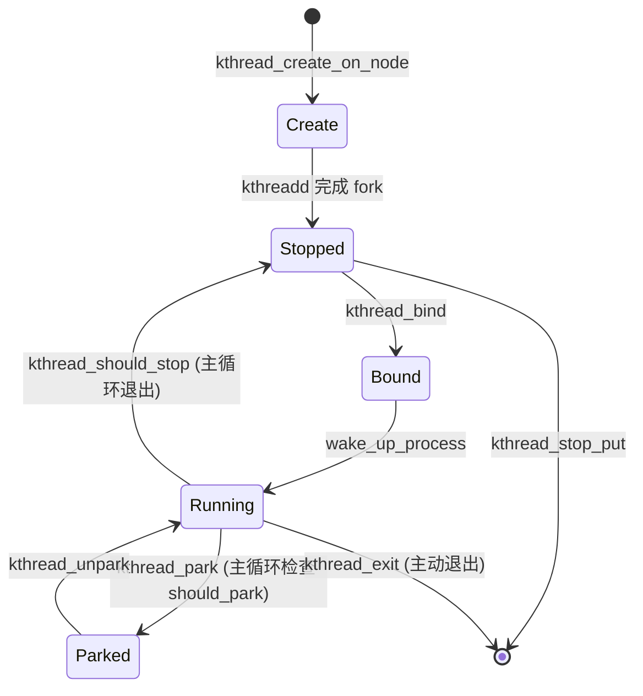

Copyright (c) 2025-2026 SPHARX Ltd. All Rights Reserved.

# OLK-6.6 认知子系统 → AirymaxOS CoreLoopThree 源码映射

> **文档定位**: 闭源内部参考，OLK-6.6 `kernel/kthread.c` + `include/linux/kthread.h` + `drivers/accel/` + `drivers/gpu/drm/scheduler/` + `include/drm/gpu_scheduler.h` 源码 → AirymaxOS 认知子系统（CoreLoopThree kthread + Thinkdual + LLM 推理调度 + GPU/NPU 调度）设计映射
> **保密级别**: SPHARX Ltd 内部参考，**闭源不公开**
> **版本**: 0.1.1（文档体系完成）
> **最后更新**: 2026-07-07
> **源码基线**: OLK-6.6（`/home/spharx/SpharxWorks/01Reference/kernel-OLK-6.6/`）

---

## 1. 文档说明

### 1.1 目的

本文档建立 OLK-6.6 认知子系统支撑机制源码到 AirymaxOS 认知子系统设计的精确映射，标注 IRON-9 v2 三层共享模型边界：

| 标注 | 含义 | 共享程度 |
|------|------|----------|
| **[SC]** | Shared Contract 共享契约层 | 完全共享代码（`include/airymax/cognition_types.h`） |
| **[SS]** | Semantic Same-origin 语义同源层 | API 签名同源，实现独立 |
| **[IND]** | Independent 完全独立层 | 各自独立实现 |

**认知是 4 大数据流之一**：CoreLoopThree 三阶段循环（PERCEPTION/THINKING/ACTION）是 AirymaxOS 区别于通用 OS 的核心特征。kthread 是内核态认知循环的承载机制，drm_sched + accel 框架是 GPU/NPU 算力调度的支撑底座。

### 1.2 源码定位

| 路径 | 说明 | 行数 |
|------|------|------|
| `kernel/kthread.c` | kthread 机制核心（创建/绑定/驻留/停止/worker） | 1562 行 |
| `include/linux/kthread.h` | kthread 公共 API 声明 + 宏定义 | 227 行 |
| `drivers/accel/drm_accel.c` | accel 框架核心（class + minor + debugfs） | 227 行 |
| `include/drm/drm_accel.h` | accel 公共 API + ACCEL_MAJOR/MAX_MINORS | 84 行 |
| `drivers/accel/ivpu/ivpu_drv.c` | Intel NPU 驱动主入口（probe/remove） | 707 行 |
| `drivers/accel/ivpu/ivpu_job.c` | Intel NPU 作业管理（kthread_run 派发） | ~622 行 |
| `drivers/accel/habanalabs/` | HabanaLabs AI 加速器（Gaudi 系列） | ~15000 行 |
| `drivers/accel/qaic/qaic_main.c` | Qualcomm AI 100 加速器主入口 | ~600 行 |
| `drivers/gpu/drm/scheduler/sched_main.c` | drm_sched 核心（kthread 主循环 + init/fini） | 1218 行 |
| `drivers/gpu/drm/scheduler/sched_entity.c` | 调度实体（多对一 entity↔scheduler） | 594 行 |
| `drivers/gpu/drm/scheduler/sched_fence.c` | fence 机制（dma_fence 子类） | 240 行 |
| `include/drm/gpu_scheduler.h` | drm_sched 公共结构体 + API 声明 | 617 行 |
| `kernel/sched/ext.c` | sched_ext 框架（与 kthread 兼容性） | ~5300 行 |

### 1.3 关键配置选项

```kconfig
CONFIG_KTHREAD=y                    # kthread 机制（默认启用）
CONFIG_DRM_ACCEL=y                  # accel 框架（GPU/NPU 统一接入）
CONFIG_DRM_GPU_SCHED=y              # drm_sched 通用 GPU 调度器
CONFIG_DRM_ACCEL_IVPU=y            # Intel NPU 驱动（ivpu）
CONFIG_DRM_ACCEL_HABANALABS=y      # HabanaLabs Gaudi 驱动
CONFIG_DRM_ACCEL_QAIC=y            # Qualcomm AI 100 驱动
CONFIG_CGROUPS=y                   # cgroup（kthread 关联）
CONFIG_BLK_CGROUP=y                # blkcg（kthread_associate_blkcg）
CONFIG_SCHED_EXT=y                  # sched_ext（与 kthread 协同）
CONFIG_NUMA=y                      # NUMA（kthread_create_on_node）
CONFIG_FREEZER=y                    # freezer（KTW_FREEZABLE）
CONFIG_CXL_BUS=y                   # CXL 总线（KV pool 共享）
```

---

## 2. kernel/kthread.c 源码深度研究

### 2.1 文件概览

```
SPDX-License-Identifier: GPL-2.0-only
Copyright (C) 2004 IBM Corporation, Rusty Russell.
Copyright (C) 2009 Red Hat, Inc.
```

文件 1562 行，承载内核线程（kernel thread）的全部生命周期管理。设计哲学是"通过 kthreadd 守护进程提供干净环境"——即使从用户态触发（modprobe、hotplug cpu），也能继承干净上下文。

**关键 include**：
- `<linux/kthread.h>`（自身 API）
- `<linux/completion.h>`（同步原语）
- `<linux/cgroup.h>` + `<linux/cpuset.h>`（cgroup 关联）
- `<linux/freezer.h>`（freeze 友好）
- `<trace/events/sched.h>`（ftrace 钩子）

### 2.2 核心结构体

#### struct kthread_create_info（kthread.c:38-51）

```c
struct kthread_create_info
{
    /* Information passed to kthread() from kthreadd. */
    char *full_name;
    int (*threadfn)(void *data);
    void *data;
    int node;

    /* Result passed back to kthread_create() from kthreadd. */
    struct task_struct *result;
    struct completion *done;

    struct list_head list;
};
```

字段说明：
- `full_name`：kthread 完整名称（task comm 可能截断，full_name 保留全名）
- `threadfn`：kthread 主体函数指针
- `data`：threadfn 的私有数据
- `node`：NUMA 节点（kthread_create_on_node 的 node 参数）
- `result`：创建结果（task_struct 指针，由 kthreadd 填充）
- `done`：完成信号（创建者等待 kthreadd 完成）
- `list`：挂入 `kthread_create_list` 链表

#### struct kthread（kthread.c:53-66）

```c
struct kthread {
    unsigned long flags;
    unsigned int cpu;
    int result;
    int (*threadfn)(void *);
    void *data;
    struct completion parked;
    struct completion exited;
#ifdef CONFIG_BLK_CGROUP
    struct cgroup_subsys_state *blkcg_css;
#endif
    char *full_name;
};
```

字段说明：
- `flags`：状态位（KTHREAD_IS_PER_CPU / KTHREAD_SHOULD_STOP / KTHREAD_SHOULD_PARK）
- `cpu`：绑定的 CPU（per-CPU kthread 缓存）
- `result`：threadfn 返回值（kthread_stop 取回）
- `threadfn`：主体函数指针（与 create_info.threadfn 一致）
- `data`：私有数据
- `parked`：驻留完成信号（kthread_park 等待）
- `exited`：退出完成信号（kthread_stop 等待）
- `blkcg_css`：块设备 cgroup（可选，CONFIG_BLK_CGROUP）
- `full_name`：完整名称

#### enum KTHREAD_BITS（kthread.c:68-72）

```c
enum KTHREAD_BITS {
    KTHREAD_IS_PER_CPU = 0,
    KTHREAD_SHOULD_STOP,
    KTHREAD_SHOULD_PARK,
};
```

3 个状态位，对应 `flags` 字段的 bit 0/1/2。

### 2.3 公开 API 清单

#### 创建类 API

| API | 行号 | 功能 | AirymaxOS 映射 |
|-----|------|------|----------------|
| `kthread_create_on_node(fn, data, node, namefmt...)` | kthread.h:11-14 | NUMA 感知创建原语（停止状态） | CoreLoopThree kthread 创建 |
| `kthread_create(fn, data, namefmt, arg...)` | kthread.h:27-28 | `= create_on_node(NUMA_NO_NODE)` 宏 | 简单场景 |
| `kthread_create_on_cpu(fn, data, cpu, namefmt)` | kthread.c:570-584 | create_on_node + bind | per-CPU kthread |
| `kthread_run(fn, data, namefmt, ...)` | kthread.h:51-58 | create + wake_up_process 便捷宏 | drm_sched helper |
| `kthread_run_on_cpu(fn, data, cpu, namefmt)` | kthread.h:72-83 | create_on_cpu + wake | per-CPU 即启动 |
| `set_kthread_struct(p)` | kthread.c:111-128 | 分配 struct kthread（kzalloc GFP_KERNEL） | kthreadd 内部 |
| `free_kthread_struct(k)` | kthread.c:130-147 | 释放 struct kthread | kthreadd 内部 |

#### 绑定与亲和性 API

| API | 行号 | 功能 | AirymaxOS 映射 |
|-----|------|------|----------------|
| `kthread_bind(k, cpu)` | kthread.c:554-558 | 绑定单 CPU（设 PF_NO_SETAFFINITY） | cognition kthread 绑定 |
| `kthread_bind_mask(k, mask)` | kthread.c:540 | 绑定 cpumask | 多 CPU 池化 |
| `kthread_set_per_cpu(k, cpu)` | kthread.c:587-602 | 标记 per-CPU | per-CPU kthread |
| `kthread_is_per_cpu(k)` | kthread.c:604-611 | 查询 per-CPU 标记 | sub-scheduler 识别 |
| `get_kthread_comm(buf, size, tsk)` | kthread.c:99-109 | 获取完整名称 | 调试输出 |

#### 停止与驻留 API

| API | 行号 | 功能 | AirymaxOS 映射 |
|-----|------|------|----------------|
| `kthread_should_stop()` | kthread.c:156-160 | 检查 SHOULD_STOP bit | 主循环顶部检查 |
| `kthread_should_park()` | kthread.c:178-182 | 检查 SHOULD_PARK bit | CPU hotplug 协议 |
| `kthread_should_stop_or_park()` | kthread.c:184-192 | 联合检查（容忍 NULL kthread） | 安全检查 |
| `kthread_park(k)` | kthread.c:654-681 | 驻留 kthread（阻塞至 parked） | 系统休眠 |
| `kthread_unpark(k)` | kthread.c:621-640 | 恢复驻留的 kthread（re-bind + wake） | 系统唤醒 |
| `kthread_parkme()` | kthread.c:168-172 | kthread 主动驻留（schedule） | 主循环内调用 |
| `kthread_stop(k)` | kthread.c:698-717 | 停止 kthread（完整序列） | 模块卸载 |
| `kthread_stop_put(k)` | kthread.c:728 | stop + put_task_struct | 持额外引用时 |
| `kthread_exit(result)` | kthread.c:312 | 显式退出（__noreturn） | threadfn 主动退出 |
| `kthread_complete_and_exit(comp, code)` | kthread.c:331-338 | complete + exit（OOM 安全） | OOM 场景 |

#### 数据访问 API

| API | 行号 | 功能 | AirymaxOS 映射 |
|-----|------|------|----------------|
| `kthread_func(k)` | kthread.c:166 | 取 threadfn 指针 | 调试 |
| `kthread_data(k)` | kthread.c:175 | 取 data 指针 | 调试 |
| `kthread_probe_data(k)` | kthread.c:184 | 探测 data（不安全但快速） | 调试 |

#### Worker API（kthread 工作队列）

| API | 行号 | 功能 | AirymaxOS 映射 |
|-----|------|------|----------------|
| `kthread_worker_fn(worker_ptr)` | kthread.h:187 | worker 主循环函数 | daemon worker |
| `kthread_create_worker(flags, namefmt...)` | kthread.h:190-191 | 创建 worker | 通用 worker |
| `kthread_create_worker_on_cpu(cpu, flags, namefmt...)` | kthread.h:193-195 | per-CPU worker | per-CPU daemon |
| `kthread_queue_work(worker, work)` | kthread.h:197-198 | 排入 work | 异步任务 |
| `kthread_queue_delayed_work(worker, dwork, delay)` | kthread.h:200-202 | 排入延迟 work | 定时任务 |
| `kthread_mod_delayed_work(worker, dwork, delay)` | kthread.h:204-206 | 修改延迟 | 重设定时 |
| `kthread_flush_work(work)` | kthread.h:208 | 刷新单个 work | 等待完成 |
| `kthread_flush_worker(worker)` | kthread.h:209 | 刷新全部 work | 批量等待 |
| `kthread_cancel_work_sync(work)` | kthread.h:211 | 取消 work（同步） | 任务取消 |
| `kthread_cancel_delayed_work_sync(dwork)` | kthread.h:212 | 取消延迟 work | 定时取消 |
| `kthread_destroy_worker(worker)` | kthread.h:214 | 销毁 worker | 资源释放 |

#### 内存与 cgroup API

| API | 行号 | 功能 | AirymaxOS 映射 |
|-----|------|------|----------------|
| `kthread_use_mm(mm)` | kthread.h:216 | 切换到指定 mm（borrow） | 用户态内存访问 |
| `kthread_unuse_mm(mm)` | kthread.h:217 | 切回 kthread mm | 释放 borrow |
| `kthread_associate_blkcg(css)` | kthread.h:222 | 关联 blkcg | kthread I/O 计费 |
| `kthread_blkcg()` | kthread.h:223 | 取当前 blkcg | I/O 路径查询 |

#### 宏定义

| 宏 | 行号 | 功能 |
|-----|------|------|
| `KTHREAD_WORK_INIT(work, fn)` | kthread.h:145-148 | 静态初始化 work |
| `KTHREAD_DELAYED_WORK_INIT(dwork, fn)` | kthread.h:150-154 | 静态初始化 delayed work |
| `DEFINE_KTHREAD_WORK(work, fn)` | kthread.h:156-157 | 定义全局 work |
| `DEFINE_KTHREAD_DELAYED_WORK(dwork, fn)` | kthread.h:159-161 | 定义全局 delayed work |
| `kthread_init_worker(worker)` | kthread.h:166-170 | 动态初始化 worker（含 lockdep key） |
| `kthread_init_work(work, fn)` | kthread.h:172-177 | 动态初始化 work |
| `kthread_init_delayed_work(dwork, fn)` | kthread.h:179-185 | 动态初始化 delayed work |

### 2.4 kthread 生命周期状态机



**关键状态转换点**：

1. **Create → Stopped**（kthreadd fork）：
   - `kthreadd`（PID=2，kthread.c:738-774）从 `kthread_create_list` 取请求
   - `create_kthread`（kthread.c:403-425）调 `kernel_thread(kthread, create, CLONE_FS|CLONE_FILES|SIGCHLD)`
   - 新 task 进入 `kthread()` 主体（kthread.c:340-391），设置 `SCHED_NORMAL`/0 + housekeeping cpumask + `__set_current_state(TASK_UNINTERRUPTIBLE)` + `complete(done)` + `schedule_preempt_disabled()`
   - 创建者从 `wait_for_completion_killable` 醒来，取 `create->result`

2. **Stopped → Bound → Running**（手动启动）：
   - `kthread_bind(p, cpu)`（kthread.c:554-558）→ `__kthread_bind`（L519-538）等 `wait_task_inactive` 后 `do_set_cpus_allowed` + `PF_NO_SETAFFINITY`
   - `wake_up_process(p)` 唤醒

3. **Running → Parked**（CPU hotplug / 系统休眠）：
   - 调用者 `kthread_park(k)`（kthread.c:654-681）：set `KTHREAD_SHOULD_PARK` + `wake_up_process` + `wait_for_completion(parked)` + `wait_task_inactive(TASK_PARKED)`
   - kthread 主循环 `kthread_should_park()` 返回 true，调 `kthread_parkme()`（L168-172）→ `__kthread_parkme(self)` 设 `TASK_PARKED` + `schedule()`

4. **Parked → Running**（恢复）：
   - `kthread_unpark(k)`（kthread.c:621-640）：per-CPU 重新 bind（`__kthread_bind(k, kthread->cpu, TASK_PARKED)`）+ clear `KTHREAD_SHOULD_PARK` + `wake_up_state(k, TASK_PARKED)`

5. **Running → Stopped → [*]**（停止）：
   - `kthread_stop(k)`（kthread.c:698-717）完整序列：
     1. `trace_sched_kthread_stop(k)`（ftrace）
     2. `get_task_struct(k)`（防 task_struct 释放）
     3. `set_bit(KTHREAD_SHOULD_STOP, &kthread->flags)`
     4. `kthread_unpark(k)`（若被 park，先唤醒）
     5. `set_tsk_thread_flag(k, TIF_NOTIFY_SIGNAL)`（打破 `wait_event_interruptible` 阻塞点）
     6. `wake_up_process(k)`
     7. `wait_for_completion(&kthread->exited)`（等待 kthread 退出）
     8. `ret = kthread->result`
     9. `put_task_struct(k)`
     10. `trace_sched_kthread_stop_ret(ret)`

### 2.5 关键代码片段

#### kthread 主体函数（kthread.c:340-391）

```c
static int kthread(void *_create)
{
    struct kthread_create_info *create = _create;
    int (*threadfn)(void *data) = create->threadfn;
    void *data = create->data;
    struct completion *done;
    struct kthread *self;
    int ret;

    self = to_kthread(current);
    /* If we were called by kthread_create_on_node(), the cpumask was
     * set to node-mask by the kthreadd code. No need to override.
     */
    set_kthread_struct(current);   /* L363: 不存在时设置 */

    /* Set up our state before we can be woken */
    __set_current_state(TASK_UNINTERRUPTIBLE);
    create->result = current;
    complete(done);  /* 通知创建者"我已出生" */

    /* And then schedule away, to let kthread_create_on_node()
     * return.  Wait_for_completion_killable is in
     * __kthread_create_on_node() (kthread.c:460)
     */
    schedule_preempt_disabled();

    /* → 醒来后，cgroup 关联 + park 检查 + 调 threadfn */
    cgroup_kthread_ready();
    __kthread_parkme(self);
    ret = threadfn(data);
    kthread_exit(ret);  /* L390: 显式退出，传 result */
}
```

#### kthread_stop 完整序列（kthread.c:698-717）

```c
int kthread_stop(struct task_struct *k)
{
    struct kthread *kthread;
    int trace;
    int ret;

    trace_sched_kthread_stop(k);
    if (k) {
        get_task_struct(k);
        kthread = to_kthread(k);
        set_bit(KTHREAD_SHOULD_STOP, &kthread->flags);
        kthread_unpark(k);
        set_tsk_thread_flag(k, TIF_NOTIFY_SIGNAL);
        wake_up_process(k);
        wait_for_completion(&kthread->exited);
        ret = kthread->result;
        put_task_struct(k);
    } else {
        ret = -EINTR;
    }
    trace_sched_kthread_stop_ret(ret);
    return ret;
}
EXPORT_SYMBOL(kthread_stop);
```

#### kthreadd 守护进程（kthread.c:738-774）

```c
int kthreadd(void *unused)
{
    struct task_struct *tsk = current;

    /* Setup a clean context for our children to start with. */
    use_mm(init_mm);  /* 借用 init_mm，干净地址空间 */
    set_cpus_allowed_ptr(tsk, housekeeping_cpumask(HK_TYPE_KTHREAD));
    set_mems_allowed(node_states[N_MEMORY]);

    current->flags |= PF_NOFREEZE;
    cgroup_init_kthreadd();  /* 纳入根 cgroup */
    ignore_signals(tsk);     /* 忽略所有信号 */

    for (;;) {
        set_current_state(TASK_INTERRUPTIBLE);
        if (list_empty(&kthread_create_list))
            schedule();
        __set_current_state(TASK_RUNNING);

        spin_lock_irq(&kthread_create_lock);
        while (!list_empty(&kthread_create_list)) {
            struct kthread_create_info *create;
            create = list_entry(kthread_create_list.next,
                                struct kthread_create_info, list);
            list_del_init(&create->list);
            spin_unlock_irq(&kthread_create_lock);

            create_kthread(create);  /* fork 新 kthread */

            spin_lock_irq(&kthread_create_lock);
        }
        spin_unlock_irq(&kthread_create_lock);
    }
    return 0;
}
```

---

## 3. drivers/accel/ 加速器框架研究

### 3.1 目录结构

```
drivers/accel/
├── Kconfig                    # 配置选项（CONFIG_DRM_ACCEL）
├── Makefile                   # 构建规则
├── drm_accel.c                # accel 框架核心（227 行）
└── include/drm/drm_accel.h    # 公共 API（84 行）
    ├── habanalabs/            # HabanaLabs Gaudi 加速器（~15000 行）
    ├── ivpu/                  # Intel NPU（NPU for Vision Processing Unit）（17+ 文件）
    └── qaic/                  # Qualcomm AI 100 加速器（4 文件）
```

### 3.2 drm_accel.c 核心 API

| API | 行号 | 功能 | AirymaxOS 映射 |
|-----|------|------|----------------|
| `accel_core_init()` | L205-227 | accel 子系统初始化（sysfs + debugfs + chrdev） | boot 时调用 |
| `accel_core_exit()` | L197-203 | accel 子系统退出 | 关机时调用 |
| `accel_open(inode, filp)` | L133-161 | accel 设备 open（acquire minor + drm_open_helper） | 用户态 ioctl 入口 |
| `accel_stub_open(inode, filp)` | L163-189 | 占位 open（fops 替换） | 模块加载时切换 |
| `accel_debugfs_init(minor, id)` | L89-104 | debugfs 初始化 | 调试接口 |
| `accel_set_device_instance_params(kdev, index)` | L115-120 | 设备参数设置（devt + class + type） | 设备注册 |
| `accel_sysfs_init()` | L34-43 | sysfs class 创建（"accel"） | 用户态发现 |
| `accel_sysfs_destroy()` | L45-51 | sysfs class 销毁 | 关机 |

**关键设计**：
- **ACCEL_MAJOR = 261**（drm_accel.h:13）——固定主设备号
- **ACCEL_MAX_MINORS = 256**（drm_accel.h:14）——最多 256 个 accel 设备
- **DEFINE_XARRAY_ALLOC(accel_minors_xa)**（drm_accel.c:20）——minor 池用 xarray 分配
- **accel_class**（drm_accel.c:23）——sysfs class "accel"，`/sys/class/accel/`
- **accel_devnode**（drm_accel.c:29-32）——`/dev/accel/<name>` 设备节点
- **DEFINE_DRM_ACCEL_FOPS(name)**（drm_accel.h:46-50）——标准 fops 宏（accel_open + drm_release + drm_ioctl + drm_poll + drm_read + drm_gem_mmap）

### 3.3 accel 与 DRM 的解耦点

accel 框架**复用 DRM 核心基础设施**，但独立成一类：

| 共享 | 独立 |
|------|------|
| `struct drm_device`（设备模型） | ACCEL_MAJOR=261（vs DRM_MAJOR=226） |
| `struct drm_minor`（minor 管理） | `/sys/class/accel/`（vs `/sys/class/drm/`） |
| `drm_open_helper` / `drm_release` | `accel_open` 替换 `drm_open` |
| `drm_ioctl` / `drm_compat_ioctl` | accel 模块加载时 `accel_stub_open` → fops 替换 |
| `drm_gem_mmap`（GEM 内存管理） | debugfs 根 `/sys/kernel/debug/accel/` |
| `drm_minor_acquire` / `drm_minor_release` | `accel_minors_xa` 独立 xarray |

**解耦理由**：GPU（DRM）= 图形 + 计算加速；accel = 纯计算加速（NPU/TPU/IPU）。共享基础设施但分类独立，避免 `/dev/drm/` 混淆图形卡与 AI 加速卡。

### 3.4 三大子目录关键文件

#### drivers/accel/ivpu/（Intel NPU，17+ 文件）

| 文件 | 功能 |
|------|------|
| `ivpu_drv.c`（707 行） | 主入口（probe/remove + ivpu_device 结构体） |
| `ivpu_job.c`（~622 行） | 作业管理（ivpu_job_done_thread 用 kthread_run） |
| `ivpu_mmu.c` / `ivpu_mmu_context.c` | MMU + 地址空间管理 |
| `ivpu_hw_37xx.c` / `ivpu_hw_40xx.c` | 硬件抽象（MTL/Meteor Lake vs LNL/Lunar Lake） |
| `ivpu_fw.c` | 固件加载 |
| `ivpu_ipc.c` / `ivpu_jsm_msg.c` | IPC（host↔NPU 固件通信） |
| `ivpu_pm.c` | 电源管理 |
| `ivpu_gem.c` | GEM 内存对象 |
| `ivpu_debugfs.c` | debugfs 接口 |
| `ivpu_fw_log.c` | 固件日志 |

#### drivers/accel/habanalabs/（HabanaLabs Gaudi，~15000 行）

模块化设计：
- `habanalabs.c`（核心注册）
- `common/`（公共代码）
- `gaudi2/`（Gaudi2 ASIC 特定）
- `gaudi/`（Gaudi ASIC 特定）
- `goya/`（Goya ASIC 特定）

#### drivers/accel/qaic/（Qualcomm AI 100，4 文件）

| 文件 | 功能 |
|------|------|
| `qaic_drv.c`（~600 行） | 主入口（probe/remove） |
| `qaic_data.c` | 数据路径（作业 + DMA） |
| `qaic_control.c` | 控制路径（MHI 协议） |
| `mhi_controller.c` | MHI 总线控制器 |

### 3.5 ivpu_drv.c 关键代码

#### ivpu_job_done_thread（ivpu_job.c，使用 kthread_run）

```c
static int ivpu_job_done_thread(void *arg)
{
    struct ivpu_device *vdev = (struct ivpu_device *)arg;
    struct ivpu_ipc_consumer cons;
    struct vpu_jsm_msg jsm_msg;
    bool jobs_submitted;
    unsigned int timeout;
    int ret;

    ivpu_dbg(vdev, JOB, "Started %s\n", __func__);
    ivpu_ipc_consumer_add(vdev, &cons, VPU_IPC_CHAN_JOB_RET);

    while (!kthread_should_stop()) {  /* 协作式停止协议 */
        timeout = ivpu_tdr_timeout_ms ? ivpu_tdr_timeout_ms : vdev->timeout.tdr;
        jobs_submitted = !xa_empty(&vdev->submitted_jobs_xa);
        ret = ivpu_ipc_receive(vdev, &cons, NULL, &jsm_msg, timeout);
        if (!ret) {
            ivpu_job_done_message(vdev, &jsm_msg);
        } else if (ret == -ETIMEDOUT) {
            if (jobs_submitted && !xa_empty(&vdev->submitted_jobs_xa)) {
                ivpu_err(vdev, "TDR detected, timeout %d ms", timeout);
                ivpu_hw_diagnose_failure(vdev);
                ivpu_pm_schedule_recovery(vdev);
            }
        }
    }

    ivpu_ipc_consumer_del(vdev, &cons);
    ivpu_jobs_abort_all(vdev);
    ivpu_dbg(vdev, JOB, "Stopped %s\n", __func__);
    return 0;
}

int ivpu_job_done_thread_init(struct ivpu_device *vdev)
{
    struct task_struct *thread;
    thread = kthread_run(&ivpu_job_done_thread, (void *)vdev, "ivpu_job_done_thread");
    if (IS_ERR(thread)) {
        ivpu_err(vdev, "Failed to start job completion thread\n");
        return -EIO;
    }
    get_task_struct(thread);
    wake_up_process(thread);  /* 注：kthread_run 内部已 wake_up_process，此处冗余但安全 */
    vdev->job_done_thread = thread;
    return 0;
}

void ivpu_job_done_thread_fini(struct ivpu_device *vdev)
{
    kthread_stop_put(vdev->job_done_thread);  /* 持额外引用时用 _put 变体 */
}
```

**关键工程要点**：
- `kthread_run` 创建即唤醒（适合生命周期与设备一致的 kthread）
- `while (!kthread_should_stop())` 协作式停止
- TDR（Timeout Detection and Recovery）机制：超时触发硬件诊断 + 恢复
- `kthread_stop_put` 在持 `get_task_struct` 时使用

---

## 4. drivers/gpu/drm/scheduler/ 研究

### 4.1 目录文件清单 + 行数

| 文件 | 行数 | 功能 |
|------|------|------|
| `sched_main.c` | 1218 | 调度器核心（init/fini/main/stop/start/resubmit/pick_best） |
| `sched_entity.c` | 594 | 调度实体（init/fini/push/pop/select_rq/priority） |
| `sched_fence.c` | 240 | fence 机制（init/alloc/free/scheduled/finished） |
| `gpu_scheduler_trace.h` | 114 | tracepoint 定义 |

### 4.2 核心结构体（include/drm/gpu_scheduler.h，617 行）

#### struct drm_sched_entity（18 字段）

```c
struct drm_sched_entity {
    struct drm_gpu_scheduler        *sched;
    struct list_head                 list;
    struct drm_sched_rq            *rq;
    spinlock_t                      rq_lock;
    struct dma_fence               *dependency;
    struct dma_fence_cb            cb;
    atomic_t                       fence_seq;
    uint64_t                       fence_context;
    struct list_head                job_list;
    spinlock_t                      job_list_lock;
    struct rb_root_cached           rb_tree_root;
    spinlock_t                      priority_lock;
    struct drm_sched_priority      priority;
    struct drm_gpu_scheduler      **sched_list;
    unsigned int                    num_sched_list;
    enum drm_sched_priority         new_priority;
    bool                            stopped;
    struct completion                entity_idle;
    struct work_struct              work;
};
```

#### struct drm_gpu_scheduler（20 字段）

```c
struct drm_gpu_scheduler {
    const struct drm_sched_backend_ops *ops;
    struct drm_sched_rq           *sched_rq;
    uint32_t                       hw_submission_limit;
    unsigned                       hang_limit;
    struct workqueue_struct       *timeout_wq;
    struct delayed_work            work_tdr;
    struct list_head               pending_list;
    spinlock_t                     job_list_lock;
    struct spsc_queue             *pending_queue;
    atomic_t                       hw_rq_count;
    atomic64_t                     job_id_count;
    struct task_struct            *thread;       /* ← kthread！ */
    struct device                 *dev;
    char                           name[12];
    bool                           ready;
    bool                           free_guilty;
    enum drm_gpu_sched_stat       stat;
    unsigned int                   num_rqs;
    struct drm_sched_rq           *sched_rq_kfree;
};
```

#### struct drm_sched_job（13 字段）

```c
struct drm_sched_job {
    struct drm_gpu_scheduler       *sched;
    struct drm_sched_fence        *s_fence;
    struct dma_fence              *parent;
    struct list_head               list;
    struct dma_fence_cb            cb;
    struct xarray                  dependencies;
    enum drm_sched_priority        s_priority;
    atomic_t                       karma;
    uint64_t                       id;
    struct dma_fence_cb           *fence_cb;
    struct dma_fence              *fence;
    void                          *owner;
    struct drm_sched_entity       *entity;
};
```

#### struct drm_sched_fence（7 字段）

```c
struct drm_sched_fence {
    struct dma_fence           scheduled;   /* 调度器接受的 fence */
    struct dma_fence           finished;    /* 作业完成的 fence */
    struct drm_gpu_scheduler  *sched;
    struct dma_fence          *parent;
    struct dma_fence_cb       cb;
    struct list_head          list;
    spinlock_t                lock;
};
```

#### struct drm_sched_backend_ops（4 字段，驱动回调）

```c
struct drm_sched_backend_ops {
    struct dma_fence *(*run_job)(struct drm_sched_job *sched_job);
    void (*timedout_job)(struct drm_sched_job *sched_job);
    void (*free_job)(struct drm_sched_job *sched_job);
    void (*update_job)(struct drm_sched_job *sched_job);
};
```

#### enum drm_sched_priority

```c
enum drm_sched_priority {
    DRM_SCHED_PRIORITY_MIN,
    DRM_SCHED_PRIORITY_NORMAL,
    DRM_SCHED_PRIORITY_HIGH,
    DRM_SCHED_PRIORITY_KERNEL,
    DRM_SCHED_PRIORITY_COUNT,
};
```

### 4.3 核心 API 清单

#### 调度器生命周期 API（sched_main.c）

| API | 行号 | 功能 | AirymaxOS 映射 |
|-----|------|------|----------------|
| `drm_sched_init(sched, ops, ..., hw_submission, hang_limit, timeout, timeout_wq, name, dev)` | L1095 | 创建调度器（含 kthread_run(drm_sched_main)） | GPU/NPU 调度器创建 |
| `drm_sched_fini(sched)` | L1168 | 销毁调度器（kthread_stop + 释放） | 设备卸载 |
| `drm_sched_stop(sched, bad)` | L439-511 | 停止调度器（kthread_park + 取消 pending） | GPU 复位 |
| `drm_sched_start(sched, full_recovery)` | L520-558 | 启动调度器（kthread_unpark + 恢复 pending） | GPU 恢复 |
| `drm_sched_resubmit_jobs(sched)` | L577-611 | 重提 pending jobs（已废弃，不推荐新代码） | — |
| `drm_sched_main(arg)` | L1015-1048 | 调度器主循环（kthread 主体） | CoreLoopThree 主循环模板 |
| `drm_sched_pick_best(sched_list, num_sched, entity, atomic_queue)` | L992 | 选最优调度器 | 负载均衡 |
| `drm_sched_blocked(sched)` | L1001 | 检查是否阻塞（kthread_should_park） | hotplug 检测 |
| `drm_sched_fault(sched, mask)` | L1060 | 报告故障 | GPU 错误 |
| `drm_sched_set_guilty(job)` | L627 | 标记作业为有错 | 故障归因 |

#### 作业 API（sched_main.c）

| API | 行号 | 功能 | AirymaxOS 映射 |
|-----|------|------|----------------|
| `drm_sched_job_init(job, entity, owner)` | L632-657 | 初始化作业（含 fence 分配） | LLM 推理请求初始化 |
| `drm_sched_job_arm(job)` | L673-688 | 武装作业（绑定 sched + priority + id） | 调度前准备 |
| `drm_sched_job_add_dependency(job, fence)` | L700-734 | 添加依赖 fence | 多作业同步 |
| `drm_sched_job_add_syncobj_dependency(job, file, handle, point)` | L748-770 | 添加 syncobj 依赖 | syncobj 集成 |
| `drm_sched_get_cleanup_job(sched)` | L949 | 取待清理作业 | 完成处理 |
| `drm_sched_entity_pop_job(entity)` | L309-330 | 取下一作业 | 派发 |

#### Entity API（sched_entity.c）

| API | 行号 | 功能 | AirymaxOS 映射 |
|-----|------|------|----------------|
| `drm_sched_entity_init(entity, priority, sched_list, num_sched, guilty)` | L59-127 | 初始化 entity（绑 sched + priority + workqueue） | Agent 实体创建 |
| `drm_sched_entity_fini(entity)` | L131-220 | 销毁 entity（flush + 释放） | Agent 实体销毁 |
| `drm_sched_entity_push_job(job, entity)` | L239-283 | 推送作业到 entity 队列 | LLM 请求提交 |
| `drm_sched_entity_is_idle(entity)` | L291-304 | 检查 entity 是否空闲 | 闲置检测 |
| `drm_sched_entity_is_ready(entity)` | L336-348 | 检查 entity 有可派发作业 | 就绪检测 |
| `drm_sched_entity_select_rq(entity)` | L399-427 | 选择 rq（负载均衡） | 调度选择 |
| `drm_sched_entity_modify_sched(entity, sched_list, num_sched)` | L436-487 | 修改 entity 绑定的 sched | 迁移 |
| `drm_sched_entity_set_priority(entity, priority)` | L489-503 | 设置 entity 优先级 | 优先级调整 |
| `drm_sched_entity_flush(entity)` | L512-543 | 刷新 entity（等队列清空） | 优雅停止 |
| `drm_sched_entity_destroy(entity)` | L549-564 | 销毁 entity（flush + fini） | 优雅销毁 |
| `drm_sched_entity_pop_job(entity)` | L309-330 | 弹出下一作业 | 派发 |
| `drm_sched_entity_error(entity)` | L317-322 | 取 entity 错误码 | 错误处理 |

#### Fence API（sched_fence.c）

| API | 行号 | 功能 | AirymaxOS 映射 |
|-----|------|------|----------------|
| `drm_sched_fence_init(fence, entity)` | L165-200 | 初始化 fence（scheduled + finished + driver/timeline name） | 作业 fence 创建 |
| `drm_sched_fence_alloc(entity, owner)` | L91-102 | 分配 fence（kmem_cache） | fence 池 |
| `drm_sched_fence_free(rcu)` | L67-79 | 释放 fence | fence 池回收 |
| `drm_sched_fence_scheduled(fence)` | L46-51 | 信号 scheduled fence | 调度器接受信号 |
| `drm_sched_fence_finished(fence, error)` | L53-62 | 信号 finished fence（含 error） | 作业完成信号 |
| `to_drm_sched_fence(fence)` | L109-150 | dma_fence → drm_sched_fence（类型转换） | fence 查询 |

### 4.4 调度策略与算法

#### Round-Robin（默认，sched_main.c:195）

```c
static struct drm_sched_entity *
drm_sched_rq_select_entity_rr(struct drm_sched_rq *rq)
{
    struct drm_sched_entity *entity;

    spin_lock(&rq->lock);
    if (list_empty(&rq->entities)) {
        spin_unlock(&rq->lock);
        return NULL;
    }
    entity = rq->current_entity;
    if (!entity)
        entity = list_first_entry_or_null(&rq->entities,
                                            struct drm_sched_entity, list);
    if (entity) {
        rq->current_entity = list_next_entry(entity, list);
        drm_sched_entity_get(entity);  /* 增加 refcount */
    }
    spin_unlock(&rq->lock);
    return entity;
}
```

#### FIFO（可选，sched_main.c:239）

```c
static struct drm_sched_entity *
drm_sched_rq_select_entity_fifo(struct drm_sched_rq *rq)
{
    struct drm_sched_entity *entity;
    spin_lock(&rq->lock);
    entity = list_first_entry_or_null(&rq->entities, struct drm_sched_entity, list);
    if (entity)
        drm_sched_entity_get(entity);
    spin_unlock(&rq->lock);
    return entity;
}
```

#### 优先级分层

调度器维护 4 个 `drm_sched_rq`（按 `DRM_SCHED_PRIORITY_MIN/NORMAL/HIGH/KERNEL`），调度时**从高优先级 rq 开始选 entity**，高优先级 rq 有 entity 时低优先级饿死。

### 4.5 fence 机制详解

**dma_fence 子类化**：
- `drm_sched_fence` 包含 2 个 `dma_fence`：`scheduled`（调度器接受）+ `finished`（作业完成）
- `drm_sched_fence_init`（sched_fence.c:165-200）调用 `dma_fence_init` 两次，分别初始化 scheduled 和 finished，driver/timeline name 由 `drm_sched_fence_get_driver_name` / `drm_sched_fence_get_timeline_name` 提供

**信号流程**：
1. 作业推送 → entity → 调度器接受 → `drm_sched_fence_scheduled` 信号 scheduled fence
2. 驱动 `run_job` 回调返回 hw