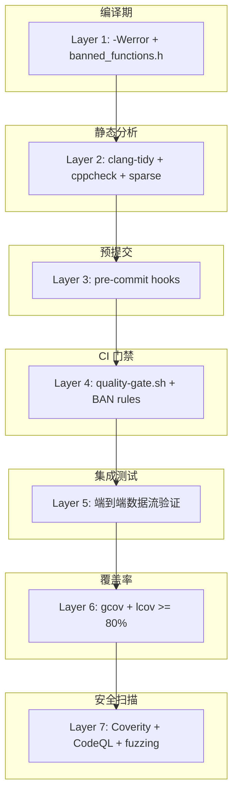

Copyright (c) 2025-2026 SPHARX Ltd. All Rights Reserved.

# agentrt-liunx（AirymaxOS）基本工程标准规范

> **文档定位**: agentrt-liunx（AirymaxOS，极境智能体操作系统）闭源工程标准规范总纲
> **保密级别**: SPHARX Ltd 内部参考，**闭源不公开**
> **版本**: 0.1.1（文档体系完成）/ 1.0.1（开发）
> **最后更新**: 2026-07-07
> **适用范围**: AirymaxOS 架构委员会 + 内核开发组
> **核心约束**: IRON-9 v2 同源且部分代码共享——[SC] 共享契约层 4 个头文件落地于 `include/airymax/`
> **同源映射**: agentrt `docs/ARCHITECTURAL_PRINCIPLES.md`（五维正交 24 原则）+ `docs-closed/0.1.1工程标准规范手册.md`（17 类规则编号体系）
> **理论根基**: Linux 6.6（OLK-6.6）内核工程思想 + Airymax 体系并行论（Multibody Cybernetic Intelligent System）

---

## 目录

- [第 1 章 总则与工程标准框架](#第-1-章-总则与工程标准框架)
- [第 2 章 代码规范](#第-2-章-代码规范)
- [第 3 章 代码格式](#第-3-章-代码格式)
- [第 4 章 工程思想](#第-4-章-工程思想)
- [第 5 章 开发流程](#第-5-章-开发流程)
- [第 6 章 工具链与自动化](#第-6-章-工具链与自动化)
- [第 7 章 维护者制度与治理](#第-7-章-维护者制度与治理)
- [第 8 章 规范符合性检查](#第-8-章-规范符合性检查)
- [第 9 章 IRON-9 v2 三层共享模型](#第-9-章-iron-9-v2-三层共享模型)
- [第 10 章 Euler 标准兼容性](#第-10-章-euler-标准兼容性)
- [第 11 章 禁词清单与处罚机制](#第-11-章-禁词清单与处罚机制)
- [附录 A 规则编号注册表](#附录-a-规则编号注册表)
- [附录 B 五维正交 24 原则映射](#附录-b-五维正交-24-原则映射)

---

## 第 1 章 总则与工程标准框架

### 1.1 文档定位

本规范是 AirymaxOS（agentrt-linux）**闭源工程标准规范的总纲**，面向 SPHARX Ltd 内部架构委员会与内核开发组。它定义了 AirymaxOS 在工程实践层面的全部强制性规则、禁止性规则、验收标准与铁律，是 8 子仓代码开发、审查、测试、发布全生命周期中不可妥协的执行基线。

本规范与开源文档 `docs/AirymaxAgentOS/50-engineering-standards/` 构成**闭源总纲 + 开源子文档**的双层结构：闭源总纲包含完整规则定义、禁词清单、Euler 兼容性声明、内部治理机制；开源子文档面向公众贡献者，仅包含工程标准的核心规则与实施指南，不包含任何专有信息。

### 1.2 工程标准三大支柱

AirymaxOS 工程标准建立在三大支柱之上，缺一不可。

| 支柱 | 思想来源 | 核心贡献 |
|------|---------|---------|
| **Linux 内核工程思想** | Linux 6.6（OLK-6.6）内核源代码深度研究提炼 | 双层稳定性哲学、策略机制分离、渐进式开发、审查优先文化、补丁生命周期、维护者层级制度 |
| **Airymax 五维正交 24 原则** | `ARCHITECTURAL_PRINCIPLES.md`（S/K/C/E/A 五维） | 体系并行论、反馈闭环、层次分解、内核极简、接口契约化、服务隔离、可插拔策略、安全内生、可观测性、资源确定性等 24 条核心原则 |
| **agentrt 17 类规则编号体系** | `0.1.1工程标准规范手册.md`（IRON/BAN/STD/ACC/FOUND 等） | 17 类规则骨架、自动化强制执行哲学、四层自动化铁律、三层集成验证、验收标准量化 |

**三大支柱的正交耦合关系**：Linux 内核工程思想提供严肃性基底（内核工程的普遍规律），五维正交 24 原则提供 Airymax 自身的设计语言（Airymax 在这些规律上的立场），17 类规则编号体系提供可执行性骨架（这些立场如何被强制执行）。三者并非简单叠加，而是正交耦合——每条规则都可以同时追溯到：一份 Linux 内核工程传统的沉淀 + 一条五维正交原则的支撑 + 一个 17 类规则编号。

### 1.3 与 agentrt 工程标准的关系

AirymaxOS 与 agentrt（AirymaxAgentRT）遵循 **IRON-9 v2 同源且部分代码共享** 原则（详见第 9 章）。两者关系如下：

- **同源**：共享 Airymax 五维正交 24 原则作为顶层设计哲学；共享 17 类规则编号体系骨架；共享 E-7 文档即代码、E-6 错误可追溯、E-1 安全内生等核心工程观原则。共享契约层代码（`include/airymax/` 头文件库）。
- **独立**：AirymaxOS 是 OS 发行版，承担内核态严肃性责任，其工程标准必须独立处理内核 ABI 稳定性、内核内部 API 不稳定性、补丁生命周期、维护者层级制度等 agentrt 不涉及的领域。
- **互操作**：agentrt 在 AirymaxOS 上运行时，两端工程标准形成天然互补——agentrt 遵循其用户态运行时规范，AirymaxOS 遵循其内核发行版规范，两端通过共享契约层代码实现无适配层互操作。

### 1.4 8 子仓工程标准差异化要求

AirymaxOS 的 8 个子仓对应不同的内核子系统，各自承担不同的工程标准侧重点。

| 子仓 | 对应 agentrt 模块 | 工程标准侧重点 | 适用规则前缀 |
|------|------------------|---------------|-------------|
| `airymaxos-kernel` | atoms/corekern | 内核极简（K-1）、接口契约化（K-2）、资源确定性（E-3）、临界区锁规则 | OS-KER、OS-IRON |
| `airymaxos-services` | daemons | 服务隔离（K-3）、跨平台一致性（E-4）、用户态内存安全 | OS-STD、OS-DRV |
| `airymaxos-security` | cupolas | 安全内生（E-1）、最小权限、LSM 钩子注册规则、capability 派生 | OS-SEC、OS-IRON |
| `airymaxos-memory` | heapstore + memoryrovol | 内存管理规范、池化与泄漏检测、MGLRU 多代 LRU、CXL/PMEM 分级 | OS-KER、OS-STD |
| `airymaxos-cognition` | coreloopthree + frameworks | 双系统协同（C-1）、增量演化（C-2）、调度策略可插拔（K-4） | OS-STD、OS-ACC |
| `airymaxos-cloudnative` | gateway + sdk | 接口契约化（K-2）、可观测性（E-2）、API 版本管理 | OS-STD、OS-ABI |
| `airymaxos-system` | commons | 命名语义化（E-5）、错误可追溯（E-6）、文档即代码（E-7） | OS-STD、OS-BUILD |
| `airymaxos-tests` | 全模块测试 | 可测试性（E-8）、覆盖率门槛、契约测试、模糊测试 | OS-TEST、OS-ACC |

### 1.5 规则编号体系

AirymaxOS 在 agentrt 17 类规则编号体系基础上，新增 OS 专属编号前缀。规则编号的完整注册表见附录 A。

| 编号前缀 | 含义 | 与 agentrt 的关系 | 示例 |
|---------|------|------------------|------|
| **OS-IRON** | AirymaxOS 工程铁律（不可妥协） | 继承 agentrt IRON-1~10 + 新增 | OS-IRON-001: 用户空间 ABI 永不破坏 |
| **OS-BAN** | AirymaxOS 禁止规则 | 继承 agentrt BAN-1~360 + 新增 | OS-BAN-001: 敏感术语禁用 |
| **OS-STD** | AirymaxOS 标准规则 | 继承 agentrt STD + OS 专属扩展 | OS-STD-001: 全局符号描述性命名 |
| **OS-ACC** | AirymaxOS 验收标准 | 继承 agentrt ACC-1~149 + OS 专属 | OS-ACC-001: 覆盖率 >= 80% |
| **OS-KER** | AirymaxOS 内核工程规则 | 全新（agentrt 不涉及内核态） | OS-KER-001: goto 集中出口模式 |
| **OS-DRV** | AirymaxOS 驱动工程规则 | 全新 | OS-DRV-001: 驱动用户态化优先 |
| **OS-BUILD** | AirymaxOS 构建工程规则 | 全新 | OS-BUILD-001: Kbuild 规范强制 |
| **OS-TEST** | AirymaxOS 测试工程规则 | 全新 | OS-TEST-001: KUnit 单元测试覆盖 |
| **OS-OBS** | AirymaxOS 可观测性规则 | 全新 | OS-OBS-001: ftrace 追踪点命名 |
| **OS-SEC** | AirymaxOS 安全工程规则 | 全新 | OS-SEC-001: LSM 钩子最小权限 |
| **OS-ABI** | AirymaxOS ABI 稳定性规则 | 全新 | OS-ABI-001: syscall 永不删除 |

### 1.6 规则等级与执行力度

| 等级 | 编号前缀 | 违反后果 | CI 阻断 | 处理时限 |
|------|---------|---------|---------|----------|
| **铁律** | OS-IRON | 补丁退回，不可合并 | 是 | 立即修复 |
| **禁止** | OS-BAN | 补丁退回，强制修改 | 是 | 立即修复 |
| **标准** | OS-STD | 审查要求修改 | 是 | 24h 内修复 |
| **验收** | OS-ACC | 版本发布阻断 | 是 | 发布前修复 |
| **内核** | OS-KER | 补丁退回 | 是 | 立即修复 |
| **驱动** | OS-DRV | 审查要求修改 | 是 | 24h 内修复 |
| **构建** | OS-BUILD | 构建失败 | 是 | 立即修复 |
| **测试** | OS-TEST | 覆盖率不达标 | 是 | 发布前修复 |
| **可观测** | OS-OBS | 审查要求补充 | 是 | 下次迭代修复 |
| **安全** | OS-SEC | 补丁退回 | 是 | 立即修复 |
| **ABI** | OS-ABI | 架构委员会审批 | 是 | 专项审查 |

---

## 第 2 章 代码规范

### 2.1 命名规范

#### 2.1.1 全局函数与全局变量

> **OS-STD-001**: 全局符号必须描述性命名，禁止无意义缩写。

C 是朴素的语言，命名应与之相称。全局函数名应当精确描述其行为：`count_active_users()` 而非 `cntusr()`，`agentrt_sched_ready_queue()` 而非 `q()`。这不仅是可读性要求，更是五维正交 E-5 命名语义化原则的直接落地——好的命名本身就是文档。

#### 2.1.2 局部变量

> **OS-STD-002**: 局部变量短小切题。循环计数器用 `i`，临时值用 `tmp`，缓冲区用 `buf`。需要长名才能区分说明函数职责过重，应拆分。

```c
int i;                /* 循环计数器 */
char *tmp;            /* 临时指针 */
u8 buf[256];          /* 缓冲区 */
struct agentrt_task *task;
```

#### 2.1.3 宏与枚举命名

> **OS-STD-003**: 常量宏全大写；多个相关常量优先用 `enum` 而非散落 `#define`。

```c
#define AGENTRT_MAX_TASKS     1024

enum agentrt_task_state {
    AGENTRT_TASK_PENDING   = 0,
    AGENTRT_TASK_RUNNING   = 1,
    AGENTRT_TASK_COMPLETED = 2,
    AGENTRT_TASK_FAILED    = 3,
};
```

#### 2.1.4 敏感术语禁止

> **OS-BAN-001**: 新增代码禁用 `master/slave`、`blacklist/whitelist`，替换为 `primary/secondary`、`denylist/allowlist`。仅当维护既有 UAPI 或对齐既有硬件/协议规范时例外。

这是五维正交 A-3 人文关怀原则在命名层面的直接体现——技术不应携带歧视性历史包袱。

#### 2.1.5 AirymaxOS 专属前缀

> **OS-STD-005**: `agentrt_*` 前缀保留给 agentrt 同源 API；`airymaxos_*` 前缀用于 AirymaxOS 内核/发行版专属 API。两者共享 Airymax 同源语义，但代码归属与 ABI 边界不同，前缀隔离确保无适配层互操作时不冲突。

```c
int agentrt_ipc_send(u32 ch, const void *msg, size_t len);     /* agentrt 同源 */
int airymaxos_lsm_hook_register(const struct security_hook_list *hooks); /* OS 专属 */
```

### 2.2 函数规范

#### 2.2.1 函数长度

> **OS-STD-006**: 函数长度应一屏可读（约 80x24 字符），局部变量不超过 5-10 个。超过此限度的函数应拆分为子函数。

函数长度的约束不是审美问题，而是认知负荷管理——一屏可读的函数意味着审查者可以在不滚动的情况下理解其全部逻辑，这是五维正交 A-1 极简主义原则的函数级体现。

#### 2.2.2 函数原型

> **OS-STD-007**: 函数原型元素固定顺序：storage class → attributes → return type → name → params → behavior attributes。

```c
static __always_inline void *agentrt_get_private(const struct agentrt_device *dev);
```

#### 2.2.3 返回值约定

> **OS-STD-004**: 动作式/命令式函数返回错误码（0 = 成功，-Exxx = 失败）；谓词式函数返回 `bool`。混合两种约定是难调 Bug 的温床。

```c
int  agentrt_task_submit(struct agentrt_task *task);   /* 0 / -EBUSY */
bool agentrt_task_is_pending(const struct agentrt_task *task);
```

#### 2.2.4 错误处理（强制范式）

> **OS-KER-001**: 使用 `goto out_free_xxx:` 集中出口模式 + 分级标签按分配逆序释放。这是 Linux 内核 30+ 年沉淀的最优错误处理范式，AirymaxOS 全内核强制使用。

```c
struct agentrt_buffer *agentrt_alloc_and_init(size_t size)
{
    struct agentrt_buffer *buf;
    void *data;

    buf = kzalloc(sizeof(*buf), GFP_KERNEL);
    if (!buf)
        return ERR_PTR(-ENOMEM);

    data = kzalloc(size, GFP_KERNEL);
    if (!data) {
        kfree(buf);
        return ERR_PTR(-ENOMEM);
    }

    /* 推荐：使用 goto 集中出口 */
    buf = kzalloc(sizeof(*buf), GFP_KERNEL);
    if (!buf)
        return ERR_PTR(-ENOMEM);
    data = kzalloc(size, GFP_KERNEL);
    if (!data)
        goto out_free_buf;
    /* ... 初始化 ... */
    return buf;

out_free_data:
    kfree(data);
out_free_buf:
    kfree(buf);
    return ERR_PTR(-ENOMEM);
}
```

> **OS-BAN-002**: 禁止 `BUG()`/`BUG_ON()`，改用 `WARN()`/`WARN_ON_ONCE()` 并提供恢复代码。内核崩溃不是可接受的错误处理方式。

> **OS-BAN-003**: 内存分配用 `sizeof(*p)` 而非 `sizeof(struct xxx)`。数组分配用 `kmalloc_array`/`kcalloc`（含溢出检查）。

> **OS-BAN-004**: 禁止 `strcpy`/`strncpy`/`strlcpy`，强制 `strscpy`。

> **OS-BAN-005**: 禁用 `%p` 默认输出（哈希化），新增 `%p` 不被接受。

### 2.3 注释规范

#### 2.3.1 kernel-doc 强制

> **OS-STD-008**: 所有 EXPORTed 函数、公共结构体、公共枚举必须包含完整的 kernel-doc 注释。注释必须通过 `scripts/kernel-doc` 验证无警告。

```c
/**
 * agentrt_sched_submit_task - 向调度器提交任务
 * @task: 待提交的任务结构体指针（非 NULL）
 * @flags: 提交标志位（AGENTRT_SCHED_F_* 掩码）
 *
 * 将任务加入调度器的就绪队列。如果调度器当前空闲，
 * 立即唤醒调度器开始处理。
 *
 * 上下文: 可在进程上下文或中断上下文调用
 * 返回: 0 成功，-EBUSY 队列已满，-EINVAL 无效参数
 */
int agentrt_sched_submit_task(struct agentrt_task *task, u32 flags);
```

#### 2.3.2 注释原则

> **OS-STD-009**: 注释解释"为什么"而非"是什么"。代码本身说明"是什么"，注释应说明设计意图、非显而易见的假设、性能考量。

### 2.4 多语言栈规范

#### 2.4.1 C 语言

- 遵循 Linux 内核 `coding-style.rst` 全部规则
- 最大警告级别 `-Wall -Wextra -Werror`
- 禁止隐式类型转换（`-Wconversion`）

#### 2.4.2 Rust 语言

- 遵循 Rust 2021 edition
- 内核模块仅用于安全敏感且非热路径的子系统（如安全策略、文件系统解析）
- `#![no_std]` 内核模块，禁止 `std` 依赖
- 所有 `unsafe` 块必须有 `// SAFETY:` 注释说明安全性理由

#### 2.4.3 Python 语言

- 遵循 PEP 8
- 4 空格缩进，100 列行宽
- 使用 Black + isort 统一格式化
- 类型注解强制（mypy strict 模式）

#### 2.4.4 TypeScript 语言

- 遵循 ESLint + Prettier
- 2 空格缩进，100 列行宽
- 严格模式（`strict: true`）

### 2.5 类型规范

> **OS-STD-010**: 内核内部使用 `u8/u16/u32/u64`，用户空间可见结构体使用 `__u32` 等。typedef 严格限制（仅 5 种例外：完全不透明对象、清晰整数类型、sparse 新类型、C99 等价、UAPI 安全类型）。

> **OS-STD-011**: bool 仅用于函数返回值与栈变量，对齐敏感的结构体不使用 bool。

---

## 第 3 章 代码格式

### 3.1 缩进

> **OS-FMT-001**: C 内核代码使用 Tab 缩进，Tab 宽度为 8 字符。与 Linux 内核保持一致。

8 字符 Tab 不是审美选择，而是工程约束——当缩进超过 3 层时，代码已经顶到屏幕右边缘，这是函数需要拆分的物理信号。如果代码在 3 层缩进后再缩进，剩余空间不足以写出有意义的内容。

其他语言遵循各自生态规范：
- Rust：4 空格
- Python：4 空格（PEP 8）
- TypeScript：2 空格

### 3.2 行宽

> **OS-FMT-002**: C 代码首选 80 列。超过 80 列的代码行要么是嵌套过深（应拆分函数），要么是表达式过于复杂（应引入中间变量）。

其他语言行宽：
- Rust：100 列
- Python：100 列
- TypeScript：100 列

### 3.3 大括号风格

> **OS-FMT-003**: 使用 K&R 风格。非函数块的左括号放在行末，函数定义的左括号放在行首。

```c
/* 函数：左括号新起一行 */
int agentrt_task_create(void)
{
    /* 非函数块：左括号放行末 */
    if (task == NULL) {
        return -EINVAL;
    }

    for (i = 0; i < AGENTRT_MAX_TASKS; i++) {
        /* ... */
    }
}
```

> **OS-FMT-004**: 即使只有一条语句，也使用大括号包围。这是防止未来修改引入 bug 的防御性实践。

### 3.4 空格规则

> **OS-FMT-005**:
> - 关键字后加空格：`if (`、`for (`、`while (`、`switch (`
> - 括号内禁止空格：`if (condition)` 而非 `if ( condition )`
> - 二元运算符两侧加空格：`a + b`、`a = b`
> - 一元运算符不加空格：`!condition`、`-value`
> - 指针声明 `*` 贴名字：`char *p` 而非 `char* p`

### 3.5 行尾禁止空白

> **OS-FMT-006**: 任何代码行的行尾不得有空白字符（空格、Tab）。这是五维正交 A-2 极致细节原则的最基本体现。

### 3.6 clang-format 配置

> **OS-FMT-007**: 所有 C/C++ 代码必须通过 `.clang-format` 配置自动格式化。CI 中强制 `make format-check`。

.clang-format 关键配置项：

```yaml
BasedOnStyle: LLVM
IndentWidth: 8
UseTab: Always
TabWidth: 8
ColumnLimit: 80
BreakBeforeBraces: Linux
PointerAlignment: Right
SpaceAfterCStyleCast: true
ForEachMacros:
  - 'list_for_each_entry'
  - 'agentrt_for_each_task'
  # ... 完整列表参见 airymaxos-kernel/.clang-format
```

---

## 第 4 章 工程思想

### 4.1 双层稳定性哲学

AirymaxOS 工程思想的第一铁律是双层稳定性哲学，源自 Linux 内核 30+ 年工程传统的核心洞见。

#### 4.1.1 用户空间 ABI 永不破坏

> **OS-IRON-001**: 一旦接口导出至用户空间，必须永久支持。

当一条系统调用、一个 ioctl 命令码、一个 `/proc` 条目、一个 `/sys` 属性、一个 AgentsIPC 消息类型从内核态被导出至用户空间后，它就构成了用户与系统之间的契约——这份契约的有效期是**永久**。

用户空间接口设计必须做到三件事：深思熟虑（不导出未经充分论证的接口）、清晰文档（所有导出接口必须有完整的 ABI 文档）、广泛审查（所有用户空间接口改动必须 CC 专门的 ABI 审查组）。

#### 4.1.2 内核内部 API 不保证稳定

> **OS-IRON-002**: 内核内部 API 不保证稳定；API 改动者必须同时修复所有受影响代码。

这是 deliberate design decision——允许持续重构以降低维护成本。配套规则："you broke it, you fix it"——API 改动者必须同时修复所有调用点。

### 4.2 AirymaxOS 4 层接口稳定性分级

AirymaxOS 在双层稳定性基础上扩展为 4 层：

| 层级 | 接口类型 | 稳定性 | 变更流程 |
|------|---------|--------|---------|
| L1 | Agent 应用 API（SDK + syscall） | 极稳定（类 Linux syscall） | RFC + 6 个月宽限期 + 弃用声明 |
| L2 | 智能体运行时接口（AgentsIPC 协议） | 中等稳定（版本化演进） | 季度评审 + 兼容性测试 |
| L3 | 内核子系统接口（内核内部 API） | 可重构 | 补丁序列修复所有调用点 |
| L4 | 内部实现细节 | 完全自由 | 无约束 |

### 4.3 策略与机制分离

> **OS-IRON-003**: 机制留在内核（提供能力），策略外移至用户空间或可插拔模块。

这是五维正交 K-4 可插拔策略原则的内核级体现。具体实践：
- **sched_ext BPF 调度策略**：调度机制（`kernel/sched/ext.c`）留在内核，调度策略（BPF 程序）运行在用户空间可观测、可热更新的 BPF 沙箱中。
- **LSM 安全策略**：安全机制（LSM 钩子框架）留在内核，具体安全策略（SELinux/AppArmor/Landlock）以可插拔模块形式加载。

### 4.4 渐进式开发

> **OS-IRON-004**: 每个补丁必须是逻辑上自包含的最小变更单元，中点可编译运行，支持 `git bisect`。

这是五维正交 C-2 增量演化原则与 S-4 涌现性管理原则的工程化落地。AirymaxOS 的每个补丁必须满足：
- 逻辑自包含：一个补丁只做一件事
- 中点可编译：补丁序列中任意点都能编译通过
- 可 bisect：任意点都能运行，回归可通过 git bisect 定位

### 4.5 审查优先文化

> **OS-IRON-005**: 所有代码进入主线前必须通过至少一名维护者审查并获得 Reviewed-by 标签。

审查是 AirymaxOS 的"免疫系统"——它的成本是前置的（审查时间），但收益是长期的（阻止回归、传递知识、保持代码质量）。审查不是"找茬"，而是知识传递和质量共建的过程。

### 4.6 不破坏用户空间原则

> **OS-IRON-006**: 任何补丁不得导致用户空间程序行为改变，除非该行为被明确标记为 bug。

regression 不可接受。一次 unnoticed regression 可能让关键工作负载在生产环境悄无声息地崩溃。这是五维正交 E-6 错误可追溯原则的内核工程表达。

---

## 第 5 章 开发流程

### 5.1 6 阶段补丁生命周期

AirymaxOS 采用与 Linux 内核一致的 6 阶段补丁生命周期模型：


| 阶段 | 输入 | 输出 | 责任人 | SLA |
|------|------|------|--------|-----|
| **Design** | 需求分析 / RFC 提案 | 设计文档 + 架构评审通过 | 提案者 | 无硬性 SLA |
| **Early Review** | 补丁序列（RFC 标记） | 初步反馈 + 设计方向确认 | 子系统维护者 | 2 周内响应 |
| **Wider Review** | 修订后的补丁序列 | Reviewed-by + Acked-by 标签 | 子系统维护者 + 资深维护者 | 4 周内完成 |
| **Mainline** | 通过审查的补丁 | 合并入 `develop` 分支 | 总维护者（Chief Maintainer） | Merge Window 内 |
| **Stable Release** | `develop` 分支稳定版快照 | `release/*` 分支 | 稳定版维护者 | 按发布计划 |
| **Long-term** | `release/*` 分支 | LTS 持续维护 | LTS 维护者 | 2-6 年 |

### 5.2 维护者层级制度（Lieutenant System）

AirymaxOS 采用与 Linux 内核一致的维护者层级制度：

```
Chief Maintainer（总维护者）
├── Top-level Maintainer（顶层维护者，8 子仓各一名）
│   ├── Subsystem Maintainer（子系统维护者，如 kernel/sched/）
│   │   └── Contributor（贡献者）
│   └── Subsystem Maintainer（子系统维护者，如 kernel/security/）
│       └── Contributor（贡献者）
└── Top-level Maintainer（顶层维护者）
    └── ...
```

每层维护者的职责：
- **Chief Maintainer**：最终决策者，合并窗口管理，发布管理
- **Top-level Maintainer**：8 子仓各自负责人，审批子仓内所有补丁，管理子系统维护者
- **Subsystem Maintainer**：具体子系统负责人，代码审查，技术决策
- **Contributor**：提交补丁，响应审查意见

### 5.3 补丁提交规范

#### 5.3.1 补丁格式

> **OS-STD-020**: 补丁必须包含以下元素：

```
subsystem: 简短摘要（50-72 字符）

详细描述。解释为什么需要这个修改，而非仅仅说明做了什么。
描述设计决策、替代方案、性能影响。

Signed-off-by: 作者名 <author@example.com>
Reviewed-by: 审查者名 <reviewer@example.com>
Fixes: 12 字符 SHA ("补丁摘要")  # 如有
Closes: #123  # 如有
Link: https://...  # 如有
```

#### 5.3.2 标签体系

| 标签 | 含义 | 添加者 |
|------|------|--------|
| `Signed-off-by:` | DCO 认证（Developer Certificate of Origin） | 补丁作者 |
| `Reviewed-by:` | 审查通过声明 | 审查者 |
| `Acked-by:` | 知悉且不反对 | 相关维护者 |
| `Tested-by:` | 测试通过声明 | 测试者 |
| `Fixes:` | 修复的 commit SHA | 补丁作者 |
| `Closes:` | 关闭的 Issue 编号 | 补丁作者 |
| `Link:` | 相关讨论链接 | 补丁作者 |
| `Co-developed-by:` | 共同开发者 | 补丁作者 |
| `Reported-by:` | 问题报告者 | 补丁作者 |
| `Suggested-by:` | 建议提出者 | 补丁作者 |

#### 5.3.3 DCO（Developer Certificate of Origin）

> **OS-IRON-007**: 所有补丁必须包含 Signed-off-by 标签，表示开发者认证其贡献的原创性。CI 中 DCO bot 自动验证 Signed-off-by 链条完整性。

### 5.4 审查流程与礼仪

#### 5.4.1 审查流程

1. 贡献者提交 PR（Pull Request），填写 PR 模板
2. CODEOWNERS 自动分配审查者
3. 审查者在 2 周内提供反馈
4. 贡献者响应反馈、修订补丁
5. 审查者最终确认并添加 Reviewed-by 标签
6. 顶层维护者合并入 develop 分支

#### 5.4.2 审查礼仪

- 审查者：批评代码，不批评人。提供建设性建议，而非仅仅指出问题。
- 贡献者：不防御性回应。审查者的时间是无偿的——尊重每条反馈。
- 双方：审查是知识传递的过程，不是对抗。

### 5.5 稳定版维护规则

> **OS-STD-021**: `release/*` 分支仅接受以下类型的补丁：
> - 关键 bug 修复（CVE、数据损坏、崩溃）
> - 安全修复（及时性优先）
> - 构建修复（确保可编译）
> - 文档修正（不改变行为）
>
> 禁止：新特性、代码重构、行为变更、ABI 变更。

### 5.6 LTS 长期支持

AirymaxOS LTS 版本提供 2-6 年长期支持，期间持续提供安全修复和关键 bug 修复。LTS 维护策略：
- 前 2 年：全面支持（安全 + bug 修复）
- 第 3-4 年：安全支持（仅安全修复）
- 第 5-6 年：扩展支持（需商业支持协议）

---

## 第 6 章 工具链与自动化

### 6.1 7 层自动化验证

AirymaxOS 采用 7 层自动化验证体系，确保每条规范都被强制执行：



| 层级 | 验证内容 | 工具 | 阻断条件 |
|------|---------|------|---------|
| L1 编译期 | 编译警告、禁用函数 | `-Werror`、`banned_functions.h` | 任何警告/禁用函数使用 |
| L2 静态分析 | 代码质量、潜在 bug | clang-tidy、cppcheck、sparse | 新增警告 |
| L3 预提交 | 格式检查、基础规则 | pre-commit hooks | 格式不符合 |
| L4 CI 门禁 | 构建、单元测试、BAN 规则 | quality-gate.sh | 构建失败/测试失败/规则违反 |
| L5 集成测试 | 端到端数据流 | KUnit + kselftest | 集成测试失败 |
| L6 覆盖率 | 行覆盖率 | gcov + lcov | 覆盖率 < 80% |
| L7 安全扫描 | 安全漏洞 | Coverity、CodeQL | Critical/High 漏洞 |

### 6.2 checkpatch 集成

> **OS-STD-030**: 所有补丁提交前必须通过 `scripts/checkpatch.pl` 检查。CI 中强制运行，任何 ERROR 级别问题阻断合并。

checkpatch 检查项包括：
- 代码风格（缩进、行宽、空格）
- 命名规范（CamelCase 警告）
- 注释格式（kernel-doc 缺失）
- 敏感术语（master/slave、blacklist/whitelist）
- 内存分配惯用法（sizeof(*p)）
- 字符串操作（strcpy/strncpy 禁止）

### 6.3 CI/CD 流水线

```
PR 提交
  → L1 编译检查（GCC + Clang 双编译器）
  → L2 静态分析（clang-tidy + cppcheck + sparse）
  → L3 格式检查（clang-format + checkpatch）
  → L4 单元测试（KUnit）
  → L5 集成测试（kselftest）
  → L6 覆盖率报告（gcov + lcov，门槛 80%）
  → L7 安全扫描（CodeQL）
  → 审查者分配（CODEOWNERS）
  → 审查通过
  → 合并入 develop
```

### 6.4 覆盖率门槛

> **OS-ACC-001**: 新增代码行覆盖率 >= 80%，关键路径（调度、内存、IPC、安全）>= 90%。

覆盖率报告在每次 PR 中自动生成，低于门槛的 PR 无法合并。覆盖率数据存档于时间序列数据库，用于趋势分析和技术债务追踪。

---

## 第 7 章 维护者制度与治理

### 7.1 MAINTAINERS 文件规范

> **OS-STD-040**: 每个子仓必须包含 `MAINTAINERS` 文件，记录该子系统的维护者信息、邮件列表、状态、相关文件路径。

格式参考 Linux 内核 `MAINTAINERS`：

```
AIRYMAXOS SCHEDULER (SCHED_AGENT)
M:  Maintainer Name <maintainer@airymaxos.dev>
L:  os-sched@airymaxos.dev
S:  Mainlined
F:  kernel/sched/
F:  include/airymax/sched.h
F:  Documentation/scheduler/
```

### 7.2 维护者层级

| 层级 | 角色 | 权限 | 选拔方式 |
|------|------|------|---------|
| **Contributor** | 提交补丁、参与讨论 | 提交 PR | 任何人 |
| **Subsystem Maintainer** | 审查子系统补丁、技术决策 | 批准子系统 PR | 由 Top-level Maintainer 提名，Chief Maintainer 批准 |
| **Top-level Maintainer** | 管理子仓、审批重大架构变更 | 合并子仓 PR | 由 Chief Maintainer 提名，架构委员会投票 |
| **Chief Maintainer** | 最终决策者、合并窗口管理、发布管理 | 合并所有 PR | 架构委员会选举 |

### 7.3 成熟度模型

每个子系统（功能模块）按照以下成熟度模型演进：

| 阶段 | 标签 | 含义 | 合并条件 |
|------|------|------|---------|
| **Experimental** | `S: Experimental` | 新功能，API 不稳定，可能随时变更 | 通过基本构建和单元测试 |
| **Staging** | `S: Staging` | 功能基本稳定，正在收集使用反馈 | 通过集成测试和审查 |
| **Mainline** | `S: Mainlined` | 功能稳定，API 冻结，正式支持 | 通过全部 7 层验证 |
| **Stable** | `S: Stable` | 长期支持承诺，ABI 冻结 | 通过 LTS 发布审查 |

### 7.4 DCO（Developer Certificate of Origin）

AirymaxOS 要求所有贡献者签署 DCO，证明：
- 贡献是原创的，或基于有适当许可的现有工作
- 贡献者有权利在所使用的许可证下提交贡献
- 贡献者理解贡献是公开的，将被记录在项目的永久历史中

DCO 通过 Signed-off-by 标签在每次提交中声明，CI 自动验证。

### 7.5 CODEOWNERS 自动审查分配

> **OS-STD-041**: 每个子仓必须包含 `.github/CODEOWNERS` 文件，定义文件路径到审查者的自动映射。

```codeowners
# airymaxos-kernel CODEOWNERS
kernel/sched/     @airymaxos/sched-maintainers
kernel/security/  @airymaxos/security-maintainers
include/airymax/  @airymaxos/contract-maintainers
```

---

## 第 8 章 规范符合性检查

### 8.1 STD-DOC 文档规范检查（8 项）

| 编号 | 检查项 | 检查方法 | 阻断等级 | CI 集成 |
|------|--------|---------|----------|---------|
| STD-DOC-01 | Copyright 头部存在 | `grep -L "Copyright (c) 2025-2026 SPHARX"` | P0-CRITICAL | 是 |
| STD-DOC-02 | 开源文档禁词检查 | 正则匹配 forbidden-words.conf | P0-CRITICAL | 是 |
| STD-DOC-03 | IRON-9 v2 三层标注 | 深度修订文档必须有 [SC]/[SS]/[IND] 标注 | P1-MAJOR | 是 |
| STD-DOC-04 | 文档版本号一致性 | VERSION 文件与文档头部版本号比对 | P1-MAJOR | 是 |
| STD-DOC-05 | 文档链接有效性 | `scripts/check_doc_links.py` | P1-MAJOR | 是 |
| STD-DOC-06 | Mermaid 图表完整性 | 架构文档必须有至少 1 个 Mermaid 图表 | P2-MINOR | 否 |
| STD-DOC-07 | 文档行数超限检查 | 单文档 > 1500 行需拆分 | P2-MINOR | 否 |
| STD-DOC-08 | 术语一致性 | 对照 TERMINOLOGY.md 检查 | P2-MINOR | 否 |

### 8.2 STD-CODE 代码规范检查（5 项）

| 编号 | 检查项 | 检查方法 | 阻断等级 | CI 集成 |
|------|--------|---------|----------|---------|
| STD-CODE-01 | 编译警告零容忍 | `-Wall -Wextra -Werror` | P0-CRITICAL | 是 |
| STD-CODE-02 | checkpatch 通过 | `scripts/checkpatch.pl --strict` | P0-CRITICAL | 是 |
| STD-CODE-03 | clang-format 格式一致 | `clang-format --dry-run -Werror` | P0-CRITICAL | 是 |
| STD-CODE-04 | kernel-doc 无警告 | `scripts/kernel-doc -none` | P1-MAJOR | 是 |
| STD-CODE-05 | 覆盖率 >= 80% | `gcov + lcov` | P1-MAJOR | 是 |

### 8.3 STD-IRON 铁律检查（4 项）

| 编号 | 检查项 | 检查方法 | 阻断等级 | CI 集成 |
|------|--------|---------|----------|---------|
| STD-IRON-01 | 用户空间 ABI 不变 | ABI 兼容性检查脚本 | P0-CRITICAL | 是 |
| STD-IRON-02 | 补丁逻辑自包含 | 人工审查（CI 辅助标记） | P0-CRITICAL | 否 |
| STD-IRON-03 | Signed-off-by 链条完整 | DCO bot 自动验证 | P0-CRITICAL | 是 |
| STD-IRON-04 | 无 BUG()/BUG_ON() | `grep -r "BUG\(\)\|BUG_ON("` | P0-CRITICAL | 是 |

### 8.4 检查脚本规范

所有检查脚本必须满足以下规范：

> **OS-STD-050**: 检查脚本位于 `scripts/check/` 目录，以 `check-` 前缀命名，退出码 0 = 通过，1 = 违规，2 = 脚本自身错误。

> **OS-STD-051**: 检查脚本必须支持 `--format json` 输出，用于 CI 结果聚合。

> **OS-STD-052**: 检查脚本必须输出明确的违规文件路径和行号，支持 IDE 一键跳转。

### 8.5 CI/CD 集成方案

```
.github/workflows/compliance.yml
├── check-copyright        # STD-DOC-01
├── check-forbidden-words  # STD-DOC-02
├── check-iron9-labels     # STD-DOC-03
├── check-doc-links        # STD-DOC-05
├── checkpatch             # STD-CODE-02
├── clang-format-check     # STD-CODE-03
├── kernel-doc-check       # STD-CODE-04
├── coverage-check         # STD-CODE-05
└── dco-check              # STD-IRON-03
```

---

## 第 9 章 IRON-9 v2 三层共享模型

### 9.1 三层共享模型概述

IRON-9 v2（2026-07-07 用户决策变更）确立了 agentrt 与 AirymaxOS **同源且部分代码共享**的关系。三层模型如下：

| 层次 | 共享程度 | 内容 | 组织方式 |
|------|---------|------|---------|
| **[SC] 共享契约层** | 完全共享代码 | 4 个核心头文件 | `include/airymax/` 独立头文件库，两端共同依赖 |
| **[SS] 语义同源层** | API 签名相同，实现独立 | 调度、安全、IPC、记忆模型 | 各自独立实现，通过契约层保证互操作 |
| **[IND] 完全独立层** | 完全独立 | 驱动、运行时、硬件相关 | 各自独立仓库，无依赖关系 |

### 9.2 [SC] 共享契约层：4 个头文件

> **OS-IRON-008**: 共享契约层 4 个头文件是 agentrt 与 AirymaxOS 的代码共享边界，任何变更必须通过双向 CI 验证（agentrt + AirymaxOS CI 同时通过）。

| 头文件 | 内容 | 变更审批 |
|--------|------|---------|
| `bpf_struct_ops.h` | struct_ops 状态机 + common_value | 架构委员会 + 两端维护者 |
| `memory_types.h` | MemoryRovol L1-L4 数据结构 + GFP 掩码语义 + PMEM 持久化接口 | 架构委员会 + 两端维护者 |
| `security_types.h` | POSIX capability 38 ID + LSM 钩子 254 ID + Cupolas blob 布局 + capability 派生模型 + Vault backend + 策略裁决 4 值枚举 | 架构委员会 + 两端维护者 |
| `cognition_types.h` | CoreLoopThree 阶段枚举 + Thinkdual 模式枚举 + LLM 推理阶段枚举 + 上下文结构 + Token 能效指标 + GPU/NPU 描述符 | 架构委员会 + 两端维护者 |

### 9.3 [SS] 语义同源层

| 子系统 | agentrt 实现 | AirymaxOS 实现 | 共享的语义 |
|--------|-------------|---------------|-----------|
| 调度 | MicroCoreRT 用户态调度 | sched_ext BPF 调度 | 任务优先级、抢占模型、时间片语义 |
| 安全 | Cupolas 用户态权限 | LSM 钩子 + Cupolas 内核模块 | POSIX capability 38 ID、策略裁决 4 值枚举 |
| IPC | agentrt 消息队列 | AgentsIPC over io_uring | 128B 消息头、通道创建/销毁语义 |
| 记忆 | heapstore 用户态 | MemoryRovol 内核态 | L1-L4 卷载语义、遗忘曲线算法 |

### 9.4 [IND] 完全独立层

- AirymaxOS 专属：内核驱动框架、Kbuild、systemd 集成、内核内部 API、printk 日志系统
- agentrt 专属：跨平台用户态运行时、SDK 四语言、CLI/TUI、网关层

### 9.5 与旧版 IRON-9 的差异

| 维度 | 旧版 IRON-9 | 新版 IRON-9 v2 |
|------|-----------|---------------|
| 设计哲学 | 共享 | 共享（不变） |
| 规则编号 | 共享骨架 | 共享骨架（不变） |
| 契约层代码 | 不共享，仅语义同源 | **完全共享**（`include/airymax/` 头文件库） |
| 实现层代码 | 独立 | 独立（不变） |
| 互操作方式 | 通过同源语义无适配层 | **通过共享代码无适配层**（增强） |
| CI 校验 | 无 | 契约层变更双向校验 |

---

## 第 10 章 Euler 标准兼容性

### 10.1 兼容性声明

AirymaxOS（agentrt-linux）的工程思想与实现方式与 Euler 保持一致性，以便未来兼容 Euler 标准的发行版工具链。兼容性分为四个层次，各自独立且互不耦合。

### 10.2 协议层兼容

| 协议 | 兼容方式 | 共享代码 |
|------|---------|---------|
| kthread 创建/停止/驻留协议 | 同源协议设计，[IND] 独立实现 | 不共享 |
| IPC 消息传递协议 | 同源协议设计，[IND] 独立实现 | 不共享 |
| capability 令牌协议 | 同源协议设计，[IND] 独立实现 | 不共享 |

### 10.3 接入层兼容

| 接入模式 | 兼容方式 | 共享代码 |
|---------|---------|---------|
| 加速器接入（accel 框架） | 参考设计模式，[IND] 独立实现 | 不共享 |
| GPU 调度器（drm_sched） | 参考设计模式，[IND] 独立实现 | 不共享 |
| eBPF 可编程内核 | 参考设计模式，[IND] 独立实现 | 不共享 |

### 10.4 模块化兼容

| 模块化维度 | 兼容方式 | 共享代码 |
|-----------|---------|---------|
| Kconfig 风格 | 同源工程规范 | 不共享 |
| Makefile 结构 | 同源工程规范 | 不共享 |
| Kbuild 规范 | 同源工程规范 | 不共享 |

### 10.5 工具链兼容

| 工具链 | 兼容方式 | 共享代码 |
|--------|---------|---------|
| GCC/Clang/Rust | 兼容 Euler 发行版工具链 | 工具链共享（开源生态） |
| checkpatch/spatch | 兼容 Euler 发行版工具链 | 工具链共享（开源生态） |
| RPM/dnf 包管理 | 兼容 Euler 发行版工具链 | 工具链共享（开源生态） |

### 10.6 代码共享边界澄清

> **OS-IRON-009**: 代码共享仅限于 agentrt 与 agentrt-liunx（AirymaxOS）之间，与 Euler 项目仅技术参考，不共享代码。

```
agentrt ←→ AirymaxOS:  [SC] 共享契约层完全共享代码
AirymaxOS ←→ Euler:    仅技术参考，不共享代码
```

- OLK-6.6 的 kthread.c/accel.c/sched_main.c 等是 AirymaxOS [IND] 独立层的实现参考
- AirymaxOS 工程思想与 Euler 一致性体现在协议层和接入层，不体现在代码层

### 10.7 兼容性验证检查项

| 检查项 | 验证方法 | 合格标准 |
|--------|----------|----------|
| kthread 协议一致性 | 核对 kthread_create/stop/park API 签名 | 与 Euler 标准签名一致 |
| 加速器接入一致性 | 核对 drivers/accel/ 模式 | 接入模式一致（[IND] 独立实现） |
| Kconfig 风格一致性 | 核对 CONFIG_ 前缀命名 | 与 Euler Kconfig 风格一致 |
| 模块化一致性 | 核对 Makefile/Kbuild 结构 | 与 Euler 构建结构一致 |
| 调度类编号不冲突 | 核对 SCHED_AGENT 编号 | 不与 Euler 已有调度类冲突 |

---

## 第 11 章 禁词清单与处罚机制

### 11.1 禁词清单

以下词汇在**开源文档**（`docs/AirymaxAgentOS/`）中**严禁出现**。闭源文档（`docs-closed/agentrt-liunx/`）中允许引用，但应避免不必要的泄露。

> **OS-BAN-010**: 开源文档中严禁出现以下禁词。

| 禁词 | 禁词变体 | 替代表述 | 类别 |
|------|---------|---------|------|
| openEuler | open Euler, openeuler, OpenEuler | "内核发行版" / "行业标杆发行版" | 内核发行版名称 |
| mugen | Mugen, MUGEN | "集成测试框架" | 集成测试框架 |
| KADC | kadc, KADC | — | 内部代号 |
| 智慧中枢 | 智慧中心, 智能中枢 | "认知循环" / "CoreLoopThree" | 旧术语 |

> **完整禁词清单**维护于 `docs-closed/agentrt-liunx/forbidden-words.conf`，检查脚本从该文件读取正则表达式进行匹配。

### 11.2 违规等级

| 等级 | 场景 | 处罚 |
|------|------|------|
| **P0-CRITICAL** | 在开源文档中出现内核发行版名称（openEuler 及其变体） | 补丁立即退回，CI 阻断，记录违规 |
| **P1-MAJOR** | 在开源文档中出现内部代号（KADC）或旧术语（智慧中枢） | 补丁退回，24h 内修复 |
| **P2-MINOR** | 在开源文档中出现集成测试框架名称（mugen） | 审查要求替换，下次迭代修复 |

### 11.3 处罚机制

> **OS-BAN-011**: 违反禁词规则的处理流程：

1. **首次违规**：CI 阻断，补丁退回，警告通知
2. **二次违规**：CI 阻断，补丁退回，维护者记录，要求提交整改报告
3. **三次违规**：CI 阻断，补丁退回，暂停贡献者权限 1 周，架构委员会审查
4. **四次及以上**：架构委员会讨论是否永久撤销贡献者权限

### 11.4 禁词豁免

以下场景允许引用禁词：
- 闭源文档（`docs-closed/`）中引用 openEuler 技术规范（必须）
- 代码注释中引用上游 Linux 内核的 Fixes SHA（如 OLK-6.6 分支 commit）
- 构建脚本中引用工具链路径（仅限闭源仓库）

---

## 附录 A 规则编号注册表

### A.1 OS-IRON 工程铁律（不可妥协）

| 编号 | 规则 | 章节 |
|------|------|------|
| OS-IRON-001 | 用户空间 ABI 永不破坏 | §4.1.1 |
| OS-IRON-002 | 内核内部 API 不保证稳定 | §4.1.2 |
| OS-IRON-003 | 策略与机制分离 | §4.3 |
| OS-IRON-004 | 渐进式开发，补丁自包含 | §4.4 |
| OS-IRON-005 | 审查优先文化 | §4.5 |
| OS-IRON-006 | 不破坏用户空间原则 | §4.6 |
| OS-IRON-007 | DCO 强制 | §5.3.3 |
| OS-IRON-008 | 共享契约层 4 个头文件双向 CI 验证 | §9.2 |
| OS-IRON-009 | 代码共享边界：仅 agentrt ↔ AirymaxOS | §10.6 |

### A.2 OS-BAN 禁止规则

| 编号 | 规则 | 章节 |
|------|------|------|
| OS-BAN-001 | 敏感术语禁用（master/slave → primary/secondary） | §2.1.4 |
| OS-BAN-002 | 禁止 BUG()/BUG_ON() | §2.2.4 |
| OS-BAN-003 | 内存分配用 sizeof(*p) | §2.2.4 |
| OS-BAN-004 | 禁止 strcpy/strncpy/strlcpy | §2.2.4 |
| OS-BAN-005 | 禁用 %p 默认输出 | §2.2.4 |
| OS-BAN-010 | 开源文档禁词 | §11.1 |
| OS-BAN-011 | 禁词违规处罚 | §11.3 |

### A.3 OS-STD 标准规则

| 编号 | 规则 | 章节 |
|------|------|------|
| OS-STD-001 | 全局符号描述性命名 | §2.1.1 |
| OS-STD-002 | 局部变量短小切题 | §2.1.2 |
| OS-STD-003 | 常量宏全大写，优先 enum | §2.1.3 |
| OS-STD-004 | 返回值约定（命令式 0/-Exxx，谓词式 bool） | §2.2.3 |
| OS-STD-005 | AirymaxOS 专属前缀 | §2.1.5 |
| OS-STD-006 | 函数长度一屏可读 | §2.2.1 |
| OS-STD-007 | 函数原型元素固定顺序 | §2.2.2 |
| OS-STD-008 | kernel-doc 强制 | §2.3.1 |
| OS-STD-009 | 注释解释"为什么" | §2.3.2 |
| OS-STD-010 | 类型规范（u8/u16/u32/u64） | §2.5 |
| OS-STD-011 | bool 仅用于返回值与栈变量 | §2.5 |
| OS-STD-020 | 补丁格式规范 | §5.3.1 |
| OS-STD-021 | 稳定版维护规则 | §5.5 |
| OS-STD-030 | checkpatch 强制 | §6.2 |
| OS-STD-040 | MAINTAINERS 文件规范 | §7.1 |
| OS-STD-041 | CODEOWNERS 自动审查分配 | §7.5 |
| OS-STD-050 | 检查脚本命名与退出码规范 | §8.4 |
| OS-STD-051 | 检查脚本 JSON 输出 | §8.4 |
| OS-STD-052 | 检查脚本输出文件路径与行号 | §8.4 |

### A.4 OS-ACC 验收标准

| 编号 | 规则 | 章节 |
|------|------|------|
| OS-ACC-001 | 覆盖率 >= 80%，关键路径 >= 90% | §6.4 |

### A.5 OS-KER 内核工程规则

| 编号 | 规则 | 章节 |
|------|------|------|
| OS-KER-001 | goto 集中出口模式 | §2.2.4 |

### A.6 OS-FMT 格式规则

| 编号 | 规则 | 章节 |
|------|------|------|
| OS-FMT-001 | Tab 缩进，8 字符宽 | §3.1 |
| OS-FMT-002 | 80 列行宽 | §3.2 |
| OS-FMT-003 | K&R 大括号风格 | §3.3 |
| OS-FMT-004 | 即使单条语句也使用大括号 | §3.3 |
| OS-FMT-005 | 空格规则 | §3.4 |
| OS-FMT-006 | 行尾禁止空白 | §3.5 |
| OS-FMT-007 | clang-format 强制 | §3.6 |

---

## 附录 B 五维正交 24 原则映射

AirymaxOS 工程标准每一条规则都可以追溯到 Airymax 五维正交 24 原则。

| 五维 | 原则 | 编号 | 在本规范中的体现 |
|------|------|------|-----------------|
| 系统观 | 反馈闭环 | S-1 | 7 层自动化验证（§6.1）、CI 失败即反馈 |
| 系统观 | 层次分解 | S-2 | 4 层接口稳定性分级（§4.2）、8 子仓差异化要求（§1.4） |
| 系统观 | 总体设计部 | S-3 | 维护者层级制度（§5.2）、Chief Maintainer 角色 |
| 系统观 | 涌现性管理 | S-4 | 渐进式开发模型（§4.4）、Merge Window + RC 周期 |
| 内核观 | 内核极简 | K-1 | 微内核化改造策略、内核职责最小化（§1.4） |
| 内核观 | 接口契约化 | K-2 | 双层稳定性哲学（§4.1）、kernel-doc 强制（§2.3.1） |
| 内核观 | 服务隔离 | K-3 | 驱动用户态化、服务进程隔离 |
| 内核观 | 可插拔策略 | K-4 | sched_ext BPF 调度器、LSM 钩子（§4.3） |
| 认知观 | 双系统协同 | C-1 | 快慢路径分层（热路径 C / 慢路径 Rust） |
| 认知观 | 增量演化 | C-2 | 补丁序列中点可编译运行、git bisect 友好（§4.4） |
| 认知观 | 记忆卷载 | C-3 | MGLRU 多代 LRU、CXL/PMEM 分级 |
| 认知观 | 遗忘机制 | C-4 | 弃用接口清单、ABI 弃用流程 |
| 工程观 | 安全内生 | E-1 | 强制安全编码、fault injection、LSM 集成 |
| 工程观 | 可观测性 | E-2 | ftrace + eBPF + perf + 7 层自动化验证 |
| 工程观 | 资源确定性 | E-3 | 引用计数强制、内存分配惯用法（§2.2.4） |
| 工程观 | 跨平台一致性 | E-4 | 用户态跨 Linux/macOS/Windows |
| 工程观 | 命名语义化 | E-5 | 命名规范（§2.1）、敏感术语禁用（§2.1.4） |
| 工程观 | 错误可追溯 | E-6 | Fixes:/Closes:/Link: 标签 + Signed-off-by DCO 链 |
| 工程观 | 文档即代码 | E-7 | kernel-doc 强制（§2.3.1）、ABI 文档化 |
| 工程观 | 可测试性 | E-8 | KUnit + kselftest + 覆盖率门槛（§6.4） |
| 设计美学 | 极简主义 | A-1 | 反过度抽象、函数长度约束（§2.2.1） |
| 设计美学 | 细节关注 | A-2 | 行尾禁止空白（§3.5）、函数原型元素顺序（§2.2.2） |
| 设计美学 | 人文关怀 | A-3 | 敏感术语禁用（§2.1.4）、审查礼仪（§5.4.2） |
| 设计美学 | 完美主义 | A-4 | 7 层验证（§6.1）、24 项提交检查清单 |

---

> **文档结束** | SPHARX Ltd 内部参考 | 闭源不公开