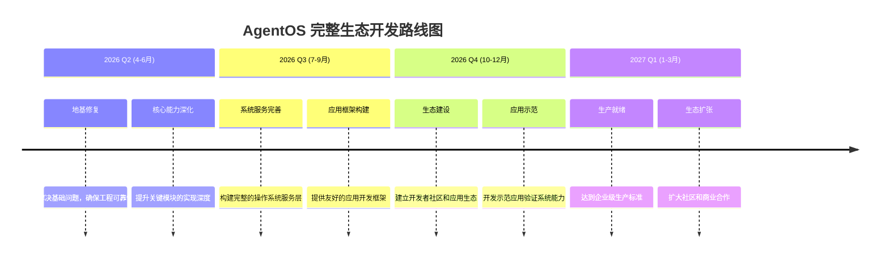

# AgentOS 完整生态开发计划：构建真正的智能体操作系统

**计划编号**: 20260410-09次  
**制定时间**: 2026-04-10  
**制定依据**: [20260410-08次-项目全面检查与初始目标评估报告.md](./20260410-08次-项目全面检查与初始目标评估报告.md)  
**愿景目标**: 将 AgentOS 打造成为真正的底层操作系统，建立类似 OpenHarmony/HarmonyOS 的完整生态系统，实现"真正底层+应用"的双轮驱动  
**计划周期**: 12个月（2026年4月 - 2027年3月）  
**计划状态**: 草案 v1.0

---

## 🎯 计划总览

### 核心目标
基于项目现状（61.5%初始目标达成度），通过 12 个月的系统化开发，将 AgentOS 从一个**技术基础扎实但应用层薄弱**的系统，提升为**底层稳固、应用丰富、生态繁荣**的完整智能体操作系统。

### 对标生态
- **技术对标**: OpenHarmony（开源操作系统架构）
- **生态对标**: HarmonyOS（应用生态和开发者社区）
- **创新方向**: 全球首个专为智能体协作设计的操作系统

### 核心指标（12个月后）
| 指标类别 | 当前状态 | 目标状态 | 提升幅度 |
|----------|----------|----------|----------|
| **初始目标达成度** | 61.5% | 90%+ | +28.5% |
| **核心功能完整性** | 70% | 95% | +25% |
| **应用生态规模** | 5个示例 | 50+个智能体/技能 | 10倍 |
| **开发者社区** | 基础 | 活跃开发者社区 | 从0到1 |
| **生产就绪度** | 40% | 85% | +45% |
| **端到端工作流** | 0个 | 3个完整工作流 | 从0到3 |

---

## 📅 总体路线图

### 阶段划分与时间安排



### 阶段依赖关系
```
地基修复 → 核心能力深化 → 系统服务完善 → 应用框架构建 → 生态建设 → 应用示范 → 生产就绪
      ↓           ↓             ↓             ↓           ↓          ↓          ↓
   基础稳固   能力提升     服务完备     开发友好     生态繁荣   验证能力   企业就绪
```

### 资源需求概算
| 资源类型 | 需求描述 | 备注 |
|----------|----------|------|
| **核心开发团队** | 8-10人（架构师2、后端4、前端2、测试2） | 关键技术攻坚 |
| **生态运营团队** | 3-5人（社区运营、文档、布道师） | 生态建设期投入 |
| **开发环境** | 专用CI/CD集群、测试环境、文档平台 | 硬件和云资源 |
| **第三方服务** | 代码托管、安全扫描、性能测试工具 | 年费预算 |
| **社区资源** | 开源社区贡献者、技术合作伙伴 | 逐步建立 |

---

## 🔧 阶段一：地基修复（2026年4月-5月，6周）

### 🎯 阶段目标
解决项目最基础的工程问题，建立可靠的开发、构建、测试基础，为后续深度开发扫清障碍。

### 📊 当前问题分析
1. **编译系统不完整**：根目录缺少 CMakeLists.txt，无法整体构建
2. **代码质量堪忧**：777个TODO/FIXME注释，大量"占坑"代码
3. **安全隐患**：197个不安全字符串函数调用，内存管理不一致
4. **技术债务**：788个free()调用需要审查，缺乏统一编码规范

### 📋 关键任务清单

#### 任务 1.1：构建系统统一化（2周）
| 子任务 | 描述 | 交付物 | 负责人 |
|--------|------|--------|--------|
| 1.1.1 | 创建根目录 CMakeLists.txt，支持整体构建 | `CMakeLists.txt` | 架构师 |
| 1.1.2 | 统一子模块构建配置，消除编译警告 | 无警告编译 | 后端开发 |
| 1.1.3 | 建立跨平台构建脚本（Linux/macOS/Windows） | `build-all.sh`, `build-all.ps1` | 后端开发 |
| 1.1.4 | 集成包管理（vcpkg/conan）统一依赖 | `vcpkg.json` | 架构师 |
| 1.1.5 | 创建一键编译安装脚本 | `install.sh`, `install.ps1` | 后端开发 |

#### 任务 1.2：代码质量整治（3周）
| 子任务 | 描述 | 交付物 | 负责人 |
|--------|------|--------|--------|
| 1.2.1 | TODO/FIXME注释分类处理（修复/延期/删除） | 减少80%的TODO | 全体开发 |
| 1.2.2 | 不安全函数替换（strcpy→strncpy等） | 安全函数审计报告 | 安全专家 |
| 1.2.3 | 内存管理一致性检查（788个free调用） | 内存泄漏测试报告 | 后端开发 |
| 1.2.4 | 编码规范统一（.clang-format, .clang-tidy） | 规范检查流水线 | 架构师 |
| 1.2.5 | 静态代码分析集成（SonarQube/CodeQL） | 代码质量仪表板 | 测试工程师 |

#### 任务 1.3：基础安全加固（1周）
| 子任务 | 描述 | 交付物 | 负责人 |
|--------|------|--------|--------|
| 1.3.1 | 输入验证和边界检查补全 | 安全审计报告 | 安全专家 |
| 1.3.2 | 权限检查补全（特别是系统调用层） | 权限审计矩阵 | 安全专家 |
| 1.3.3 | 敏感信息泄露检查（日志、错误信息） | 敏感信息清单 | 测试工程师 |
| 1.3.4 | 基础加密库集成（TLS/哈希/签名） | 加密模块文档 | 安全专家 |

#### 任务 1.4：开发体验优化（2周）
| 子任务 | 描述 | 交付物 | 负责人 |
|--------|------|--------|--------|
| 1.4.1 | 开发环境一键配置脚本 | `dev-setup.sh` | 后端开发 |
| 1.4.2 | 调试工具链完善（GDB/LLDB配置） | 调试指南文档 | 后端开发 |
| 1.4.3 | 单元测试框架统一（CUnit→Unity） | 测试框架迁移完成 | 测试工程师 |
| 1.4.4 | 代码覆盖率工具集成（gcov/lcov） | 覆盖率报告流水线 | 测试工程师 |
| 1.4.5 | 文档生成系统（Doxygen+Sphinx） | API文档网站 | 文档工程师 |

### 📦 阶段交付物
1. ✅ **可构建系统**：根目录完整构建，支持三平台编译
2. ✅ **代码质量报告**：TODO减少80%，安全函数全部替换
3. ✅ **安全基线**：通过基础安全审计，无高危漏洞
4. ✅ **开发工具链**：完整的开发、调试、测试工具链
5. ✅ **编码规范**：统一的编码规范和检查流水线

### ⚠️ 风险与应对
| 风险 | 概率 | 影响 | 应对措施 |
|------|------|------|----------|
| **遗留代码改造困难** | 中 | 高 | 分模块渐进式改造，优先关键路径 |
| **兼容性问题** | 中 | 中 | 保持向后兼容，提供迁移指南 |
| **团队技能不足** | 低 | 中 | 培训和技术分享，外部专家咨询 |

---

## 🧠 阶段二：核心能力深化（2026年6月-7月，8周）

### 🎯 阶段目标
深化现有核心模块的实现深度，特别是双模型协同、记忆系统和安全机制，从"基础实现"提升到"工业级实现"。

### 📊 当前问题分析
1. **双模型协同简单**：仅权重选择，缺乏交叉验证和仲裁
2. **记忆系统深度不足**：架构完整但智能化程度待验证
3. **安全机制集成度**：各安全组件独立，缺乏联动
4. **性能优化缺失**：缺乏量化性能指标和优化

### 📋 关键任务清单

#### 任务 2.1：双模型协同深度实现（4周）
| 子任务 | 描述 | 交付物 | 负责人 |
|--------|------|--------|--------|
| 2.1.1 | 交叉验证机制实现（结果对比、置信度评估） | `cross_validation.c` | 算法工程师 |
| 2.1.2 | 仲裁算法实现（多数表决、加权投票、专家仲裁） | `arbitration_engine.c` | 算法工程师 |
| 2.1.3 | 反思机制实现（错误分析、原因追溯、策略调整） | `reflection_engine.c` | 算法工程师 |
| 2.1.4 | 模型简配策略（1大+1小成本优化） | `model_simplification.c` | 架构师 |
| 2.1.5 | 双模型性能基准测试 | 性能基准报告 | 测试工程师 |

#### 任务 2.2：记忆系统智能化提升（3周）
| 子任务 | 描述 | 交付物 | 负责人 |
|--------|------|--------|--------|
| 2.2.1 | L4模式层智能化（自动规则发现和验证） | 智能模式挖掘引擎 | 算法工程师 |
| 2.2.2 | 记忆检索优化（语义理解、上下文感知） | 智能检索优化模块 | 算法工程师 |
| 2.2.3 | 遗忘策略自适应（基于使用频率和重要性） | 自适应遗忘引擎 | 算法工程师 |
| 2.2.4 | 记忆融合机制（多源记忆整合和冲突解决） | 记忆融合框架 | 算法工程师 |
| 2.2.5 | 记忆系统性能基准 | 记忆性能报告 | 测试工程师 |

#### 任务 2.3：安全机制深度集成（3周）
| 子任务 | 描述 | 交付物 | 负责人 |
|--------|------|--------|--------|
| 2.3.1 | Cupolas安全联动（审计→权限→沙箱闭环） | 安全联动框架 | 安全专家 |
| 2.3.2 | 运行时安全监控（行为异常检测） | 运行时监控引擎 | 安全专家 |
| 2.3.3 | 供应链安全（依赖包安全扫描） | 供应链安全扫描工具 | 安全专家 |
| 2.3.4 | 安全策略动态更新（无需重启） | 动态策略更新机制 | 安全专家 |
| 2.3.5 | 安全认证和加密强化 | 强化认证模块 | 安全专家 |

#### 任务 2.4：性能优化和基准测试（2周）
| 子任务 | 描述 | 交付物 | 负责人 |
|--------|------|--------|--------|
| 2.4.1 | 关键路径性能分析（profiling） | 性能热点分析报告 | 性能工程师 |
| 2.4.2 | Token效率优化（减少冗余、压缩传输） | Token优化模块 | 性能工程师 |
| 2.4.3 | 内存使用优化（池化、缓存、压缩） | 内存优化报告 | 性能工程师 |
| 2.4.4 | 并发性能优化（锁优化、无锁数据结构） | 并发优化模块 | 性能工程师 |
| 2.4.5 | 建立性能基准测试套件 | 性能基准套件 | 测试工程师 |

### 📦 阶段交付物
1. ✅ **深度双模型协同**：交叉验证、仲裁、反思机制完整
2. ✅ **智能记忆系统**：自适应遗忘、智能检索、模式挖掘
3. ✅ **集成安全框架**：安全组件联动，运行时监控
4. ✅ **性能优化套件**：性能基准和优化工具
5. ✅ **量化指标**：Token效率、响应时间、内存占用指标

### ⚠️ 风险与应对
| 风险 | 概率 | 影响 | 应对措施 |
|------|------|------|----------|
| **算法复杂度高** | 中 | 高 | 分阶段实现，先基础后优化 |
| **性能与功能平衡** | 中 | 中 | 性能监控，必要时功能降级 |
| **安全与便利矛盾** | 低 | 中 | 分层安全策略，用户可配置 |

---

## 🏗️ 阶段三：系统服务完善（2026年8月-10月，12周）

### 🎯 阶段目标
构建完整的操作系统服务层，提供稳定、可靠、高效的系统服务，支撑上层应用运行。

### 📊 当前问题分析
1. **服务间协作薄弱**：各daemon独立运行，缺乏协调
2. **系统管理缺失**：缺少统一的系统管理和监控
3. **资源管理简单**：缺乏细粒度资源调度和控制
4. **高可用性不足**：缺少故障恢复和容错机制

### 📋 关键任务清单

#### 任务 3.1：服务框架统一化（4周）
| 子任务 | 描述 | 交付物 | 负责人 |
|--------|------|--------|--------|
| 3.1.1 | 统一服务管理框架（启动、停止、监控） | `service_manager` | 架构师 |
| 3.1.2 | 服务间通信标准化（gRPC/消息队列） | 统一通信协议 | 后端开发 |
| 3.1.3 | 服务发现和注册中心 | 服务注册发现系统 | 后端开发 |
| 3.1.4 | 服务配置中心（动态配置更新） | 配置管理中心 | 后端开发 |
| 3.1.5 | 服务健康检查和自愈 | 健康检查框架 | 后端开发 |

#### 任务 3.2：资源管理系统（3周）
| 子任务 | 描述 | 交付物 | 负责人 |
|--------|------|--------|--------|
| 3.2.1 | 统一资源调度器（CPU、内存、IO、网络） | 资源调度器 | 架构师 |
| 3.2.2 | 资源配额和限制（cgroup/namespace集成） | 资源限制框架 | 后端开发 |
| 3.2.3 | 资源监控和告警 | 资源监控系统 | 后端开发 |
| 3.2.4 | 资源优化建议（自动调优） | 资源优化引擎 | 算法工程师 |
| 3.2.5 | 资源使用审计和计费 | 资源审计系统 | 后端开发 |

#### 任务 3.3：高可用性架构（3周）
| 子任务 | 描述 | 交付物 | 负责人 |
|--------|------|--------|--------|
| 3.3.1 | 服务冗余和负载均衡 | 负载均衡器 | 后端开发 |
| 3.3.2 | 故障检测和自动恢复 | 故障恢复框架 | 后端开发 |
| 3.3.3 | 数据持久化和备份 | 数据持久化框架 | 后端开发 |
| 3.3.4 | 服务降级和熔断 | 熔断降级框架 | 后端开发 |
| 3.3.5 | 灾难恢复方案 | 灾难恢复计划 | 架构师 |

#### 任务 3.4：系统管理工具（2周）
| 子任务 | 描述 | 交付物 | 负责人 |
|--------|------|--------|--------|
| 3.4.1 | 命令行管理工具（CLI） | `agentos-cli` | 后端开发 |
| 3.4.2 | Web管理控制台 | Web控制台 | 前端开发 |
| 3.4.3 | 批量操作和脚本支持 | 批量操作框架 | 后端开发 |
| 3.4.4 | 系统日志和审计查询 | 日志查询工具 | 后端开发 |
| 3.4.5 | 系统状态监控仪表板 | 状态监控仪表板 | 前端开发 |

### 📦 阶段交付物
1. ✅ **统一服务框架**：服务管理、通信、配置、监控一体化
2. ✅ **资源管理系统**：细粒度资源调度、监控、优化
3. ✅ **高可用架构**：故障恢复、负载均衡、数据持久化
4. ✅ **系统管理工具**：CLI、Web控制台、监控仪表板
5. ✅ **生产级服务**：支持7x24小时稳定运行

### ⚠️ 风险与应对
| 风险 | 概率 | 影响 | 应对措施 |
|------|------|------|----------|
| **服务复杂度爆炸** | 中 | 高 | 模块化设计，逐步迭代 |
| **性能开销增加** | 中 | 中 | 性能监控，轻量级实现 |
| **向后兼容破坏** | 低 | 高 | 版本管理，兼容性测试 |

---

## 🛠️ 阶段四：应用框架构建（2026年11月-12月，8周）

### 🎯 阶段目标
构建友好、高效、统一的应用开发框架，降低智能体应用开发门槛，提高开发效率。

### 📊 当前问题分析
1. **开发门槛高**：需要深入理解底层架构才能开发应用
2. **API不一致**：不同语言SDK接口不一致
3. **开发工具缺乏**：缺少IDE插件、调试工具、模板
4. **文档不完整**：API文档、示例、教程不足

### 📋 关键任务清单

#### 任务 4.1：统一应用框架（4周）
| 子任务 | 描述 | 交付物 | 负责人 |
|--------|------|--------|--------|
| 4.1.1 | 智能体应用框架（生命周期、状态管理） | `agent_framework` | 架构师 |
| 4.1.2 | 技能开发框架（注册、调用、版本管理） | `skill_framework` | 架构师 |
| 4.1.3 | 任务管理框架（编排、依赖、执行） | `task_framework` | 架构师 |
| 4.1.4 | 事件驱动框架（发布-订阅、消息总线） | `event_framework` | 后端开发 |
| 4.1.5 | 插件化框架（热加载、动态扩展） | `plugin_framework` | 后端开发 |

#### 任务 4.2：多语言SDK统一（3周）
| 子任务 | 描述 | 交付物 | 负责人 |
|--------|------|--------|--------|
| 4.2.1 | 统一API设计和规范 | API设计规范文档 | 架构师 |
| 4.2.2 | Python SDK完善和统一 | `agentos-python` v2.0 | 后端开发 |
| 4.2.3 | JavaScript/TypeScript SDK完善 | `agentos-js` v2.0 | 前端开发 |
| 4.2.4 | Go SDK完善和统一 | `agentos-go` v2.0 | 后端开发 |
| 4.2.5 | Rust SDK完善和统一 | `agentos-rust` v2.0 | 后端开发 |
| 4.2.6 | SDK一致性测试套件 | SDK测试框架 | 测试工程师 |

#### 任务 4.3：开发工具链（3周）
| 子任务 | 描述 | 交付物 | 负责人 |
|--------|------|--------|--------|
| 4.3.1 | IDE插件（VSCode/IntelliJ） | IDE插件包 | 前端开发 |
| 4.3.2 | 代码生成工具（模板、脚手架） | 代码生成器 | 后端开发 |
| 4.3.3 | 本地调试工具（模拟器、调试器） | 本地调试工具 | 后端开发 |
| 4.3.4 | 性能分析工具（Profiler） | 性能分析工具 | 性能工程师 |
| 4.3.5 | 打包和发布工具 | 应用打包工具 | 后端开发 |

#### 任务 4.4：开发者体验优化（2周）
| 子任务 | 描述 | 交付物 | 负责人 |
|--------|------|--------|--------|
| 4.4.1 | 交互式教程和示例 | 交互式教程平台 | 文档工程师 |
| 4.4.2 | API文档自动生成 | API文档网站 | 文档工程师 |
| 4.4.3 | 沙箱环境（在线体验） | 在线沙箱环境 | 前端开发 |
| 4.4.4 | 开发者社区平台 | 开发者社区网站 | 社区运营 |
| 4.4.5 | 问题反馈和解决流程 | 问题反馈系统 | 社区运营 |

### 📦 阶段交付物
1. ✅ **统一应用框架**：智能体、技能、任务、事件、插件框架
2. ✅ **多语言SDK**：Python、JS/TS、Go、Rust统一SDK
3. ✅ **完整开发工具**：IDE插件、代码生成、调试、分析工具
4. ✅ **开发者体验平台**：教程、文档、沙箱、社区
5. ✅ **应用开发规范**：设计模式、最佳实践、代码规范

### ⚠️ 风险与应对
| 风险 | 概率 | 影响 | 应对措施 |
|------|------|------|----------|
| **框架设计不合理** | 中 | 高 | 多轮评审，参考成熟框架 |
| **学习曲线仍陡峭** | 中 | 中 | 渐进式教程，简化API |
| **多语言维护负担** | 高 | 中 | 代码生成，自动化测试 |

---

## 🌐 阶段五：生态建设（2027年1月-2月，8周）

### 🎯 阶段目标
建立繁荣的开发者社区和应用生态，形成良性发展的生态系统。

### 📊 当前问题分析
1. **社区基础薄弱**：缺少活跃的开发者社区
2. **应用生态空白**：只有少数示例应用
3. **商业模式不清晰**：缺少可持续的商业模式
4. **合作伙伴缺乏**：缺少技术合作伙伴

### 📋 关键任务清单

#### 任务 5.1：开发者社区建设（4周）
| 子任务 | 描述 | 交付物 | 负责人 |
|--------|------|--------|--------|
| 5.1.1 | 开发者社区网站（论坛、博客、问答） | 社区网站 | 社区运营 |
| 5.1.2 | 技术博客和教程内容建设 | 技术内容库 | 文档工程师 |
| 5.1.3 | 线上/线下技术沙龙和培训 | 活动计划 | 社区运营 |
| 5.1.4 | 开源贡献者激励计划 | 贡献者计划 | 社区运营 |
| 5.1.5 | 技术布道和推广 | 布道计划 | 社区运营 |

#### 任务 5.2：应用市场完善（3周）
| 子任务 | 描述 | 交付物 | 负责人 |
|--------|------|--------|--------|
| 5.2.1 | 应用市场功能完善（搜索、评分、评论） | 市场功能增强 | 前端开发 |
| 5.2.2 | 应用审核和认证流程 | 审核认证流程 | 社区运营 |
| 5.2.3 | 应用分发和更新机制 | 分发更新系统 | 后端开发 |
| 5.2.4 | 应用收入分成模型 | 商业模式设计 | 产品经理 |
| 5.2.5 | 应用安全和质量扫描 | 安全质量扫描 | 安全专家 |

#### 任务 5.3：合作伙伴计划（3周）
| 子任务 | 描述 | 交付物 | 负责人 |
|--------|------|--------|--------|
| 5.3.1 | 技术合作伙伴计划（集成、适配） | 合作伙伴计划 | 商务拓展 |
| 5.3.2 | 企业客户合作计划（定制、部署） | 企业合作计划 | 商务拓展 |
| 5.3.3 | 开源项目合作（互补项目整合） | 开源合作清单 | 社区运营 |
| 5.3.4 | 高校和研究机构合作 | 学术合作计划 | 社区运营 |
| 5.3.5 | 生态基金和孵化器 | 生态基金方案 | 产品经理 |

#### 任务 5.4：商业模式设计（2周）
| 子任务 | 描述 | 交付物 | 负责人 |
|--------|------|--------|--------|
| 5.4.1 | 开源商业模式（开放核心） | 商业模式文档 | 产品经理 |
| 5.4.2 | 云服务产品设计 | 云服务方案 | 产品经理 |
| 5.4.3 | 企业版产品设计 | 企业版方案 | 产品经理 |
| 5.4.4 | 咨询和培训服务 | 服务产品目录 | 产品经理 |
| 5.4.5 | 营收预测和财务模型 | 财务模型 | 产品经理 |

### 📦 阶段交付物
1. ✅ **活跃开发者社区**：论坛、博客、活动、贡献者计划
2. ✅ **完善应用市场**：功能完整、审核流程、商业模式
3. ✅ **合作伙伴网络**：技术伙伴、企业客户、学术合作
4. ✅ **清晰商业模式**：开源核心、云服务、企业版、服务
5. ✅ **生态治理机制**：社区治理、决策流程、冲突解决

### ⚠️ 风险与应对
| 风险 | 概率 | 影响 | 应对措施 |
|------|------|------|----------|
| **社区冷启动困难** | 高 | 高 | 种子用户培养，激励计划 |
| **商业模式不成立** | 中 | 高 | 多模式探索，小规模验证 |
| **生态碎片化** | 低 | 中 | 统一标准，核心控制 |

---

## 🚀 阶段六：应用示范（2027年2月-3月，6周）

### 🎯 阶段目标
开发高质量的示范应用，全面展示 AgentOS 的能力和价值，吸引开发者和用户。

### 📊 当前问题分析
1. **示例应用简单**：现有示例功能简单，缺乏代表性
2. **端到端体验缺失**：缺少完整的从需求到交付的工作流
3. **行业应用空白**：缺少垂直行业的深度应用
4. **用户体验不足**：应用界面和交互体验待提升

### 📋 关键任务清单

#### 任务 6.1：旗舰示范应用（4周）
| 子任务 | 描述 | 交付物 | 负责人 |
|--------|------|--------|--------|
| 6.1.1 | 智能软件开发团队（需求→代码→测试→部署） | 软件开发应用 | 产品经理 |
| 6.1.2 | 企业知识管理助手（文档→问答→分析→报告） | 知识管理应用 | 产品经理 |
| 6.1.3 | 客户服务自动化（咨询→解答→跟进→反馈） | 客服自动化应用 | 产品经理 |
| 6.1.4 | 数据分析与可视化（数据→处理→分析→可视化） | 数据分析应用 | 产品经理 |
| 6.1.5 | 多语言翻译和本地化（翻译→校对→本地化） | 翻译应用 | 产品经理 |

#### 任务 6.2：端到端工作流验证（3周）
| 子任务 | 描述 | 交付物 | 负责人 |
|--------|------|--------|--------|
| 6.2.1 | 自然语言需求到任务分解工作流 | 需求分解工作流 | 算法工程师 |
| 6.2.2 | 智能体团队组建和协作工作流 | 团队协作工作流 | 算法工程师 |
| 6.2.3 | 任务执行和监控工作流 | 任务执行工作流 | 后端开发 |
| 6.2.4 | 质量评估和优化工作流 | 质量评估工作流 | 测试工程师 |
| 6.2.5 | 端到端性能基准测试 | 端到端性能报告 | 测试工程师 |

#### 任务 6.3：用户体验优化（2周）
| 子任务 | 描述 | 交付物 | 负责人 |
|--------|------|--------|--------|
| 6.3.1 | 应用界面设计和交互优化 | UI设计规范 | 前端开发 |
| 6.3.2 | 移动端适配（响应式设计） | 移动端界面 | 前端开发 |
| 6.3.3 | 无障碍访问支持 | 无障碍支持 | 前端开发 |
| 6.3.4 | 多语言国际化 | 国际化支持 | 前端开发 |
| 6.3.5 | 用户反馈收集和分析 | 用户反馈系统 | 产品经理 |

#### 任务 6.4：案例研究和宣传（2周）
| 子任务 | 描述 | 交付物 | 负责人 |
|--------|------|--------|--------|
| 6.4.1 | 成功案例研究文档 | 案例研究白皮书 | 文档工程师 |
| 6.4.2 | 技术演示视频和材料 | 演示视频库 | 社区运营 |
| 6.4.3 | 媒体报道和公关 | 媒体报道清单 | 社区运营 |
| 6.4.4 | 行业会议和展览 | 会议参展计划 | 社区运营 |
| 6.4.5 | 用户见证和推荐 | 用户推荐库 | 社区运营 |

### 📦 阶段交付物
1. ✅ **旗舰示范应用**：5个高质量的行业应用
2. ✅ **端到端工作流**：3个完整的工作流验证
3. ✅ **优秀用户体验**：界面美观、交互友好、多端适配
4. ✅ **丰富案例材料**：白皮书、视频、演示、报道
5. ✅ **用户价值证明**：效率提升、成本降低、质量提高

### ⚠️ 风险与应对
| 风险 | 概率 | 影响 | 应对措施 |
|------|------|------|----------|
| **应用开发延期** | 中 | 高 | 简化MVP，核心功能优先 |
| **用户体验不佳** | 中 | 中 | 用户测试，迭代优化 |
| **案例说服力不足** | 低 | 中 | 数据支撑，用户见证 |

---

## 🏭 阶段七：生产就绪（2027年3月，4周）

### 🎯 阶段目标
确保 AgentOS 达到企业级生产标准，具备大规模部署和运维能力。

### 📊 当前问题分析
1. **生产部署复杂**：缺乏标准化的部署方案
2. **运维工具缺失**：缺少监控、告警、日志分析工具
3. **安全合规不足**：缺少安全认证和合规支持
4. **技术支持不完善**：缺少技术支持体系和SLA

### 📋 关键任务清单

#### 任务 7.1：生产部署方案（2周）
| 子任务 | 描述 | 交付物 | 负责人 |
|--------|------|--------|--------|
| 7.1.1 | 容器化部署（Docker、Kubernetes） | 容器化部署方案 | 运维工程师 |
| 7.1.2 | 云平台部署（AWS、Azure、GCP） | 云部署指南 | 运维工程师 |
| 7.1.3 | 私有化部署方案 | 私有化部署指南 | 运维工程师 |
| 7.1.4 | 边缘计算部署 | 边缘部署方案 | 运维工程师 |
| 7.1.5 | 部署自动化工具（Ansible/Terraform） | 部署自动化脚本 | 运维工程师 |

#### 任务 7.2：运维监控体系（2周）
| 子任务 | 描述 | 交付物 | 负责人 |
|--------|------|--------|--------|
| 7.2.1 | 全面监控系统（资源、服务、业务） | 监控系统 | 运维工程师 |
| 7.2.2 | 智能告警系统（分级、去重、通知） | 告警系统 | 运维工程师 |
| 7.2.3 | 日志收集和分析（ELK/EFK） | 日志分析系统 | 运维工程师 |
| 7.2.4 | 性能分析和调优工具 | 性能分析工具 | 性能工程师 |
| 7.2.5 | 容量规划和预测 | 容量规划工具 | 运维工程师 |

#### 任务 7.3：安全合规认证（2周）
| 子任务 | 描述 | 交付物 | 负责人 |
|--------|------|--------|--------|
| 7.3.1 | 安全漏洞管理流程 | 漏洞管理流程 | 安全专家 |
| 7.3.2 | 安全认证支持（ISO27001、SOC2） | 安全认证材料 | 安全专家 |
| 7.3.3 | 合规性检查（GDPR、CCPA等） | 合规检查清单 | 安全专家 |
| 7.3.4 | 安全审计日志和报告 | 安全审计报告 | 安全专家 |
| 7.3.5 | 应急响应计划 | 应急响应计划 | 安全专家 |

#### 任务 7.4：技术支持体系（1周）
| 子任务 | 描述 | 交付物 | 负责人 |
|--------|------|--------|--------|
| 7.4.1 | 技术支持流程（SLA、响应时间） | 技术支持流程 | 产品经理 |
| 7.4.2 | 知识库和常见问题 | 知识库系统 | 文档工程师 |
| 7.4.3 | 培训认证体系 | 培训认证计划 | 社区运营 |
| 7.4.4 | 客户成功管理 | 客户成功计划 | 产品经理 |
| 7.4.5 | 服务级别协议（SLA） | SLA文档 | 产品经理 |

### 📦 阶段交付物
1. ✅ **标准化部署方案**：容器化、云平台、私有化部署
2. ✅ **完整运维体系**：监控、告警、日志、性能分析
3. ✅ **安全合规框架**：安全认证、合规检查、应急响应
4. ✅ **专业技术支持**：SLA、知识库、培训认证、客户成功
5. ✅ **企业级文档**：部署指南、运维手册、安全白皮书

### ⚠️ 风险与应对
| 风险 | 概率 | 影响 | 应对措施 |
|------|------|------|----------|
| **部署复杂度高** | 中 | 高 | 简化部署，提供托管服务 |
| **运维人力需求大** | 中 | 中 | 自动化运维，智能诊断 |
| **安全合规成本高** | 低 | 高 | 分阶段认证，必要认证优先 |

---

## 📈 成功标准与度量指标

### 技术成功标准
| 指标 | 目标值 | 测量方法 |
|------|--------|----------|
| **初始目标达成度** | ≥90% | 目标评估矩阵 |
| **核心功能完整性** | ≥95% | 功能检查清单 |
| **系统稳定性** | 99.9%可用性 | 监控系统数据 |
| **性能指标** | 响应时间<100ms，吞吐量>1000TPS | 性能测试 |
| **安全性** | 无高危漏洞，通过基础安全审计 | 安全扫描报告 |
| **代码质量** | 代码覆盖率≥80%，零TODO | 代码分析报告 |

### 生态成功标准
| 指标 | 目标值 | 测量方法 |
|------|--------|----------|
| **开发者社区** | ≥1000活跃开发者 | 社区统计 |
| **应用生态** | ≥50个高质量应用 | 应用市场统计 |
| **合作伙伴** | ≥10家技术合作伙伴 | 合作伙伴列表 |
| **用户数量** | ≥100家企业用户 | 用户注册统计 |
| **市场影响力** | 行业认可度提升 | 媒体报道、搜索指数 |

### 商业成功标准
| 指标 | 目标值 | 测量方法 |
|------|--------|----------|
| **收入来源** | 3个以上收入来源 | 财务报告 |
| **客户满意度** | NPS≥50 | 用户调查 |
| **市场占有率** | 智能体操作系统领域领先 | 市场分析报告 |
| **可持续性** | 年增长率≥50% | 财务预测 |
| **投资回报** | ROI≥3倍 | 投资分析 |

---

## 🔮 未来展望（2027年之后）

### 技术发展方向
1. **智能化升级**：更强大的AI能力，更智能的决策
2. **边缘计算**：轻量级版本，边缘设备部署
3. **量子计算**：量子算法和计算能力集成
4. **脑机接口**：更自然的人机交互方式
5. **自主进化**：系统自我优化和进化能力

### 生态扩展方向
1. **垂直行业深耕**：金融、医疗、教育、制造等行业解决方案
2. **全球市场扩张**：多语言、多文化、多地区支持
3. **教育体系融合**：高校课程、职业培训、认证体系
4. **标准化推进**：行业标准、国际标准制定
5. **开源治理完善**：更开放、更民主的治理模式

### 商业扩展方向
1. **平台化战略**：成为智能体应用的基础平台
2. **生态系统**：构建完整的智能体应用生态
3. **国际化扩张**：全球市场布局和本地化
4. **产业联盟**：建立产业联盟，推动行业发展
5. **社会价值**：解决社会问题，创造社会价值

---

## 📋 计划执行与调整

### 执行机制
1. **双周迭代**：每两周一个开发迭代，评审和调整计划
2. **季度评审**：每季度全面评审进展，调整路线图
3. **透明沟通**：定期向社区和利益相关者汇报进展
4. **数据驱动**：基于数据做决策，持续优化
5. **灵活调整**：根据市场和技术变化灵活调整计划

### 风险管理机制
1. **风险登记册**：维护风险登记册，定期评估
2. **应急预案**：关键风险准备应急预案
3. **风险缓解**：主动采取措施降低风险概率和影响
4. **风险转移**：通过保险、合作等方式转移风险
5. **风险接受**：对低概率低影响风险接受并监控

### 成功保障措施
1. **领导支持**：确保管理层支持和资源投入
2. **团队建设**：建设高效、协作、创新的团队
3. **文化塑造**：培养开放、透明、用户至上的文化
4. **流程优化**：持续优化开发、测试、部署流程
5. **外部合作**：积极寻求外部合作和支持

---

## 📄 附录

### 附录A：术语表
| 术语 | 定义 |
|------|------|
| **AgentOS** | 智能体操作系统，本项目的核心产品 |
| **CoreKern** | 微内核，提供IPC、内存、任务、时间等原子机制 |
| **CoreLoopThree** | 三层认知循环，包括认知层、行动层、记忆层 |
| **MemoryRovol** | 四层记忆卷载系统，实现长期记忆和学习 |
| **Cupolas** | 安全穹顶，提供全方位安全保障 |
| **MCIS** | 体系并行论，项目的理论基础 |

### 附录B：参考资源
1. **OpenHarmony架构**：https://gitee.com/openharmony/docs
2. **HarmonyOS生态**：https://developer.harmonyos.com
3. **微内核设计模式**：相关学术论文和工程实践
4. **智能体系统架构**：AutoGPT、CrewAI、LangChain等参考
5. **开源生态建设**：Kubernetes、TensorFlow等成功案例

### 附录C：相关文档链接
1. [项目现状检查报告](./20260410-08次-项目全面检查与初始目标评估报告.md)
2. [架构设计文档](../docs/ARCHITECTURAL_PRINCIPLES.md)
3. [开发指南](../docs/Capital_Guides/getting_started.md)
4. [API文档](../docs/Capital_API/README.md)
5. [部署指南](../scripts/deploy/docker/README.md)

---

**计划制定**: 2026-04-10  
**制定团队**: AgentOS 架构委员会  
**下一次评审**: 2026-04-24（双周迭代评审）  
**计划版本**: v1.0（草案）

> **注**: 本计划为动态文档，将根据实际情况定期更新和调整。所有利益相关者应定期查阅最新版本。
